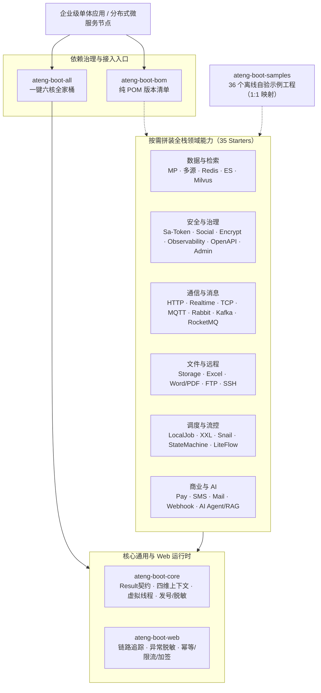

# ateng-boot

> 面向生产就绪的 Spring Boot 3（3.3.13）全栈基础设施与企业中间件 Starter 套件——零臃肿纯原生、显式强类型契约、35 领域开箱协同、原生 AI-Ready。

[](https://github.com/atengk/ateng-boot/actions/workflows/ci.yml)
[](https://central.sonatype.com/artifact/io.github.atengk/ateng-boot)
[](https://www.oracle.com/java/)
[](https://spring.io/projects/spring-boot)
[](#2-全栈能力版图与模块目录)
[](./llms.txt)
[](./LICENSE)

---

## 为什么选择 `ateng-boot`

- **纯原生、零臃肿依赖**：基于 JDK 17 LTS（兼容 JDK 21+ 虚拟线程运行时）与 Spring 6 原生能力构建，坚决屏蔽 `hutool-all`、`guava` 等重型工具包，避免依赖冲突与安全面扩大。
- **显式强类型工程契约**：Controller 显式返回 `Result<T>` 与 `PageResult<VO>`，`ValidList` + `BusinessAssert` 分层防卫，拒绝 `@ResponseBodyAdvice` 隐式篡改返回体，杜绝 ORM Entity 穿透到接口层。
- **单体全家桶与微服务按需拼装兼得**：单体与快速原型通过 [`ateng-boot-all`](./ateng-boot-all/README.md) 一行依赖集齐 6 大核心底座；微服务与复杂系统导入 [`ateng-boot-bom`](./ateng-boot-bom/README.md) 按需精细选配 35 项企业能力，未配置外部中间件时平滑降级待命。
- **内置企业级 AI 与向量检索底座**：集成 [`ateng-boot-ai`](./ateng-boot-ai/README.md)（`@AiAgent` 声明式智能体、DeepSeek/OpenAI 兼容多模型路由、RAG 混合检索溯源、MCP/OpenAPI 工具、HITL 人机审批与配额护栏）与 [`ateng-boot-milvus`](./ateng-boot-milvus/README.md)。
- **为 AI 编码时代而设计（AI-Ready）**：仓库原生维护 [`llms.txt`](./llms.txt)、[`CONTEXT-MAP.md`](./CONTEXT-MAP.md)、每个 Starter 自包含的全景 API 速查表与离线可运行 Sample，让 Cursor、Claude Code、Copilot 等助手直接生成零幻觉业务代码。



---

## 1. 60 秒极速上手

### 1.1 引入 Maven 依赖（二选一）

#### 方式一：一键全家桶（推荐单体 / 快速原型）

一行依赖一次性引入 `core`、`web`、`mybatis-plus`、`redis`、`excel`、`satoken` 六大核心能力，仍可叠加任意按需扩展 Starter（如 `ateng-boot-ai`、`ateng-boot-openapi`）：

```xml
<dependencies>
    <!-- 一键引入六大核心基础设施与中间件 -->
    <dependency>
        <groupId>io.github.atengk</groupId>
        <artifactId>ateng-boot-all</artifactId>
        <version>1.2.0</version>
    </dependency>

    <!-- 按需引入数据库驱动（以 MySQL 为例） -->
    <dependency>
        <groupId>com.mysql</groupId>
        <artifactId>mysql-connector-j</artifactId>
        <scope>runtime</scope>
    </dependency>
</dependencies>
```

#### 方式二：BOM 按需精准引入（推荐微服务 / 精细化依赖控制）

导入纯清单 [`ateng-boot-bom`](./ateng-boot-bom/README.md) 后，所有 Starter 与核心中间件免配版本号且严格隔离测试/内部传递依赖：

```xml
<dependencyManagement>
    <dependencies>
        <dependency>
            <groupId>io.github.atengk</groupId>
            <artifactId>ateng-boot-bom</artifactId>
            <version>1.2.0</version>
            <type>pom</type>
            <scope>import</scope>
        </dependency>
    </dependencies>
</dependencyManagement>

<dependencies>
    <dependency>
        <groupId>io.github.atengk</groupId>
        <artifactId>ateng-boot-web</artifactId>
    </dependency>
    <dependency>
        <groupId>io.github.atengk</groupId>
        <artifactId>ateng-boot-mybatis-plus</artifactId>
    </dependency>
    <dependency>
        <groupId>io.github.atengk</groupId>
        <artifactId>ateng-boot-redis</artifactId>
    </dependency>
    <dependency>
        <groupId>io.github.atengk</groupId>
        <artifactId>ateng-boot-ai</artifactId>
    </dependency>
</dependencies>
```

### 1.2 十行代码接入核心契约与声明式智能体

#### ① 显式 Web 契约与全局异常/链路追踪

```java
@RestController
@RequestMapping("/users")
public class UserController {

    private final UserService userService;

    public UserController(UserService userService) {
        this.userService = userService;
    }

    @GetMapping("/{id}")
    public Result<UserVO> getUser(@PathVariable Long id) {
        UserVO user = userService.findById(id);
        // 语义化业务断言：为空时抛出 BusinessException，统一转为规范响应并记录 traceId
        BusinessAssert.notNull(user, CommonResultCode.NOT_FOUND);
        return Result.success(user);
    }
}
```

前端收到的响应（HTTP 200 显式契约、自动注入 `traceId` 与响应头 `X-Trace-Id`、64 位 `Long` 自动转 String 防前端截断）：

```json
{
  "code": 200,
  "msg": "操作成功",
  "data": {
    "id": "104485532445560832",
    "username": "ateng",
    "createTime": "2026-10-16 16:00:00"
  },
  "timestamp": 1776326400000,
  "success": true,
  "traceId": "c8a14b0365734fb4864f7bdf753b890a"
}
```

#### ② 声明式企业智能体（[`ateng-boot-ai`](./ateng-boot-ai/README.md)）

零厂商私有 SDK 绑定，原生收敛 OpenAI-Compatible 协议，支持受管工具沙箱与 JSR-303 结构化防幻觉校验：

```java
@AiAgent(tools = {OrderTools.class})
@SystemMessage("你是一名资深财务合规审计专家，请调用工具查询订单并给出严谨的合规审计决策报告。")
public interface FinancialAuditAgent {

    FinancialAuditResult auditOrder(@UserMessage FinancialAuditRequest request);
}
```

### 1.3 本地零依赖离线跑通示例

所有示例工程内置 `@Profile("!local")` 内存桩或 H2 内存库，无需提前安装 MySQL、Redis 或大模型 API Key 即可启动体验：

```bash
# 体验全家桶多 Starter 协同（H2 内存库 + Swagger /v3/api-docs + 离线降级）
mvn -pl ateng-boot-samples/ateng-boot-sample-smoke-test spring-boot:run

# 体验 AI 智能体、流式推流与 RAG（内置 MockWebServer 离线桩）
mvn -pl ateng-boot-samples/ateng-boot-sample-ai spring-boot:run
```

---

## 2. 全栈能力版图与模块目录

仓库共包含 **37 个 Maven 模块**（1 个 BOM + 1 个聚合全家桶 + 35 个功能 Starter）与 **36 个 1:1 自验示例工程**。每个 Starter 模块均配有一份自包含的权威使用文档（含全量 API 速查矩阵、YAML/Java 示例与边界说明）：

### 依赖治理与全局聚合

| 模块坐标 (`ArtifactId`) | 核心能力定位 | 文档与示例 |
| :--- | :--- | :--- |
| `ateng-boot-bom` | 纯 `<dependencyManagement>` 依赖物料清单，统一锁定全量坐标版本并隔离测试传递依赖 | [模块文档](./ateng-boot-bom/README.md) · [示例总览](./ateng-boot-samples/README.md) |
| `ateng-boot-all` | 零源码空 JAR 聚合包，一键装配 `core`/`web`/`mybatis-plus`/`redis`/`excel`/`satoken` 六大核心底座 | [模块文档](./ateng-boot-all/README.md) · [冒烟示例](./ateng-boot-samples/ateng-boot-sample-smoke-test/README.md) |
| `ateng-boot-samples` | 36 个零共享代码的可运行 Web 体验沙箱，默认离线可跑并支持 `-Dspring-boot.run.profiles=local` 联调真实中间件 | [示例矩阵](./ateng-boot-samples/README.md) |

### 核心基座与 Web 运行时

| 模块坐标 (`ArtifactId`) | 核心能力定位 | 文档与示例 |
| :--- | :--- | :--- |
| `ateng-boot-core` | 统一响应 `Result<T>`/`PageResult<T>`、业务断言、四维上下文异步透传与虚拟线程、Snowflake `IdUtil`、脱敏 `@Sensitive` 与通用枚举 `IBaseEnum<T>` | [模块文档](./ateng-boot-core/README.md) · [示例](./ateng-boot-samples/ateng-boot-sample-core/README.md) |
| `ateng-boot-web` | 无锁 MDC `TraceFilter`、全局异常生产脱敏、Long 转 String 防失真、`@Idempotent`、`@RateLimiter`、`@ApiSign`、`@OperateLog` 与动态 CORS | [模块文档](./ateng-boot-web/README.md) · [示例](./ateng-boot-samples/ateng-boot-sample-web/README.md) |

### 数据持久、缓存与检索

| 模块坐标 (`ArtifactId`) | 核心能力定位 | 文档与示例 |
| :--- | :--- | :--- |
| `ateng-boot-mybatis-plus` | 五级实体继承、审计填充、JSqlParser 行级多租户、`@DataScope` 数据权限、`@FieldEncrypt` 加密、批量插入/Upsert、流式游标与乐观锁重试 | [模块文档](./ateng-boot-mybatis-plus/README.md) · [示例](./ateng-boot-samples/ateng-boot-sample-mybatis-plus/README.md) |
| `ateng-boot-datasource` | SaaS 物理多租户分库、主从读写分离、从库故障熔断主动探活自愈、三向差量同步与事务假切源守卫 | [模块文档](./ateng-boot-datasource/README.md) · [示例](./ateng-boot-samples/ateng-boot-sample-datasource/README.md) |
| `ateng-boot-redis` | Spring Data Redis + Redisson 双核融合、无 `@class` JSON 序列化、`@DistributedLock`、防穿透缓存、L1+L2 缓存、延时队列与 Stream | [模块文档](./ateng-boot-redis/README.md) · [示例](./ateng-boot-samples/ateng-boot-sample-redis/README.md) |
| `ateng-boot-search` | Elasticsearch 8.x & OpenSearch 双引擎检索门面、安全 DSL 构造、流式批量处理器、零停机别名切换与 Search-After 深度分页 | [模块文档](./ateng-boot-search/README.md) · [示例](./ateng-boot-samples/ateng-boot-sample-search/README.md) |
| `ateng-boot-milvus` | Milvus `MilvusClientV2` 集合运维、多向量混合检索（RRF/Weighted）、多租户 `PartitionKey` 隔离与 LangChain4j 桥接 | [模块文档](./ateng-boot-milvus/README.md) · [示例](./ateng-boot-samples/ateng-boot-sample-milvus/README.md) |

### 安全鉴权与配置加密

| 模块坐标 (`ArtifactId`) | 核心能力定位 | 文档与示例 |
| :--- | :--- | :--- |
| `ateng-boot-satoken` | Sa-Token 企业级鉴权、`LoginHelper` 强类型会话、Core/MP 操作人审计贯通、L1+L2 权限缓存、多账号路由与微服务 Same-Token 零信任 | [模块文档](./ateng-boot-satoken/README.md) · [示例](./ateng-boot-samples/ateng-boot-sample-satoken/README.md) |
| `ateng-boot-social` | OAuth2 第三方社会化登录、两阶段阅后即焚 `bindTicket` 绑定、开放重定向白名单防御与 Sa-Token 多端会话联动 | [模块文档](./ateng-boot-social/README.md) · [示例](./ateng-boot-samples/ateng-boot-sample-social/README.md) |
| `ateng-boot-encrypt` | 全属性源配置加解密（AES-GCM/RSA/SM2/SM4）、Nacos 启动期穿透、多密钥轮换、Actuator `/env` 掩码与脱机就地回写 CLI | [模块文档](./ateng-boot-encrypt/README.md) · [示例](./ateng-boot-samples/ateng-boot-sample-encrypt/README.md) |

### 网络通信、实时推送与消息队列

| 模块坐标 (`ArtifactId`) | 核心能力定位 | 文档与示例 |
| :--- | :--- | :--- |
| `ateng-boot-http` | Spring 6 声明式 `@HttpClient`（支持 `fallback`）、`HttpTemplate`、多命名 `RestClient` 池化、SSE 流消费、mTLS 与上下文域隔离透传 | [模块文档](./ateng-boot-http/README.md) · [示例](./ateng-boot-samples/ateng-boot-sample-http/README.md) |
| `ateng-boot-realtime` | WebSocket & SSE 双规融合、`@RealtimeAction` RPC、分布式群组、离线消息重放、Redis 集群广播与四阶优雅停机 | [模块文档](./ateng-boot-realtime/README.md) · [示例](./ateng-boot-samples/ateng-boot-sample-realtime/README.md) |
| `ateng-boot-tcp` | Netty 4.1 双模长连接 Server/Client、粘包拆包、mTLS、高低水位背压流控、全双工 RPC 与跨节点广播桥接 | [模块文档](./ateng-boot-tcp/README.md) · [示例](./ateng-boot-samples/ateng-boot-sample-tcp/README.md) |
| `ateng-boot-mqtt` | Eclipse Paho MQTT v5 物联网通信、`@MqttListener`、`$share` 共享订阅、同步 RPC 应答与死信受控重放 | [模块文档](./ateng-boot-mqtt/README.md) · [示例](./ateng-boot-samples/ateng-boot-sample-mqtt/README.md) |
| `ateng-boot-rabbitmq` | Publisher Confirms/Returns、`sendAfterCommit` 事务协同、死信受控重放、消费端幂等静默确认与 Quorum 声明式拓扑 | [模块文档](./ateng-boot-rabbitmq/README.md) · [示例](./ateng-boot-samples/ateng-boot-sample-rabbitmq/README.md) |
| `ateng-boot-kafka` | 微批可靠投递、`@RetryableTopic` 非阻塞重试、死信重放、Lag/Offset 观测与批量消费多租户上下文隔离 | [模块文档](./ateng-boot-kafka/README.md) · [示例](./ateng-boot-samples/ateng-boot-sample-kafka/README.md) |
| `ateng-boot-rocketmq` | RocketMQ 5.x gRPC 客户端、2PC 原生分布式事务、延时精准撤回、`SimpleConsumer` 流式拉取与死信重放 | [模块文档](./ateng-boot-rocketmq/README.md) · [示例](./ateng-boot-samples/ateng-boot-sample-rocketmq/README.md) |

### 文件存储、办公文档与远程传输

| 模块坐标 (`ArtifactId`) | 核心能力定位 | 文档与示例 |
| :--- | :--- | :--- |
| `ateng-boot-storage` | Local 本地磁盘与 S3 兼容协议统一对象存储、文件魔数嗅探、流式分片上传防 OOM、断点续传与预签名直链 | [模块文档](./ateng-boot-storage/README.md) · [示例](./ateng-boot-samples/ateng-boot-sample-storage/README.md) |
| `ateng-boot-excel` | Apache Fesod 流式读写、`@ExcelSensitive` 动态脱敏、JSR-303 校验红字批注回写、下拉模板、多 Sheet 与 AES 工作簿加密 | [模块文档](./ateng-boot-excel/README.md) · [示例](./ateng-boot-samples/ateng-boot-sample-excel/README.md) |
| `ateng-boot-document` | Word 模板渲染（`poi-tl`）与 PDF 防截屏暗水印、跨页骑缝章、AcroForm 扁平化与高清渲染预览（PDFBox 3.x） | [模块文档](./ateng-boot-document/README.md) · [示例](./ateng-boot-samples/ateng-boot-sample-document/README.md) |
| `ateng-boot-ftp` | FTP/FTPS 连接池化、线程级动态切源、RFC 2640 防乱码、`.tmp` 原子上传与目录递归同步 | [模块文档](./ateng-boot-ftp/README.md) · [示例](./ateng-boot-samples/ateng-boot-sample-ftp/README.md) |
| `ateng-boot-ssh` | Apache MINA SSHD/SFTP 会话池、多主机并发巡检、超时防孤儿进程、SFTP 原子同步、端口转发与 WebSSH 终端 | [模块文档](./ateng-boot-ssh/README.md) · [示例](./ateng-boot-samples/ateng-boot-sample-ssh/README.md) |

### 任务调度与流程编排

| 模块坐标 (`ArtifactId`) | 核心能力定位 | 文档与示例 |
| :--- | :--- | :--- |
| `ateng-boot-job-local` | 受管线程池隔离的单机定时任务、四阶重叠并发策略、硬超时中断、SaaS 多租户遍历与轻量集群互斥锁 | [模块文档](./ateng-boot-job-local/README.md) · [示例](./ateng-boot-samples/ateng-boot-sample-job-local/README.md) |
| `ateng-boot-job-xxl` | XXL-Job 生产加固、四维上下文透传、SLF4J 日志镜像、分片流式批处理、硬看门狗熔断与 K8s 三阶优雅排空 | [模块文档](./ateng-boot-job-xxl/README.md) · [示例](./ateng-boot-samples/ateng-boot-sample-job-xxl/README.md) |
| `ateng-boot-job-snail` | SnailJob 调度与分布式重试双引擎加固、MapReduce 切片、看门狗降级与 100% 脱网测试助手 | [模块文档](./ateng-boot-job-snail/README.md) · [示例](./ateng-boot-samples/ateng-boot-sample-job-snail/README.md) |
| `ateng-boot-statemachine` | 无状态单例业务状态机 Fluent DSL、只读预检、CAS 前置并发跃迁、`performAfterCommit` 与拓扑图导出 | [模块文档](./ateng-boot-statemachine/README.md) · [示例](./ateng-boot-samples/ateng-boot-sample-statemachine/README.md) |
| `ateng-boot-liteflow` | LiteFlow 规则与 DAG 流程编排、受管 `WHEN` 并行线程池透传、静态 EL 预检、历史回滚与 Saga 反向补偿 | [模块文档](./ateng-boot-liteflow/README.md) · [示例](./ateng-boot-samples/ateng-boot-sample-liteflow/README.md) |

### 商业交易、多端通知、AI 与运维观测

| 模块坐标 (`ArtifactId`) | 核心能力定位 | 文档与示例 |
| :--- | :--- | :--- |
| `ateng-boot-pay` | 微信支付 v3 与支付宝官方 SDK 统一收单门面、多商户动态切源、Webhook 验签防重、分账开关与全域 `BigDecimal` 元契约 | [模块文档](./ateng-boot-pay/README.md) · [示例](./ateng-boot-samples/ateng-boot-sample-pay/README.md) |
| `ateng-boot-sms` | 零 SDK 多渠道短信（阿里/腾讯/华为/天翼/云片）、加权熔断、单日预算硬切断与验证码防暴破 | [模块文档](./ateng-boot-sms/README.md) · [示例](./ateng-boot-samples/ateng-boot-sample-sms/README.md) |
| `ateng-boot-mail` | SMTP 多账号路由、国际化模板 SPI、并发批量合并、测试沙箱拦截、合规归档与事务后补偿发送 | [模块文档](./ateng-boot-mail/README.md) · [示例](./ateng-boot-samples/ateng-boot-sample-mail/README.md) |
| `ateng-boot-notification` | 企微/钉钉/飞书 Webhook 群机器人推送、`@NotifyAlert` 三阶防风暴聚合与备用通道容灾切换 | [模块文档](./ateng-boot-notification/README.md) · [示例](./ateng-boot-samples/ateng-boot-sample-notification/README.md) |
| `ateng-boot-ai` | LangChain4j & LangGraph4j 智能体编排、RAG 混合检索与证据溯源、MCP/OpenAPI 工具、HITL 审批、长效记忆与配额护栏 | [模块文档](./ateng-boot-ai/README.md) · [示例](./ateng-boot-samples/ateng-boot-sample-ai/README.md) |
| `ateng-boot-openapi` | SpringDoc OpenAPI 3.0 契约治理、生产 404/CIDR/Sa-Token 五模守卫、枚举字典增强与离线契约导出 | [模块文档](./ateng-boot-openapi/README.md) · [示例](./ateng-boot-samples/ateng-boot-sample-openapi/README.md) |
| `ateng-boot-observability` | K8s Liveness/Readiness 硬隔离、异步超时防假死健康探针、`MetricsTemplate`/`@ObservedMetric` 与端点防御 | [模块文档](./ateng-boot-observability/README.md) · [示例](./ateng-boot-samples/ateng-boot-sample-observability/README.md) |
| `ateng-boot-admin` | Spring Boot Admin 运维监控看板、Sa-Token 登录守卫、防 SSRF 实例注册防火墙、僵尸实例清理与防抖告警 | [模块文档](./ateng-boot-admin/README.md) · [示例](./ateng-boot-samples/ateng-boot-sample-admin/README.md) |

---

## 3. 面向 AI 时代：让 AI 编程助手精准驾驭 `ateng-boot` (`AI-Ready`)

### 3.1 为 AI 准备好的结构化知识入口

为了让外部 AI 编程助手（Cursor、Claude Code、Antigravity、Copilot、Windsurf 等）在接入 `ateng-boot` 时做到**零凭空捏造、一次生成即通过编译**，仓库原生提供逐层递进的机读与人读文档索引：

| 入口文件 | 面向对象 | 核心用途 |
| :--- | :--- | :--- |
| [`llms.txt`](./llms.txt) | AI Agent / MCP 文档抓取 | 遵循 llms.txt 标准的极简全局索引，汇总 37 模块路径与核心编码约束 |
| [`CONTEXT-MAP.md`](./CONTEXT-MAP.md) | AI 架构寻址 | 查阅 38 个限界上下文职责边界与跨模块依赖拓扑 |
| `./ateng-boot-<module>/README.md` | 业务集成生成 | 第 0 节全景矩阵 + 同屏闭环“YAML 配置 + 真实 Java 代码 + 生产边界” |
| `./ateng-boot-samples/ateng-boot-sample-*` | 端到端参考范式 | 每个能力域对应一份可直接编译运行的真实多 Controller / DTO / 测试工程 |

### 3.2 给开发者：复制即用的 AI 规则提示词

将以下片段粘贴到你业务项目的 `.cursorrules`、`CLAUDE.md`、`AGENTS.md` 或对话开场提示中，即可显著减少 AI 助手写错包名、乱引工具库或绕开统一契约的概率：

```text
本项目基于 ateng-boot（Spring Boot 3.3.13 + JDK 17/21+）构建。编写相关业务代码时请遵守：
1. 优先检索 ateng-boot 的 llms.txt、CONTEXT-MAP.md 与对应模块的 README.md（第 0 节全景矩阵与配置示例）。
2. Controller 必须显式返回 Result<T>（分页用 PageQuery/PageResult<VO>），严禁引入 @ResponseBodyAdvice 或向接口暴露 ORM Entity。
3. 参数校验使用 JSR-303 + ValidList<E> + ValidationGroups，业务防卫使用 BusinessAssert 与 ValidatorUtil。
4. 禁止引入 hutool-all、guava 或新建裸 Thread/Executors；异步与工具能力优先复用 ateng-boot-core。
5. 业务层与内存实体保持明文，存储加密交由 @FieldEncrypt，接口脱敏交由 @Sensitive / @ExcelSensitive。
```

---

## 4. 延伸阅读与参与贡献

- **架构决策看板（全量 ADR 索引）**：[`docs/adr/README.md`](./docs/adr/README.md)
- **模块边界与限界上下文地图**：[`CONTEXT-MAP.md`](./CONTEXT-MAP.md)
- **36 个可运行示例工程指南**：[`ateng-boot-samples/README.md`](./ateng-boot-samples/README.md)
- **分支模型、提交规约与代码贡献**：[`CONTRIBUTING.md`](./CONTRIBUTING.md)
- **开源许可协议**：[Apache License 2.0](./LICENSE)
