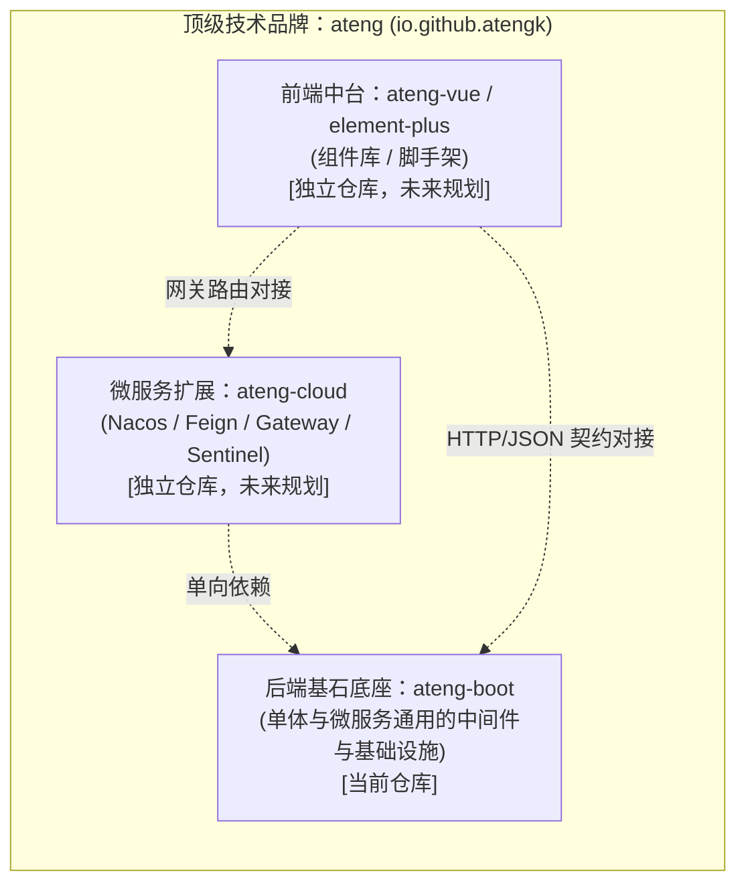

# ateng-boot

> 高内聚、低侵入、对标 Hutool 组织心智的 Spring Boot 3 基础框架与中间件 Starter 套件。

[](https://github.com/atengk/ateng-boot/actions/workflows/ci.yml)
[](https://central.sonatype.com/artifact/io.github.atengk/ateng-boot)
[](https://www.oracle.com/java/)
[](https://spring.io/projects/spring-boot)
[](https://baomidou.com/)
[](LICENSE)
[](https://github.com/atengk/ateng-boot/pulls)

---

## 1. 项目愿景与生态矩阵

`ateng-boot` 专注于为企业级 Spring Boot 3 应用提供高质量、开箱即用的基础设施和中间件赋能。作为 `ateng` 顶级技术品牌的基础底座，采用**多仓解耦演进（Multi-repo）**架构：



- **基石定位**：无论是单体应用，还是作为 `ateng-cloud` 微服务节点的基础依赖，`ateng-boot` 均作为统一底层支撑；
- **非侵入与低耦合**：不绑定具体业务模型，业务工程可自由引入、按需组装；
- **极简心智（类 Hutool）**：摒弃繁琐的长模块命名，采用直观精炼的模块名与一键聚合心智；
- **显式契约原则**：Controller 统一显式声明返回 `Result<T>`，绝不搞全局 `@ResponseBodyAdvice` 自动包装黑魔法。

---

## 2. 模块拓扑一览

| 模块名称 | 坐标 (ArtifactId) | 职责说明 |
| :--- | :--- | :--- |
| **BOM 管控中心** | `ateng-boot-bom` | 依赖版本统管清单（纯 `<dependencyManagement>`） |
| **核心通用底座** | `ateng-boot-core` | 统一 API 响应契约、业务异常体系、业务断言工具、审计 SPI 与异步上下文 |
| **Web 运行时增强** | `ateng-boot-web` | 链路追踪 `TraceFilter`、全局异常安全防御、Jackson 雪花防失真、CORS |
| **持久层增强底座** | `ateng-boot-mybatis-plus` | `BaseEntity`、防御性审计填充、动态方言分页、防全表更新删除、乐观锁 |
| **一键全家桶聚合** | `ateng-boot-all` | 纯依赖聚合 Jar，传递引入 core、web 与 mybatis-plus |
| **自验演示套件** | `ateng-boot-samples` | 基于 H2 内存库与 MockMvc 的端到端自动化测试金字塔与最佳实践 Demo |

---

## 3. 核心特性与设计优势

| 特性维度 | 常见痛点 | `ateng-boot` 解决方案 | 架构决策 |
| :--- | :--- | :--- | :--- |
| **响应契约** | `@ResponseBodyAdvice` 导致 String 类型强转报错、污染 Swagger 与文件下载 | 坚持显式契约：Controller 显式声明 `Result<T>`，提供链式流式工厂与 `getOrThrow()` 解包 | [ADR-0002](./docs/adr/0002-explicit-result-contract-no-response-body-advice.md) |
| **数字精度** | 64 位雪花 Long 传到前端超出 $2^{53}-1$ 导致末尾截断失真 | 注册 `Jackson2ObjectMapperBuilderCustomizer` 将 Long/BigInteger 自动序列化为 String | [ADR-0005](./docs/adr/0005-jackson-customizer-over-objectmapper-override.md) |
| **全链路追踪** | 单体应用无 APM 时日志串联困难，排查无从下手 | 内置轻量 `TraceFilter` 自动生成/透传 `X-Trace-Id` 并注入 MDC，请求结束安全清理 | - |
| **安全脱敏** | 生产异常直接向前端暴露 SQL 语法与数据表结构 | 全局异常处理器对未知根异常强制生产脱敏，内部堆栈与 traceId 仅记录于后台日志 | [ADR-0004](./docs/adr/0004-http-200-with-business-code-and-exception-masking.md) |
| **审计填充** | 数据迁移导入历史记录时，自动填充无脑覆盖创建时间与人 | `DefaultMetaObjectHandler` 采用防御性策略：仅在字段为 null 时自动填充，保留显式赋值 | - |
| **分页与防灾** | 分页插件硬编码 MySQL 导致多库报错；无限制分页与全表误更打崩生产 | 动态方言自适应分页（单页上限 500 条防爆）；内置 `BlockAttack` 阻断全表更新删除 | - |

---

## 4. 快速接入指南

### 方式一：一键全家桶模式（最贴近 Hutool 心智，极速起步）

适用于绝大多数单体应用或快速开发场景：

```xml
<dependencies>
    <!-- 一键引入全部核心底座与中间件增强 -->
    <dependency>
        <groupId>io.github.atengk</groupId>
        <artifactId>ateng-boot-all</artifactId>
        <version>0.0.3</version>
    </dependency>

    <!-- 按需引入实际业务使用的数据库驱动，例如 MySQL -->
    <dependency>
        <groupId>com.mysql</groupId>
        <artifactId>mysql-connector-j</artifactId>
        <scope>runtime</scope>
    </dependency>
</dependencies>
```

### 方式二：BOM 按需精细化引入（推荐企业级最佳实践）

适用于微服务节点或需要严格控制依赖传递的工程：

```xml
<dependencyManagement>
    <dependencies>
        <!-- 引入 ateng-boot 统一依赖物料清单 -->
        <dependency>
            <groupId>io.github.atengk</groupId>
            <artifactId>ateng-boot-bom</artifactId>
            <version>0.0.3</version>
            <type>pom</type>
            <scope>import</scope>
        </dependency>
    </dependencies>
</dependencyManagement>

<dependencies>
    <!-- 仅引入 Web 与核心底座 -->
    <dependency>
        <groupId>io.github.atengk</groupId>
        <artifactId>ateng-boot-web</artifactId>
    </dependency>

    <!-- 仅引入 MyBatis-Plus 增强 -->
    <dependency>
        <groupId>io.github.atengk</groupId>
        <artifactId>ateng-boot-mybatis-plus</artifactId>
    </dependency>
</dependencies>
```

---

## 5. 核心代码范式

### 5.1 统一 API 响应与业务断言

```java
@RestController
@RequestMapping("/users")
public class UserController {

    @GetMapping("/{id}")
    public Result<UserVO> getUser(@PathVariable Long id) {
        User user = userService.getById(id);
        // 语义化断言：空时自动抛出 BusinessException
        BusinessAssert.notNull(user, CommonResultCode.NOT_FOUND);
        return Result.success(UserVO.from(user));
    }
}
```

**前端收到的 JSON 载荷（HTTP 保持 200，Long 自动转 String，时间格式化）：**
```json
{
  "code": 200,
  "msg": "操作成功",
  "data": {
    "id": "1846182948192841920",
    "username": "ateng",
    "createTime": "2026-10-15 16:00:00"
  },
  "timestamp": 1729000000000,
  "success": true,
  "traceId": "9b1deb4d3b7d4bad9bdd2b0d7b3dcb6d"
}
```

### 5.2 通用持久化实体

```java
@Data
@EqualsAndHashCode(callSuper = true)
@TableName("sys_user")
public class User extends BaseEntity {

    private String username;
    private String email;

    @Version
    private Integer version; // 自动参与乐观锁 CAS 防护
}
```

继承 `BaseEntity` 自动获得雪花 ID、`createTime`、`updateTime`、`createBy`、`updateBy` 与 `@JsonIgnore` 逻辑删除。

---

## 6. 配置属性参考 (`application.yml`)

```yaml
ateng:
  boot:
    web:
      enabled: true               # 是否启用 Web 模块整体增强（默认 true）
      long-to-string: true        # 是否将 Long 序列化为 String（防前端雪花丢失精度，默认 true）
      trace:
        enabled: true             # 是否启用 TraceFilter 链路追踪与 MDC 自动流转（默认 true）
        header-name: "X-Trace-Id" # 链路追踪头名称（默认 X-Trace-Id）
      cors:
        enabled: false            # 是否开启通用跨域支持（默认 false）
    mybatis-plus:
      enabled: true               # 是否启用 MyBatis-Plus 增强配置（默认 true）
      audit:
        default-operator: "system"# 上下文为空时的默认审计操作人兜底（默认 null）
      pagination:
        enabled: true             # 是否装配分页插件（默认 true）
        max-limit: 500            # 单页查询上限（默认 500，防内存打爆）
      block-attack:
        enabled: true             # 是否装配防全表更新删除插件（默认 true）
      optimistic-locker:
        enabled: true             # 是否装配乐观锁插件（默认 true）
```

---

## 7. 架构决策与规范索引

- **全局架构决策记录 (ADR)**：
  - [ADR-0001: 多仓解耦架构与 ateng 顶层品牌矩阵](./docs/adr/0001-multi-repo-brand-matrix.md)
  - [ADR-0002: 坚持显式 API 响应契约，拒绝 ResponseBodyAdvice 自动包装](./docs/adr/0002-explicit-result-contract-no-response-body-advice.md)
  - [ADR-0003: 依赖管理采用 BOM Import 模式而非继承 parent](./docs/adr/0003-dependency-management-via-bom-import.md)
  - [ADR-0004: 全局统一 HTTP 200 响应与生产级未知异常脱敏](./docs/adr/0004-http-200-with-business-code-and-exception-masking.md)
  - [ADR-0005: 采用 Jackson2ObjectMapperBuilderCustomizer 挂载定制而非覆盖 ObjectMapper](./docs/adr/0005-jackson-customizer-over-objectmapper-override.md)
  - [ADR-0006: 依赖版本基线锁定与升级治理策略](./docs/adr/0006-dependency-baseline-and-upgrade-strategy.md)
  - [ADR-0007: Maven 中央仓库发布解耦与 CI 纯净化治理决策](./docs/adr/0007-maven-publishing-and-clean-ci-pipeline.md)
  - [ADR-0008: 自动化发版闭环、多维变更日志与常青文档架构决策](./docs/adr/0008-automated-release-changelog-and-evergreen-docs.md)
- **多上下文领域映射**：[CONTEXT-MAP.md](./CONTEXT-MAP.md)
- **变更日志 (Changelog)**：[CHANGELOG.md](./CHANGELOG.md)（权威动态日志参见 [GitHub Releases](https://github.com/atengk/ateng-boot/releases)）
- **Agent 研发指南**：[AGENTS.md](./AGENTS.md)
- **贡献指南与规范**：[CONTRIBUTING.md](./CONTRIBUTING.md)
- **Maven 发布实战指南**：[docs/guides/maven-central-publishing.md](./docs/guides/maven-central-publishing.md)

---

## 8. 开发者工具链与脚本助手

本项目内置纯中文交互式工程管理脚本（位于 `scripts/` 目录），全面提升协作与交付效率：

- **规范化提交助手 (`scripts/commit.sh`)**：
  ```bash
  # 交互向导模式 (支持多行/列表式 Body 录入与自动推送)
  bash scripts/commit.sh

  # 自动化/参数模式 (支持 -l 多项改动清晰罗列)
  bash scripts/commit.sh -t feat -s web -m "增强响应契约" -l "新增语义化异常解包" -l "完善脱敏拦截" -p -y
  ```
  引导选择 Conventional Commits 提交类型、输入影响范围与描述，支持在正文中清晰罗列多项变动列表，自动提供高亮预览并可选一键推送。
- **语义化发版助手 (`scripts/release.sh`)**：
  ```bash
  bash scripts/release.sh
  ```
  内置多模块编译快速自检、SemVer 版本推导与单主干（`main`）强防呆校验；自动全量设置工程 POM 正式版，通过原生 `sed -i` 原地直接流式同步更新 `README.md` 接入版本；创建附注 Git Tag 并原子推送以触发 GitHub Actions 流水线；发版成功后自动询问将主干平滑推进至下一代开发快照（`SNAPSHOT`）。
- **激活本地提交守门钩子**：
  ```bash
  git config core.hooksPath .githooks
  ```
  在本地提交时进行毫秒级格式拦截校验，彻底杜绝非标提交。

---

## 9. 开源许可证

本项目基于 [Apache 2.0 开源协议](LICENSE) 授权。
