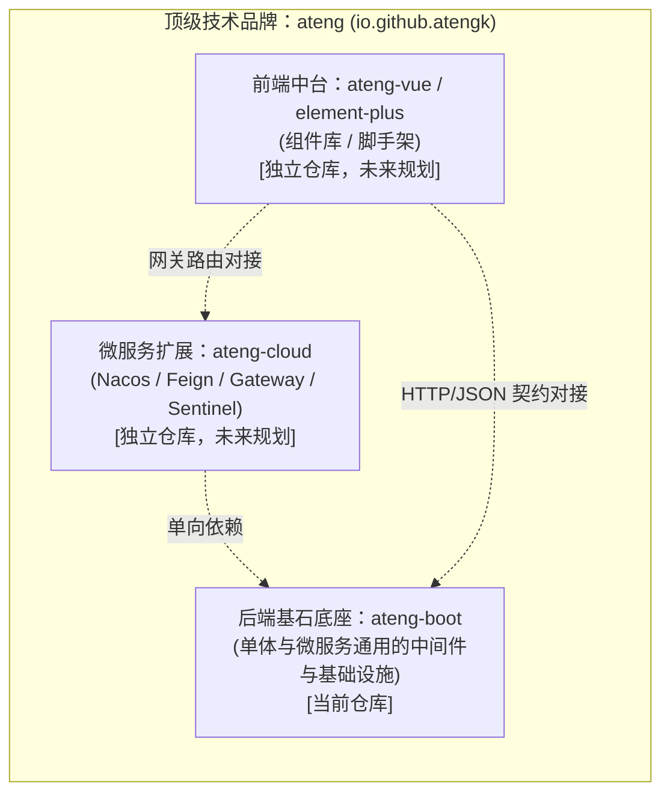
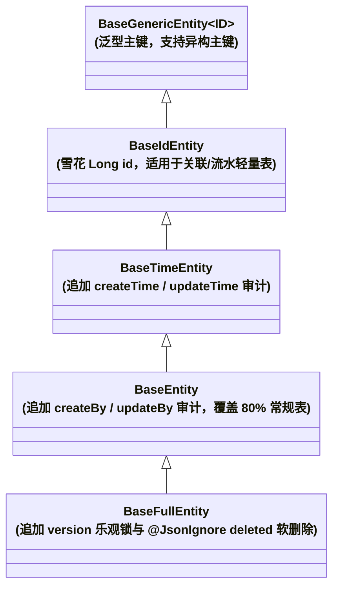

# ateng-boot

> 高内聚、低侵入、对标 Hutool 组织心智的 Spring Boot 3 基础框架与中间件 Starter 套件。

[](https://github.com/atengk/ateng-boot/actions/workflows/ci.yml)
[](https://central.sonatype.com/artifact/io.github.atengk/ateng-boot)
[](https://www.oracle.com/java/)
[](https://spring.io/projects/spring-boot)
[](https://baomidou.com/)
[](LICENSE)
[](https://github.com/atengk/ateng-boot/pulls)

---

## 1. 项目愿景与生态矩阵

`ateng-boot` 专注于为企业级 Spring Boot 3 应用提供高质量、开箱即用的基础设施和中间件赋能。作为 `ateng` 顶级技术品牌的基础底座，采用**多仓解耦演进（Multi-repo）**架构：



- **基石定位**：无论是单体应用，还是作为 `ateng-cloud` 微服务节点的基础依赖，`ateng-boot` 均作为统一底层支撑；
- **非侵入与低耦合**：不绑定具体业务模型，业务工程可自由引入、按需组装；
- **极简心智（类 Hutool）**：摒弃繁琐的长模块命名，采用直观精炼的模块名与一键聚合心智；
- **显式契约原则**：Controller 统一显式声明返回 `Result<T>`，绝不搞全局 `@ResponseBodyAdvice` 自动包装黑魔法。

---

## 2. 模块拓扑一览

| 模块名称 | 坐标 (ArtifactId) | 职责说明 |
| :--- | :--- | :--- |
| **BOM 管控中心** | `ateng-boot-bom` | 依赖版本统管清单（纯 `<dependencyManagement>`） |
| **核心通用底座** | `ateng-boot-core` | 统一 API 响应契约、业务异常体系、业务断言工具、审计 SPI 与异步上下文 |
| **Web 运行时增强** | `ateng-boot-web` | 链路追踪 `TraceFilter`、全局异常安全防御、Jackson 雪花防失真、CORS |
| **持久层增强底座** | `ateng-boot-mybatis-plus` | `BaseEntity`、防御性审计填充、动态方言分页、防全表更新删除、乐观锁 |
| **一键全家桶聚合** | `ateng-boot-all` | 纯依赖聚合 Jar，传递引入 core、web 与 mybatis-plus |
| **自验演示套件** | `ateng-boot-samples` | 基于 H2 内存库与 MockMvc 的端到端自动化测试金字塔与最佳实践 Demo |

---

## 3. 核心特性与设计优势

| 特性维度 | 常见痛点 | `ateng-boot` 解决方案 | 架构决策 |
| :--- | :--- | :--- | :--- |
| **响应契约** | `@ResponseBodyAdvice` 导致 String 类型强转报错、污染 Swagger 与文件下载 | 坚持显式契约：Controller 显式声明 `Result<T>`，提供链式流式工厂与 `getOrThrow()` 解包 | [ADR-0002](./docs/adr/0002-explicit-result-contract-no-response-body-advice.md) |
| **数字精度** | 64 位雪花 Long 传到前端超出 $2^{53}-1$ 导致末尾截断失真 | 注册 `Jackson2ObjectMapperBuilderCustomizer` 将 Long/BigInteger 自动序列化为 String | [ADR-0005](./docs/adr/0005-jackson-customizer-over-objectmapper-override.md) |
| **全链路追踪** | 单体应用无 APM 时日志串联困难，排查无从下手 | 内置轻量 `TraceFilter` 自动生成/透传 `X-Trace-Id` 并注入 MDC，请求结束安全清理 | - |
| **安全脱敏** | 生产异常直接向前端暴露 SQL 语法与数据表结构 | 全局异常处理器对未知根异常强制生产脱敏，内部堆栈与 traceId 仅记录于后台日志 | [ADR-0004](./docs/adr/0004-http-200-with-business-code-and-exception-masking.md) |
| **审计填充** | 数据迁移导入历史记录时，自动填充无脑覆盖创建时间与人 | `DefaultMetaObjectHandler` 采用防御性策略：仅在字段为 null 时自动填充，保留显式赋值 | - |
| **分页与防灾** | 分页插件硬编码 MySQL 导致多库报错；无限制分页与全表误更打崩生产 | 动态方言自适应分页（单页上限 500 条防爆）；内置 `BlockAttack` 阻断全表更新删除 | - |

---

## 4. 快速接入指南

### 方式一：一键全家桶模式（最贴近 Hutool 心智，极速起步）

适用于绝大多数单体应用或快速开发场景：

**Maven (`pom.xml`)**:
```xml
<dependencies>
    <!-- 一键引入全部核心底座与中间件增强 -->
    <dependency>
        <groupId>io.github.atengk</groupId>
        <artifactId>ateng-boot-all</artifactId>
        <version>0.0.5</version>
    </dependency>

    <!-- 按需引入实际业务使用的数据库驱动，例如 MySQL -->
    <dependency>
        <groupId>com.mysql</groupId>
        <artifactId>mysql-connector-j</artifactId>
        <scope>runtime</scope>
    </dependency>
</dependencies>
```

**Gradle (Kotlin DSL - `build.gradle.kts`)**:
```kotlin
dependencies {
    // 一键引入全部核心底座与中间件增强
    implementation("io.github.atengk:ateng-boot-all:0.0.5")

    // 按需引入实际业务使用的数据库驱动，例如 MySQL
    runtimeOnly("com.mysql:mysql-connector-j")
}
```

**Gradle (Groovy DSL - `build.gradle`)**:
```groovy
dependencies {
    // 一键引入全部核心底座与中间件增强
    implementation 'io.github.atengk:ateng-boot-all:0.0.5'

    // 按需引入实际业务使用的数据库驱动，例如 MySQL
    runtimeOnly 'com.mysql:mysql-connector-j'
}
```

### 方式二：BOM 按需精细化引入（推荐企业级最佳实践）

适用于微服务节点或需要严格控制依赖传递的工程：

**Maven (`pom.xml`)**:
```xml
<dependencyManagement>
    <dependencies>
        <!-- 引入 ateng-boot 统一依赖物料清单 -->
        <dependency>
            <groupId>io.github.atengk</groupId>
            <artifactId>ateng-boot-bom</artifactId>
            <version>0.0.5</version>
            <type>pom</type>
            <scope>import</scope>
        </dependency>
    </dependencies>
</dependencyManagement>

<dependencies>
    <!-- 仅引入 Web 与核心底座 -->
    <dependency>
        <groupId>io.github.atengk</groupId>
        <artifactId>ateng-boot-web</artifactId>
    </dependency>

    <!-- 仅引入 MyBatis-Plus 增强 -->
    <dependency>
        <groupId>io.github.atengk</groupId>
        <artifactId>ateng-boot-mybatis-plus</artifactId>
    </dependency>
</dependencies>
```

**Gradle (Kotlin DSL - `build.gradle.kts`)**:
```kotlin
dependencies {
    // 引入 ateng-boot 统一依赖物料清单
    implementation(platform("io.github.atengk:ateng-boot-bom:0.0.5"))

    // 仅按需引入 Web 与持久层（免配版本号）
    implementation("io.github.atengk:ateng-boot-web")
    implementation("io.github.atengk:ateng-boot-mybatis-plus")
}
```

**Gradle (Groovy DSL - `build.gradle`)**:
```groovy
dependencies {
    // 引入 ateng-boot 统一依赖物料清单
    implementation platform('io.github.atengk:ateng-boot-bom:0.0.5')

    // 仅按需引入 Web 与持久层（免配版本号）
    implementation 'io.github.atengk:ateng-boot-web'
    implementation 'io.github.atengk:ateng-boot-mybatis-plus'
}
```

### 本地样例一键运行 (Demo Samples)

想要在本地快速上手体验所有特性？可直接启动工程内置的自验 Demo 应用（自带 H2 内存库）：

```bash
# 快速启动样例工程服务
mvn -pl ateng-boot-samples spring-boot:run
```

启动后即可访问演示 API，例如通过 `curl http://localhost:8080/users/1` 验证标准 `Result<T>` 响应契约与 `X-Trace-Id` 链路追踪表现。

---

## 5. 核心代码范式

### 5.1 统一 API 响应与业务断言

```java
@RestController
@RequestMapping("/users")
public class UserController {

    @GetMapping("/{id}")
    public Result<UserVO> getUser(@PathVariable Long id) {
        User user = userService.getById(id);
        // 语义化断言：空时自动抛出 BusinessException
        BusinessAssert.notNull(user, CommonResultCode.NOT_FOUND);
        return Result.success(UserVO.from(user));
    }
}
```

**前端收到的 JSON 载荷（HTTP 保持 200，Long 自动转 String，时间格式化）：**
```json
{
  "code": 200,
  "msg": "操作成功",
  "data": {
    "id": "1846182948192841920",
    "username": "ateng",
    "createTime": "2026-10-15 16:00:00"
  },
  "timestamp": 1729000000000,
  "success": true,
  "traceId": "9b1deb4d3b7d4bad9bdd2b0d7b3dcb6d"
}
```

### 5.2 持久层阶梯式实体体系 (Tiered Entity Hierarchy)

**场景痛点**：传统单一 `BaseEntity` 强行绑定乐观锁版本号与逻辑删除，导致关联映射表（如 `user_role`）、流水日志表等物理表在缺失 `deleted` 或 `version` 列时频繁触发 SQL 列缺失异常。`ateng-boot` 提供解耦的五级阶梯体系，按需继承：



#### 范式一：核心业务流转实体（全要素受管，继承 `BaseFullEntity`）
```java
@Getter
@Setter
@ToString(callSuper = true)
@TableName("sys_user")
public class UserEntity extends BaseFullEntity {
    private String name;
    private Integer age;
    private String email;
}
```
- **开箱特性**：拥有雪花 `id`、时间与操作人自动填充、`version` CAS 乐观锁防并发覆盖，以及 `@TableLogic @JsonIgnore` 逻辑删除（对外 JSON 自动忽略脱敏，Mapper 查询自动附加 `WHERE deleted = 0`）。

#### 范式二：常规物理删除业务实体（推荐默认，继承 `BaseEntity`）
```java
@Getter
@Setter
@ToString(callSuper = true)
@TableName("biz_article")
public class ArticleEntity extends BaseEntity {
    private String title;
    private String content;
}
```
- **开箱特性**：拥有雪花 `id`、创建/修改时间与操作人自动填充，执行真实物理删除，无乐观锁或软删除开销。

#### 范式三：轻量关联或流水日志实体（极简零冗余，继承 `BaseIdEntity`）
```java
@Getter
@Setter
@ToString(callSuper = true)
@TableName("sys_user_role")
public class UserRoleEntity extends BaseIdEntity {
    private Long userId;
    private Long roleId;
}
```
- **开箱特性**：仅保留雪花 `id`，底层执行真正的物理增删改查，绝不向数据库抛出冗余列缺失的 SQL 语法异常。

### 5.3 传输层分页契约解耦与流式转换 (PageResult & PageUtil)

**场景痛点**：Controller 传输层若直接返回 MyBatis-Plus 的 `Page<T>`，会导致 `optimizeCountSql`、`searchCount`、`orders`、`maxLimit` 等持久层内部状态严重向前端泄露，产生大量 ORM 噪音；同时导致数据库物理实体与对外视图模型强耦合。`ateng-boot` 提供与 ORM 彻底解耦的标准契约：

**核心代码范式**：
```java
@GetMapping("/page")
public Result<PageResult<UserVO>> page(PageQuery query) {
    // 1. 入参安全转换（PageQuery -> MP Page）
    Page<UserEntity> page = PageUtil.toPage(query);
    // 2. ORM 分页查询
    Page<UserEntity> entityPage = userMapper.selectPage(page, null);
    // 3. 流式转换为业务 VO（彻底消除 ORM 属性泄露）
    PageResult<UserVO> result = PageUtil.toPageResult(entityPage, user -> {
        UserVO vo = new UserVO();
        vo.setId(user.getId());
        vo.setName(user.getName());
        vo.setAge(user.getAge());
        vo.setEmail(user.getEmail());
        return vo;
    });
    return Result.success(result);
}
```

**前端收到的纯净 JSON 契约（仅含标准 5 要素，彻底杜绝 ORM 内部属性泄露）：**
```json
{
  "code": 200,
  "msg": "操作成功",
  "data": {
    "records": [
      {
        "id": "1846182948192841920",
        "name": "李四",
        "age": 30,
        "email": "lisi@example.com"
      }
    ],
    "total": "1",
    "size": "10",
    "current": "1",
    "pages": "1"
  },
  "timestamp": 1729000000000,
  "success": true,
  "traceId": "c563ed5e6d70430b9c0a9ab836985582"
}
```

### 5.4 上下文感知受管异步线程池 (@Async & TaskDecorator)

**场景痛点**：标准 `@Async` 异步方法脱离了当前请求的 Servlet 线程，导致 MDC 中的 `traceId` 链路丢失，且 `UserContextHolder` 中存储的当前登录用户信息无法传递至子线程，造成异步任务日志断链以及持久层自动审计回退为 `SYSTEM`。`ateng-boot-web` 自动导出装配了 `ContextCopyingTaskDecorator` 的受管线程池（`taskExecutor` / `applicationTaskExecutor`），配合 `@EnableAsync` 零感知流转上下文。

**核心代码范式**：
```java
// 1. 在主配置类开启 Spring 异步支持
@EnableAsync
@SpringBootApplication
public class Application { ... }

// 2. 编写异步业务逻辑（入库实体自动获取调用方登录人标识）
@Service
@RequiredArgsConstructor
public class AuditLogService {

    private final UserMapper userMapper;

    @Async
    public CompletableFuture<Void> recordAuditAsync(UserEntity logEntity) {
        // 自动继承调用方线程的 MDC traceId 与 UserContextHolder 登录人身份
        userMapper.insert(logEntity);
        return CompletableFuture.completedFuture(null);
    }
}
```

**控制台与数据库审计呈现**：
```text
2026-10-16 08:00:00.123 INFO  [ateng-async-1] [c563ed5e6d70430b9c0a9ab836985582] c.e.s.AuditLogService : 异步操作执行完成
```
- **数据库落地呈现**：入库实体的 `create_by` 与 `update_by` 字段自动落盘为父线程登录用户 `admin-user`（而非系统回退值 `SYSTEM`）。

### 5.5 零依赖高内聚通用工具集 (Zero-Bloat Utilities)

**场景痛点**：传统企业级项目往往盲目引入 `hutool-all`、`guava` 等几十兆外部巨型依赖，导致类路径膨胀、版本冲突以及“通用垃圾桶 (Junk Drawer)”模块乱象。`ateng-boot` 遵循 Zero-Bloat 原则与高内聚架构，100% 依托 JDK 17 与 Spring 基础组件能力，按运行时上下文就近收敛：

#### 1. 核心底座工具 (`ateng-boot-core`)
- **数据脱敏 (`DesensitizeUtil`)**：全场景极速动态掩码（手机号、身份证、银行卡、中文姓名、邮箱、固话、密码）：
  ```java
  DesensitizeUtil.mobilePhone("13812345678");   // "138****5678"
  DesensitizeUtil.idCard("110101199003072345"); // "110101********2345"
  DesensitizeUtil.chineseName("诸葛孔明");      // "诸**明"
  DesensitizeUtil.password("secret123");        // "******"
  ```
- **纯 JDK 原生加解密 (`CryptoUtil`)**：支持 `AES/CBC/PKCS5Padding` 与带防篡改认证标签的 `AES/GCM/NoPadding`，内置安全随机 IV 与 Base64 编解码，彻底无 Bouncy Castle 外部依赖：
  ```java
  byte[] key = CryptoUtil.generateKey(256);
  byte[] iv = CryptoUtil.generateGcmIv();
  String cipherText = CryptoUtil.encryptGcm("敏感数据", key, iv);
  String plainText = CryptoUtil.decryptGcm(cipherText, key, iv);
  ```
- **通用线性树装配 (`TreeUtil`)**：纯函数式抽象，依托哈希表两遍扫描以 $O(N)$ 线性时间复杂度组装任意嵌套父子树形结构，空安全且避免 NPE：
  ```java
  List<MenuNode> tree = TreeUtil.build(
      list, 0L, MenuNode::getId, MenuNode::getParentId, MenuNode::setChildren
  );
  ```

#### 2. Web 运行时工具 (`ateng-boot-web`)
- **真实客户端 IP 提取 (`IpUtil`)**：精准穿透多级反向代理（`X-Forwarded-For`、`X-Real-IP` 等）提取首个有效公网 IP，自动规整 IPv6 本地环回（`0:0:0:0:0:0:0:1` / `::1` -> `127.0.0.1`）：
  ```java
  String clientIp = IpUtil.getClientIp(); // 自动从当前 Request 上下文提取
  ```
- **Servlet 上下文门面 (`ServletUtil`)**：基于 `RequestContextHolder` 静态提取当前 Request/Response，便捷读取 Header、Cookie，智能识别 JSON 与 AJAX 请求：
  ```java
  String token = ServletUtil.getHeader("Authorization");
  boolean isJson = ServletUtil.isJsonRequest(ServletUtil.getRequest());
  ```

### 5.6 Web 请求接口审计日志与耗时观测 (@WebLog)

**场景痛点**：生产环境中排查接口偶发延迟、复现偶发缺陷或满足安全合规审计时，开发者常需要在各个 Controller 方法中手工编写繁琐且重复的日志代码，且极易因直接打印请求体造成密码、Token 等明文凭据泄漏，或因序列化 `MultipartFile` 大文件及流对象引发严重内存溢出 (OOM)。`ateng-boot-web` 提供配置开关驱动的 `@WebLog` 接口审计注解与 AOP 切面 `WebLogAspect`。

**核心代码范式**：
```java
@RestController
@RequestMapping("/users")
public class UserController {

    @PostMapping("/login")
    @WebLog(value = "用户登录认证", excludeParams = {"password"})
    public Result<String> login(@RequestBody LoginDTO dto) {
        return Result.success(authService.login(dto));
    }

    @PostMapping("/upload")
    @WebLog(value = "用户头像上传")
    public Result<String> uploadAvatar(@RequestParam("file") MultipartFile file) {
        return Result.success(ossService.upload(file));
    }
}
```

**控制台审计日志呈现**：
```text
2026-10-16 08:00:00.123 INFO  [main] [c563ed5e6d70430b9c0a9ab836985582] i.g.atengk.boot.web.aspect.WebLogAspect : [WebLog] 开始请求: URL=[POST /users/login], IP=[192.0.2.1], 操作=[用户登录认证], 目标=[UserController#login], 入参={"dto":{"username":"admin","password":"[EXCLUDED]"}}
2026-10-16 08:00:00.145 INFO  [main] [c563ed5e6d70430b9c0a9ab836985582] i.g.atengk.boot.web.aspect.WebLogAspect : [WebLog] 结束请求: URL=[POST /users/login], 耗时=[22ms], 出参={"code":200,"msg":"操作成功","data":"mock-token-admin","timestamp":"1792108967810","traceId":"c563ed5e6d70430b9c0a9ab836985582","success":true}
```
- **核心特性**：自动提取客户端真实 IP 并感知 MDC `traceId`；通过 `excludeParams` 递归脱敏排除密码等敏感凭据；大文件（`MultipartFile`）及输入输出流自动占位替换，严防 OOM；发生业务异常时自动捕获异常上下文并打印入参与耗时。

### 5.7 持久层透明加密与视图动态脱敏 (@FieldEncrypt & @FieldSensitive)

**场景痛点**：传统脱敏方案常在业务逻辑层直接对实体对象的属性做打星号修改，导致后续执行 `updateById` 或持久化更新时，极易将掩码脏数据（如 `138****0000`）写回数据库，造成不可逆的数据破坏与资损；若全库明文存储，又无法满足网络安全与隐私合规要求。`ateng-boot` 严格践行**“生命周期分离与内存真明文”**不变量：持久化存储加密收敛于 MyBatis `TypeHandler`（落盘密文、查询明文），展示脱敏收敛于 Jackson 视图序列化器（输出 JSON 动态掩码），业务逻辑与实体对象在内存中始终保持 100% 原始真实明文！

**核心代码范式**：
```java
@Getter
@Setter
@ToString(callSuper = true)
@TableName(value = "sys_user", autoResultMap = true)
public class UserEntity extends BaseFullEntity {

    private String name;

    /**
     * 手机号码：数据库中以 AES 密文存储；Controller 输出 JSON 时动态掩码为 138****5678
     */
    @FieldEncrypt
    @TableField(typeHandler = EncryptTypeHandler.class)
    @FieldSensitive(SensitiveType.MOBILE_PHONE)
    private String phone;

    /**
     * 身份证号码：数据库中以 AES 密文存储；Controller 输出 JSON 时动态掩码为 110101********2345
     */
    @FieldEncrypt
    @TableField(typeHandler = EncryptTypeHandler.class)
    @FieldSensitive(SensitiveType.ID_CARD)
    private String idCard;
}
```

**全生命周期一致性对比**：
- **底层数据库物理存储 (H2/MySQL 原生 SQL)**：
  ```sql
  SELECT phone, id_card FROM sys_user WHERE id = 2110888996374634498;
  -- 结果呈现为强安全性 AES Base64 密文（含前置随机 16 字节 IV）：
  -- phone:   uiPi0MfpVUhgRrTK1FEVoYfNYtisSOx/lRZspr3yLUU=
  -- id_card: 8iEvZbd7XsQZ789n8UssUhLpK+Pib+ahA7+yCeqD3Q/PQP6CnTMYq+tHssnxWIzB
  ```
- **Java 内存实体 (`user.getPhone()`)**：`13812345678`（100% 原始真实明文，业务流转零感知）
- **Controller 最终输出的 JSON 响应**：
  ```json
  {
    "code": 200,
    "msg": "操作成功",
    "data": {
      "id": "2110888996374634498",
      "name": "安全测试用户",
      "phone": "138****5678",
      "idCard": "110101********2345"
    }
  }
  ```
- **调用 `userMapper.updateById(user)`**：持久层基于内存真明文重新计算随机 IV 加密落盘，**绝不会把 `*` 号脏数据写回数据库**！

### 5.5 接口防重幂等与请求防抖 (@Idempotent)

**场景痛点**：网络抖动重发、前端按钮连击或并发重放攻击极易导致重复下单、重复扣款等高危事故。传统方案要么强行绑定 Redis 中间件破坏单体零依赖，要么采用固定死锁导致业务异常后无法立即重试。`ateng-boot-web` 内置 SPI 混合防重引擎，默认零配置单机内存防爆运行，检测到 Redis 时自动平滑升级为分布式锁。

**最小可用代码范式**：
```java
@RestController
@RequestMapping("/api/orders")
public class OrderController {

    /**
     * 1. 业务主键精准防重：SpEL 绑定订单号，有效窗口 3 秒；异常时自动释放锁允许立即重试
     */
    @PostMapping
    @Idempotent(key = "#dto.orderNo", prefix = "order:", timeout = 3, message = "订单处理中，请勿重复提交")
    public Result<String> createOrder(@Valid @RequestBody OrderCreateDTO dto) {
        orderService.create(dto);
        return Result.success(dto.getOrderNo());
    }

    /**
     * 2. 通用按钮无参防抖：自动提取 URL + Method + UserID + 请求参数 SHA-256 哈希作为防重指纹
     */
    @PostMapping("/submit-form")
    @Idempotent(timeout = 2)
    public Result<Void> submitForm(@RequestParam String formToken) {
        return Result.success();
    }
}
```

**预期 HTTP 响应契约呈现**：
- **首个合法请求（正常放行）**：
  ```json
  {
    "code": 200,
    "msg": "操作成功",
    "data": "ORD_20261016_001",
    "success": true
  }
  ```
- **窗口期内重复提交（切面统一阻断，遵循 ADR-0002/0004 统一契约）**：
  ```json
  {
    "code": 40003,
    "msg": "订单处理中，请勿重复提交",
    "data": null,
    "success": false,
    "traceId": "9b1deb4d3b7d4bad9bdd2b0d7b3dcb6d"
  }
  ```

---

## 6. 配置属性参考 (`application.yml`)

```yaml
ateng:
  boot:
    web:
      enabled: true               # 是否启用 Web 模块整体增强（默认 true）
      long-to-string: true        # 是否将 Long 序列化为 String（防前端雪花丢失精度，默认 true）
      trace:
        enabled: true             # 是否启用 TraceFilter 链路追踪与 MDC 自动流转（默认 true）
        header-name: "X-Trace-Id" # 链路追踪头名称（默认 X-Trace-Id）
      log:
        enabled: true             # 是否装配 @WebLog 接口审计切面（默认 false，按需开启）
      cors:
        enabled: false            # 是否开启通用跨域支持（默认 false）
      idempotent:
        enabled: true             # 是否启用接口防重幂等切面与存储引擎（默认 true）
        key-prefix: "idempotent:" # 存储全局 Key 前缀（默认 idempotent:）
        in-memory:
          max-capacity: 10000     # 单机内存存储软上限（默认 10000，防爆防 OOM）
          clean-interval: 60s     # 定时扫描过期淘汰周期（默认 60s）
    async:
      enabled: true               # 是否启用受管异步线程池（默认 true）
      core-pool-size: 8           # 核心线程数（默认可用 CPU 核心数）
      max-pool-size: 16           # 最大线程数（默认可用 CPU 核心数 * 2）
      queue-capacity: 1000        # 阻塞队列容量（默认 1000）
      keep-alive-seconds: 60      # 空闲线程存活时间（秒，默认 60）
      thread-name-prefix: "ateng-async-" # 异步工作线程名前缀（默认 ateng-async-）
      wait-for-tasks-to-complete-on-shutdown: true # 容器关闭时等待任务执行完成（优雅停机，默认 true）
      await-termination-seconds: 60 # 优雅停机等待超时时间（秒，默认 60）
    mybatis-plus:
      enabled: true               # 是否启用 MyBatis-Plus 增强配置（默认 true）
      audit:
        default-operator: "system"# 上下文为空时的默认审计操作人兜底（默认 null）
      pagination:
        enabled: true             # 是否装配分页插件（默认 true）
        max-limit: 500            # 单页查询上限（默认 500，防内存打爆）
      block-attack:
        enabled: true             # 是否装配防全表更新删除插件（默认 true）
      optimistic-locker:
        enabled: true             # 是否装配乐观锁插件（默认 true）
      crypto:
        secret-key: "YourSecretKey" # AES 密钥（可选，未配置时自适应默认内置密钥）
```

---

## 7. 架构决策与规范索引

- **全局架构决策记录 (ADR)**：
  - [ADR-0001: 多仓解耦架构与 ateng 顶层品牌矩阵](./docs/adr/0001-multi-repo-brand-matrix.md)
  - [ADR-0002: 坚持显式 API 响应契约，拒绝 ResponseBodyAdvice 自动包装](./docs/adr/0002-explicit-result-contract-no-response-body-advice.md)
  - [ADR-0003: 依赖管理采用 BOM Import 模式而非继承 parent](./docs/adr/0003-dependency-management-via-bom-import.md)
  - [ADR-0004: 全局统一 HTTP 200 响应与生产级未知异常脱敏](./docs/adr/0004-http-200-with-business-code-and-exception-masking.md)
  - [ADR-0005: 采用 Jackson2ObjectMapperBuilderCustomizer 挂载定制而非覆盖 ObjectMapper](./docs/adr/0005-jackson-customizer-over-objectmapper-override.md)
  - [ADR-0006: 依赖版本基线锁定与升级治理策略](./docs/adr/0006-dependency-baseline-and-upgrade-strategy.md)
  - [ADR-0007: Maven 中央仓库发布解耦与 CI 纯净化治理决策](./docs/adr/0007-maven-publishing-and-clean-ci-pipeline.md)
  - [ADR-0008: 自动化发版闭环、多维变更日志与常青文档架构决策](./docs/adr/0008-automated-release-changelog-and-evergreen-docs.md)
  - [ADR-0009: main 稳定发布与 dev 活跃开发双分支架构](./docs/adr/0009-dual-branch-workflow-main-release-and-dev-active.md)
  - [ADR-0010: 传输契约与持久层解耦与流式转换工具](./docs/adr/0010-transport-pagination-contract-decoupling.md)
  - [ADR-0011: 零重型外部依赖与上下文就近内聚工具集](./docs/adr/0011-zero-bloat-and-co-located-utilities.md)
  - [ADR-0012: 数据安全生命周期分离：存储加密与视图脱敏](./docs/adr/0012-lifecycle-separated-data-security.md)
  - [ADR-0013: 基于 SPI 抽象的混合式接口幂等防重引擎](./docs/adr/0013-spi-based-hybrid-idempotent-engine.md)
- **多上下文领域映射**：[CONTEXT-MAP.md](./CONTEXT-MAP.md)
- **变更日志 (Changelog)**：[CHANGELOG.md](./CHANGELOG.md)（权威动态日志参见 [GitHub Releases](https://github.com/atengk/ateng-boot/releases)）
- **Agent 研发指南**：[AGENTS.md](./AGENTS.md)
- **贡献指南与规范**：[CONTRIBUTING.md](./CONTRIBUTING.md)
- **Maven 发布实战指南**：[docs/guides/maven-central-publishing.md](./docs/guides/maven-central-publishing.md)

---

## 8. 开发者工具链与脚本助手

本项目内置纯中文交互式工程管理脚本（位于 `scripts/` 目录），全面提升协作与交付效率：

- **规范化提交助手 (`scripts/commit.sh`)**：
  ```bash
  # 交互向导模式 (支持多行/列表式 Body 录入与自动推送)
  bash scripts/commit.sh

  # 自动化/参数模式 (支持 -l 多项改动清晰罗列)
  bash scripts/commit.sh -t feat -s web -m "增强响应契约" -l "新增语义化异常解包" -l "完善脱敏拦截" -p -y
  ```
  引导选择 Conventional Commits 提交类型、输入影响范围与描述，支持在正文中清晰罗列多项变动列表，自动提供高亮预览并可选一键推送。
- **语义化发版助手 (`scripts/release.sh`)**：
  ```bash
  bash scripts/release.sh
  ```
  内置多模块编译快速自检、SemVer 版本推导与单主干（`main`）强防呆校验；自动全量设置工程 POM 正式版，通过原生 `sed -i` 原地直接流式同步更新 `README.md` 接入版本；创建附注 Git Tag 并原子推送，注入 `[skip ci]` 彻底消除重复构建与快照冗余。
- **激活本地提交守门钩子**：
  ```bash
  git config core.hooksPath .githooks
  ```
  在本地提交时进行毫秒级格式拦截校验，彻底杜绝非标提交。

---

## 9. 开源许可证

本项目基于 [Apache 2.0 开源协议](LICENSE) 授权。
