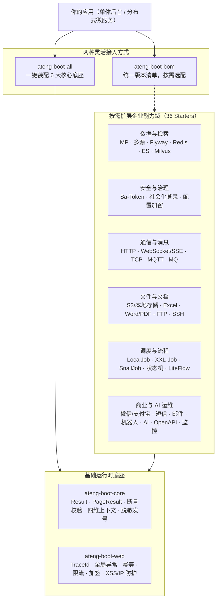

# ateng-boot

> 生产就绪的 Spring Boot 3（3.3.13）全栈企业级基础设施与中间件 Starter 套件——零臃肿纯原生、强类型显式契约、36 个正交模块开箱协同，原生面向 AI 编程时代。

[](https://github.com/atengk/ateng-boot/actions/workflows/ci.yml)
[](https://central.sonatype.com/artifact/io.github.atengk/ateng-boot)
[](https://www.oracle.com/java/)
[](https://spring.io/projects/spring-boot)
[](#2-全栈能力版图)
[](./llms.txt)
[](./LICENSE)

---

## 为什么选择 `ateng-boot`

Java 团队从零搭建 Spring Boot 3 项目，往往要花几周时间拼装响应封装、全局异常、链路追踪、多租户、脱敏加密、防重限流、对象存储、文档处理与大模型接入，还要反复解决依赖冲突。`ateng-boot` 把经过生产打磨的 **36 个企业级能力模块** 收敛为一套风格一致、可按需拼装的基础设施底座：

| 常见研发痛点 | 传统裸搭 / 重型脚手架的困境 | `ateng-boot` 的开箱体验 |
| :--- | :--- | :--- |
| **响应与异常边界** | `@ResponseBodyAdvice` 全局包装误伤文件下载与 Swagger；未知异常堆栈直接泄露 | Controller 显式返回 `Result<T>` 与 `PageResult<VO>`，`BusinessAssert` 快速失败，全局异常自动脱敏并注入 `traceId` |
| **数据安全与多租户** | 业务代码里手动打星号污染入库数据；手写租户 SQL 易漏表越权 | 内存中始终保持明文；`@FieldEncrypt` 负责入库加密，`@FieldSensitive` / `@ExcelSensitive` 自动脱敏；行级与分库多租户开箱隔离 |
| **分布式协同与限流** | 每个服务重复造分布式锁、防重幂等和限流轮子，缺中间件就启动报错 | `@DistributedLock`、`@Idempotent`、`@RateLimiter` 声明式即用；未配置 Redis 时平滑退化为单机安全模式 |
| **依赖体积与虚拟线程** | 动辄引入 `hutool-all`、`guava` 导致体积膨胀、依赖打架或 `synchronized` 阻塞虚拟线程 | 基于 **JDK 17 + Spring 6** 纯原生实现，零重型工具包绑架；核心临界区全面采用 `ReentrantLock`，开箱适配 **JDK 21+ 虚拟线程** |
| **AI 智能体与企业检索** | 各模型厂商私有 SDK 碎片化，缺乏工具沙箱、审批护栏与限流控制 | `@AiAgent` 统一接入 DeepSeek / OpenAI / 通义千问 / Ollama，内置 RAG 混合检索溯源、MCP/OpenAPI 工具、人工审批与配额熔断 |



---

## 1. 60 秒极速上手

### 环境基线

- **JDK**：JDK 17 LTS 编译与运行（100% 兼容 JDK 21+；在配置中添加 `spring.threads.virtual.enabled=true` 即可启用虚拟线程）
- **Spring Boot**：`3.3.13`（兼容 Spring Cloud `2023.0.x` 与 Spring Cloud Alibaba 生态）
- **构建工具**：Maven `3.6.3+`（或 Gradle 8.x）

### 1.1 引入 Maven 依赖（二选一）

#### 方式一：一键全家桶（推荐单体应用 / 管理后台 / 快速原型）

一行坐标引入 `core`、`web`、`mybatis-plus`、`redis`、`excel`、`satoken` 六大核心底座，同时支持按需叠加任意其他 Starter（详见 [ateng-boot-all 文档](./ateng-boot-all/README.md)）：

```xml
<dependencies>
    <!-- 一键引入六大核心基础设施 -->
    <dependency>
        <groupId>io.github.atengk</groupId>
        <artifactId>ateng-boot-all</artifactId>
        <version>1.2.0</version>
    </dependency>

    <!-- 按需追加数据库驱动（以 MySQL 为例） -->
    <dependency>
        <groupId>com.mysql</groupId>
        <artifactId>mysql-connector-j</artifactId>
        <scope>runtime</scope>
    </dependency>
</dependencies>
```

#### 方式二：BOM 按需精准拼装（推荐微服务 / 精细化依赖控制）

在 `<dependencyManagement>` 中导入 [`ateng-boot-bom`](./ateng-boot-bom/README.md)，无需改动项目现有 `<parent>`，所有 Starter 与配套第三方组件免配 `<version>`：

```xml
<dependencyManagement>
    <dependencies>
        <dependency>
            <groupId>io.github.atengk</groupId>
            <artifactId>ateng-boot-bom</artifactId>
            <version>1.2.0</version>
            <type>pom</type>
            <scope>import</scope>
        </dependency>
    </dependencies>
</dependencyManagement>

<dependencies>
    <dependency>
        <groupId>io.github.atengk</groupId>
        <artifactId>ateng-boot-web</artifactId>
    </dependency>
    <dependency>
        <groupId>io.github.atengk</groupId>
        <artifactId>ateng-boot-mybatis-plus</artifactId>
    </dependency>
    <dependency>
        <groupId>io.github.atengk</groupId>
        <artifactId>ateng-boot-redis</artifactId>
    </dependency>
    <dependency>
        <groupId>io.github.atengk</groupId>
        <artifactId>ateng-boot-ai</artifactId>
    </dependency>
</dependencies>
```

### 1.2 直观感受开发体验

#### ① 标准 Web 接口：强类型契约、自动链路追踪与视图脱敏

```java
// 1. 视图对象：内存中保留原始手机号明文，仅在 JSON 序列化响应时自动脱敏
@Data
public class UserVO {
    private Long id;
    private String username;
    @FieldSensitive(SensitiveType.MOBILE_PHONE)
    private String mobile;
}

// 2. Controller：显式返回 Result<T>，用 BusinessAssert 快速拦截空值或业务违规
@RestController
@RequestMapping("/users")
public class UserController {

    private final UserService userService;

    public UserController(UserService userService) {
        this.userService = userService;
    }

    @GetMapping("/{id}")
    public Result<UserVO> getUser(@PathVariable Long id) {
        UserVO user = userService.findById(id);
        BusinessAssert.notNull(user, CommonResultCode.NOT_FOUND);
        return Result.success(user);
    }
}
```

自动获得的 JSON 响应（`traceId` 与响应头 `X-Trace-Id` 自动打通，雪花 `Long` 主键自动转字符串防止前端精度丢失，手机号自动脱敏）：

```json
{
  "code": 200,
  "msg": "操作成功",
  "data": {
    "id": "104485532445560832",
    "username": "ateng",
    "mobile": "138****8000"
  },
  "timestamp": 1776326400000,
  "success": true,
  "traceId": "c8a14b0365734fb4864f7bdf753b890a"
}
```

#### ② 声明式企业 AI 智能体（[`ateng-boot-ai`](./ateng-boot-ai/README.md)）

只需 5 行模型配置即可对接 DeepSeek、通义千问、Ollama 或任意 OpenAI 兼容接口：

```yaml
ateng:
  boot:
    ai:
      model:
        base-url: https://api.deepseek.com/v1
        api-key: ${AI_API_KEY}
        model-name: deepseek-chat
```

定义接口即获得 Spring 受管代理 Bean，原生支持工具调用沙箱、流式推流、会话记忆与结构化输出校验：

```java
@AiAgent(tools = {OrderTools.class})
@SystemMessage("你是一名资深财务合规审计专家，请调用工具查询订单与仓储履约状态，并给出客观严谨的合规审计决策报告。")
public interface FinancialAuditAgent {

    FinancialAuditResult auditOrder(@UserMessage FinancialAuditRequest request);
}
```

### 1.3 本地零依赖运行内置示例

仓内所有示例均内置 H2 内存库与离线模拟桩，无需提前部署 MySQL、Redis 或申请大模型 Key 即可启动体验：

```bash
git clone https://github.com/atengk/ateng-boot.git
cd ateng-boot

# 体验全家桶多模块联动（Web + 鉴权 + H2 持久层 + 脱敏 Excel 导出 + OpenAPI /docs）
mvn -pl ateng-boot-samples/ateng-boot-sample-smoke-test spring-boot:run

# 体验声明式 AI 智能体、流式推流与 RAG 检索
mvn -pl ateng-boot-samples/ateng-boot-sample-ai spring-boot:run
```

> 如需连接本地真实的 MySQL / Redis / MQ，参考对应示例工程下的 `application-local.example.yml` 复制为 `application-local.yml`，附加 `-Dspring-boot.run.profiles=local` 启动即可。

---

## 2. 全栈能力版图

`ateng-boot` 共包含 **1 个 BOM 清单**、**1 个核心全家桶** 与 **36 个独立功能 Starter**，全部 Starter 按能力域解耦且配有独立文档和可运行示例：

| 能力域 | 一句话解决什么问题 | 核心代表模块 |
| :--- | :--- | :--- |
| **依赖治理与核心底座** | 一键引入或按需锁版，统一 API 响应、断言校验、脱敏发号与链路追踪 | [`bom`](./ateng-boot-bom/README.md) · [`all`](./ateng-boot-all/README.md) · [`core`](./ateng-boot-core/README.md) · [`web`](./ateng-boot-web/README.md) |
| **数据持久、缓存与检索** | 审计多租户加密、物理分库读写分离、版本迁移、分布式锁缓存、全文与向量检索 | [`mybatis-plus`](./ateng-boot-mybatis-plus/README.md) · [`datasource`](./ateng-boot-datasource/README.md) · [`flyway`](./ateng-boot-flyway/README.md) · [`redis`](./ateng-boot-redis/README.md) · [`search`](./ateng-boot-search/README.md) · [`milvus`](./ateng-boot-milvus/README.md) |
| **安全鉴权与配置加密** | 会话权限与零信任网关、OAuth2 第三方登录、配置全属性源透明加密 | [`satoken`](./ateng-boot-satoken/README.md) · [`social`](./ateng-boot-social/README.md) · [`encrypt`](./ateng-boot-encrypt/README.md) |
| **网络通信与消息队列** | 声明式 HTTP、WebSocket/SSE、Netty TCP、MQTT 物联网及三大主流 MQ 可靠投递 | [`http`](./ateng-boot-http/README.md) · [`realtime`](./ateng-boot-realtime/README.md) · [`tcp`](./ateng-boot-tcp/README.md) · [`mqtt`](./ateng-boot-mqtt/README.md) · [`rabbitmq`](./ateng-boot-rabbitmq/README.md) · [`kafka`](./ateng-boot-kafka/README.md) · [`rocketmq`](./ateng-boot-rocketmq/README.md) |
| **文件存储与办公文档** | 本地/S3 断点续传、流式脱敏 Excel、Word 模板与 PDF 水印签章、FTP/SSH 传输 | [`storage`](./ateng-boot-storage/README.md) · [`excel`](./ateng-boot-excel/README.md) · [`document`](./ateng-boot-document/README.md) · [`ftp`](./ateng-boot-ftp/README.md) · [`ssh`](./ateng-boot-ssh/README.md) |
| **任务调度与流程编排** | 单机定时、XXL-Job / SnailJob 分布式调度加固、无状态状态机与 DAG 规则编排 | [`job-local`](./ateng-boot-job-local/README.md) · [`job-xxl`](./ateng-boot-job-xxl/README.md) · [`job-snail`](./ateng-boot-job-snail/README.md) · [`statemachine`](./ateng-boot-statemachine/README.md) · [`liteflow`](./ateng-boot-liteflow/README.md) |
| **商业交易、通知、AI 与运维** | 微信/支付宝收单分账、多渠道短信/邮件/机器人通知、大模型 Agent/RAG 与可观测运维 | [`pay`](./ateng-boot-pay/README.md) · [`sms`](./ateng-boot-sms/README.md) · [`mail`](./ateng-boot-mail/README.md) · [`notification`](./ateng-boot-notification/README.md) · [`ai`](./ateng-boot-ai/README.md) · [`openapi`](./ateng-boot-openapi/README.md) · [`observability`](./ateng-boot-observability/README.md) · [`admin`](./ateng-boot-admin/README.md) |

<details>
<summary><strong>展开查看全部 36 个 Starter 与对应 Sample 示例索引</strong></summary>

#### 依赖治理与全局聚合

| 模块坐标 (`ArtifactId`) | 核心能力定位 | 文档与示例 |
| :--- | :--- | :--- |
| `ateng-boot-bom` | 纯 `<dependencyManagement>` 依赖物料清单，统一锁定全量版本，无侵入兼容企业既有母 POM | [文档](./ateng-boot-bom/README.md) · [示例总览](./ateng-boot-samples/README.md) |
| `ateng-boot-all` | 一键聚合 `core`、`web`、`mybatis-plus`、`redis`、`excel`、`satoken` 六大核心底座 | [文档](./ateng-boot-all/README.md) · [示例](./ateng-boot-samples/ateng-boot-sample-smoke-test/README.md) |

#### 核心基座与 Web 运行时

| 模块坐标 (`ArtifactId`) | 核心能力定位 | 文档与示例 |
| :--- | :--- | :--- |
| `ateng-boot-core` | 统一响应 `Result<T>` / `PageResult<T>`、业务断言 `BusinessAssert`、受管异步与虚拟线程、雪花发号 `IdUtil`、脱敏 `@FieldSensitive` 与通用枚举 `IBaseEnum<T>` | [文档](./ateng-boot-core/README.md) · [示例](./ateng-boot-samples/ateng-boot-sample-core/README.md) |
| `ateng-boot-web` | 无锁 MDC `TraceFilter`、全局异常生产脱敏、Long 转 String 防截断、`@Idempotent`、`@RateLimiter`、`@ApiSign`、`@OperateLog` 与动态 CORS | [文档](./ateng-boot-web/README.md) · [示例](./ateng-boot-samples/ateng-boot-sample-web/README.md) |

#### 数据持久、缓存与检索

| 模块坐标 (`ArtifactId`) | 核心能力定位 | 文档与示例 |
| :--- | :--- | :--- |
| `ateng-boot-mybatis-plus` | 实体继承阶梯、审计自动填充、行级多租户、`@DataScope` 数据权限、`@FieldEncrypt` 加密、批量插入/Upsert、游标流式查询与乐观锁重试 | [文档](./ateng-boot-mybatis-plus/README.md) · [示例](./ateng-boot-samples/ateng-boot-sample-mybatis-plus/README.md) |
| `ateng-boot-datasource` | SaaS 物理多租户分库、主从读写分离、从库故障熔断探活自愈、三向差量同步与事务切源防护 | [文档](./ateng-boot-datasource/README.md) · [示例](./ateng-boot-samples/ateng-boot-sample-datasource/README.md) |
| `ateng-boot-flyway` | Flyway 10.x 数据库版本迁移、生产误删强拦截、加密隔离凭据及多库/物理租户建表协同 | [文档](./ateng-boot-flyway/README.md) · [示例](./ateng-boot-samples/ateng-boot-sample-flyway/README.md) |
| `ateng-boot-redis` | Spring Data Redis + Redisson 双核融合、纯净 JSON 序列化、`@DistributedLock`、防击穿缓存、L1+L2 两级缓存、延时队列与 Stream | [文档](./ateng-boot-redis/README.md) · [示例](./ateng-boot-samples/ateng-boot-sample-redis/README.md) |
| `ateng-boot-search` | Elasticsearch 8.x & OpenSearch 双引擎检索、安全 DSL、流式批量写入、零停机别名切换与 Search-After 深度分页 | [文档](./ateng-boot-search/README.md) · [示例](./ateng-boot-samples/ateng-boot-sample-search/README.md) |
| `ateng-boot-milvus` | Milvus 集合运维、多向量混合检索（RRF/Weighted）、多租户分区隔离与 LangChain4j 向量存储桥接 | [文档](./ateng-boot-milvus/README.md) · [示例](./ateng-boot-samples/ateng-boot-sample-milvus/README.md) |

#### 安全鉴权与配置加密

| 模块坐标 (`ArtifactId`) | 核心能力定位 | 文档与示例 |
| :--- | :--- | :--- |
| `ateng-boot-satoken` | Sa-Token 企业级鉴权、`LoginHelper` 强类型会话、审计人自动打通、L1+L2 权限缓存、多账号路由与微服务 Same-Token | [文档](./ateng-boot-satoken/README.md) · [示例](./ateng-boot-samples/ateng-boot-sample-satoken/README.md) |
| `ateng-boot-social` | OAuth2 第三方社会化登录、两阶段阅后即焚绑定、开放重定向白名单防御与 Sa-Token 多端会话联动 | [文档](./ateng-boot-social/README.md) · [示例](./ateng-boot-samples/ateng-boot-sample-social/README.md) |
| `ateng-boot-encrypt` | 全属性源透明加解密（AES-GCM/RSA/SM2/SM4）、Nacos 启动穿透、多密钥轮换、Actuator 脱敏与脱机 CLI 回写 | [文档](./ateng-boot-encrypt/README.md) · [示例](./ateng-boot-samples/ateng-boot-sample-encrypt/README.md) |

#### 网络通信、实时推送与消息队列

| 模块坐标 (`ArtifactId`) | 核心能力定位 | 文档与示例 |
| :--- | :--- | :--- |
| `ateng-boot-http` | Spring 6 声明式 `@HttpClient`（支持 `fallback`）、`HttpTemplate`、多命名 `RestClient` 池化、SSE 流消费与 mTLS | [文档](./ateng-boot-http/README.md) · [示例](./ateng-boot-samples/ateng-boot-sample-http/README.md) |
| `ateng-boot-realtime` | WebSocket & SSE 双规融合、`@RealtimeAction` RPC、分布式群组、离线消息重放、Redis 广播与优雅停机 | [文档](./ateng-boot-realtime/README.md) · [示例](./ateng-boot-samples/ateng-boot-sample-realtime/README.md) |
| `ateng-boot-tcp` | Netty 4.1 双模长连接服务端/客户端、粘包拆包、mTLS、背压流控、全双工 RPC 与跨节点桥接 | [文档](./ateng-boot-tcp/README.md) · [示例](./ateng-boot-samples/ateng-boot-sample-tcp/README.md) |
| `ateng-boot-mqtt` | MQTT v5 物联网通信、`@MqttListener`、`$share` 共享订阅、同步 RPC 应答与死信受控重放 | [文档](./ateng-boot-mqtt/README.md) · [示例](./ateng-boot-samples/ateng-boot-sample-mqtt/README.md) |
| `ateng-boot-rabbitmq` | Publisher Confirms/Returns、事务后发信 `sendAfterCommit`、死信受控重放、幂等静默确认与 Quorum 拓扑 | [文档](./ateng-boot-rabbitmq/README.md) · [示例](./ateng-boot-samples/ateng-boot-sample-rabbitmq/README.md) |
| `ateng-boot-kafka` | 微批可靠投递、`@RetryableTopic` 非阻塞重试、死信重放、Lag/Offset 观测与批量消费多租户隔离 | [文档](./ateng-boot-kafka/README.md) · [示例](./ateng-boot-samples/ateng-boot-sample-kafka/README.md) |
| `ateng-boot-rocketmq` | RocketMQ 5.x gRPC 客户端、2PC 原生分布式事务、延时撤回、`SimpleConsumer` 拉取与死信重放 | [文档](./ateng-boot-rocketmq/README.md) · [示例](./ateng-boot-samples/ateng-boot-sample-rocketmq/README.md) |

#### 文件存储、办公文档与远程传输

| 模块坐标 (`ArtifactId`) | 核心能力定位 | 文档与示例 |
| :--- | :--- | :--- |
| `ateng-boot-storage` | Local 本地磁盘与 S3 兼容协议统一对象存储、文件魔数嗅探、流式分片上传、断点续传与预签名直链 | [文档](./ateng-boot-storage/README.md) · [示例](./ateng-boot-samples/ateng-boot-sample-storage/README.md) |
| `ateng-boot-excel` | Apache Fesod 流式读写、`@ExcelSensitive` 动态脱敏、JSR-303 红字批注回写、下拉模板、多 Sheet 与 AES 工作簿加密 | [文档](./ateng-boot-excel/README.md) · [示例](./ateng-boot-samples/ateng-boot-sample-excel/README.md) |
| `ateng-boot-document` | Word 模板渲染（`poi-tl`）与 PDF 防截屏暗水印、跨页骑缝章、AcroForm 扁平化与高清渲染预览（PDFBox 3.x） | [文档](./ateng-boot-document/README.md) · [示例](./ateng-boot-samples/ateng-boot-sample-document/README.md) |
| `ateng-boot-ftp` | FTP/FTPS 连接池、线程级动态切源、RFC 2640 防乱码、`.tmp` 原子上传与目录递归同步 | [文档](./ateng-boot-ftp/README.md) · [示例](./ateng-boot-samples/ateng-boot-sample-ftp/README.md) |
| `ateng-boot-ssh` | Apache MINA SSHD/SFTP 会话池、多主机并发巡检、超时防孤儿进程、SFTP 原子同步、端口转发与 WebSSH | [文档](./ateng-boot-ssh/README.md) · [示例](./ateng-boot-samples/ateng-boot-sample-ssh/README.md) |

#### 任务调度与流程编排

| 模块坐标 (`ArtifactId`) | 核心能力定位 | 文档与示例 |
| :--- | :--- | :--- |
| `ateng-boot-job-local` | 受管线程池隔离的单机定时任务、重叠并发控制、硬超时中断、多租户遍历与轻量集群互斥锁 | [文档](./ateng-boot-job-local/README.md) · [示例](./ateng-boot-samples/ateng-boot-sample-job-local/README.md) |
| `ateng-boot-job-xxl` | XXL-Job 执行器加固、上下文透传、日志镜像、分片流式批处理、看门狗熔断与优雅排空 | [文档](./ateng-boot-job-xxl/README.md) · [示例](./ateng-boot-samples/ateng-boot-sample-job-xxl/README.md) |
| `ateng-boot-job-snail` | SnailJob 调度与分布式重试双引擎加固、MapReduce 切片、看门狗降级与脱网调试辅助 | [文档](./ateng-boot-job-snail/README.md) · [示例](./ateng-boot-samples/ateng-boot-sample-job-snail/README.md) |
| `ateng-boot-statemachine` | 无状态单例业务状态机 Fluent DSL、只读预检、CAS 并发跃迁、事务后执行与拓扑图导出 | [文档](./ateng-boot-statemachine/README.md) · [示例](./ateng-boot-samples/ateng-boot-sample-statemachine/README.md) |
| `ateng-boot-liteflow` | LiteFlow 规则与 DAG 流程编排、并行线程池透传、静态 EL 预检、历史回滚与 Saga 反向补偿 | [文档](./ateng-boot-liteflow/README.md) · [示例](./ateng-boot-samples/ateng-boot-sample-liteflow/README.md) |

#### 商业交易、多端通知、AI 与运维观测

| 模块坐标 (`ArtifactId`) | 核心能力定位 | 文档与示例 |
| :--- | :--- | :--- |
| `ateng-boot-pay` | 微信支付 v3 与支付宝官方 SDK 收单门面、多商户切源、Webhook 验签防重、分账与 `BigDecimal` 金额契约 | [文档](./ateng-boot-pay/README.md) · [示例](./ateng-boot-samples/ateng-boot-sample-pay/README.md) |
| `ateng-boot-sms` | 零 SDK 多渠道短信（15 种驱动）、加权熔断、单日预算硬切断与验证码防暴破 | [文档](./ateng-boot-sms/README.md) · [示例](./ateng-boot-samples/ateng-boot-sample-sms/README.md) |
| `ateng-boot-mail` | SMTP 多账号路由、国际化模板、并发批量合并、测试沙箱拦截、合规归档与事务后补偿发送 | [文档](./ateng-boot-mail/README.md) · [示例](./ateng-boot-samples/ateng-boot-sample-mail/README.md) |
| `ateng-boot-notification` | 企微/钉钉/飞书 Webhook 群机器人推送、`@NotifyAlert` 防风暴聚合与备用通道容灾切换 | [文档](./ateng-boot-notification/README.md) · [示例](./ateng-boot-samples/ateng-boot-sample-notification/README.md) |
| `ateng-boot-ai` | LangChain4j & LangGraph4j 智能体编排、RAG 混合检索溯源、MCP/OpenAPI 工具、人工审批与配额护栏 | [文档](./ateng-boot-ai/README.md) · [示例](./ateng-boot-samples/ateng-boot-sample-ai/README.md) |
| `ateng-boot-openapi` | SpringDoc OpenAPI 3.0（Swagger UI 5.x）、五模生产安全守卫、枚举字典增强与离线契约导出 | [文档](./ateng-boot-openapi/README.md) · [示例](./ateng-boot-samples/ateng-boot-sample-openapi/README.md) |
| `ateng-boot-observability` | K8s Liveness/Readiness 隔离、超时防假死健康探针、`MetricsTemplate` / `@ObservedMetric` 与端点防御 | [文档](./ateng-boot-observability/README.md) · [示例](./ateng-boot-samples/ateng-boot-sample-observability/README.md) |
| `ateng-boot-admin` | Spring Boot Admin 运维看板、Sa-Token 登录守卫、SSRF 注册防火墙、僵尸清理与防抖告警 | [文档](./ateng-boot-admin/README.md) · [示例](./ateng-boot-samples/ateng-boot-sample-admin/README.md) |

</details>

---

## 3. 面向 AI 编程时代：让 AI 助手零幻觉写对代码

在业务项目中借助各类 AI 编程助手或 Coding Agent 开发时，AI 最大的风险是凭记忆编造包名、错写注解或绕开项目统一契约。`ateng-boot` 原生提供标准化索引与通用规则模板，帮助任何 AI 工具一次生成即编译通过。

### 3.1 把官方结构化索引直接喂给 AI

仓库根目录维护遵循 [llmstxt.org](https://llmstxt.org/) 标准的机读索引 **[`llms.txt`](./llms.txt)**（按能力域收录 38 个模块的精确路径、核心用法约定与对应 Sample）：

- **方式一（在自己的业务项目中通过远程索引 / URL 抓取接入）**：
  在支持远程文档索引、URL 抓取或 MCP Fetch 的 AI 编程工具中，添加如下地址作为上下文源，或在提问时附带该地址并要求 AI *“先读取 `llms.txt` 定位所需 `ateng-boot-*` 模块，再读取对应模块的 `README.md` 第 0 节全景矩阵与配置示例”*：
  ```text
  https://raw.githubusercontent.com/atengk/ateng-boot/main/llms.txt
  ```
- **方式二（本地同时打开或参考 `ateng-boot` 源码时）**：
  AI 可直接沿 `./llms.txt` -> `./ateng-boot-<module>/README.md` -> `./ateng-boot-samples/ateng-boot-sample-<module>` 链式检索零失真真实代码。

### 3.2 一键复制：业务项目通用 AI 编码规则模板

将以下内容复制到你业务项目的通用规则文件（如 `AGENTS.md`、`.agents/rules/ateng-boot.md` 或对应工具的 `CLAUDE.md` / `GEMINI.md`）中，即可约束 AI 严格对齐 `ateng-boot` 契约：

```markdown
本项目基于 ateng-boot（Spring Boot 3.3.13 + JDK 17/21+）构建。编写业务代码前请遵守以下约定：
1. 检索真源：使用任何 ateng-boot-* 模块前，先通过 https://raw.githubusercontent.com/atengk/ateng-boot/main/llms.txt 定位目标模块的 README.md 与示例工程，严禁凭记忆猜配置项或类名。
2. 响应与接口边界：Controller 必须显式返回 `Result<T>`（分页入参 `PageQuery`，出参 `PageResult<VO>`），禁止引入 `@ResponseBodyAdvice` 全局包装，禁止在 Controller 接收或返回数据库 Entity。
3. 参数与业务校验：请求参数使用 JSR-303 注解，列表参数使用 `ValidList<E>`，分组使用 `ValidationGroups`；Service 层使用 `BusinessAssert` 与 `ValidatorUtil.validate(obj)`。
4. 加密与脱敏：业务对象在内存中保持明文；入库加密使用 `@FieldEncrypt`，JSON 视图脱敏使用 `@FieldSensitive`，Excel 导出脱敏使用 `@ExcelSensitive`。
5. 并发与工具复用：禁止引入 `hutool-all`、`guava` 或私建裸 `Thread`/`Executors`；异步上下文透传使用 `AsyncContext` 与受管线程池，I/O 临界区优先使用 `ReentrantLock` 适配虚拟线程。
```

---

## 4. 延伸阅读与参与贡献

- **全部 37 个可运行示例工程**：[`ateng-boot-samples/README.md`](./ateng-boot-samples/README.md)
- **分支模型与提交贡献指南**：[`CONTRIBUTING.md`](./CONTRIBUTING.md)
- **开源许可协议**：[Apache License 2.0](./LICENSE)
