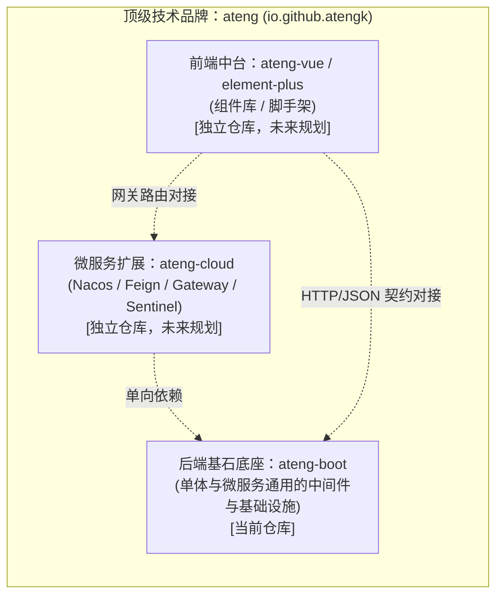

# ateng-boot

> 面向企业级的高内聚、轻量级、开箱即用的 Spring Boot 3 & JDK 17 基础设施与中间件 Starter 套件。

[](https://github.com/atengk/ateng-boot/actions/workflows/ci.yml)
[](https://central.sonatype.com/artifact/io.github.atengk/ateng-boot)
[](https://www.oracle.com/java/)
[](https://spring.io/projects/spring-boot)
[](https://baomidou.com/)
[](LICENSE)
[](https://github.com/atengk/ateng-boot/pulls)

---

## 1. 项目愿景与生态矩阵

`ateng-boot` 专注于为企业级 Spring Boot 3 应用提供高质量、开箱即用的基础设施和中间件赋能。作为 `ateng` 顶级技术品牌的基础底座，采用**多仓解耦演进（Multi-repo）**架构：



- **基石定位**：无论是单体应用，还是作为 `ateng-cloud` 微服务节点的基础依赖，`ateng-boot` 均作为统一底层支撑；
- **非侵入与低耦合**：不绑定具体业务模型，业务工程可自由引入、按需组装；
- **纯原生零臃肿**：彻底杜绝重型外部工具包，100% 依托 JDK 17 原生能力与 Spring 6 官方基准；
- **显式契约原则**：Controller 统一显式声明返回 `Result<T>`，依托强类型契约自洽，坚决杜绝全局 `@ResponseBodyAdvice` 自动拦截包装。

---

## 2. 模块拓扑与专属文档

`ateng-boot` 遵循“**子模块内聚**”文档拓扑，每个模块均具备自包含的独立使用文档与代码范式：

| 模块名称 | 坐标 (ArtifactId) | 职责定位 | 详细使用文档 |
| :--- | :--- | :--- | :---: |
| **核心通用底座** | `ateng-boot-core` | 统一 API 响应契约、异常体系、业务断言、雪花发号器、全场景脱敏、加解密工具 | [查看文档](./ateng-boot-core/README.md) |
| **Web 运行时增强** | `ateng-boot-web` | 链路追踪 `TraceFilter`、全局异常防御、自适应防重幂等、自适应限流、动态 CORS、双向加签验签、流式下载 | [查看文档](./ateng-boot-web/README.md) |
| **持久层增强底座** | `ateng-boot-mybatis-plus` | 实体五级继承链、审计填充、行级多租户、AST 数据权限、分批批量插入、存储透明加密与出库脱敏 | [查看文档](./ateng-boot-mybatis-plus/README.md) |
| **一键全家桶聚合** | `ateng-boot-all` | 纯依赖聚合 Jar，一键传递引入 core、web 与 mybatis-plus 全部构件 | [查看文档](./ateng-boot-all/README.md) |
| **BOM 管控中心** | `ateng-boot-bom` | 依赖版本统管清单（纯 `<dependencyManagement>`），下游按需引入免配版本号 | [查看文档](./ateng-boot-bom/README.md) |
| **自验演示套件** | `ateng-boot-samples` | 基于 H2 内存库与 MockMvc 的端到端自动化测试金字塔与工程化最佳实践 Demo | [查看文档](./ateng-boot-samples/README.md) |

---

## 3. 核心特性矩阵

| 特性维度 | 常见痛点 | `ateng-boot` 解决方案 | 归属模块 | 架构决策 |
| :--- | :--- | :--- | :---: | :---: |
| **响应契约** | `@ResponseBodyAdvice` 导致 String 强转报错、污染 Swagger 与文件下载 | 坚持显式契约：Controller 声明 `Result<T>`，提供链式工厂与 `getOrThrow()` | `core` | [ADR-0002](./docs/adr/0002-explicit-result-contract-no-response-body-advice.md) |
| **分布式发号** | 依赖第三方组件或中心化服务，且多套发号器时间戳规则割裂 | 纯原生 `Snowflake` 引擎（2026 纪元、$\le 5\text{ms}$ 回拨自旋、$> 5\text{ms}$ 熔断）与 `IdUtil` 门面 | `core` | [ADR-0020](./docs/adr/0020-zero-bloat-distributed-id-and-mask-strategy.md) |
| **全场景脱敏** | 仅覆盖基础字段；业务层手写星号导致脏数据写回数据库 | `DesensitizeUtil` 覆盖地址/车牌/IP/税号等 10+ 维度；出库 Jackson 动态打码 | `core` | [ADR-0020](./docs/adr/0020-zero-bloat-distributed-id-and-mask-strategy.md) |
| **数字精度** | 64 位雪花 Long 传到前端超出 $2^{53}-1$ 导致末尾截断失真 | 注册 `Jackson2ObjectMapperBuilderCustomizer` 将 Long/BigInteger 序列化为 String | `web` | [ADR-0005](./docs/adr/0005-jackson-customizer-over-objectmapper-override.md) |
| **全链路追踪** | 单体无 APM 时日志串联困难，跨线程上下文丢失 | `TraceFilter` 自动注入/回写 `X-Trace-Id`；受管线程池透传 MDC 与操作人 | `web` | [ADR-0004](./docs/adr/0004-http-200-with-business-code-and-exception-masking.md) |
| **异常脱敏** | 生产报错直接向前端暴露 SQL 语法与数据表结构 | 全局异常处理器未知异常生产脱敏，内部堆栈与 traceId 仅记录于后台日志 | `web` | [ADR-0004](./docs/adr/0004-http-200-with-business-code-and-exception-masking.md) |
| **接口幂等防重** | 并发连击、网络重发导致重复创建订单 | `@Idempotent` 切面提供 Redisson -> Redis -> 内存 三级自适应锁 | `web` | [ADR-0013](./docs/adr/0013-spi-based-hybrid-idempotent-engine.md) |
| **流量限流防刷** | 恶意刷接口盗刷短信、突发洪峰打爆数据库 | `@RateLimiter` 切面提供 Redisson -> Redis (Lua) -> 内存 令牌桶防刷 | `web` | [ADR-0014](./docs/adr/0014-three-tier-adaptive-rate-limiter-engine.md) |
| **双向加签验签** | OpenAPI 与移动端通信被抓包篡改或重放 | `@ApiSign` 切面提供 HMAC-SHA256 / RSA 双向加签验签与防重放窗口 | `web` | [ADR-0016](./docs/adr/0016-dual-direction-api-signature-and-anti-replay-engine.md) |
| **流式文件下载** | 每次手写 Header 繁琐且浏览器常中文乱码 | `ServletUtil` 遵循 RFC 6266 双重文件名编码，一键输出字节/输入流 | `web` | [ADR-0021](./docs/adr/0021-core-baseline-convergence-and-zero-bloat-freeze-strategy.md) |
| **数据安全分离** | 业务层直接修改实体属性破坏内存真明文 | 存储加密（`EncryptTypeHandler`）与视图脱敏（`SensitiveJsonSerializer`）分离 | `mybatis-plus` | [ADR-0012](./docs/adr/0012-lifecycle-separated-data-security.md) |
| **行级多租户** | 每条 SQL 手工拼接 `tenant_id` 容易疏漏越权 | JSqlParser AST 语法树动态注入；`@IgnoreTenant` 与闭包短路放行 | `mybatis-plus` | [ADR-0017](./docs/adr/0017-multi-tenant-row-level-isolation-architecture.md) |
| **细粒度数据权限** | 动态拼接 SQL 容易引发 SQL 注入漏洞 | 声明式 `@DataScope` 自动重写 AST 条件；多表别名防御与超管秒级放行 | `mybatis-plus` | [ADR-0018](./docs/adr/0018-declarative-data-permission-engine-architecture.md) |
| **高效批量插入** | 原生 `saveBatch` 循环单条 Insert 网络 RTT 极高 | `insertBatchSomeColumn` 单条多值批量插入；`BatchUtil` 自动切片防溢出 | `mybatis-plus` | [ADR-0019](./docs/adr/0019-native-high-performance-batch-insert-engine.md) |
| **契约解耦** | ORM 的 `Page<T>` 泄露给 Controller 造成属性噪音 | 统一入参 `PageQuery`，出参 `PageResult<VO>`，`PageUtil` 流式纯净转换 | `mybatis-plus` | [ADR-0010](./docs/adr/0010-transport-pagination-contract-decoupling.md) |

---

## 4. 快速接入指南

### 方式一：一键全家桶模式（最省心，极速起步）

适用于标准单体业务应用：

```xml
<dependencies>
    <!-- 一键引入全部核心底座与中间件增强 -->
    <dependency>
        <groupId>io.github.atengk</groupId>
        <artifactId>ateng-boot-all</artifactId>
        <version>0.0.5</version>
    </dependency>

    <!-- 按需引入实际业务使用的数据库驱动，例如 MySQL -->
    <dependency>
        <groupId>com.mysql</groupId>
        <artifactId>mysql-connector-j</artifactId>
        <scope>runtime</scope>
    </dependency>
</dependencies>
```

### 方式二：BOM 按需精细化引入（推荐企业级微服务最佳实践）

适用于微服务节点或需要严格控制依赖传递的工程：

```xml
<dependencyManagement>
    <dependencies>
        <!-- 引入 ateng-boot 统一依赖物料清单 -->
        <dependency>
            <groupId>io.github.atengk</groupId>
            <artifactId>ateng-boot-bom</artifactId>
            <version>0.0.5</version>
            <type>pom</type>
            <scope>import</scope>
        </dependency>
    </dependencies>
</dependencyManagement>

<dependencies>
    <!-- 仅按需引入 Web 与持久层（免配版本号） -->
    <dependency>
        <groupId>io.github.atengk</groupId>
        <artifactId>ateng-boot-web</artifactId>
    </dependency>
    <dependency>
        <groupId>io.github.atengk</groupId>
        <artifactId>ateng-boot-mybatis-plus</artifactId>
    </dependency>
</dependencies>
```

---

## 5. 一分钟极速起步 (Quick Start)

### 核心 Controller 范式
```java
@RestController
@RequestMapping("/users")
public class UserController {

    @Autowired
    private UserService userService;

    @GetMapping("/{id}")
    public Result<UserVO> getUser(@PathVariable Long id) {
        User user = userService.getById(id);
        // 语义化业务断言：空时自动抛出 BusinessException 转译为 HTTP 200 业务错误
        BusinessAssert.notNull(user, CommonResultCode.NOT_FOUND);
        return Result.success(UserVO.from(user));
    }
}
```

### 前端收到的 JSON 载荷
```json
{
  "code": 200,
  "msg": "操作成功",
  "data": {
    "id": "104485532445560832",
    "username": "ateng",
    "createTime": "2026-10-16 16:00:00"
  },
  "timestamp": 1776326400000,
  "success": true,
  "traceId": "c8a14b0365734fb4864f7bdf753b890a"
}
```
> **自动生效的特性**：HTTP 保持标准 200、全局注入链路 `traceId` 与响应头 `X-Trace-Id`、64 位雪花 Long 自动转 String 防前端截断、时间自动标准化格式化。

### 本地样例一键运行 (Demo Samples)
```bash
# 启动样例演示工程（内置 H2 内存库与完整自验用例）
mvn -pl ateng-boot-samples spring-boot:run
```

---

## 6. 全局架构决策记录 (ADR)

全生命周期架构演进与设计权衡详见 [架构决策记录看板 (ADR)](./docs/adr/README.md)：

- [ADR-0001: 多仓解耦架构与 ateng 顶层品牌矩阵](./docs/adr/0001-multi-repo-brand-matrix.md)
- [ADR-0002: 坚持显式 API 响应契约，拒绝 ResponseBodyAdvice 自动包装](./docs/adr/0002-explicit-result-contract-no-response-body-advice.md)
- [ADR-0003: 依赖管理采用 BOM Import 模式而非继承 parent](./docs/adr/0003-dependency-management-via-bom-import.md)
- [ADR-0004: 全局统一 HTTP 200 响应与生产级未知异常脱敏](./docs/adr/0004-http-200-with-business-code-and-exception-masking.md)
- [ADR-0005: 采用 Jackson2ObjectMapperBuilderCustomizer 挂载定制而非覆盖 ObjectMapper](./docs/adr/0005-jackson-customizer-over-objectmapper-override.md)
- [ADR-0006: 依赖版本基线锁定与升级治理策略](./docs/adr/0006-dependency-baseline-and-upgrade-strategy.md)
- [ADR-0007: Maven 中央仓库发布解耦与 CI 纯净化治理决策](./docs/adr/0007-maven-publishing-and-clean-ci-pipeline.md)
- [ADR-0008: 自动化发布流、变更日志生成与长青文档同步](./docs/adr/0008-automated-release-changelog-and-evergreen-docs.md)
- [ADR-0009: 双分支演进模型：main 只读发布与 dev 活跃开发](./docs/adr/0009-dual-branch-workflow-main-release-and-dev-active.md)
- [ADR-0010: 传输层分页契约解耦与 ORM 内部属性彻底隔离](./docs/adr/0010-transport-pagination-contract-decoupling.md)
- [ADR-0011: 零重型外部依赖与上下文就近内聚工具集](./docs/adr/0011-zero-bloat-and-co-located-utilities.md)
- [ADR-0012: 数据安全生命周期分离：存储加密与视图脱敏](./docs/adr/0012-lifecycle-separated-data-security.md)
- [ADR-0013: 基于 SPI 抽象与两级存储自适应的接口防重幂等引擎架构](./docs/adr/0013-spi-based-hybrid-idempotent-engine.md)
- [ADR-0014: 基于 SPI 抽象与三级自适应令牌桶的接口限流防刷引擎架构](./docs/adr/0014-three-tier-adaptive-rate-limiter-engine.md)
- [ADR-0015: 动态跨域安全策略与凭证安全反射架构](./docs/adr/0015-dynamic-cors-and-credentials-safe-origin-reflection.md)
- [ADR-0016: 双向 API 数据加签验签与防重放引擎架构](./docs/adr/0016-dual-direction-api-signature-and-anti-replay-engine.md)
- [ADR-0017: 基于 JSqlParser AST 的行级多租户安全隔离架构](./docs/adr/0017-multi-tenant-row-level-isolation-architecture.md)
- [ADR-0018: 基于 JSqlParser AST 的声明式细粒度数据权限引擎架构](./docs/adr/0018-declarative-data-permission-engine-architecture.md)
- [ADR-0019: 原生高性能分批批量插入引擎架构决策](./docs/adr/0019-native-high-performance-batch-insert-engine.md)
- [ADR-0020: 零膨胀分布式 ID 引擎与全场景敏感数据脱敏架构决策](./docs/adr/0020-zero-bloat-distributed-id-and-mask-strategy.md)
- [ADR-0021: 存量核心基线收敛与零冗余封版战略决策](./docs/adr/0021-core-baseline-convergence-and-zero-bloat-freeze-strategy.md)

---

## 7. 质量门禁与工程规范

- **反应堆单测准出门禁**：全工程各模块执行 `mvn clean test` 100% 绿色通过方可交付；
- **双分支开发铁律**：`main` 仅作为只读发布主干，日常研发一律收口于 `dev` 分支；
- **受控提交**：遵循 Conventional Commits 规约，统一调用 `bash scripts/commit.sh` 门面脚本；
- **持续集成流水线守护**：推送至远端后由 GitHub Actions 矩阵执行 JDK 17 & 21 双版本全自动验证。
