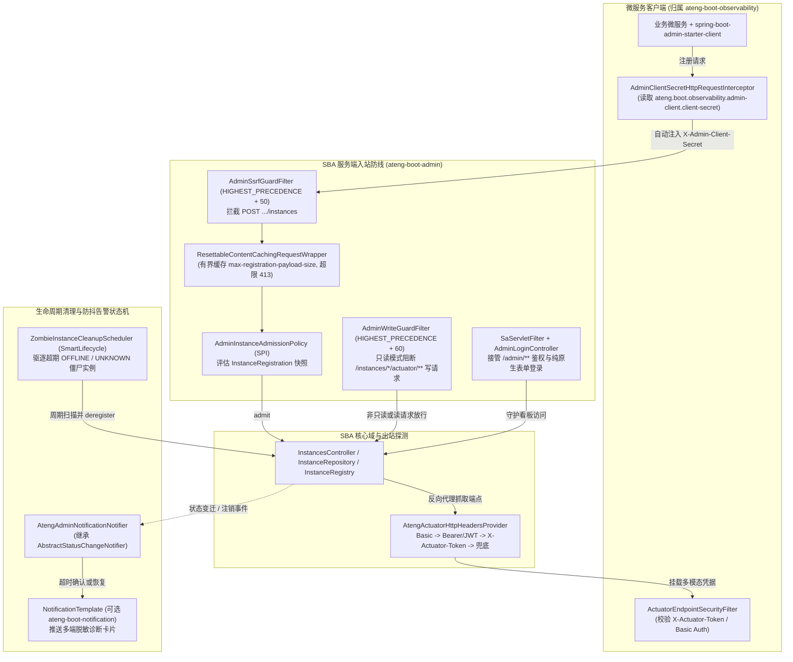
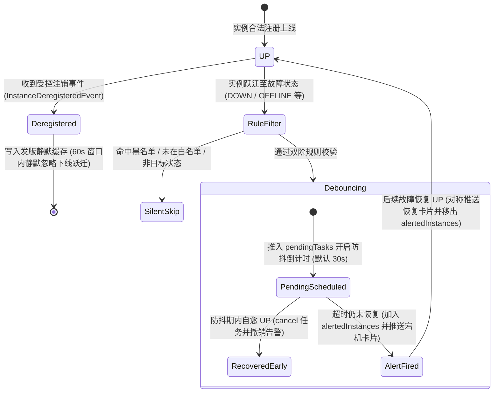

# ateng-boot-admin 企业级运维管控中心 Starter

> 基于 Spring Boot Admin 3.3.4 与 Sa-Token 鉴权生态构建的工业级微服务集中监控运维看板 Starter。100% 排除笨重易冲突的 Spring Security，提供内置拟物化响应式表单登录、防 SSRF 实例注册防火墙与有界可复位请求流（`413` 载荷防爆）、动态实例准入策略 SPI、控制台只读安全守卫、出站 Actuator 四阶多模态凭据级联推导、容器云离线僵尸实例自动清理调度器，以及集防抖、发版静默与富文本诊断脱敏于一体的告警状态机。

---

## 0. 特性与公共 API 全景速查矩阵 (Feature & API Panorama Matrix)

| 特性分类 | 特性名称 | 核心门面 / SPI / 模型 | 关键配置项 (`ateng.boot.admin.server.*`) | 关键 API 签名 / 核心行为 | 锚定验证源头 (*Test / Sample) |
| :--- | :--- | :--- | :--- | :--- | :--- |
| **自动化装配** | SBA 服务端防御性自动装配 | `AtengAdminServerAutoConfiguration` | `enabled`（默认 `true`） | `@ConditionalOnBean(Marker.class)` 守卫；全量 Bean 标配 `@ConditionalOnMissingBean`；装配登录页、Sa-Token 守卫、SSRF/只读过滤器、抓取凭据与清理通知组件 | `AtengAdminServerAutoConfigurationTest` |
| **路径规范化** | 上下文路径规范化静态工具 | `AtengAdminServerAutoConfiguration` | `spring.boot.admin.context-path` | `static String normalizeContextPath(String contextPath)`：收敛空白、补齐前导 `/`、剥离尾斜杠与根 `/` | `AtengAdminServerAutoConfigurationTest`<br>`AdminAdmissionController` |
| **调度器托管** | 告警防抖共享调度器 Bean | `sbaNotificationTaskScheduler` (`ThreadPoolTaskScheduler`) | - | 名称 `sbaNotificationTaskScheduler`，`destroyMethod = "destroy"`，1 线程守护调度池 `sba-notify-debounce-` | `AtengAdminServerAutoConfigurationTest` |
| **路由安全守卫** | Sa-Token 控制台过滤守卫 | `adminSaServletFilter` (`SaServletFilter`) | `enabled` | 拦截 `{contextPath}/**`，放行登录/登出/静态资源与生命周期请求（`POST /instances`、`DELETE /instances/{id}`）；未授权 HTML 302 重定向、Ajax 返回 `401` | `AdminLoginControllerTest`<br>`AdminSampleIntegrationTest` |
| **原生登录控制** | 纯原生拟物化表单登录控制器 | `AdminLoginController` | `username`（默认 `admin`）<br>`password`（默认 `admin`） | `String renderLoginPage(String error, String logout)` (`GET /login`)<br>`void doLogin(String username, String password, HttpServletResponse)` (`POST /login`)<br>`void doLogout(HttpServletResponse)` (`GET/POST /logout`) | `AdminLoginControllerTest`<br>`AdminSampleIntegrationTest` |
| **认证扩展 SPI** | 控制台登录认证扩展接口与默认实现 | `AdminAuthProvider` (SPI)<br>`DefaultPropertiesAdminAuthProvider` | `username`<br>`password` | `boolean authenticate(String username, String password)`：默认实现使用 `MessageDigest.isEqual` 恒定时间比对，支持自定义 Bean 平滑接管 | `AdminAuthProviderTest`<br>`SampleAdminAuthProvider`<br>`AdminAdmissionController` |
| **注册快照模型** | 实例注册不可变快照领域模型 | `InstanceRegistration` | - | `static InstanceRegistration of(String name, String serviceUrl, String managementUrl, String healthUrl)`、`static InstanceRegistration from(Registration)`、`static InstanceRegistration parse(JsonNode)`、`builder()` / `toBuilder()`；`getName()` / `getServiceUrl()` / `getManagementUrl()` / `getHealthUrl()` / `getSource()` / `getMetadata()` | `DefaultAdminInstanceAdmissionPolicyTest` |
| **准入决策模型** | 实例注册准入评估结果模型 | `AdminAdmissionResult` | - | `static AdminAdmissionResult admit()`<br>`static AdminAdmissionResult reject(String reason)`<br>`static AdminAdmissionResult reject(HttpStatus status, String reason)`<br>`boolean isAllowed()`、`boolean isRejected()`、`HttpStatus getStatus()`、`String getReason()` | `DefaultAdminInstanceAdmissionPolicyTest` |
| **准入扩展 SPI** | 动态实例注册准入策略 SPI 与默认实现 | `AdminInstanceAdmissionPolicy` (SPI)<br>`DefaultAdminInstanceAdmissionPolicy` | `client-secret`<br>`allow-local-instances`<br>`allowed-url-patterns` | 常量 `CLIENT_SECRET_HEADER` (`"X-Admin-Client-Secret"`)；`AdminAdmissionResult evaluate(InstanceRegistration registration, HttpServletRequest request)`：默认核验集群密钥、`http`/`https` Scheme、链路本地（`169.254.0.0/16`、`fe80::/10`）、IPv4/IPv6 多编码环回与 `trim()` 后正则白名单 | `DefaultAdminInstanceAdmissionPolicyTest`<br>`SampleInstanceAdmissionPolicy`<br>`AdminAdmissionController` |
| **SSRF 防火墙** | 实例注册防 SSRF 与载荷上限过滤器 | `AdminSsrfGuardFilter`<br>`AdminSsrfGuardFilter.PayloadTooLargeException` | `client-secret`<br>`allow-local-instances`<br>`allowed-url-patterns`<br>`max-registration-payload-size` | Bean `@Order(HIGHEST_PRECEDENCE + 50)`；常量 `CLIENT_SECRET_HEADER`、`DEFAULT_MAX_PAYLOAD_BYTES` (`1MB`)；拦截 `POST .../instances` 委托准入 SPI，超限抛 `PayloadTooLargeException` 返回 `413` | `AdminSsrfGuardFilterTest`<br>`AdminSampleIntegrationTest` |
| **可复位请求流** | 有界可重读 HTTP 请求包装器 | `AdminSsrfGuardFilter.ResettableContentCachingRequestWrapper` | `max-registration-payload-size`（默认 `1MB`） | 继承 `HttpServletRequestWrapper`：`getContentAsByteArray()`、`getInputStream()`、`getReader()`；分块有界读取防大报文 OOM 与下游 `EOFException` | `AdminSsrfGuardFilterTest` |
| **只读安全守卫** | 控制台高危写操作物理拦截过滤器 | `AdminWriteGuardFilter` | `enable-write-operations`（默认 `true`） | `@Order(HIGHEST_PRECEDENCE + 60)` / `int getOrder()`；`boolean isActuatorProxyEndpoint(String uri)`、`boolean shouldBlock(String method, String uri)`；只读模式拦截 `/instances/{id}/actuator/**` 写方法（`POST`/`PUT`/`DELETE`/`PATCH`）返回 `403` | `AdminWriteGuardFilterTest`<br>`AdminGovernanceController` |
| **出站抓取穿透** | 异构微服务 Actuator 凭据级联提供者 | `AtengActuatorHttpHeadersProvider` | `default-actuator-token` | 实现 SBA `HttpHeadersProvider`：`HttpHeaders getHeaders(Instance instance)`；暴露常量 `ACTUATOR_TOKEN_HEADER`、`METADATA_ACTUATOR_TOKEN`、`METADATA_USER_NAME`、`METADATA_USER_PASSWORD`、`METADATA_SPRING_SECURITY_USER_NAME`、`METADATA_SPRING_SECURITY_USER_PASSWORD`、`METADATA_BEARER_TOKEN`、`METADATA_JWT_TOKEN`；按 `Basic -> Bearer/JWT -> X-Actuator-Token -> 全局兜底` 四阶优先级挂载标头 | `AtengActuatorHttpHeadersProviderTest`<br>`AdminGovernanceController` |
| **僵尸清理调度** | 离线僵尸实例受管周期清理器 | `ZombieInstanceCleanupScheduler` | `cleanup.enabled`（默认 `false`）<br>`cleanup.interval`（默认 `1h`）<br>`cleanup.zombie-threshold`（默认 `24h`） | 实现 `SmartLifecycle`：`int cleanZombies()`、`start()`、`stop()`、`stop(Runnable)`、`isRunning()`、`getPhase()`、`isAutoStartup()`；安全注销超期 `OFFLINE`/`UNKNOWN` 实例 | `ZombieInstanceCleanupSchedulerTest`<br>`AdminLifecycleController` |
| **防抖告警状态机** | 状态跃迁防抖、发版静默与多端卡片通知器 | `AtengAdminNotificationNotifier` | `debounce-duration`（默认 `30s`）<br>`alert.included-services`<br>`alert.excluded-services`<br>`alert.notify-statuses` | 继承 `AbstractStatusChangeNotifier` 实现 `SmartLifecycle`：常量 `DEFAULT_DEREGISTRATION_SILENCE_WINDOW` (`60s`)；`notify(InstanceEvent)`、`onInstanceDeregistered(InstanceDeregisteredEvent)`、`doNotify(...)`、`start()`、`stop()`、`isRunning()`、`getPendingTasks()`、`getAlertedInstances()`、`getDeregisteredInstances()` | `AtengAdminNotificationNotifierTest`<br>`AdminAlertController` |
| **强类型配置属性** | 服务端全量强类型配置属性与嵌套模型 | `AtengAdminServerProperties` | `ateng.boot.admin.server.*` | 包含顶层安全/防抖/`DataSize` 上限字段，以及 `@NestedConfigurationProperty` 嵌套 `CleanupProperties` 与 `AlertProperties` | `AtengAdminServerAutoConfigurationTest` |

---

## 1. 模块定位与快速起步 (Quick Start & Happy Path)

### 1.1 模块定位与 Maven 坐标
`ateng-boot-admin` 专职承担微服务集中监控运维中心（Server 端）职责，解决官方 Spring Boot Admin 强绑定 Spring Security、缺少原生登录界面、注册接口暴露 SSRF 风险、出站抓取难以适配异构加密 Actuator、控制台高危写操作失控以及 K8s 滚动发布引发告警风暴与僵尸实例堆积等问题。

```xml
<dependency>
    <groupId>io.github.atengk</groupId>
    <artifactId>ateng-boot-admin</artifactId>
</dependency>
```

> [!IMPORTANT]
> `ateng-boot-admin` 仅用于独立部署的监控运维中心服务端工程，**严禁引入业务微服务中，亦严禁纳管进 `ateng-boot-all` 聚合包**。需要接入看板的业务微服务，只需引入 `ateng-boot-observability` 与官方 `spring-boot-admin-starter-client` 即可。

### 1.2 最小可用配置 (`application.yml`)
1:1 提取自已实测全绿的 [sample-admin application.yml](../ateng-boot-samples/ateng-boot-sample-admin/src/main/resources/application.yml)：

```yaml
server:
  port: 8080

spring:
  application:
    name: ateng-boot-sample-admin
  config:
    import: "optional:classpath:application-local.yml"
  boot:
    admin:
      context-path: /admin

ateng:
  boot:
    admin:
      server:
        enabled: true
        username: admin
        password: admin
        client-secret: CLUSTER_SECRET_DEMO_2026
        default-actuator-token: DEFAULT_ACTUATOR_TOKEN_DEMO
        debounce-duration: 30s
        allow-local-instances: true
        enable-write-operations: true
        max-registration-payload-size: 1MB
        cleanup:
          enabled: true
          interval: 1h
          zombie-threshold: 24h
        alert:
          excluded-services:
            - "silent-*"
          notify-statuses:
            - "DOWN"
            - "OFFLINE"
    # 以下 observability 配置仅用于 ateng-boot-sample-admin 单体自注册联调演示；独立部署 SBA 服务端可省略
    observability:
      security:
        token: CLIENT_ACTUATOR_TOKEN_DEMO
      admin-client:
        enabled: true
        client-secret: CLUSTER_SECRET_DEMO_2026
```

### 1.3 开箱极简启动类与验证链路
1:1 提取自 [AdminSampleApplication.java](../ateng-boot-samples/ateng-boot-sample-admin/src/main/java/io/github/atengk/boot/sample/admin/AdminSampleApplication.java)：

```java
package io.github.atengk.boot.sample.admin;

import de.codecentric.boot.admin.server.config.EnableAdminServer;
import org.springframework.boot.SpringApplication;
import org.springframework.boot.autoconfigure.SpringBootApplication;

@EnableAdminServer
@SpringBootApplication
public class AdminSampleApplication {

    public static void main(String[] args) {
        SpringApplication.run(AdminSampleApplication.class, args);
    }
}
```

- **极速验证链路**：
  1. 启动后访问 `http://localhost:8080/admin`（浏览器 HTML 请求），未认证时 `SaServletFilter` 自动 `302` 重定向至 `/admin/login`；
  2. 在内置拟物化登录页提交 `admin / admin`，认证通过后植入 Sa-Token 会话 Cookie 并跳转至 SBA 监控首页；
  3. 退出登录访问 `/admin/logout`，注销会话并携带 `?logout=true` 重定向回登录页；
  4. 通过样例工程暴露的 `/sample/admin/**` 四大领域 REST 接口可一键交互体验全量特性。

---

## 2. 核心架构与跨模块协同 (Architecture, Cross-Module Synergy & Invariants)



### 跨模块客户端协同边界说明
- 客户端自动挂载 `X-Admin-Client-Secret` 标头的 `AdminClientSecretHttpRequestInterceptor` 与 `AtengAdminClientAutoConfiguration` **归属 `ateng-boot-observability` 模块**（配置前缀为 `ateng.boot.observability.admin-client.*`），不属于 `ateng-boot-admin` 自身导出 API。
- 当业务微服务引入 `ateng-boot-observability` 并开启 `ateng.boot.observability.admin-client.enabled=true` 时，客户端向 `ateng-boot-admin` 发起注册的 `RestTemplate` 会自动注入 `X-Admin-Client-Secret`，无需业务代码显式改造。

### 核心设计不变量 (Design Invariants)
1. **零 Spring Security 与三套凭据正交不变量**：彻底排除 `spring-boot-starter-security`；严格区分 **Console Authentication**（看板人员登录）、**Cluster Admission Secret**（`X-Admin-Client-Secret` 集群准入防伪）与 **Outbound Actuator Credential Cascade**（出站端点抓取凭据），严禁混用。
2. **有界无损流与 SSRF 防穿透不变量**：`ResettableContentCachingRequestWrapper` 继承 `HttpServletRequestWrapper` 实施分块有界读取（默认 `1MB`，超限返回 `413`），兼顾下游 SBA 反序列化重复消费与防超大畸形报文 OOM。
3. **三类静默正交语义不变量**：**Fault Debounce Window**（可配置防抖窗口）、**Graceful Deregistration Silence**（60 秒发版注销静默期）与 **Alert Rule Filtering**（双阶通配符黑白名单与状态白名单过滤）各司其职。
4. **Zero-Entity-Leakage 传输隔离不变量**：样例对外接口入参全部采用 JSR-303 校验 Request DTO，出参统一包装 `Result<T>` 脱敏 VO，绝对禁止泄露 SBA `Instance`、`Registration` 或明文口令/令牌。

---

## 3. 控制台鉴权与防 SSRF 注册防线套件 (Console Auth & SSRF Registration Firewall)

### 3.1 Sa-Token 路由守卫与纯原生表单登录 (`AdminLoginController` / `AdminAuthProvider`)

#### 本节专属 YAML 配置
```yaml
spring:
  boot:
    admin:
      context-path: /admin  # SBA 挂载路径前缀，登录端点同步映射为 /admin/login 与 /admin/logout

ateng:
  boot:
    admin:
      server:
        enabled: true
        username: admin     # 默认配置认证账号（通过 MessageDigest.isEqual 恒定时间比对）
        password: admin     # 默认配置认证口令（生产环境请修改或注入自定义 AdminAuthProvider）
```

#### 业务实战 Java 代码 (100% 逆向自 Sample)
```java
// 抽取自 AdminAdmissionController (@RequestMapping("/sample/admin/admission"))
@PostMapping("/auth-verify")
public Result<AuthVerifyVO> verifyAdminAuth(@Valid @RequestBody AuthVerifyRequest request) {
    boolean authenticated = authProvider.authenticate(request.getUsername(), request.getPassword());
    String username = request.getUsername().trim();
    String maskedUser;
    if (username.length() <= 1) {
        maskedUser = "*";
    } else if (username.length() <= 3) {
        maskedUser = DesensitizeUtil.mask(username, 1, username.length());
    } else {
        maskedUser = DesensitizeUtil.maskKeepHeadTail(username, 2, 1);
    }
    AuthVerifyVO vo = AuthVerifyVO.builder()
            .authenticated(authenticated)
            .maskedUsername(maskedUser)
            .providerClass(authProvider.getClass().getSimpleName())
            .message(authenticated ? "控制台认证通过" : "账号或访问口令校验未通过")
            .build();
    return Result.success(vo);
}

@GetMapping("/normalize-path")
public Result<ContextPathNormalizeVO> normalizeContextPath(
        @RequestParam(value = "path", defaultValue = "") String path) {
    String normalized = AtengAdminServerAutoConfiguration.normalizeContextPath(path);
    return Result.success(ContextPathNormalizeVO.builder()
            .rawPath(path)
            .normalizedPath(normalized)
            .build());
}
```

#### 核心机制与边界防御
- `AdminLoginController` 直接通过原生内嵌纯白圆角卡片 HTML 渲染 `/login`（并按 `context-path` 同步映射 `{contextPath}/login` 与 `{contextPath}/logout`），无任何 Thymeleaf/Freemarker 模板引擎依赖；
- `adminSaServletFilter` 自动放行登录页、注销、静态资源、健康/信息端点以及微服务客户端生命周期接口（`POST .../instances` 与 `DELETE .../instances/{id}`）；HTML 浏览请求未认证统一 `302` 重定向登录页，Ajax/JSON 请求返回 HTTP `401` 与 `{"code":401,"message":"Unauthorized"}`；
- 账号密码比对采用 `MessageDigest.isEqual` 恒定时间对比，防范时序侧信道攻击。

---

### 3.2 SSRF 注册防火墙与有界可复位流 (`AdminSsrfGuardFilter` / `ResettableContentCachingRequestWrapper`)

#### 本节专属 YAML 配置
```yaml
ateng:
  boot:
    admin:
      server:
        client-secret: CLUSTER_SECRET_DEMO_2026  # 集群准入密钥，校验 X-Admin-Client-Secret
        allow-local-instances: true              # 本地调试放行环回地址；生产环境建议 false
        allowed-url-patterns: []                 # 可选正则白名单（如 "^https?://.*\\.corp\\.internal(:\\d+)?/.*$"）
        max-registration-payload-size: 1MB       # DataSize 强类型注册载荷上限，超限直接拒绝 413
```

#### 业务实战 Java 代码 (100% 逆向自 Sample)
```java
// 抽取自 AdminAdmissionController (@RequestMapping("/sample/admin/admission"))
@PostMapping("/evaluate")
public Result<AdmissionEvaluateVO> evaluateAdmission(@Valid @RequestBody AdmissionEvaluateRequest request,
                                                     HttpServletRequest servletRequest) {
    InstanceRegistration registration = InstanceRegistration.builder()
            .name(request.getServiceName().trim())
            .serviceUrl(request.getServiceUrl().trim())
            .managementUrl(StringUtils.hasText(request.getManagementUrl()) ? request.getManagementUrl().trim() : null)
            .healthUrl(StringUtils.hasText(request.getHealthUrl()) ? request.getHealthUrl().trim() : null)
            .source("sample-http-preview")
            .build();

    HttpServletRequest evaluatedRequest = StringUtils.hasText(request.getClientSecret())
            ? new ClientSecretOverrideRequestWrapper(servletRequest, request.getClientSecret())
            : servletRequest;

    AdminAdmissionResult result = admissionPolicy.evaluate(registration, evaluatedRequest);
    AdmissionEvaluateVO vo = AdmissionEvaluateVO.builder()
            .allowed(result.isAllowed())
            .httpStatus(result.getStatus().value())
            .reason(result.getReason())
            .serviceName(registration.getName())
            .policyClass(admissionPolicy.getClass().getSimpleName())
            .build();
    return Result.success(vo);
}
```

- 端到端注册端点（`POST /admin/instances`）的 `413 Payload Too Large` 与 IPv6 环回拦截验证见 [AdminSampleIntegrationTest.java](../ateng-boot-samples/ateng-boot-sample-admin/src/test/java/io/github/atengk/boot/sample/admin/AdminSampleIntegrationTest.java)。

#### 核心机制与边界防御
- `AdminSsrfGuardFilter` 仅精确匹配 `POST` 且末尾为 `/instances` 的注册请求（不误伤 `/api/user-instances` 等业务路径）；
- `ResettableContentCachingRequestWrapper` 先校验 `Content-Length`，再以 `4096` 字节分块读取并累加计数（同时防御 `Content-Length: -1` 分块传输欺骗），一旦超出 `maxRegistrationPayloadSize` 立即中止读取并响应 `413 Payload Too Large`（`maxRegistrationPayloadSize <= 0` 时自动回退 `1MB` 默认上限）；
- JSON 解析失败时返回 `400 Bad Request`（`Malformed JSON registration payload`）；通过准入后将包装请求继续透传给下游 SBA `InstancesController`，保证 `getInputStream()` 与 `getReader()` 可被无损重复消费。

---

### 3.3 动态实例准入策略 SPI (`AdminInstanceAdmissionPolicy` / `InstanceRegistration`)

#### 本节专属 YAML 配置
```yaml
ateng:
  boot:
    admin:
      server:
        client-secret: CLUSTER_SECRET_DEMO_2026  # 由 DefaultAdminInstanceAdmissionPolicy 自动核验
        allow-local-instances: true              # 决定是否放行 localhost / 127.0.0.1 / [::1] / 0.0.0.0
```

#### 业务实战 Java 代码 (100% 逆向自 Sample)
```java
@Component
public class SampleInstanceAdmissionPolicy implements AdminInstanceAdmissionPolicy {

    private final DefaultAdminInstanceAdmissionPolicy defaultPolicy;

    public SampleInstanceAdmissionPolicy(AtengAdminServerProperties properties) {
        this.defaultPolicy = new DefaultAdminInstanceAdmissionPolicy(properties);
    }

    @Override
    public AdminAdmissionResult evaluate(InstanceRegistration registration, HttpServletRequest request) {
        // 1. 委托默认准入策略执行集群防伪密钥与防 SSRF 审查
        AdminAdmissionResult defaultResult = defaultPolicy.evaluate(registration, request);
        if (defaultResult.isRejected()) {
            return defaultResult;
        }

        // 2. 企业级命名治理扩展：禁止未批复或违规前缀服务接入生产监控看板
        if (registration != null && StringUtils.hasText(registration.getName())) {
            String serviceName = registration.getName().trim();
            if (serviceName.startsWith("forbidden-") || serviceName.startsWith("unapproved-")) {
                return AdminAdmissionResult.reject(
                        HttpStatus.FORBIDDEN,
                        "Service name rejected by sample admission policy: " + serviceName
                );
            }
        }

        return AdminAdmissionResult.admit();
    }
}
```

#### 核心机制与边界防御
- `DefaultAdminInstanceAdmissionPolicy.isUrlSafe` 对 `serviceUrl`、`managementUrl` 与 `healthUrl` 执行三重强制审查：
  1. **协议白名单**：先对原始 URL 执行 `trim()`，仅允许 `http` 与 `https` Scheme，拦截 `ftp://`、`file://`、`gopher://` 及无协议 URL；
  2. **纯 JDK 无 DNS 查表分类防御**：借助原生 IPv4（含缩写与八/十六/十进制整数形式）及 IPv6（含非标准零压缩、Zone ID `%25...` 及 IPv4-mapped/compatible 内嵌地址）离线解析，**绝对硬阻断** `169.254.0.0/16` 与 `fe80::/10` 链路本地网段；并在 `allow-local-instances=false` 时统一拦截 `localhost` / `*.localhost`、`127.0.0.0/8`、`0.0.0.0`、`[::1]`、`[::]` 及各类等价环回编码；
  3. **正则白名单**：若配置了 `allowed-url-patterns`，非空 URL 在 `trim()` 后必须至少匹配其中一条正则表达式；
- SPI 入参使用框架不可变快照模型 `InstanceRegistration`（与 SBA 内部持久化 `Registration` 解耦），决策通过 `AdminAdmissionResult.admit()` / `reject(HttpStatus, String)` 显式返回状态码与拒绝原因。

---

## 4. 控制台只读管控与出站多模态穿透套件 (Write Guard & Outbound Credential Cascade)

### 4.1 只读安全守卫与高危写操作物理拦截 (`AdminWriteGuardFilter`)

#### 本节专属 YAML 配置
```yaml
ateng:
  boot:
    admin:
      server:
        enable-write-operations: true  # Sample 体验基线默认为 true；生产环境推荐设为 false 启用只读守卫
```

#### 业务实战 Java 代码 (100% 逆向自 Sample)
```java
// 抽取自 AdminGovernanceController (@RequestMapping("/sample/admin/governance"))
private static final String DEFAULT_PROBE_METHOD = "POST";
private static final String DEFAULT_PROBE_URI = "/admin/instances/order-core-01/actuator/loggers/root";

@PostMapping("/write-guard")
public Result<WriteGuardStatusVO> toggleWriteGuard(@Valid @RequestBody WriteGuardToggleRequest request) {
    String method = StringUtils.hasText(request.getProbeMethod()) ? request.getProbeMethod().trim() : DEFAULT_PROBE_METHOD;
    String uri = StringUtils.hasText(request.getProbeUri()) ? request.getProbeUri().trim() : DEFAULT_PROBE_URI;
    return SamplePropertyOverrideSupport.withLock(writeGuardLock, () -> {
        // 仅用于单节点 Sample 沙箱实时体验 AdminWriteGuardFilter 403 拦截与放行切换
        properties.setEnableWriteOperations(request.getEnableWriteOperations());
        return Result.success(buildWriteGuardStatus(method, uri));
    });
}

private WriteGuardStatusVO buildWriteGuardStatus(String probeMethod, String probeUri) {
    String normalizedMethod = probeMethod.toUpperCase(Locale.ROOT);
    boolean proxyEndpoint = writeGuardFilter.isActuatorProxyEndpoint(probeUri);
    boolean wouldBlock = writeGuardFilter.shouldBlock(normalizedMethod, probeUri);
    return WriteGuardStatusVO.builder()
            .enableWriteOperations(properties.isEnableWriteOperations())
            .contextPath(contextPath)
            .probeMethod(normalizedMethod)
            .probeUri(probeUri)
            .actuatorProxyEndpoint(proxyEndpoint)
            .wouldBlock(wouldBlock)
            .build();
}
```

#### 核心机制与边界防御
- `AdminWriteGuardFilter` 优先级为 `HIGHEST_PRECEDENCE + 60`，基于配置规范化后的 `context-path` 精确编译正则 `^{prefix}/instances/[^/]+/actuator(?:/.*)?$`，并通过公共方法 `shouldBlock(method, uri)` 统一承载阻断判定；
- 当 `enable-write-operations=false` 时，拦截上述代理端点的 `POST`、`PUT`、`DELETE`、`PATCH` 请求，直接返回 `403 Forbidden`（`Console write operations are disabled by policy`），阻断在线篡改日志级别、修改配置或关机；
- 严格放行客户端生命周期通信（`POST .../instances` 与 `DELETE .../instances/{id}`）及所有 `GET` 只读端点查询。

---

### 4.2 异构微服务 Actuator 四阶抓取凭据推导 (`AtengActuatorHttpHeadersProvider`)

#### 本节专属 YAML 配置
```yaml
ateng:
  boot:
    admin:
      server:
        default-actuator-token: DEFAULT_ACTUATOR_TOKEN_DEMO  # 第四优先级：实例元数据均无凭据时的全局兜底 X-Actuator-Token
```

#### 业务实战 Java 代码 (100% 逆向自 Sample)
```java
@PostMapping("/headers/preview")
public Result<HeaderDerivePreviewVO> previewOutboundHeaders(@Valid @RequestBody HeaderDerivePreviewRequest request) {
    Registration.Builder regBuilder = Registration.builder()
            .name(request.getServiceName().trim())
            .serviceUrl("http://127.0.0.1:8080/")
            .managementUrl("http://127.0.0.1:8080/actuator")
            .healthUrl("http://127.0.0.1:8080/actuator/health");
    if (request.getMetadata() != null && !request.getMetadata().isEmpty()) {
        regBuilder.metadata(request.getMetadata());
    }
    Instance transientInstance = Instance.create(InstanceId.of("preview-only")).register(regBuilder.build());
    HttpHeaders derived = headersProvider.getHeaders(transientInstance);

    return Result.success(buildMaskedHeaderPreview(request.getServiceName().trim(), request.getMetadata(), derived));
}
```

#### 核心机制与边界防御
`AtengActuatorHttpHeadersProvider.getHeaders(Instance)` 严格按四阶互斥优先级推导认证头（高优先级命中即返回）：
1. **第一优先级（HTTP Basic Auth）**：元数据同时含 `user.name`（或 `spring.security.user.name`）与 `user.password`（或 `spring.security.user.password`），自动合成 `Authorization: Basic <base64>`；
2. **第二优先级（Bearer / JWT）**：元数据含 `bearer-token` 或 `jwt-token`，自动挂载 `Authorization: Bearer <token>`；
3. **第三优先级（实例级自定义 Token）**：元数据含 `actuator-token`，自动挂载 `X-Actuator-Token: <token>`；
4. **第四优先级（服务端全局兜底）**：若上述元数据均未提供且配置了 `default-actuator-token`，则自动填充 `X-Actuator-Token`。

---

## 5. 防抖告警状态机与容器云生命周期治理套件 (Alert State Machine & Lifecycle Governance)

### 5.1 四阶告警防抖与 K8s 发版静默状态机 (`AtengAdminNotificationNotifier`)



#### 本节专属 YAML 配置
```yaml
ateng:
  boot:
    admin:
      server:
        debounce-duration: 30s  # 故障防抖窗口期（强类型 Duration，支持 0s/30s/1m 等）
```

#### 业务实战 Java 代码 (100% 逆向自 Sample)
```java
// 抽取自 AdminAlertController (@RequestMapping("/sample/admin/alert"))
@PostMapping("/status-transition")
public Result<AlertStateSnapshotVO> triggerStatusTransition(@Valid @RequestBody StatusTransitionTriggerRequest request) {
    InstanceId instanceId = InstanceId.of(request.getInstanceId().trim());
    StatusInfo statusInfo = buildStatusInfo(request);

    Instance updated = instanceRepository.compute(instanceId, (id, current) -> {
        if (current == null) {
            return Mono.empty();
        }
        return Mono.just(current.withStatusInfo(statusInfo));
    }).block();
    BusinessAssert.notNull(updated, "未找到目标实例，请先登记演练实例: " + instanceId.getValue());

    InstanceStatusChangedEvent event = new InstanceStatusChangedEvent(
            instanceId,
            updated.getVersion(),
            statusInfo
    );

    boolean immediate = Boolean.TRUE.equals(request.getImmediate());
    AlertStateSnapshotVO snapshot;
    if (immediate) {
        // 在单机沙箱即时演示模式下受锁串行切换 0s 防抖窗口并等待调度与卡片录制闭环完成
        snapshot = SamplePropertyOverrideSupport.withTemporaryOverride(
                debounceOverrideLock,
                properties::getDebounceDuration,
                properties::setDebounceDuration,
                Duration.ZERO,
                () -> {
                    RecordingNotificationTemplate recorder = recordingTemplateProvider.getIfAvailable();
                    long beforeCount = recorder != null ? recorder.getTotalRecordedCount() : 0L;
                    notifier.notify(event).block();
                    awaitPendingTaskIfPresent(instanceId);
                    if (recorder != null
                            && notifier.getAlertedInstances().contains(instanceId)
                            && recorder.getTotalRecordedCount() == beforeCount) {
                        recorder.awaitRecordedCountAfter(beforeCount, Duration.ofSeconds(2));
                    }
                    return buildStateSnapshot();
                }
        );
    } else {
        snapshot = SamplePropertyOverrideSupport.withLock(debounceOverrideLock, () -> {
            notifier.notify(event).block();
            return buildStateSnapshot();
        });
    }

    return Result.success(snapshot);
}

@PostMapping("/graceful-deregister")
public Result<AlertStateSnapshotVO> triggerGracefulDeregister(@Valid @RequestBody GracefulDeregisterRequest request) {
    InstanceId instanceId = InstanceId.of(request.getInstanceId().trim());
    Instance existing = instanceRepository.find(instanceId).block();
    BusinessAssert.notNull(existing, "未找到目标实例，请先登记演练实例: " + instanceId.getValue());

    long baseVersion = existing.getVersion();
    AlertStateSnapshotVO snapshot = SamplePropertyOverrideSupport.withLock(debounceOverrideLock, () -> {
        notifier.notify(new InstanceDeregisteredEvent(instanceId, baseVersion + 1)).block();

        if (StringUtils.hasText(request.getFollowUpFaultStatus())) {
            StatusInfo followUp = SampleStatusConverter.toStatusInfo(request.getFollowUpFaultStatus());
            notifier.notify(new InstanceStatusChangedEvent(instanceId, baseVersion + 2, followUp)).block();
        }

        return buildStateSnapshot();
    });

    return Result.success(snapshot);
}
```

#### 核心机制与边界防御
- `AtengAdminNotificationNotifier` 继承 SBA `AbstractStatusChangeNotifier` 并重写顶层 `notify(InstanceEvent)` 与 `@EventListener onInstanceDeregistered`，无论注销事件经由 SBA 反应式事件管道还是 Spring 事件总线广播均可 100% 捕获；
- **防发版误报**：`DEFAULT_DEREGISTRATION_SILENCE_WINDOW`（`60s`）内该实例后续 `OFFLINE`/`DOWN` 变迁直接忽略，并伴随周期性过期缓存清理（`evictExpiredDeregistrations`）；
- **仅对真实故障发恢复通知**：`alertedInstances` 确保仅在防抖超时后真实发过宕机卡片的实例恢复 `UP` 时，才对称发送恢复卡片；在防抖期内自愈的闪断零噪音；
- **三态生命周期与并发守卫**：采用 `LifecycleState`（`CREATED`/`RUNNING`/`STOPPED`）与 `ReentrantLock` 保护排期、回调与启停流转（释放锁后执行出站通知 I/O）；严格区分 `internalScheduler` 归属，未 `start()` 直接 `stop()` 亦确定性清理并关闭内部调度器（外部注入 Spring 托管 `sbaNotificationTaskScheduler` 时不误杀），且 `stop()` 后重新 `start()` 可自动重建内部调度器。

---

### 5.2 服务黑白名单过滤与富文本诊断脱敏 (`AtengAdminServerProperties.AlertProperties`)

#### 本节专属 YAML 配置
```yaml
ateng:
  boot:
    admin:
      server:
        alert:
          included-services: []      # 白名单匹配（支持 Ant 通配符如 "core-*"；为空表示默认关注全部服务）
          excluded-services:
            - "silent-*"             # 黑名单匹配（命中任意一项即静默跳过）
          notify-statuses:
            - "DOWN"
            - "OFFLINE"              # 关注的目标异常状态集合
```

#### 业务实战 Java 代码 (100% 逆向自 Sample 控制器与录制桩)
```java
// 抽取自 AdminAlertController (@RequestMapping("/sample/admin/alert")) 与 RecordingNotificationTemplate
@GetMapping("/cards")
public Result<List<RecordedAlertCardVO>> listRecordedCards() {
    RecordingNotificationTemplate recorder = recordingTemplateProvider.getIfAvailable();
    if (recorder == null) {
        return Result.success(Collections.emptyList());
    }
    return Result.success(recorder.getRecordedCards());
}
```

- 离线录制卡片诊断字段抽取与敏感元数据脱敏（过滤 `user.password`、`bearer-token` 等）端到端断言详见 [AdminSampleIntegrationTest.java](../ateng-boot-samples/ateng-boot-sample-admin/src/test/java/io/github/atengk/boot/sample/admin/AdminSampleIntegrationTest.java)。

#### 核心机制与边界防御
- **双阶名单防线**：在防抖入队前与定时任务触发前均执行 `isServiceAlertAllowed`，避免在防抖等待期内配置动态变化后继续误推告警；
- **诊断信息抽取与敏感剥离**：自动抽取应用版本（`buildVersion`、`version`、`build.version`）及 `statusInfo.details` 下各健康探针组件的错误根因，并严格过滤含 `user.password`、`password`、`token`、`secret`、`bearer-token`、`actuator-token` 的元数据键，防止明文凭据外泄至协同群机器人。

---

### 5.3 离线僵尸实例受管清理调度 (`ZombieInstanceCleanupScheduler`)

#### 本节专属 YAML 配置
```yaml
ateng:
  boot:
    admin:
      server:
        cleanup:
          enabled: true            # Starter 默认为 false；Sample 为演示生命周期治理设为 true
          interval: 1h             # 清理扫描调度周期（Duration）
          zombie-threshold: 24h    # 持续处于 OFFLINE / UNKNOWN 状态判定为僵尸的超期阈值（Duration）
```

#### 业务实战 Java 代码 (100% 逆向自 Sample)
```java
// 抽取自 AdminLifecycleController (@RequestMapping("/sample/admin/lifecycle"))
@PostMapping("/zombies/clean")
public Result<ZombieCleanupResultVO> cleanZombies(@Valid @RequestBody(required = false) ZombieCleanRequest request) {
    ZombieInstanceCleanupScheduler scheduler = cleanupSchedulerProvider.getIfAvailable();
    if (scheduler == null) {
        return Result.success(ZombieCleanupResultVO.builder()
                .evictedCount(0)
                .schedulerRunning(false)
                .zombieThreshold(properties.getCleanup().getZombieThreshold())
                .remainingRegisteredCount(countRegisteredInstances())
                .build());
    }

    Duration requestedOverride = request != null ? request.getZombieThresholdOverride() : null;
    if (requestedOverride != null) {
        // 使用统一临时配置覆盖辅助器隔离单机沙箱临时阈值演示，并在 finally 确定性还原与安全释放锁
        int evicted = SamplePropertyOverrideSupport.withTemporaryOverride(
                cleanupThresholdLock,
                () -> properties.getCleanup().getZombieThreshold(),
                value -> properties.getCleanup().setZombieThreshold(value),
                requestedOverride,
                scheduler::cleanZombies
        );
        return Result.success(buildZombieCleanupResult(evicted, scheduler.isRunning(), requestedOverride));
    }

    return SamplePropertyOverrideSupport.withLock(cleanupThresholdLock, () -> {
        int evicted = scheduler.cleanZombies();
        return Result.success(buildZombieCleanupResult(
                evicted, scheduler.isRunning(), properties.getCleanup().getZombieThreshold()));
    });
}
```

#### 核心机制与边界防御
- `ZombieInstanceCleanupScheduler` 实现 `SmartLifecycle`（`phase = Integer.MAX_VALUE - 100`），启用后按照 `fixedDelay` 启动调度（首发延迟 `min(interval, 10s)`）；
- 仅驱逐 `isRegistered() == true`、状态为 `OFFLINE` 或 `UNKNOWN` 且 `Duration.between(statusTimestamp, now) >= zombieThreshold` 的历史失联实例，**健康 `UP` 实例无论运行多久绝不误杀**；
- 优先经由 `InstanceRegistry.deregister(id)` 触发完整事件注销并排空内存；当 `InstanceRegistry` 不可用时自动降级为 `InstanceRepository.computeIfPresent`。

---

## 6. 生产扩展接管与核心非功能边界 (Customization & Production Boundary)

### 6.1 SPI 与 `@ConditionalOnMissingBean` 生产扩展接管
本模块所有核心组件均标配 `@ConditionalOnMissingBean`，业务工程只需注册对应类型的 Spring Bean 即可零冲突接管：

1. **自定义控制台登录认证 (`AdminAuthProvider`)**：
   参照 [SampleAdminAuthProvider.java](../ateng-boot-samples/ateng-boot-sample-admin/src/main/java/io/github/atengk/boot/sample/admin/provider/SampleAdminAuthProvider.java) 声明 `@Component implements AdminAuthProvider`，可用于拦截冻结账号、对接数据库运维表、LDAP 或统一认证中心。
2. **自定义实例注册准入 (`AdminInstanceAdmissionPolicy`)**：
   参照 [SampleInstanceAdmissionPolicy.java](../ateng-boot-samples/ateng-boot-sample-admin/src/main/java/io/github/atengk/boot/sample/admin/policy/SampleInstanceAdmissionPolicy.java) 声明 `@Component implements AdminInstanceAdmissionPolicy`，可叠加企业服务名白名单、VPC 网段校验与配额限制。
3. **自定义清理调度器 / 告警推送通道**：
   - 可通过 `@Bean ZombieInstanceCleanupScheduler` 替换默认周期清理实现；
   - 按需引入 `ateng-boot-notification` 并配置群机器人通道（如企微/钉钉/飞书），`AtengAdminNotificationNotifier` 将通过 `ObjectProvider<NotificationTemplate>` 自动感知推送（或参照 [RecordingNotificationTemplate.java](../ateng-boot-samples/ateng-boot-sample-admin/src/main/java/io/github/atengk/boot/sample/admin/config/RecordingNotificationTemplate.java) 在 `@Profile("!local")` 离线环境自动录制验证）。

### 6.2 核心非功能与安全边界
- **无状态与并发安全**：`pendingTasks`、`alertedInstances` 与 `deregisteredInstances` 均基于并发容器构建；Filter 与 Provider 全程无可变共享业务状态，适配虚拟线程运行时。
- **防 OOM 与抗慢速攻击边界**：`AdminSsrfGuardFilter` 通过 `DataSize` 限制单次注册请求体上限（默认 `1MB`），流式读取逐块计数拦截超限包。
- **可选依赖平滑退让**：当工程未配置 `ateng-boot-notification` 渠道或未开启 `cleanup.enabled=true` 时，自动装配保持静默退让而不影响核心监控看板启动。

---

## 7. 完整 YAML 配置属性清单 (Full Configuration Reference)

| 配置属性键 (`ateng.boot.admin.server.*`) | Java 类型 | 默认值 | 核心职责与行为说明 |
| :--- | :--- | :--- | :--- |
| `ateng.boot.admin.server.enabled` | `boolean` | `true` | 是否启用企业级 SBA 服务端自动化装配 |
| `ateng.boot.admin.server.username` | `String` | `"admin"` | 默认内置管理员登录账号 |
| `ateng.boot.admin.server.password` | `String` | `"admin"` | 默认内置管理员访问口令 |
| `ateng.boot.admin.server.client-secret` | `String` | `"YOUR_CLIENT_SECRET"` | 实例注册握手标头 `X-Admin-Client-Secret` 核验密钥 |
| `ateng.boot.admin.server.default-actuator-token` | `String` | `""` | 客户端无专有凭据时的全局兜底 `X-Actuator-Token` |
| `ateng.boot.admin.server.debounce-duration` | `Duration` | `30s` | 实例故障跃迁防抖延时窗口 |
| `ateng.boot.admin.server.allow-local-instances` | `boolean` | `true` | 是否允许 `localhost`、`127.0.0.1`、`[::1]`、`0.0.0.0` 等环回地址注册 |
| `ateng.boot.admin.server.allowed-url-patterns` | `List<String>` | `[]` | 允许注册的实例 URL 正则白名单集合 |
| `ateng.boot.admin.server.enable-write-operations` | `boolean` | `true` | 是否允许通过控制台代理写操作（`false` 时 `AdminWriteGuardFilter` 拦截返回 `403`） |
| `ateng.boot.admin.server.max-registration-payload-size` | `DataSize` | `1MB` | `POST .../instances` 请求体最大允许缓存容量，超限返回 `413` |
| `ateng.boot.admin.server.cleanup.enabled` | `boolean` | `false` | 是否启用离线僵尸实例自动清理调度器 |
| `ateng.boot.admin.server.cleanup.interval` | `Duration` | `1h` | 僵尸实例扫描固定延迟周期（`fixedDelay`） |
| `ateng.boot.admin.server.cleanup.zombie-threshold` | `Duration` | `24h` | 持续处于 `OFFLINE` / `UNKNOWN` 状态判定为僵尸实例的阈值 |
| `ateng.boot.admin.server.alert.included-services` | `List<String>` | `[]` | 告警关注服务名白名单（支持 AntPath 通配符，为空表示关注全部） |
| `ateng.boot.admin.server.alert.excluded-services` | `List<String>` | `[]` | 告警忽略服务名黑名单（支持 AntPath 通配符，命中直接静默） |
| `ateng.boot.admin.server.alert.notify-statuses` | `List<String>` | `["DOWN", "OFFLINE"]` | 触发防抖告警的目标实例健康状态集合 |

---

## 8. 场景样例与测试验收 (Sample Sandbox & Verification)

- **体验工程指南**：参见 [ateng-boot-sample-admin README](../ateng-boot-samples/ateng-boot-sample-admin/README.md)（四段式极简体验卡与 4 大领域控制器 cURL 速查表）。
- **双轨自动化测试**：
  - 核心 SBA 全链路集成测试：[AdminSampleIntegrationTest.java](../ateng-boot-samples/ateng-boot-sample-admin/src/test/java/io/github/atengk/boot/sample/admin/AdminSampleIntegrationTest.java)（12 项端到端场景）
  - 4 领域 Controller 黑盒测试：[SampleAdminWebControllerTest.java](../ateng-boot-samples/ateng-boot-sample-admin/src/test/java/io/github/atengk/boot/sample/admin/SampleAdminWebControllerTest.java)（6 项黑盒契约与并发/脱敏/Fail-Fast 回归）

执行阶梯二全量回归命令实测输出截取（17 个上游及目标模块全量回归）：

```bash
mvn test -pl ateng-boot-admin,ateng-boot-samples/ateng-boot-sample-admin -am -T 1 -nsu -B
```

```text
[INFO] Tests run: 12, Failures: 0, Errors: 0, Skipped: 0, Time elapsed: 0.691 s -- in io.github.atengk.boot.admin.admission.DefaultAdminInstanceAdmissionPolicyTest
[INFO] Tests run: 9, Failures: 0, Errors: 0, Skipped: 0, Time elapsed: 4.574 s -- in io.github.atengk.boot.admin.autoconfigure.AtengAdminServerAutoConfigurationTest
[INFO] Tests run: 8, Failures: 0, Errors: 0, Skipped: 0, Time elapsed: 1.953 s -- in io.github.atengk.boot.admin.controller.AdminLoginControllerTest
[INFO] Tests run: 15, Failures: 0, Errors: 0, Skipped: 0, Time elapsed: 0.738 s -- in io.github.atengk.boot.admin.notifier.AtengAdminNotificationNotifierTest
[INFO] Tests run: 3, Failures: 0, Errors: 0, Skipped: 0, Time elapsed: 0.006 s -- in io.github.atengk.boot.admin.provider.AdminAuthProviderTest
[INFO] Tests run: 9, Failures: 0, Errors: 0, Skipped: 0, Time elapsed: 0.030 s -- in io.github.atengk.boot.admin.provider.AtengActuatorHttpHeadersProviderTest
[INFO] Tests run: 10, Failures: 0, Errors: 0, Skipped: 0, Time elapsed: 0.431 s -- in io.github.atengk.boot.admin.scheduler.ZombieInstanceCleanupSchedulerTest
[INFO] Tests run: 13, Failures: 0, Errors: 0, Skipped: 0, Time elapsed: 0.193 s -- in io.github.atengk.boot.admin.security.AdminSsrfGuardFilterTest
[INFO] Tests run: 5, Failures: 0, Errors: 0, Skipped: 0, Time elapsed: 0.080 s -- in io.github.atengk.boot.admin.security.AdminWriteGuardFilterTest
[INFO] Results:
[INFO] Tests run: 84, Failures: 0, Errors: 0, Skipped: 0

[INFO] Tests run: 12, Failures: 0, Errors: 0, Skipped: 0, Time elapsed: 25.71 s -- in io.github.atengk.boot.sample.admin.AdminSampleIntegrationTest
[INFO] Tests run: 6, Failures: 0, Errors: 0, Skipped: 0, Time elapsed: 2.369 s -- in io.github.atengk.boot.sample.admin.SampleAdminWebControllerTest
[INFO] Results:
[INFO] Tests run: 18, Failures: 0, Errors: 0, Skipped: 0

[INFO] io.github.atengk:ateng-boot-admin .................. SUCCESS [ 10.782 s]
[INFO] io.github.atengk:ateng-boot-sample-admin ........... SUCCESS [ 42.722 s]
[INFO] BUILD SUCCESS
```
