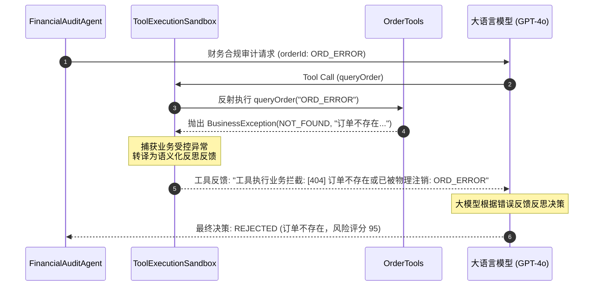

# ateng-boot-ai 工业级智能体与认知图底座

> 面向生产就绪的 Spring Boot 3 工业级智能体与认知图基础设施 Starter，依托万能 OpenAI-Compatible 协议收敛主流大语言模型（DeepSeek、DashScope/通义千问、Ollama、OpenAI 等），提供多模型命名注册表与线程级动态切源、发票凭单视觉多模态分析、DeepSeek-R1 `<think>` 思考链提炼与 SSE 双通道打字机流式推流、瞬态 429/Timeout 退避重试与全链路四维上下文透传。

---

## 0. 特性与公共 API 全景速查矩阵 (Feature & API Panorama Matrix)

| 特性分类 | 特性名称 | 核心门面 / 注解 / SPI | 关键配置项 (`ateng.boot.*`) | 关键 API 签名 / 核心行为 | 锚定验证源头 (*Test / Sample) |
| :--- | :--- | :--- | :--- | :--- | :--- |
| **基础配置** | AI 底座自动装配与平滑探测 | `AtengAiAutoConfiguration` | `ateng.boot.ai.enabled` | 自动探测 API Key，缺省配置时静默保持待命状态，杜绝应用启动崩溃 | `AtengAiAutoConfigurationTest` |
| **同步对话** | 极简同步文本问答 | `AiTemplate` | `ateng.boot.ai.model.*` | `chat(String)` / `chatWithModel(String, String)`，自动接入指数退避重试并返回文本回答 | `AiTemplateTest` / `ChatControllerIntegrationTest` |
| **指定模型对话** | 指定命名模型同步对话 | `AiTemplate` | `ateng.boot.ai.models.<name>.*` | `chatWithModel(String modelName, String prompt)`，按需调用指定模型实例 | `AiTemplateTest` / `ChatControllerIntegrationTest` |
| **图文多模态** | 视觉多模态混合对话分析 | `AiTemplate`<br>`ImageContentParser` | `ateng.boot.ai.model.*` | `chat(String, List<String>)` / `chat(String, String...)` / `chatWithModel(String, String, List<String>)`，支持 HTTP(S) URL 与 Base64 编码 | `ImageContentParserTest` / `AiTemplateTest` / `ChatControllerIntegrationTest` |
| **动态模板** | 动态变量插值提示词执行 | `AiTemplate`<br>`PromptTemplate` | - | `chat(PromptTemplate, Map<String, Object>)` / `PromptTemplate.of(String).format(Map)`，原生防注入安全变量插值 | `PromptTemplateTest` / `AiTemplateTest` |
| **多轮历史** | 结构化历史消息对话与元数据 | `AiTemplate` | - | `chatMessages(List<ChatMessage>)` / `generate(List<ChatMessage>)`，返回带 Token 统计的强类型 `Response<AiMessage>` | `AiTemplateTest` |
| **流式打字机** | SseEmitter 打字机极简推流 | `AiTemplate` | `ateng.boot.ai.model.*` | `stream(String)` (返回 `SseEmitter`) / `stream(String, SseEmitter)`，自动挂载 180s 生产安全超时 | `AiTemplateTest` / `ChatControllerIntegrationTest` |
| **指定流式模型** | 指定命名模型流式推流 | `AiTemplate` | `ateng.boot.ai.models.<name>.*` | `streamWithModel(String, String, SseEmitter)`，指定模型并发打字机推流 | `AiTemplateTest` / `ChatControllerIntegrationTest` |
| **多模态流式** | 图文多模态打字机流式推流 | `AiTemplate` | `ateng.boot.ai.model.*` | `stream(String, List<String>, SseEmitter)` / `streamWithModel(String, String, List<String>, SseEmitter)` | `AiTemplateTest` / `ChatControllerIntegrationTest` |
| **思考链提炼** | DeepSeek-R1 `<think>` 状态机 | `ReasonerTokenExtractor` | - | `feed(String)` / `finish()` / `hasThinking()`，三状态机精准解耦思考链与正文，最长后缀匹配防断字残片泄露 | `ReasonerTokenExtractorTest` / `ChatControllerIntegrationTest` |
| **SSE 桥接器** | 双通道流式响应桥接驱动 | `SseTokenStreamBridge` | - | `onNext(String)` / `onComplete(Response)` / `onError(Throwable)`，`reasoning` 与 `text` 双通道独立推流，`[DONE]` 安全闭合 | `SseTokenStreamBridgeTest` / `ChatControllerIntegrationTest` |
| **模型注册表** | 多模型纳管与实例缓存 | `AiModelRegistry` | `ateng.boot.ai.models.*` | `register(name, chatModel, streamModel)` / `getChatModel(name)` / `getStreamingChatModel(name)` / `listModels()` | `AiModelRegistryTest` |
| **动态切源** | 线程级模型动态切源持有者 | `AiContextHolder` | - | `AiContextHolder.useModel(String)` (AutoCloseable 作用域) / `setModelName(String)` / `clear()`，ThreadLocal 无状态安全还原 | `AiContextHolderTest` / `AiTemplateTest` |
| **退避重试** | 429 限流与超时指数退避重试 | `AiTemplate`<br>`AiExceptionTranslator` | `ateng.boot.ai.model.max-retries` | 接入 Core 模块 `RetryUtil`，遇 429 / 连接超时自动执行带 Jitter 的指数退避重试，401/403 快速失败 | `AiExceptionTranslatorTest` / `AiTemplateTest` |
| **因果异常体系** | 业务异常转译与强类型错误码 | `AiException`<br>`AiResultCode` | - | 底层驱动网络与 HTTP 异常统一转译为 `AiException`，100% 保留原始 cause 因果链，严禁 Log-and-Throw 双重污染 | `AiExceptionTranslatorTest` |
| **全链路透传** | 四维上下文快照异步透传 | `SseTokenStreamBridge`<br>`AsyncContext` | - | 流式推流回调在 OkHttp 工作线程中完整还原调用方的 MDC `traceId` 与 `UserContext`，执行完毕严格恢复 | `SseTokenStreamBridgeTest` |
| **声明式智能体** | `@AiAgent` 接口动态代理装配 | `@AiAgent`<br>`AiAgentFactoryBean` | `ateng.boot.ai.model.*` | 声明式接口结合 `@SystemMessage`/`@UserMessage`/`@V`，自动装配底层多模型动态路由代理 | `AiAgentFactoryBeanTest` / `AgentControllerIntegrationTest` |
| **智能体包扫描** | 主程序自动探测与包扫描 | `@AiAgentScan`<br>`AiAgentRegistrar` | - | 依托 `AutoConfigurationPackages` 零配置自动扫描主程序包，或通过 `@AiAgentScan(basePackages = ...)` 显式指定路径 | `AiAgentRegistrarTest` / `AgentControllerIntegrationTest` |
| **受管工具沙箱** | 局部受管工具执行与耗时自省 | `ToolExecutionSandbox`<br>`SandboxedToolExecutor` | - | `@AiAgent(tools = {OrderTools.class})`，解析 `@Tool`/`@P` 注解，DEBUG 入参/INFO 耗时统计，受管绑定 MDC `traceId` | `ToolExecutionSandboxTest` / `AgentControllerIntegrationTest` |
| **异常自愈反思** | 业务异常转译与大模型自主纠偏 | `SandboxedToolExecutor` | - | 拦截工具抛出的 `BusinessException`/`IllegalArgumentException`，转译为语义化错误文本反馈模型促成反思自愈，JVM 致命 `Error` 坚决 Fail-Fast | `ToolExecutionSandboxTest` / `AgentControllerIntegrationTest` |
| **结构化脱壳去噪** | 大模型 Markdown 代码块脱壳清洗 | `JsonPayloadSanitizer` | - | `sanitize(String)`，剥离 ` ```json ` 等包裹标记，保留纯净 JSON 并防范空内容与未闭合截断 | `JsonPayloadSanitizerTest` |
| **防幻觉格式防卫** | 结构化输出 JSR-303 防卫熔断 | `AiAgentFactoryBean`<br>`ValidatorUtil` | - | 智能体方法返回强类型 DTO/Record 时，自动经由 `ValidatorUtil.validate(...)` 执行校验，格式破损时熔断抛出 `AI_RESPONSE_PARSE_ERROR` | `AiAgentFactoryBeanTest` / `AgentControllerIntegrationTest` |
| **双模会话存储** | 内存与 Redis 双模存储自适应 | `ChatMemoryStore`<br>`InMemoryChatMemoryStore`<br>`RedisChatMemoryStore` | `ateng.boot.ai.chat-memory.type` | 统一 `ChatMemoryStore` SPI，`AUTO` 模式自动探测 Redis，未引入时无缝平滑回退至单机并发安全内存存储 | `InMemoryChatMemoryStoreTest` / `RedisChatMemoryStoreTest` |
| **Redis TTL 漫游** | 分布式会话存储强类型 TTL 续期 | `RedisChatMemoryStore` | `ateng.boot.ai.chat-memory.ttl`<br>`ateng.boot.ai.chat-memory.key-prefix` | 原生 JSON 序列化（零 `@class` 污染），每次读写自动重置滑动 TTL，超时由 Redis 确定性物理回收，防内存膨胀 | `RedisChatMemoryStoreTest` |
| **对称会话管理** | 会话记忆对称管理门面 | `ChatMemoryManager` | `ateng.boot.ai.chat-memory.max-messages` | `getMessages(id)`/`updateMessages(id, list)`、`appendMessage(id, msg)`/`clear(id)`、`exists(id)`/`getMessageCount(id)`/`truncate(id, n)` 完备对称运维 | `ChatMemoryManagerTest` / `AgentControllerIntegrationTest` |
| **跨轮会话隔离** | 多用户/多租户会话隔离 | `@MemoryId`<br>`ChatMemoryProvider` | - | 接口方法形参标注 `@MemoryId`，LangChain4j 自动按 `sessionId` 路由至对应独立滑动窗口，会话历史物理隔离 | `AiAgentMemoryAndRagIntegrationTest` / `AgentControllerIntegrationTest` |
| **RAG 知识库挂载** | 企业私有知识检索挂载点 | `@AiAgent(contentRetriever)`<br>`ContentRetriever` | - | 显式指定 Bean 名称或单 Bean 缺省自动装配 `ContentRetriever`，智能体调用时自动检索注入增强上下文 | `AiAgentMemoryAndRagIntegrationTest` |
| **强类型状态模型** | 认知图状态契约与惰性反序列化 | `BaseGraphState`<br>`TypedKey<T>` | - | 依托 `TypedKey<T>` 强类型存取与纯净 JSON 序列化，杜绝 `@class` 污染，底层保留真实类型 | `BaseGraphStateSerializationTest` |
| **双模检查点存储** | 内存与 Redis 检查点持久化自适应 | `GraphCheckpointSaver`<br>`MemoryCheckpointSaver`<br>`RedisCheckpointSaver` | `ateng.boot.ai.graph.checkpoint.type` | 统一检查点 SPI，`AUTO` 模式自动探测 Redis 启用分布式存储与滑动 TTL 漫游，缺失时无缝回退单机内存 | `MemoryCheckpointSaverTest` / `RedisCheckpointSaverTest` |
| **工作流拓扑编排** | 认知图全生命周期与静态中断 | `GraphWorkflow<S>` | `ateng.boot.ai.graph.enabled` | 抽象泛型拓扑基类，封装 `start`/`resume`/`getSnapshot`，支持静态中断节点声明（`interruptBefore`/`interruptAfter`）与死循环防卫 | `GraphWorkflowTest` / `WorkflowControllerIntegrationTest` |
| **多图动态注册中心** | 工作流单例受管统一纳管与调度 | `GraphWorkflowRegistry` | - | 容器启动时自动探测并收集所有 `GraphWorkflow` Bean，提供基于名字的动态查找、注册与枚举探测 | `GraphWorkflowRegistryTest` / `AtengAiGraphAutoConfigurationTest` |
| **分布式租约锁管理器** | 高熵令牌校验与 Lua 释放防卫 | `GraphLockManager`<br>`LocalGraphLockManager`<br>`RedisGraphLockManager` | `ateng.boot.ai.graph.checkpoint.lock-prefix`<br>`ateng.boot.ai.graph.checkpoint.lock-ttl` | Redis Lua 脚本校验令牌匹配原子释放锁，杜绝超时误删他人有效锁，无 Redis 依赖时本地并发安全平滑降级 | `GraphResumeTemplateTest` |
| **人机协作恢复门面** | 断点恢复、CAS 跃迁与工单撤销 | `GraphResumeTemplate` | `ateng.boot.ai.graph.*` | 提供 `getSnapshot` 快照探查、`resume` 同步恢复、`resumeAsync` 异步透传四维上下文与 `cancel` 工单主动撤销完备对称门面 | `GraphResumeTemplateTest` / `WorkflowControllerIntegrationTest` |

---

## 1. 模块定位与 Maven 坐标

`ateng-boot-ai` 是面向 Spring Boot 3 企业级智能体与认知图场景的核心底座：
- **万能协议收敛**：依托 LangChain4j 标准 OpenAI-Compatible 协议，单一依赖收敛 DeepSeek、通义千问、月之暗面、Ollama、OpenAI 等所有主流模型，坚决杜绝引入各厂商碎片化重型私有 SDK；
- **纯净依赖架构**：仅必需依赖 `ateng-boot-core` 与 `langchain4j-open-ai`，`spring-webmvc` 作为可选依赖（optional）提供打字机推流，核心通用原语 100% 收敛复用 Core 底座；
- **BOM 统管**：版本由 `ateng-boot-bom` 集中纳管，子模块声明免配版本号。

```xml
<dependency>
    <groupId>io.github.atengk</groupId>
    <artifactId>ateng-boot-ai</artifactId>
</dependency>
```

---

## 2. 核心架构与设计不变量

```mermaid
flowchart TD
    subgraph Client["调用接入边界 (Controller / Service / Agent / Workflow)"]
        DirectSync["同步对话<br>AiTemplate.chat(...)"]
        DirectStream["SSE 打字机推流<br>AiTemplate.stream(...)"]
        DynamicSwitch["动态切源作用域<br>AiContextHolder.useModel(...)"]
        DeclarativeAgent["声明式智能体<br>@AiAgent 动态代理接口"]
        WorkflowClient["状态图编排与人机恢复<br>GraphWorkflow / GraphResumeTemplate"]
    end

    subgraph CoreEngine["ateng-boot-ai 核心引擎"]
        AiTmpl["核心统一门面<br>AiTemplate"]
        Registry["多模型受管注册表<br>AiModelRegistry"]
        RoutingModel["多模型动态切源代理<br>DynamicRoutingChatLanguageModel"]
        RetryEngine["指数退避重试引擎<br>RetryUtil (Equal Jitter)"]
        Extractor["思考链解耦状态机<br>ReasonerTokenExtractor"]
        Bridge["双通道流式推流桥接器<br>SseTokenStreamBridge"]
        CtxSnap["全链路四维快照传播<br>AsyncContext.ContextSnapshot"]
        ToolSandbox["局部受管工具沙箱<br>ToolExecutionSandbox"]
        MemoryFacade["会话记忆对称管理门面<br>ChatMemoryManager"]
        Sanitizer["脱壳去噪与防幻觉防卫<br>JsonPayloadSanitizer / JSR-303"]
        WorkflowEngine["认知状态图拓扑引擎<br>GraphWorkflow / LangGraph4j StateGraph"]
        ResumeFacade["人机协作运维门面<br>GraphResumeTemplate"]
        WorkflowRegistry["多图动态注册中心<br>GraphWorkflowRegistry"]
        LockManager["分布式租约锁管理器<br>GraphLockManager (Redis Lua / Local)"]
    end

    subgraph MemoryAndCheckpoint["持久化与会话状态底座"]
        MemoryStore["双模会话存储<br>RedisChatMemoryStore / InMemory"]
        CheckpointStore["双模检查点存储<br>RedisCheckpointSaver / MemoryCheckpointSaver"]
        RagRetriever["知识库检索挂载点<br>ContentRetriever"]
    end

    subgraph Providers["大语言模型网关 (OpenAI-Compatible Gateway)"]
        M_Default["默认主模型<br>(DeepSeek / GPT-4o)"]
        M_Reasoner["深度推理模型<br>(DeepSeek-R1)"]
        M_Fast["高吞吐对话模型<br>(Qwen / Ollama)"]
    end

    DirectSync --> AiTmpl
    DirectStream --> AiTmpl
    DynamicSwitch -.-> Registry
    DeclarativeAgent --> RoutingModel
    DeclarativeAgent --> ToolSandbox
    DeclarativeAgent --> Sanitizer
    DeclarativeAgent -.-> MemoryFacade
    DeclarativeAgent -.-> RagRetriever

    WorkflowClient --> WorkflowEngine
    WorkflowClient --> ResumeFacade
    ResumeFacade --> WorkflowRegistry
    ResumeFacade --> LockManager
    ResumeFacade --> CheckpointStore
    WorkflowEngine --> CheckpointStore

    AiTmpl --> Registry
    AiTmpl --> RetryEngine
    AiTmpl --> Bridge
    Bridge --> Extractor
    Bridge --> CtxSnap

    MemoryFacade --> MemoryStore

    RoutingModel --> Registry
    Registry --> M_Default
    Registry --> M_Reasoner
    Registry --> M_Fast
```



### 设计不变量 (Architecture Invariants)
1. **零实体泄露与对称契约**：对外接口纯净解耦，流式与同步操作、会话存取操作具备严格的对称性与完备性；
2. **内存真明文不变量**：大模型调用凭证（API Key）在内存中安全绑定，配置属性与异常日志输出强制掩码；
3. **断字缓冲防泄露**：针对深度推理模型分片流输出，状态机在遇到标签前缀时进行有界缓冲，证伪后安全发射，确保思考链与正文绝对解耦；
4. **资源安全确定性**：客户端中断网络连接（`Broken pipe`）时，推流桥接器主动拦截并安全闭合，杜绝 SDK 连接池悬挂与内存泄漏；
5. **受管沙箱与异常自愈不变量**：工具调用严格通过沙箱受管执行，业务异常转译为语义化错误文本促成大模型自主反思与修正，致命 `Error` 坚决 Fail-Fast；
6. **确定性会话生命周期与滑动 TTL 不变量**：Redis 会话存储每次读写强制重置滑动 TTL，超时由 Redis 确定性物理回收，杜绝会话悬挂与内存膨胀。

---

## 3. 基础通信与多模型路由拓扑

### 3.1 默认模型与多模型配置

#### 本节专属 YAML 配置
```yaml
ateng:
  boot:
    ai:
      enabled: true
      # 默认主模型配置 (GPT-4o 或 DeepSeek-Chat)
      model:
        base-url: https://api.deepseek.com/v1
        api-key: YOUR_DEEPSEEK_API_KEY
        model-name: deepseek-chat
        temperature: 0.7
        timeout: 60s
        max-retries: 3
        log-requests: false
        log-responses: false
      # 命名多模型拓扑配置 (按需声明任意多个专用模型)
      models:
        reasoner:
          base-url: https://api.deepseek.com/v1
          api-key: YOUR_DEEPSEEK_API_KEY
          model-name: deepseek-reasoner
          temperature: 0.6
          timeout: 120s
          max-retries: 2
        qwen:
          base-url: https://dashscope.aliyuncs.com/compatible-mode/v1
          api-key: YOUR_DASHSCOPE_API_KEY
          model-name: qwen-plus
          timeout: 60s
```

#### 实战业务 Java 示例
```java
@Service
@RequiredArgsConstructor
public class CustomerSupportService {

    private final AiTemplate aiTemplate;

    /**
     * 1. 默认模型通用咨询问答
     */
    public String answerGeneralInquiry(String userQuestion) {
        return aiTemplate.chat(userQuestion);
    }

    /**
     * 2. 指定 reasoner 深度推理模型分析复杂故障工单
     */
    public String diagnoseComplexTicket(String ticketDetails) {
        return aiTemplate.chatWithModel("reasoner", "请深度推导以下工单故障根因：\n" + ticketDetails);
    }
}
```

#### 核心机制与边界防御
- **平滑探测待命**：若未配置 `api-key`，自动装配组件在启动时打印诊断日志并保持待命，避免无外部凭据时导致宿主应用启动崩溃；
- **强类型超时**：`timeout` 统配强类型 `Duration`，彻底取缔无量纲裸数值，消除时间单位歧义。

---

### 3.2 基于 AiContextHolder 的线程级动态切源

#### 本节专属 YAML 配置
参考 3.1 节配置的多模型拓扑 `ateng.boot.ai.models.*`。

#### 实战业务 Java 示例
```java
@Service
@RequiredArgsConstructor
public class AuditReportService {

    private final AiTemplate aiTemplate;

    public String generateAuditSummary(String auditData, boolean highPrecisionRequired) {
        if (highPrecisionRequired) {
            // 采用 Scoped try-with-resources 模式在当前线程临时切入推理大模型
            try (AiContextHolder.AiModelScope ignored = AiContextHolder.useModel("reasoner")) {
                // 内部调用的所有 aiTemplate 方法自动路由至 reasoner 模型
                return aiTemplate.chat("请以极高严谨度审计数据并生成合规摘要：\n" + auditData);
            } // 作用域结束自动还原为原上下文，杜绝线程池污染
        }

        return aiTemplate.chat("请生成通用审计摘要：\n" + auditData);
    }
}
```

#### 核心机制与边界防御
- **栈式上下文管理**：`AiContextHolder` 底层维护 `Deque<String>` 线程栈，支持多层方法嵌套临时切源并在 `close()` 中确定性出栈，线程安全无状态。

---

### 3.3 网络瞬态异常与指数退避重试

#### 本节专属 YAML 配置
```yaml
ateng:
  boot:
    ai:
      model:
        max-retries: 3    # 遭遇 429 或网络抖动时最大重试次数 (默认 3 次)
```

#### 核心机制与边界防御
- **自适应重试谓词**：通过 `AiExceptionTranslator.isRetryable(Throwable)` 识别 HTTP 429（Rate Limit）、网络连接超时、连接重置等瞬态故障；
- **Equal Jitter 抖动算法**：接入 Core 模块 `RetryUtil`，采用指数退避伴随随机抖动，分散瞬间重试流量，防止大模型服务端雪崩；
- **快速失败防线**：遇到 HTTP 401（认证失败）、403（越权）、400（参数非法）等确定性客户端错误，立即快速失败抛出语义化 `AiException`，严禁无谓重试浪费资源。

---

## 4. 视觉多模态图文交互与动态提示词

### 4.1 发票凭单图文多模态识别

#### 本节专属 YAML 配置
```yaml
ateng:
  boot:
    ai:
      model:
        base-url: https://dashscope.aliyuncs.com/compatible-mode/v1
        api-key: YOUR_DASHSCOPE_API_KEY
        model-name: qwen-vl-max      # 具备视觉多模态理解能力的模型
        timeout: 90s
```

#### 实战业务 Java 示例
```java
@Service
@RequiredArgsConstructor
public class FinanceInvoiceService {

    private final AiTemplate aiTemplate;

    /**
     * 发票单据多模态混合核验
     *
     * @param invoiceImageUrl 公网图片 URL 或 Base64 编码 (data:image/png;base64,...)
     * @return 结构化提取的发票金额与开票方信息
     */
    public String parseInvoice(String invoiceImageUrl) {
        String prompt = "请识别发票中的发票代码、发票号码、开票日期、购买方名称及价税合计金额";
        return aiTemplate.chat(prompt, invoiceImageUrl);
    }
}
```

#### 核心机制与边界防御
- **多编码格式自适应**：`ImageContentParser` 原生支持标准 HTTP/HTTPS 远程链接、RFC 2397 Data URI 规范（`data:image/jpeg;base64,...`）以及纯 Raw Base64 字符串；
- **格式快速失败**：对不支持的图片格式（如非图片媒体）执行 Fail-Fast 校验，抛出 `AI_INVALID_PAYLOAD` 错误。

---

### 4.2 Fluent PromptTemplate 变量安全插值

#### 实战业务 Java 示例
```java
@Service
@RequiredArgsConstructor
public class OrderNotificationService {

    private final AiTemplate aiTemplate;

    private static final PromptTemplate NOTIFY_TEMPLATE = PromptTemplate.of(
            "尊敬的 {{customerName}}，您尾号为 {{orderIdSuffix}} 的订单已发货，物流单号为 {{trackingNumber}}。请以热情的语气写一段物流通知短语。"
    );

    public String generateDeliveryMessage(String customer, String orderId, String trackingNo) {
        Map<String, Object> variables = Map.of(
                "customerName", customer,
                "orderIdSuffix", orderId.substring(orderId.length() - 4),
                "trackingNumber", trackingNo
        );

        return aiTemplate.chat(NOTIFY_TEMPLATE, variables);
    }
}
```

#### 核心机制与边界防御
- **`{{var}}` 规范占位符**：`PromptTemplate` 解析变量并在格式化时进行安全替换，避免手写字符串拼接导致提示词注入或空指针隐患。

---

## 5. DeepSeek-R1 思考链提炼与 SSE 双通道打字机流式推流

### 5.1 ReasonerTokenExtractor 三状态机与断字缓冲防泄露

#### 状态机工作原理
深度推理模型（如 DeepSeek-R1）在输出时会将推理过程包装于 `<think> ... </think>` 标签内。在大模型流式逐字输出时，标签可能在网络分片中被截断：

```
分片 1: "<th"          --> 疑似开始标签前缀，状态机暂存缓冲区，不向客户端发送
分片 2: "ink>推导公式"  --> 匹配成功，剔除标签，将 "推导公式" 路由至 reasoning 通道
分片 3: "证明完</th"    --> 尾部包含闭合标签前缀，仅发射 "证明完"，保留 "</th"
分片 4: "ink>因此结论为真"--> 闭合标签识别成功，切换至正文状态，后续内容路由至 text 通道
```

```java
ReasonerTokenExtractor extractor = new ReasonerTokenExtractor();
List<StreamToken> tokens = extractor.feed(chunk);
// tokens 自动解耦为 StreamToken(REASONING, "...") 与 StreamToken(TEXT, "...")
```

---

### 5.2 SseTokenStreamBridge 双通道推流与 Web 控制器集成

#### 实战业务 Java 示例
```java
@RestController
@RequestMapping("/sample/ai/chat")
@RequiredArgsConstructor
public class AiChatController {

    private final AiTemplate aiTemplate;

    /**
     * 双通道打字机流式推流接口
     * 客户端接收：event: reasoning（思考中）、event: text（最终答复）、event: done（结束标记）
     */
    @GetMapping(value = "/stream", produces = MediaType.TEXT_EVENT_STREAM_VALUE + ";charset=UTF-8")
    public SseEmitter streamChat(@RequestParam("prompt") String prompt,
                                 @RequestParam(value = "model", required = false) String model) {
        SseEmitter emitter = new SseEmitter(180_000L); // 3 分钟超时守护
        if (StringUtils.hasText(model)) {
            aiTemplate.streamWithModel(model, prompt, emitter);
        } else {
            aiTemplate.stream(prompt, emitter);
        }
        return emitter;
    }
}
```

#### 前端消费示例
```javascript
const eventSource = new EventSource('/sample/ai/chat/stream?prompt=求解微积分难题');

// 1. 订阅思考链通道
eventSource.addEventListener('reasoning', (event) => {
    console.log('[深度思考]:', event.data);
    appendThinkingUi(event.data);
});

// 2. 订阅正文回答通道
eventSource.addEventListener('text', (event) => {
    console.log('[回答内容]:', event.data);
    appendTextUi(event.data);
});

// 3. 订阅结束信号
eventSource.addEventListener('done', (event) => {
    console.log('[传输完成]');
    eventSource.close();
});

// 4. 异常处理
eventSource.addEventListener('error', (event) => {
    console.error('[推流中断]:', event.data);
    eventSource.close();
});
```

---

### 5.3 四维上下文透传与客户端套接字断连安全恢复

- **四维上下文透传**：`SseTokenStreamBridge` 构造时在 Web 主线程捕获 `AsyncContext.ContextSnapshot` 快照。当 OkHttp 工作线程异步收到 `onNext`/`onComplete` 回调时，自动还原调用方线程的 MDC `traceId` 与 `UserContext`，推流过程日志具备 100% 完整追踪链；
- **套接字断连安全治理**：当浏览器关闭标签页或网络断开时，`SseEmitter.send()` 抛出 `IOException` 或 `IllegalStateException`，桥接器自动捕获并执行 `closeSafely()` 释放底层通道，严禁异常抛出导致破坏 OkHttp 底层连接池。

---

## 6. 声明式智能体与受管工具沙箱体系

### 6.1 声明式接口定义与包扫描机制 (@AiAgent & @AiAgentScan)

通过 `@AiAgent` 注解声明 Java 强类型接口，框架动态生成代理 Bean 并装配多模型切源、工具沙箱、会话记忆与输出防卫流水线：

```java
package io.github.atengk.boot.sample.ai.agent;

import dev.langchain4j.service.MemoryId;
import dev.langchain4j.service.SystemMessage;
import dev.langchain4j.service.UserMessage;
import io.github.atengk.boot.ai.annotation.AiAgent;
import io.github.atengk.boot.sample.ai.dto.FinancialAuditRequest;
import io.github.atengk.boot.sample.ai.tool.OrderTools;
import io.github.atengk.boot.sample.ai.vo.FinancialAuditResult;

/**
 * 财务合规审计声明式智能体
 */
@AiAgent(tools = {OrderTools.class})
public interface FinancialAuditAgent {

    @SystemMessage("你是一名资深财务合规审计专家，请调用工具查询订单与仓储履约状态，并给出客观严谨的合规审计决策报告。请以 JSON 格式输出。")
    FinancialAuditResult auditOrder(@UserMessage FinancialAuditRequest request);

    @SystemMessage("你是一名资深财务合规审计专家，请调用工具查询订单与仓储履约状态，并给出客观严谨的合规审计决策报告。请以 JSON 格式输出。")
    FinancialAuditResult auditOrderWithSession(@MemoryId String sessionId, @UserMessage FinancialAuditRequest request);
}
```

- **零配置自动探测**：缺省情况下，`AiAgentRegistrar` 依托 `AutoConfigurationPackages` 自动探测主程序入口所在包及其子包，无需额外配置；
- **显式包扫描接管**：多模块拆分或接口定义在外部包时，可通过 `@AiAgentScan(basePackages = {"com.example.agent"})` 显式声明扫描路径；
- **复合对象入参自动序列化**：方法形参可直接传入复杂业务对象（JavaBean / Record），底层通过 `JsonUtil` 自动转译为规范 JSON 字符串，消除了手写序列化代码的繁琐。

---

### 6.2 局部受管工具沙箱 (ToolExecutionSandbox) 与可观测性

受管工具类统一遵循 Spring 标准组件规范（标注 `@Component`），由智能体在 `@AiAgent(tools = {OrderTools.class})` 中挂载调用：

```java
@Component
public class OrderTools {

    private static final Logger log = LoggerFactory.getLogger(OrderTools.class);

    @Tool("根据订单号查询订单履约详情信息，包含买家标识、商品编号、购买数量与实付金额")
    public OrderInfo queryOrder(@P("待查询的订单业务主键，例如 ORD_20261103001") String orderId) {
        log.info("[TOOL-INVOKE] 正在查询订单履约详情: {}", orderId);
        if ("ORD_ERROR".equalsIgnoreCase(orderId)) {
            throw new BusinessException(CommonResultCode.NOT_FOUND, "订单不存在或已被物理注销: " + orderId);
        }
        return new OrderInfo(orderId, "buyer_u10086", "SKU_LAPTOP_AI_PRO", 1, new BigDecimal("9999.00"), "PAID");
    }
}
```

- **局部隔离沙箱**：每个工具方法由 `SandboxedToolExecutor` 统一包装，确保工具执行与框架内核安全解耦；
- **全链路可观测性**：DEBUG 级别记录输入参数，INFO 级别精准统计方法执行毫秒耗时，WARN 级别记录异常，自动绑定调用方的 MDC `traceId`；
- **启动期 Fail-Fast 铁律**：工具类若未被 Spring 容器纳管为 Bean，或存在非法形参类型，框架在容器启动期直接熔断报错，严禁带病上线。

---

### 6.3 异常自愈反思范式 (Self-Healing Reflection)

当业务系统发生受控拦截时，框架沙箱主动转译异常，引导大语言模型自主纠偏：



- **业务受控异常转译**：工具方法抛出 `BusinessException` 或 `IllegalArgumentException` 时，沙箱捕获并格式化为 `"工具执行业务拦截: [code] message"` 文本反馈给大模型，促使大模型自主反思、更换参数重试或输出降级报告；
- **致命系统错误 Fail-Fast**：对于 JVM 严重错误（如 `Error`、`OutOfMemoryError`）坚决向外抛出阻断执行，防止掩盖系统级崩溃。

---

### 6.4 响应脱壳去噪与 JSR-303 防幻觉输出校验

大模型结构化响应普遍存在携带 Markdown 代码块格式（````json ... ````）及偶发性数值幻觉越界风险，框架提供双道安全防线：

```java
public record FinancialAuditResult(
        @NotBlank(message = "审核决策状态不能为空")
        String status,

        @NotBlank(message = "合规审计分析报告不能为空")
        String analysis,

        @NotNull(message = "风险评分不能为空")
        @Min(value = 0, message = "风险评分不能小于 0")
        @Max(value = 100, message = "风险评分不能大于 100")
        Integer riskScore,

        List<String> riskTags
) {}
```

1. **结构化脱壳清洗**：底层 `DynamicRoutingChatLanguageModel` 经由 `JsonPayloadSanitizer` 自动剥离 ` ```json ` 等外围包裹字符，保留纯净 JSON；
2. **JSR-303 防幻觉输出防卫**：智能体方法返回强类型 DTO / Record 时，底层动态代理自动经由 Core 模块 `ValidatorUtil.validate(...)` 执行校验。若大模型幻觉输出导致评分越界（例如 `riskScore = 150`），直接熔断抛出 `AiException(AiResultCode.AI_RESPONSE_PARSE_ERROR)`，杜绝脏数据注入下游业务流程。

---

## 7. 双模会话记忆治理与 RAG 知识检索挂载

### 7.1 双模会话存储与 Redis 强类型 TTL 漫游

#### 本节专属 YAML 配置
```yaml
ateng:
  boot:
    ai:
      chat-memory:
        # 是否启用会话记忆治理 (默认 true)
        enabled: true
        # 存储类型: AUTO (自动探测 Redis，未引入平滑回退内存), IN_MEMORY, REDIS
        type: AUTO
        # Redis 存储键前缀 (默认 "ateng:ai:chat-memory:")
        key-prefix: "ateng:ai:chat-memory:"
        # 强类型滑动过期 TTL (每次读写自动重置续期，默认 24h)
        ttl: 24h
        # 默认滑动窗口保留的最大消息条数 (默认 20 条)
        max-messages: 20
```

- **统一 SPI 抽象**：`ChatMemoryStore` 统一封装底层会话状态存取，内置 `InMemoryChatMemoryStore` 与 `RedisChatMemoryStore` 两种实现；
- **零 `@class` 污染与原生序列化**：`RedisChatMemoryStore` 使用原生 JSON 结构持久化消息历史，彻底消除 Jackson `@class` 多态类型绑定引发的安全漏洞与跨语言屏障；
- **强类型滑动 TTL 续期**：借助 `Duration` 强类型 TTL，每次会话读写强制重置过期时间，会话失效后由 Redis 原生机制确定性物理回收，杜绝无界悬挂与内存膨胀。

---

### 7.2 会话记忆对称管理门面 (ChatMemoryManager)

框架自动装配对称管理门面 `ChatMemoryManager`，为业务与运维端提供完备对称的操作能力：

```java
@Autowired
private ChatMemoryManager chatMemoryManager;

// 1. 存在性与消息数检查
boolean hasHistory = chatMemoryManager.exists("sess_u10086");
int messageCount = chatMemoryManager.getMessageCount("sess_u10086");

// 2. 读写对称：获取不可变消息历史列表与全量覆写
List<ChatMessage> history = chatMemoryManager.getMessages("sess_u10086");
chatMemoryManager.updateMessages("sess_u10086", newMessages);

// 3. 增删对称：追加单条消息与安全清空会话
chatMemoryManager.appendMessage("sess_u10086", UserMessage.from("你好"));
chatMemoryManager.clear("sess_u10086");

// 4. 滑动窗口维护：保留最近 N 条核心消息
chatMemoryManager.truncate("sess_u10086", 10);
```

---

### 7.3 @MemoryId 跨轮多会话物理隔离

智能体方法中声明 `@MemoryId` 形参，LangChain4j 自动按会话 ID 路由至对应的物理隔离滑动窗口：

```java
@AiAgent(tools = {OrderTools.class})
public interface CustomerServiceAgent {

    @SystemMessage("你是一个客服助理")
    String chat(@MemoryId String sessionId, @UserMessage String message);
}
```

- **会话物理隔离**：不同的 `sessionId`（如不同用户、工单或场景）拥有完全独立的上下文窗口，严禁上下文串话；
- **状态无感知漫游**：配合 `RedisChatMemoryStore`，多实例集群环境下用户请求路由至任意节点均可平滑读取同一份历史会话。

---

### 7.4 企业私有知识检索挂载点 (ContentRetriever / RAG)

声明式智能体支持无缝挂载 LangChain4j 的 `ContentRetriever`，打通企业私有知识库与向量检索体系：

```java
// 1. 显式挂载指定名称的知识检索 Bean
@AiAgent(contentRetriever = "financeRetriever")
public interface FinanceRagAgent {
    String ask(@UserMessage String question);
}

// 2. 容器中注册检索点 Bean
@Bean
public ContentRetriever financeRetriever(EmbeddingModel embeddingModel, EmbeddingStore<TextSegment> embeddingStore) {
    return EmbeddingStoreContentRetriever.builder()
            .embeddingStore(embeddingStore)
            .embeddingModel(embeddingModel)
            .maxResults(3)
            .minScore(0.75)
            .build();
}
```

- **显式与缺省兼备**：未显式指定时，若容器中存在唯一的 `ContentRetriever` Bean，系统将自动绑定缺省检索点；存在多个时强制显式指定 Bean 名称，实现防御性隔离。

---

## 8. 认知状态图 (LangGraph4j) 与人机协作 (HITL) 编排架构

### 8.1 背景与设计愿景

传统的单向线性管线（DAG，如 LiteFlow）适合营销算价、规则决策等无环快速计算场景；然而在高级智能体协同、反思循环纠偏与长流程审批中，必须具备：
1. **循环反思与图跃迁 (Cyclic Loops)**：节点能够根据上一步反思反馈跳回历史节点重新审视，直至满足终止谓词；
2. **人机协作断点中断 (Human-in-the-Loop, HITL)**：复杂审批或高危操作必须在指定节点挂起（`SUSPENDED`），释放执行线程并持久化检查点（Checkpoint），等待人工审核员注入决断后再行恢复；
3. **分布式检查点与租约锁防卫**：支持集群多 Pod 架构下跨天持久化与会话漫游，依托 CAS 状态原子跃迁与 Lua 高熵令牌租约锁阻断并发双击重入与他人有效锁误删。

---

### 8.2 强类型状态模型与纯净序列化 (`BaseGraphState` / `TypedKey<T>`)

```yaml
# 状态图配置（缺省即生效，采用生产合理默认值）
ateng:
  boot:
    ai:
      graph:
        enabled: true
```

所有流转数据统一继承 `BaseGraphState`，通过强类型常量 `TypedKey<T>` 进行编译期类型约束与存取：

```java
public class OrderReviewState extends BaseGraphState {
    public static final TypedKey<String> ORDER_ID = TypedKey.of("orderId", String.class);
    public static final TypedKey<BigDecimal> AMOUNT = TypedKey.of("amount", BigDecimal.class);
    public static final TypedKey<Integer> CREDIT_SCORE = TypedKey.of("creditScore", Integer.class);
    public static final TypedKey<String> RISK_LEVEL = TypedKey.of("riskLevel", String.class);
    public static final TypedKey<Integer> DOC_RETRY_COUNT = TypedKey.of("docRetryCount", Integer.class);
    public static final TypedKey<String> FINAL_STATUS = TypedKey.of("finalStatus", String.class);
    public static final TypedKey<String> REASON = TypedKey.of("reason", String.class);

    public OrderReviewState(Map<String, Object> initData) {
        super(initData);
    }
}
```

- **内存真明文与零污染**：序列化采用纯净 JSON 格式，坚决杜绝 Jackson `@class` 多态侵入污染；反序列化时依托 `TypedKey` 执行惰性就地类型转换（如 `String` 到 `BigDecimal` / `Integer`），保障多端与 Redis 纯净互通；
- **标准时间与空安全**：时间字段统一格式化为 `yyyy-MM-dd HH:mm:ss`，存取严格防范 NPE。

---

### 8.3 状态图拓扑定义与声明式挂起中断 (`GraphWorkflow<S>`)

业务工作流继承 `GraphWorkflow<S>` 并声明为 Spring `@Component`，框架在容器启动时自动收集至 `GraphWorkflowRegistry` 并完成生命周期拓扑编译：

```java
@Slf4j
@Component
public class OrderReviewGraphWorkflow extends GraphWorkflow<OrderReviewState> {

    public OrderReviewGraphWorkflow() {
        super("orderReviewWorkflow", OrderReviewState::new);
    }

    @Override
    protected void initGraph(StateGraph<OrderReviewState> graph) throws GraphStateException {
        // 1. 初审节点：规则自动化校验
        graph.addNode("riskCheck", node_async(state -> {
            BigDecimal amount = state.get(OrderReviewState.AMOUNT, BigDecimal.ZERO);
            Integer creditScore = state.get(OrderReviewState.CREDIT_SCORE, 700);
            if (amount.compareTo(new BigDecimal("1000")) <= 0 && creditScore >= 700) {
                return Map.of("riskLevel", "LOW", "finalStatus", "APPROVED");
            }
            return Map.of("riskLevel", "HIGH", "reason", "大额高危订单进入人工复审");
        }));

        // 2. 人工审核挂起节点 (静态中断)
        graph.addNode("humanReview", node_async(state -> {
            Object approval = state.data().get(TypedKey.APPROVAL_DATA.name());
            String action = extractAction(approval);
            if ("PASSED".equalsIgnoreCase(action)) {
                return Map.of("finalStatus", "APPROVED", "reason", "人工审核通过");
            }
            return Map.of("finalStatus", "REJECTED", "reason", "人工审核驳回");
        }));

        // 3. 补充资质反思节点 (循环回流)
        graph.addNode("docSupplement", node_async(state -> {
            int retry = state.get(OrderReviewState.DOC_RETRY_COUNT, 0) + 1;
            return Map.of("docRetryCount", retry, "reason", "资质材料补充完成第 " + retry + " 次");
        }));

        // 4. 终审归档节点
        graph.addNode("archive", node_async(state -> Map.of("archiveTime", LocalDateTime.now().toString())));

        // 拓扑连线与条件分流
        graph.addEdge(START, "riskCheck");
        graph.addConditionalEdges("riskCheck", edge_async(state ->
                "LOW".equals(state.get(OrderReviewState.RISK_LEVEL, "")) ? END : "humanReview"
        ), Map.of("humanReview", "humanReview", END, END));

        graph.addConditionalEdges("humanReview", edge_async(state -> {
            Object approval = state.data().get(TypedKey.APPROVAL_DATA.name());
            return "REQUEST_DOCS".equalsIgnoreCase(extractAction(approval)) ? "docSupplement" : "archive";
        }), Map.of("docSupplement", "docSupplement", "archive", "archive"));

        graph.addConditionalEdges("docSupplement", edge_async(state ->
                state.get(OrderReviewState.DOC_RETRY_COUNT, 0) > 2 ? "archive" : "humanReview"
        ), Map.of("humanReview", "humanReview", "archive", "archive"));

        graph.addEdge("archive", END);
    }

    @Override
    protected List<String> interruptBeforeNodes() {
        return List.of("humanReview"); // 静态声明在 humanReview 节点执行前挂起中断
    }

    @Override
    protected int maxIterations() {
        return 25; // 生产级防死循环保护
    }
}
```

---

### 8.4 人机协作恢复门面与 CAS 租约锁防卫 (`GraphResumeTemplate`)

```yaml
ateng:
  boot:
    ai:
      graph:
        checkpoint:
          type: AUTO                 # 存储引擎: AUTO (自动探测 Redis，未引入平滑回退内存), IN_MEMORY, REDIS
          key-prefix: "ateng:ai:graph:checkpoint:" # 检查点键前缀
          lock-prefix: "ateng:ai:graph:lock:"       # 租约锁键前缀
          lock-ttl: 30s              # 租约锁持有超时 (强类型 Duration)
          checkpoint-ttl: 7d         # 检查点保留时长 (强类型 Duration)
```

`GraphResumeTemplate` 屏蔽底层图编译与检查点操作细节，对外提供完备对称的恢复与运维门面：

```java
@RestController
@RequestMapping("/sample/ai/workflow/order-review")
@RequiredArgsConstructor
public class AiWorkflowController {

    private final OrderReviewGraphWorkflow workflow;
    private final GraphResumeTemplate resumeTemplate;

    // 1. 启动工作流
    @PostMapping("/start")
    public Result<StateSnapshotVo> start(@RequestBody OrderReviewStartRequest request) {
        OrderReviewState state = new OrderReviewState();
        state.set(OrderReviewState.ORDER_ID, request.getOrderId());
        state.set(OrderReviewState.AMOUNT, request.getAmount());
        return Result.success(workflow.start(state));
    }

    // 2. 快照探查
    @GetMapping("/snapshot/{threadId}")
    public Result<StateSnapshotVo> getSnapshot(@PathVariable String threadId) {
        return Result.success(resumeTemplate.getSnapshot(threadId)
                .orElseThrow(() -> new BusinessException("快照不存在")));
    }

    // 3. 人工审批恢复 (同步 / 异步)
    @PostMapping("/resume")
    public Result<StateSnapshotVo> resume(@RequestBody OrderReviewResumeRequest request) {
        StateSnapshotVo snapshot = resumeTemplate.resume(
                request.getThreadId(),
                Map.of("action", request.getAction(), "comment", request.getComment()),
                state -> state.set(OrderReviewState.ADDITIONAL_DOCS, request.getAdditionalDocs())
        );
        return Result.success(snapshot);
    }

    // 4. 工单主动撤销
    @PostMapping("/cancel")
    public Result<StateSnapshotVo> cancel(@RequestBody OrderReviewCancelRequest request) {
        return Result.success(resumeTemplate.cancel(request.getThreadId(), request.getReason()));
    }
}
```

- **分布式租约锁防卫**：优先使用 Redis 结合高熵 UUID 令牌与 Lua 脚本原子释放；无 Redis 依赖时自动优雅降级为本地 `ConcurrentHashMap` 租约锁，杜绝超时误删他人有效锁；
- **CAS 原子状态跃迁防卫**：严格校验快照必须为 `SUSPENDED` 态方可恢复；对已撤销（`CANCELLED`）抛出 `AI_GRAPH_ALREADY_CANCELLED`，对已终态/运行中工单抛出 `AI_GRAPH_ALREADY_RESUMED`，杜绝并发双击；
- **四维上下文异步透传**：`resumeAsync` 深度融合 Core 底座 `AsyncContext.wrapSupplier`，自动捕获并在异步线程池中还原 MDC `traceId` 与操作人上下文。

---

## 9. 完整 YAML 配置属性清单 (全量速查附录)

```yaml
ateng:
  boot:
    ai:
      # 是否启用 AI 核心自动装配组件 (默认 true)
      enabled: true
      
      # 主默认模型配置
      model:
        # 大模型服务端点 (OpenAI-Compatible 基础网关地址)
        base-url: https://api.deepseek.com/v1
        # 大模型鉴权 API Key
        api-key: YOUR_API_KEY
        # 模型标识名称 (如 deepseek-chat, gpt-4o 等)
        model-name: deepseek-chat
        # 采样温度 (取值 0.0 ~ 2.0，默认 0.7)
        temperature: 0.7
        # 核采样阈值 (取值 0.0 ~ 1.0，可选)
        top-p: 1.0
        # 最大生成 Token 上限 (可选)
        max-tokens: 4096
        # HTTP 连接与响应读取超时 (默认 60s)
        timeout: 60s
        # 遭遇 429 或网络抖动时最大退避重试次数 (默认 3 次)
        max-retries: 3
        # 是否在控制台打印原始请求报文日志 (生产环境建议 false)
        log-requests: false
        # 是否在控制台打印原始响应报文日志 (生产环境建议 false)
        log-responses: false
        # 自定义附加 HTTP 请求头 (可选，如特定网关鉴权标头)
        custom-headers:
          X-Tenant-Id: "10001"
      
      # 会话记忆治理强类型配置
      chat-memory:
        # 是否启用会话记忆治理 (默认 true)
        enabled: true
        # 存储类型: AUTO (默认自动探测 Redis，未引入平滑回退内存), IN_MEMORY, REDIS
        type: AUTO
        # Redis 存储键前缀 (默认 "ateng:ai:chat-memory:")
        key-prefix: "ateng:ai:chat-memory:"
        # 强类型滑动过期 TTL (每次读写自动续期，默认 24h)
        ttl: 24h
        # 默认滑动窗口保留的最大消息条数 (默认 20 条)
        max-messages: 20
      
      # 认知状态图 (LangGraph4j) 与人机协作 (HITL) 配置
      graph:
        # 是否启用认知状态图底座 (默认 true)
        enabled: true
        checkpoint:
          # 检查点存储引擎: AUTO (默认自动探测 Redis，未引入平滑回退内存), IN_MEMORY, REDIS
          type: AUTO
          # 检查点 Redis 键前缀 (默认 "ateng:ai:graph:checkpoint:")
          key-prefix: "ateng:ai:graph:checkpoint:"
          # 人机协作分布式租约锁 Redis 键前缀 (默认 "ateng:ai:graph:lock:")
          lock-prefix: "ateng:ai:graph:lock:"
          # 分布式租约锁持有超时时间 (默认 30s)
          lock-ttl: 30s
          # 检查点持久化保留时长与淘汰 TTL (默认 7d)
          checkpoint-ttl: 7d

      # 命名多模型拓扑配置 (Map<String, AiModelConfig>)
      models:
        reasoner:
          base-url: https://api.deepseek.com/v1
          api-key: YOUR_DEEPSEEK_API_KEY
          model-name: deepseek-reasoner
          temperature: 0.6
          timeout: 120s
          max-retries: 2
        qwen:
          base-url: https://dashscope.aliyuncs.com/compatible-mode/v1
          api-key: YOUR_DASHSCOPE_API_KEY
          model-name: qwen-plus
          timeout: 60s
```
