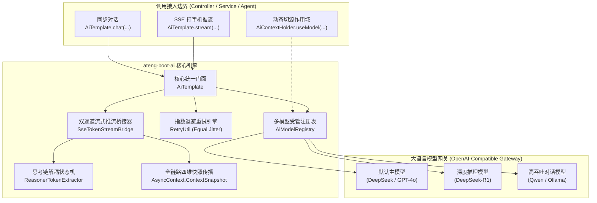

# ateng-boot-ai 工业级智能体与认知图底座

> 面向生产就绪的 Spring Boot 3 工业级智能体与认知图基础设施 Starter，依托万能 OpenAI-Compatible 协议收敛主流大语言模型（DeepSeek、DashScope/通义千问、Ollama、OpenAI 等），提供多模型命名注册表与线程级动态切源、发票凭单视觉多模态分析、DeepSeek-R1 `<think>` 思考链提炼与 SSE 双通道打字机流式推流、瞬态 429/Timeout 退避重试与全链路四维上下文透传。

---

## 0. 特性与公共 API 全景速查矩阵 (Feature & API Panorama Matrix)

| 特性分类 | 特性名称 | 核心门面 / 注解 / SPI | 关键配置项 (`ateng.boot.*`) | 关键 API 签名 / 核心行为 | 锚定验证源头 (*Test / Sample) |
| :--- | :--- | :--- | :--- | :--- | :--- |
| **基础配置** | AI 底座自动装配与平滑探测 | `AtengAiAutoConfiguration` | `ateng.boot.ai.enabled` | 自动探测 API Key，缺省配置时静默保持待命状态，杜绝应用启动崩溃 | `AtengAiAutoConfigurationTest` |
| **同步对话** | 极简同步文本问答 | `AiTemplate` | `ateng.boot.ai.model.*` | `chat(String)` / `chatWithModel(String, String)`，自动接入指数退避重试并返回文本回答 | `AiTemplateTest` / `ChatControllerIntegrationTest` |
| **指定模型对话** | 指定命名模型同步对话 | `AiTemplate` | `ateng.boot.ai.models.<name>.*` | `chatWithModel(String modelName, String prompt)`，按需调用指定模型实例 | `AiTemplateTest` / `ChatControllerIntegrationTest` |
| **图文多模态** | 视觉多模态混合对话分析 | `AiTemplate`<br>`ImageContentParser` | `ateng.boot.ai.model.*` | `chat(String, List<String>)` / `chat(String, String...)` / `chatWithModel(String, String, List<String>)`，支持 HTTP(S) URL 与 Base64 编码 | `ImageContentParserTest` / `AiTemplateTest` / `ChatControllerIntegrationTest` |
| **动态模板** | 动态变量插值提示词执行 | `AiTemplate`<br>`PromptTemplate` | - | `chat(PromptTemplate, Map<String, Object>)` / `PromptTemplate.of(String).format(Map)`，原生防注入安全变量插值 | `PromptTemplateTest` / `AiTemplateTest` |
| **多轮历史** | 结构化历史消息对话与元数据 | `AiTemplate` | - | `chatMessages(List<ChatMessage>)` / `generate(List<ChatMessage>)`，返回带 Token 统计的强类型 `Response<AiMessage>` | `AiTemplateTest` |
| **流式打字机** | SseEmitter 打字机极简推流 | `AiTemplate` | `ateng.boot.ai.model.*` | `stream(String)` (返回 `SseEmitter`) / `stream(String, SseEmitter)`，自动挂载 180s 生产安全超时 | `AiTemplateTest` / `ChatControllerIntegrationTest` |
| **指定流式模型** | 指定命名模型流式推流 | `AiTemplate` | `ateng.boot.ai.models.<name>.*` | `streamWithModel(String, String, SseEmitter)`，指定模型并发打字机推流 | `AiTemplateTest` / `ChatControllerIntegrationTest` |
| **多模态流式** | 图文多模态打字机流式推流 | `AiTemplate` | `ateng.boot.ai.model.*` | `stream(String, List<String>, SseEmitter)` / `streamWithModel(String, String, List<String>, SseEmitter)` | `AiTemplateTest` / `ChatControllerIntegrationTest` |
| **思考链提炼** | DeepSeek-R1 `<think>` 状态机 | `ReasonerTokenExtractor` | - | `feed(String)` / `finish()` / `hasThinking()`，三状态机精准解耦思考链与正文，最长后缀匹配防断字残片泄露 | `ReasonerTokenExtractorTest` / `ChatControllerIntegrationTest` |
| **SSE 桥接器** | 双通道流式响应桥接驱动 | `SseTokenStreamBridge` | - | `onNext(String)` / `onComplete(Response)` / `onError(Throwable)`，`reasoning` 与 `text` 双通道独立推流，`[DONE]` 安全闭合 | `SseTokenStreamBridgeTest` / `ChatControllerIntegrationTest` |
| **模型注册表** | 多模型纳管与实例缓存 | `AiModelRegistry` | `ateng.boot.ai.models.*` | `register(name, chatModel, streamModel)` / `getChatModel(name)` / `getStreamingChatModel(name)` / `listModels()` | `AiModelRegistryTest` |
| **动态切源** | 线程级模型动态切源持有者 | `AiContextHolder` | - | `AiContextHolder.useModel(String)` (AutoCloseable 作用域) / `setModelName(String)` / `clear()`，ThreadLocal 无状态安全还原 | `AiContextHolderTest` / `AiTemplateTest` |
| **退避重试** | 429 限流与超时指数退避重试 | `AiTemplate`<br>`AiExceptionTranslator` | `ateng.boot.ai.model.max-retries` | 接入 Core 模块 `RetryUtil`，遇 429 / 连接超时自动执行带 Jitter 的指数退避重试，401/403 快速失败 | `AiExceptionTranslatorTest` / `AiTemplateTest` |
| **因果异常体系** | 业务异常转译与强类型错误码 | `AiException`<br>`AiResultCode` | - | 底层驱动网络与 HTTP 异常统一转译为 `AiException`，100% 保留原始 cause 因果链，严禁 Log-and-Throw 双重污染 | `AiExceptionTranslatorTest` |
| **全链路透传** | 四维上下文快照异步透传 | `SseTokenStreamBridge`<br>`AsyncContext` | - | 流式推流回调在 OkHttp 工作线程中完整还原调用方的 MDC `traceId` 与 `UserContext`，执行完毕严格恢复 | `SseTokenStreamBridgeTest` |

---

## 1. 模块定位与 Maven 坐标

`ateng-boot-ai` 是面向 Spring Boot 3 企业级智能体与认知图场景的核心底座：
- **万能协议收敛**：依托 LangChain4j 标准 OpenAI-Compatible 协议，单一依赖收敛 DeepSeek、通义千问、月之暗面、Ollama、OpenAI 等所有主流模型，坚决杜绝引入各厂商碎片化重型私有 SDK；
- **纯净依赖架构**：仅必需依赖 `ateng-boot-core` 与 `langchain4j-open-ai`，`spring-webmvc` 作为可选依赖（optional）提供打字机推流，核心通用原语 100% 收敛复用 Core 底座；
- **BOM 统管**：版本由 `ateng-boot-bom` 集中纳管，子模块声明免配版本号。

```xml
<dependency>
    <groupId>io.github.atengk</groupId>
    <artifactId>ateng-boot-ai</artifactId>
</dependency>
```

---

## 2. 核心架构与设计不变量



### 设计不变量 (Architecture Invariants)
1. **零实体泄露与对称契约**：对外接口纯净解耦，流式与同步操作具备严格的对称性与完备性；
2. **内存真明文不变量**：大模型调用凭证（API Key）在内存中安全绑定，配置属性与异常日志输出强制掩码；
3. **断字缓冲防泄露**：针对深度推理模型分片流输出，状态机在遇到标签前缀时进行有界缓冲，证伪后安全发射，确保思考链与正文绝对解耦；
4. **资源安全确定性**：客户端中断网络连接（`Broken pipe`）时，推流桥接器主动拦截并安全闭合，杜绝 SDK 连接池悬挂与内存泄漏。

---

## 3. 基础通信与多模型路由拓扑

### 3.1 默认模型与多模型配置

#### 本节专属 YAML 配置
```yaml
ateng:
  boot:
    ai:
      enabled: true
      # 默认主模型配置 (GPT-4o 或 DeepSeek-Chat)
      model:
        base-url: https://api.deepseek.com/v1
        api-key: YOUR_DEEPSEEK_API_KEY
        model-name: deepseek-chat
        temperature: 0.7
        timeout: 60s
        max-retries: 3
        log-requests: false
        log-responses: false
      # 命名多模型拓扑配置 (按需声明任意多个专用模型)
      models:
        reasoner:
          base-url: https://api.deepseek.com/v1
          api-key: YOUR_DEEPSEEK_API_KEY
          model-name: deepseek-reasoner
          temperature: 0.6
          timeout: 120s
          max-retries: 2
        qwen:
          base-url: https://dashscope.aliyuncs.com/compatible-mode/v1
          api-key: YOUR_DASHSCOPE_API_KEY
          model-name: qwen-plus
          timeout: 60s
```

#### 实战业务 Java 示例
```java
@Service
@RequiredArgsConstructor
public class CustomerSupportService {

    private final AiTemplate aiTemplate;

    /**
     * 1. 默认模型通用咨询问答
     */
    public String answerGeneralInquiry(String userQuestion) {
        return aiTemplate.chat(userQuestion);
    }

    /**
     * 2. 指定 reasoner 深度推理模型分析复杂故障工单
     */
    public String diagnoseComplexTicket(String ticketDetails) {
        return aiTemplate.chatWithModel("reasoner", "请深度推导以下工单故障根因：\n" + ticketDetails);
    }
}
```

#### 核心机制与边界防御
- **平滑探测待命**：若未配置 `api-key`，自动装配组件在启动时打印诊断日志并保持待命，避免无外部凭据时导致宿主应用启动崩溃；
- **强类型超时**：`timeout` 统配强类型 `Duration`，彻底取缔无量纲裸数值，消除时间单位歧义。

---

### 3.2 基于 AiContextHolder 的线程级动态切源

#### 本节专属 YAML 配置
参考 3.1 节配置的多模型拓扑 `ateng.boot.ai.models.*`。

#### 实战业务 Java 示例
```java
@Service
@RequiredArgsConstructor
public class AuditReportService {

    private final AiTemplate aiTemplate;

    public String generateAuditSummary(String auditData, boolean highPrecisionRequired) {
        if (highPrecisionRequired) {
            // 采用 Scoped try-with-resources 模式在当前线程临时切入推理大模型
            try (AiContextHolder.AiModelScope ignored = AiContextHolder.useModel("reasoner")) {
                // 内部调用的所有 aiTemplate 方法自动路由至 reasoner 模型
                return aiTemplate.chat("请以极高严谨度审计数据并生成合规摘要：\n" + auditData);
            } // 作用域结束自动还原为原上下文，杜绝线程池污染
        }

        return aiTemplate.chat("请生成通用审计摘要：\n" + auditData);
    }
}
```

#### 核心机制与边界防御
- **栈式上下文管理**：`AiContextHolder` 底层维护 `Deque<String>` 线程栈，支持多层方法嵌套临时切源并在 `close()` 中确定性出栈，线程安全无状态。

---

### 3.3 网络瞬态异常与指数退避重试

#### 本节专属 YAML 配置
```yaml
ateng:
  boot:
    ai:
      model:
        max-retries: 3    # 遭遇 429 或网络抖动时最大重试次数 (默认 3 次)
```

#### 核心机制与边界防御
- **自适应重试谓词**：通过 `AiExceptionTranslator.isRetryable(Throwable)` 识别 HTTP 429（Rate Limit）、网络连接超时、连接重置等瞬态故障；
- **Equal Jitter 抖动算法**：接入 Core 模块 `RetryUtil`，采用指数退避伴随随机抖动，分散瞬间重试流量，防止大模型服务端雪崩；
- **快速失败防线**：遇到 HTTP 401（认证失败）、403（越权）、400（参数非法）等确定性客户端错误，立即快速失败抛出语义化 `AiException`，严禁无谓重试浪费资源。

---

## 4. 视觉多模态图文交互与动态提示词

### 4.1 发票凭单图文多模态识别

#### 本节专属 YAML 配置
```yaml
ateng:
  boot:
    ai:
      model:
        base-url: https://dashscope.aliyuncs.com/compatible-mode/v1
        api-key: YOUR_DASHSCOPE_API_KEY
        model-name: qwen-vl-max      # 具备视觉多模态理解能力的模型
        timeout: 90s
```

#### 实战业务 Java 示例
```java
@Service
@RequiredArgsConstructor
public class FinanceInvoiceService {

    private final AiTemplate aiTemplate;

    /**
     * 发票单据多模态混合核验
     *
     * @param invoiceImageUrl 公网图片 URL 或 Base64 编码 (data:image/png;base64,...)
     * @return 结构化提取的发票金额与开票方信息
     */
    public String parseInvoice(String invoiceImageUrl) {
        String prompt = "请识别发票中的发票代码、发票号码、开票日期、购买方名称及价税合计金额";
        return aiTemplate.chat(prompt, invoiceImageUrl);
    }
}
```

#### 核心机制与边界防御
- **多编码格式自适应**：`ImageContentParser` 原生支持标准 HTTP/HTTPS 远程链接、RFC 2397 Data URI 规范（`data:image/jpeg;base64,...`）以及纯 Raw Base64 字符串；
- **格式快速失败**：对不支持的图片格式（如非图片媒体）执行 Fail-Fast 校验，抛出 `AI_INVALID_PAYLOAD` 错误。

---

### 4.2 Fluent PromptTemplate 变量安全插值

#### 实战业务 Java 示例
```java
@Service
@RequiredArgsConstructor
public class OrderNotificationService {

    private final AiTemplate aiTemplate;

    private static final PromptTemplate NOTIFY_TEMPLATE = PromptTemplate.of(
            "尊敬的 {{customerName}}，您尾号为 {{orderIdSuffix}} 的订单已发货，物流单号为 {{trackingNumber}}。请以热情的语气写一段物流通知短语。"
    );

    public String generateDeliveryMessage(String customer, String orderId, String trackingNo) {
        Map<String, Object> variables = Map.of(
                "customerName", customer,
                "orderIdSuffix", orderId.substring(orderId.length() - 4),
                "trackingNumber", trackingNo
        );

        return aiTemplate.chat(NOTIFY_TEMPLATE, variables);
    }
}
```

#### 核心机制与边界防御
- **`{{var}}` 规范占位符**：`PromptTemplate` 解析变量并在格式化时进行安全替换，避免手写字符串拼接导致提示词注入或空指针隐患。

---

## 5. DeepSeek-R1 思考链提炼与 SSE 双通道打字机流式推流

### 5.1 ReasonerTokenExtractor 三状态机与断字缓冲防泄露

#### 状态机工作原理
深度推理模型（如 DeepSeek-R1）在输出时会将推理过程包装于 `<think> ... </think>` 标签内。在大模型流式逐字输出时，标签可能在网络分片中被截断：

```
分片 1: "<th"          --> 疑似开始标签前缀，状态机暂存缓冲区，不向客户端发送
分片 2: "ink>推导公式"  --> 匹配成功，剔除标签，将 "推导公式" 路由至 reasoning 通道
分片 3: "证明完</th"    --> 尾部包含闭合标签前缀，仅发射 "证明完"，保留 "</th"
分片 4: "ink>因此结论为真"--> 闭合标签识别成功，切换至正文状态，后续内容路由至 text 通道
```

```java
ReasonerTokenExtractor extractor = new ReasonerTokenExtractor();
List<StreamToken> tokens = extractor.feed(chunk);
// tokens 自动解耦为 StreamToken(REASONING, "...") 与 StreamToken(TEXT, "...")
```

---

### 5.2 SseTokenStreamBridge 双通道推流与 Web 控制器集成

#### 实战业务 Java 示例
```java
@RestController
@RequestMapping("/sample/ai/chat")
@RequiredArgsConstructor
public class AiChatController {

    private final AiTemplate aiTemplate;

    /**
     * 双通道打字机流式推流接口
     * 客户端接收：event: reasoning（思考中）、event: text（最终答复）、event: done（结束标记）
     */
    @GetMapping(value = "/stream", produces = MediaType.TEXT_EVENT_STREAM_VALUE + ";charset=UTF-8")
    public SseEmitter streamChat(@RequestParam("prompt") String prompt,
                                 @RequestParam(value = "model", required = false) String model) {
        SseEmitter emitter = new SseEmitter(180_000L); // 3 分钟超时守护
        if (StringUtils.hasText(model)) {
            aiTemplate.streamWithModel(model, prompt, emitter);
        } else {
            aiTemplate.stream(prompt, emitter);
        }
        return emitter;
    }
}
```

#### 前端消费示例
```javascript
const eventSource = new EventSource('/sample/ai/chat/stream?prompt=求解微积分难题');

// 1. 订阅思考链通道
eventSource.addEventListener('reasoning', (event) => {
    console.log('[深度思考]:', event.data);
    appendThinkingUi(event.data);
});

// 2. 订阅正文回答通道
eventSource.addEventListener('text', (event) => {
    console.log('[回答内容]:', event.data);
    appendTextUi(event.data);
});

// 3. 订阅结束信号
eventSource.addEventListener('done', (event) => {
    console.log('[传输完成]');
    eventSource.close();
});

// 4. 异常处理
eventSource.addEventListener('error', (event) => {
    console.error('[推流中断]:', event.data);
    eventSource.close();
});
```

---

### 5.3 四维上下文透传与客户端套接字断连安全恢复

- **四维上下文透传**：`SseTokenStreamBridge` 构造时在 Web 主线程捕获 `AsyncContext.ContextSnapshot` 快照。当 OkHttp 工作线程异步收到 `onNext`/`onComplete` 回调时，自动还原调用方线程的 MDC `traceId` 与 `UserContext`，推流过程日志具备 100% 完整追踪链；
- **套接字断连安全治理**：当浏览器关闭标签页或网络断开时，`SseEmitter.send()` 抛出 `IOException` 或 `IllegalStateException`，桥接器自动捕获并执行 `closeSafely()` 释放底层通道，严禁异常抛出导致破坏 OkHttp 底层连接池。

---

## 6. 完整 YAML 配置属性清单 (全量速查附录)

```yaml
ateng:
  boot:
    ai:
      # 是否启用 AI 核心自动装配组件 (默认 true)
      enabled: true
      
      # 主默认模型配置
      model:
        # 大模型服务端点 (OpenAI-Compatible 基础网关地址)
        base-url: https://api.deepseek.com/v1
        # 大模型鉴权 API Key
        api-key: YOUR_API_KEY
        # 模型标识名称 (如 deepseek-chat, gpt-4o 等)
        model-name: deepseek-chat
        # 采样温度 (取值 0.0 ~ 2.0，默认 0.7)
        temperature: 0.7
        # 核采样阈值 (取值 0.0 ~ 1.0，可选)
        top-p: 1.0
        # 最大生成 Token 上限 (可选)
        max-tokens: 4096
        # HTTP 连接与响应读取超时 (默认 60s)
        timeout: 60s
        # 遭遇 429 或网络抖动时最大退避重试次数 (默认 3 次)
        max-retries: 3
        # 是否在控制台打印原始请求报文日志 (生产环境建议 false)
        log-requests: false
        # 是否在控制台打印原始响应报文日志 (生产环境建议 false)
        log-responses: false
        # 自定义附加 HTTP 请求头 (可选，如特定网关鉴权标头)
        custom-headers:
          X-Tenant-Id: "10001"
      
      # 命名多模型拓扑配置 (Map<String, AiModelConfig>)
      models:
        reasoner:
          base-url: https://api.deepseek.com/v1
          api-key: YOUR_DEEPSEEK_API_KEY
          model-name: deepseek-reasoner
          temperature: 0.6
          timeout: 120s
          max-retries: 2
        qwen:
          base-url: https://dashscope.aliyuncs.com/compatible-mode/v1
          api-key: YOUR_DASHSCOPE_API_KEY
          model-name: qwen-plus
          timeout: 60s
```
