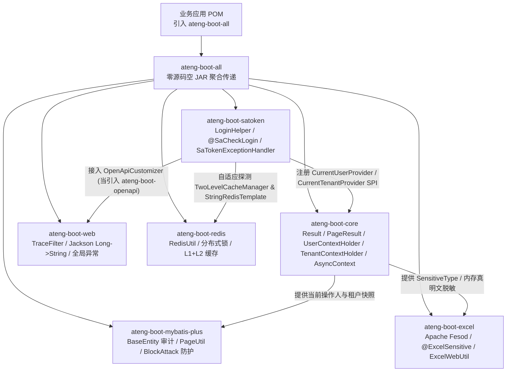

# ateng-boot-all 一键核心全家桶聚合引擎

> 零编译源码的空 JAR 传递依赖聚合体（`<packaging>jar</packaging>`）：一行坐标一次性装配 **Core + Web + MyBatis-Plus + Redis + Excel + Sa-Token** 六大核心基础设施，助力单体应用与快速原型业务开箱即用、零冲突联动。

---

## 0. 核心捆绑成员与按需扩展选型矩阵 (维度零：100% 全覆盖)

`ateng-boot-all` **本身不编译任何 Java 类与自动装配器**，而是严格收敛 **6 大高频基础核心 Starter (`CoreStarterBundle`)** 的传递入口；其余 29 项重型或专有基础设施保持按需独立选配，防止单应用无谓依赖膨胀。

### 0.1 默认传递捆绑的 6 大核心 Starter (`CoreStarterBundle`)

| 序号 | 核心模块 (`io.github.atengk:*`) | 核心门面 / 注解 / 关键机制 | 典型业务能力 | 权威文档 |
| :---: | :--- | :--- | :--- | :--- |
| 1 | `ateng-boot-core` | `Result<T>` / `PageQuery` / `PageResult<T>` / `BusinessAssert` / `ValidList<E>` / `@InEnum` / `@FieldSensitive` / `AsyncContext` / `JsonUtil` | 统一响应与校验契约、四维上下文异步透传、视图与通用原语底座 | [查看](../ateng-boot-core/README.md) |
| 2 | `ateng-boot-web` | `TraceFilter` / `@Idempotent` / `@RateLimiter` / `@ApiSign` / `@OperateLog` / `EnumDictionaryController` / `long-to-string` | MDC 链路追踪、全域异常拦截、防重防刷安全防线、Snowflake ID 防精度丢失 | [查看](../ateng-boot-web/README.md) |
| 3 | `ateng-boot-mybatis-plus` | `AtengBaseMapper<T>` / `AtengServiceImpl<M, T>` / `BaseEntity` / `PageUtil` / `@IgnoreTenant` / `@DataScope` / `@FieldEncrypt` | 操作人与时间审计自动填充、多租户与数据权限、标准 `PageResult` 分页与批量增强 | [查看](../ateng-boot-mybatis-plus/README.md) |
| 4 | `ateng-boot-redis` | `RedisUtil` / `@DistributedLock` / `RedisCacheTemplate` / `TwoLevelCacheManager` / `RedisDelayedQueue` / `RedisStreamTemplate` | 双核 Lettuce+Redisson、分布式锁、防击穿缓存、L1+L2 两级缓存与可靠消息队列 | [查看](../ateng-boot-redis/README.md) |
| 5 | `ateng-boot-excel` | `ExcelUtil` / `ExcelWebUtil` / `@ExcelSensitive` / `@ExcelDropdown` / `BatchValidationListener` / `WorkbookEncryption` | Apache Fesod 流式导出与下载、导出动态脱敏、行级校验红字回写与 AES 加密 | [查看](../ateng-boot-excel/README.md) |
| 6 | `ateng-boot-satoken` | `LoginHelper` / `LoginUser` / `@SaCheckLogin` / `@SaCheckRole` / `@CheckDataOwner` / `@CheckSameToken` / `SaTokenCurrentUserProvider` | 登录与多账号会话路由、自动贯通 Core/MP 操作人上下文、L1+L2 权限缓存与零信任 | [查看](../ateng-boot-satoken/README.md) |

### 0.2 未捆绑但兼容共存的 29 项按需扩展 Starter 选型对比矩阵

> 下列 29 个模块不随 `ateng-boot-all` 默认传递，已纳入 [`ateng-boot-bom`](../ateng-boot-bom/README.md) 统一管控版本，业务按需直接引入即可与全家桶**零冲突共存**：

| 领域分类 | 按需引入坐标 (`io.github.atengk:*`) | 核心适用场景 | 权威文档 |
| :--- | :--- | :--- | :--- |
| **存储与文档** | `ateng-boot-storage` | Local 本地磁盘与 S3 兼容协议对象存储、自适应流式分片与断点续传 | [查看](../ateng-boot-storage/README.md) |
| **存储与文档** | `ateng-boot-ftp` | FTP/FTPS 连接池、RFC 2640 中文防乱码与递归目录同步 | [查看](../ateng-boot-ftp/README.md) |
| **存储与文档** | `ateng-boot-ssh` | SSH/SFTP 会话池、多主机批量命令巡检、端口转发隧道与 WebSSH | [查看](../ateng-boot-ssh/README.md) |
| **存储与文档** | `ateng-boot-document` | Word 模板渲染 (`poi-tl`) 与 PDF 暗水印、跨页骑缝章、动态表单 (`PDFBox`) | [查看](../ateng-boot-document/README.md) |
| **网络与通信** | `ateng-boot-http` | Spring 6 声明式 `@HttpClient`、多命名 `RestClient` 池化、SSE 流与 mTLS | [查看](../ateng-boot-http/README.md) |
| **网络与通信** | `ateng-boot-realtime` | WebSocket 与 SSE 实时推送、分布式群组、断线重放与优雅停机 | [查看](../ateng-boot-realtime/README.md) |
| **网络与通信** | `ateng-boot-tcp` | Netty 4.1 双模长连接服务端/客户端、粘包拆包、mTLS 与跨节点推流 | [查看](../ateng-boot-tcp/README.md) |
| **网络与通信** | `ateng-boot-mqtt` | MQTT v5 物联网设备双向通信、`$share` 共享订阅与 RPC 应答 | [查看](../ateng-boot-mqtt/README.md) |
| **消息队列** | `ateng-boot-rabbitmq` | RabbitMQ 可靠确认、事务提交后发信、死信重放与 Quorum 拓扑 | [查看](../ateng-boot-rabbitmq/README.md) |
| **消息队列** | `ateng-boot-kafka` | Kafka 流批处理、`@RetryableTopic` 非阻塞重试、死信治理与 Lag 观测 | [查看](../ateng-boot-kafka/README.md) |
| **消息队列** | `ateng-boot-rocketmq` | RocketMQ 5.x gRPC 瘦客户端、2PC 分布式事务、SimpleConsumer 与死信重放 | [查看](../ateng-boot-rocketmq/README.md) |
| **运维与契约** | `ateng-boot-openapi` | SpringDoc OpenAPI 3.0（Swagger UI 5.x）、五模访问守卫、枚举契约与离线导出 | [查看](../ateng-boot-openapi/README.md) |
| **运维与契约** | `ateng-boot-observability` | K8s Liveness/Readiness 硬隔离、防假死健康探针、业务度量与端点防火墙 | [查看](../ateng-boot-observability/README.md) |
| **运维与契约** | `ateng-boot-admin` | Spring Boot Admin 监控看板、Sa-Token 登录守卫与 SSRF 注册防火墙 | [查看](../ateng-boot-admin/README.md) |
| **通知与触达** | `ateng-boot-mail` | SMTP 多账号发送、国际化模板、批量合并、测试沙箱与延迟补偿 | [查看](../ateng-boot-mail/README.md) |
| **通知与触达** | `ateng-boot-notification` | 企微/钉钉/飞书 Webhook 群机器人推送、`@NotifyAlert` 防风暴与故障转移 | [查看](../ateng-boot-notification/README.md) |
| **通知与触达** | `ateng-boot-sms` | 多渠道短信统一推送、加权熔断、单日预算切断与回调防重网关 | [查看](../ateng-boot-sms/README.md) |
| **交易与安全** | `ateng-boot-pay` | 微信支付 v3 与支付宝官方 SDK 统一收单与回调验签防重网关 | [查看](../ateng-boot-pay/README.md) |
| **交易与安全** | `ateng-boot-social` | OAuth2 第三方社会化登录、两阶段绑定票据与 Sa-Token 多端会话联动 | [查看](../ateng-boot-social/README.md) |
| **交易与安全** | `ateng-boot-datasource` | SaaS 动态多数据源、主从读写分离、从库自愈与事务假切源守卫 | [查看](../ateng-boot-datasource/README.md) |
| **交易与安全** | `ateng-boot-encrypt` | 配置属性全链路透明加解密、AES/RSA/SM2/SM4、CLI 回写与 `/env` 掩码 | [查看](../ateng-boot-encrypt/README.md) |
| **调度与流程** | `ateng-boot-statemachine` | 无状态单例业务状态机 Fluent DSL、CAS 跃迁与状态图导出 | [查看](../ateng-boot-statemachine/README.md) |
| **调度与流程** | `ateng-boot-liteflow` | LiteFlow 规则与 DAG 流程编排、受管并行池与静态预检回滚 | [查看](../ateng-boot-liteflow/README.md) |
| **调度与流程** | `ateng-boot-job-local` | 单机受管定时任务、四阶重叠并发防卫、硬超时强中断与集群互斥锁 | [查看](../ateng-boot-job-local/README.md) |
| **调度与流程** | `ateng-boot-job-xxl` | XXL-Job 生产加固、受管线程池、分片流式批处理与 K8s 三阶排空 | [查看](../ateng-boot-job-xxl/README.md) |
| **调度与流程** | `ateng-boot-job-snail` | SnailJob 调度与分布式重试双擎加固、防僵尸看门狗与脱网调试 | [查看](../ateng-boot-job-snail/README.md) |
| **搜索与 AI** | `ateng-boot-search` | Elasticsearch 8.x & OpenSearch 双引擎检索、流式批量与 Search-After 深度分页 | [查看](../ateng-boot-search/README.md) |
| **搜索与 AI** | `ateng-boot-ai` | LangChain4j & LangGraph4j 智能体编排、RAG 溯源、HITL 审批与配额管控 | [查看](../ateng-boot-ai/README.md) |
| **搜索与 AI** | `ateng-boot-milvus` | Milvus 向量库运维、多向量混合检索与多租户 `PartitionKey` 物理隔离 | [查看](../ateng-boot-milvus/README.md) |

---

## 1. 模块定位与快速起步 (维度一：Maven 引入与最小可用体验)

### 1.1 一句话痛点与适用定位

* **解决痛点**：单体管理系统、SaaS 管理后台或快速交付原型工程通常同时需要标准 Web 契约、持久层审计/分页、Redis 缓存与锁、Excel 报表导入导出及登录权限管理，逐个拼接坐标冗长繁琐。
* **设计原则**：`ateng-boot-all` 将日常业务 `80%` 高频基础设施收敛为单一坐标依赖，且 100% 遵循防御性自动装配——在引入阶段未配置的中间件（如无 Redis 环境通过 `ateng.boot.redis.enabled: false` 关闭）均可平滑降级运行。

### 1.2 Maven 引入坐标

* **方式一（导入 BOM 后免配版本号 — 推荐）**：

```xml
<dependencyManagement>
    <dependencies>
        <dependency>
            <groupId>io.github.atengk</groupId>
            <artifactId>ateng-boot-bom</artifactId>
            <version>1.2.0</version>
            <type>pom</type>
            <scope>import</scope>
        </dependency>
    </dependencies>
</dependencyManagement>

<dependencies>
    <dependency>
        <groupId>io.github.atengk</groupId>
        <artifactId>ateng-boot-all</artifactId>
    </dependency>
    <!-- 可选：按需追加接口文档引擎，与 Sa-Token 无缝协同 -->
    <dependency>
        <groupId>io.github.atengk</groupId>
        <artifactId>ateng-boot-openapi</artifactId>
    </dependency>
</dependencies>
```

* **方式二（快速试用独立引入，显式指定版本号）**：

```xml
<dependency>
    <groupId>io.github.atengk</groupId>
    <artifactId>ateng-boot-all</artifactId>
    <version>1.2.0</version>
</dependency>
```

### 1.3 最小可用配置 (`application.yml`)

以下配置提取自通过全真集成测试的 [`ateng-boot-sample-smoke-test`](../ateng-boot-samples/ateng-boot-sample-smoke-test/README.md)，展示默认离线自洽与 `local` 真实 Redis 的双模开箱配置：

```yaml
spring:
  application:
    name: ateng-boot-sample-smoke-test
  config:
    import: "optional:classpath:application-local.yml"
  datasource:
    url: jdbc:h2:mem:smokedb;DB_CLOSE_DELAY=-1;MODE=MySQL
    driver-class-name: org.h2.Driver
    username: sa
    password: ""

ateng:
  boot:
    web:
      trace:
        enabled: true
      long-to-string: true
      log:
        enabled: true
    mybatis-plus:
      audit:
        enabled: true
        default-operator: SYSTEM
    satoken:
      enabled: true
      interceptor:
        enabled: true
        check-login: false
    openapi:
      enabled: true
      title: "ateng-boot 全家桶装配冒烟与集成示例"
      version: "1.2.0"

---
spring:
  config:
    activate:
      on-profile: "!local"
  autoconfigure:
    exclude:
      - org.springframework.boot.autoconfigure.data.redis.RedisAutoConfiguration
      - org.springframework.boot.autoconfigure.data.redis.RedisRepositoriesAutoConfiguration

ateng:
  boot:
    redis:
      enabled: false
```

### 1.4 极简启动与契约校验实战代码

提取自 `SmokeContractController`，开箱获得 `Result<T>` 显式契约、MDC `traceId` 透传、大整数 `Long` 自动转字符串（防止前端 JavaScript IEEE 754 精度丢失）、`ValidList<E>` 批量级联校验及 `@FieldSensitive` 视图动态脱敏：

```java
@Tag(name = "1. 基础契约与校验")
@RestController
@RequestMapping("/sample/smoke/contract")
public class SmokeContractController {

    private static final long SNOWFLAKE_PROBE_ID = 9007199254740993L;

    @GetMapping("/ping")
    public Result<SmokePingVO> ping() {
        SmokePingVO vo = new SmokePingVO(
                "ateng-boot-sample-smoke-test",
                "1.2.0",
                SNOWFLAKE_PROBE_ID,
                MDC.get("traceId")
        );
        return Result.success(vo);
    }

    @PostMapping("/batch-validate")
    public Result<List<SmokeSanitizedVO>> batchValidate(@RequestBody @Valid ValidList<SmokeBatchItemRequest> items) {
        List<SmokeSanitizedVO> result = items.stream()
                .map(item -> new SmokeSanitizedVO(item.getTitle(), item.getStatus(), item.getMobile()))
                .toList();
        return Result.success(result);
    }
}
```

---

## 2. 聚合装配拓扑与零冲突协调原理 (维度二)

`ateng-boot-all` 的 6 大成员在运行期通过 **Core 四维上下文底座 + SPI 自动桥接 + 条件装配先后序** 形成无胶水联动闭环：



* **SPI 无缝桥接**：引入 `ateng-boot-satoken` 后，`AtengSaTokenAutoConfiguration` 自动向 `ateng-boot-core` 的 `UserContextHolder` 与 `TenantContextHolder` 注册当前登录人提供者，下游 MyBatis-Plus 插入/更新记录时**无需业务代码手动传参**即可自动填充 `createBy`/`updateBy`。
* **防误删与防冲突**：全家桶默认装配 `SaTokenCorsFilterForJakartaServlet` 禁用器（交由 `ateng-boot-web` 动态 CORS 统一管理）与 MyBatis-Plus 全表更新/删除阻断（`BlockAttackInnerInterceptor`），从底层消弭多重过滤器或拦截器打架。
* **OpenAPI 文档现代基线**：如业务需要在线 Swagger 接口调试，推荐协同引入 `ateng-boot-openapi`（基于官方 SpringDoc OpenAPI 3.0 与 Swagger UI 5.x），可自动接入 Sa-Token Token 鉴权方案并保持 `/v3/api-docs` 匿名放行。

---

## 3. 全真跨模块端到端闭环场景 (维度三)

以下代码全部提取自 [`ateng-boot-sample-smoke-test`](../ateng-boot-samples/ateng-boot-sample-smoke-test/README.md) 并已通过 `SampleSmokeIntegrationTest` 全链路断言验证：

### 3.1 安全会话、审计自动填充、标准分页与视图脱敏闭环

1. **Sa-Token 登录并自动桥接四维上下文**（提取自 `SmokeSecurityCoordinationController`）：

```java
@PostMapping("/login")
public Result<SmokeSessionVO> login(@RequestBody @Valid SmokeLoginRequest request) {
    LoginUser loginUser = LoginUser.builder()
            .userId(request.getUserId())
            .userAccount(request.getUserAccount())
            .userName(request.getUserName())
            .tenantId(request.getTenantId())
            .build();
    LoginHelper.login(loginUser);
    return Result.success(buildSessionSnapshot(loginUser));
}

@SaCheckLogin
@GetMapping("/me")
public Result<SmokeSessionVO> me() {
    LoginUser loginUser = LoginHelper.getLoginUser();
    return Result.success(buildSessionSnapshot(loginUser));
}
```

2. **Service 内部持久化实体隔离与分页 VO 转换**（提取自 `SmokeRecordServiceImpl` 与 `SmokePersistenceExcelController`，恪守 `Zero-Entity-Leakage` 与 `ADR-0012` 内存真明文）：

```java
@Service
public class SmokeRecordServiceImpl extends AtengServiceImpl<SmokeRecordMapper, SmokeRecordEntity> implements SmokeRecordService {

    @Override
    public SmokeRecordVO createRecord(SmokeRecordCreateRequest request) {
        Objects.requireNonNull(request, "新增请求参数不能为空");
        SmokeRecordEntity entity = new SmokeRecordEntity(
                request.getTitle(), request.getStatus(), request.getAmount(), request.getMobile()
        );
        save(entity);
        return SmokeRecordVO.fromEntity(entity);
    }

    @Override
    public PageResult<SmokeRecordVO> pageRecords(SmokeRecordPageRequest request) {
        SmokeRecordPageRequest safeQuery = request != null ? request : new SmokeRecordPageRequest();
        LambdaQueryWrapper<SmokeRecordEntity> wrapper = new LambdaQueryWrapper<SmokeRecordEntity>()
                .like(StringUtils.hasText(safeQuery.getTitle()), SmokeRecordEntity::getTitle, safeQuery.getTitle())
                .eq(StringUtils.hasText(safeQuery.getStatus()), SmokeRecordEntity::getStatus, safeQuery.getStatus())
                .orderByDesc(SmokeRecordEntity::getCreateTime);
        Page<SmokeRecordEntity> mpPage = page(PageUtil.toPage(safeQuery, SmokeRecordEntity.class), wrapper);
        return PageUtil.toPageResult(mpPage, SmokeRecordVO::fromEntity);
    }
}
```

### 3.2 `@ExcelSensitive` 流式安全下载与 Redis 双模降级探针

```java
// 提取自 SmokeRecordExportRow：底层内存与数据库保持原始手机号明文，仅在写入 Excel 单元格时掩码为 139****5678
@Data
@NoArgsConstructor
@AllArgsConstructor
public class SmokeRecordExportRow implements Serializable {
    @ExcelProperty("记录标题")
    private String title;
    @ExcelProperty("状态")
    private String status;
    @ExcelProperty("金额")
    private BigDecimal amount;
    @ExcelProperty("联系人手机")
    @ExcelSensitive(SensitiveType.MOBILE_PHONE)
    private String mobile;
    @ExcelProperty("创建人")
    private String createBy;
}

// 提取自 SmokePersistenceExcelController：一行完成 RFC 5987 防乱码与客户端中断自愈下载
@GetMapping("/export")
public ResponseEntity<StreamingResponseBody> export(@RequestParam(required = false) String status) {
    List<SmokeRecordExportRow> rows = smokeRecordService.listExportRows(status);
    return ExcelWebUtil.toResponseEntity("smoke-records", rows, SmokeRecordExportRow.class);
}
```

> **全真测试验证输出要点**（来自 `SampleSmokeIntegrationTest` 实跑日志）：携带 Token 调用 `/sample/smoke/record/create` 时，`INSERT INTO sys_smoke_record` 自动填充 `create_by = smoke-user-9999`，数据库内保留原始手机号 `13912345678`；而接口 JSON 与流式 `.xlsx` 第 4 列单元格均自动脱敏输出 `139****5678`。

---

## 4. 适用边界、局部排除与拆分演进指南 (维度四)

### 4.1 选型边界：何时用 `ateng-boot-all` vs [`ateng-boot-bom`](../ateng-boot-bom/README.md)

* **推荐使用 `ateng-boot-all`**：中小型单体应用、管理后台、PoC/Demo 原型验证、一体化综合业务系统。
* **建议切换回 `ateng-boot-bom` + 精细按需选配**：云原生轻量网关 / 无状态 BFF 节点（无数据库与 Redis，需压低镜像体积）、重度定制高并发边缘服务、或架构明确拆分读写与异步处理的微服务群。

### 4.2 使用 `<exclusions>` 局部裁剪不用的核心 Starter

若单体应用仅暂不需要缓存或报表导出，无需放弃 `ateng-boot-all`，直接在 `<dependency>` 中声明 `<exclusions>` 即可：

```xml
<dependency>
    <groupId>io.github.atengk</groupId>
    <artifactId>ateng-boot-all</artifactId>
    <exclusions>
        <!-- 示例：极简轻量节点剔除 Redis 或 Excel，其余 Core / Web / MP / SaToken 照常装配 -->
        <exclusion>
            <groupId>io.github.atengk</groupId>
            <artifactId>ateng-boot-excel</artifactId>
        </exclusion>
    </exclusions>
</dependency>
```

> **红线警告**：**严禁排除 `ateng-boot-core`**！其余全部 Starter 均强依赖 `core` 中的 `Result<T>`、`BusinessException`、`JsonUtil` 与四维上下文原语；排除后将直接触发 `ClassNotFoundException`。

### 4.3 1:1 配套自验工程

* 完整端到端可运行样例与 3 大领域 Controller 体验入口，详见：[ateng-boot-sample-smoke-test README](../ateng-boot-samples/ateng-boot-sample-smoke-test/README.md)。
