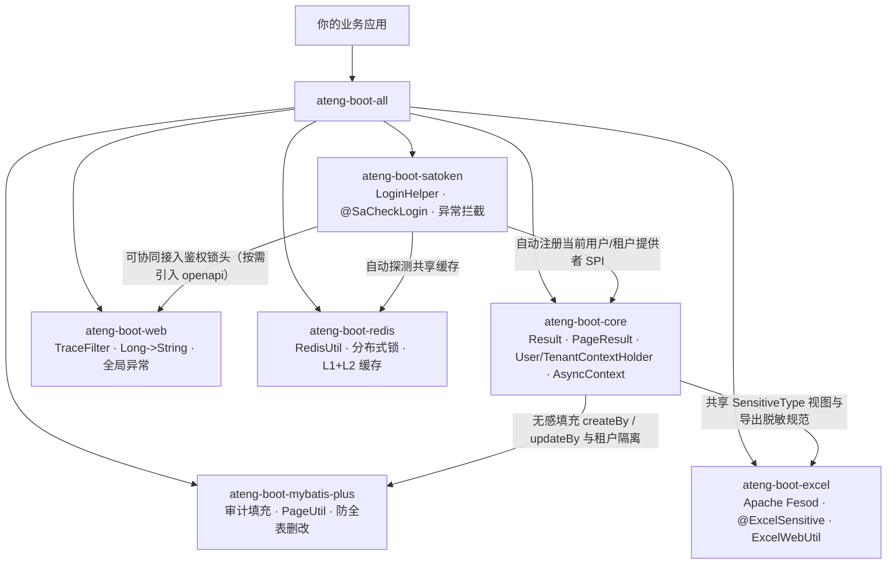

# ateng-boot-all 一键核心全家桶

> 零编译源码的聚合依赖包（`<packaging>jar</packaging>`）：一行 Maven/Gradle 坐标一次性引入 **Core + Web + MyBatis-Plus + Redis + Excel + Sa-Token** 六大高频基础设施，助力单体应用、SaaS 管理后台与快速原型工程开箱即用。

---

## 1. 核心成员与选型边界

### 1.1 默认捆绑的 6 大核心 Starter

| 序号 | 核心模块 (`io.github.atengk:*`) | 核心门面 / 注解 | 开箱即得的核心能力 | 详细文档 |
| :---: | :--- | :--- | :--- | :--- |
| 1 | `ateng-boot-core` | `Result<T>` / `PageQuery` / `PageResult<T>` / `BusinessAssert` / `ValidList<E>` / `@InEnum` / `@FieldSensitive` / `AsyncContext` / `JsonUtil` | 统一响应与校验契约、四维上下文异步透传、视图动态脱敏与通用原生原语 | [查看](../ateng-boot-core/README.md) |
| 2 | `ateng-boot-web` | `TraceFilter` / `@Idempotent` / `@RateLimiter` / `@ApiSign` / `@OperateLog` / `EnumDictionaryController` / `long-to-string` | MDC 链路追踪、全域异常脱敏、防重防刷安全防线、Snowflake Long 防前端精度丢失 | [查看](../ateng-boot-web/README.md) |
| 3 | `ateng-boot-mybatis-plus` | `AtengBaseMapper<T>` / `AtengServiceImpl<M, T>` / `BaseEntity` / `PageUtil` / `@IgnoreTenant` / `@DataScope` / `@FieldEncrypt` | 操作人与时间审计自动填充、多租户与数据权限、标准分页转换与批量增强 | [查看](../ateng-boot-mybatis-plus/README.md) |
| 4 | `ateng-boot-redis` | `RedisUtil` / `@DistributedLock` / `RedisCacheTemplate` / `TwoLevelCacheManager` / `RedisDelayedQueue` / `RedisStreamTemplate` | 双核 Lettuce+Redisson、分布式锁、防击穿缓存、L1+L2 两级缓存与延时消息队列 | [查看](../ateng-boot-redis/README.md) |
| 5 | `ateng-boot-excel` | `ExcelUtil` / `ExcelWebUtil` / `@ExcelSensitive` / `@ExcelDropdown` / `BatchValidationListener` / `ExcelSecurityUtil` | Apache Fesod 流式导出与下载、导出动态脱敏、行级校验红字批注与工作簿 AES 加密 | [查看](../ateng-boot-excel/README.md) |
| 6 | `ateng-boot-satoken` | `LoginHelper` / `LoginUser` / `@SaCheckLogin` / `@SaCheckRole` / `@CheckDataOwner` / `@CheckSameToken` / `SaTokenCurrentUserProvider` | 登录与多账号会话路由、自动贯通操作人与租户上下文、L1+L2 权限缓存与微服务零信任 | [查看](../ateng-boot-satoken/README.md) |

### 1.2 什么时候选 `ateng-boot-all` vs `ateng-boot-bom`？

* **优先使用 `ateng-boot-all`**：中小型单体应用、企业管理后台、一体化综合业务系统、PoC / 原型验证（覆盖日常 80% 高频需求，且在未配置 Redis 等中间件时支持一键关闭平滑降级）。
* **建议切换至 [`ateng-boot-bom`](../ateng-boot-bom/README.md) 按需选配**：无数据库/无缓存的轻量网关、BFF 边缘服务，或对容器镜像体积与依赖树有精细控制要求的分布式微服务集群。

---

## 2. 快速开始

### 2.1 引入依赖

* **方式一：配合 `ateng-boot-bom` 引入（推荐，便于后续叠加任意扩展 Starter）**

```xml
<dependencyManagement>
    <dependencies>
        <dependency>
            <groupId>io.github.atengk</groupId>
            <artifactId>ateng-boot-bom</artifactId>
            <version>1.2.0</version>
            <type>pom</type>
            <scope>import</scope>
        </dependency>
    </dependencies>
</dependencyManagement>

<dependencies>
    <dependency>
        <groupId>io.github.atengk</groupId>
        <artifactId>ateng-boot-all</artifactId>
    </dependency>
    <!-- 可选：按需追加接口文档引擎，自动接入 Sa-Token 鉴权 -->
    <dependency>
        <groupId>io.github.atengk</groupId>
        <artifactId>ateng-boot-openapi</artifactId>
    </dependency>
</dependencies>
```

* **方式二：独立引入（直接显式指定版本号）**

```xml
<dependency>
    <groupId>io.github.atengk</groupId>
    <artifactId>ateng-boot-all</artifactId>
    <version>1.2.0</version>
</dependency>
```

<details>
<summary><strong>使用 Gradle？展开查看 Kotlin / Groovy DSL 引入方式</strong></summary>

**Kotlin DSL (`build.gradle.kts`)**：

```kotlin
dependencies {
    implementation("io.github.atengk:ateng-boot-all:1.2.0")
}
```

**Groovy DSL (`build.gradle`)**：

```groovy
dependencies {
    implementation 'io.github.atengk:ateng-boot-all:1.2.0'
}
```

</details>

### 2.2 最小可用配置 (`application.yml`)

以下配置直接提取自可完整跑通的 [`ateng-boot-sample-smoke-test`](../ateng-boot-samples/ateng-boot-sample-smoke-test/README.md)，展示“默认 H2 + 离线禁用 Redis”与“激活 `local` Profile 直连真实 Redis”的双模开箱配置：

```yaml
spring:
  application:
    name: ateng-boot-sample-smoke-test
  config:
    import: "optional:classpath:application-local.yml"
  datasource:
    url: jdbc:h2:mem:smokedb;DB_CLOSE_DELAY=-1;MODE=MySQL
    driver-class-name: org.h2.Driver
    username: sa
    password: ""
  sql:
    init:
      mode: always
      schema-locations: classpath:schema.sql

mybatis-plus:
  configuration:
    map-underscore-to-camel-case: true

ateng:
  boot:
    web:
      trace:
        enabled: true
      long-to-string: true
      log:
        enabled: true
    mybatis-plus:
      audit:
        enabled: true
        default-operator: SYSTEM
    satoken:
      enabled: true
      interceptor:
        enabled: true
        check-login: false
    openapi:
      enabled: true
      title: "ateng-boot 全家桶装配冒烟与集成示例"
      version: "1.2.0"
      description: "验证 ateng-boot-all 核心全家桶与按需 Starter 在同一容器中的零冲突协同装配"

---
spring:
  config:
    activate:
      on-profile: "!local"
  autoconfigure:
    exclude:
      - org.springframework.boot.autoconfigure.data.redis.RedisAutoConfiguration
      - org.springframework.boot.autoconfigure.data.redis.RedisRepositoriesAutoConfiguration

ateng:
  boot:
    redis:
      enabled: false

---
spring:
  config:
    activate:
      on-profile: "local"
  data:
    redis:
      host: ${REDIS_HOST:localhost}
      port: ${REDIS_PORT:6379}
      password: ${REDIS_PASSWORD:}

ateng:
  boot:
    redis:
      enabled: true
      key-prefix: "smoke:"
```

### 2.3 极简契约与校验实战

提取自 `SmokeContractController`，开箱获得 `Result<T>` 显式契约、MDC `traceId` 透传、大整数 `Long` 自动转字符串（防前端 JavaScript IEEE 754 精度丢失）、`ValidList<E>` 批量级联校验与 `@FieldSensitive` 视图动态脱敏：

```java
@Tag(name = "1. 基础契约与校验")
@RestController
@RequestMapping("/sample/smoke/contract")
public class SmokeContractController {

    private static final long SNOWFLAKE_PROBE_ID = 9007199254740993L;

    @Operation(summary = "冒烟探活与基础契约检查")
    @GetMapping("/ping")
    public Result<SmokePingVO> ping() {
        SmokePingVO vo = new SmokePingVO(
                "ateng-boot-sample-smoke-test",
                "1.2.0",
                SNOWFLAKE_PROBE_ID,
                MDC.get("traceId")
        );
        return Result.success(vo);
    }

    @Operation(summary = "ValidList 级联校验与视图脱敏")
    @PostMapping("/batch-validate")
    public Result<List<SmokeSanitizedVO>> batchValidate(@RequestBody @Valid ValidList<SmokeBatchItemRequest> items) {
        List<SmokeSanitizedVO> result = items.stream()
                .map(item -> new SmokeSanitizedVO(item.getTitle(), item.getStatus(), item.getMobile()))
                .toList();
        return Result.success(result);
    }
}
```

---

## 3. 多模块零胶水协同实战

六大底座在容器内通过 `ateng-boot-core` 上下文桥梁、SPI 自动发现与有序装配配置实现开箱联动：



* **自动桥接审计人**：引入 `ateng-boot-satoken` 后，登录态自动同步到 Core 上下文；MyBatis-Plus 插入/更新数据时**无需业务代码手动传人名**即可自动填充 `createBy`/`updateBy`。
* **过滤器与防误删兜底**：内部自动协调 CORS 过滤器顺序（统一由 `ateng-boot-web` 管理），并开启 MyBatis-Plus 全表更新/删除阻断，消除多模块拼装冲突。

以下代码均提取自 [`ateng-boot-sample-smoke-test`](../ateng-boot-samples/ateng-boot-sample-smoke-test/README.md) 并已通过 `SampleSmokeIntegrationTest` 端到端集成断言：

### 3.1 登录态贯通多模块上下文

提取自 `SmokeSecurityCoordinationController`：

```java
@Operation(summary = "登录并验证上下文桥接")
@PostMapping("/login")
public Result<SmokeSessionVO> login(@RequestBody @Valid SmokeLoginRequest request) {
    LoginUser loginUser = LoginUser.builder()
            .userId(request.getUserId())
            .userAccount(request.getUserAccount())
            .userName(request.getUserName())
            .tenantId(request.getTenantId())
            .build();
    LoginHelper.login(loginUser);
    return Result.success(buildSessionSnapshot(loginUser));
}

@Operation(summary = "获取当前已登录会话快照")
@SaCheckLogin
@GetMapping("/me")
public Result<SmokeSessionVO> me() {
    LoginUser loginUser = LoginHelper.getLoginUser();
    return Result.success(buildSessionSnapshot(loginUser));
}
```

### 3.2 实体隔离分页与 `@ExcelSensitive` 流式安全下载

1. **Service 内部完成持久化实体向 VO 的转换**（提取自 `SmokeRecordServiceImpl`，避免数据库实体暴露到接口层）：

```java
@Service
public class SmokeRecordServiceImpl extends AtengServiceImpl<SmokeRecordMapper, SmokeRecordEntity> implements SmokeRecordService {

    @Override
    public SmokeRecordVO createRecord(SmokeRecordCreateRequest request) {
        Objects.requireNonNull(request, "新增请求参数不能为空");
        SmokeRecordEntity entity = new SmokeRecordEntity(
                request.getTitle(),
                request.getStatus(),
                request.getAmount(),
                request.getMobile()
        );
        save(entity);
        return SmokeRecordVO.fromEntity(entity);
    }

    @Override
    public PageResult<SmokeRecordVO> pageRecords(SmokeRecordPageRequest request) {
        SmokeRecordPageRequest safeQuery = request != null ? request : new SmokeRecordPageRequest();
        LambdaQueryWrapper<SmokeRecordEntity> wrapper = new LambdaQueryWrapper<SmokeRecordEntity>()
                .like(StringUtils.hasText(safeQuery.getTitle()), SmokeRecordEntity::getTitle, safeQuery.getTitle())
                .eq(StringUtils.hasText(safeQuery.getStatus()), SmokeRecordEntity::getStatus, safeQuery.getStatus())
                .orderByDesc(SmokeRecordEntity::getCreateTime);
        Page<SmokeRecordEntity> mpPage = page(PageUtil.toPage(safeQuery, SmokeRecordEntity.class), wrapper);
        return PageUtil.toPageResult(mpPage, SmokeRecordVO::fromEntity);
    }

    @Override
    public List<SmokeRecordExportRow> listExportRows(String status) {
        LambdaQueryWrapper<SmokeRecordEntity> wrapper = new LambdaQueryWrapper<SmokeRecordEntity>()
                .eq(StringUtils.hasText(status), SmokeRecordEntity::getStatus, status)
                .orderByDesc(SmokeRecordEntity::getCreateTime);
        List<SmokeRecordEntity> entities = list(wrapper);
        if (entities == null || entities.isEmpty()) {
            return Collections.emptyList();
        }
        return entities.stream()
                .map(SmokeRecordExportRow::fromEntity)
                .toList();
    }
}
```

2. **内存与数据库保持明文，导出单元格动态脱敏流式下载**（提取自 `SmokeRecordExportRow` 与 `SmokePersistenceExcelController`）：

```java
@Data
@NoArgsConstructor
@AllArgsConstructor
public class SmokeRecordExportRow implements Serializable {

    @Serial
    private static final long serialVersionUID = 1L;

    @ExcelProperty("记录标题")
    private String title;

    @ExcelProperty("状态")
    private String status;

    @ExcelProperty("金额")
    private BigDecimal amount;

    @ExcelProperty("联系人手机")
    @ExcelSensitive(SensitiveType.MOBILE_PHONE)
    private String mobile;

    @ExcelProperty("创建人")
    private String createBy;

    public static SmokeRecordExportRow fromEntity(SmokeRecordEntity entity) {
        if (entity == null) {
            return null;
        }
        return new SmokeRecordExportRow(
                entity.getTitle(),
                entity.getStatus(),
                entity.getAmount(),
                entity.getMobile(),
                entity.getCreateBy()
        );
    }
}
```

```java
@Operation(summary = "流式导出脱敏 Excel 表格")
@GetMapping("/export")
public ResponseEntity<StreamingResponseBody> export(@RequestParam(required = false) String status) {
    List<SmokeRecordExportRow> rows = smokeRecordService.listExportRows(status);
    return ExcelWebUtil.toResponseEntity("smoke-records", rows, SmokeRecordExportRow.class);
}
```

> **实测验证效果**（来自 `SampleSmokeIntegrationTest`）：携带登录 Token 调用 `/sample/smoke/record/create` 时，`create_by` 自动填入当前登录用户 `smoke-user-9999`，数据库持久化保留原始手机号 `13912345678`，而接口 JSON 与导出的 `.xlsx` 文件均自动脱敏输出 `139****5678`。

---

## 4. 按需扩展、局部裁剪与配套示例

### 4.1 叠加任意其他业务 Starter

导入 `ateng-boot-bom` 并引入 `ateng-boot-all` 后，可按需无缝叠加 `ateng-boot-ai`、`ateng-boot-openapi`、`ateng-boot-storage`、`ateng-boot-http`、`ateng-boot-pay` 等任意其他 Starter。完整能力清单请参阅：

- [全栈能力版图（根目录 README）](../README.md#2-全栈能力版图)
- [BOM 全量坐标清单](../ateng-boot-bom/README.md#4-基线兼容与全量纳管清单附录)

### 4.2 使用 `<exclusions>` 局部裁剪不需要的底座

若项目暂不需要报表导出或 Redis 缓存，无需放弃 `ateng-boot-all`，直接排除对应 Starter 即可：

```xml
<dependency>
    <groupId>io.github.atengk</groupId>
    <artifactId>ateng-boot-all</artifactId>
    <exclusions>
        <!-- 示例：极简服务剔除 Excel 模块，其余 Core / Web / MP / Redis / Sa-Token 正常生效 -->
        <exclusion>
            <groupId>io.github.atengk</groupId>
            <artifactId>ateng-boot-excel</artifactId>
        </exclusion>
    </exclusions>
</dependency>
```

> **红线提示**：切勿排除 `ateng-boot-core`。所有其余 Starter 均依赖 `core` 提供的 `Result<T>`、`BusinessException`、`JsonUtil` 与上下文原语。

### 4.3 配套可运行示例工程

完整的 HTTP 体验接口与跨模块测试案例，详见：[ateng-boot-sample-smoke-test README](../ateng-boot-samples/ateng-boot-sample-smoke-test/README.md)。
