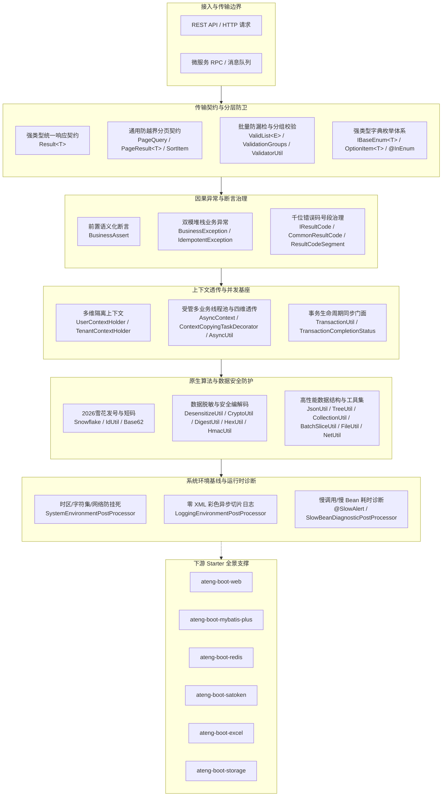

# ateng-boot-core 核心通用底座

> 提供全局统一 API 响应契约、因果异常与分层防卫体系、强类型字典枚举、多维异步上下文透传、受管多业务线程池、零 XML 工业级日志引擎与纯原生分布式发号底座。

---

## 0. 特性与公共 API 全景速查矩阵

| 特性分类 | 特性名称 | 核心门面 / 注解 / SPI | 关键配置项 (`ateng.boot.*`) | 关键 API 签名 / 核心行为 | 锚定验证源头 (*Test / Sample) |
| :--- | :--- | :--- | :--- | :--- | :--- |
| **API 响应契约** | 强类型通用统一响应模型 | `Result<T>` | - | `Result.success()`, `Result.success(data)`, `Result.fail(...)`, `getOrThrow()`, `map()`, `peek()`, `ifFail()`, `orElseGet()`, `orElseThrow()` | `ResultTest.java`, `CoreContractControllerTest.java`, `CoreResilienceScenarioServiceTest.java` |
| **标准状态码与号段治理** | 统一状态码契约、预置枚举与千位号段治理 | `IResultCode`, `CommonResultCode`, `ResultCodeSegment`, `ResultCodeUtil` | - | `CommonResultCode.SUCCESS(200)`, `BAD_REQUEST(400)`, `UNAUTHORIZED(401)`, `FORBIDDEN(403)`, `NOT_FOUND(404)`, `INTERNAL_SERVER_ERROR(500)`; `ResultCodeSegment.SYSTEM_CORE/AUTH_SECURITY/...`; `ResultCodeUtil.getSegment(code)`, `isInSegment(...)`, `assertInSegment(...)`, `assertUnique(...)` | `CommonResultCodeTest.java`, `ResultCodeUtilTest.java`, `CoreContractControllerTest.java`, `CoreResilienceScenarioServiceTest.java` |
| **分页传输契约** | 防越界分页入参、强类型排序、安全清洗与纯净出参模型 | `PageQuery`, `SortItem`, `PageResult<T>` | - | `PageQuery.getCurrent()`, `PageQuery.getSize()`, `PageQuery.safeCurrent()`, `PageQuery.safeSize()`, `PageQuery.normalize()`, `PageQuery.offset()` (防溢出计算), `PageQuery.addAsc/Desc()`, `SortItem.asc/desc()`, `PageResult.of(list, total, current, size)`, `PageResult.map(mapper)`, `hasPrevious()`, `hasNext()`, `isEmpty()` | `PageQueryTest.java`, `SortItemTest.java`, `PageResultTest.java`, `CoreContractControllerTest.java`, `CoreResilienceScenarioServiceTest.java` |
| **因果异常体系** | 业务受控异常、双模堆栈治理与幂等专用异常 | `BusinessException`, `IdempotentException` | - | `BusinessException(resultCode)`, `BusinessException(code, msg, cause)`（有 cause 默认保留完整调用栈与因果链，无 cause 零抓栈开销）, `BusinessException(..., writableStackTrace)`; `new IdempotentException("请求重复")` 防重拦截 | `BusinessExceptionTest.java`, `IdempotentExceptionTest.java`, `CoreContractControllerTest.java`, `CoreResilienceScenarioServiceTest.java`, `CoreResilienceAndPipelineControllerTest.java` |
| **业务语义断言** | 快速失败业务语义前置防卫门面 | `BusinessAssert` | - | `isTrue(...)`, `isFalse(...)`, `notNull(...)`, `isNull(...)`, `hasText(...)`, `notEmpty(...)`, `equals(...)`, `{}` 占位符惰性格式化, `Supplier<String>`, 数值区间断言 (`gt`, `gte`, `lt`, `lte`, `between`) | `BusinessAssertTest.java`, `CoreContractControllerTest.java`, `CoreResilienceScenarioServiceTest.java` |
| **分层双防校验** | 批量列表防漏检、分组标记与编程式防卫 | `ValidList<E>`, `ValidationGroups`, `ValidatorUtil` | - | `ValidList<E>` 解决 Spring 默认直接注入 `List<T>` 漏检 JSR-303 问题；`ValidationGroups.Create/Update`；`ValidatorUtil.validate(obj)` 非 Web 边界快速失败 | `ValidListTest.java`, `ValidatorUtilTest.java`, `CoreContractControllerTest.java`, `CoreDataProcessingScenarioServiceTest.java` |
| **强类型通用枚举** | 通用枚举契约、标准选项模型、别名注解、高速解析门面与 JSR-303 格式防卫 | `IBaseEnum<T>`, `OptionItem<T>`, `@EnumAlias`, `EnumUtil`, `@InEnum`, `InEnumValidator` | - | `IBaseEnum.getCode()`, `getLabel()`, `matches(code)`, `toOption()`, `getValue()`; `OptionItem.of(...)`; `EnumUtil.fromCode(...)`, `getByCodeOrThrow(...)`, `getLabelByCode(...)`, `isValidCode(...)`, `toOptions(...)`, `getAllCodes(...)`; `@InEnum(value = StatusEnum.class)` 第一道防线校验拦截 | `EnumUtilTest.java`, `InEnumValidatorTest.java`, `CoreContractControllerTest.java` |
| **分布式发号器与短码** | 2026 纪元雪花发号器、逆向反解与 Base62 短码 | `IdUtil`, `Snowflake`, `SnowflakeIdInfo` | - | `IdUtil.nextId()`, `IdUtil.nextIdStr()`, `IdUtil.parseSnowflake(id)` / `Snowflake.parse(id)` 逆向反解元数据，`IdUtil.toBase62(long)`, `IdUtil.fromBase62(str)`, `IdUtil.fastSimpleUUID()`, `IdUtil.fastUUID()`, `IdUtil.nanoId()` | `IdUtilTest.java`, `SnowflakeTest.java`, `CoreSecurityControllerTest.java`, `CoreResilienceScenarioServiceTest.java` |
| **四维异步传播与快照扩展** | 受管线程池上下文捕获、还原与自定义快照 SPI | `AsyncContext`, `ContextCopyingTaskDecorator`, `AsyncContextSnapshotProvider` | `ateng.boot.async.*` | `AsyncContext.wrap(runnable)`, `wrap(callable)`, `wrapSupplier(supplier)`, 传递 $\langle\text{MDC}, \text{User}, \text{TenantId}, \text{IgnoreTenant}\rangle$ 快照；SPI `AsyncContextSnapshotProvider` 扩展外部上下文透传 | `AsyncContextTest.java`, `ContextCopyingTaskDecoratorTest.java`, `AsyncContextSnapshotProviderTest.java`, `CoreContextScenarioServiceTest.java`, `CoreAsyncAndContextControllerTest.java` |
| **多业务异步底座与治理** | 多业务受管线程池、动态调参、状态监控、超时汇聚与短路策略 | `AsyncProperties`, `AsyncPoolProperties`, `DynamicAsyncPoolRegistrar`, `AtengAsyncAutoConfiguration`, `AsyncExecutionMode`, `AsyncRejectedPolicy`, `AsyncUtil`, `ThreadPoolStatus` | `ateng.boot.async.enabled`, `core-pool-size`, `max-pool-size`, `queue-capacity`, `keep-alive`, `thread-name-prefix`, `virtual-thread-name-prefix`, `concurrency-limit`, `mode`, `rejected-policy` (`WARN_CALLER_RUNS`, `WARN_ABORT`), `pools.*` | 声明式多业务线程池注册；`AsyncUtil.getStatus(poolName)` 提取 `ThreadPoolStatus` 监控指标；`AsyncUtil.resize(poolName, corePoolSize, maxPoolSize)` 动态热调参；`AsyncUtil.run(...)`, `AsyncUtil.supply(...)`, `AsyncUtil.allOf(...)`, `AsyncUtil.supplyAll(pool, suppliers, timeout)` (强类型超时聚合), `AsyncUtil.allOf(futures, timeout)`, `AsyncUtil.allMatches(pool, tasks, predicate, timeout)` (早期短路预检) | `AtengAsyncAutoConfigurationTest.java`, `AsyncUtilTest.java`, `CoreReportExportScenarioServiceTest.java`, `CoreContextScenarioServiceTest.java`, `CoreAsyncAndContextControllerTest.java` |
| **命名线程工厂** | 线程池命名与异常处理标准件 | `NamedThreadFactory` | - | `NamedThreadFactory(prefix)`, `newThread(runnable)`（支持自定义前缀、守护属性与 UncaughtExceptionHandler，消除匿名线程池） | `NamedThreadFactoryTest.java`, `CoreContextScenarioServiceTest.java` |
| **上下文持有者** | 用户身份与多租户无状态隔离 | `UserContextHolder`, `TenantContextHolder` | - | `getUserId()`, `setUserId()`, `getTenantId()`, `setTenantId()`, `ignoreTenant(supplier)`, `clear()` | `UserContextHolderTest.java`, `TenantContextHolderTest.java`, `CoreContextScenarioServiceTest.java` |
| **审计/租户 SPI** | 跨中间件解耦上下文扩展点 | `CurrentUserProvider`, `CurrentTenantProvider` | - | `getUserId()`, `getUserName()`, `getTenantId()`（供下游 Sa-Token / MyBatis-Plus 无缝对接） | `CoreContextScenarioServiceTest.java` |
| **安全序列化与内存深克隆** | 零 `@class` 污染高性能 Jackson 门面与脱敏安全深克隆 | `JsonUtil` | - | `toJsonString(obj)`, `toPrettyJsonString(obj)`, `parseObject(...)`, `parseList(...)`, `parseMap(...)`, `isValidJson(json)`, `readTree(String/byte[]/InputStream)`, `deepClone(obj)`（内存真明文深克隆，杜绝掩码星号污染） | `JsonUtilTest.java`, `JsonUtilDeepCloneTest.java`, `CoreDataProcessingScenarioServiceTest.java` |
| **敏感数据脱敏** | 15 大类敏感信息动态掩码与内存真明文防护 | `@FieldSensitive`, `DesensitizeUtil`, `SensitiveJsonSerializer`, `SensitiveType` | - | `DesensitizeUtil.mobilePhone(str)`, `idCard(str)`, `unifiedCreditCode(str)`, `secretKey(str)`, `passport(str)` 等，保证“内存真明文”防脏写 | `DesensitizeUtilTest.java`, `SensitiveJsonSerializerTest.java`, `CoreSecurityControllerTest.java`, `CoreSecurityScenarioServiceTest.java` |
| **退避指数重试** | 纯原生轻量无第三方重试工具 | `RetryUtil` | - | `execute(supplier, config, fallback)`, `executeAction(runnable, config, fallback)`，支持 Equal Jitter 平滑随机抖动、onRetry 监听器、指数退避与 Fallback 降级兜底 | `RetryUtilTest.java`, `CoreResilienceScenarioServiceTest.java`, `CoreResilienceAndPipelineControllerTest.java` |
| **加解密与十六进制** | 原生安全加解密、摘要算法与 Hex 编解码 | `CryptoUtil`, `DigestUtil`, `HexUtil` | - | `CryptoUtil.encryptGcm/decryptGcm`, `encryptCbc/decryptCbc`, `DigestUtil.sha256Hex`, `md5Hex`, `HexUtil.encodeHex(bytes)`, `HexUtil.decodeHex(hexStr)` | `CryptoUtilTest.java`, `DigestUtilTest.java`, `HexUtilTest.java`, `CoreSecurityControllerTest.java`, `CoreSecurityScenarioServiceTest.java` |
| **安全文件与流处理** | 路径穿越防御、隐性垃圾过滤、安全有界读取与临时文件 | `FileUtil` | - | `FileUtil.cleanFilename(name)`（防御 `../` 路径穿越）, `cleanPath(path)`, `resolveSafePath(baseDir, subPath)` (安全子路径解析防逃逸), `isSystemJunkFile(path)` (过滤 .DS_Store / desktop.ini), `filterValidPaths(paths)`, `getExtName(name)`, `formatSize(bytes)`, `readNBytesSafe(stream, maxBytes)` (防 OOM 安全有界读取), `createTempFile(...)` | `FileUtilTest.java`, `CoreDataProcessingScenarioServiceTest.java`, `CoreSystemAndAuditControllerTest.java` |
| **集合切片与大批量安全流转** | 零内存拷贝分批切片、函数式去重与大批量流转原语 | `CollectionUtil`, `BatchSliceUtil`, `MoreCollectors` | - | `CollectionUtil.partition(list, batchSize)`（基于 subList 视图切片，防 OOM 批量流转）, `BatchSliceUtil.slice(list, sliceSize)`, `BatchSliceUtil.forEachSlice(list, sliceSize, consumer)`, `CollectionUtil.distinctByKey(keyExtractor)`, `MoreCollectors.toSafeMap(...)`, `MoreCollectors.toDistinctList(...)` | `CollectionUtilTest.java`, `BatchSliceUtilTest.java`, `MoreCollectorsTest.java`, `CoreDataProcessingScenarioServiceTest.java`, `CoreDataAndTreeControllerTest.java` |
| **树形森林装配与析取** | O(N) 线性组装、递归剪枝、展平与路径探寻 | `TreeUtil` | - | `TreeUtil.build(...)`, `buildForest(...)`, `filter(...)`, `flatten(roots, childrenGetter)` / `flattenTree(...)` (先序深度优先展平), `findPath(...)` (面包屑导航路径), `getLeafNodes(...)` (提取所有叶子终端节点) | `TreeUtilTest.java`, `CoreDataProcessingScenarioServiceTest.java`, `CoreDataAndTreeControllerTest.java` |
| **类型安全引用** | SerializedLambda 强类型字段推导与受管 LRU 缓存 | `LambdaUtil`, `PropertyFunc` | `ateng.boot.core.cache.default-max-capacity`, `default-ttl` | `LambdaUtil.getFieldName(func)`（解析 `User::getName` -> `"name"`，带本地并发缓存）, `LambdaUtil.resolve(func)`, `LambdaUtil.configureCache(maxCapacity, ttl)` (外置配置自动绑定注入) | `LambdaUtilTest.java`, `CoreDataProcessingScenarioServiceTest.java`, `CoreDataAndTreeControllerTest.java` |
| **标准日期与工作日** | 标准日期常量、无损互转与工作日推演 | `DatePattern`, `DateTimeUtil` | - | `DateTimeUtil.toLocalDateTime(date)`, `toDate(ldt)`, `toEpochMilli(ldt)`, `beginOfDay(ldt)`, `endOfDay(ldt)`, `betweenDays(...)`, `isWorkday(date)`, `plusWorkdays(date, workdays)`, `betweenWorkdays(start, end)` | `DatePatternTest.java`, `DateTimeUtilTest.java`, `CoreDataProcessingScenarioServiceTest.java`, `CoreDataAndTreeControllerTest.java` |
| **高性能随机件** | 无锁安全随机与列表抽样洗牌 | `RandomUtil` | - | `RandomUtil.randomNumbers(len)`, `randomString(len)`, `randomInt(min, max)`, `randomEle(list)`, `randomEles(list, count)`, `shuffle(list)`, `shuffleNew(list)` | `RandomUtilTest.java`, `CoreDataProcessingScenarioServiceTest.java`, `CoreDataAndTreeControllerTest.java` |
| **通用辅助原语** | 对象属性安全拷贝、不可变元组与 Spring 容器门面 | `BeanUtil`, `Pair`, `Triple`, `SpringUtil`, `AtengCoreAutoConfiguration` | - | `BeanUtil.copy(...)`, `copyList(...)`, `BeanUtil.copyIgnoreNull(source, target)`, `Pair.of(...)`, `Triple.of(...)`, `SpringUtil.getBean(...)`, `containsBean(...)`, `isDev/isProd/isTest()`, `getServerPort()` | `BeanUtilTest.java`, `PairTripleTest.java`, `SpringUtilTest.java`, `CoreDataProcessingScenarioServiceTest.java`, `CoreDataAndTreeControllerTest.java`, `CoreSystemAndAuditControllerTest.java` |
| **事务同步门面与状态枚举** | 事务生命周期门面、上下文穿透与事务状态枚举 | `TransactionUtil`, `TransactionCompletionStatus` | - | `executeAfterCommit(task)`, `executeAfterRollback(task)`, `executeAfterCommitAsync(task)`, `publishAfterCommit(event)`, `isActualTransactionActive()`, `isSynchronizationActive()`, `TransactionCompletionStatus.COMMITTED/ROLLED_BACK/UNKNOWN` | `TransactionUtilTest.java`, `CoreContextScenarioServiceTest.java`, `CoreAsyncAndContextControllerTest.java` |
| **操作审计契约与事件发布** | 操作日志模型、操作动作枚举与解耦事件 | `OperateLogModel`, `OperateTypeEnum`, `OperateLogEvent` | - | `OperateLogModel.builder()`, `model.isSuccess()`, `model.addExtra(k, v)`, `OperateTypeEnum.of(code)`, `new OperateLogEvent(source, model)` 异步事件解耦发布 | `OperateLogModelTest.java`, `CoreResilienceScenarioServiceTest.java`, `CoreSystemAndAuditControllerTest.java` |
| **持久层无侵入 SQL 审计** | SQL 审计结构体与语法类型判定 | `SqlLogModel`, `SqlTypeEnum` | - | `SqlLogModel.builder()`, `model.getSql()`, `model.getExecutionTimeMs()`, `SqlTypeEnum.fromSql(sql)` 识别 SELECT/INSERT/UPDATE/DELETE/DDL | `SqlLogModelTest.java`, `SqlTypeEnumTest.java`, `CoreSystemAndAuditControllerTest.java` |
| **进程内滑动窗口流控** | 高性能单机内存滑动窗口限流器 | `SlidingWindowCounter` | - | `SlidingWindowCounter(duration, sliceCount)`, `incrementAndGet(delta)`, `tryAcquire(delta, threshold)`, `getCount()`, `reset()` (基于环形时间切片，零外部中间件平滑限流与防刷) | `SlidingWindowCounterTest.java`, `CoreResilienceScenarioServiceTest.java`, `CoreResilienceAndPipelineControllerTest.java` |
| **纳秒级任务秒表** | 阶梯多任务秒表与函数剖析门面 | `StopWatch` | - | `new StopWatch(id)`, `start(taskName)`, `stop()`, `getTotalTimeMillis()`, `prettyPrint()`, `measureMillis(runnable)`, `measure(supplier)` | `StopWatchTest.java`, `CoreDataProcessingScenarioServiceTest.java`, `CoreSystemAndAuditControllerTest.java` |
| **网络通信地址与网段匹配** | 内核路由嗅探、CIDR 网段匹配与虚拟网卡过滤 | `NetUtil`, `CidrMatcher`, `NetProperties` | `ateng.boot.core.net.preferred-ip`, `ateng.boot.core.net.preferred-networks`, `ateng.boot.core.net.ignored-interfaces` | `NetUtil.getLocalIpv4()` 智能解析最佳内网 IP（五级决策链）, `isPortAvailable(port)`, `findAvailablePort(min, max)`; `new CidrMatcher(patterns).matches(ip)`, `CidrMatcher.matches(ip, cidr)`, `stripPort(rawIp)` | `NetUtilTest.java`, `CidrMatcherTest.java`, `CoreDataProcessingScenarioServiceTest.java`, `CoreSystemScenarioServiceTest.java`, `CoreSystemAndAuditControllerTest.java` |
| **安全类型转换** | 纯原生强类型安全转换与保底默认值 | `ConvertUtil` | - | `ConvertUtil.toLong(obj, defaultVal)`, `toInt(obj, defaultVal)`, `toBoolean(obj, defaultVal)`, `toBigDecimal(obj, defaultVal)`, `toList(obj)` / `toList(obj, type)` (彻底杜绝 NPE 与 ClassCastException) | `ConvertUtilTest.java`, `CoreDataProcessingScenarioServiceTest.java`, `CoreDataAndTreeControllerTest.java` |
| **异常分析与堆栈截断** | 因果链深度分析与有界堆栈序列化 | `ExceptionUtil` | - | `ExceptionUtil.getRootCause(throwable)` (内置循环依赖防护), `getMessage(throwable)`, `stackTraceToString(throwable, maxLen)` (防日志/数据库撑爆优雅截断) | `ExceptionUtilTest.java`, `CoreDataProcessingScenarioServiceTest.java`, `CoreSystemAndAuditControllerTest.java` |
| **通用字符串算法** | 高性能占位符替换、驼峰下划线互转与安全截断 | `StringUtil` | - | `StringUtil.format(template, args)`, `toCamelCase(str)`, `toUnderlineCase(str)`, `containsAny(...)`, `containsIgnoreCase(...)`, `truncate(...)`, `mask(...)` | `StringUtilTest.java`, `CoreDataProcessingScenarioServiceTest.java`, `CoreDataAndTreeControllerTest.java` |
| **跨中间件消息传播契约与载荷序列化 SPI** | 消息头标准常量、五维上下文激活与对称还原、序列化 SPI、毒丸判定与异常 | `MessageHeaderConstants`, `MessageContextPropagator`, `MessagePayloadSerializer`, `FatalExceptionClassifier`, `MessageDeliveryException` | - | `MessageHeaderConstants.TRACE_ID`, `TENANT_ID`, `USER_ID`, `TIMESTAMP`; `MessageContextPropagator.inject(...)`, `extractAndSet(...)`, `MessageContextPropagator.activate(headers)` (返回 `ContextScope` 对称还原现场，防 ThreadLocal 泄漏); SPI `MessagePayloadSerializer.serialize/deserialize`; `FatalExceptionClassifier.isFatal(ex)` | `MessageContextPropagatorTest.java`, `FatalExceptionClassifierTest.java`, `MessageDeliveryExceptionTest.java`, `CoreAsyncAndContextControllerTest.java` |
| **纯原生有界 LRU 缓存** | 纯原生有界 LRU 缓存原语与底层防 OOM 加固 | `ConcurrentLruCache<K, V>` | - | `ConcurrentLruCache(maxCapacity, ttl)`, `get(key)`, `put(key, val)`, `computeIfAbsent(key, mappingFunc)`, `remove(key)`, `clear()`, `size()`, `containsKey(key)`, `cleanUp()` | `ConcurrentLruCacheTest.java`, `CoreDataProcessingScenarioServiceTest.java`, `CoreDataAndTreeControllerTest.java` |
| **安全受限 SpEL 求值门面** | 安全受限 SpEL 表达式求值门面与受管 AST 缓存 | `SpelUtil` | `ateng.boot.core.cache.default-max-capacity`, `default-ttl` | `SpelUtil.evaluate(expr, root, vars, type)`, `SpelUtil.evaluateMethod(method, args, expr, type)`, `evaluateTrusted(...)`, `parseExpression(expr)`, `SpelUtil.configureCache(maxCapacity, ttl)` (外置配置自动绑定注入), `getCacheSize()`, `clearCache()` | `SpelUtilTest.java`, `CoreDataProcessingScenarioServiceTest.java`, `CoreDataAndTreeControllerTest.java` |
| **函数式业务管道** | 轻量函数式管道编排与中断异常隔离 | `Pipeline<C>`, `PipelineStage<C>`, `PipelineInterruptible`, `PipelineResult`, `PipelineErrorHandler` | - | `Pipeline.builder().addStage(...).build()`, `pipeline.execute(ctx)`, `result.isSuccess()`, `result.isTerminated()`, `result.orThrow()` | `PipelineTest.java`, `CorePipelineScenarioServiceTest.java`, `CoreResilienceAndPipelineControllerTest.java` |
| **原生安全 HMAC 加签** | 纯原生密钥散列加签与恒定时间防侧信道比对 | `HmacUtil` | - | `HmacUtil.hmacSha256Hex(data, key)`, `hmacSha256Base64(data, key)`, `hmacSha1Hex`, `hmacMd5Hex`, `verifyHex(expected, actual)`, `verifyBase64(expected, actual)`（恒定时间安全比对） | `HmacUtilTest.java`, `CoreSecurityControllerTest.java`, `CoreSecurityScenarioServiceTest.java` |
| **数据传输与硬件校验和** | 纯原生数据传输与硬件报文校验和计算 | `ChecksumUtil` | - | `ChecksumUtil.crc32(data)`, `crc32Hex(data)`, `crc32c(data)`, `crc32cHex(data)`, `adler32(data)`, `adler32Hex(data)`, `verifyCrc32`, `verifyCrc32c`, `verifyAdler32`，支持 `InputStream` 流式计算 | `ChecksumUtilTest.java`, `CoreSecurityControllerTest.java`, `CoreSecurityScenarioServiceTest.java` |
| **单机流量整形与限流** | 纯无锁 CAS 纳秒级平滑令牌桶限流器 | `TokenBucketLimiter` | - | `new TokenBucketLimiter(capacity, refillRatePerSecond)`, `tryAcquire()`, `tryAcquire(permits)`, `tryAcquire(permits, timeout)`, `acquire()`, `acquire(permits)`, `getAvailableTokens()` | `TokenBucketLimiterTest.java`, `CoreResilienceScenarioServiceTest.java`, `CoreResilienceAndPipelineControllerTest.java` |
| **核心配置外置化与发号器装配** | Core 配置属性绑定、受管雪花发号器与缓存自动装配 | `CoreProperties`, `SnowflakeProperties`, `CacheProperties`, `AtengCoreAutoConfiguration`, `CoreCacheInitializer`, `Snowflake` | `ateng.boot.core.clock-backoff-tolerance`, `ateng.boot.core.cache-ttl`, `ateng.boot.core.snowflake.enabled`, `worker-id`, `datacenter-id`, `epoch`, `clock-backoff-tolerance`, `ateng.boot.core.cache.default-max-capacity`, `default-ttl` | 自动装配 `@Bean Snowflake`，自适应网卡/IP推导；时钟回拨熔断转译；`CoreCacheInitializer` 自动将 `cache` 配置绑定至 `SpelUtil` 与 `LambdaUtil` | `AtengCoreAutoConfigurationTest.java`, `SnowflakeTest.java`, `CoreSecurityControllerTest.java`, `CoreResilienceScenarioServiceTest.java` |
| **系统环境基线防卫** | 启动前置校准时区、编码、Headless 与底层网络防死锁超时 | `SystemEnvironmentPostProcessor`, `SystemProperties` | `ateng.boot.core.system.enabled`, `timezone`, `timezone-guard-enabled`, `shutdown-uptime-enabled` | 容器与应用启动前置校准 JVM 默认时区 (`Asia/Shanghai`)、UTF-8 字符集与 Headless，强制注入底层 Socket 默认连接与读取超时 (`10000ms`)，彻底防御网络无限挂死 | `SystemEnvironmentPostProcessorTest.java`, `CoreSystemScenarioServiceTest.java`, `CoreSystemAndAuditControllerTest.java` |
| **零 XML 工业级日志引擎** | 零 XML 模式高亮彩色控制台、traceId 注入与双文件异步切片落盘 | `LoggingEnvironmentPostProcessor`, `LoggingProperties` | `ateng.boot.core.logging.enabled`, `console.enabled`, `file.enabled`, `file.path`, `file.max-file-size`, `file.max-history`, `file.total-size-cap`, `file.split-error`, `file.clean-history-on-start` | 零 XML 自动注入控制台彩色高亮与 MDC `traceId` 追踪格式；支持纯配置开启磁盘双文件落盘 (`app.log` / `app-error.log`)、大小时间滚动切片与启动自清理 | `LoggingEnvironmentPostProcessorTest.java`, `CoreSystemScenarioServiceTest.java`, `CoreSystemAndAuditControllerTest.java` |
| **方法级慢调用主动告警** | 声明式慢方法执行耗时毫秒级监控与安全参数快照 | `@SlowAlert`, `SlowAlertAspect`, `SlowAlertProperties` | `ateng.boot.core.slow-alert.enabled`, `default-threshold`, `include-args`, `max-args-length` | `@SlowAlert(threshold = 30, includeArgs = true)` 监控业务方法执行耗时，超阈值输出 `[SLOW_METHOD]` WARN 告警，自动快照入参、1KB 截断防爆并安全脱敏 | `SlowAlertAspectTest.java`, `CoreSystemScenarioServiceTest.java`, `CoreSystemAndAuditControllerTest.java` |
| **慢 Bean 初始化耗时诊断** | Spring 容器启动期慢 Bean 耗时精准诊断定位 | `SlowBeanDiagnosticPostProcessor` | `ateng.boot.core.system.slow-bean-threshold` | 监听 Spring 容器内部所有 Bean 初始化耗时，超出阈值（默认 500ms）主动输出 `[SLOW_BEAN]` 告警并定位目标类与耗时，辅助冷启动性能分析调优 | `SlowBeanDiagnosticPostProcessorTest.java` |
| **受管临时目录与生命周期治理** | 应用专属隔离临时目录、安全递归清理与关机存活时长摘要 | `FileUtil`, `AppTempDirCleanupListener`, `AppShutdownListener` | `ateng.boot.core.system.shutdown-uptime-enabled` | `FileUtil.getAppTempDirectory(appName)` 生成受管隔离临时目录，`cleanDirectorySafely(dir)` 递归安全清理，JVM 关闭钩子自动清理临时目录并输出优雅关机 Uptime 摘要 | `FileUtilTest.java`, `AppTempDirCleanupListenerTest.java`, `AppShutdownListenerTest.java`, `CoreSystemScenarioServiceTest.java`, `CoreSystemAndAuditControllerTest.java` |

---

## 1. 模块定位与 Maven 坐标

`ateng-boot-core` 是整个 `ateng-boot` 框架最轻量、最高内聚的核心底层基石。

- **纯原生零臃肿**：坚持 100% 依托 JDK 17 LTS 与 Spring 6 原生基础设施，严禁引入 `hutool-all`、`guava`、`commons-collections` 等重型第三方全量工具包；
- **全场景通用宿主**：无 Servlet / Web 容器强依赖，独立自洽，可平滑运行于 Spring Boot 单体应用、分布式微服务网关、CLI 终端工具、纯批处理流水线与后台守护任务；
- **底座原语收敛**：跨中间件解耦的统一传输契约、业务状态码号段治理、因果异常双模堆栈、四维异步上下文传播、数据安全脱敏与雪花发号引擎，强制收敛于本模块，并作为统一标准规范向下游所有组件（`web`, `mybatis-plus`, `redis`, `satoken`, `excel`, `storage` 等）单向赋能。

### Maven 坐标

在依赖了 `ateng-boot-bom` 统一纳管的项目中，声明依赖无需显式配置 `<version>` 版本号：

```xml
<dependency>
    <groupId>io.github.atengk</groupId>
    <artifactId>ateng-boot-core</artifactId>
</dependency>
```

---

## 2. 核心架构与设计不变量

### 分层架构全景



### 四大核心设计不变量 (Core Invariants)

1. **零臃肿与底座优先 (Zero-Bloat & Core-First Invariant)**：
   - 坚持纯原生标准库与 Spring 6 核心能力优先，坚决杜绝引入第三方全量工具包；
   - 跨中间件解耦的通用原语（上下文、脱敏掩码、重试退避、批量切片、网络嗅探等）强制收敛于 `ateng-boot-core`，坚决杜绝在下游子模块重复造轮子。
2. **数据安全与“内存真明文”不变量 (In-Memory Plaintext Invariant)**：
   - 业务层与实体对象在 JVM 堆内存中始终保持 100% 原始真实明文，严禁在业务逻辑中直接对实体属性打掩码星号；
   - 脱敏展示收敛于视图展示层序列化（`SensitiveJsonSerializer`）或数据流式导出层，彻底杜绝打星号脏数据写回持久层破坏原始业务资产（[ADR-0012](./docs/adr/0012-lifecycle-separated-data-security.md)）。
3. **因果异常双模堆栈治理 (Stack Trace Duality Invariant)**：
   - **轻量无堆栈模式（纯业务校验）**：当单纯传递状态码或提示信息时（`cause == null`），`BusinessException` 重写 `fillInStackTrace() { return this; }` 抹除堆栈抓取，赋予微秒级轻量前置断言极速吞吐；
   - **全真因果链路保留模式（系统/驱动转译）**：当传入底层根因异常（`cause != null`）或显式声明时，100% 自动采集并保留当前调用栈与原始 cause 因果链，排障精确定位根因；
   - 严格遵循“要么就地降级补偿，要么转换为业务异常向外抛出”，杜绝 Log-and-Throw 双重污染。
4. **全链路追踪与四维上下文透传 (Tracing & 4D Context Propagation Invariant)**：
   - 所有进入系统的请求统一在 Web 边界注入无锁 `fastSimpleUUID` 生成的 `traceId`；
   - 异步任务与受管线程池通过 `ContextCopyingTaskDecorator` 与 `AsyncContext` 实现 $\langle\text{MDC traceId}, \text{User}, \text{TenantId}, \text{IgnoreTenant}\rangle$ 四维上下文快照的全链路自动透传，并在任务执行完毕后在 `finally` 块严格确定性清理现场，杜绝跨线程脏读。

---

## 3. 传输契约、因果异常与分层校验体系

### 3.1 统一 API 响应契约 (`Result<T>`)

#### 业务场景与痛点
传统 Spring Boot 项目常使用 `@ResponseBodyAdvice` 进行响应全局自动包装。这种方式存在严重隐患：破坏 Swagger/OpenAPI 文档契约推断、String 类型序列化 ClassCast 异常、二进制文件流下载损坏，以及微服务 Feign 调用反序列化复杂化。`ateng-boot` 坚守**显式响应契约**，Controller 统一显式声明强类型 `Result<T>` 返回。

#### 核心代码范式
代码锚定样例：[`CoreContractController.java`](../ateng-boot-samples/ateng-boot-sample-core/src/main/java/io/github/atengk/boot/sample/core/controller/CoreContractController.java)

```java
import io.github.atengk.boot.core.model.Result;
import io.github.atengk.boot.core.code.CommonResultCode;
import io.github.atengk.boot.sample.core.vo.OrderCheckVO;

// 1. 成功响应（携带强类型数据载荷）
OrderCheckVO vo = new OrderCheckVO("ORD-20261107-001", true, "SUCCESS", "校验通过");
Result<OrderCheckVO> successResult = Result.success(vo);

// 2. 成功响应（无载荷）
Result<Void> emptyResult = Result.success();

// 3. 失败响应（标准状态码）
Result<OrderCheckVO> failResult = Result.fail(CommonResultCode.BAD_REQUEST);

// 4. 失败响应（自定义状态码与提示信息）
Result<Void> customFail = Result.fail(1001, "用户账户已被禁用");

// 5. 链式安全取值（成功取值，失败抛出 BusinessException）
OrderCheckVO checked = successResult.getOrThrow();

// 6. 函数式映射（成功转换载荷，失败透传状态码与 traceId）
Result<String> orderNoResult = successResult.map(OrderCheckVO::getOrderNo);

// 7. 函数式观察与消费（peek 观察成功，ifFail 捕获失败）
successResult.peek(v -> log.info("订单校验通过: {}", v.getOrderNo()))
             .ifFail(err -> log.error("校验失败: [{}] {}", err.getCode(), err.getMsg()));

// 8. 安全兜底获取（orElseGet / orElseThrow）
OrderCheckVO safeVO = failResult.orElseGet(() -> OrderCheckVO.defaultRejected("系统降级"));
```

#### 预期响应 JSON 契约
```json
{
  "code": 200,
  "msg": "操作成功",
  "data": {
    "orderNo": "ORD-20261107-001",
    "passed": true,
    "resultCode": "SUCCESS",
    "message": "校验通过"
  },
  "timestamp": 1794052800000,
  "success": true,
  "traceId": "91a0c841bb2f4e3c9c64be630c71049c"
}
```

---

### 3.2 通用分页传输契约 (`PageQuery` & `PageResult<T>`)

#### 业务场景与痛点
**传输层与持久层绝对解耦（Zero-Entity-Leakage）**：严禁将持久层 ORM 实体（Entity）或 MyBatis-Plus 专有的 `Page<T>` 泄露至 Web 外部。分页查询统一使用专用 `PageQuery` 接收请求，出参统一返回强类型 `PageResult<VO>`。
在非 Web 消费、RPC 调用或外部恶意传参场景下，页码可能传入 0 或负数，单页容量可能传入过大数值引发深分页或 OOM，计算偏移量 `(current - 1) * size` 时可能发生 `Long` 算术溢出。`PageQuery` 提供了编程式安全纠偏、只读安全读取与防溢出偏移量计算。

#### 核心代码范式
代码锚定样例：[`CoreContractController.java`](../ateng-boot-samples/ateng-boot-sample-core/src/main/java/io/github/atengk/boot/sample/core/controller/CoreContractController.java)、[`CoreResilienceScenarioService.java`](../ateng-boot-samples/ateng-boot-sample-core/src/main/java/io/github/atengk/boot/sample/core/service/CoreResilienceScenarioService.java)

```java
import io.github.atengk.boot.core.model.PageQuery;
import io.github.atengk.boot.core.model.PageResult;
import io.github.atengk.boot.core.model.Result;
import io.github.atengk.boot.sample.core.vo.OrderSummaryVO;
import io.github.atengk.boot.sample.core.vo.PageNormalizeVO;
import org.springframework.web.bind.annotation.GetMapping;
import org.springframework.web.bind.annotation.RequestMapping;
import org.springframework.web.bind.annotation.RequestParam;
import org.springframework.web.bind.annotation.RestController;

@RestController
@RequestMapping("/sample/core/contract")
public class CoreContractController {

    // 1. 标准分页查询与解耦输出
    @GetMapping("/orders/page")
    public Result<PageResult<OrderSummaryVO>> queryOrdersPage(PageQuery pageQuery) {
        // 使用 safeCurrent() 与 safeSize() 读取安全清洗后的分页参数（current <= 0 兜底为 1，size <= 0 兜底为 10，size > 1000 截断为 1000）
        long current = pageQuery.safeCurrent();
        long size = pageQuery.safeSize();
        long offset = pageQuery.offset(); // 计算安全偏移量 (safeCurrent - 1) * safeSize，带防乘法溢出保护

        // 模拟 Service 层持久化查询并流式解耦转换为纯净 VO
        List<OrderSummaryVO> list = List.of(
                new OrderSummaryVO("ORD-20261107-001", "PAID", new BigDecimal("199.00")),
                new OrderSummaryVO("ORD-20261107-002", "SHIPPED", new BigDecimal("388.50"))
        );
        long total = 100L;

        // 构建通用分页出参模型（PageResult 自带 hasPrevious/hasNext/getPages 计算）
        PageResult<OrderSummaryVO> pageResult = PageResult.of(list, total, current, size);
        return Result.success(pageResult);
    }

    // 2. 编程式安全分页纠偏与防溢出偏移量计算
    @GetMapping("/page-normalize")
    public Result<PageNormalizeVO> normalizePage(
            @RequestParam(required = false, defaultValue = "0") long current,
            @RequestParam(required = false, defaultValue = "-5") long size) {
        PageQuery query = new PageQuery(current, size);
        long rawCurrent = query.getCurrent();
        long rawSize = query.getSize();
        long safeCurrent = query.safeCurrent();
        long safeSize = query.safeSize();
        long offset = query.offset();
        query.normalize(); // 原位清洗自身属性

        PageNormalizeVO vo = PageNormalizeVO.builder()
                .rawCurrent(rawCurrent)
                .rawSize(rawSize)
                .safeCurrent(safeCurrent)
                .safeSize(safeSize)
                .offset(offset)
                .normalizedCurrent(query.getCurrent())
                .normalizedSize(query.getSize())
                .build();

        return Result.success(vo);
    }
}
```

#### 预期响应 JSON 契约 (`/page-normalize?current=0&size=-5`)
```json
{
  "code": 200,
  "msg": "操作成功",
  "data": {
    "rawCurrent": "0",
    "rawSize": "-5",
    "safeCurrent": "1",
    "safeSize": "10",
    "offset": "0",
    "normalizedCurrent": "1",
    "normalizedSize": "10"
  },
  "timestamp": 1794052800000,
  "success": true,
  "traceId": "91a0c841bb2f4e3c9c64be630c71049c"
}
```

#### 多字段排序 (`SortItem`) 契约传参
`PageQuery` 挂载 `List<SortItem> sorts`，支持强类型安全排序：
```http
GET /sample/core/contract/orders/page?current=1&size=10&sorts[0].property=orderTime&sorts[0].direction=DESC
```

#### 核心机制与防溢出边界
- **只读安全读取 (`safeCurrent()` / `safeSize()`)**：不改变 `PageQuery` 对象内部属性，纯计算返回清洗值；
- **原位纠偏标准清洗 (`normalize()`)**：直接将 `current` 与 `size` 纠偏并赋值回对象字段，适用于进入 Service 前的数据清洗；
- **防乘法溢出计算 (`offset()`)**：底层基于 `Math.multiplyExact((safeCurrent() - 1), safeSize())` 计算，若入参极其庞大导致乘法溢出，主动捕获 `ArithmeticException` 并截断保底返回 `Long.MAX_VALUE`，彻底防止负数偏移量穿透持久层引发崩溃。

---

### 3.3 统一业务异常体系与语义化断言 (`BusinessException` & `BusinessAssert`)

#### 业务场景与痛点
1. 传统业务开发充斥着脆弱的 `if (...) throw new RuntimeException(...)`，缺乏统一状态码与多端对接标准；
2. 异常捕获要么无脑抓栈导致校验性能暴跌，要么抹除堆栈导致底层驱动通信异常的因果链丢失，排障如同盲盒。

#### 核心代码范式
代码锚定样例：[`CoreResilienceScenarioService.java`](../ateng-boot-samples/ateng-boot-sample-core/src/main/java/io/github/atengk/boot/sample/core/service/CoreResilienceScenarioService.java)

```java
import io.github.atengk.boot.core.code.CommonResultCode;
import io.github.atengk.boot.core.exception.BusinessException;
import io.github.atengk.boot.core.exception.IdempotentException;
import io.github.atengk.boot.core.util.BusinessAssert;
import io.github.atengk.boot.sample.core.dto.OrderCheckRequest;

public class OrderCheckoutService {

    public void checkout(OrderCheckRequest request) {
        // 1. 第二道防线：Service 层业务状态语义化断言（不通过时抛出轻量级无堆栈 BusinessException）
        BusinessAssert.notNull(request, "结算请求体不能为空");
        BusinessAssert.isTrue(request.getQuantity() > 0, "购买数量必须大于0");
        BusinessAssert.hasText(request.getShippingAddress(), "收货地址不能为空");
        BusinessAssert.notNull(request.getPayType(), "支付方式不能为空");

        // 2. 幂等拦截专用异常（自动继承 BusinessException，赋予专属语义与错误码）
        if (isProcessing(request.getOrderNo())) {
            throw new IdempotentException("当前订单正在处理中，请勿重复提交");
        }

        // 3. 驱动与底层通信异常转译（必须保留原始 cause 因果链，自动开启完整调用栈追踪）
        try {
            remotePaymentGateway.pay(request);
        } catch (IOException e) {
            throw new BusinessException(CommonResultCode.INTERNAL_SERVER_ERROR, "支付网关通信超时", e);
        }
    }
}
```

---

### 3.4 标准状态码与号段治理规约 (`IResultCode`, `ResultCodeSegment`, `ResultCodeUtil`)

#### 业务场景与痛点
在微服务与多团队协作中，状态码定义极易混乱冲突（例如不同的开发团队分别定义了相同的错误码 1001，但含义完全不同）。`ateng-boot-core` 提供标准化千位号段治理规约，实现全局状态码唯一性防重校验与号段语义隔离。

#### 千位号段规约设计
| 号段区间 | 归属领域 (`ResultCodeSegment`) | 说明 |
| :--- | :--- | :--- |
| `200` | `CommonResultCode.SUCCESS` | 成功固定状态码 |
| `400` ~ `500` | `CommonResultCode.*` | HTTP 标准错误码基线 (`BAD_REQUEST`, `UNAUTHORIZED`, `INTERNAL_SERVER_ERROR` 等) |
| `1000` ~ `1999` | `SYSTEM_CORE` | 核心通用底座与基础设施错误码 |
| `2000` ~ `2999` | `AUTH_SECURITY` | 认证鉴权、安全防刷与权限隔离 |
| `3000` ~ `3999` | `PERSISTENCE_DB` | 持久层、事务并发与数据库操作 |
| `4000` ~ `4999` | `CACHE_MIDDLEWARE` | 缓存中间件、布隆过滤器与分布式锁 |
| `5000` ~ `5999` | `MESSAGE_QUEUE` | 消息队列投递、消费与死信重试 |
| `6000` ~ `6999` | `FILE_STORAGE` | 文件对象存储、分片上传与签名 |
| `7000` ~ `7999` | `INTEGRATION_EXTERNAL` | 第三方系统集成与外部 RPC |
| `8000` ~ `8999` | `BUSINESS_EXTENSION` | 业务线自研定制扩展号段 |

#### 核心代码范式
代码锚定样例：[`ResultCodeUtilTest.java`](./src/test/java/io/github/atengk/boot/core/ResultCodeUtilTest.java)、[`CoreContractController.java`](../ateng-boot-samples/ateng-boot-sample-core/src/main/java/io/github/atengk/boot/sample/core/controller/CoreContractController.java)

```java
import io.github.atengk.boot.core.code.IResultCode;
import io.github.atengk.boot.core.code.ResultCodeSegment;
import io.github.atengk.boot.core.code.ResultCodeUtil;

// 1. 定义业务线错误码枚举（实现 IResultCode）
public enum SampleBusinessResultCode implements IResultCode {
    USER_NOT_FOUND(1001, "目标用户不存在"),
    ORDER_EXPIRED(1002, "订单已过支付有效期");

    private final int code;
    private final String msg;

    SampleBusinessResultCode(int code, String msg) {
        this.code = code;
        this.msg = msg;
    }
    @Override public int getCode() { return code; }
    @Override public String getMsg() { return msg; }
}

// 2. 状态码号段解析与断言防卫
ResultCodeSegment segment = ResultCodeUtil.getSegment(SampleBusinessResultCode.USER_NOT_FOUND.getCode()); // SYSTEM_CORE
ResultCodeUtil.assertInSegment(SampleBusinessResultCode.USER_NOT_FOUND.getCode(), ResultCodeSegment.SYSTEM_CORE);

// 3. 启动期状态码唯一性防重校验（防止不同枚举类定义重复冲突码）
ResultCodeUtil.assertUnique(SampleBusinessResultCode.values());
```

---

### 3.5 分层双防校验体系与批量防漏检 (`ValidList<E>`, `ValidationGroups`, `ValidatorUtil`)

#### 业务场景与痛点
- **第一道防线（传输边界 / Controller）**：负责无状态语法格式校验与 Fail-Fast。Spring MVC 存在一个著名的深坑：当 Controller 直接声明 `@RequestBody @Valid List<DTO> list` 时，Spring 会**静默跳过对列表中每个元素的 JSR-303 格式校验**，导致非法数据堂而皇之穿透至业务层；
- **第二道防线（业务边界 / Service）**：负责业务语义、上下文逻辑与状态不变量校验。通过 `BusinessAssert` 语义化断言；在非 Web 消费场景（如 MQ、批处理）通过 `ValidatorUtil.validate(obj)` 进行编程式主动防御。

#### 核心代码范式
代码锚定样例：[`CoreContractController.java`](../ateng-boot-samples/ateng-boot-sample-core/src/main/java/io/github/atengk/boot/sample/core/controller/CoreContractController.java)、[`CustomerOnboardingRequest.java`](../ateng-boot-samples/ateng-boot-sample-core/src/main/java/io/github/atengk/boot/sample/core/dto/CustomerOnboardingRequest.java)

```java
import io.github.atengk.boot.core.model.Result;
import io.github.atengk.boot.core.model.ValidList;
import io.github.atengk.boot.core.util.ValidatorUtil;
import io.github.atengk.boot.core.validation.ValidationGroups;
import io.github.atengk.boot.sample.core.dto.CustomerOnboardingRequest;
import jakarta.validation.Valid;
import org.springframework.validation.annotation.Validated;
import org.springframework.web.bind.annotation.PostMapping;
import org.springframework.web.bind.annotation.RequestBody;
import org.springframework.web.bind.annotation.RequestMapping;
import org.springframework.web.bind.annotation.RestController;

@RestController
@RequestMapping("/sample/core/contract")
@Validated
public class CoreContractController {

    // 1. Controller 第一道防线：使用 ValidList<E> 彻底解决 Spring 默认直接接收 List<T> 时的漏检漏洞
    @PostMapping("/users/batch-validate")
    public Result<Integer> batchOnboardCustomers(
            @RequestBody @Valid ValidList<CustomerOnboardingRequest> requests) {
        
        // 2. 非 Web 边界或二次手动编程式防卫（ValidatorUtil 快速失败）
        for (CustomerOnboardingRequest req : requests) {
            ValidatorUtil.validate(req, ValidationGroups.Create.class);
        }
        
        return Result.success(requests.size());
    }
}
```

#### DTO 校验模型定义
```java
public class CustomerOnboardingRequest {
    @NotBlank(message = "真实姓名不能为空", groups = ValidationGroups.Create.class)
    private String realName;

    @NotBlank(message = "手机号码不能为空")
    @Pattern(regexp = "^1[3-9]\\d{9}$", message = "手机号格式不正确")
    private String phoneNumber;

    @NotNull(message = "订单状态代码不能为空")
    @InEnum(value = OrderStatusEnum.class, message = "订单状态非法")
    private Integer orderStatusCode;
    
    // 省略 getter / setter
}
```

---

### 3.6 强类型通用字典枚举体系 (`IBaseEnum<T>`, `OptionItem<T>`, `@EnumAlias`, `EnumUtil`, `@InEnum`)

#### 业务场景与痛点
传统枚举类在跨系统交互时常常遇到三大痛点：
1. 缺乏标准公共接口，每个模块自行定义 `code` 或 `value`，前端下拉选单组件需要编写各种适配器转换；
2. 数据入参格式校验困难，常常接收到非法枚举值穿透至数据库；
3. 需要按业务模块别名全局扫描枚举字典并对外动态暴露。

#### 核心代码范式
代码锚定样例：[`OrderStatusEnum.java`](../ateng-boot-samples/ateng-boot-sample-core/src/main/java/io/github/atengk/boot/sample/core/enums/OrderStatusEnum.java)、[`CoreContractController.java`](../ateng-boot-samples/ateng-boot-sample-core/src/main/java/io/github/atengk/boot/sample/core/controller/CoreContractController.java)

```java
import io.github.atengk.boot.core.annotation.EnumAlias;
import io.github.atengk.boot.core.enums.IBaseEnum;
import io.github.atengk.boot.core.model.OptionItem;
import io.github.atengk.boot.core.model.Result;
import io.github.atengk.boot.core.util.EnumUtil;
import org.springframework.web.bind.annotation.GetMapping;
import org.springframework.web.bind.annotation.RequestParam;
import org.springframework.web.bind.annotation.RestController;

// 1. 实现 IBaseEnum<T> 并声明别名注解 @EnumAlias
@EnumAlias("orderStatus")
public enum OrderStatusEnum implements IBaseEnum<Integer> {
    PENDING_PAY(10, "待支付"),
    PAID(20, "已支付"),
    SHIPPED(30, "已发货"),
    COMPLETED(40, "已完成"),
    CANCELLED(50, "已取消");

    private final Integer code;
    private final String label;

    OrderStatusEnum(Integer code, String label) {
        this.code = code;
        this.label = label;
    }
    @Override public Integer getCode() { return code; }
    @Override public String getLabel() { return label; }
}

// 2. 统一字典选项接口：按枚举别名极速输出前端标准 OptionItem 下拉选单
@RestController
public class EnumOptionController {
    @GetMapping("/sample/core/contract/enums/options")
    public Result<List<OptionItem<Object>>> getEnumOptions(@RequestParam("alias") String alias) {
        // EnumUtil 内部搭载高速缓存，根据别名瞬时获取全局 OptionItem 列表
        List<OptionItem<Object>> options = EnumUtil.toOptions(alias);
        return Result.success(options);
    }
}
```

#### 枚举高速解析门面 (`EnumUtil`)
```java
// 根据 code 逆向查找枚举项（优雅空安全或抛出受管异常）
OrderStatusEnum status = EnumUtil.fromCode(OrderStatusEnum.class, 20); // PAID
OrderStatusEnum required = EnumUtil.getByCodeOrThrow(OrderStatusEnum.class, 99); // 抛出 BusinessException

// 判断枚举码合法性
boolean valid = EnumUtil.isValidCode(OrderStatusEnum.class, 20); // true

// 提取标签说明
String label = EnumUtil.getLabelByCode(OrderStatusEnum.class, 30); // "已发货"
```

---

## 4. 标识发号、数据脱敏与密码学防护网

### 4.1 纯原生分布式雪花发号器 (`Snowflake`)、ID 门面 (`IdUtil`) 与 Base62 短码

#### 业务场景与痛点
1. **分布式趋势有序发号**：大型分布式与高并发微服务需要趋势递增、紧凑不重复的 64 位全局主键，彻底消除数据库自增 ID 的单点瓶颈与分库分表冲突；
2. **时钟回拨隐患防护**：NTP 网络时钟同步或闰秒可能导致服务器系统时钟倒退，无保护的发号算法会直接生成重复 ID 引发重大灾难；
3. **前端精度截断与短链存储**：JavaScript 只能精确表示 53 位整数（超过 $2^{53}-1$ 将发生精度截断导致后几位全变 0）；传统 18~19 位雪花 ID 作为推广短链接或代号时体积冗长。

#### 专属 YAML 配置块
```yaml
ateng:
  boot:
    core:
      snowflake:
        enabled: true                 # 是否开启受管 Snowflake Bean 自动装配，默认 true
        worker-id: 1                  # 工作节点编号 (0~31)，未显式配置时自适应网卡/IP哈希推导
        datacenter-id: 1              # 数据中心编号 (0~31)，未显式配置时自适应推导
        epoch: 1767225600000          # 2026 自定义纪元起始时间戳 (2026-01-01 00:00:00 UTC)
        clock-backoff-tolerance: 5ms   # 时钟回拨最大容忍等待时长，默认 5ms (超出则熔断转译为 BusinessException)
```

#### 核心代码范式
代码锚定样例：[`CoreSecurityController.java`](../ateng-boot-samples/ateng-boot-sample-core/src/main/java/io/github/atengk/boot/sample/core/controller/CoreSecurityController.java)、[`CoreSecurityScenarioService.java`](../ateng-boot-samples/ateng-boot-sample-core/src/main/java/io/github/atengk/boot/sample/core/service/CoreSecurityScenarioService.java)

```java
import io.github.atengk.boot.core.id.Snowflake;
import io.github.atengk.boot.core.id.SnowflakeIdInfo;
import io.github.atengk.boot.core.model.Result;
import io.github.atengk.boot.core.util.IdUtil;
import io.github.atengk.boot.sample.core.vo.IdGenerateVO;
import org.springframework.beans.factory.annotation.Autowired;
import org.springframework.web.bind.annotation.GetMapping;
import org.springframework.web.bind.annotation.RequestMapping;
import org.springframework.web.bind.annotation.RestController;

@RestController
@RequestMapping("/sample/core/security")
public class CoreSecurityController {

    @Autowired
    private Snowflake snowflake;

    @GetMapping("/ids/generate")
    public Result<IdGenerateVO> generateDistributedId() {
        // 1. 生成 64 位全局唯一递增雪花 Long ID
        long id = snowflake.nextId(); // 如 104485532445560832L

        // 2. 生成雪花 ID 字符串（前端防 JS 精度截断）
        String idStr = String.valueOf(id);

        // 3. 纯原生零依赖 Base62 双向紧凑短码（18~19 位十进制 ID 压缩为 10~11 位紧凑短码）
        String base62 = IdUtil.toBase62(id); // 如 "7zWk0S0l8K"
        long restoredId = IdUtil.fromBase62(base62); // 100% 无损还原原始长整型 ID

        // 4. 雪花 ID 逆向反解结构化不可变元数据 (SnowflakeIdInfo)
        SnowflakeIdInfo info = IdUtil.parseSnowflake(id);

        // 5. 高性能无锁 UUID 与 URL 安全 NanoId 短代号
        String simpleUuid = IdUtil.fastSimpleUUID(); // 32 位无横线 UUID
        String uuid = IdUtil.fastUUID();             // 36 位标准 UUID
        String nanoId = IdUtil.nanoId();             // 21 位 URL 安全短代号

        IdGenerateVO vo = IdGenerateVO.builder()
                .id(id).idStr(idStr).base62(base62).restoredId(restoredId)
                .datacenterId(info.datacenterId()).workerId(info.workerId())
                .sequence(info.sequence()).timestamp(info.timestamp()).dateTime(info.dateTime())
                .simpleUuid(simpleUuid).uuid(uuid).nanoId(nanoId).build();

        return Result.success(vo);
    }
}
```

#### 核心机制与生产边界
- **2026 自定义纪元**：起始基准为 `1767225600000L`，生成的 ID 更紧凑低位，提供长达 69 年的超长生命周期；
- **时钟回拨容错与受管熔断**：时钟回拨 $\le 5\text{ms}$（可配置 `clock-backoff-tolerance`）时，发号器执行无锁自旋等待追平时钟；若时钟回拨超出容忍上限，发号器立即执行**受管快速熔断**，抛出带清晰错误码的 `BusinessException(CommonResultCode.INTERNAL_SERVER_ERROR)`，绝对杜绝发重复号；
- **四级自适应节点推导**：按序探测 `CoreProperties` 配置属性 -> JVM 系统属性 -> 本地环境变量 -> 网卡 MAC/IP 哈希 -> 安全随机数兜底，零配置开箱即用。

#### 预期响应 JSON 契约
```json
{
  "code": 200,
  "msg": "操作成功",
  "data": {
    "id": "104485532445560832",
    "idStr": "104485532445560832",
    "base62": "7zWk0S0l8K",
    "restoredId": "104485532445560832",
    "datacenterId": 1,
    "workerId": 1,
    "sequence": 0,
    "timestamp": 1794052800000,
    "dateTime": "2026-11-07T20:45:00",
    "simpleUuid": "4a6df7a0bc1249b8918231012ab987de",
    "uuid": "4a6df7a0-bc12-49b8-9182-31012ab987de",
    "nanoId": "V1StGXR8_Z5jdHi6B-myT"
  },
  "timestamp": 1794052800000,
  "success": true,
  "traceId": "a1b2c3d4e5f647890abcdef123456789"
}
```

---

### 4.2 全场景敏感数据脱敏体系 (`DesensitizeUtil`, `@FieldSensitive`, `SensitiveJsonSerializer`) 与“内存真明文”防卫

#### 业务场景与“内存真明文”核心不变量
- **业务痛点**：全链路数据隐私合规监管（个保法、GDPR、等保2.0）；若直接在业务层或持久层对象属性打掩码星号（如把手机号改为 `138****5678`），一旦对象被后续业务逻辑流转或触发 MyBatis-Plus 的 `updateById`，将导致打星号的掩码脏数据永久写回数据库，造成不可逆的灾难性业务资产破坏；
- **内存真明文不变量 (In-Memory Plaintext Invariant)**：
  - **业务层与持久层**：在 JVM 堆内存中 100% 始终保持原始未脱敏真实明文；
  - **脱敏边界隔离**：脱敏仅在传输层（Controller HTTP 响应出界时通过 Jackson 注解驱动的 `SensitiveJsonSerializer` 自动掩码）或数据导出层生效；
  - **安全深克隆保障**：`JsonUtil.deepClone(obj)` 采用内存明文深克隆，杜绝任何中间状态掩码污染。

#### 15 大类敏感规则速查矩阵
| 敏感类型 (`SensitiveType`) | 掩码规则与示例 |
| :--- | :--- |
| `CHINESE_NAME` | 中文姓名：两字隐藏后一位（张\*），三字及以上仅保留首尾字符（诸\*\*明） |
| `MOBILE_PHONE` | 11 位手机号码：保留前 3 后 4，中间 4 位掩码（138\*\*\*\*5678） |
| `FIXED_PHONE` | 固定电话：保留区号与后 2 位，中间掩码（010-\*\*\*\*\*\*78） |
| `ID_CARD` | 18 位居民身份证号：保留前 6 后 4，中间 8 位掩码（110101\*\*\*\*\*\*\*\*2345） |
| `EMAIL` | 电子邮箱：保留前缀首尾字符与域名后缀（a\*\*\*\*k@example.com） |
| `BANK_CARD` | 银行卡号：保留前 6 后 4，中间掩码（622202\*\*\*\*\*\*\*\*\*4012） |
| `PASSWORD` | 密码凭据：无论原长一律输出 6 位星号（\*\*\*\*\*\*） |
| `ADDRESS` | 国内地址：保留前 6 位省市区，详细门牌全部掩码（北京市海淀区\*\*\*\*\*\*\*\*\*） |
| `CAR_LICENSE` | 车牌号：普通燃油 7 位（京A\*\*\*88）与新能源 8 位绿牌（粤B\*\*\*\*5D）自适应掩码 |
| `IPV4` | IPv4 地址：仅掩码末位段（192.168.1.\*） |
| `IPV6` | IPv6 地址：掩码中间段（2001:\*\*\*\*:7334） |
| `UNIFIED_CREDIT_CODE` | 统一社会信用代码：18 位法人证照保留前 2 后 4，中间 12 位掩码（91\*\*\*\*\*\*\*\*\*\*\*\*000X） |
| `SECRET_KEY` | 开发者密钥 / Token：保留前 4 后 4，中间等长掩码（sk-p\*\*\*\*\*\*\*\*\*\*\*\*\*\*\*\*cdef） |
| `PASSPORT` | 护照号码：保留前 2 后 3，中间等长掩码（G1\*\*\*\*678） |
| `KEEP_HEAD_TAIL` / `CUSTOM` | 首尾保留（`keepHead`, `keepTail`, `maskChar`）或自定义区间（`startInclude`, `endExclude`） |

#### 核心代码范式
代码锚定样例：[`CustomerPrivacyVO.java`](../ateng-boot-samples/ateng-boot-sample-core/src/main/java/io/github/atengk/boot/sample/core/vo/CustomerPrivacyVO.java)、[`CoreSecurityController.java`](../ateng-boot-samples/ateng-boot-sample-core/src/main/java/io/github/atengk/boot/sample/core/controller/CoreSecurityController.java)

```java
import io.github.atengk.boot.core.annotation.FieldSensitive;
import io.github.atengk.boot.core.enums.SensitiveType;
import io.github.atengk.boot.core.model.Result;
import io.github.atengk.boot.sample.core.vo.CustomerPrivacyVO;
import org.springframework.web.bind.annotation.GetMapping;
import org.springframework.web.bind.annotation.RestController;

// 1. 视图层 VO 声明脱敏注解（严禁直接标注在数据库 Entity 实体上）
public class CustomerPrivacyVO {
    private Long customerId;

    @FieldSensitive(SensitiveType.CHINESE_NAME)
    private String realName;

    @FieldSensitive(SensitiveType.MOBILE_PHONE)
    private String phone;

    @FieldSensitive(SensitiveType.ID_CARD)
    private String idCard;

    @FieldSensitive(SensitiveType.EMAIL)
    private String email;

    @FieldSensitive(SensitiveType.BANK_CARD)
    private String bankCard;

    @FieldSensitive(SensitiveType.PASSWORD)
    private String password;

    @FieldSensitive(SensitiveType.ADDRESS)
    private String address;

    @FieldSensitive(SensitiveType.CAR_LICENSE)
    private String carLicense;

    @FieldSensitive(SensitiveType.IPV4)
    private String clientIpv4;

    @FieldSensitive(SensitiveType.UNIFIED_CREDIT_CODE)
    private String creditCode;

    @FieldSensitive(SensitiveType.SECRET_KEY)
    private String secretKey;

    @FieldSensitive(value = SensitiveType.KEEP_HEAD_TAIL, keepHead = 2, keepTail = 2, maskChar = '#')
    private String customToken;
}

// 2. Controller 正常返回明文 VO，由 SensitiveJsonSerializer 在出界序列化为 JSON 时自动动态掩码
@RestController
public class CustomerController {
    @GetMapping("/sample/core/security/customer/masked")
    public Result<CustomerPrivacyVO> getCustomerMaskedProfile() {
        CustomerPrivacyVO vo = customerService.getProfile();
        // 核心不变量：此时 vo.getPhone() 在内存中依然是 "13812345678" 真实明文
        return Result.success(vo);
    }
}
```

#### 预期响应 JSON 呈现（出界序列化结果）
```json
{
  "code": 200,
  "msg": "操作成功",
  "data": {
    "customerId": "104485532445560832",
    "realName": "诸**明",
    "phone": "138****5678",
    "fixedPhone": "010-******78",
    "idCard": "110101********2345",
    "email": "a****k@example.com",
    "bankCard": "622202*********4012",
    "password": "******",
    "address": "北京市海淀区*********",
    "carLicense": "京A***88",
    "clientIpv4": "192.168.1.*",
    "creditCode": "91************000X",
    "secretKey": "sk-p****************cdef",
    "passport": "G1****678",
    "customToken": "AB######CD",
    "internalCode": "PR****56US"
  },
  "timestamp": 1794052800000,
  "success": true,
  "traceId": "91a0c841bb2f4e3c9c64be630c71049c"
}
```

---

### 4.3 原生安全对称加解密 (`CryptoUtil`)、哈希摘要 (`DigestUtil`) 与 Hex 编解码 (`HexUtil`)

#### 业务场景与痛点
支付敏感凭据存储、金融交易载荷签名及系统间机密通信需要高度可靠的加解密算法。传统实现常常由于误用 ECB 模式、硬编码全零 IV 或缺乏防篡改机制，导致容易遭受重放攻击与 Padding Oracle 攻击；引入第三方大型密码学包又极易引发依赖冲突。`ateng-boot-core` 提供 100% 依托 JDK 17 原生能力的安全加解密标准门面。

#### 密码学算法选型与规范
- **AES/GCM 认证加解密 (推荐现代工业级标准)**：
  - 采用 Galois/Counter Mode（GCM），自动附带 128 位 GCM Tag，集数据机密性加密与完整性防篡改认证于一身；
  - 密钥长度推荐 256 位，推荐配置 12 字节（96 位）安全随机 IV（`CryptoUtil.generateGcmIv()`），彻底杜绝 Padding Oracle 漏洞；
- **AES/CBC 对称加解密 (经典兼容模式)**：
  - 采用 Cipher Block Chaining 配合 PKCS5Padding；
  - 强制严格搭配 16 字节随机初始向量 IV（`CryptoUtil.generateIv()`），严禁复用固定静态 IV；
- **安全摘要与十六进制编解码**：
  - `DigestUtil.sha256Hex(text)` / `DigestUtil.md5Hex(text)`：纯原生高并发无锁哈希计算；
  - `HexUtil.encodeHex(bytes)` / `HexUtil.decodeHex(hexStr)`：高性能字节与 Hex 串双向转换。

#### 核心代码范式
代码锚定样例：[`PaymentCryptoRequest.java`](../ateng-boot-samples/ateng-boot-sample-core/src/main/java/io/github/atengk/boot/sample/core/dto/PaymentCryptoRequest.java)、[`CoreSecurityScenarioService.java`](../ateng-boot-samples/ateng-boot-sample-core/src/main/java/io/github/atengk/boot/sample/core/service/CoreSecurityScenarioService.java)

```java
import io.github.atengk.boot.core.util.CryptoUtil;
import io.github.atengk.boot.core.util.DigestUtil;
import io.github.atengk.boot.core.util.HexUtil;
import java.nio.charset.StandardCharsets;

// 1. AES/GCM 认证加密与解密（推荐用于支付交易核心载荷）
byte[] gcmKey = CryptoUtil.generateKey(256); // 256 位高强度密钥
byte[] gcmIv = CryptoUtil.generateGcmIv();    // 12 字节标准 GCM IV
String gcmCiphertext = CryptoUtil.encryptGcm(rawPayload, gcmKey, gcmIv);
String gcmDecrypted = CryptoUtil.decryptGcm(gcmCiphertext, gcmKey, gcmIv);

// 2. AES/CBC 对称加密与解密（兼容存量三方系统）
byte[] cbcKey = CryptoUtil.generateKey(128); // 128 位密钥
byte[] cbcIv = CryptoUtil.generateIv();       // 16 字节 CBC IV
String cbcCiphertext = CryptoUtil.encryptCbc(rawPayload, cbcKey, cbcIv);
String cbcDecrypted = CryptoUtil.decryptCbc(cbcCiphertext, cbcKey, cbcIv);

// 3. 安全哈希消息摘要计算
String sha256Hex = DigestUtil.sha256Hex(rawPayload); // 64 位十六进制散列
String md5Hex = DigestUtil.md5Hex(rawPayload);       // 32 位十六进制散列

// 4. Hex 十六进制双向编解码
String hexString = HexUtil.encodeHex(rawPayload.getBytes(StandardCharsets.UTF_8));
byte[] decodedBytes = HexUtil.decodeHex(hexString);
```

---

### 4.4 原生安全 HMAC 密钥加签 (`HmacUtil`) 与硬件级数据校验和 (`ChecksumUtil`)

#### 业务场景与痛点
1. **防侧信道时序攻击 (Timing Attack)**：在开放平台 API 签名校验与 Webhook 回调验签中，若使用普通字符串 `equals` 比对签名，攻击者可通过测量比对耗时（微秒级时间差，当首字符匹配时耗时略长于首字符不匹配）逐字节暴力破解签名密文；`HmacUtil` 采用恒定时间防侧信道比对算法，比对耗时与内容无关；
2. **数据传输报文完整性检验**：网络报文或文件流流转时需要极速计算校验和防传输位翻转。

#### 核心代码范式
代码锚定样例：[`PaymentCryptoRequest.java`](../ateng-boot-samples/ateng-boot-sample-core/src/main/java/io/github/atengk/boot/sample/core/dto/PaymentCryptoRequest.java)、[`CoreSecurityScenarioService.java`](../ateng-boot-samples/ateng-boot-sample-core/src/main/java/io/github/atengk/boot/sample/core/service/CoreSecurityScenarioService.java)

```java
import io.github.atengk.boot.core.util.ChecksumUtil;
import io.github.atengk.boot.core.util.HmacUtil;

// 1. HMAC-SHA256 密钥散列加签（支持十六进制 Hex 与 Base64 两种输出契约）
String hmacHex = HmacUtil.hmacSha256Hex(rawPayload, merchantSecretKey);
String hmacBase64 = HmacUtil.hmacSha256Base64(rawPayload, merchantSecretKey);

// 2. 恒定时间防侧信道验签（底层基于 MessageDigest.isEqual 恒定时间比对，杜绝时序攻击）
String recomputedHex = HmacUtil.hmacSha256Hex(rawPayload, merchantSecretKey);
boolean verified = HmacUtil.verifyHex(recomputedHex, hmacHex); // true

// 篡改载荷或伪造密钥验签必定失败
boolean tampered = HmacUtil.verifyHex(HmacUtil.hmacSha256Hex(rawPayload + "&tampered=1", merchantSecretKey), hmacHex); // false

// 3. 数据传输校验和计算 (CRC32, 现代 CPU 硬件指令加速的 CRC32C, 以及极速轻量 Adler32)
String crc32Hex = ChecksumUtil.crc32Hex(rawPayload);
String crc32cHex = ChecksumUtil.crc32cHex(rawPayload);
String adler32Hex = ChecksumUtil.adler32Hex(rawPayload);
```

---

## 5. 全链路多维上下文透传与受管异步并发

> 涵盖用户与多租户无状态隔离、全链路四维与扩展快照跨线程透传、多业务受管线程池舱壁治理与动态热调参、事务生命周期同步门面、跨中间件消息传播契约与原生不可变元组标准件。

### 5.1 专属 YAML 配置块 (`ateng.boot.async.*`)

`ateng-boot-core` 提供声明式多业务异步线程池底座，支持开箱即用与按需划分专属业务子池（舱壁隔离）：

```yaml
spring:
  threads:
    virtual:
      enabled: false                # 默认平台线程；JDK 21+ 下设为 true 自动切换主池为虚拟线程

ateng:
  boot:
    async:
      enabled: true                 # 全局异步线程池总开关（默认 true）
      mode: AUTO                    # 线程运行模式（AUTO：自适应跟随全局虚拟线程开关；支持 AUTO / PLATFORM / VIRTUAL）
      core-pool-size: 4             # 主线程池核心线程数（默认可用 CPU 核心数）
      max-pool-size: 8              # 主线程池最大线程数（默认可用 CPU 核心数 * 2）
      queue-capacity: 100           # 主线程池阻塞工作队列容量（默认 1000）
      keep-alive: 60s               # 空闲线程存活超时（强类型 Duration，默认 60s）
      thread-name-prefix: sample-core-async- # 主线程池线程名称前缀（默认 ateng-async-）
      virtual-thread-name-prefix: ateng-vt-async- # 虚拟线程前缀（默认 ateng-vt-async-）
      concurrency-limit: -1         # 虚拟线程并发度限制（-1 表示无界；限制时可防下游 HikariCP 连接池击穿）
      rejected-policy: CALLER_RUNS  # 平台线程饱和拒绝策略（默认 CALLER_RUNS；支持 CALLER_RUNS / WARN_CALLER_RUNS / WARN_ABORT / ABORT / DISCARD / DISCARD_OLDEST）
      wait-for-tasks-to-complete-on-shutdown: true # 容器关闭时是否等待任务完成（优雅停机，默认 true）
      await-termination: 60s        # 优雅停机最大等待时间（强类型 Duration，默认 60s）

      # 业务专属受管子池声明（舱壁物理隔离，彻底消除慢任务挤占在线高频任务队列）
      pools:
        # 1. 专属 export 平台线程池：针对批处理、耗时计算或重报表文件流式导出
        export:
          enabled: true
          mode: PLATFORM            # 平台线程池 (ThreadPoolTaskExecutor)
          core-pool-size: 2
          max-pool-size: 4
          queue-capacity: 50
          keep-alive: 60s
          thread-name-prefix: sample-export-async- # 自动注册 Bean: exportTaskExecutor，并挂载同名别名 export
          rejected-policy: CALLER_RUNS
          wait-for-tasks-to-complete-on-shutdown: true
          await-termination: 60s

        # 2. 专属 report 平台线程池：针对聚合计算、汇总统计任务
        report:
          enabled: true
          mode: PLATFORM
          core-pool-size: 2
          max-pool-size: 4
          queue-capacity: 50
          keep-alive: 60s
          thread-name-prefix: sample-report-async- # 自动注册 Bean: reportTaskExecutor，并挂载同名别名 report
          rejected-policy: CALLER_RUNS
          wait-for-tasks-to-complete-on-shutdown: true
          await-termination: 60s

        # 3. 专属 notification 虚拟线程池：针对高并发轻量 I/O、HTTP 调用或通知发送（JDK 21+）
        notification:
          enabled: true
          mode: VIRTUAL             # 虚拟线程执行器 (SimpleAsyncTaskExecutor，低于 JDK 21 自动安全降级)
          virtual-thread-name-prefix: sample-notify-vt-
          concurrency-limit: 64     # 虚拟线程并发度背压控制（防下游击穿，默认 -1 无界）
          wait-for-tasks-to-complete-on-shutdown: true
          await-termination: 30s
```

---

### 5.2 用户与多租户无状态隔离上下文 (`UserContextHolder`, `TenantContextHolder`)

#### 业务场景与痛点
在分布式 SaaS 多租户系统中，请求线程在整个生命周期内需要安全隔离租户 ID 与当前登录用户。若使用未受管的普通 `ThreadLocal`：
1. 线程池复用会导致线程脏读与跨租户越权漏洞；
2. 缺失动态 SPI 降级机制，无法无缝桥接 Sa-Token 或 Spring Security；
3. 缺失栈式嵌套租户环境，临时切换或全局跨租户统计时无法可靠恢复原始上下文。

#### 核心代码范式
```java
import io.github.atengk.boot.core.context.TenantContextHolder;
import io.github.atengk.boot.core.context.UserContextHolder;

// ==================== 1. 用户上下文 (UserContextHolder) ====================
UserContextHolder.set("user-prod-8888");
String userId = UserContextHolder.get();

// 挂载全局 CurrentUserProvider SPI 外部动态降级兜底（例如无缝桥接 Sa-Token 会话）
UserContextHolder.setUserProvider(() -> "sa-token-user-999");

// 闭包式执行（执行完成后在 finally 块中绝对可靠清理上下文现场）
UserContextHolder.runWithUser("user-temp-100", () -> {
    orderService.processOrder();
});

// ==================== 2. 多租户上下文 (TenantContextHolder) ====================
TenantContextHolder.setTenantId("tenant-finance-001");
String tenantId = TenantContextHolder.getTenantId();

// 闭包式在临时租户环境中执行
TenantContextHolder.runWithTenant("tenant-finance-002", () -> {
    syncService.syncTenantData();
});

// 闭包式受控忽略租户拦截（如跨租户全局大盘汇总统计）
TenantContextHolder.runWithoutTenant(() -> {
    sysDictService.initSystemCache();
});
```

---

### 5.3 全链路四维透传 (`AsyncContext`, `ContextCopyingTaskDecorator`) 与扩展快照 SPI (`AsyncContextSnapshotProvider`)

#### 业务场景与痛点
当异步任务被提交给受管线程池（`@Async`、`CompletableFuture`、`AsyncUtil`）时，主线程的上下文极易丢失。`ateng-boot-core` 构建了 $\langle\text{MDC}, \text{User}, \text{TenantId}, \text{IgnoreTenant}\rangle$ **四维全链路快照透传机制**，并通过 `AsyncContextSnapshotProvider` SPI 支持下游业务动态扩展“第五维及以上”自定义上下文（如分库分表键、安全凭据等）。

#### 扩展快照 SPI 实现
代码锚定样例：[`SampleCustomContextSnapshotProvider.java`](../ateng-boot-samples/ateng-boot-sample-core/src/main/java/io/github/atengk/boot/sample/core/context/SampleCustomContextSnapshotProvider.java)

```java
package io.github.atengk.boot.sample.core.context;

import io.github.atengk.boot.core.context.AsyncContextSnapshotProvider;
import org.springframework.stereotype.Component;

/**
 * 业务自定义上下文快照扩展提供者（第五维数据）
 * 标注 @Component 后由 AtengAsyncAutoConfiguration 自动收集并注入 AsyncContext，零侵入无感生效
 */
@Component
public class SampleCustomContextSnapshotProvider implements AsyncContextSnapshotProvider {

    @Override
    public Object capture() {
        return SampleCustomContextHolder.get();
    }

    @Override
    public void restore(Object snapshot) {
        if (snapshot instanceof String customData) {
            SampleCustomContextHolder.set(customData);
        } else {
            SampleCustomContextHolder.clear();
        }
    }

    @Override
    public void cleanUp() {
        SampleCustomContextHolder.clear();
    }
}
```

#### 控制器跨线程透传实战
代码锚定样例：[`CoreAsyncAndContextController.java`](../ateng-boot-samples/ateng-boot-sample-core/src/main/java/io/github/atengk/boot/sample/core/controller/CoreAsyncAndContextController.java)

```java
@PostMapping("/propagate")
public Result<AsyncPropagateVO> propagateContext(@RequestBody @Valid AsyncPropagateRequest request) {
    // 1. 主线程注入四维与第五维上下文
    UserContextHolder.set(request.getUserId());
    TenantContextHolder.setTenantId(request.getTenantId());
    SampleCustomContextHolder.set(request.getCustomContextData());

    try {
        // 2. 调度专属受管 export 线程池异步执行，自动捕获并恢复完整快照
        CompletableFuture<AsyncPropagateVO> future = AsyncUtil.supply("export", () -> {
            String asyncTraceId = MDC.get("traceId");
            String asyncUserId = UserContextHolder.get();
            String asyncTenantId = TenantContextHolder.getTenantId();
            String asyncCustom = SampleCustomContextHolder.get();
            String threadName = Thread.currentThread().getName();

            boolean matched = request.getUserId().equals(asyncUserId)
                    && request.getTenantId().equals(asyncTenantId)
                    && Objects.equals(request.getCustomContextData(), asyncCustom);

            return AsyncPropagateVO.builder()
                    .mainTraceId(MDC.get("traceId"))
                    .asyncTraceId(asyncTraceId)
                    .mainUserId(request.getUserId())
                    .asyncUserId(asyncUserId)
                    .mainTenantId(request.getTenantId())
                    .asyncTenantId(asyncTenantId)
                    .contextMatched(matched)
                    .asyncThreadName(threadName)
                    .customSnapshotValue(asyncCustom)
                    .build();
        });

        return Result.success(future.join());
    } finally {
        UserContextHolder.clear();
        TenantContextHolder.clear();
        SampleCustomContextHolder.clear();
    }
}
```

#### 预期响应 JSON 契约
```json
{
  "code": 200,
  "msg": "操作成功",
  "data": {
    "mainTraceId": "e9843c26afb100d33524ac7204f85586",
    "asyncTraceId": "e9843c26afb100d33524ac7204f85586",
    "mainUserId": "user-prod-8888",
    "asyncUserId": "user-prod-8888",
    "mainTenantId": "tenant-finance-001",
    "asyncTenantId": "tenant-finance-001",
    "contextMatched": true,
    "asyncThreadName": "sample-export-async-1",
    "customSnapshotValue": "CUSTOM-METRIC-TRACE-PAYLOAD"
  },
  "timestamp": 1794052800000,
  "success": true,
  "traceId": "e9843c26afb100d33524ac7204f85586"
}
```

---

### 5.4 多业务受管线程池舱壁治理、运行时监控 (`ThreadPoolStatus`)、动态热调参 (`AsyncUtil.resize`) 与超时短路批协调

#### 业务场景与痛点
1. **舱壁物理隔离 (Bulkhead)**：高耗时文件流式导出（`export`）与大批量数据聚合汇总（`report`）必须使用物理隔离的独立线程池，防止重度任务阻塞导致工作队列溢出；
2. **在线全景监控与动态弹性调优**：业务洪峰期无需重启服务即可平滑扩容核心线程与最大线程数，洪峰后平滑缩容；
3. **编程式异步批协调与超时防悬挂**：提供 `AsyncUtil.run`、`AsyncUtil.supply`、`AsyncUtil.allOf(futures, timeout)`，统一挂载四维上下文快照装饰器并防御无界悬挂；
4. **批量任务强类型超时聚合与早期短路拦截**：在微服务多源扇出调用或高并发风控并行评估中，单个慢任务会导致整个请求堆积挂死；`AsyncUtil.supplyAll` 提供带强类型 Duration 超时的结果批量有序汇聚，`AsyncUtil.allMatches` 提供快速失败**早期短路（Short-Circuit）**拦截机制，首个失败立即熔断返回，杜绝冗余无效计算。

#### 多业务线程池协同与动态调参代码范式
代码锚定样例：[`CoreAsyncAndContextController.java`](../ateng-boot-samples/ateng-boot-sample-core/src/main/java/io/github/atengk/boot/sample/core/controller/CoreAsyncAndContextController.java)

```java
// 1. 多业务受管线程池舱壁并发隔离协同与带超时 allOf 汇聚
@PostMapping("/export-report")
public Result<ReportExportVO> exportReportBulkhead(@RequestBody @Valid ReportExportRequest request) {
    long start = System.currentTimeMillis();

    // 调度 export 专属池处理文件流渲染
    CompletableFuture<String> exportFuture = AsyncUtil.supply("export", () -> Thread.currentThread().getName());

    // 调度 report 专属池处理汇总聚合计算
    CompletableFuture<String> reportFuture = AsyncUtil.supply("report", () -> Thread.currentThread().getName());

    // 编程式聚合等待所有协同任务完成（支持显式指定 Duration 超时，防无限挂死）
    AsyncUtil.allOf(List.of(exportFuture, reportFuture), Duration.ofSeconds(10)).join();

    String exportThread = exportFuture.join();
    String reportThread = reportFuture.join();

    return Result.success(ReportExportVO.builder()
            .reportName(request.getReportName())
            .exportThreadName(exportThread)
            .reportThreadName(reportThread)
            .bulkheadIsolated(!exportThread.equals(reportThread))
            .executionTimeMs(System.currentTimeMillis() - start)
            .build());
}

// 2. 线程池全景状态监控探测与动态平滑热调参 (AsyncUtil.resize)
@PostMapping("/pool-governance")
public Result<PoolGovernanceVO> governThreadPool(@RequestBody @Valid PoolGovernanceRequest request) {
    String pool = request.getPoolName();

    // 获取调参前运行时指标快照 (ThreadPoolStatus)
    ThreadPoolStatus before = AsyncUtil.getStatus(pool);

    // 动态在线平滑热扩缩容（内部严格遵循 core <= max 阶梯安全顺序调节）
    AsyncUtil.resize(pool, request.getNewCorePoolSize(), request.getNewMaxPoolSize());

    // 获取调参后最新指标快照
    ThreadPoolStatus after = AsyncUtil.getStatus(pool);

    return Result.success(PoolGovernanceVO.builder()
            .poolName(pool)
            .beforeCorePoolSize(before.corePoolSize())
            .beforeMaxPoolSize(before.maxPoolSize())
            .afterCorePoolSize(after.corePoolSize())
            .afterMaxPoolSize(after.maxPoolSize())
            .isVirtual(after.virtual())
            .queueCapacity(after.queueSize() + after.remainingQueueCapacity())
            .queueRemainingCapacity(after.remainingQueueCapacity())
            .completedTaskCount(after.completedTaskCount())
            .build());
}

// 3. 异步批量任务强类型超时汇聚与受管线程池协同 (AsyncUtil.supplyAll)
@PostMapping("/batch-supply")
public Result<AsyncBatchSupplyVO> batchSupply(@RequestBody @Valid AsyncBatchSupplyRequest request) {
    long start = System.currentTimeMillis();
    List<Supplier<String>> tasks = request.getMetrics().stream()
            .<Supplier<String>>map(metric -> () -> {
                String threadName = Thread.currentThread().getName();
                log.info("专属 report 线程池并发计算指标 [thread={}]: {}", threadName, metric);
                return "METRIC_VALUE_" + metric.toUpperCase();
            })
            .toList();

    // 调度专属 report 线程池并发计算，并强制 5 秒硬超时汇聚强类型 List<String> 结果
    List<String> results = AsyncUtil.supplyAll("report", tasks, Duration.ofSeconds(5));
    long cost = System.currentTimeMillis() - start;

    return Result.success(AsyncBatchSupplyVO.builder()
            .results(results)
            .executionTimeMs(cost)
            .totalTasks(results.size())
            .build());
}

// 4. 异步并行规则校验与快速失败早期短路拦截 (AsyncUtil.allMatches)
@PostMapping("/risk-check")
public Result<AsyncRiskCheckVO> riskCheck(@RequestBody @Valid AsyncRiskCheckRequest request) {
    long start = System.currentTimeMillis();
    List<Supplier<Integer>> tasks = request.getScores().stream()
            .<Supplier<Integer>>map(score -> () -> {
                String threadName = Thread.currentThread().getName();
                log.info("专属 export 线程池并发评估风控规则 [thread={}]: score={}", threadName, score);
                return score;
            })
            .toList();

    // 并发评估风控规则，首个得分低于安全阈值立即提前短路返回 false，不再等待其余任务
    boolean allPassed = AsyncUtil.allMatches("export", tasks, score -> score >= request.getSafetyThreshold(), Duration.ofSeconds(5));
    long cost = System.currentTimeMillis() - start;

    return Result.success(AsyncRiskCheckVO.builder()
            .allPassed(allPassed)
            .totalRules(request.getScores().size())
            .executionTimeMs(cost)
            .build());
}
```

#### 预期响应 JSON 契约 (`/batch-supply` & `/risk-check`)
```json
{
  "code": 200,
  "msg": "操作成功",
  "data": {
    "results": [
      "METRIC_VALUE_CPU",
      "METRIC_VALUE_MEMORY",
      "METRIC_VALUE_DISK"
    ],
    "executionTimeMs": 15,
    "totalTasks": 3
  },
  "timestamp": 1794052800000,
  "success": true,
  "traceId": "91a0c841bb2f4e3c9c64be630c71049c"
}
```

#### 核心机制与性能边界
- **强类型有序汇聚 (`supplyAll`)**：结果列表严格保持入参任务的初始提交顺序，内部自动装配调用方父线程上下文快照，超时抛出受管 `BusinessException(INTERNAL_SERVER_ERROR)`，杜绝无界挂死；
- **首个不匹配即短路 (`allMatches`)**：内部采用早期完成控制（Early Completion），只要任一任务产出的结果使谓词返回 `false`，即刻标记聚合结果并短路，消除高负载场景无效计算。

#### 预期响应 JSON 契约
```json
{
  "code": 200,
  "msg": "操作成功",
  "data": {
    "poolName": "export",
    "beforeCorePoolSize": 2,
    "beforeMaxPoolSize": 4,
    "afterCorePoolSize": 6,
    "afterMaxPoolSize": 12,
    "virtual": false,
    "queueCapacity": 50,
    "queueRemainingCapacity": 50,
    "completedTaskCount": 1
  },
  "timestamp": 1794052800000,
  "success": true,
  "traceId": "39e558ac695a9b8a75f99a10be703296"
}
```

---

### 5.5 事务生命周期同步门面 (`TransactionUtil`) 与完成状态枚举 (`TransactionCompletionStatus`)

#### 业务场景与痛点
持久层物理事务提交后常需触发外部副作用（发布 MQ 消息、清理缓存、调用外部支付通知），回滚后需执行补偿清理：
1. **时序脏读漏洞**：若在事务提交前就发布 MQ 或异步通知，下游消费者抢先读取数据库时会读到未提交数据甚至脏读；
2. **次生异常逆向破坏**：若事务提交后触发的回调抛出次生异常，不能逆向导致主业务报错或崩溃；
3. **环境弹性与平滑降级**：在非事务环境或无 `spring-tx` 依赖下，钩子必须平滑降级就地同步执行，杜绝因未开启事务而静默丢失动作。

#### 核心代码范式
代码锚定样例：[`CoreAsyncAndContextController.java`](../ateng-boot-samples/ateng-boot-sample-core/src/main/java/io/github/atengk/boot/sample/core/controller/CoreAsyncAndContextController.java)

```java
import io.github.atengk.boot.core.enums.TransactionCompletionStatus;
import io.github.atengk.boot.core.util.TransactionUtil;

// 1. 事务物理提交前同步执行（前置防卫与校验）
TransactionUtil.executeBeforeCommit(() -> log.info("事务物理提交前执行前置审计校验"));

// 2. 事务成功提交后同步执行（例如就地清理本地二级缓存）
TransactionUtil.executeAfterCommit(() -> localCache.invalidate(orderId));

// 3. 事务成功提交后异步调度受管线程池（自动透传四维全链路上下文快照）
TransactionUtil.executeAfterCommitAsync(() -> mqProducer.sendOrderCreated(orderId));

// 4. 事务终态全状态监听（无论物理提交还是回滚均兜底触发，透传终态枚举）
TransactionUtil.executeAfterCompletion(status -> {
    if (status == TransactionCompletionStatus.COMMITTED) {
        log.info("事务已成功物理提交");
    } else if (status == TransactionCompletionStatus.ROLLED_BACK) {
        log.warn("事务已发生物理回滚，执行资源补偿清理");
    }
});
```

---

### 5.6 跨中间件消息传播契约 (`MessageContextPropagator`, `MessagePayloadSerializer`, `FatalExceptionClassifier`)

#### 业务场景与痛点
在跨系统消息队列（RabbitMQ / Kafka / RocketMQ）交互中：
1. **链路追踪与租户中断**：消息发出与消费后常丢失 `traceId` 与 `tenantId`；
2. **上下文污染与泄漏风险**：在消费端接收消息并提取上下文覆盖当前工作线程后，若缺乏确定性还原机制，工作线程被线程池复用时会引发严重的数据越权与日志串标；
3. **载荷序列化规范**：统一提供零依赖强类型字节序列化门面；
4. **毒丸异常与死信防护**：对于载荷格式损坏或无法自愈的毒丸异常（如 `IllegalArgumentException`），若盲目无限重试会导致消费队列无限阻塞并撑爆重试队列。`FatalExceptionClassifier` 快速识别毒丸异常，指导不予重试直接路由死信队列。

#### 核心代码范式
代码锚定样例：[`CoreAsyncAndContextController.java`](../ateng-boot-samples/ateng-boot-sample-core/src/main/java/io/github/atengk/boot/sample/core/controller/CoreAsyncAndContextController.java)

```java
import io.github.atengk.boot.core.constant.MessageHeaderConstants;
import io.github.atengk.boot.core.context.MessageContextPropagator;
import io.github.atengk.boot.core.helper.FatalExceptionClassifier;
import io.github.atengk.boot.core.spi.MessagePayloadSerializer;
import io.github.atengk.boot.core.util.HexUtil;
import org.slf4j.MDC;

// 1. 跨中间件出站消息头上下文注入（标准透传 traceId, tenantId, userId, timestamp）
Map<String, Object> headers = new HashMap<>();
MessageContextPropagator.inject(headers, "ORDER-20261107-001");
String messageTraceId = MessageContextPropagator.extractString(headers, MessageHeaderConstants.TRACE_ID);

// 2. 消费端接收消息并激活上下文，依托 try-with-resources 对称还原线程现场（防跨租户越权与泄漏）
try (MessageContextPropagator.ContextScope scope = MessageContextPropagator.activate(headers)) {
    // 作用域内自动生效消息透传的 traceId、tenantId、userId
    log.info("消息消费中当前生效上下文: traceId={}", MDC.get(MessageHeaderConstants.TRACE_ID));
    // 执行业务处理...
}
// 退出作用域后，当前工作线程 100% 对称还原为消费前的原始上下文！

// 3. 原生载荷序列化与反序列化 SPI
MessagePayloadSerializer serializer = MessagePayloadSerializer.defaultSerializer();
byte[] payloadBytes = serializer.serialize(orderPayload);
String restoredPayload = serializer.deserialize(payloadBytes, String.class);

// 4. 不可自愈毒丸异常智能判定（防消息队列死循环阻塞）
Exception poisonPill = new IllegalArgumentException("格式错误不可自愈");
if (FatalExceptionClassifier.isFatal(poisonPill)) {
    // 判定为毒丸异常，立即阻断重试并直投死信队列 (DLQ)
    deadLetterQueue.send(headers, payloadBytes);
}
```

#### 核心机制与对称还原保证
- **`MessageContextPropagator.activate(headers)` 对称还原不变量**：调用 `activate` 时，首先完整快照当前工作线程原有的 $\langle\text{MDC}, \text{User}, \text{TenantId}\rangle$ 现场，再注入消息头携带的上下文；
- **确定性清理 (`ContextScope`)**：返回的 `ContextScope` 实现 `AutoCloseable` 接口，配合 Java 原生 `try-with-resources` 语法糖，在退出业务代码块时（无论正常结束还是抛出异常），确定性在 `close()` 中将工作线程无损恢复为原始快照，彻底消灭线程池复用时的上下文残留。

---

### 5.7 原生不可变元组标准件 (`Pair<L, R>` & `Triple<L, M, R>`)

#### 业务场景与痛点
业务方法常需要返回 2~3 个强关联字段（如“计算总数与总金额”或“最小值、平均值与最大值”），新建专用 DTO 过重，使用 `Map<String, Object>` 丧失类型安全与编译期校验。

#### 核心特性
- **JDK 17 Record 原生实现**：100% 具备值对象语义（原生不可变、自动实现 `equals`、`hashCode` 与 `toString`）；
- **全生态别名兼容**：支持 `left()/right()`、`getLeft()/getRight()` 以及 `getKey()/getValue()` 别名，平滑对接 Map 与 Stream 流；
- **原生可序列化**：标配实现 `Serializable`，安全支持 RPC、分布式缓存与文件持久化。

#### 核心代码范式
```java
import io.github.atengk.boot.core.model.Pair;
import io.github.atengk.boot.core.model.Triple;

// 1. 构造与解构双元组 Pair
Pair<String, Long> pair = Pair.of("活跃用户总数", 1024L);
String label = pair.left();     // 或 pair.getKey()
Long count = pair.right();      // 或 pair.getValue()

// 2. 构造与解构三元组 Triple
Triple<String, BigDecimal, Boolean> triple = Triple.of("VIP-01", new BigDecimal("99.9"), true);
String grade = triple.left();
BigDecimal price = triple.middle();
Boolean enabled = triple.right();
```

---

### 5.8 核心生产边界与非功能机制 (Production Boundary)

1. **`@Primary` 兜底路由守卫**：多业务池共存场景下，主池 `taskExecutor` 统一显式标注 `@Primary`。开发者直接 `@Autowired Executor defaultExecutor` 或无参数 `@Async` 方法稳定命中主池，彻底消除 Spring 多候选 Bean 导致的 `NoUniqueBeanDefinitionException`；
2. **“四维上下文快照”无损穿透与零污染保证**：所有受管子池统一强制挂载 `ContextCopyingTaskDecorator`。在任务执行前捕获调用方父线程的 $\langle\text{MDC}, \text{User}, \text{TenantId}, \text{IgnoreTenant}\rangle$ 快照并在工作线程精准还原；任务执行完毕后在 `finally` 块中严格恢复原始工作线程现场，杜绝线程复用污染与跨租户越权漏洞；
3. **虚拟线程并发背压控制 (`concurrency-limit`)**：虚拟线程执行器支持配置 `concurrency-limit`，通过轻量信号量实现并发背压，彻底防御下游关系型数据库连接池（HikariCP）被瞬间海量虚拟线程击穿；
4. **全生命周期优雅停机 (Graceful Shutdown)**：平台线程池与虚拟线程执行器统一步调注册 Spring 销毁钩子，应用关机时在 `await-termination` 超时内平滑排空队列中正在等待与执行的任务，杜绝数据丢失。

---

## 6. 高可用弹性治理、进程内流控与业务管道编排

### 场景痛点
在单体拆分、混合云调用及微服务通信场景下，外部网络波动或第三方下游网关瞬时不可用极其频繁。如果缺乏弹性机制，一次轻微的网络丢包就会导致用户提单失败或批量任务中断；而若无脑重试，又会形成“重试风暴（Retry Storm）”击垮下游系统。
同时，在进程内关键接口面对突发刷量或高并发请求时，若无进程内流量整形与防刷机制，本地内存与 CPU 很容易被打爆。
此外，复杂的业务流程（如提单前置风控、黑名单拦截、库存预占、优惠核销）若使用传统嵌套 if-else 或单一臃肿方法，不仅代码维护性极差，而且难以在任意阶段安全短路中断与优雅清理现场。

`ateng-boot-core` 提供了轻量自洽的高可用弹性治理、单机流控与管道编排套件，100% 依托原生能力，零重型第三方依赖。

---

### 6.1 平滑随机抖动指数退避重试 (`RetryUtil`)

#### 核心机制与 Equal Jitter 抖动算法
`RetryUtil` 是 100% 纯原生实现的轻量级重试执行门面。支持：
1. **指数退避因子 (`multiplier`)**：每次重试间隔按等比级数平滑增长；
2. **Equal Jitter 随机抖动打散 (`jitter(true)`)**：采用 AWS 推荐的 Equal Jitter 算法：
   $$\text{sleep} = \frac{\text{delay}}{2} + \text{random}\left(0, \frac{\text{delay}}{2}\right)$$
   将集中在同一时刻超时的重试并发平滑打散，彻底消除“重试惊群”；
3. **因果谓词匹配 (`retryPredicate`)**：只对指定的瞬态异常（如网络超时、连接重置）发起重试，业务断言异常立即快速失败；
4. **监听器度量 (`onRetry`)**：重试发生时实时触发回调，记录审计告警与指标打点；
5. **保底降级 (`fallback`)**：多次重试耗尽后平滑触发 Fallback 回调，返回本地保底缓存数据，保障业务主链路不中断。

#### 跨境汇率网关弹性查询实战代码
```java
import io.github.atengk.boot.core.util.RetryUtil;
import java.math.BigDecimal;
import java.time.Duration;

// 1. 构建指数退避与随机抖动重试配置
RetryUtil.RetryConfig config = RetryUtil.RetryConfig.builder()
        .maxAttempts(3)                                 // 最多尝试 3 次（含首次）
        .delay(Duration.ofMillis(100))                 // 初始退避基准间隔 100ms
        .multiplier(2.0)                               // 指数倍数：100ms -> 200ms -> 400ms
        .maxDelay(Duration.ofSeconds(1))               // 最大退避上限 1s
        .jitter(true)                                  // 开启 Equal Jitter 随机抖动
        .retryPredicate(ex -> ex instanceof IllegalStateException // 仅对网络通信超时重试
                || ex instanceof java.net.SocketTimeoutException)
        .onRetry((attempt, ex) -> {
            log.warn("跨境汇率网关第 [{}] 次尝试失败，触发弹性重试: {}", attempt, ex.getMessage());
        })
        .build();

// 2. 执行带 Fallback 降级保底的有返回值重试任务
ExchangeRateVO rateInfo = RetryUtil.execute(() -> {
    // 调用第三方境外汇率网关 HTTP 接口
    return foreignExchangeGateway.queryLiveRate("USD/CNY");
}, config, ex -> {
    // 重试耗尽时平滑触发降级兜底，返回最近一次本地缓存保底汇率
    log.error("跨境汇率网关多次重试仍不可用，平滑启用本地保底兜底汇率: {}", ex.getMessage());
    return ExchangeRateVO.builder()
            .currencyPair("USD/CNY")
            .rate(new BigDecimal("7.0000"))
            .fallbackTriggered(true)
            .source("FALLBACK_CACHE")
            .build();
});

// 3. 执行无返回值的异步消息或通知推送重试
RetryUtil.executeAction(() -> {
    smsClient.sendVerificationCode("13800138000", "6688");
}, config, ex -> {
    log.error("短信通道重试耗尽，降级将验证码写入死信待重发队列: {}", ex.getMessage());
});
```

---

### 6.2 进程内环形切片滑动窗口防刷 (`SlidingWindowCounter`)

#### 场景痛点与特性
在无需或不便引入 Redis 等外部中间件的单体服务、本地批处理或微服务边界中，接口防刷、短信频次控制、敏感 IP 频次统计及重复告警去重极其普遍。
若使用简单的固定窗口，在窗口交界处易产生 2 倍瞬时流量洪峰击穿系统；若使用传统令牌桶则需复杂的背景线程持续填充。
`SlidingWindowCounter` 基于**环形时间切片（Ring Slices）与原子累加器**实现：
- **纯内存高性能无外部依赖**：基于 `System.currentTimeMillis()` 动态切片滑动与 `LongAdder` 累加，无外部网络 IO 与序列化开销；
- **滑动窗口平滑削峰**：支持自定义窗口总时长（如 1 秒）与切片分片数量（如 5 片、10 片），窗口平滑向前推进，杜绝交界处流量突刺；
- **双重防刷与限流门面**：提供 `incrementAndGet(delta)` 计数并返回当前窗口累计总数；提供 `tryAcquire(delta, threshold)` 原子判定许可，未超限放行并自增，超限立即拦截快速失败。

#### 实战代码范式
```java
import io.github.atengk.boot.core.concurrent.SlidingWindowCounter;
import java.time.Duration;

// 1. 初始化滑动窗口计数器：1 秒总窗口，切分为 5 个环形时间切片（每片 200ms）
SlidingWindowCounter counter = new SlidingWindowCounter(Duration.ofSeconds(1), 5);

// 2. 原子自增 1 并获取当前滑动窗口内的总计数值
long currentCount = counter.incrementAndGet();

// 3. 快速判定限流门面：判断当前窗口计数值 + 请求增量是否 <= 阈值 10
boolean allowed = counter.tryAcquire(1, 10);
if (!allowed) {
    throw new BusinessException(CommonResultCode.TOO_MANY_REQUESTS, "接口请求过于频繁，请稍后再试");
}

// 4. 重置滑动窗口状态（测试或周期刷新）
counter.reset();
```

---

### 6.3 纯无锁 CAS 纳秒级平滑令牌桶流量整形 (`TokenBucketLimiter`)

#### 机制与架构
基于 `AtomicReference` CAS 与纳秒级惰性时间推进（Lazy Refill）打造的纯无锁单机限流器，支持突发流量缓冲、平滑限速整形与非阻塞/超时阻塞获取，零后台定时任务线程消耗：
- **纯无锁 CAS 竞争**：高并发读写下无锁同步，仅依托 CPU 原子 CAS 指令，极致吞吐；
- **惰性时间推演 (Lazy Refill)**：只有在请求发生时根据纳秒时间差计算新增令牌，杜绝无效定时器唤醒 CPU；
- **支持突发与超时等待**：支持即时非阻塞 `tryAcquire()`，支持有界超时阻塞 `tryAcquire(permits, timeout)`，支持可中断死等 `acquire()`。

#### 实战代码范式
```java
import io.github.atengk.boot.core.concurrent.TokenBucketLimiter;
import java.time.Duration;

// 1. 初始化令牌桶：桶最大容量 10，每秒恒定补充 5.0 个令牌
TokenBucketLimiter limiter = new TokenBucketLimiter(10, 5.0);

// 2. 非阻塞快速尝试获取 1 个令牌（满足突发并发时立即成功，超出容量时快速失败拦截）
if (limiter.tryAcquire()) {
    log.info("成功获取令牌，放行执行核心业务");
} else {
    log.warn("瞬时并发超限且桶内无可用令牌，执行降级流控");
}

// 3. 批量获取与带超时等待的阻塞尝试（最多等待 200ms）
boolean acquiredBatch = limiter.tryAcquire(2, Duration.ofMillis(200));

// 4. 获取当前桶内估算的可用令牌数
double available = limiter.getAvailableTokens();

// 5. 重置为满桶初始状态
limiter.reset();
```

---

### 6.4 跨中间件与业务防重幂等异常拦截 (`IdempotentException`)

#### 机制与统一错误码
在网络抖动或前端重复点击时，保证接口幂等性至关重要。
`IdempotentException` 是 `BusinessException` 的专门子类，预置绑定标准错误码 `CommonResultCode.REPEAT_SUBMIT`（`code = 40003`，消息 `"操作过于频繁，请稍后再试"`）。
当业务层或幂等拦截器抛出 `IdempotentException` 时：
1. 框架的 `GlobalExceptionHandler` 统一将其拦截并转译为标准强类型 `Result<Void>` 结构（HTTP 200，`code: 40003`）；
2. 异常具备完整的因果链堆栈，支持携带动态防重 Token 标识与业务提示语，无需业务编写重复的捕获包装逻辑。

#### 业务防重拦截实战代码
```java
import io.github.atengk.boot.core.exception.IdempotentException;
import java.util.concurrent.ConcurrentHashMap;

// 业务幂等校验实现（支持本地内存 ConcurrentHashMap 或分布式 Redis 门面）
Map<String, Long> idempotentTokens = new ConcurrentHashMap<>();

public void checkIdempotent(String reqToken) {
    Long previous = idempotentTokens.putIfAbsent(reqToken, System.currentTimeMillis());
    if (previous != null) {
        log.warn("检测到重复提交请求，触发幂等防重拦截: reqToken={}", reqToken);
        throw new IdempotentException("短时间内重复提交请求，被防重幂等拦截: " + reqToken);
    }
}
```

---

### 6.5 结构化函数式通用业务管道编排 (`Pipeline`)

#### 架构与中断契约
面向复杂的多阶段业务流程（如提单前置校验、风控审批、多级营销计算、异步流转）：
- **强类型泛型上下文 (`Pipeline<C>`)**：全阶段共享同一业务上下文模型；
- **受控短路中断契约 (`PipelineInterruptible`)**：上下文实现该接口后，任何阶段均可通过 `ctx.interrupt("原因")` 触发安全短路，后续阶段自动跳过；
- **多种阶段编排风格**：支持普通 `PipelineStage`、断言式 Predicate、只读 Consumer 与函数式闭包；
- **阶段执行结果与审计 (`PipelineResult`)**：结构化收集执行足迹、中断阶段名称、中断原因与耗时，支持 `result.orThrow()` 快速抛出异常。

#### 电商提单责任链编排实战代码
```java
import io.github.atengk.boot.core.pipeline.Pipeline;
import io.github.atengk.boot.core.pipeline.PipelineInterruptible;
import io.github.atengk.boot.core.pipeline.PipelineResult;
import io.github.atengk.boot.core.pipeline.PipelineStage;
import java.math.BigDecimal;
import java.util.ArrayList;
import java.util.List;

// 1. 定义业务上下文，实现 PipelineInterruptible 契约
public class OrderPipelineContext implements PipelineInterruptible {
    private String orderNo;
    private Long userId;
    private BigDecimal orderAmount;
    private String skuCode;
    private Integer buyCount;
    private Integer availableStock;
    private BigDecimal discountAmount = BigDecimal.ZERO;
    private final List<String> auditTrail = new ArrayList<>();
    private boolean interrupted;
    private String interruptReason;

    @Override public boolean isInterrupted() { return interrupted; }
    @Override public String getInterruptReason() { return interruptReason; }
    @Override public void interrupt(String reason) {
        this.interrupted = true;
        this.interruptReason = reason;
    }
    public void recordStage(String stageName) { this.auditTrail.add(stageName); }
    // ... getter/setter 略
}

// 2. 组装多阶段提单流水线
Pipeline<OrderPipelineContext> orderPipeline = Pipeline.<OrderPipelineContext>builder()
        // 阶段 1：基础参数合法性校验
        .addStage("基础参数校验", ctx -> {
            ctx.recordStage("基础参数校验");
            if (ctx.getOrderAmount() == null || ctx.getOrderAmount().compareTo(BigDecimal.ZERO) <= 0) {
                ctx.interrupt("订单金额非法");
                return false;
            }
            return true;
        })
        // 阶段 2：风控合规校验（命中黑名单提前短路）
        .addStage(PipelineStage.ofConsumer("风控合规校验", ctx -> {
            ctx.recordStage("风控合规校验");
            if (Long.valueOf(9999L).equals(ctx.getUserId())) {
                ctx.interrupt("用户命中欺诈风险黑名单，禁止下单");
            }
        }))
        // 阶段 3：库存充足性校验（库存不足提前短路）
        .addStage("库存充足性检查", ctx -> {
            ctx.recordStage("库存充足性检查");
            if (ctx.getAvailableStock() < ctx.getBuyCount()) {
                ctx.interrupt("商品库存不足，剩余库存: " + ctx.getAvailableStock());
                return false;
            }
            return true;
        })
        // 阶段 4：营销优惠抵扣核销
        .addStage(PipelineStage.ofConsumer("营销优惠计算", ctx -> {
            ctx.recordStage("营销优惠计算");
            if (ctx.getOrderAmount().compareTo(new BigDecimal("100.00")) >= 0) {
                ctx.setDiscountAmount(new BigDecimal("20.00"));
            }
        }))
        .build();

// 3. 执行管道并获取结构化结果
OrderPipelineContext ctx = new OrderPipelineContext(...);
PipelineResult result = orderPipeline.execute(ctx);

if (result.isSuccess()) {
    log.info("订单提单责任链全部放行，最终抵扣优惠: {}", ctx.getDiscountAmount());
} else if (result.isTerminated()) {
    log.warn("提单在阶段 [{}] 被短路中断: {}", result.getTerminatedStageName(), result.getInterruptReason());
} else {
    result.orThrow(); // 重新抛出阶段中未捕获的运行时异常
}
```

---

### 6.6 核心生产边界与非功能机制 (Production Boundary)

1. **重试风暴与退避抖动**：严禁裸无限重试，生产环境调用外部三方或跨微服务时必须显式配置 `maxAttempts`（建议 3 次以内）与最大退避上限 `maxDelay`；强烈建议开启 `jitter(true)`（Equal Jitter），防止大量并发下游超时后在同一时刻发起重试产生“惊群效应”打垮下游服务；
2. **内存有界与单机流控适用边界**：`SlidingWindowCounter` 与 `TokenBucketLimiter` 纯运行于 JVM 堆内存中，适用于单机防刷、单进程流量整形与保护本地关键受限资源；多实例集群环境下需配合分布式网关（如 Spring Cloud Gateway、Sentinel）或 Redis 门面；
3. **幂等异常与事务一致性**：`IdempotentException` 为受管业务异常，触发时在事务传播边界自动触发回滚；
4. **管道短路与确定性清理**：管道阶段发生受控中断或未捕获异常时，执行链立即短路返回 `PipelineResult`，调用方可依托 `auditTrail` 与 `terminatedStageName` 追溯问题根因并执行前置资源清理。

---

## 7. 通用原语与高性能数据结构工具套件

> 为未来扩展存储（Storage）、消息队列（MQ）、分布式任务调度（Job）、邮件短信及数据处理等功能模块提供统一的纯原生零外部依赖基础设施标准件。

### 7.1 通用线性树形与森林装配工具 (`TreeUtil`)

代码锚定样例：[`CoreDataAndTreeController.java`](../ateng-boot-samples/ateng-boot-sample-core/src/main/java/io/github/atengk/boot/sample/core/controller/CoreDataAndTreeController.java)、[`CoreDataAndTreeControllerTest.java`](../ateng-boot-samples/ateng-boot-sample-core/src/test/java/io/github/atengk/boot/sample/core/CoreDataAndTreeControllerTest.java)

商品类目树、组织架构树、权限菜单树等层级结构组装是企业业务极高频操作。传统嵌套递归循环的时间复杂度为 $O(N^2)$，在数据量膨胀时极易导致响应迟缓甚至深层调用栈溢出（StackOverflowError）。`TreeUtil` 坚持纯函数式设计，依托哈希辅助索引表执行两遍线性扫描，实现严格 $O(N)$ 极速装配，并原生支持多根谓词成林、递归深拷贝剪枝、先序深度优先展平、全链路面包屑寻路与终端叶子节点提取：

```java
import io.github.atengk.boot.core.util.JsonUtil;
import io.github.atengk.boot.core.util.TreeUtil;
import io.github.atengk.boot.sample.core.vo.CategoryNodeVO;

// 原始商品分类扁平数据集（平铺列表）
List<CategoryNodeVO> flatCategories = categoryService.listAllCategories();

// 1. 指定根父级 ID 组装标准商品类目树（O(N) 线性装配，空安全回写子集合）
List<CategoryNodeVO> categoryTree = TreeUtil.build(
        flatCategories,
        0L,                             // 根节点父 ID 标记（0L 表示顶级分类）
        CategoryNodeVO::getId,          // 当前节点 ID 提取函数
        CategoryNodeVO::getParentId,    // 父节点 ID 提取函数
        CategoryNodeVO::setChildren     // 子节点集合回写函数
);

// 2. 基于自定义谓词成林（适用于非固定 parentId、孤儿节点或复杂根规则森林）
List<CategoryNodeVO> forest = TreeUtil.buildForest(
        flatCategories,
        node -> node.getParentId() == null || node.getParentId() <= 0,
        CategoryNodeVO::getId,
        CategoryNodeVO::getParentId,
        CategoryNodeVO::setChildren
);

// 3. 递归条件剪枝过滤（保留命中文本的节点及其完整祖先链路，剪除无关分支；深拷贝防引用脏突变）
List<CategoryNodeVO> copyForFilter = JsonUtil.deepClone(categoryTree);
List<CategoryNodeVO> filteredTree = TreeUtil.filter(
        copyForFilter,
        node -> node.getName() != null && node.getName().contains("手机"),
        CategoryNodeVO::getChildren,
        CategoryNodeVO::setChildren
);

// 4. 将嵌套树形结构反向扁平展平为一维列表（深度优先先序遍历 DFS）
List<CategoryNodeVO> allNodes = TreeUtil.flatten(categoryTree, CategoryNodeVO::getChildren);

// 5. 探寻根节点到目标节点的完整链路（电商商品详情页面包屑导航：数码电脑 -> 智能设备 -> 5G智能手机）
List<CategoryNodeVO> breadcrumbs = TreeUtil.findPath(
        categoryTree,
        node -> "5G智能手机".equals(node.getName()),
        CategoryNodeVO::getChildren
);

// 6. 提取树形结构中的所有终端叶子类目（无子节点的末端商品品类）
List<CategoryNodeVO> leafCategories = TreeUtil.getLeafNodes(categoryTree, CategoryNodeVO::getChildren);
```

#### 核心生产边界与非功能语义
- **$O(N)$ 线性时间复杂度保障**：第一遍扫描哈希分组归类，第二遍扫描回写子列表，无论节点数据量多大均维持线性执行耗时，彻底消除 $O(N^2)$ 嵌套循环性能隐患；
- **空安全与保底集合返回**：入参为空集合或无匹配根节点时保底返回 `Collections.emptyList()`，无子节点的节点自动回写空列表，彻底杜绝下游前端与业务调用产生空指针异常（NPE）；
- **深拷贝剪枝防污染不变量**：`TreeUtil.filter` 会就地重构满足条件的子节点列表；在业务流转中若需复用原始树引用，强烈推荐结合 `JsonUtil.deepClone` 深度克隆后再行剪枝，防御多线程并发脏读或视图状态污染。

### 7.2 Spring 容器静态门面 (`SpringUtil`)
在非受管 POJO、静态工具类或异步闭包中安全获取 Spring Bean、环境变量与发布事件：
```java
import io.github.atengk.boot.core.util.SpringUtil;

// 1. 获取已注册的 Bean
UserService userService = SpringUtil.getBean(UserService.class);
DataSource dataSource = SpringUtil.getBean("dataSource", DataSource.class);

// 2. 读取配置属性与环境环境
String port = SpringUtil.getProperty("server.port", "8080");
Integer timeout = SpringUtil.getProperty("rpc.timeout", Integer.class, 3000);
String activeProfile = SpringUtil.getActiveProfile();
boolean isDev = SpringUtil.isDev(); // 是否开发环境
boolean containsUserBean = SpringUtil.containsBean("userService");
Integer serverPort = SpringUtil.getServerPort(); // 智能探测 Web 服务端口

// 3. 动态向容器注册单例 Bean
SpringUtil.registerBean("dynamicService", new CustomServiceImpl());

// 4. 发布应用事件
SpringUtil.publishEvent(new UserRegisteredEvent(userId));
```

### 7.3 强类型方法引用解析 (`LambdaUtil`)
纯 JDK 17 原生通过方法引用推导 JavaBean 字段名，告别易错的硬编码字符串属性名：
```java
import io.github.atengk.boot.core.util.LambdaUtil;

// 1. 标准 Getter 方法引用推导
String nameField = LambdaUtil.getFieldName(User::getName); // "name"
String ageField = LambdaUtil.getFieldName(User::getAge);   // "age"

// 2. boolean is 方法推导
String deletedField = LambdaUtil.getFieldName(User::isDeleted); // "deleted"

// 3. 连续大写缩写保护
String urlField = LambdaUtil.getFieldName(User::getURL); // "URL"

// 4. 手动/容器动态外置缓存参数配置（默认通过 CoreCacheInitializer 自动绑定）
LambdaUtil.configureCache(2048, Duration.ofHours(1));
```

#### 核心生产边界与受管缓存治理
- **`SerializedLambda` 原生解析**：纯 JDK 原生通过反射写入与替换解析，无字节码增强依赖；
- **受管 LRU 缓存与外置配置自动绑定**：内部持有 `ConcurrentLruCache<String, String>` 缓存字段名推导结果。Spring 容器启动时，`CoreCacheInitializer` 自动读取 `ateng.boot.core.cache.default-max-capacity` 与 `default-ttl` 配置并通过 `LambdaUtil.configureCache` 注入，彻底防御反射解析在高频高基数字段下的 CPU 开销与内存泄漏。

### 7.4 内存零拷贝分批、流式切片消费与安全收集器 (`CollectionUtil`, `BatchSliceUtil` & `MoreCollectors`)

代码锚定样例：[`CoreDataAndTreeController.java`](../ateng-boot-samples/ateng-boot-sample-core/src/main/java/io/github/atengk/boot/sample/core/controller/CoreDataAndTreeController.java)、[`CoreDataAndTreeControllerTest.java`](../ateng-boot-samples/ateng-boot-sample-core/src/test/java/io/github/atengk/boot/sample/core/CoreDataAndTreeControllerTest.java)

在大数据量分页流转、批处理插入与流式计算场景中，传统硬拆分集合往往伴随大量堆内存额外拷贝与频繁 GC；而 JDK 原生 `Collectors.toMap` 在遇到 Value 为 `null` 时会无脑抛出空指针异常，遇到重复 Key 时会抛出 `IllegalStateException`。`ateng-boot-core` 下沉纯原生集合强化标准套件：

```java
import io.github.atengk.boot.core.util.BatchSliceUtil;
import io.github.atengk.boot.core.util.CollectionUtil;
import io.github.atengk.boot.core.util.MoreCollectors;

// 1. 基于 subList 原生视图的零拷贝分批（防 OOM 批量流转与批处理落库）
List<OrderDTO> orders = orderService.queryPendingOrders();
List<List<OrderDTO>> batches = CollectionUtil.partition(orders, 500);
for (List<OrderDTO> batch : batches) {
    orderService.processBatchOrders(batch);
}

// 2. BatchSliceUtil 流式切片遍历消费（语义化分批管道）
BatchSliceUtil.forEachSlice(orders, 500, batch -> {
    orderSyncService.pushToDataWarehouse(batch);
});

// 3. 防 NPE 与防 DuplicateKey 的安全收集器（原生 Collectors.toMap 当 Value 为 null 时会抛出 NPE）
Map<Long, String> orderRemarkMap = orders.stream()
        .collect(MoreCollectors.toSafeMap(OrderDTO::getId, OrderDTO::getRemark));

// 4. 基于属性提取函数的 Stream.filter 去重谓词
List<OrderDTO> distinctOrders = orders.stream()
        .filter(MoreCollectors.distinctByKey(OrderDTO::getOrderNo))
        .collect(Collectors.toList());
```

#### 核心生产边界与非功能语义
- **零内存分配视图切片**：`CollectionUtil.partition` 与 `BatchSliceUtil.slice` 100% 依托 `List.subList` 原生视图实现，切片过程零额外对象拷贝，彻底防御海量数据分批引发的瞬态内存暴涨与 OOM；
- **空安全与保底返回**：原始列表为空集合或 `null` 时返回不可变空集合，切片大小非法（$\le 0$）时立即抛出语义化 `IllegalArgumentException` 快速失败；
- **Null-Tolerant Map 收集契约**：`MoreCollectors.toSafeMap` 原生兼容 `null` 值映射，并在遇到重复 Key 时执行幂等保留后项策略，消除生产级异常。

### 7.5 自动实例化反射拷贝与非空合并 (`BeanUtil`)

代码锚定样例：[`CoreDataAndTreeController.java`](../ateng-boot-samples/ateng-boot-sample-core/src/main/java/io/github/atengk/boot/sample/core/controller/CoreDataAndTreeController.java)、[`CoreDataAndTreeControllerTest.java`](../ateng-boot-samples/ateng-boot-sample-core/src/test/java/io/github/atengk/boot/sample/core/CoreDataAndTreeControllerTest.java)

基于 Spring `BeanUtils` 原生能力，提供强类型安全的单实体自动实例化拷贝、集合批量拷贝与 PATCH 增量非空覆盖原语：

```java
import io.github.atengk.boot.core.util.BeanUtil;

// 1. 单实体自动实例化拷贝（目标类型须具备无参构造方法，空安全入参返回 null）
UserVO vo = BeanUtil.copy(userEntity, UserVO.class);

// 2. 列表批量拷贝（源集合为空时保底返回不可变空集合 Collections.emptyList()）
List<UserVO> voList = BeanUtil.copyList(userEntityList, UserVO.class);

// 3. 局部非空增量合并（严格遵循 void copyIgnoreNull(Object source, Object target) 签名契约）
// 仅用 patchDTO 中非 null 的属性覆盖 existEntity，已有字段完整保留，特别适合 HTTP PATCH 局部更新
BeanUtil.copyIgnoreNull(patchDTO, existEntity);
```

#### 核心生产边界与非功能语义
- **`copyIgnoreNull` 签名一致性与原位覆盖契约**：方法签名严格为 `void copyIgnoreNull(Object source, Object target)`，底层依托 `BeanWrapperImpl` 动态扫描并提取 `source` 对象中全部为 `null` 的属性名数组，并在调用 Spring `BeanUtils.copyProperties` 时作为 `ignoreProperties` 传入，直接原位更新 `target` 实例，严禁产生冗余中间实例；
- **构造异常转译防护**：当目标类缺失公有无参构造方法或反射受阻时，底层主动捕获异常并转译为带有清晰上下文的 `IllegalArgumentException`，严禁让反射原始受检异常击穿模块边界。

### 7.6 路径穿越安全清洗、隐性垃圾过滤与容量格式化 (`FileUtil`)
```java
import io.github.atengk.boot.core.util.FileUtil;
import java.nio.file.Path;
import java.util.List;

// 1. 防御路径穿越攻击（彻底消除 ../ 与空字符路径穿越漏洞）
String cleanName = FileUtil.cleanFilename("../../etc/passwd"); // "passwd"
String safeDoc = FileUtil.cleanFilename("report\0.pdf");        // "report.pdf"

// 2. 操作系统隐性垃圾文件检测与过滤（识别 .DS_Store, desktop.ini, Thumbs.db, __MACOSX 等）
boolean isJunk = FileUtil.isSystemJunkFile(Path.of(".DS_Store")); // true
List<Path> validPaths = FileUtil.filterValidPaths(allUploadedPaths); // 自动排除系统垃圾文件

// 3. 安全子路径解析与路径穿越逃逸防御（如果子路径试图逃出 baseDir 则抛出 IllegalArgumentException）
Path safeSubPath = FileUtil.resolveSafePath(baseStorageDir, "uploads/avatar.png");

// 4. 扩展名与主文件名提取（统一转小写）
String ext = FileUtil.getExtName("archive.tar.gz"); // "gz"
String base = FileUtil.getBaseName("avatar.png");   // "avatar"

// 5. 字节容量人类可读格式化
String size1 = FileUtil.formatSize(1536);          // "1.50 KB"
String size2 = FileUtil.formatSize(10485760);       // "10.00 MB"
String size3 = FileUtil.formatSize(2684354560L);    // "2.50 GB"

// 6. 安全有界输入流读取（探测超限立即抛出异常，防 OOM 内存攻击）
byte[] safeBytes = FileUtil.readNBytesSafe(inputStream, 1024 * 1024); // 最多读取 1MB

// 7. 创建 JVM 退出自动物理销毁的安全临时文件
File tempFile = FileUtil.createTempFile("export-task-", ".xlsx");
```

#### 核心生产边界与目录逃逸防御
- **多平台隐性垃圾识别 (`isSystemJunkFile`)**：针对 Windows（`desktop.ini`、`Thumbs.db`）、macOS（`.DS_Store`、`__MACOSX`）及临时文件隐性特征进行快速判定，配合 `filterValidPaths` 提供上传目录清洗与压缩包解压过滤；
- **目录逃逸刚性拦截 (`resolveSafePath`)**：通过 `baseDir.resolve(subPath).normalize()` 解析规范化绝对路径，并严格校验 `resolvedPath.startsWith(baseDir.normalize())`。若解析结果逃逸至根目录之外，立即抛出带清晰定位的 `IllegalArgumentException`，彻底阻断越权文件读写。

### 7.7 命名线程工厂标准件 (`NamedThreadFactory`)
纯 JDK 17 原生实现，为自建线程池提供统一前缀、自增序号、守护线程属性与未捕获异常防护，彻底消除线上线程转储 (`jstack`) 中无意义的 `pool-N-thread-M` 命名：
```java
import io.github.atengk.boot.core.concurrent.NamedThreadFactory;
import java.util.concurrent.ExecutorService;
import java.util.concurrent.Executors;

// 1. 创建非守护线程工厂（业务工作线程）
ExecutorService workerPool = Executors.newFixedThreadPool(8, new NamedThreadFactory("order-worker"));
// 线程名依次为: order-worker-1, order-worker-2, ...

// 2. 创建守护线程工厂（后台监控/轮询）
ExecutorService daemonPool = Executors.newCachedThreadPool(new NamedThreadFactory("mq-pull", true));

// 3. 带有未捕获异常处理器的线程工厂
NamedThreadFactory factory = new NamedThreadFactory("sync-job", false, (thread, ex) -> {
    log.error("线程 [{}] 发生未捕获致命异常: ", thread.getName(), ex);
});
```

### 7.8 常用业务数据格式编程式校验 (`ValidatorUtil`)
100% 依托原生能力，提供手机号、中国居民身份证（带模 11 加权校验码与出生日期真伪验证）、邮箱、IP、车牌号及统一社会信用代码的高精度编程式布尔断言：
```java
import io.github.atengk.boot.core.util.ValidatorUtil;

// 1. 手机号码与电话校验
boolean v1 = ValidatorUtil.isMobile("13812345678"); // true
boolean v2 = ValidatorUtil.isPhone("010-88889999"); // true

// 2. 18 位身份证权威加权模 11 校验
boolean v3 = ValidatorUtil.isIdCard("11010519491231002X"); // true (包含生日真实性与校验位校验)

// 3. 电子邮箱校验
boolean v4 = ValidatorUtil.isEmail("admin@company.com"); // true

// 4. IP 地址校验 (IPv4 / IPv6)
boolean v5 = ValidatorUtil.isIpv4("192.168.1.1"); // true
boolean v6 = ValidatorUtil.isIp("::1");           // true

// 5. 中国车牌号 (含新能源绿牌)
boolean v7 = ValidatorUtil.isCarLicense("京A88888");  // true
boolean v8 = ValidatorUtil.isCarLicense("粤B12345D"); // true

// 6. 统一社会信用代码 (18位法人证照)
boolean v9 = ValidatorUtil.isSocialCreditCode("91110000000000001X"); // true

// 7. POJO 编程式整对象快速失败校验（不通过直接抛出 BusinessException 400）
UserDTO user = new UserDTO(null, "", "13800000000");
ValidatorUtil.validate(user); // 抛出 BusinessException: "用户名不能为空"

// 8. 支持指定校验分组
ValidatorUtil.validate(user, ValidationGroups.Update.class);

// 9. 单属性校验断言
ValidatorUtil.validateProperty(user, "username");
```

### 7.9 校验分组标准契约 (`ValidationGroups`)
解决全系统分组 Marker 接口随意定义、语义割裂的痛点，提供高频统一标记接口：
```java
import io.github.atengk.boot.core.validation.ValidationGroups;
import jakarta.validation.constraints.*;

public class UserDTO {
    // 仅在 Update 分组下要求必填
    @NotNull(groups = ValidationGroups.Update.class, message = "修改时用户ID不能为空")
    private Long id;

    // 默认全分组必填
    @NotBlank(message = "用户名不能为空")
    private String username;

    // 仅在 Status 状态流转分组下校验
    @NotNull(groups = ValidationGroups.Status.class, message = "变更状态不能为空")
    private Integer status;
}
```

### 7.10 批量级联校验 List 包装器 (`ValidList`)
Spring MVC 默认接收 `@RequestBody @Valid List<DTO>` 时会忽略元素内部字段校验，导致非法数据穿透。`ValidList<E>` 原生透传集合方法并支持完整级联校验：
```java
import io.github.atengk.boot.core.model.Result;
import io.github.atengk.boot.core.validation.ValidList;
import jakarta.validation.Valid;
import org.springframework.web.bind.annotation.*;

@RestController
@RequestMapping("/user")
public class UserController {

    /**
     * 批量创建用户：传入 ValidList 自动级联触发每个 UserCreateDTO 内部字段校验
     */
    @PostMapping("/batch")
    public Result<Void> batchCreate(@RequestBody @Valid ValidList<UserCreateDTO> userList) {
        userService.saveBatch(userList);
        return Result.success();
    }
}
```

### 7.11 操作审计标准契约 (`OperateLogModel` & `OperateTypeEnum`)

#### 场景痛点与特性
在全栈开发与分布式审计场景中，操作日志流转通常涉及 Web 切面拦截、MQ 消息异步削峰、领域事件分发以及持久层（MySQL / Elasticsearch / ClickHouse）消费落库。
若各子系统或分层自行定义散落的 Map 或不规范 POJO，极易导致字段命名割裂、操作动作歧义、Jackson 序列化 `@class` 漏洞污染以及缺失租户和全链路 TraceId 透传。
`ateng-boot-core` 下沉通用审计元数据标准契约：
- **标准枚举与多源安全解析**：`OperateTypeEnum` 集中收敛 11 种通用操作动作（`OTHER(0)`、`INSERT(1)`、`UPDATE(2)`、`DELETE(3)`、`QUERY(4)`、`EXPORT(5)`、`IMPORT(6)`、`LOGIN(7)`、`LOGOUT(8)`、`GRANT(9)`、`CLEAN(10)`），支持按 code 数值或名称大小写安全匹配，提供 `@JsonCreator` 兼容解析；
- **18 项全要素结构化元数据**：`OperateLogModel` 覆盖全链路追踪（`traceId`）、多租户（`tenantId`）、操作人（`userId`, `userName`）、功能模块与描述（`module`, `description`）、网络端点（`requestMethod`, `requestUrl`, `clientIp`, `operateLocation`）、出入参摘要（`requestParams`, `responseResult`）、执行度量（`status`, `costTime`, `errorMsg`）、扩展字典（`extra`）与时间戳（`operateTime`）；
- **语法糖与无失真序列化**：提供 `isSuccess()` 语法糖判定（`status == 0`，标配 `@JsonIgnore` 防派生字段污染），支持 `addExtra(k, v)` 便捷链式扩展，100% 适配 Jackson 规范序列化与未知属性容错。

#### 核心代码范式
```java
import io.github.atengk.boot.core.audit.OperateLogModel;
import io.github.atengk.boot.core.audit.OperateTypeEnum;
import io.github.atengk.boot.core.util.JsonUtil;

import java.time.LocalDateTime;

// 1. 构建结构化操作审计日志模型
OperateLogModel logModel = OperateLogModel.builder()
        .traceId("c8a14b0365734fb4864f7bdf753b890a")
        .tenantId("tenant-001")
        .userId("user-10001")
        .userName("张三")
        .module("用户管理")
        .operateType(OperateTypeEnum.INSERT)
        .description("新增系统用户")
        .requestMethod("POST")
        .requestUrl("/api/users")
        .clientIp("192.168.1.100")
        .operateLocation("中国北京北京")
        .requestParams("{\"username\":\"zhangsan\"}")
        .responseResult("{\"code\":200,\"msg\":\"操作成功\"}")
        .status(0)
        .costTime(28L)
        .operateTime(LocalDateTime.now())
        .build();

// 2. 便捷链式追加自定义扩展业务要素
logModel.addExtra("browser", "Chrome")
        .addExtra("os", "Windows 11");

// 3. 语法糖判定
if (logModel.isSuccess()) {
    log.info("操作成功执行");
}

// 4. 纯净序列化与反序列化（零 @class 污染，时间格式自动对齐）
String json = JsonUtil.toJsonString(logModel);
OperateLogModel parsed = JsonUtil.parseObject(json, OperateLogModel.class);
```

### 7.12 原生日期时间互转与跨度计算门面 (`DateTimeUtil`)

#### 场景痛点与特性
Java 8 引入 JSR-310（`java.time`）后，企业老代码库或外部驱动（如 JDBC、旧版 SDK）仍大量充斥 `java.util.Date` 与毫秒时间戳。
开发者在 `LocalDateTime`、`LocalDate`、`Date` 与时间戳之间互转时，常因忽略时区（`ZoneId`）、纳秒与毫秒换算失真或未防 null 产生 NPE。
`DateTimeUtil` 坚持 100% 纯 JDK 17 原生封装，坚决杜绝 `joda-time` 或第三方全量包：
- **三向安全无损互转**：支持 `LocalDateTime`、`LocalDate`、`Date` 与毫秒时间戳多向自由互转，默认绑定系统时区，严格防范 null 崩溃；
- **天首天尾起止计算**：提供 `beginOfDay`（00:00:00.000000000）与 `endOfDay`（23:59:59.999999999），支持 `LocalDateTime`、`LocalDate` 与 `Date`，涵盖今日开箱即用快捷语法糖；
- **标准化格式化与解析**：内置 `DatePattern` 标准格式串（`yyyy-MM-dd HH:mm:ss` 与 `yyyy-MM-dd`），支持自定义 Pattern 与预编译 `DateTimeFormatter`；
- **多维度跨度计算**：提供 `betweenDays`、`betweenHours`、`betweenMinutes`、`betweenSeconds`、`betweenMillis`、`betweenDuration` 与 `betweenPeriod`，缺省入参防御保底返回 0。

#### 核心代码范式
```java
import io.github.atengk.boot.core.util.DateTimeUtil;

import java.time.Duration;
import java.time.LocalDate;
import java.time.LocalDateTime;
import java.util.Date;

// 1. 无损互转（自动绑定系统默认时区）
Date date = DateTimeUtil.toDate(LocalDateTime.now());
LocalDateTime ldt = DateTimeUtil.toLocalDateTime(date);
Long epochMilli = DateTimeUtil.toEpochMilli(ldt);
LocalDate localDate = DateTimeUtil.toLocalDate(epochMilli);

// 2. 天首天尾起止
LocalDateTime dayStart = DateTimeUtil.beginOfDay(ldt); // 2026-10-18T00:00:00
LocalDateTime dayEnd = DateTimeUtil.endOfDay(ldt);     // 2026-10-18T23:59:59.999999999
Date todayStart = DateTimeUtil.beginOfTodayDate();

// 3. 标准格式化与解析
String str = DateTimeUtil.format(ldt); // "2026-10-18 20:15:30"
LocalDateTime parsed = DateTimeUtil.parseDateTime(str);

// 4. 时间跨度计算
long days = DateTimeUtil.betweenDays(ldt, ldt.plusDays(3));       // 3
long hours = DateTimeUtil.betweenHours(ldt, ldt.plusHours(12));   // 12
Duration duration = DateTimeUtil.betweenDuration(ldt, ldt.plusMinutes(90)); // PT1H30M
```

### 7.13 高性能无锁安全随机标准件 (`RandomUtil`)

#### 场景痛点与特性
传统业务代码中频繁使用 `new Random()` 或 `Math.random()`，在高并发多线程争用下底层 CAS 种子自旋竞争导致吞吐断崖式下跌；而在需要定长短信验证码、指定区间闭合随机整数、随机抽样与洗牌时，容易写出边界越界、符号位溢出（如 `max == Integer.MAX_VALUE` 时加 1 溢出）或破坏原列表的脆弱代码。
`RandomUtil` 依托 `ThreadLocalRandom` 提供无锁并发高性能实现：
- **无锁验证码与随机串**：`randomNumbers(len)` 生成定长纯数字验证码（支持包含前导 0）；`randomString(len)` 生成数字大小写混合串；`randomStringLower(len)` / `randomStringUpper(len)` 生成指定格式随机串；
- **双向闭区间数值防溢出**：`randomInt(min, max)` 与 `randomLong(min, max)` 生成严格闭区间 `[min, max]` 数值，具备大小边界自动对调与 `Integer.MAX_VALUE` 防溢出保护；
- **防空抽样与无损洗牌**：`randomEle(list/array)` 单元素安全随机提取；`randomEles(list, count)` 无放回安全抽样（不破坏原列表）；`shuffle(list)` 就地打乱与 `shuffleNew(list)` 防变副本书写。

#### 核心代码范式
```java
import io.github.atengk.boot.core.util.RandomUtil;

import java.util.Arrays;
import java.util.List;

// 1. 生成 6 位纯数字短信验证码
String smsCode = RandomUtil.randomNumbers(6); // 如 "391845"

// 2. 生成 16 位混合随机密钥串
String secretKey = RandomUtil.randomString(16);

// 3. 闭区间 [10, 50] 随机整数（自动防溢出与边界对调）
int randomInt = RandomUtil.randomInt(10, 50);

// 4. 列表随机抽样（防 NPE 与空列表，无放回抽样）
List<String> users = Arrays.asList("Alice", "Bob", "Charlie", "David");
String winner = RandomUtil.randomEle(users);            // 随机抽取 1 人
List<String> luckyTwo = RandomUtil.randomEles(users, 2); // 随机抽取 2 人（不重复）

// 5. 列表无损洗牌打乱（返回新副本，不破坏原列表顺序）
List<String> shuffled = RandomUtil.shuffleNew(users);
```

### 7.14 高性能纳秒级任务秒表与函数剖析 (`StopWatch`)

#### 场景痛点与特性
复杂的批处理任务、长事务链路或排查接口性能瓶颈时，传统手工打印 `System.currentTimeMillis()` 充斥散落冗余减法计算代码且精度仅达毫秒级。
`StopWatch` 坚持纯原生无重型依赖：
- **纳秒级高精度统计**：依托 `System.nanoTime()` 实现纳秒级高精度耗时测算；
- **多分段任务阶梯监控**：支持 `start("taskName")` 与 `stop()` 分步阶梯记录，计算分段绝对耗时与全链路耗时百分比（`%`）；
- **可视化美化报告输出**：`prettyPrint()` 生成格式对齐的标准表格文本，清晰呈现实测耗时与占比；
- **函数式闭包极简测量**：提供 `measureMillis(Runnable)`、`measure(Supplier<T>)` 与 `measureNanos` 静态辅助门面，一行代码测算耗时并返回结果。

#### 核心代码范式
```java
import io.github.atengk.boot.core.util.StopWatch;
import io.github.atengk.boot.core.model.Pair;

// 1. 阶梯分段任务秒表
StopWatch sw = new StopWatch("orderProcess");
sw.start("1.验证参数");
Thread.sleep(10);
sw.stop();

sw.start("2.落库持久化");
Thread.sleep(20);
sw.stop();

// 输出美化分析报告
log.info("\n{}", sw.prettyPrint());

// 2. 函数式闭包一行测算耗时与结果
Pair<UserVO, Long> result = StopWatch.measure(() -> userService.queryUserDetail(1001L));
log.info("查询耗时: {} ms, 用户: {}", result.right(), result.left().getName());
```

### 7.15 网络通信地址探测与端口工具 (`NetUtil`)

#### 场景痛点与特性
服务节点注册、全链路日志、告警通知中常需获取当前机器内网真实 IP。直接调用 `InetAddress.getLocalHost()` 在多网卡、Docker 容器、VPN 代理或虚拟网卡（VirtualBox / VMware / Hyper-V）环境下常被解析为 `127.0.0.1` 或虚拟网段 IP（如 `192.168.157.1`）；同时在本地动态绑定端口时缺乏可用端口探测防护。
`NetUtil` 提供纯原生网络与通信门面，执行工业级五级决策链：
- **五级 IP 决策链**：
  1. **首选固定 IP（逃生舱）**：最高优先级采用 `preferred-ip`（支持配置/系统属性/环境变量）；
  2. **首选网段匹配**：支持通配符（`192.168.3.*`）与 CIDR 掩码（`192.168.3.0/24`）匹配非忽略物理网卡；
  3. **OS 内核路由探测（UDP Socket Dummy Probe）**：通过无开销内核 UDP 连接提取操作系统默认网关物理出口 IP，0 网络 IO，防卫忽略网卡；
  4. **全景黑名单物理网卡枚举**：全面过滤 VirtualBox、VMware、Hyper-V、WSL、Docker、VPN、抓包（Npcap）及中文“虚拟”等网卡，优先获取 SiteLocal 私网 IPv4；
  5. **保底降级**：非回环 IPv4 降级，最终兜底 `127.0.0.1`。
- **配置与排除无缝桥接**：支持通过 `application.yml`（`ateng.boot.core.net.*`）声明首选网段与 `ignored-interfaces` 自定义排除网卡，启动期由 `SystemEnvironmentPostProcessor` 自动同步并刷新缓存；
- **本地端口安全探测**：`isUsableLocalPort(port)` 探查指定端口是否空闲未被占用；`findAvailablePort(min, max)` 在区间内快速探测并返回一个可用端口；
- **远程服务连通性探针**：`canConnect(host, port, timeoutMillis)` 快速探测远程 Socket 连通性，防止网络不可达引发线程阻塞。

#### 核心代码范式
```java
import io.github.atengk.boot.core.util.NetUtil;

// 1. 获取本机真实内网物理 IPv4（智能绕过 VirtualBox/VMware/VPN 虚拟网卡）
String localIp = NetUtil.getLocalIpv4(); // 如 "192.168.3.41"

// 2. 本地端口状态校验与可用端口搜索
boolean isPortFree = NetUtil.isUsableLocalPort(8080);
int freePort = NetUtil.findAvailablePort(9000, 9100);

// 3. 远程网络探针
boolean ping = NetUtil.canConnect("192.168.3.1", 3306, 200);
```

#### YAML 配置示例
```yaml
ateng:
  boot:
    core:
      net:
        # 首选固定 IP（逃生舱模式，默认空）
        preferred-ip: ""
        # 首选网段列表（支持通配符或 CIDR 掩码）
        preferred-networks:
          - "192.168.3.*"
        # 自定义排除网卡名称列表（支持通配符 * 或正则）
        ignored-interfaces:
          - "VirtualBox.*"
          - "Sangfor.*"
```

### 7.16 纯原生强类型安全转换门面 (`ConvertUtil`)

#### 场景痛点与特性
从 JSON 反序列化字典、外部 RPC、HTTP 参数或环境变量中读取数据时，常常遇到 `Object` 到 `Long`、`Integer`、`BigDecimal`、`Boolean` 的类型转换。直接进行 `(Long) obj` 强转在类型稍有不匹配时引发 `ClassCastException`，调用 `Long.parseLong` 遇空或非法字符直接抛出 `NumberFormatException`。
`ConvertUtil` 提供纯原生安全转换：
- **安全强转与默认值保底**：支持 `toLong(obj, defaultVal)`、`toInt`、`toBoolean`、`toDouble`、`toBigDecimal` 等，遇 `null`、空白或格式异常安全返回指定兜底值，彻底消除运行时空指针与类型转换异常；
- **强类型集合安全解包**：提供 `toList(obj, elementType)` 与 `toSet(obj, elementType)`，兼容数组、集合及迭代器对象的安全类型转换。

#### 核心代码范式
```java
import io.github.atengk.boot.core.util.ConvertUtil;
import java.math.BigDecimal;

// 1. 安全数值转换（容错字符串、Double、浮点数与异常输入）
Long userId = ConvertUtil.toLong("9876543210", 0L);
Integer port = ConvertUtil.toInt("8080", 8080);
Boolean active = ConvertUtil.toBoolean("true", false);
BigDecimal amount = ConvertUtil.toBigDecimal("99.95", BigDecimal.ZERO);
```

### 7.17 异常深度分析、因果追溯与有界堆栈截断 (`ExceptionUtil`)

#### 场景痛点与特性
在多层抽象、中间件转译或 RPC 远程调用场景中，真实根因异常常被多层 `NestedServletException` 或 `UndeclaredThrowableException` 嵌套包裹。同时在持久化错误日志或向外输出时，未经截断的全量堆栈极易撑爆数据库字段或日志采集缓冲区。
`ExceptionUtil` 提供稳健的异常分析能力：
- **最深层根本原因 (Root Cause) 因果回溯**：`getRootCause(t)` 递归下钻提取深层根本原因，内置循环引用因果链（Cyclic Cause）检测，绝不发生死循环；
- **自解释消息提取**：`getMessage(t)` 当异常未设置 message 时安全回退为其全限定类名，杜绝返回空串；
- **安全有界堆栈序列化**：`stackTraceToString(t, maxLen)` 将异常堆栈转为字符串，超过最大长度时优雅截断并追加 `... [truncated]` 标记，防持久化与告警风暴撑爆。

#### 核心代码范式
```java
import io.github.atengk.boot.core.util.ExceptionUtil;

try {
    orderService.submitOrder();
} catch (Throwable e) {
    // 1. 递归提取最深层真实根因
    Throwable rootCause = ExceptionUtil.getRootCause(e);
    String rootMsg = ExceptionUtil.getMessage(rootCause); // 如 "连接池已被耗尽"

    // 2. 有界堆栈序列化（限制最大 2000 字符，超长优雅截断）
    String safeTrace = ExceptionUtil.stackTraceToString(e, 2000);
    log.error("订单提交失败，根因: {}, 堆栈: {}", rootMsg, safeTrace);
}
```

### 7.18 纯原生高性能十六进制编解码 (`HexUtil`)

#### 场景痛点与特性
安全加解密、校验和计算、消息签名及硬件通信中需要频繁在二进制字节数组与十六进制字符串之间互转。传统代码常引入第三方全量包，或手写循环导致前导零丢失或大小写混乱。
`HexUtil` 基于 **JDK 17 原生 `HexFormat`** 提供纯原生高吞吐实现：
- **零外部依赖与高吞吐**：100% 依托 JDK 17 `java.util.HexFormat`，消除 Commons-Codec 或 Hutool 依赖；
- **前导零严格对齐与大小写可控**：`encodeHex(bytes)` 默认小写，支持 `encodeHex(bytes, toLowerCase)`；
- **奇偶长度与非法字符安全校验**：`decodeHex(hexStr)` 自动清洗两端空白，遇到非 Hex 字符或奇数长度严密抛出 `IllegalArgumentException` 快速失败。

#### 核心代码范式
```java
import io.github.atengk.boot.core.util.HexUtil;
import java.nio.charset.StandardCharsets;

byte[] bytes = "AtengBoot2026".getBytes(StandardCharsets.UTF_8);

// 1. 编码为小写十六进制字符串
String hexStr = HexUtil.encodeHex(bytes); // "4174656e67426f6f7432303236"

// 2. 解码还原为原始二进制字节
byte[] decoded = HexUtil.decodeHex(hexStr);
String text = new String(decoded, StandardCharsets.UTF_8); // "AtengBoot2026"
```

### 7.19 纯原生高性能通用字符串算法 (`StringUtil`)

#### 场景痛点与特性
实体与数据库字段映射、DTO 属性生成及文本清洗中，下划线与驼峰命名转换极其频繁。`StringUtil` 坚持纯原生字符扫描：
- **纯原生字符状态机互转**：`toCamelCase(str)`（如 `"user_profile_name"` -> `"userProfileName"`）与 `toUnderlineCase(str)`（如 `"userProfileName"` -> `"user_profile_name"`），彻底杜绝正则替换的内存拷贝与 CPU 损耗；
- **安全文本截断与敏感探测**：`truncate(str, maxLen)` 优雅截断超长字符串并追加省略标记；`containsAny(str, testStrs)` 与 `containsIgnoreCase` 提供高效子串包含探针。

#### 核心代码范式
```java
import io.github.atengk.boot.core.util.StringUtil;

// 1. 驼峰与下划线风格双向互转
String camel = StringUtil.toCamelCase("user_profile_name"); // "userProfileName"
String snake = StringUtil.toUnderlineCase("userProfileName"); // "user_profile_name"

// 2. 安全文本截断（超长时自动保留前缀并截断）
String truncated = StringUtil.truncate("这是一个非常长的业务备注文本超过了阈值", 10);
```

### 7.20 纯原生有界 LRU 缓存容器 (`ConcurrentLruCache`)

代码锚定样例：[`CoreDataAndTreeController.java`](../ateng-boot-samples/ateng-boot-sample-core/src/main/java/io/github/atengk/boot/sample/core/controller/CoreDataAndTreeController.java)、[`CoreDataAndTreeControllerTest.java`](../ateng-boot-samples/ateng-boot-sample-core/src/test/java/io/github/atengk/boot/sample/core/CoreDataAndTreeControllerTest.java)

#### 场景痛点与特性
在高性能中间件底座与多租户业务系统中，若直接使用缺乏容量上限防护的 `ConcurrentHashMap` 缓存动态租户配额、SpEL 解析树或认证令牌，在遭遇高基数海量请求时极易导致无界内存膨胀甚至 OOM 宕机。`ateng-boot-core` 下沉纯原生高性能并发有界缓存标准件：
- **纯 JDK 17 原生零臃肿**：依托 access-order `LinkedHashMap` 与 `ReentrantLock` 构建，无任何第三方缓存包引入；
- **容量上限与访问热度自动淘汰**：达到最大容量阈值时自动以 LRU 策略淘汰最久未访问条目，杜绝内存泄漏；
- **可选 TTL 强类型存活过期**：支持 `Duration` 时间颗粒度过期防腐，兼顾惰性清理与主动 `cleanUp()` 扫描；
- **线程安全与原子计算防击穿**：提供并发安全的 `computeIfAbsent` 原语，底层严格遵循防御性锁释放范式，消除高并发击穿与重复计算。

#### 就近专属 YAML 配置
```yaml
ateng:
  boot:
    core:
      cache:
        # LRU 缓存默认最大条目容量（无量纲整型，默认 1024，防无界内存膨胀与 OOM）
        default-max-capacity: 1024
        # LRU 缓存条目存活时间 TTL（强类型 Duration 格式，支持 30m, 1h 等，默认 30m；为 null 或 0 表示永不过期）
        default-ttl: 30m
```

#### 核心代码范式（多租户配额与流控缓存演进）
```java
import io.github.atengk.boot.core.concurrent.ConcurrentLruCache;
import io.github.atengk.boot.sample.core.vo.TenantQuotaVO;

import java.time.Duration;

// 1. 构造容量上限为 2、条目 TTL 为 30 分钟的有界租户配额缓存
ConcurrentLruCache<String, TenantQuotaVO> tenantCache = new ConcurrentLruCache<>(2, Duration.ofMinutes(30));

// 2. 写入初始租户配额数据
tenantCache.put("tenant-standard-001", new TenantQuotaVO("tenant-standard-001", "标准企业租户", 200, 50));
tenantCache.put("tenant-enterprise-002", new TenantQuotaVO("tenant-enterprise-002", "旗舰企业租户", 500, 120));

// 3. 读取条目自动刷新访问热度（使 tenant-enterprise-002 成为最久未访问条目）
TenantQuotaVO standardTenant = tenantCache.get("tenant-standard-001");

// 4. 写入超限新条目，自动触发容量淘汰最久未访问条目 (tenant-enterprise-002)
tenantCache.put("tenant-vip-003", new TenantQuotaVO("tenant-vip-003", "VIP尊享租户", 1000, 0));
boolean hasEnterpriseTenant = tenantCache.containsKey("tenant-enterprise-002"); // false (已被物理淘汰出内存)
boolean hasStandardTenant = tenantCache.containsKey("tenant-standard-001");     // true (命中保留)

// 5. 线程安全原子计算写入（防并发击穿与重复加载）
TenantQuotaVO computedTenant = tenantCache.computeIfAbsent(
        "tenant-computed-004",
        id -> new TenantQuotaVO(id, "动态计算算力租户", 800, 0)
);
```

#### 核心生产边界与非功能语义
- **锁粒度与防御性释放铁律**：内部写操作与访问热度调整采用独占 `ReentrantLock` 保护，并在 `finally` 块中通过状态判断范式可靠释放锁，严禁产生锁泄露；
- **内存防溢出与容量刚性约束**：重写 `LinkedHashMap.removeEldestEntry`，严格保障当前容器实际大小永不超越 `maxCapacity`，彻底杜绝单机内存无界雪崩；
- **惰性清理与主动回收协同**：读取与写入时顺带触发过期探测；必要时可定时调度 `cleanUp()` 进行主动巡检，释放无效条目内存。

### 7.21 状态码号段规约与唯一性防重校验 (`ResultCodeSegment` & `ResultCodeUtil`)

#### 场景痛点与特性
随着 Starter 数量与微服务生态扩展，状态码容易产生编号碰撞、号段口径不一以及越界乱用。
`ateng-boot-core` 提供标准千位号段划分与防重检测设施：
- **领域号段规约 (`ResultCodeSegment`)**：统一定义核心底座（1000~1999）、认证鉴权（2000~2999）、对象存储（3000~3999）、网络通信（4000~4999）、持久化事务（5000~5999）与业务扩展（6000~9999）的标准区间；
- **号段探测与合规防卫 (`ResultCodeUtil`)**：支持 `getSegment` 反查与 `assertInSegment` 强制校验，防止错误码越界乱用；
- **全局唯一性冲突检测**：`assertUnique(IResultCode...)` 快速失败拦截状态码定义冲突。

#### 核心代码范式
```java
import io.github.atengk.boot.core.code.IResultCode;
import io.github.atengk.boot.core.code.ResultCodeSegment;
import io.github.atengk.boot.core.code.ResultCodeUtil;

// 1. 获取业务状态码归属的标准领域号段
ResultCodeSegment segment = ResultCodeUtil.getSegment(1001); // ResultCodeSegment.SYSTEM_CORE

// 2. 校验状态码必须落在合规号段内
ResultCodeUtil.assertInSegment(SampleBusinessResultCode.USER_NOT_FOUND, ResultCodeSegment.SYSTEM_CORE);

// 3. 规约断言：启动期或单测校验全量枚举状态码数值无重复冲突
ResultCodeUtil.assertUnique(SampleBusinessResultCode.values());
```

### 7.22 安全受限 SpEL 表达式求值门面与 AST 缓存 (`SpelUtil`)

代码锚定样例：[`CoreDataAndTreeController.java`](../ateng-boot-samples/ateng-boot-sample-core/src/main/java/io/github/atengk/boot/sample/core/controller/CoreDataAndTreeController.java)、[`CoreDataAndTreeControllerTest.java`](../ateng-boot-samples/ateng-boot-sample-core/src/test/java/io/github/atengk/boot/sample/core/CoreDataAndTreeControllerTest.java)

#### 场景痛点与特性
在分布式锁动态 Key 计算、操作审计占位符求值与业务规则解析中，直接使用 SpEL 默认配置极易触发高危 RCE 注入漏洞（如恶意反射调用 `Runtime.exec`）；且高频重复解析表达式会导致严重 CPU 尖刺与 GC 压力。
`SpelUtil` 提供跨中间件通用的安全受限表达式求值门面：
- **安全沙箱 (防 RCE)**：默认采用 `SimpleEvaluationContext.forReadOnlyDataBinding()`，严格阻断类型加载（`T(...)`）、构造器与任意实例方法调用；
- **AST 编译 LRU 缓存**：内部组合容量 1024 的 `ConcurrentLruCache<String, Expression>`，消除高并发重复解析开销；
- **方法参数动态绑定**：基于 `DefaultParameterNameDiscoverer` 提取形参名，并同时支持 `#paramName` 与 `#p0`/`#a0` 别名解析；
- **显式可信逃生舱**：提供带显式安全警示的 `evaluateTrusted` 开放完整反射能力，满足受控管理台脚本的反射求值诉求。

#### 核心代码范式
```java
import io.github.atengk.boot.core.util.SpelUtil;

// 1. 基础算术与只读对象属性访问
Integer math = SpelUtil.evaluate("100 * 2 + 50", Integer.class); // 250
String userName = SpelUtil.evaluate("name", user, String.class);

// 2. 外部变量映射求值（同时支持 #user 变量名绑定与直接对象属性访问）
String varResult = SpelUtil.evaluate("#prefix + '-' + #seq", Map.of("prefix", "ORD", "seq", 9999), String.class);

// 3. 针对方法形参求值（形参名与 #p0/#a0 别名双向支持）
Method method = getClass().getMethod("demonstrateSpelEvaluation", Long.class, String.class, SampleUserDTO.class);
Object[] args = new Object[]{orderId, clientType, user};
String paramBinding = SpelUtil.evaluateMethod(method, args, "#orderId + ':' + #clientType + ':' + #user.name", String.class);
String positionalBinding = SpelUtil.evaluateMethod(method, args, "#p0 + '-' + #a1", String.class);

// 4. 防高危 RCE 注入拦截验证（恶意表达式被沙箱阻断并抛出 BusinessException 400）
try {
    SpelUtil.evaluate("T(java.lang.Runtime).getRuntime().exec('calc')");
} catch (Exception ex) {
    log.warn("SpEL 安全沙箱成功拦截恶意反射调用: {}", ex.getMessage());
}

// 5. AST 编译解析树缓存状态探测、动态调优与清理
int cacheSize = SpelUtil.getCacheSize();
SpelUtil.configureCache(2048, Duration.ofMinutes(45)); // 容器启动期由 CoreCacheInitializer 自动绑定配置
SpelUtil.clearCache();
```

#### 核心生产边界与非功能语义
- **只读数据绑定防逃逸机制**：`SimpleEvaluationContext` 在解析期直接拒绝类型引用 `T(...)`、反射构造与非只读属性突变，将可能被黑客利用的 RCE 风险从底层彻底清零；
- **AST 解析缓存与防 OOM**：表达式字符串统一由内部受管 `ConcurrentLruCache` 纳管，解析语法错误立即转译为清晰的 `BusinessException(BAD_REQUEST)`，严禁未受控异常穿透；
- **配置外置化自动热绑定**：Spring 容器启动时，`CoreCacheInitializer` 自动读取 `ateng.boot.core.cache` 属性并通过 `SpelUtil.configureCache` 注入最大容量与存活 TTL，保障生产高并发环境下的缓存自适应；
- **可信逃逸舱边界审计**：非受信用户输入严禁调用 `evaluateTrusted`，该方法仅限系统内网白名单环境执行受信任脚本。

### 7.23 纯原生安全 HMAC 密钥散列加签与恒定时间比对 (`HmacUtil`)
纯 JDK 原生标准库实现，基于 `javax.crypto.Mac`，零第三方工具包依赖。提供基于 `MessageDigest.isEqual` 的防侧信道时序攻击（Timing Attack Safe）恒定时间比对：
```java
import io.github.atengk.boot.core.util.HmacUtil;

String payload = "orderId=10086&amount=88.88";
String secretKey = "SecureSecretKey2026";

// 1. HMAC-SHA256 签名（小写十六进制 Hex 与 Base64）
String hexSign = HmacUtil.hmacSha256Hex(payload, secretKey);
String base64Sign = HmacUtil.hmacSha256Base64(payload, secretKey);

// 2. 恒定时间防侧信道比对（防范针对字符逐位比较耗时的时序攻击）
boolean isValid = HmacUtil.verifyHex(hexSign, hexSign); // true
boolean isBase64Valid = HmacUtil.verifyBase64(base64Sign, base64Sign); // true

// 3. 兼容 HMAC-SHA1 与 HMAC-MD5
String sha1Sign = HmacUtil.hmacSha1Hex(payload, secretKey);
String md5Sign = HmacUtil.hmacMd5Hex(payload, secretKey);
```

### 7.24 纯原生数据传输与硬件报文校验和计算 (`ChecksumUtil`)
封装原生 `java.util.zip.CRC32`、`CRC32C`（Castagnoli 多项式，硬件指令集加速）与 `Adler32`，支持字节数组、文本及 `InputStream` 流式计算与确定性释放：
```java
import io.github.atengk.boot.core.util.ChecksumUtil;
import java.io.ByteArrayInputStream;
import java.io.InputStream;
import java.nio.charset.StandardCharsets;

String data = "123456789";

// 1. 标准 CRC-32 校验和计算与 8 位小写 Hex 格式化
long crc32 = ChecksumUtil.crc32(data); // 3421780262L
String crc32Hex = ChecksumUtil.crc32Hex(data); // "cbf43926"
boolean crc32Matched = ChecksumUtil.verifyCrc32(3421780262L, data.getBytes(StandardCharsets.UTF_8)); // true

// 2. 高性能 CRC-32C 校验和（iSCSI / 现代硬件报文首选）
long crc32c = ChecksumUtil.crc32c(data); // 3808858755L
String crc32cHex = ChecksumUtil.crc32cHex(data); // "e3069283"
boolean crc32cMatched = ChecksumUtil.verifyCrc32c(3808858755L, data.getBytes(StandardCharsets.UTF_8)); // true

// 3. 轻量快速 Adler-32 校验和（Zlib 常用）
long adler32 = ChecksumUtil.adler32(data); // 152961502L
String adler32Hex = ChecksumUtil.adler32Hex(data); // "091e01de"

// 4. 输入流流式安全计算（单次缓冲读取，防止大文件 OOM）
try (InputStream stream = new ByteArrayInputStream(data.getBytes(StandardCharsets.UTF_8))) {
    long streamCrc = ChecksumUtil.crc32(stream);
}
```

### 7.25 安全序列化门面与脱敏安全深克隆 (`JsonUtil` & `deepClone`)
基于东八区、JSR-310 日期模块与零 `@class` 漏洞的生产级 Jackson 门面。独家提供严格遵从 [ADR-0012](./docs/adr/0012-lifecycle-separated-data-security.md) “内存真明文”不变量的脱敏安全深克隆（`deepClone`），在内存中克隆对象时无条件抑制 `@FieldSensitive` 打码序列化器，彻底消除掩码星号污染业务层与持久层的隐患：
```java
import io.github.atengk.boot.core.util.JsonUtil;

// 1. 标准强类型对象与 JSON 互转
String json = JsonUtil.toJsonString(userDto);
SampleUserDTO parsed = JsonUtil.parseObject(json, SampleUserDTO.class);

// 2. 内存脱敏安全深克隆（内存真明文保障）
SampleUserDTO clonedUser = JsonUtil.deepClone(originalUser);
// clonedUser 获得完全独立的深拷贝对象，且手机号等敏感字段依然保持 100% 原始真实明文，绝不变成 "138****5678"
```

### 7.26 强类型通用枚举契约与选项门面 (`IBaseEnum` / `OptionItem` / `@EnumAlias` / `EnumUtil` / `@InEnum`)

#### 场景痛点
1. **魔法值与类型脆弱**：业务系统状态码分散在代码各处，缺乏统管契约；数据库存整数，对外展示中文，DTO 与 Entity 转换时频繁编写循环遍历或手动 `if-else` 判断；
2. **前端选项契约不统一**：不同模块下拉框字段五花八门（`id`/`name`、`value`/`label`、`code`/`text`），前端被迫适配；
3. **入界校验缺失**：Spring 默认仅支持 `@NotNull`，无法校验整型或字符串参数是否属于枚举合法值，导致非法状态码击穿持久层或产生不可预期的运行时异常。

#### 核心契约与枚举声明 (`IBaseEnum<T>`)
所有业务枚举统一实现 `IBaseEnum<T>`，并可选通过 `@EnumAlias` 声明显式别名：
```java
import io.github.atengk.boot.core.annotation.EnumAlias;
import io.github.atengk.boot.core.enums.IBaseEnum;

import java.util.Map;

@EnumAlias("userStatus")
public enum UserStatusEnum implements IBaseEnum<Integer> {
    ACTIVE(1, "启用"),
    DISABLED(2, "禁用") {
        @Override
        public Boolean getDisabled() { return true; }

        @Override
        public Map<String, Object> getExtra() { return Map.of("color", "red"); }
    },
    LOCKED(3, "锁定");

    private final Integer code;
    private final String label;

    UserStatusEnum(Integer code, String label) {
        this.code = code;
        this.label = label;
    }

    @Override
    public Integer getCode() { return code; }

    @Override
    public String getLabel() { return label; }
}
```

#### 高速门面与选项模型 (`EnumUtil` & `OptionItem<T>`)
基于内存并发缓存实现 $O(1)$ 高性能状态码查找、格式防卫与选项转换：
```java
import io.github.atengk.boot.core.model.OptionItem;
import io.github.atengk.boot.core.util.EnumUtil;

import java.util.List;
import java.util.Optional;

// 1. 根据 code 高速安全查找枚举实例（O(1) 内存并发缓存，支持数字/字符串双向兼容）
Optional<UserStatusEnum> statusOpt = EnumUtil.fromCode(UserStatusEnum.class, 1); // Optional.of(ACTIVE)

// 2. 根据 code 获取枚举实例，未找到时抛出 BAD_REQUEST 业务异常
UserStatusEnum status = EnumUtil.getByCodeOrThrow(UserStatusEnum.class, 1);

// 3. 根据 code 提取展示标签（支持保底默认文案）
String label = EnumUtil.getLabelByCode(UserStatusEnum.class, 1, "未知状态"); // "启用"

// 4. 校验状态码合法性
boolean valid = EnumUtil.isValidCode(UserStatusEnum.class, 999); // false

// 5. 将枚举全量常量转换为前端标准 OptionItem 四字段选项列表
List<OptionItem<Integer>> options = EnumUtil.toOptions(UserStatusEnum.class);
// [{"code":1,"label":"启用","disabled":false,"extra":{}}, {"code":2,"label":"禁用","disabled":true,"extra":{"color":"red"}}, ...]
```

#### 第一道防线：JSR-303 参数校验 (`@InEnum`)
在 Controller Request DTO 中直接声明 `@InEnum`，在边界快速失败，拦截非法入参并由 `GlobalExceptionHandler` 统一转译为 HTTP 200 + Result 400：
```java
import io.github.atengk.boot.core.annotation.InEnum;
import jakarta.validation.constraints.NotNull;

public class UserCreateRequest {
    @NotNull(message = "状态编码不能为空")
    @InEnum(value = UserStatusEnum.class, message = "用户状态编码不合法")
    private Integer statusCode;
    // ...
}
```

---

## 8. 系统基线防卫、零 XML 工业级日志引擎与运行时诊断

### 场景痛点
1. **环境差异与时区漂移**：Docker 容器默认运行在 UTC 时区，或宿主机环境编码并非 UTF-8，导致持久化时间偏移 8 小时或中文乱码；
2. **网络无界挂死与网卡干扰**：JDK 默认网络连接与读取超时为 `-1`（无限等待），当下游网络抖动时导致工作线程全部悬挂在原生 Socket 读写上引发线程耗尽与雪崩；多网卡与云原生容器环境下宿主机物理 IP 常被 VMware/VirtualBox/Docker 等虚拟网卡误判劫持；
3. **日志 XML 维护灾难**：各微服务到处拷贝冗长脆弱的 `logback-spring.xml`，格式混乱且缺乏全链路 MDC `traceId` 注入与大小/时间双维度压缩切片分流策略；
4. **性能黑盒与慢调用**：线上核心业务偶发波动缺乏轻量方法级监控；Spring 容器冷启动缓慢，排查拖慢启动的底层 Bean 如同开盲盒；
5. **临时文件失控堆积与路径穿越风险**：报表流式导出或文件上传产生的临时文件散落各处，缺乏隔离命名与自动清理机制导致磁盘被撑爆，且未防范 `../` 路径穿越攻击；
6. **运维审计契约割裂与深层异常根因丢失**：各业务自行拼装 Map 审计，缺乏标准化 18 项全要素元数据契约与事件总线解耦；深层因果链在多层框架异常包装下丢失真实 Root Cause，且未经截断的堆栈撑爆日志库。

---

### 8.1 系统运行环境基线防卫与网络探测 (`SystemEnvironmentPostProcessor`, `NetUtil` & `CidrMatcher`)

代码锚定样例：[`CoreSystemAndAuditController.java`](../ateng-boot-samples/ateng-boot-sample-core/src/main/java/io/github/atengk/boot/sample/core/controller/CoreSystemAndAuditController.java)、[`CoreSystemAndAuditControllerTest.java`](../ateng-boot-samples/ateng-boot-sample-core/src/test/java/io/github/atengk/boot/sample/core/CoreSystemAndAuditControllerTest.java)

#### 核心机制与特性
在 Spring Boot 容器与日志系统初始化前，`SystemEnvironmentPostProcessor`（通过 `EnvironmentPostProcessor` 标准规范自动触发）自动执行系统安全基线防卫：
1. **时区一致性校准**：将当前 JVM 默认时区校准为 `Asia/Shanghai`（可通过 `ateng.boot.core.system.timezone` 灵活定制），彻底消除 UTC 时区漂移；
2. **字符集防卫**：前置校验 `file.encoding`，优先确保 UTF-8 运行环境；
3. **Headless 无头模式**：强制设置 `java.awt.headless=true`，防御缺少图形环境的云原生容器环境因绘图崩溃；
4. **网络通信防挂死超时**：前置设置 `sun.net.client.defaultConnectTimeout=10000` 与 `sun.net.client.defaultReadTimeout=10000`（10 秒默认超时），彻底杜绝原生网络调用无界悬挂；
5. **五级物理网卡 IPv4 决策链 (`NetUtil.getLocalIpv4()`)**：主动过滤回环、虚拟网卡（如 `vEthernet`、`docker0`、`flannel`、`cni0`、`wsl`、`vmnet`、`virtualbox`）及下线网卡，结合 UDP Socket Dummy Probe 嗅探系统默认出口物理 IP；
6. **纯 JDK 17 原生 CIDR 子网与白名单匹配 (`CidrMatcher`)**：依托位运算实现零外部依赖的 IPv4（如 `192.168.1.0/24`）与 IPv6（如 `fe80::/10`）CIDR 掩码匹配，0 DNS 解析开销，并提供反代端口安全剥离清洗 (`CidrMatcher.stripPort`)。

#### 就近专属 YAML 配置 (系统环境与网络通信)
```yaml
ateng:
  boot:
    core:
      # 系统运行环境基线防卫配置 (SystemProperties)
      system:
        # 是否启用系统环境防卫总开关（默认 true，为 false 时彻底熔断所有系统级干预）
        enabled: true
        # 默认校准时区标识（默认 Asia/Shanghai，支持 UTC 等合法 ZoneId）
        timezone: "Asia/Shanghai"
        # 是否开启时区、UTF-8 字符集与 JVM 底层网络超时防卫（默认 true）
        timezone-guard-enabled: true
        # 慢 Bean 初始化耗时诊断阈值（强类型 Duration，默认 500ms；设为 0 或 null 禁用）
        slow-bean-threshold: 500ms
        # 应用关闭时是否输出存活 Uptime 摘要（默认 true）
        shutdown-uptime-enabled: true

      # 网络通信与网卡探测配置 (NetProperties)
      net:
        # 首选固定 IP（逃生舱模式，非空时最高优先级直接采用）
        preferred-ip: ""
        # 首选网段列表（支持通配符如 192.168.3.* 或 CIDR 格式如 192.168.3.0/24）
        preferred-networks:
          - "192.168.3.*"
        # 自定义排除网卡名称列表（支持通配符如 VirtualBox.* 或正则，同时匹配逻辑名与显示名）
        ignored-interfaces:
          - "VirtualBox.*"
          - "Sangfor.*"
```

#### 核心代码范式
```java
import io.github.atengk.boot.core.util.CidrMatcher;
import io.github.atengk.boot.core.util.NetUtil;
import io.github.atengk.boot.core.util.SpringUtil;

import java.time.ZoneId;

// 1. 获取精准物理网卡 IPv4 地址（五级决策链智能绕过 VMware/VirtualBox/VPN 虚拟网卡）
String physicalIpv4 = NetUtil.getLocalIpv4(); // 如 "192.168.3.41"

// 2. 动态探测并分配当前宿主机可用端口（区间 28000~29000）
int freePort = NetUtil.findAvailablePort(28000, 29000);

// 3. 反向代理客户端 IP 端口剥离清洗（兼容 IPv4:port 与 [IPv6]:port 格式）
String cleanedIpv4 = CidrMatcher.stripPort("192.168.1.188:8443"); // "192.168.1.188"
String cleanedIpv6 = CidrMatcher.stripPort("[fe80::1]:8080");       // "fe80::1"

// 4. CIDR 子网掩码与白名单匹配判定（0 DNS 解析，高性能纯位运算）
boolean isInternal = CidrMatcher.matches("192.168.1.188", "192.168.1.0/24"); // true
boolean isIpv6Match = CidrMatcher.matches("fe80::1", "fe80::/10");           // true

// 5. 校验运行基线环境状态
ZoneId zoneId = ZoneId.systemDefault(); // Asia/Shanghai
String connectTimeout = System.getProperty("sun.net.client.defaultConnectTimeout"); // 10000
String activeProfile = SpringUtil.getActiveProfile(); // "default"
```

#### 核心生产边界与非功能语义
- **0 DNS 解析安全防卫**：`CidrMatcher` 严格执行数值点分十进制与冒号十六进制前置格式校验，遇到非法字符串立即快速失败返回 `false`，坚决杜绝因错误入参触发底层网络 DNS 解析导致请求线程挂起；
- **UDP Socket Dummy Probe 机制**：`NetUtil` 路由嗅探仅借由内核路由表确定最佳出口网卡，不产生任何真实网络 I/O 报文，耗时低于 1 微秒；
- **逃生舱最高优先级**：在多虚拟网卡或复杂云混合网络环境下，若自动嗅探受阻，可通过 `ateng.boot.core.net.preferred-ip` 显式硬编码指定内网 IP。

---

### 8.2 零 XML 工业级日志引擎 (`LoggingEnvironmentPostProcessor`)

代码锚定样例：[`CoreSystemScenarioServiceTest.java`](../ateng-boot-samples/ateng-boot-sample-core/src/test/java/io/github/atengk/boot/sample/core/CoreSystemScenarioServiceTest.java)

#### 核心机制与特性
无需在各工程中维护脆弱冗长的 `logback-spring.xml`，`LoggingEnvironmentPostProcessor` 纯原生接管 Logback 配置：
1. **控制台日志（默认开启）**：自动注入高亮彩色与 MDC `traceId` 追踪格式（`[%clr(%d{...}){faint}] [%clr(%5p)] [%clr(%X{traceId:-}){magenta}] ...`），天然打通全链路追踪；
2. **磁盘双文件异步切片落盘（可选开启）**：
   - 仅需在 YAML 中配置 `ateng.boot.core.logging.file.enabled: true`，无需任何 XML 文件；
   - 自动生成 `app.log`（全量运行日志）与 `app-error.log`（仅收集 WARN/ERROR 等级异常日志）；
   - 支持基于大小（默认 100MB）与时间（天）的滚动压缩归档（`.gz`），支持历史保留天数（默认 30 天）与磁盘总占用上限（默认 10GB）自动清理；
   - 支持启动期自动清理历史日志（`clean-history-on-start`），适用于边缘端或临时测试容器。

#### 就近专属 YAML 配置 (日志引擎与文件切片)
```yaml
ateng:
  boot:
    core:
      # 零 XML 工业级日志引擎与持久化配置 (LoggingProperties)
      logging:
        # 日志引擎总开关（默认 true，为 false 时完全保留 Spring 官方原生裸行为）
        enabled: true
        console:
          # 是否开启高亮彩色 + traceId 控制台输出（默认 true）
          enabled: true
        file:
          # 是否开启磁盘文件持久化落盘（默认 false）
          enabled: false
          # 日志文件输出目录路径（默认 logs）
          path: "logs"
          # 单日志文件滚动切片阈值（强类型 DataSize 格式，默认 100MB）
          max-file-size: 100MB
          # 历史归档日志保留天数（默认 30 天）
          max-history: 30
          # 磁盘日志总占用上限（强类型 DataSize 格式，默认 10GB）
          total-size-cap: 10GB
          # 是否独立分流生成 app-error.log 错误日志（默认 true）
          split-error: true
          # 是否在应用启动时清理历史日志文件（默认 false）
          clean-history-on-start: false
```

#### 控制台真实输出示例
```text
2026-11-07 18:00:00.123  INFO 12345 --- [ateng-boot-sample-core] [main] [a1b2c3d4e5f67890] i.g.a.b.s.c.s.CoreSystemScenarioService : 系统运行基线校准完成
```

---

### 8.3 方法级慢调用主动告警 (`@SlowAlert`)

代码锚定样例：[`CoreSystemAndAuditController.java`](../ateng-boot-samples/ateng-boot-sample-core/src/main/java/io/github/atengk/boot/sample/core/controller/CoreSystemAndAuditController.java)、[`CoreSystemAndAuditControllerTest.java`](../ateng-boot-samples/ateng-boot-sample-core/src/test/java/io/github/atengk/boot/sample/core/CoreSystemAndAuditControllerTest.java)

#### 核心机制与特性
对于可能存在性能波动的核心计算、第三方调用或批处理方法，直接在方法或类上标注 `@SlowAlert` 声明耗时阈值与告警策略：
- **微秒级高精度拦截**：依托 `System.nanoTime()` 精确度量方法绝对耗时，达到阈值时自动输出结构化 WARN 告警；
- **参数快照与敏感凭据脱敏**：默认记录入参 JSON 快照，内置敏感词正则（`password`、`token`、`secret`、`key` 等）自动掩码替换为 `******`；
- **1KB 刚性截断防 OOM**：入参快照严格限制最大字符数（默认 1024 字符），超过时优雅追加 `... [TRUNCATED]`，防止超大报文引发内存溢出。

#### 就近专属 YAML 配置 (慢调用告警)
```yaml
ateng:
  boot:
    core:
      # 方法级慢调用告警配置 (SlowAlertProperties)
      slow-alert:
        # 是否启用 @SlowAlert 慢调用告警切面（默认 true）
        enabled: true
        # 默认慢方法判定耗时阈值（强类型 Duration 格式，默认 500ms）
        default-threshold: 500ms
        # 告警日志中是否记录方法入参快照（默认 true）
        include-args: true
        # 入参快照最大字符截断长度（默认 1024 字符 = 1KB，防大报文引发 OOM）
        max-args-length: 1024
```

#### 核心代码范式
```java
import io.github.atengk.boot.core.annotation.SlowAlert;
import org.springframework.stereotype.Service;

@Service
public class CoreSystemScenarioService {

    // 声明慢调用阈值 30ms，自动记录入参快照（敏感参数自动脱敏掩码）
    @SlowAlert(threshold = 30, includeArgs = true)
    public long processSlowComputation(String taskId, String secretToken) {
        long start = System.currentTimeMillis();
        try {
            Thread.sleep(45);
        } catch (InterruptedException ignored) {
            Thread.currentThread().interrupt();
        }
        return System.currentTimeMillis() - start;
    }
}
```

#### 告警日志输出规范
```text
2026-11-07 18:00:00.180  WARN 12345 --- [ateng-boot-sample-core] [main] [a1b2c3d4e5f67890] i.g.a.boot.core.aspect.SlowAlertAspect : [SLOW-ALERT] 方法调用超时告警：[CoreSystemScenarioService#processSlowComputation] 执行耗时 47 ms (阈值: 30 ms), 入参: {"taskId":"bench-task-999","secretToken":"******"}
```

---

### 8.4 慢 Bean 初始化耗时诊断 (`SlowBeanDiagnosticPostProcessor`)

代码锚定样例：[`SlowBeanDiagnosticPostProcessorTest.java`](./src/test/java/io/github/atengk/boot/core/diagnostic/SlowBeanDiagnosticPostProcessorTest.java)

#### 核心机制与特性
Spring 启动时，`SlowBeanDiagnosticPostProcessor`（基于 Spring 原生 `BeanPostProcessor`）在底层纳秒级统计每个单例 Bean 的初始化耗时。
- 凡耗时超过阈值（默认 `500ms`，由 `ateng.boot.core.system.slow-bean-threshold` 配置）的 Bean，自动在控制台输出醒目的 WARN 诊断日志，精确展示 Bean 名称、目标类与耗时毫秒数；
- 辅助运维与开发人员在应用冷启动缓慢时迅速定位拖慢启动的组件（如某些重量级外部客户端连接池、反射扫描类等）。

#### 诊断日志输出示例
```text
2026-11-07 18:00:00.950  WARN 12345 --- [ateng-boot-sample-core] [main] [] i.g.a.b.c.a.SlowBeanDiagnosticPostProcessor : [SLOW_BEAN] Spring Bean 初始化耗时过长! beanName='heavyDataEngine', targetClass=com.example.HeavyDataEngine, cost=752ms, threshold=500ms
```

---

### 8.5 受管临时目录治理与安全清理 (`FileUtil` & `AppShutdownListener`)

代码锚定样例：[`CoreSystemAndAuditController.java`](../ateng-boot-samples/ateng-boot-sample-core/src/main/java/io/github/atengk/boot/sample/core/controller/CoreSystemAndAuditController.java)、[`CoreSystemAndAuditControllerTest.java`](../ateng-boot-samples/ateng-boot-sample-core/src/test/java/io/github/atengk/boot/sample/core/CoreSystemAndAuditControllerTest.java)

#### 核心机制与特性
在文件上传、报表流式导出与数据批处理过程中，若临时文件散落于宿主机各处且未及时回收，极易引发磁盘占满或目录遍历逃逸。`FileUtil` 提供工业级临时文件生命周期防线：
- **路径穿越防御清洗 (`cleanFilename`)**：递归剔除 `\0` 空字符、`../` 相对路径标记与反斜杠，确保文件名纯净安全；
- **应用专属受管工作空间 (`getAppTempDirectory`)**：路径规范统一收敛于 `${java.io.tmpdir}/ateng-boot/${appName}/`，具备自动递归建目录能力；
- **防 OOM 有界流式安全读取 (`readNBytesSafe`)**：支持限定最大读取字节数，严格探测流实际大小，杜绝超大流撑爆内存；
- **确定性递归清理 (`cleanDirectorySafely`)**：递归清理目录内所有临时文件，并在 JVM 关闭钩子（`AppTempDirCleanupListener`）中提供终极保底销毁；
- **优雅停机存活摘要 (`AppShutdownListener`)**：应用关闭时自动计算并输出存活 Uptime 摘要。

#### 核心代码范式
```java
import io.github.atengk.boot.core.util.FileUtil;

import java.io.InputStream;
import java.nio.charset.StandardCharsets;
import java.nio.file.Files;
import java.nio.file.Path;

// 1. 安全清洗文件名（防御 ../ 恶意路径遍历提权）
String safeFilename = FileUtil.cleanFilename("../../malicious/path/export-audit.txt"); // "export-audit.txt"

// 2. 获取当前应用专属隔离受管临时目录（自动递归创建）
Path appTempDir = FileUtil.getAppTempDirectory("sample-core");
Path targetFile = appTempDir.resolve(safeFilename);

// 3. 写入业务临时文件
Files.writeString(targetFile, "Sample Content", StandardCharsets.UTF_8);

// 4. 有界安全流式读取（最大允许读取 1024 字节，超限抛出 IllegalArgumentException 快速失败）
try (InputStream in = Files.newInputStream(targetFile)) {
    byte[] safeBytes = FileUtil.readNBytesSafe(in, 1024);
    String content = new String(safeBytes, StandardCharsets.UTF_8);
}

// 5. 业务结束时确定性清理临时工作空间（保证磁盘零残留）
int cleanedCount = FileUtil.cleanDirectorySafely(appTempDir);
```

---

### 8.6 结构化操作与物理 SQL 审计契约与事件总线 (`OperateLogEvent`, `SqlLogModel` & `ExceptionUtil`)

代码锚定样例：[`CoreSystemAndAuditController.java`](../ateng-boot-samples/ateng-boot-sample-core/src/main/java/io/github/atengk/boot/sample/core/controller/CoreSystemAndAuditController.java)、[`CoreSystemAndAuditControllerTest.java`](../ateng-boot-samples/ateng-boot-sample-core/src/test/java/io/github/atengk/boot/sample/core/CoreSystemAndAuditControllerTest.java)

#### 核心机制与特性
分布式微服务审计体系通常涉及操作审计与持久层物理 SQL 审计两大核心契约。`ateng-boot-core` 下沉通用审计标准模型与解耦设施：
- **18 项全要素操作审计契约 (`OperateLogModel`)**：涵盖链路追踪（`traceId`）、多租户（`tenantId`）、操作人（`userId`, `userName`）、模块动作（`module`, `operateType`）、端点入参（`requestMethod`, `requestUrl`, `clientIp`, `requestParams`, `responseResult`）、耗时度量与扩展字典；
- **事件总线解耦发布与异步消费 (`OperateLogEvent`)**：业务通过 Spring `ApplicationEventPublisher` 发布审计事件，业务模块只需声明 `@EventListener` 即可独立消费并持久化，实现与业务主链路 100% 解耦；
- **物理 SQL 审计契约 (`SqlLogModel` & `SqlTypeEnum`)**：规范数据源标识（`datasource`）、执行语句（`sql`）、语句类型（`SqlTypeEnum` DML / SELECT 识别）、执行耗时与影响行数；
- **异常深度因果分析与有界堆栈截断 (`ExceptionUtil`)**：多层包裹异常递归提取 Root Cause（内置循环依赖防死循环），并将错误堆栈限制在安全长度内优雅截断，彻底消除日志风暴与存储溢出。

#### 核心代码范式
```java
import io.github.atengk.boot.core.audit.OperateLogEvent;
import io.github.atengk.boot.core.audit.OperateLogModel;
import io.github.atengk.boot.core.audit.OperateTypeEnum;
import io.github.atengk.boot.core.audit.SqlLogModel;
import io.github.atengk.boot.core.enums.SqlTypeEnum;
import io.github.atengk.boot.core.util.ExceptionUtil;
import org.springframework.context.ApplicationEventPublisher;
import org.springframework.context.event.EventListener;
import org.springframework.stereotype.Component;

import java.time.LocalDateTime;

// 1. 构建结构化操作审计模型
OperateLogModel operateLog = OperateLogModel.builder()
        .traceId("a1b2c3d4e5f67890")
        .tenantId("tenant-finance-001")
        .userId("user-admin-1001")
        .userName("系统管理员")
        .module("系统基线管理")
        .operateType(OperateTypeEnum.INSERT)
        .description("新增系统参数配置")
        .requestMethod("POST")
        .requestUrl("/sample/core/system/audit-and-diagnose")
        .clientIp("192.168.3.41")
        .status(0)
        .costTime(15L)
        .operateTime(LocalDateTime.now())
        .build();

// 2. 通过 Spring 事件总线解耦发布领域事件
eventPublisher.publishEvent(new OperateLogEvent(this, operateLog));

// 3. 业务模块通过 @EventListener 解耦消费审计事件
@Component
public class AuditEventListener {
    @EventListener
    public void onOperateLog(OperateLogEvent event) {
        OperateLogModel model = event.getLogModel();
        // 异步入库至 MySQL / Elasticsearch / Kafka
    }
}

// 4. 构建物理 SQL 审计模型与动作判定
SqlTypeEnum sqlType = SqlTypeEnum.of("INSERT");
boolean isDml = sqlType.isDml();     // true
boolean isQuery = sqlType.isQuery(); // false

SqlLogModel sqlLog = SqlLogModel.builder()
        .traceId("a1b2c3d4e5f67890")
        .sql("INSERT INTO sys_config (config_key, config_value) VALUES ('sys.timeout', '30s')")
        .sqlType(sqlType)
        .costTime(8L)
        .affectedRows(1L)
        .status(0)
        .build();

// 5. 异常因果链深度追溯与有界截断
try {
    // 模拟底层驱动抛出异常
} catch (Throwable e) {
    Throwable rootCause = ExceptionUtil.getRootCause(e); // 提取真正最深层根因
    String rootMessage = ExceptionUtil.getMessage(rootCause);
    String safeStackTrace = ExceptionUtil.stackTraceToString(e, 500); // 截断并附加 ... [truncated]
}
```

---

## 9. 模块配置属性参考 (`application.yml`)

`ateng-boot-core` 提供核心底座全局配置属性（`CoreProperties`）与自适应双模受管异步任务执行器（`AtengAsyncAutoConfiguration`），支持开箱即用与按需定制：

```yaml
# 开启 Spring Boot 官方虚拟线程（仅在 JDK 21+ 运行时生效，默认 false）
spring:
  threads:
    virtual:
      enabled: false

ateng:
  boot:
    # ==================== 0. Core 核心通用底座配置 (CoreProperties) ====================
    core:
      # 全局默认时钟回拨容忍阈值（强类型 Duration 格式，默认 5ms）
      clock-backoff-tolerance: 10ms
      # 进程内内存缓存默认存活时间（强类型 Duration 格式，默认 30m）
      cache-ttl: 30m
      # 系统运行环境基线防卫配置
      system:
        # 是否启用系统环境防卫总开关（默认 true）
        enabled: true
        # 默认校准时区标识（默认 Asia/Shanghai）
        timezone: "Asia/Shanghai"
        # 是否开启时区、UTF-8 字符集与 JVM 底层网络超时防卫（默认 true）
        timezone-guard-enabled: true
        # 慢 Bean 初始化耗时诊断阈值（强类型 Duration，默认 500ms；设为 0 或 null 禁用）
        slow-bean-threshold: 500ms
        # 应用关闭时是否输出存活 Uptime 摘要（默认 true）
        shutdown-uptime-enabled: true
      # 零 XML 工业级日志引擎与持久化配置
      logging:
        # 日志引擎总开关（默认 true）
        enabled: true
        console:
          # 是否开启高亮彩色 + traceId 控制台输出（默认 true）
          enabled: true
        file:
          # 是否开启磁盘文件持久化落盘（默认 false）
          enabled: false
          # 日志文件输出目录路径（默认 logs）
          path: "logs"
          # 单日志文件滚动切片阈值（强类型 DataSize，默认 100MB）
          max-file-size: 100MB
          # 历史归档日志保留天数（默认 30 天）
          max-history: 30
          # 磁盘日志总占用上限（强类型 DataSize，默认 10GB）
          total-size-cap: 10GB
          # 是否独立分流生成 app-error.log 错误日志（默认 true）
          split-error: true
          # 是否在应用启动时清理历史日志文件（默认 false）
          clean-history-on-start: false
      # 方法级慢调用告警配置
      slow-alert:
        # 是否启用 @SlowAlert 切面（默认 true）
        enabled: true
        # 默认慢方法耗时判定阈值（强类型 Duration，默认 500ms）
        default-threshold: 500ms
        # 告警日志中是否记录方法入参快照（默认 true）
        include-args: true
        # 入参快照最大字符截断长度（默认 1024 字符，防大报文 OOM）
        max-args-length: 1024
      # Snowflake 分布式雪花发号器配置
      snowflake:
        # 是否开启受管 Snowflake 发号器自动装配 Bean（默认 true）
        enabled: true
        # 工作节点 ID（0~31，缺省时自动从网卡 MAC / IP 优雅自适应推导）
        worker-id: 1
        # 数据中心 ID（0~31，缺省时自动从网卡 MAC / IP 优雅自适应推导）
        datacenter-id: 1
        # 基准时间戳纪元（毫秒，默认 1767225600000L - 2026-01-01 00:00:00 UTC）
        epoch: 1767225600000
        # 节点专属时钟回拨容忍阈值（强类型 Duration 格式，缺省时回退至顶层配置）
        clock-backoff-tolerance: 10ms
      # 内存缓存容器配置
      cache:
        # LRU 缓存默认最大条目容量（默认 1024）
        default-max-capacity: 1024
        # LRU 缓存默认条目存活时间 TTL（默认 30m）
        default-ttl: 30m
      # 网络通信与网卡探测配置 (NetProperties)
      net:
        # 首选固定 IP（逃生舱模式，默认空）
        preferred-ip: ""
        # 首选网段列表（支持通配符如 192.168.3.* 或 CIDR 格式如 192.168.3.0/24）
        preferred-networks:
          - "192.168.3.*"
        # 自定义排除网卡名称列表（支持通配符如 VirtualBox.* 或正则，同时匹配逻辑名与显示名）
        ignored-interfaces:
          - "VirtualBox.*"
          - "Sangfor.*"

    # ==================== 1. 全局默认主线程池配置 (taskExecutor) ====================
    async:
      # ==================== 1. 全局默认主线程池配置 (taskExecutor) ====================
      # 是否启用受管异步执行器装配（默认 true）
      enabled: true
      # 线程运行模式（默认 AUTO：跟随全局 spring.threads.virtual.enabled 环境自适应；支持 AUTO / PLATFORM / VIRTUAL）
      mode: AUTO
      # 核心线程数（平台线程模式，默认可用 CPU 核心数）
      core-pool-size: 8
      # 最大线程数（平台线程模式，默认可用 CPU 核心数 * 2）
      max-pool-size: 16
      # 阻塞队列容量（平台线程模式，默认 1000）
      queue-capacity: 1000
      # 空闲线程存活时间（强类型 Duration 格式，支持 60s, 1m 等，默认 60s；向后兼容 keep-alive-seconds: 60）
      keep-alive: 60s
      # 平台线程工作线程名前缀（主池默认 "ateng-async-"）
      thread-name-prefix: "ateng-async-"
      # 虚拟线程工作线程名前缀（主池默认 "ateng-vt-async-"，虚拟线程模式下生效）
      virtual-thread-name-prefix: "ateng-vt-async-"
      # 虚拟线程并发任务限制数（默认 -1 即无界；可按需配置限制防下游 HikariCP 连接池击穿）
      concurrency-limit: -1
      # 平台线程饱和拒绝策略（默认 CALLER_RUNS；支持 CALLER_RUNS / WARN_CALLER_RUNS / WARN_ABORT / ABORT / DISCARD / DISCARD_OLDEST）
      rejected-policy: WARN_CALLER_RUNS
      # 容器关闭时是否等待任务执行完成（优雅停机，默认 true）
      wait-for-tasks-to-complete-on-shutdown: true
      # 优雅停机等待超时时间（强类型 Duration 格式，支持 60s, 1m 等，默认 60s；向后兼容 await-termination-seconds: 60）
      await-termination: 60s

      # ==================== 2. 多业务专属受管子池声明 (pools: 舱壁物理隔离) ====================
      pools:
        # 业务专属子池 1：平台线程池（适用于计算密集型、大数据批处理或耗时报表流式导出）
        export:
          enabled: true                 # 是否启用当前子池（默认 true）
          mode: PLATFORM                # 强制平台线程池（装配为 ThreadPoolTaskExecutor）
          core-pool-size: 2             # 专属核心线程数（默认 CPU 核心数）
          max-pool-size: 4              # 专属最大线程数（默认 CPU 核心数 * 2）
          queue-capacity: 50            # 专属阻塞队列容量（默认 1000）
          keep-alive: 60s               # 空闲线程存活时间（强类型 Duration，默认 60s）
          thread-name-prefix: "sample-export-async-" # 专属线程名前缀（缺省时自动推导为 ateng-async-export-）
          rejected-policy: WARN_CALLER_RUNS # 饱和拒绝策略（CALLER_RUNS / WARN_CALLER_RUNS / WARN_ABORT / ABORT / DISCARD / DISCARD_OLDEST）
          wait-for-tasks-to-complete-on-shutdown: true # 容器关闭时是否等待任务执行完毕（默认 true）
          await-termination: 60s        # 优雅停机最大等待时间（强类型 Duration，默认 60s）

        # 业务专属子池 2：虚拟线程执行器（适用于高并发轻量 I/O、HTTP 调用或通知发送，JDK 21+）
        notification:
          enabled: true                 # 是否启用当前子池（默认 true）
          mode: VIRTUAL                 # 强制虚拟线程（装配为 SimpleAsyncTaskExecutor，低于 JDK 21 自动安全降级）
          virtual-thread-name-prefix: "sample-notify-vt-" # 专属虚拟线程名前缀（缺省自动推导为 ateng-vt-async-notification-）
          concurrency-limit: 64         # 虚拟线程并发任务限制数（信号量背压限流，防下游连接池击穿，默认 -1 无界）
          wait-for-tasks-to-complete-on-shutdown: true # 容器关闭时是否等待任务执行完毕（默认 true）
          await-termination: 30s        # 优雅停机最大等待时间（强类型 Duration，默认 60s）

        # 业务专属子池 3：按需禁用的子池（支持多环境灵活切换）
        disabledPool:
          enabled: false                # 设为 false 则跳过该子池的动态装配
```
