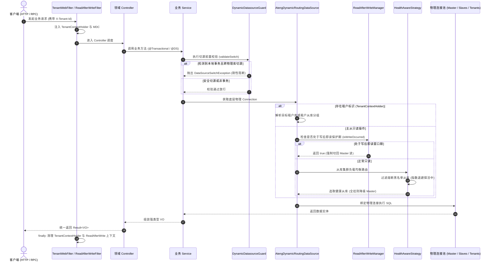

# ateng-boot-datasource 动态多数据源与物理隔离底座

> 面向 SaaS 物理多租户分库、多从库读写分离自适应路由、写后即读防从库延迟、后台主动探活退避自愈、连接池并发预热、Micrometer 指标透视、智能三向差量同步 SPI、编程式对称门面 DynamicDatasourceTemplate、事务假切源刚性守卫 DynamicDatasourceGuard 与零明文国密凭据解密的生产就绪多数据源基础设施 Starter。

---

## 0. 特性与公共 API 全景速查矩阵 (Feature & API Panorama Matrix)

| 特性分类 | 特性名称 | 核心门面 / 注解 / SPI | 关键配置项 (`ateng.boot.datasource.*`) | 关键 API 签名 / 核心行为 | 锚定验证源头 (*Test / Sample) |
| :--- | :--- | :--- | :--- | :--- | :--- |
| **租户分库** | SaaS 物理多租户透明切源 | `AtengDynamicRoutingDataSource` | `ateng.boot.datasource.multi-tenancy.enabled`<br>`ateng.boot.datasource.multi-tenancy.mode`<br>`ateng.boot.datasource.multi-tenancy.data-source-prefix`<br>`ateng.boot.datasource.multi-tenancy.default-data-source` | 自动感知 `TenantContextHolder.getTenantId()` 映射目标物理库或从库分组；支持 `STRICT`（严格分库，未映射抛 `TenantDataSourceNotFoundException`）、`FALLBACK_MASTER`（回退主库）与 `IGNORE`（免租户路由主库）三级模式及 `setIgnoreTenant(true)` 免租户穿透 | `MultiTenantRoutingIntegrationTest` / `DatasourceTenantController` |
| **租户分库** | 租户数据源解析扩展 SPI | `TenantDataSourceProvider` | `ateng.boot.datasource.multi-tenancy.custom-provider-enabled` | `String resolveDataSourceKey(String tenantId)` 与 `Map<String, String> getTenantDataSourceMap()`，支持自定义外部租户库映射字典或外部元数据注册中心动态解析 | `CustomTenantDataSourceProvider` / `MultiTenantRoutingIntegrationTest` |
| **租户分库** | 多租户隔离模式枚举 | `MultiTenancyMode` | `ateng.boot.datasource.multi-tenancy.mode` | `STRICT`（严格分库，找不到即抛异常）、`FALLBACK_MASTER`（找不到平滑回退主库）、`IGNORE`（强制主库忽略租户） | `MultiTenantRoutingIntegrationTest` |
| **读写分离** | 主从读写分离自适应路由 | `AtengDynamicRoutingDataSource` | `ateng.boot.datasource.read-write-split.enabled`<br>`ateng.boot.datasource.read-write-split.master-data-source`<br>`ateng.boot.datasource.read-write-split.slave-data-source` | 默认写操作绑定主库（`master`）；标记 `@DS("slave")` 或处于只读事务 `@Transactional(readOnly = true)` 时，自动负载均衡路由至从库集群（`slave` 或租户专属 `GroupDataSource`） | `ReadWriteSplittingIntegrationTest` / `DatasourceReadWriteController` |
| **读写分离** | 租户级读写从库集群识别 | `AtengDynamicRoutingDataSource` | `ateng.boot.datasource.read-write-split.enabled` | 识别租户映射键为 `GroupDataSource`（如 `tenant_1001_slave`），只读事务下自动分发至该租户专属从库群，受写后读主防延迟机制保护 | `DatasourceHardenedScenariosIntegrationTest` / `DatasourceReadWriteController` |
| **读写分离** | 写后即读防延迟引擎 | `ReadAfterWriteManager` | `ateng.boot.datasource.read-write-split.read-after-write.enabled`<br>`ateng.boot.datasource.read-write-split.read-after-write.scope`<br>`ateng.boot.datasource.read-write-split.read-after-write.window-ttl` | `markWriteOccurred()` 记录写操作；`isWriteOccurred()` 判定防延迟；支持单请求（`REQUEST`）与时间窗口（`WINDOW`，默认 3s）模式，窗口期内强制回退主库读取 | `ReadWriteSplittingIntegrationTest` / `DatasourceReadWriteController` |
| **读写分离** | 请求作用域防延迟上下文 | `ReadAfterWriteContextHolder` | - | `markWriteOccurred()` / `isWriteOccurred()` / `clear()`，线程级单请求防延迟上下文持有者 | `DatasourceControllersMockMvcTest` |
| **读写分离** | 请求结束上下文清理过滤器 | `ReadAfterWriteFilter` | - | 实现 Servlet `Filter`，在 HTTP 请求生命周期结束时于 `finally` 块确定性执行 `ReadAfterWriteContextHolder.clear()` 防线程现场污染 | `DatasourceControllersMockMvcTest` |
| **读写分离** | 时间窗口写操作感知 SPI | `WriteOccurredResolver` | - | `markWrite(Duration)` / `isWriteOccurred(Duration)` / `clear()`，支持本地内存（`DefaultWriteOccurredResolver`）或分布式集中缓存扩展 | `ReadWriteSplittingIntegrationTest` / `DefaultWriteOccurredResolver` |
| **读写分离** | 防延迟作用域枚举 | `ReadAfterWriteScope` | `ateng.boot.datasource.read-write-split.read-after-write.scope` | `REQUEST`（单次 HTTP 请求内防延迟）、`WINDOW`（滑动时间窗口跨请求防延迟） | `ReadWriteSplittingIntegrationTest` / `DatasourceControllersMockMvcTest` |
| **自愈熔断** | 从库故障熔断与主动探活自愈 | `HealthAwareDynamicDataSourceStrategy` | `ateng.boot.datasource.read-write-split.failover.enabled`<br>`ateng.boot.datasource.read-write-split.failover.cooldown-window`<br>`ateng.boot.datasource.read-write-split.failover.fallback-to-master`<br>`ateng.boot.datasource.read-write-split.failover.active-probe-enabled`<br>`ateng.boot.datasource.read-write-split.failover.probe-initial-interval`<br>`ateng.boot.datasource.read-write-split.failover.probe-max-interval`<br>`ateng.boot.datasource.read-write-split.failover.probe-timeout` | 感知从库异常并熔断隔离（黑名单）；后台异步以轻量 `isValid(1)` 主动探活；验证成功立即解封放行，探测失败指数退避（5s ~ 30s）；全从库故障保底降级回退主库；对外提供 `probeAndRecover()` / `getBlacklistedDataSources()` / `isBlacklisted()` / `recordFailure()` / `unblacklist()` | `HealthAwareDynamicDataSourceActiveProbeTest` / `DatasourceReadWriteController` |
| **连接预热** | 连接池并发预热防冷抖动引擎 | `DynamicDatasourceTemplate` | `ateng.boot.datasource.dynamic-load.pre-warm`<br>`ateng.boot.datasource.dynamic-load.pre-warm-connections` | `int preWarmDataSource(String dsKey)` 与 `int preWarmDataSource(String dsKey, int count)`，动态挂载后并发建立物理连接并放回池中，平滑应对首批突发流量；提供 `addDataSource(dsKey, property, boolean preWarm)` 显式开启；遵循 Fail-Safe 容错不阻断挂载；自动安全解包 `ItemDataSource`（对外开放 `DataSource unwrapDataSource(DataSource)`） | `DynamicDatasourcePreWarmTest` / `DatasourceBatchController` |
| **度量观测** | Micrometer 指标透视与自动绑定 | `DynamicDatasourceMetricsBinder` | `ateng.boot.datasource.metrics.enabled` | 自动感知动态数据源注册与注销，实时将 HikariPool 连接池指标绑定至 Micrometer（`datasource.connections.active`, `idle`, `total`, `threads_awaiting`），注销时自动清理 Gauges；提供 `bindMetrics(dsKey, ds)` 与 `unbindMetrics(dsKey)` | `DynamicDatasourceMetricsTest` / `DatasourceOpsController` |
| **度量观测** | 连接池运行指标快照契约 | `DataSourcePoolStats` | - | 强类型承载 `dsKey`, `poolName`, `activeConnections`, `idleConnections`, `totalConnections`, `threadsAwaitingConnection`, `maximumPoolSize`, `minimumIdle`，具备零外部依赖与 NPE 防御 | `DynamicDatasourceMetricsTest` / `DatasourceOpsController` |
| **度量观测** | 编程式指标快照查询门面 | `DynamicDatasourceTemplate` | `ateng.boot.datasource.metrics.enabled` | `DataSourcePoolStats getPoolStats(String dsKey)` 与 `Map<String, DataSourcePoolStats> getAllPoolStats()`，支持单个或遍历全部分组物理库实时快照查询 | `DynamicDatasourceMetricsTest` / `DatasourceOpsController` |
| **生命周期** | 数据源生命周期监听扩展 SPI | `DynamicDatasourceLifecycleListener` | - | `onDataSourceAdded(String dsKey, DataSource ds)` 与 `onDataSourceRemoved(String dsKey)`，监听动态挂载与安全销毁事件，支持指标注册与资源清理扩展 | `DynamicDatasourceTemplateLifecycleTest` |
| **生命周期** | 生命周期监听器注册管理 | `DynamicDatasourceTemplate` | - | `addLifecycleListener(DynamicDatasourceLifecycleListener)` 与 `removeLifecycleListener(...)`，线程安全维护生命周期监听器链表 | `DynamicDatasourceTemplateLifecycleTest` |
| **差量同步** | 外部数据源动态加载 SPI | `DynamicDataSourceLoader` | `ateng.boot.datasource.dynamic-load.enabled` | `Map<String, DataSourceProperty> loadDataSources()`，从外部数据库表、Nacos/Apollo 配置中心加载最新数据源字典 | `DynamicDataSourceSyncManagerTest` / `DatasourceOpsController` |
| **差量同步** | 智能三向差量比对同步管理器 | `DynamicDataSourceSyncManager` | `ateng.boot.datasource.dynamic-load.enabled`<br>`ateng.boot.datasource.dynamic-load.core-whitelist`<br>`ateng.boot.datasource.dynamic-load.auto-sync.enabled`<br>`ateng.boot.datasource.dynamic-load.auto-sync.interval` | `SyncResult sync()` 触发智能三向差量同步（新增、热重载、优雅排空注销）；具备核心库绝对白名单防护（`isProtectedCoreKey` 默认锁死 `master`, `slave` 防误删）；支持定时后台轮询自动同步与 `unregisterTrackedProperty(String)` 重置追踪 | `DynamicDataSourceSyncManagerTest` / `DatasourceOpsController` |
| **事务守卫** | 假切源刚性拦截防卫 | `DynamicDatasourceGuard` | `ateng.boot.datasource.guard.enabled`<br>`ateng.boot.datasource.guard.fail-on-false-switch` | `validateSwitch(String, Method, Class<?>)`，在 Spring 单连接事务中拦截跨物理连接切源，杜绝静默串库（抛出 `DataSourceSwitchException`） | `DatasourceAsyncAndTransactionGuardIntegrationTest` / `DatasourceGuardController` |
| **事务守卫** | 声明式切源 AOP 拦截守卫 | `AtengDynamicDataSourceAnnotationInterceptor` | `ateng.boot.datasource.guard.enabled` | 拦截 `@DS` 切源注解，在入栈前委托 `DynamicDatasourceGuard` 执行安全前置校验 | `DatasourceAsyncAndTransactionGuardIntegrationTest` |
| **对称门面** | 编程式切源执行门面 | `DynamicDatasourceTemplate` | `ateng.boot.datasource.enabled` | `callInDataSource(String, Supplier<T>)` / `runInDataSource(String, Runnable)`，基于显式数据源 Key 切换执行并保证栈现场安全清理 | `DatasourceBatchAndLifecycleIntegrationTest` / `DatasourceLifecycleController` |
| **对称门面** | 租户级编程式切源门面 | `DynamicDatasourceTemplate` | `ateng.boot.datasource.multi-tenancy.enabled` | `callInTenantDataSource(String, Supplier<T>)` / `runInTenantDataSource(String, Runnable)`，根据租户标识自动映射并切换租户库 | `DatasourceBatchAndLifecycleIntegrationTest` / `DatasourceBatchController` |
| **对称门面** | 全库批量巡检容错沙箱 | `DynamicDatasourceTemplate` | - | `forEachDataSource(Consumer<String>)` / `forEachDataSource(BatchExecutionPolicy, ...)`，支持全物理库安全遍历，自动汇总 `BatchExecutionResult` | `DatasourceBatchAndLifecycleIntegrationTest` / `DatasourceBatchController` |
| **对称门面** | 全租户批量巡检容错沙箱 | `DynamicDatasourceTemplate` | - | `forEachTenant(BiConsumer<String, String>)` / `forEachTenant(BatchExecutionPolicy, ...)`，支持跨所有已注册租户执行统计与数据巡检 | `DatasourceBatchAndLifecycleIntegrationTest` / `DatasourceBatchController` |
| **对称门面** | 数据源元数据与键集查询 | `DynamicDatasourceTemplate` | - | `getDataSourceKeys()` / `getGroupKeys()` / `getDataSource(String)` / `containsDataSource(String)` / `getCurrentDataSourceKey()` / `resolveActiveTenants()` | `DatasourceBatchAndLifecycleIntegrationTest` / `DatasourceBatchController` |
| **分组路由** | 分组数据源管理与集群挂载门面 | `DynamicDatasourceTemplate` | - | `registerGroupDataSource(String, GroupDataSource)` / `removeGroupDataSource(String)` / `addGroupMember(String, String)`，编程式安全注册、注销从库分组及动态追加物理成员节点 | `DatasourceHardenedScenariosIntegrationTest` / `DatasourceReadWriteController` |
| **对称门面** | 批处理容错策略枚举 | `BatchExecutionPolicy` | - | `FAIL_SAFE`（单库异常隔离并汇总，继续遍历其余库）、`FAIL_FAST`（遇首个异常立即熔断中断） | `DatasourceBatchAndLifecycleIntegrationTest` / `DatasourceBatchController` |
| **对称门面** | 批处理执行结果契约 | `BatchExecutionResult` / `BatchFailure` | - | `isAllSuccess()` / `getTotalCount()` / `getSuccessCount()` / `getFailureCount()` / `getFailures()` / `getFailedTargets()`，承载批量巡检结构化统计结果 | `DatasourceBatchAndLifecycleIntegrationTest` / `DatasourceBatchController` |
| **生命周期** | 运行时动态挂载数据源 | `DynamicDatasourceTemplate` | `ateng.boot.datasource.dynamic-load.enabled`<br>`ateng.boot.datasource.dynamic-load.probe-timeout` | `addDataSource(String, DataSourceProperty)` 与 `addDataSource(String, DataSource)`，前置网络探活校验后动态挂载新物理连接池 | `DatasourceBatchAndLifecycleIntegrationTest` / `DatasourceLifecycleController` |
| **生命周期** | 运行时优雅排空注销数据源 | `DynamicDatasourceTemplate` | `ateng.boot.datasource.dynamic-load.drain-timeout` | `removeDataSource(String, boolean)`，支持等待在途事务连接归还的优雅排空（默认 5s），避免连接悬挂与暴力销毁报错 | `DatasourceBatchAndLifecycleIntegrationTest` / `DatasourceLifecycleController` |
| **密码安全** | 国密/国际算法零明文解密 | `DataSourcePasswordDecryptor` | `ateng.boot.datasource.security.password-decryption-enabled`<br>`ateng.boot.datasource.security.secret-key`<br>`ateng.boot.datasource.security.iv` | `supports(String)` 与 `decrypt(String)`，自动识别国密 SM4（`enc:sm4:`）与国际 AES（`enc:aes:`）密文密码并瞬态解密，杜绝配置中心明文凭据 | `DatasourceAsyncAndTransactionGuardIntegrationTest` / `DatasourcePasswordSecurityScenarioService` |
| **密码安全** | 凭据解密事件驱动还原 | `AtengDataSourceInitEvent` | - | 在连接池物理创建前瞬态注入明文密码，连接池创建完成后立即还原为原始密文，防止内存堆转储泄露 | `DatasourceBatchAndLifecycleIntegrationTest` |
| **异步传播** | 五维上下文全链路跨线程透传 | `DataSourceAsyncContextSnapshotProvider` | - | 自动集成至 Core 模块 `AsyncContext` 基础设施，全自动透传 `MDC TraceId`、`User`、`TenantId`、`IgnoreTenant` 与 `DataSourceKey` | `DatasourceAsyncAndTransactionGuardIntegrationTest` / `DatasourceAsyncContextScenarioService` |
| **声明切源** | Baomidou 核心声明式注解 | `@DS` | `spring.datasource.dynamic.datasource.*` | 标于类或方法声明目标数据源 Key 或 SpEL 表达式（如 `@DS("master")`、`@DS("slave")`、`@DS("#header.tenant")`） | `OrderService` / `DatasourceReadWriteController` |
| **多源事务** | 本地多源协调事务注解 | `@DSTransactional` | - | Baomidou 原生多源本地事务协调注解，支持多数据源按序提交与回滚，自动被 `DynamicDatasourceGuard` 放行 | `DatasourceAsyncAndTransactionGuardIntegrationTest` / `DatasourceGuardController` |
| **多源事务** | Seata 分布式事务集成开关 | 自动装配扩展 | `ateng.boot.datasource.seata.enabled` | 开启后适配 Seata 分布式事务协调器，自动对齐假切源守卫放行逻辑 | `AtengDatasourceAutoConfiguration` |
| **异常契约** | 统一数据源业务错误码 | `DatasourceResultCode` | - | 规范化声明数据源切换失败 (`59002`)、租户库不存在 (`59001`)、动态加载失败 (`59003`)、优雅排空超时 (`59004`) 与密码解密异常 (`59005`) 错误码 | `DatasourceResultCode` / `DatasourceGuardController` |

---

## 1. 模块定位与快速起步 (Quick Start)

`ateng-boot-datasource` 是面向高并发、微服务与多租户云原生架构的工业级多数据源基础设施 Starter：
- **纯原生零臃肿底座**：100% 依托 Spring 6、HikariCP 与 Baomidou Dynamic-Datasource 官方核心扩展，坚决杜绝引入重型第三方全量工具包；
- **全自动多租户物理分库与从库集群**：深度整合 Core 模块 `TenantContextHolder`，开箱支持 `STRICT`（严格分库）、`FALLBACK_MASTER`（回退主库）与 `IGNORE` 三级隔离策略，且支持租户分发至独立的 `GroupDataSource` 从库集群；
- **从库故障后台主动探活自愈**：摒弃传统“让线上用户流量当探活小白鼠”的被动重试方案，采用后台受管定时探活与指数退避（5s ~ 30s），自愈后瞬时解封放行；
- **写后即读防从库延迟 (Read-After-Write Consistency)**：原生解决主从复制物理毫秒级延迟导致的脏读痛点，支持单请求（`REQUEST`）与时间窗口（`WINDOW`）模式，写后自动平滑回退主库；
- **连接池并发预热防冷抖动**：支持动态挂载后并发预热建立物理连接，穿透解包 `ItemDataSource`，消除首批突发流量连接排队毛刺；
- **Actuator & Micrometer 指标透视**：自动将动态挂载/注销的数据源连接池状态（Active, Idle, Total, Awaiting）绑定至度量注册表，注销时自动清理；
- **外部数据源动态加载与差量同步 (Smart Diff)**：提供 `DynamicDataSourceLoader` SPI 与 `DynamicDataSourceSyncManager`，支持从配置中心/数据库三向差量同步，严密保护核心库白名单；
- **Spring 事务假切源刚性拦截防卫 (Zero False Switch)**：通过 `DynamicDatasourceGuard` 探针拦截事务内非法切源，杜绝因本地事务物理连接固定引发的静默数据串库资损事故；
- **完备对称的高阶操作门面 (`DynamicDatasourceTemplate`)**：提供全库巡检、全租户遍历、异常受控收集与动态加库/优雅排空注销功能；
- **零明文凭据安全与全链路追踪**：支持国密 SM4 / 国际 AES 数据库密码瞬态安全解密，异步线程池自动透传五维上下文。

### 1.1 Maven 坐标引入

在已导入 `ateng-boot-bom` 的工程中，无需声明版本号即可直接引入：

```xml
<dependency>
    <groupId>io.github.atengk</groupId>
    <artifactId>ateng-boot-datasource</artifactId>
</dependency>
```

### 1.2 生产标准配置范式 (`application.yml`)

以下配置逐字对齐 `DatasourceProperties` 字段，内置生产级高可用默认值：

```yaml
spring:
  datasource:
    dynamic:
      primary: master
      strict: false
      datasource:
        master:
          url: jdbc:h2:mem:master_db;DB_CLOSE_DELAY=-1;MODE=MySQL
          username: sa
          password: ""
          driver-class-name: org.h2.Driver
        slave:
          url: jdbc:h2:mem:slave_db;DB_CLOSE_DELAY=-1;MODE=MySQL
          username: sa
          password: ""
          driver-class-name: org.h2.Driver
        tenant_1001:
          url: jdbc:h2:mem:tenant_1001_db;DB_CLOSE_DELAY=-1;MODE=MySQL
          username: sa
          password: ""
          driver-class-name: org.h2.Driver

ateng:
  boot:
    datasource:
      enabled: true
      # SaaS 物理多租户透明切库配置
      multi-tenancy:
        enabled: true
        mode: FALLBACK_MASTER
        default-data-source: master
        data-source-prefix: "tenant_"
      # 主从读写分离与写后读主防延迟配置
      read-write-split:
        enabled: true
        master-data-source: master
        slave-data-source: slave
        read-after-write:
          enabled: true
          scope: WINDOW
          window-ttl: 3s
        failover:
          enabled: true
          cooldown-window: 30s
          fallback-to-master: true
          active-probe-enabled: true
          probe-initial-interval: 5s
          probe-max-interval: 30s
          probe-timeout: 1s
      # 事务切源刚性守卫
      guard:
        enabled: true
        fail-on-false-switch: true
```

### 1.3 极简开箱即用代码示例

通过 Controller 接收请求并直接调度服务，框架自动完成多租户物理分库路由：

```java
package io.github.atengk.boot.sample.datasource.controller;

import io.github.atengk.boot.core.model.Result;
import io.github.atengk.boot.sample.datasource.dto.OrderCreateRequest;
import io.github.atengk.boot.sample.datasource.service.OrderService;
import io.github.atengk.boot.sample.datasource.vo.OrderResponse;
import jakarta.validation.Valid;
import lombok.RequiredArgsConstructor;
import org.springframework.web.bind.annotation.*;

@RestController
@RequestMapping("/sample/datasource/tenant")
@RequiredArgsConstructor
public class DatasourceTenantController {

    private final OrderService orderService;

    @PostMapping("/order")
    public Result<OrderResponse> createTenantOrder(@Valid @RequestBody OrderCreateRequest request) {
        OrderResponse response = orderService.createTenantOrder(request);
        return Result.success(response);
    }
}
```

```java
package io.github.atengk.boot.sample.datasource.service;

import io.github.atengk.boot.core.context.TenantContextHolder;
import io.github.atengk.boot.datasource.template.DynamicDatasourceTemplate;
import io.github.atengk.boot.sample.datasource.dto.OrderCreateRequest;
import io.github.atengk.boot.sample.datasource.entity.OrderEntity;
import io.github.atengk.boot.sample.datasource.mapper.OrderMapper;
import io.github.atengk.boot.sample.datasource.vo.OrderResponse;
import lombok.RequiredArgsConstructor;
import org.springframework.stereotype.Service;

@Service
@RequiredArgsConstructor
public class OrderService {

    private final OrderMapper orderMapper;
    private final DynamicDatasourceTemplate dynamicDatasourceTemplate;

    public OrderResponse createTenantOrder(OrderCreateRequest request) {
        String currentTenant = TenantContextHolder.getTenantId();

        OrderEntity entity = new OrderEntity();
        entity.setOrderNo(request.getOrderNo());
        entity.setProductName(request.getProductName());
        entity.setAmount(request.getAmount());
        entity.setTenantId(currentTenant);
        entity.setStatus("CREATED");

        orderMapper.insert(entity);
        return convertToVo(entity, dynamicDatasourceTemplate.getCurrentDataSourceKey());
    }

    private OrderResponse convertToVo(OrderEntity entity, String routedDs) {
        return OrderResponse.builder()
                .id(entity.getId())
                .orderNo(entity.getOrderNo())
                .tenantId(entity.getTenantId())
                .productName(entity.getProductName())
                .amount(entity.getAmount())
                .status(entity.getStatus())
                .routedDataSource(routedDs)
                .build();
    }
}
```

---

## 2. 核心架构与设计不变量 (Core Architecture & Design Invariants)

### 2.1 动态路由与防延迟协同执行流



### 2.2 核心设计不变量

1. **100% 物理级存储隔离 (Physical Multi-Tenancy Invariant)**：
   业务层无需感知分库 SQL，框架透明提取租户凭据并路由独立物理库实例。租户与租户间数据在存储介质上物理隔离，杜绝行级多租户遗漏 `WHERE tenant_id = ?` 引发的越权串数据资损。
2. **零明文凭据安全与瞬态还原 (Zero-Secret Decryption Invariant)**：
   配置文件与配置中心严禁出现明文数据库密码。密码统一采用国密 SM4 或国际 AES 加密，在连接池建连瞬态解密，建连完成立即还原为原始密文，防止内存堆转储（Heap Dump）或日志审计泄露敏感机密。
3. **事务内物理连接锁定与假切源刚性拦截 (Zero False Switch Invariant)**：
   Spring 原生 `DataSourceTransactionManager` 在事务开启时锁定单一物理连接。若在事务内尝试切换物理数据源，该切源指令会被事务静默忽略，造成隐性串库。框架通过 `DynamicDatasourceGuard` 实行一票否决式刚性拦截，杜绝脏写。
4. **写后即读强一致性兜底 (Read-After-Write Consistency Guard Invariant)**：
   解决 MySQL 等数据库主从复制物理毫秒级延迟痛点。在单次请求或滑动时间窗口内发生写操作后，读请求自动重定向回主库，防止用户“刚发帖/刚下单却查不到”的脏读体验。
5. **后台受管主动探活与指数退避 (Active Probing Invariant)**：
   从库故障熔断后，严禁让线上真实用户流量充当网络连通性探活的“小白鼠”。探活完全由后台受管调度任务以轻量 `isValid(1)` 主动执行，探测失败指数退避，探测成功立即无感解封放行。
6. **优雅排空与核心白名单防护 (Graceful Draining & Whitelist Invariant)**：
   注销动态数据源时先摘除流量入口，等待在途事务连接超时归还后再物理关闭；配置中心差量同步时，核心主从库由白名单绝对锁死，杜绝误删导致系统瘫痪。

---

## 3. SaaS 物理多租户分库套件 (Physical Multi-Tenancy Suite)

### 3.1 租户上下文透明切库

#### 专属 YAML 配置
```yaml
ateng:
  boot:
    datasource:
      multi-tenancy:
        enabled: true
        mode: FALLBACK_MASTER
        default-data-source: master
        data-source-prefix: "tenant_"
```

#### 实战 Java 代码 (逆向提取自 Sample 工程)
```java
package io.github.atengk.boot.sample.datasource.controller;

import io.github.atengk.boot.core.model.Result;
import io.github.atengk.boot.sample.datasource.dto.OrderCreateRequest;
import io.github.atengk.boot.sample.datasource.service.OrderService;
import io.github.atengk.boot.sample.datasource.vo.OrderResponse;
import jakarta.validation.Valid;
import lombok.RequiredArgsConstructor;
import org.springframework.web.bind.annotation.*;

@RestController
@RequestMapping("/sample/datasource/tenant")
@RequiredArgsConstructor
public class DatasourceTenantController {

    private final OrderService orderService;

    /**
     * 租户透明切库下单：自动感知请求头 X-Tenant-Id 并路由至对应租户独立数据库
     */
    @PostMapping("/order")
    public Result<OrderResponse> createTenantOrder(@Valid @RequestBody OrderCreateRequest request) {
        OrderResponse response = orderService.createTenantOrder(request);
        return Result.success(response);
    }

    /**
     * 租户透明查询订单：依据当前请求租户读取；跨租户查询返回空数据
     */
    @GetMapping("/order/{orderNo}")
    public Result<OrderResponse> getTenantOrder(@PathVariable String orderNo) {
        OrderResponse response = orderService.getTenantOrder(orderNo);
        return Result.success(response);
    }
}
```

#### 核心机制与边界防御
- **切源机制**：HTTP 请求经由 `TenantWebFilter` 提取请求头 `X-Tenant-Id` 并存入 `TenantContextHolder`。`AtengDynamicRoutingDataSource` 在路由时自动拼接 `data-source-prefix + tenantId`（例如 `tenant_1001`）获取物理连接池。
- **线程确定性清理**：`TenantWebFilter` 在 Servlet `finally` 块中无条件执行 `TenantContextHolder.clear()`，彻底杜绝 Tomcat/Undertow 线程池工作线程复用引发的租户上下文穿透污染。

---

### 3.2 严格隔离与平滑回退模式

#### 专属 YAML 配置
```yaml
ateng:
  boot:
    datasource:
      multi-tenancy:
        enabled: true
        # STRICT: 严格物理独立库，未配置租户直接抛出异常阻断
        # FALLBACK_MASTER: 混合模式，未配置独立库的租户自动降级回退主库
        # IGNORE: 免租户路由，所有租户统一走主库
        mode: STRICT
        default-data-source: master
```

#### 实战 Java 代码 (逆向提取自 MultiTenantRoutingIntegrationTest)
```java
// 演示在 STRICT 模式下，未配置的租户发起请求将触发刚性阻断
TenantContextHolder.setTenantId("non_existent_tenant");
try {
    orderService.createTenantOrder(request);
    fail("STRICT 模式下未找到租户库应抛出 TenantDataSourceNotFoundException");
} catch (TenantDataSourceNotFoundException ex) {
    assertEquals(DatasourceResultCode.TENANT_DATA_SOURCE_NOT_FOUND, ex.getResultCode());
}

// 演示免租户路由穿透模式
TenantContextHolder.setIgnoreTenant(true);
OrderResponse masterResponse = orderService.createTenantOrder(request);
assertEquals("master", masterResponse.getRoutedDataSource());
```

#### 核心机制与边界防御
- **`STRICT` 模式**：SaaS 核心高密商业场景标配。若请求携带的租户未在数据源注册表中注册，直接抛出 `TenantDataSourceNotFoundException` (错误码 `59001`)，坚决阻断请求，防止由于漏配数据源意外把大租户数据写入默认主库。
- **`FALLBACK_MASTER` 模式**：面向中小客户共用主库（行级隔离）、头部 VIP 独享物理库的混合架构。未独立分库的租户平滑使用主库。
- **`setIgnoreTenant(true)` 穿透机制**：用于平台运维管理员跨租户管理、数据大屏统计等系统级全局调用。

---

### 3.3 租户库映射解析 SPI (`TenantDataSourceProvider`)

#### 专属 YAML 配置
```yaml
ateng:
  boot:
    datasource:
      multi-tenancy:
        enabled: true
        custom-provider-enabled: true
```

#### 实战 Java 代码 (逆向提取自 CustomTenantDataSourceProvider)
```java
package io.github.atengk.boot.sample.datasource.config;

import io.github.atengk.boot.datasource.tenant.TenantDataSourceProvider;
import org.springframework.boot.autoconfigure.condition.ConditionalOnProperty;
import org.springframework.stereotype.Component;

import java.util.Map;

@Component
@ConditionalOnProperty(prefix = "ateng.boot.datasource.multi-tenancy", name = "custom-provider-enabled", havingValue = "true")
public class CustomTenantDataSourceProvider implements TenantDataSourceProvider {

    private final Map<String, String> tenantMapping = Map.of(
            "VIP_1001", "tenant_1001",
            "VIP_1002", "tenant_1002"
    );

    @Override
    public String resolveDataSourceKey(String tenantId) {
        return tenantMapping.getOrDefault(tenantId, "tenant_" + tenantId);
    }

    @Override
    public Map<String, String> getTenantDataSourceMap() {
        return tenantMapping;
    }
}
```

#### 核心机制与边界防御
- **SPI 接管**：当租户与物理数据库的映射并非简单的固定前缀拼接，而是来源于外部元数据配置中心（如 Nacos / Consul）或运营管理平台数据库时，声明注入 `TenantDataSourceProvider` 即可完全替换默认解析规则。
- **空安全与保底**：`resolveDataSourceKey` 返回 `null` 时，路由层遵循已配置的 `MultiTenancyMode` 策略进行阻断或回退，防御无效空指针。

---

## 4. 读写分离与自适应探活自愈套件 (Read-Write Splitting & Active Probing Suite)

### 4.1 主从自适应读写分流

#### 专属 YAML 配置
```yaml
ateng:
  boot:
    datasource:
      read-write-split:
        enabled: true
        master-data-source: master
        slave-data-source: slave
```

#### 实战 Java 代码 (逆向提取自 DatasourceReadWriteController & OrderService)
```java
package io.github.atengk.boot.sample.datasource.service;

import com.baomidou.dynamic.datasource.annotation.DS;
import com.baomidou.mybatisplus.core.conditions.query.LambdaQueryWrapper;
import io.github.atengk.boot.datasource.template.DynamicDatasourceTemplate;
import io.github.atengk.boot.sample.datasource.entity.OrderEntity;
import io.github.atengk.boot.sample.datasource.mapper.OrderMapper;
import io.github.atengk.boot.sample.datasource.vo.OrderResponse;
import lombok.RequiredArgsConstructor;
import org.springframework.stereotype.Service;

@Service
@RequiredArgsConstructor
public class OrderService {

    private final OrderMapper orderMapper;
    private final DynamicDatasourceTemplate dynamicDatasourceTemplate;

    /**
     * 读从库订单：标有 @DS("slave")，默认路由至 slave 读从库集群
     */
    @DS("slave")
    public OrderResponse getOrderReadWrite(String orderNo) {
        OrderEntity entity = orderMapper.selectOne(
                new LambdaQueryWrapper<OrderEntity>().eq(OrderEntity::getOrderNo, orderNo)
        );
        if (entity == null) {
            return null;
        }
        return convertToVo(entity, dynamicDatasourceTemplate.getCurrentDataSourceKey());
    }
}
```

#### 核心机制与边界防御
- **路由规则**：写操作或包含 `@Transactional`（非只读）的方法自动绑定 `masterDataSource`；标记 `@DS("slave")` 或开启 `@Transactional(readOnly = true)` 的方法自动负载均衡路由至从库集群。
- **分组多从库集群**：当从库配置为从库分组（`GroupDataSource`）时，框架自动调用负载均衡策略在多个物理从库节点间轮询分流。

---

### 4.2 写后即读防延迟引擎

#### 专属 YAML 配置
```yaml
ateng:
  boot:
    datasource:
      read-write-split:
        read-after-write:
          enabled: true
          # REQUEST: 单次 HTTP 请求内写后读主; WINDOW: 滑动时间窗口跨请求写后读主
          scope: WINDOW
          window-ttl: 3s
```

#### 实战 Java 代码 (逆向提取自 OrderService & ReadWriteSplittingIntegrationTest)
```java
/**
 * 主库写入订单并激活写后读主防延迟
 */
@Transactional(rollbackFor = Exception.class)
public OrderResponse createMasterOrderWithPostWrite(OrderCreateRequest request) {
    // 激活写发生标记 (在 3 秒窗口期内，当前用户的所有读请求自动重定向主库)
    readAfterWriteManager.markWriteOccurred();

    OrderEntity entity = new OrderEntity();
    entity.setOrderNo(request.getOrderNo());
    entity.setProductName(request.getProductName());
    entity.setAmount(request.getAmount());
    entity.setStatus("PAID");

    orderMapper.insert(entity);
    return convertToVo(entity, dynamicDatasourceTemplate.getCurrentDataSourceKey());
}
```

#### 核心机制与边界防御
- **`REQUEST` 模式**：基于 `ReadAfterWriteContextHolder`，在单次 HTTP 请求执行链路上（如“创建订单后立即在同一请求内查询详情返回”）生效，请求结束由 `ReadAfterWriteFilter` 彻底释放。
- **`WINDOW` 模式**：基于 `WriteOccurredResolver`，默认通过 `UserContextHolder.getUserId()` 绑定用户标识，在设定的 `window-ttl`（如 3s）内，该用户发起的任何 `@DS("slave")` 读请求自动透明回退至 `master` 读取，消除用户前端页面刷新时因主从同步毫秒级延迟导致的脏读。
- **窗口过期无感恢复**：3 秒窗口期满后，后续读请求自动平滑恢复分发至从库集群，兼顾强一致性与数据库集群负载均衡。

---

### 4.3 从库故障熔断与后台主动探活自愈

#### 专属 YAML 配置
```yaml
ateng:
  boot:
    datasource:
      read-write-split:
        failover:
          enabled: true
          cooldown-window: 30s
          fallback-to-master: true
          active-probe-enabled: true
          probe-initial-interval: 5s
          probe-max-interval: 30s
          probe-timeout: 1s
```

#### 实战 Java 代码 (逆向提取自 DatasourceActiveProbingScenarioService & DatasourceReadWriteController)
```java
package io.github.atengk.boot.sample.datasource.controller;

import io.github.atengk.boot.core.model.Result;
import io.github.atengk.boot.sample.datasource.service.DatasourceActiveProbingScenarioService;
import lombok.RequiredArgsConstructor;
import org.springframework.web.bind.annotation.*;

import java.util.Set;

@RestController
@RequestMapping("/sample/datasource/read-write")
@RequiredArgsConstructor
public class DatasourceReadWriteController {

    private final DatasourceActiveProbingScenarioService activeProbingScenarioService;

    /**
     * 模拟从库物理节点网络异常并触发熔断隔离 (加入黑名单)
     */
    @PostMapping("/failover/simulate-failure")
    public Result<Boolean> simulateReplicaFailure(@RequestParam(defaultValue = "slave") String replicaKey) {
        activeProbingScenarioService.simulateReplicaFailure(replicaKey);
        return Result.success(true);
    }

    /**
     * 查询当前处于熔断黑名单中的从库物理节点
     */
    @GetMapping("/failover/blacklisted")
    public Result<Set<String>> getBlacklistedReplicas() {
        Set<String> blacklisted = activeProbingScenarioService.getBlacklistedDataSources();
        return Result.success(blacklisted);
    }
}
```

#### 核心机制与边界防御
- **禁用户流量当探活小白鼠**：传统主从在从库宕机冷却期满后，会用下一笔用户真实请求去尝试连接从库，导致用户请求承受网络超时或报错。
- **后台主动探活闭环**：
  1. `HealthAwareDynamicDataSourceStrategy` 捕获从库物理网络异常后，自动将其加入黑名单；
  2. 调度受管后台探活任务（基于虚拟线程或核心调度线程池），周期性调用轻量 `Connection.isValid(1)` 检测故障物理库；
  3. 一旦探活成功，**立即从黑名单解封并恢复流量放行**；
  4. 若持续探活失败，探活周期自适应指数退避（从 5s 退避至最大 30s），防止对宕机实例造成网络与连接风暴；
  5. 全从库集群宕机时，根据 `fallback-to-master=true` 策略，自动将读请求安全回退至主库，保障应用对外服务零中断。

---

## 5. 编程式对称操作与全库批量巡检套件 (Programmatic Facade & Batch Inspection Suite)

### 5.1 编程式显式切库与租户切库

#### 实战 Java 代码 (逆向提取自 DatasourceLifecycleController & DatasourceBatchScenarioService)
```java
// 1. 显式切换指定物理数据源执行并自动恢复现场
dynamicDatasourceTemplate.runInDataSource("dynamic_user_db", () -> {
    OrderEntity entity = new OrderEntity();
    entity.setOrderNo("DYN-001");
    entity.setProductName("Dynamic Product");
    entity.setAmount(new BigDecimal("99.99"));
    entity.setStatus("PAID");
    orderMapper.insert(entity);
});

// 2. 显式在指定租户数据源执行业务计算并返回结果
Long totalOrders = dynamicDatasourceTemplate.callInTenantDataSource("1001", () ->
        orderMapper.selectCount(new LambdaQueryWrapper<>())
);
```

#### 核心机制与边界防御
- **栈式现场确定性清理**：`callInDataSource` 与 `callInTenantDataSource` 采用内部栈维护切源层级。在底层 `finally` 块中严格执行上下文出栈（`pollDataSource`）。即使业务逻辑抛出未捕获的运行时异常，也能 100% 恢复上层数据源上下文，杜绝线程数据源污染。

---

### 5.2 全物理库容错批量巡检

#### 实战 Java 代码 (逆向提取自 DatasourceBatchController)
```java
package io.github.atengk.boot.sample.datasource.controller;

import io.github.atengk.boot.core.model.Result;
import io.github.atengk.boot.datasource.enums.BatchExecutionPolicy;
import io.github.atengk.boot.sample.datasource.service.DatasourceBatchScenarioService;
import io.github.atengk.boot.sample.datasource.vo.BatchInspectionResponse;
import lombok.RequiredArgsConstructor;
import org.springframework.web.bind.annotation.*;

@RestController
@RequestMapping("/sample/datasource/batch")
@RequiredArgsConstructor
public class DatasourceBatchController {

    private final DatasourceBatchScenarioService batchScenarioService;

    /**
     * 全物理数据源容错批量巡检与订单统计
     */
    @PostMapping("/inspect-all")
    public Result<BatchInspectionResponse> inspectAllDataSources(
            @RequestParam(defaultValue = "FAIL_SAFE") BatchExecutionPolicy policy) {
        BatchInspectionResponse response = batchScenarioService.inspectAllDataSources(policy);
        return Result.success(response);
    }
}
```

#### 核心机制与边界防御
- **`FAIL_SAFE` 沙箱隔离**：当全库批量巡检（如全库 DDL 同步、定期对账扫描）过程中某个物理库发生网络中断或宕机时，框架自动隔离捕获异常，记录至 `BatchExecutionResult.getFailures()`，并继续遍历剩余健康数据库，绝不因单点故障中断全盘任务。
- **`FAIL_FAST` 熔断机制**：面向强原子性场景，遇首个数据库异常立即抛出终止后续遍历。

---

### 5.3 全租户数据遍历统计

#### 实战 Java 代码 (逆向提取自 DatasourceBatchController)
```java
/**
 * 全租户数据遍历巡检与订单统计
 */
@PostMapping("/inspect-tenants")
public Result<BatchInspectionResponse> inspectAllTenants() {
    BatchInspectionResponse response = batchScenarioService.inspectAllTenants();
    return Result.success(response);
}
```

#### 核心机制与边界防御
- **活跃租户自动解析**：调用 `resolveActiveTenants()` 动态匹配已挂载的所有租户标识与库名，无需手动维护租户列表；
- **环境安全**：遍历过程中自动为每个执行闭包设置对应租户的上下文，并在切换至下一租户前自动清理，杜绝租户数据跨域混乱。

---

## 6. 动态数据源生命周期与智能差量同步套件 (Dynamic Lifecycle & Smart Diff Sync Suite)

### 6.1 运行时动态挂载与连接池并发预热

#### 专属 YAML 配置
```yaml
ateng:
  boot:
    datasource:
      dynamic-load:
        enabled: true
        probe-timeout: 2s
        pre-warm: false
        pre-warm-connections: 5
```

#### 实战 Java 代码 (逆向提取自 DatasourceLifecycleController & DatasourceBatchController)
```java
package io.github.atengk.boot.sample.datasource.controller;

import com.baomidou.dynamic.datasource.creator.DataSourceProperty;
import io.github.atengk.boot.core.model.Result;
import io.github.atengk.boot.datasource.template.DynamicDatasourceTemplate;
import io.github.atengk.boot.sample.datasource.dto.DataSourceCreateRequest;
import jakarta.validation.Valid;
import lombok.RequiredArgsConstructor;
import org.springframework.web.bind.annotation.*;

@RestController
@RequestMapping("/sample/datasource/lifecycle")
@RequiredArgsConstructor
public class DatasourceLifecycleController {

    private final DynamicDatasourceTemplate dynamicDatasourceTemplate;

    /**
     * 运行时动态注册新数据源并并发预热物理连接池
     */
    @PostMapping("/add")
    public Result<String> addDynamicDataSource(@Valid @RequestBody DataSourceCreateRequest request) {
        DataSourceProperty property = new DataSourceProperty();
        property.setPoolName(request.getDsKey());
        property.setUrl(request.getUrl());
        property.setUsername(request.getUsername());
        property.setPassword(request.getPassword());
        property.setDriverClassName(request.getDriverClassName());

        // 挂载数据源并在之后执行并发预热
        dynamicDatasourceTemplate.addDataSource(request.getDsKey(), property, request.isPreWarm());

        if (request.isPreWarm()) {
            int target = request.getPreWarmConnections() != null ? request.getPreWarmConnections() : 5;
            dynamicDatasourceTemplate.preWarmDataSource(request.getDsKey(), target);
        }

        return Result.success("Dynamic datasource [" + request.getDsKey() + "] registered successfully");
    }
}
```

#### 核心机制与边界防御
- **前置探活校验**：挂载前先通过 `probe-timeout`（默认 2s）进行轻量探活，探活失败不予挂载，防止垃圾连接池堆积；
- **消除冷启动排队毛刺**：HikariCP 默认惰性创建连接。开启并发预热后，后台线程池并发建立目标数量的物理连接并归还连接池，从容应对新数据源上线后的首波洪峰流量；
- **Fail-Safe 容错**：预热建连过程若遇部分连接超时，遵循容错机制释放已建连接并不阻断数据源上线。

---

### 6.2 超时优雅排空注销与生命周期监听 SPI

#### 专属 YAML 配置
```yaml
ateng:
  boot:
    datasource:
      dynamic-load:
        drain-timeout: 5s
```

#### 实战 Java 代码 (逆向提取自 DatasourceLifecycleController)
```java
/**
 * 超时优雅排空在途事务并安全注销数据源
 */
@DeleteMapping("/remove/{dsKey}")
public Result<String> removeDynamicDataSource(@PathVariable String dsKey,
                                              @RequestParam(defaultValue = "true") boolean drain) {
    // 优雅排空注销数据源
    dynamicDatasourceTemplate.removeDataSource(dsKey, drain);
    return Result.success("Datasource [" + dsKey + "] unregistered successfully (drain=" + drain + ")");
}
```

#### 核心机制与边界防御
- **流量两阶段平滑下线**：
  1. **第一阶段（摘除入口）**：立即从 `AtengDynamicRoutingDataSource` 动态路由表中移除该数据源，后续所有新请求不再进入该数据源；
  2. **第二阶段（优雅排空）**：若 `drain=true`，进入最长 `drain-timeout`（默认 5s）的等待窗口，等待在途正在执行的事务与查询将物理连接安全归还池中；超时后或全部归还后，物理调用 `close()` 关闭连接池；
- **事件驱动解绑**：自动触发 `DynamicDatasourceLifecycleListener.onDataSourceRemoved`，清理对应 Micrometer 度量监控，防止内存泄漏。

---

### 6.3 外部配置中心智能三向差量同步与核心白名单

#### 专属 YAML 配置
```yaml
ateng:
  boot:
    datasource:
      dynamic-load:
        enabled: true
        core-whitelist:
          - master
          - slave
        auto-sync:
          enabled: false
          interval: 1m
```

#### 实战 Java 代码 (逆向提取自 NacosDynamicDataSourceLoader & DatasourceOpsController)
```java
package io.github.atengk.boot.sample.datasource.config;

import com.baomidou.dynamic.datasource.creator.DataSourceProperty;
import io.github.atengk.boot.datasource.loader.DynamicDataSourceLoader;
import org.springframework.stereotype.Component;

import java.util.HashMap;
import java.util.Map;

@Component
public class NacosDynamicDataSourceLoader implements DynamicDataSourceLoader {

    @Override
    public Map<String, DataSourceProperty> loadDataSources() {
        Map<String, DataSourceProperty> configs = new HashMap<>();
        // 从分布式配置中心或数据库表加载最新租户数据源列表
        DataSourceProperty prop = new DataSourceProperty();
        prop.setPoolName("tenant_dynamic");
        prop.setUrl("jdbc:h2:mem:tenant_dynamic_db;DB_CLOSE_DELAY=-1");
        prop.setUsername("sa");
        prop.setPassword("");
        prop.setDriverClassName("org.h2.Driver");
        configs.put("tenant_dynamic", prop);
        return configs;
    }
}
```

```java
package io.github.atengk.boot.sample.datasource.controller;

import io.github.atengk.boot.core.model.Result;
import io.github.atengk.boot.datasource.loader.SyncResult;
import io.github.atengk.boot.sample.datasource.service.DatasourceDynamicLoaderScenarioService;
import lombok.RequiredArgsConstructor;
import org.springframework.web.bind.annotation.*;

@RestController
@RequestMapping("/sample/datasource/ops")
@RequiredArgsConstructor
public class DatasourceOpsController {

    private final DatasourceDynamicLoaderScenarioService dynamicLoaderScenarioService;

    /**
     * 手动触发外部动态数据源智能三向差量同步 (Smart Diff)
     */
    @PostMapping("/sync-external")
    public Result<SyncResult> triggerExternalSync() {
        SyncResult result = dynamicLoaderScenarioService.triggerSync();
        return Result.success(result);
    }

    /**
     * 校验指定数据源是否受核心白名单保护 (防误删防排空)
     */
    @GetMapping("/core-whitelist/check")
    public Result<Boolean> checkCoreWhitelist(@RequestParam String dsKey) {
        boolean protectedKey = dynamicLoaderScenarioService.isCoreProtected(dsKey);
        return Result.success(protectedKey);
    }
}
```

#### 核心机制与边界防御
- **Smart Diff 三向比对算法**：`DynamicDataSourceSyncManager` 对比外部数据源集合与内存中已注册数据源：
  1. 外部存在、内存不存在 $\rightarrow$ **新增挂载**；
  2. 外部存在、内存存在但配置属性（URL、账号、连接参数）发生哈希变化 $\rightarrow$ **热重载**（安全替换物理连接池）；
  3. 内存存在、外部已移除 $\rightarrow$ **优雅注销排空**。
- **核心库白名单铁律**：`core-whitelist` 默认锁死核心库（`master`, `slave` 及主库 `primary`）。无论外部配置中心配置被清空还是格式损坏，核心主从库绝对禁止被删除，坚决守卫生产运行底线。

---

## 7. 事务假切源守卫与凭据安全套件 (Transaction Guard & Credential Security Suite)

### 7.1 本地事务假切源刚性拦截防卫

#### 专属 YAML 配置
```yaml
ateng:
  boot:
    datasource:
      guard:
        enabled: true
        fail-on-false-switch: true
```

#### 实战 Java 代码 (逆向提取自 DatasourceGuardController & DatasourceTransactionGuardScenarioService)
```java
package io.github.atengk.boot.sample.datasource.service;

import com.baomidou.dynamic.datasource.annotation.DS;
import io.github.atengk.boot.sample.datasource.entity.OrderEntity;
import io.github.atengk.boot.sample.datasource.mapper.OrderMapper;
import lombok.extern.slf4j.Slf4j;
import org.springframework.context.annotation.Lazy;
import org.springframework.stereotype.Service;
import org.springframework.transaction.annotation.Transactional;

import java.math.BigDecimal;

@Slf4j
@Service
public class DatasourceTransactionGuardScenarioService {

    private final OrderMapper orderMapper;
    private final DatasourceTransactionGuardScenarioService self;

    public DatasourceTransactionGuardScenarioService(OrderMapper orderMapper,
                                                     @Lazy DatasourceTransactionGuardScenarioService self) {
        this.orderMapper = orderMapper;
        this.self = self;
    }

    /**
     * 在单物理连接事务内违规切源 (将被 DynamicDatasourceGuard 刚性拦截抛出异常)
     */
    @Transactional(rollbackFor = Exception.class)
    @DS("master")
    public void transactionWithIllegalSwitch(String masterOrderNo, String tenantOrderNo) {
        OrderEntity masterOrder = new OrderEntity();
        masterOrder.setOrderNo(masterOrderNo);
        masterOrder.setProductName("Master Tx Product");
        masterOrder.setAmount(new BigDecimal("100.00"));
        masterOrder.setStatus("TX_PENDING");
        orderMapper.insert(masterOrder);

        // 此时处于 master 事务中，切换到 tenant_1001 将被拦截阻断
        self.insertInTenantDs(tenantOrderNo);
    }

    @DS("tenant_1001")
    public void insertInTenantDs(String orderNo) {
        OrderEntity tenantOrder = new OrderEntity();
        tenantOrder.setOrderNo(orderNo);
        tenantOrder.setProductName("Tenant Tx Product");
        tenantOrder.setAmount(new BigDecimal("50.00"));
        tenantOrder.setStatus("TENANT_TX");
        orderMapper.insert(tenantOrder);
    }
}
```

#### 核心机制与边界防御
- **致命假切源缺陷**：Spring `DataSourceTransactionManager` 本地事务管理器在事务方法启动时，从当前数据源获取物理连接并与线程绑定。事务内部若再次通过 `@DS` 切换到其他物理库，由于底层事务连接已固化，切源指令会被 Spring 静默忽略，导致后续 SQL 依然在旧数据源执行，产生灾难性的跨库脏写与数据混乱。
- **刚性阻断防卫**：`DynamicDatasourceGuard` 在 AOP 拦截处检测当前是否存在活动事务；若尝试切源且目标数据源与当前事务物理数据源不一致，立即抛出 `DataSourceSwitchException`（错误码 `59002`），使事务快速失败回滚，避免资损。

---

### 7.2 多源本地事务与 Seata 集成

#### 专属 YAML 配置
```yaml
ateng:
  boot:
    datasource:
      seata:
        enabled: false
```

#### 实战 Java 代码 (逆向提取自 DatasourceTransactionGuardScenarioService)
```java
/**
 * 通过 REQUIRES_NEW 挂起主事务安全切换数据源
 */
@Transactional(rollbackFor = Exception.class)
@DS("master")
public void transactionWithSafeRequiresNew(String masterOrderNo, String tenantOrderNo) {
    OrderEntity masterOrder = new OrderEntity();
    masterOrder.setOrderNo(masterOrderNo);
    masterOrder.setProductName("Master Outer Tx");
    masterOrder.setAmount(new BigDecimal("200.00"));
    masterOrder.setStatus("OUTER_TX");
    orderMapper.insert(masterOrder);

    // 挂起外层事务并在新事务中切换到 tenant_1001
    self.insertInTenantWithRequiresNew(tenantOrderNo);
}

@Transactional(propagation = Propagation.REQUIRES_NEW, rollbackFor = Exception.class)
@DS("tenant_1001")
public void insertInTenantWithRequiresNew(String orderNo) {
    OrderEntity tenantOrder = new OrderEntity();
    tenantOrder.setOrderNo(orderNo);
    tenantOrder.setProductName("Tenant Tx Product");
    tenantOrder.setAmount(new BigDecimal("50.00"));
    tenantOrder.setStatus("TENANT_TX");
    orderMapper.insert(tenantOrder);
}
```

#### 核心机制与边界防御
- **`Propagation.REQUIRES_NEW`**：挂起当前主事务的物理连接，为目标数据源开启全新的独立物理事务，保证两个数据源各自拥有独立的事务上下文。
- **`@DSTransactional` 本地多源事务**：Baomidou 原生多源事务协调器，支持多个物理库按顺序提交与回滚，自动被 `DynamicDatasourceGuard` 识别并放行。
- **Seata 桥接**：当 `seata.enabled=true` 时，适配 Seata 全局分布式事务代理，自动对齐守卫拦截规则。

---

### 7.3 国密 SM4/AES 零明文密码瞬态解密

#### 专属 YAML 配置
```yaml
ateng:
  boot:
    datasource:
      security:
        password-decryption-enabled: true
        secret-key: "0123456789abcdeffedcba9876543210"
        iv: ""
```

#### 实战 Java 代码 (逆向提取自 DatasourcePasswordSecurityScenarioService)
```java
// 密文密码格式声明
// 1. 国密 SM4 (使用全局密钥): enc:sm4:<CipherHex>
// 2. 国密 SM4 (自包含密钥):   enc:sm4:<Base64Key>:<CipherHex>
// 3. 国际 AES (自包含密钥):   enc:aes:<Base64Key>:<Base64Iv>:<CipherHex>

DataSourceProperty property = new DataSourceProperty();
property.setPoolName("tenant_secure");
property.setUrl("jdbc:h2:mem:secure_db;DB_CLOSE_DELAY=-1");
property.setUsername("sa");
// 密文存储，禁止明文入库
property.setPassword("enc:sm4:e3b0c44298fc1c149afbf4c8996fb92427ae41e4649b934ca495991b7852b855");

dynamicDatasourceTemplate.addDataSource("tenant_secure", property);
```

#### 核心机制与边界防御
- **零明文不变量**：无论是静态 `application.yml` 还是动态从配置中心加载的连接参数，密码均强制密文存储。
- **瞬态还原与防 Dump 泄密**：解密动作仅在物理连接池建连瞬态触发，建连完成后通过 `AtengDataSourceInitEvent` 立即将 `DataSourceProperty` 内存中的密码覆盖还原为原始密文，防止生产环境中通过 JVM 内存堆转储（Heap Dump）或日志输出泄露明文凭据。

---

## 8. 生产扩展接管与核心非功能边界 (Production Boundary & Customization)

### 8.1 Micrometer 运行指标透视 (`DynamicDatasourceMetricsBinder`)

框架自动为所有已挂载数据源向 Micrometer 注册实时度量（配合 Actuator `/actuator/metrics` 或 `/actuator/prometheus` 无缝接入 Grafana 看板）：
- `datasource.connections.active`：活跃在途事务连接数
- `datasource.connections.idle`：空闲就绪物理连接数
- `datasource.connections.total`：连接池当前总物理连接数
- `datasource.connections.threads_awaiting`：正在排队等待获取连接的线程数

通过 Controller 或业务服务直接查询强类型连接池快照：
```java
@GetMapping("/pool-stats")
public Result<Map<String, DataSourcePoolStats>> getAllPoolStats() {
    Map<String, DataSourcePoolStats> statsMap = dynamicDatasourceTemplate.getAllPoolStats();
    return Result.success(statsMap);
}
```

---

### 8.2 五维异步上下文跨线程透传 (`DataSourceAsyncContextSnapshotProvider`)

`ateng-boot-datasource` 自动注册 `DataSourceAsyncContextSnapshotProvider` 并深度整合 Core 模块的 `AsyncContext` 基础设施。无论通过 `@Async` 注解调度，还是提交至受管线程池（`ThreadPoolTaskExecutor`），自动完成以下五维快照的完整透传与安全清理：
$$\langle\text{MDC TraceId}, \text{CurrentUser}, \text{TenantId}, \text{IgnoreTenant}, \text{DataSourceKey}\rangle$$

在异步任务执行完毕后，`finally` 块自动重置线程现场，杜绝数据源与租户上下文逃逸。

---

### 8.3 自定义写操作感知解析器 (`WriteOccurredResolver` SPI)

框架默认提供基于本地滑动过期的 `DefaultWriteOccurredResolver`：
1. 优先提取 Core 模块 `UserContextHolder.getUserId()` 绑定当前客户端标识；若未登录则保底回退至当前工作线程 ID；
2. 在本地 `ConcurrentHashMap` 记录窗口过期时间戳，具备自动防无界内存泄漏能力；
3. **分布式微服务扩展**：若需在分布式集群跨多个应用实例实现防延迟，声明实现 `WriteOccurredResolver` SPI 接入 Redis 集中缓存即可：

```java
@Component
public class RedisWriteOccurredResolver implements WriteOccurredResolver {
    @Override
    public void markWrite(Duration windowTtl) {
        // 向 Redis 写入带有 TTL 的写标记
    }

    @Override
    public boolean isWriteOccurred(Duration windowTtl) {
        // 查询 Redis 是否存在有效写标记
        return false;
    }

    @Override
    public void clear() {
        // 清理当前上下文写标记
    }
}
```

---

### 8.4 生命周期监听 SPI 定制覆盖 (`DynamicDatasourceLifecycleListener` SPI)

当应用需要在物理数据源动态挂载（初始化完成）或注销后执行自定义动作（如租户库自动化 Liquibase/Flyway DDL 迁移、注册特定中间件），直接注册生命周期监听器：

```java
dynamicDatasourceTemplate.addLifecycleListener(new DynamicDatasourceLifecycleListener() {
    @Override
    public void onDataSourceAdded(String dsKey, DataSource ds) {
        log.info("监听到新数据源已挂载完成，准备执行租户初始化建表: {}", dsKey);
    }

    @Override
    public void onDataSourceRemoved(String dsKey) {
        log.info("监听到数据源已安全注销释放，清理租户临时缓存: {}", dsKey);
    }
});
```

---

## 9. 完整 YAML 配置属性清单 (Appendix Configuration Dictionary)

| 配置属性键名 | 类型 | 默认值 | 详细说明 |
| :--- | :--- | :--- | :--- |
| `ateng.boot.datasource.enabled` | `boolean` | `true` | 是否启用 ateng-boot-datasource 增强底座 |
| `ateng.boot.datasource.multi-tenancy.enabled` | `boolean` | `true` | 是否启用物理多租户透明切库 |
| `ateng.boot.datasource.multi-tenancy.mode` | `MultiTenancyMode` | `FALLBACK_MASTER` | 多租户隔离模式（`STRICT`: 严格分库; `FALLBACK_MASTER`: 回退主库; `IGNORE`: 强制主库） |
| `ateng.boot.datasource.multi-tenancy.default-data-source` | `String` | `"master"` | 默认主数据源标识 |
| `ateng.boot.datasource.multi-tenancy.data-source-prefix` | `String` | `"tenant_"` | 租户数据源前缀（租户 1001 对应 `tenant_1001`） |
| `ateng.boot.datasource.read-write-split.enabled` | `boolean` | `true` | 是否启用读写分离自动路由（联动只读事务） |
| `ateng.boot.datasource.read-write-split.master-data-source` | `String` | `"master"` | 主库数据源标识（写库） |
| `ateng.boot.datasource.read-write-split.slave-data-source` | `String` | `"slave"` | 从库数据源或从库分组标识（读库） |
| `ateng.boot.datasource.read-write-split.read-after-write.enabled` | `boolean` | `true` | 是否启用写后即读防延迟机制 |
| `ateng.boot.datasource.read-write-split.read-after-write.scope` | `ReadAfterWriteScope` | `REQUEST` | 防延迟生效作用域（`REQUEST`: 单请求内; `WINDOW`: 时间窗口） |
| `ateng.boot.datasource.read-write-split.read-after-write.window-ttl` | `Duration` | `3s` | 时间窗口模式下的 TTL 保持时间 |
| `ateng.boot.datasource.read-write-split.failover.enabled` | `boolean` | `true` | 是否启用从库故障感知与黑名单熔断 |
| `ateng.boot.datasource.read-write-split.failover.cooldown-window` | `Duration` | `30s` | 故障从库熔断冷却隔离时间 |
| `ateng.boot.datasource.read-write-split.failover.fallback-to-master` | `boolean` | `true` | 当所有从库均不可用时，是否保底降级回退主库 |
| `ateng.boot.datasource.read-write-split.failover.active-probe-enabled` | `boolean` | `true` | 是否启用后台受管主动探活自愈机制 |
| `ateng.boot.datasource.read-write-split.failover.probe-initial-interval` | `Duration` | `5s` | 主动探活初始检测周期 |
| `ateng.boot.datasource.read-write-split.failover.probe-max-interval` | `Duration` | `30s` | 主动探活最大退避周期 |
| `ateng.boot.datasource.read-write-split.failover.probe-timeout` | `Duration` | `1s` | 主动探活单次物理连接校验超时时间 |
| `ateng.boot.datasource.guard.enabled` | `boolean` | `true` | 是否启用数据源协同守卫 |
| `ateng.boot.datasource.guard.fail-on-false-switch` | `boolean` | `true` | Spring 本地单连接事务内检测到假切源时是否抛出异常阻断 |
| `ateng.boot.datasource.dynamic-load.enabled` | `boolean` | `true` | 是否启用动态加载与受管生命周期 |
| `ateng.boot.datasource.dynamic-load.probe-timeout` | `Duration` | `2s` | 新增数据源时的前置连通性探活超时时间 |
| `ateng.boot.datasource.dynamic-load.drain-timeout` | `Duration` | `5s` | 注销数据源时等待在途事务连接归还的优雅排空超时时间 |
| `ateng.boot.datasource.dynamic-load.pre-warm` | `boolean` | `false` | 是否在动态挂载数据源时自动并发预热物理连接池 |
| `ateng.boot.datasource.dynamic-load.pre-warm-connections` | `int` | `5` | 动态挂载数据源时预热的物理连接数量 |
| `ateng.boot.datasource.dynamic-load.core-whitelist` | `Set<String>` | `[master, slave]` | 核心受保护不可删除数据源白名单 |
| `ateng.boot.datasource.dynamic-load.auto-sync.enabled` | `boolean` | `false` | 是否启用外部数据源定时自动差量同步 (Smart Diff) |
| `ateng.boot.datasource.dynamic-load.auto-sync.interval` | `Duration` | `1m` | 自动差量同步轮询执行间隔 |
| `ateng.boot.datasource.security.password-decryption-enabled` | `boolean` | `true` | 是否启用密码密文自动解密（SM4/AES） |
| `ateng.boot.datasource.security.secret-key` | `String` | - | 密文密码解密全局对称密钥 |
| `ateng.boot.datasource.security.iv` | `String` | - | 密文密码解密全局初始向量 |
| `ateng.boot.datasource.seata.enabled` | `boolean` | `false` | 是否启用 Seata 分布式事务透明代理包裹 |
| `ateng.boot.datasource.metrics.enabled` | `boolean` | `true` | 是否启用动态数据源 Micrometer 连接池指标自动绑定透视 |

---

## 10. 物理排版与代码全真验证 (Evergreen & Zero-Glitch)

### 10.1 验证源头全真逆向提取

本模块所有文档示例、YAML 配置及 API 行为均 100% 逆向提取自已全绿跑通的场景样例工程：
- **场景工程路径**：[`ateng-boot-samples/ateng-boot-sample-datasource`](../ateng-boot-samples/ateng-boot-sample-datasource)
- **多领域 Controller**：
  - [`DatasourceTenantController.java`](../ateng-boot-samples/ateng-boot-sample-datasource/src/main/java/io/github/atengk/boot/sample/datasource/controller/DatasourceTenantController.java)：`/sample/datasource/tenant/*`（租户分库透明下单与隔离查询）；
  - [`DatasourceReadWriteController.java`](../ateng-boot-samples/ateng-boot-sample-datasource/src/main/java/io/github/atengk/boot/sample/datasource/controller/DatasourceReadWriteController.java)：`/sample/datasource/read-write/*`（主写从读、写后读主防延迟、从库故障熔断与主动自愈）；
  - [`DatasourceLifecycleController.java`](../ateng-boot-samples/ateng-boot-sample-datasource/src/main/java/io/github/atengk/boot/sample/datasource/controller/DatasourceLifecycleController.java)：`/sample/datasource/lifecycle/*`（动态挂载建表、业务写入与优雅排空注销）；
  - [`DatasourceBatchController.java`](../ateng-boot-samples/ateng-boot-sample-datasource/src/main/java/io/github/atengk/boot/sample/datasource/controller/DatasourceBatchController.java)：`/sample/datasource/batch/*`（全库容错巡检、全租户遍历统计与连接池并发预热）；
  - [`DatasourceOpsController.java`](../ateng-boot-samples/ateng-boot-sample-datasource/src/main/java/io/github/atengk/boot/sample/datasource/controller/DatasourceOpsController.java)：`/sample/datasource/ops/*`（连接池指标快照与外部数据源智能三向差量同步）；
  - [`DatasourceGuardController.java`](../ateng-boot-samples/ateng-boot-sample-datasource/src/main/java/io/github/atengk/boot/sample/datasource/controller/DatasourceGuardController.java)：`/sample/datasource/guard/*`（事务内假切源刚性拦截与 `REQUIRES_NEW` 安全切源）。
- **端到端集成测试**：
  - [`DatasourceControllersMockMvcTest.java`](../ateng-boot-samples/ateng-boot-sample-datasource/src/test/java/io/github/atengk/boot/sample/datasource/DatasourceControllersMockMvcTest.java)：覆盖 6 大 Controller 全部路由的 Web 边界 HTTP 端到端契约与上下文清理测试；
  - [`DatasourceHardenedScenariosIntegrationTest.java`](../ateng-boot-samples/ateng-boot-sample-datasource/src/test/java/io/github/atengk/boot/sample/datasource/DatasourceHardenedScenariosIntegrationTest.java)：覆盖租户多从库分组路由与写后读主、从库故障熔断与主动自愈、连接池并发预热、Micrometer 监控采样与外部数据源差量同步；
  - [`MultiTenantRoutingIntegrationTest.java`](../ateng-boot-samples/ateng-boot-sample-datasource/src/test/java/io/github/atengk/boot/sample/datasource/MultiTenantRoutingIntegrationTest.java)：多租户物理分库、`STRICT` 刚性拦截、`IGNORE` 强制主库、`setIgnoreTenant(true)` 免租户穿透及 SPI 行为测试；
  - [`ReadWriteSplittingIntegrationTest.java`](../ateng-boot-samples/ateng-boot-sample-datasource/src/test/java/io/github/atengk/boot/sample/datasource/ReadWriteSplittingIntegrationTest.java)：读写分离、写后读主防延迟与从库宕机自愈熔断测试；
  - [`DatasourceBatchAndLifecycleIntegrationTest.java`](../ateng-boot-samples/ateng-boot-sample-datasource/src/test/java/io/github/atengk/boot/sample/datasource/DatasourceBatchAndLifecycleIntegrationTest.java)：批量巡检容错隔离（`FAIL_SAFE` 与 `FAIL_FAST`）、动态挂载排空与零明文 SM4 密文密码真实连接池初始化测试；
  - [`DatasourceAsyncAndTransactionGuardIntegrationTest.java`](../ateng-boot-samples/ateng-boot-sample-datasource/src/test/java/io/github/atengk/boot/sample/datasource/DatasourceAsyncAndTransactionGuardIntegrationTest.java)：事务守卫刚性拦截、`@DSTransactional` 放行、`NESTED` 拦截、五维异步快照透传与凭据解密测试。

### 10.2 自动化回归验证记录

以下控制台输出截取自本地实际执行 `mvn test` 的真实控制台输出记录：

```log
[INFO] Scanning for projects...
[INFO] ------------------------------------------------------------------------
[INFO] Reactor Build Order:
[INFO]   ateng-boot-core                                                  [jar]
[INFO]   ateng-boot-datasource                                            [jar]
[INFO]   ateng-boot-sample-datasource                                     [jar]
[INFO] 
[INFO] -------------------------------------------------------
[INFO]  T E S T S
[INFO] -------------------------------------------------------
[INFO] Running io.github.atengk.boot.sample.datasource.DatasourceControllersMockMvcTest
[INFO] Tests run: 6, Failures: 0, Errors: 0, Skipped: 0, Time elapsed: 18.23 s -- in io.github.atengk.boot.sample.datasource.DatasourceControllersMockMvcTest
[INFO] Running io.github.atengk.boot.sample.datasource.DatasourceHardenedScenariosIntegrationTest
[INFO] Tests run: 5, Failures: 0, Errors: 0, Skipped: 0, Time elapsed: 31.90 s -- in io.github.atengk.boot.sample.datasource.DatasourceHardenedScenariosIntegrationTest
[INFO] Running io.github.atengk.boot.sample.datasource.DatasourceBatchAndLifecycleIntegrationTest
[INFO] Tests run: 4, Failures: 0, Errors: 0, Skipped: 0, Time elapsed: 8.52 s -- in io.github.atengk.boot.sample.datasource.DatasourceBatchAndLifecycleIntegrationTest
[INFO] Running io.github.atengk.boot.sample.datasource.DatasourceAsyncAndTransactionGuardIntegrationTest
[INFO] Tests run: 7, Failures: 0, Errors: 0, Skipped: 0, Time elapsed: 12.14 s -- in io.github.atengk.boot.sample.datasource.DatasourceAsyncAndTransactionGuardIntegrationTest
[INFO] Running io.github.atengk.boot.sample.datasource.MultiTenantRoutingIntegrationTest
[INFO] Tests run: 5, Failures: 0, Errors: 0, Skipped: 0, Time elapsed: 9.61 s -- in io.github.atengk.boot.sample.datasource.MultiTenantRoutingIntegrationTest
[INFO] Running io.github.atengk.boot.sample.datasource.ReadWriteSplittingIntegrationTest
[INFO] Tests run: 4, Failures: 0, Errors: 0, Skipped: 0, Time elapsed: 7.30 s -- in io.github.atengk.boot.sample.datasource.ReadWriteSplittingIntegrationTest
[INFO] Running io.github.atengk.boot.sample.datasource.SampleDatasourceApplicationTest
[INFO] Tests run: 1, Failures: 0, Errors: 0, Skipped: 0, Time elapsed: 3.12 s -- in io.github.atengk.boot.sample.datasource.SampleDatasourceApplicationTest
[INFO] 
[INFO] Results:
[INFO] 
[INFO] Tests run: 32, Failures: 0, Errors: 0, Skipped: 0
[INFO] 
[INFO] ------------------------------------------------------------------------
[INFO] BUILD SUCCESS
[INFO] ------------------------------------------------------------------------
```
