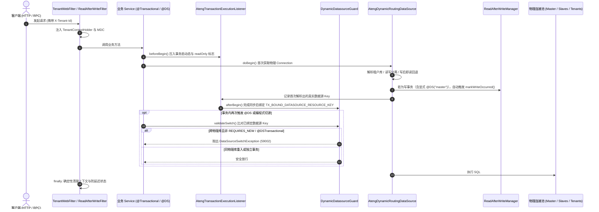

# ateng-boot-datasource 动态多数据源与物理隔离底座

> 面向 SaaS 物理多租户分库、多从库读写分离自适应路由、写后即读一致性防延迟、后台受管主动探活退避自愈、连接池并发预热与无损热重载、Micrometer 指标透视、外部数据源智能三向差量同步 SPI、编程式对称门面 `DynamicDatasourceTemplate`、事务假切源双保险守卫 `DynamicDatasourceGuard` 与零明文国密凭据瞬态解密的生产就绪多数据源基础设施 Starter。

---

## 0. 特性与公共 API 全景速查矩阵 (Feature & API Panorama Matrix)

### 0.1 核心门面、引擎、SPI 与数据契约

| 特性分类 | 特性名称 | 核心门面 / 注解 / SPI | 关键配置项 (`ateng.boot.datasource.*`) | 关键 API 签名 / 核心行为 | 锚定验证源头 (`*Test` / Sample) |
| :--- | :--- | :--- | :--- | :--- | :--- |
| **租户分库** | SaaS 物理多租户透明切源 | `AtengDynamicRoutingDataSource` | `multi-tenancy.enabled`<br>`multi-tenancy.mode`<br>`multi-tenancy.data-source-prefix`<br>`multi-tenancy.default-data-source` | 感知 `TenantContextHolder.getTenantId()` 自动路由至租户主库或从库分组；支持 `resolveTenantMasterKey(String)`、`resolveTenantSlaveKey(String, String)`、`containsDataSource(String)`、`findDataSource(String)`、`getPrimary()`、`getHealthAwareStrategy()`、`getReadAfterWriteManager()` | `MultiTenantRoutingIntegrationTest` / `DatasourceTenantController` |
| **租户分库** | 租户数据源映射扩展 SPI | `TenantDataSourceProvider` | -（注入自定义 Spring Bean 接管） | `resolveDataSourceKey(String)`、`resolveMasterDataSourceKey(String)`、`resolveSlaveDataSourceKey(String)`、`getTenantDataSourceMap()`；默认实现 `DefaultTenantDataSourceProvider` | `CustomTenantDataSourceProvider` / `MultiTenantRoutingIntegrationTest` |
| **读写分离** | 主从与租户集群读写分离路由 | `AtengDynamicRoutingDataSource` | `read-write-split.enabled`<br>`read-write-split.master-data-source`<br>`read-write-split.slave-data-source` | 写事务与非只读操作路由主库；`@DS("slave")` 与 `@Transactional(readOnly = true)` 路由从库或租户 `GroupDataSource`；`resolveWithFailover(String)` / `resolveWithFailover(String, String)` | `ReadWriteSplittingIntegrationTest` / `DatasourceReadWriteController` |
| **读写分离** | 写后即读防延迟管理器 | `ReadAfterWriteManager` | `read-write-split.read-after-write.enabled`<br>`read-write-split.read-after-write.scope`<br>`read-write-split.read-after-write.window-ttl` | `markWriteOccurred()` / `isWriteOccurred()` / `clear()`；写事务（含显式 `@DS("master")` 或租户写事务）自动激活写标记，窗口期内只读查询强制回退主库 | `ReadAfterWriteTest` / `ReadWriteSplittingIntegrationTest` / `DatasourceReadWriteController` |
| **读写分离** | 单请求防延迟上下文与清理过滤器 | `ReadAfterWriteContextHolder` / `ReadAfterWriteFilter` | `read-write-split.read-after-write.enabled` | `markWriteOccurred()` / `isWriteOccurred()` / `clear()`；`ReadAfterWriteFilter` 在 Servlet 请求结束 `finally` 中确定性清理线程上下文 | `ReadAfterWriteFilterTest` / `DatasourceControllersMockMvcTest` |
| **读写分离** | 滑动窗口写感知解析器 SPI | `WriteOccurredResolver` | `read-write-split.read-after-write.window-ttl` | `markWrite(Duration)` / `isWriteOccurred(Duration)` / `clear()`；默认 `DefaultWriteOccurredResolver` 按 `TENANT:<tenantId>:` / `GLOBAL:` 复合键隔离多租户写窗口，并提供 `clearAll()` | `ReadAfterWriteTest` / `DatasourceHardenedScenariosIntegrationTest` |
| **自愈熔断** | 从库熔断与主动探活自愈策略 | `HealthAwareDynamicDataSourceStrategy` | `read-write-split.failover.enabled`<br>`read-write-split.failover.cooldown-window`<br>`read-write-split.failover.fallback-to-master`<br>`read-write-split.failover.active-probe-enabled`<br>`read-write-split.failover.probe-initial-interval`<br>`read-write-split.failover.probe-max-interval`<br>`read-write-split.failover.probe-timeout` | `determineKey(List<String>)`、`filterHealthyNodes(List<String>)`、`recordFailure(String)`、`isBlacklisted(String)`、`unblacklist(String)`、`getBlacklistedDataSources()`、`clearBlacklist()`、`isProbing(String)`、`getProbeFailureCount(String)`、`getProbeCurrentInterval(String)`、`setDataSourceLocator(Function<String, DataSource>)`、`getDataSourceLocator()`、`destroy()` / `close()` | `HealthAwareDynamicDataSourceActiveProbeTest` / `HealthAwareDynamicDataSourceStrategyTest` / `DatasourceReadWriteController` |
| **对称门面** | 编程式数据源/主从/租户切库 | `DynamicDatasourceTemplate` | `enabled` | `callInDataSource(String, Supplier<T>)` / `runInDataSource(String, Runnable)`、`callInMaster(Supplier<T>)` / `runInMaster(Runnable)`、`callInSlave(Supplier<T>)` / `runInSlave(Runnable)`、`callInTenantDataSource(String, Supplier<T>)` / `runInTenantDataSource(String, Runnable)` | `DynamicDatasourceTemplateTest` / `DatasourceLifecycleController` |
| **分组治理** | 从库分组节点对称增删管理 | `DynamicDatasourceTemplate` / `AtengDynamicRoutingDataSource` | - | `addGroupDataSource(String, GroupDataSource)`、`registerGroupDataSource(String, GroupDataSource)`、`removeGroupDataSource(String)`、`addGroupMember(String, String)`、`removeGroupMember(String, String)` | `DynamicDatasourceTemplateTest` / `DatasourceReadWriteController` |
| **批量聚合** | 全库/全租户容错遍历与结果聚合 | `DynamicDatasourceTemplate` | - | `forEachDataSource`（4 重载）、`forEachDataSourceWithResult`（4 重载）、`forEachTenant`（4 重载）、`forEachTenantWithResult`（4 重载）；支持指定集合与 `BatchExecutionPolicy` | `DynamicDatasourceTemplateTest` / `DatasourceBatchController` |
| **批量契约** | 泛型批处理聚合结果与失败明细 | `AbstractBatchExecutionResult` / `BatchExecutionResult<T>` / `BatchFailure` | - | 结果：`getSuccessCount()`、`getFailureCount()`、`getTotalCount()`、`isAllSuccess()`、`hasFailures()`、`getFailures()`、`getFailedTargets()`、`getResults()`、`getResult(String)`；失败项字段：`target`、`errorMessage`、`cause` | `DynamicDatasourceTemplateTest` / `DatasourceBatchController` |
| **生命周期** | 运行时动态挂载与并发预热 | `DynamicDatasourceTemplate` | `dynamic-load.enabled`<br>`dynamic-load.probe-timeout`<br>`dynamic-load.pre-warm`<br>`dynamic-load.pre-warm-connections` | `addDataSource(String, DataSourceProperty)` / `(..., boolean preWarm)`、`addDataSource(String, DataSource)` / `(..., boolean preWarm)`、`preWarmDataSource(String)` / `(String, int)`、`unwrapDataSource(DataSource)` | `DynamicDatasourcePreWarmTest` / `DatasourceLifecycleController` / `DatasourceBatchController` |
| **生命周期** | 无损热重载与超时优雅排空注销 | `DynamicDatasourceTemplate` | `dynamic-load.drain-timeout`<br>`dynamic-load.core-whitelist` | `reloadDataSource(String, DataSourceProperty)` / `(..., boolean preWarm, boolean graceful)` / `(..., boolean preWarm, int preWarmConnections, boolean graceful)`、`removeDataSource(String)` / `removeDataSource(String, boolean)`、`isProtectedCoreKey(String)`；联动清理分组残余与熔断黑名单 | `DynamicDatasourceTemplateLifecycleTest` / `DatasourceLifecycleController` |
| **生命周期** | 元数据查询与生命周期监听管理 | `DynamicDatasourceTemplate` / `DynamicDatasourceLifecycleListener` | - | `getDataSourceKeys()`、`getGroupKeys()`、`containsDataSource(String)`、`getCurrentDataSourceKey()`、`getDataSource(String)`、`getPrimaryDataSourceKey()`、`resolveActiveTenants()`；`addLifecycleListener` / `registerLifecycleListener` / `removeLifecycleListener`；SPI：`onDataSourceAdded` / `onDataSourceRemoved` | `DynamicDatasourceTemplateLifecycleTest` / `DatasourceOpsController` |
| **度量观测** | Micrometer 连接池指标绑定与快照 | `DynamicDatasourceMetricsBinder` / `DataSourcePoolStats` | `metrics.enabled` | `getPoolStats(String)` / `getAllPoolStats()`；快照字段（8 项）：`dsKey`、`poolName`、`activeConnections`、`idleConnections`、`totalConnections`、`threadsAwaitingConnection`、`maximumPoolSize`、`minimumIdle`；Binder：`bindTo(MeterRegistry)`、`bindDataSource(String, DataSource)`、`unbind(String)`、`isBound(String)`、`getMonitoredKeys()`、`destroy()`；指标：`datasource.connections.active` / `idle` / `total` / `pending_threads` | `DynamicDatasourceMetricsTest` / `DatasourceOpsController` |
| **差量同步** | 外部配置动态加载与三向差量同步 | `DynamicDataSourceLoader` / `DynamicDataSourceSyncManager` / `SyncResult` | `dynamic-load.enabled`<br>`dynamic-load.core-whitelist`<br>`dynamic-load.auto-sync.enabled`<br>`dynamic-load.auto-sync.interval` | SPI：`Map<String, DataSourceProperty> loadDataSources()`；管理器：`sync()`、`syncSafe()`、`isProtectedCoreKey(String)`、`getLoadedProperties()`、`unregisterTrackedProperty(String)`；结果：`addedKeys`、`removedKeys`、`reloadedKeys`、`skippedKeys`、`failedKeys` 及计数、`hasChanges()`、`empty()` | `DynamicDataSourceSyncManagerTest` / `DatasourceOpsController` |
| **事务守卫** | 事务假切源双保险守卫与启动感知 | `DynamicDatasourceGuard` / `AtengDynamicDataSourceAnnotationInterceptor` / `AtengTransactionExecutionListener` / `TransactionRoutingContext` | `guard.enabled`<br>`guard.fail-on-false-switch` | `validateContextIsolated(String)`、`validateSwitch`（3 重载）、`isDSTransactionActive()`、`isSpringTransactionActive()`、`getCurrentTransactionDataSourceKey()`、`bindTransactionDataSourceKeyIfAbsent(String)`、`isRequiresNewTransaction(Method, Class<?>)`；启动上下文：`pushStartingTransaction(boolean, boolean)`、`isStartingActualTransaction()`、`isStartingReadOnly()`、`recordResolvedDataSourceKey(String)`、`popStartingTransaction()` | `DynamicDatasourceGuardTest` / `AtengTransactionExecutionListenerTest` / `DatasourceGuardController` |
| **密码安全** | 国密 SM4 / AES 零明文瞬态解密 | `DataSourcePasswordDecryptor` / `CryptoUtilPasswordDecryptor` / `AtengDataSourceInitEvent` | `security.password-decryption-enabled`<br>`security.secret-key`<br>`security.iv` | `supports(String)` / `decrypt(String)` 识别 `enc:sm4:` 与 `enc:aes:`；`AtengDataSourceInitEvent` 在建连前瞬态解密、建连后立即还原为原始密文 | `CryptoUtilPasswordDecryptorTest` / `AtengDataSourceInitEventTest` / `DatasourceOpsController` |
| **异步传播** | 五维上下文全链路跨线程透传 | `DataSourceAsyncContextSnapshotProvider` | - | 自动注册至 Core `AsyncContext`，透传 `MDC TraceId` / `UserId` / `TenantId` / `IgnoreTenant` / `DataSourceKey` 并在 `finally` 还原线程现场 | `DataSourceAsyncContextTest` / `DatasourceOpsController` |
| **声明切源** | Baomidou 声明式切源与多源事务 | `@DS` / `@DSTransactional` / Seata 开关 | `seata.enabled` | `@DS` 声明目标库或 SpEL（如 `@DS("#tenantDsKey")`）；`@DSTransactional` 本地多源事务与 `seata.enabled=true` 自动被守卫放行 | `OrderService` / `DatasourceGuardController` |
| **异常体系** | 受管数据源业务异常类 | `DataSourceSwitchException` / `TenantDataSourceNotFoundException` | `guard.fail-on-false-switch`<br>`multi-tenancy.mode` | 继承 `BusinessException`；`DataSourceSwitchException` 携带 `currentDataSourceKey`、`targetDataSourceKey` 与 `59002`~`59007`；`TenantDataSourceNotFoundException` 携带 `tenantId`、`expectedDataSourceKey` 与 `59001` | `DynamicDatasourceGuardTest` / `DatasourceGuardController` |

### 0.2 核心强类型枚举与状态码字典

#### 核心业务枚举

| 枚举类型 | 真实枚举值 | 语义与关键说明 |
| :--- | :--- | :--- |
| `MultiTenancyMode` | `STRICT`、`FALLBACK_MASTER`、`IGNORE` | 物理多租户隔离模式（严格独立库 / 混合回退主库 / 强制主库忽略租户） |
| `ReadAfterWriteScope` | `REQUEST`、`WINDOW` | 写后即读防延迟作用域（`REQUEST`：单请求周期；`WINDOW`：滑动时间窗口） |
| `BatchExecutionPolicy` | `FAIL_SAFE`、`FAIL_FAST` | 批处理容错策略（`FAIL_SAFE`：单库异常隔离收集继续遍历；`FAIL_FAST`：遇首个异常即熔断） |

#### 数据源模块业务错误码字典 (`DatasourceResultCode`：`59001 ~ 59007`)

| 状态码 | 枚举常量 | 默认提示文案 | 典型触发场景 |
| :---: | :--- | :--- | :--- |
| `59001` | `TENANT_DATASOURCE_NOT_FOUND` | 未找到租户对应的物理数据源 | `STRICT` 严格模式下请求租户未匹配到已注册物理库（`TenantDataSourceNotFoundException`） |
| `59002` | `DATASOURCE_SWITCH_ERROR` | 数据源切换异常 | Spring 单连接事务内触发假切源阻断、核心受保护库禁止热重载/注销或切源参数异常（`DataSourceSwitchException`） |
| `59003` | `DATASOURCE_CONNECTION_ERROR` | 数据源连接异常 | 底层物理连接不可用或故障转移异常 |
| `59004` | `UNSUPPORTED_DIALECT_FEATURE` | 当前数据源方言不支持该特化操作 | 当前目标数据库方言不支持指定特化能力 |
| `59005` | `DATASOURCE_NOT_FOUND` | 数据源不存在 | 目标动态数据源键未注册或已被注销 |
| `59006` | `DATASOURCE_INIT_ERROR` | 数据源初始化或凭据解密异常 | 动态建池失败、连通性预检异常、外部加载失败或 SM4/AES 密文密码解密失败 |
| `59007` | `DATASOURCE_LIFECYCLE_ERROR` | 数据源受管生命周期操作异常 | 动态数据源受管生命周期治理阶段发生异常 |

---

## 1. 模块定位与快速起步 (Quick Start)

`ateng-boot-datasource` 是面向高并发微服务与 SaaS 云原生架构的生产就绪多数据源基础设施 Starter：
- **纯原生零臃肿底座**：100% 依托 JDK 17、Spring 6、HikariCP 与 Baomidou `dynamic-datasource` 扩展构建，严禁引入重型第三方全量工具包；
- **全自动多租户物理分库与租户集群读写分离**：无缝衔接 Core 模块 `TenantContextHolder`，支持 `STRICT` / `FALLBACK_MASTER` / `IGNORE` 三级策略及租户级从库分组（`GroupDataSource`）；
- **写后即读强一致性与事务启动精准感知**：通过 `AtengTransactionExecutionListener` + `TransactionRoutingContext` 解决 Spring `DataSourceTransactionManager.doBegin()` 先取连接后激活同步的路由盲区，确保 `@Transactional(readOnly = true)` 与显式 `@DS("master")` 写事务 100% 精准识别，且 `WINDOW` 模式按租户维度复合隔离；
- **高可用熔断自愈、并发预热与无损热重载**：后台受管任务以 `isValid(timeout)` 指数退避（5s ~ 30s）主动探活恢复，动态挂载支持并发预热，`reloadDataSource` / `removeDataSource` 联动自净分组引用与熔断黑名单；
- **零明文凭据安全与五维异步上下文透传**：支持国密 SM4 / 国际 AES 瞬态解密还原及 `<TraceId, UserId, TenantId, IgnoreTenant, DataSourceKey>` 全链路跨线程透传。

### 1.1 Maven 坐标引入

#### 方式一：已导入 `ateng-boot-bom` 统管（推荐，免声明版本号）

```xml
<dependency>
    <groupId>io.github.atengk</groupId>
    <artifactId>ateng-boot-datasource</artifactId>
</dependency>
```

#### 方式二：未引入 BOM 时独立显式指定版本号引入

```xml
<dependency>
    <groupId>io.github.atengk</groupId>
    <artifactId>ateng-boot-datasource</artifactId>
    <version>1.2.0</version>
</dependency>
```

### 1.2 最小可用配置与极简实战 (`application.yml` + Controller / Service)

#### ① 最小可用 YAML 配置（逆向提取自 Sample 工程）

```yaml
spring:
  datasource:
    dynamic:
      primary: master
      strict: false
      datasource:
        master:
          url: jdbc:h2:mem:master_db;DB_CLOSE_DELAY=-1;MODE=MySQL
          username: sa
          password: ""
          driver-class-name: org.h2.Driver
        slave:
          url: jdbc:h2:mem:slave_db;DB_CLOSE_DELAY=-1;MODE=MySQL
          username: sa
          password: ""
          driver-class-name: org.h2.Driver
        tenant_1001:
          url: jdbc:h2:mem:tenant_1001_db;DB_CLOSE_DELAY=-1;MODE=MySQL
          username: sa
          password: ""
          driver-class-name: org.h2.Driver

ateng:
  boot:
    datasource:
      enabled: true
      multi-tenancy:
        enabled: true
        mode: FALLBACK_MASTER
        default-data-source: master
        data-source-prefix: "tenant_"
      read-write-split:
        enabled: true
        master-data-source: master
        slave-data-source: slave
      guard:
        enabled: true
        fail-on-false-switch: true
```

#### ② 极简开箱代码示例（逆向提取自 `DatasourceTenantController` & `OrderService`）

```java
@RestController
@RequestMapping("/sample/datasource/tenant")
@RequiredArgsConstructor
public class DatasourceTenantController {

    private final OrderService orderService;

    @PostMapping("/order")
    public Result<OrderResponse> createTenantOrder(@Valid @RequestBody OrderCreateRequest request) {
        OrderResponse response = orderService.createTenantOrder(request);
        return Result.success(response);
    }

    @GetMapping("/order/{orderNo}")
    public Result<OrderResponse> getTenantOrder(@PathVariable String orderNo) {
        OrderResponse response = orderService.getTenantOrder(orderNo);
        return Result.success(response);
    }
}
```

```java
@Service
@RequiredArgsConstructor
public class OrderService {

    private final OrderMapper orderMapper;
    private final DynamicDatasourceTemplate dynamicDatasourceTemplate;

    public OrderResponse createTenantOrder(OrderCreateRequest request) {
        String currentTenant = TenantContextHolder.getTenantId();

        OrderEntity entity = new OrderEntity();
        entity.setOrderNo(request.getOrderNo());
        entity.setProductName(request.getProductName());
        entity.setAmount(request.getAmount());
        entity.setTenantId(currentTenant);
        entity.setStatus("CREATED");

        orderMapper.insert(entity);
        return convertToVo(entity, dynamicDatasourceTemplate.getCurrentDataSourceKey());
    }
}
```

---

## 2. 核心架构与设计不变量 (Core Architecture & Design Invariants)

### 2.1 动态路由、事务启动感知与双保险守卫执行流



### 2.2 核心设计不变量

1. **100% 物理级存储隔离 (`Physical Multi-Tenancy`)**：依托 `TenantContextHolder` 透明路由物理库实例，租户数据存储物理隔离，彻底规避行级条件漏写风险。
2. **事务启动盲区消除与假切源双保险 (`False DataSource Switch Guard`)**：`AtengTransactionExecutionListener` + `TransactionRoutingContext` 打通 `doBegin()` 与 `prepareSynchronization()` 时序断点，使无 `@DS` 租户事务、只读事务与显式切主写事务均在首次路由即绑定真实物理数据源 Key。
3. **写后即读与多租户时间窗口隔离 (`Read-After-Write Consistency`)**：`DefaultWriteOccurredResolver` 在 `WINDOW` 模式下以 `TENANT:<tenantId>:` / `GLOBAL:` 复合键隔离写窗口，防止租户间读主误伤。
4. **后台受管主动探活与指数退避 (`Active Probing Strategy`)**：从库熔断后绝不以线上用户流量试错，由后台调度任务以轻量 `isValid()` 主动探活并按 5s ~ 30s 指数退避，自愈即刻放行，全灭自动降级主库。
5. **对称门面与联动自净生命周期 (`Graceful Draining & Hot Reload`)**：`reloadDataSource` 先建新池预检预热再原子切流与排空旧池；注销与热重载同步摘除分组残余引用、清理空分组并解除旧熔断黑名单。
6. **零明文凭据安全不变量 (`Zero-Secret Decryption`)**：SM4/AES 密文仅在连接池创建瞬态内存解密并在 `afterCreate` 立即还原为原始密文，Web 校验接口严禁回传明文。

---

## 3. SaaS 物理多租户分库套件 (Physical Multi-Tenancy Suite)

### 3.1 租户上下文透明切库与物理隔离

#### 专属 YAML 配置

```yaml
ateng:
  boot:
    datasource:
      multi-tenancy:
        enabled: true
        mode: FALLBACK_MASTER
        default-data-source: master
        data-source-prefix: "tenant_"
```

#### 实战 Java 代码 (逆向提取自 `DatasourceTenantController` & `OrderService`)

```java
public OrderResponse getTenantOrder(String orderNo) {
    String currentTenant = TenantContextHolder.getTenantId();
    log.info("[OrderService] 查询租户 [{}] 订单: {}", currentTenant, orderNo);

    OrderEntity entity = orderMapper.selectOne(
            new LambdaQueryWrapper<OrderEntity>()
                    .eq(OrderEntity::getOrderNo, orderNo)
    );

    if (entity == null) {
        return null;
    }
    return convertToVo(entity, dynamicDatasourceTemplate.getCurrentDataSourceKey());
}
```

#### 核心机制与边界防御

- **路由拼接**：`TenantWebFilter` 从 `X-Tenant-Id` 提取租户并注入 `TenantContextHolder`，`AtengDynamicRoutingDataSource` 按 `data-source-prefix + tenantId` 映射至 `tenant_1001` 等物理库，并在请求出口 `finally` 中无条件执行 `TenantContextHolder.clear()` 防池化线程污染。
- **跨库无穿透**：租户 `1002` 查询租户 `1001` 创建的订单时，物理库隔离直接返回 `null`（Controller 返回 `Result.success(null)`）。

---

### 3.2 严格隔离、平滑回退与免租户穿透模式

#### 专属 YAML 配置

```yaml
ateng:
  boot:
    datasource:
      multi-tenancy:
        enabled: true
        # STRICT: 严格独立库（未匹配抛 59001）; FALLBACK_MASTER: 回退主库; IGNORE: 强制主库
        mode: STRICT
        default-data-source: master
```

#### 实战 Java 代码 (逆向提取自 `MultiTenantRoutingIntegrationTest`)

```java
// 1. STRICT 模式下未分配独立物理库的租户触发 59001 异常阻断
datasourceProperties.getMultiTenancy().setMode(MultiTenancyMode.STRICT);
TenantContextHolder.setTenantId("9999");

assertThatThrownBy(() -> orderService.getTenantOrder("NON-EXISTENT"))
        .hasRootCauseInstanceOf(TenantDataSourceNotFoundException.class)
        .hasMessageContaining("未找到租户 [9999]");

// 2. 免租户穿透机制：setIgnoreTenant(true) 时即使设置了租户标识也直接穿透至 master 主库
TenantContextHolder.setTenantId("1001");
TenantContextHolder.setIgnoreTenant(true);

OrderResponse response = orderService.getTenantOrder("ORD-IGNORE-TENANT-TEST");
assertThat(response).isNull();
```

#### 核心机制与边界防御

- **`STRICT` 阻断**：防止遗漏配置租户数据源时静默落入主库造成数据污染，直接抛出 `TenantDataSourceNotFoundException`（`59001`）。
- **免租户穿透与清理**：`TenantContextHolder.setIgnoreTenant(true)`（或 `TenantContextHolder.runWithoutTenant(...)`）支持跨过租户路由直达 `master` 默认库，使用后须在 `finally` 或 `@AfterEach` 中执行 `TenantContextHolder.clear()` 清理上下文。

---

### 3.3 租户库映射解析扩展 SPI (`TenantDataSourceProvider`)

#### 专属 YAML 配置

```yaml
ateng:
  boot:
    datasource:
      multi-tenancy:
        enabled: true
        default-data-source: master
        data-source-prefix: "tenant_"
```

#### 实战 Java 代码 (逆向提取并适配自 `CustomTenantDataSourceProvider`)

```java
@Component
public class CustomTenantDataSourceProvider implements TenantDataSourceProvider {

    private final Map<String, String> tenantMapping = Map.of(
            "VIP_1001", "tenant_1001",
            "VIP_1002", "tenant_1002"
    );

    @Override
    public String resolveDataSourceKey(String tenantId) {
        return tenantMapping.getOrDefault(tenantId, "tenant_" + tenantId);
    }

    @Override
    public Map<String, String> getTenantDataSourceMap() {
        return tenantMapping;
    }
}
```

#### 核心机制与边界防御

- **SPI 覆盖**：在业务工程中注入任意 `TenantDataSourceProvider` Bean（`AtengDatasourceAutoConfiguration` 使用 `@ConditionalOnMissingBean(TenantDataSourceProvider.class)` 退让），即可覆盖默认前缀映射，并支持 `resolveMasterDataSourceKey` 与 `resolveSlaveDataSourceKey` 分别指定租户主库与从库集群（Sample 工程中另通过本地开关按需激活该示例 Bean，以免干扰默认前缀路由演示）。

---

## 4. 主从读写分离与自愈熔断套件 (Read-Write Splitting & Active Probing Suite)

### 4.1 主从路由与从库分组节点对称增删

#### 专属 YAML 配置

```yaml
ateng:
  boot:
    datasource:
      read-write-split:
        enabled: true
        master-data-source: master
        slave-data-source: slave
```

#### 实战 Java 代码 (逆向提取自 `DatasourceReadWriteController` & `DatasourceTenantReadWriteScenarioService`)

```java
@PostMapping("/group/member/add")
public Result<GroupMemberResponse> addGroupMember(@Valid @RequestBody GroupMemberRequest request) {
    GroupMemberResponse response = tenantReadWriteScenarioService.addGroupMember(
            request.getGroupKey(), request.getMemberKey());
    return Result.success(response);
}

@PostMapping("/group/member/remove")
public Result<GroupMemberResponse> removeGroupMember(@Valid @RequestBody GroupMemberRequest request) {
    GroupMemberResponse response = tenantReadWriteScenarioService.removeGroupMember(
            request.getGroupKey(), request.getMemberKey());
    return Result.success(response);
}
```

```java
public GroupMemberResponse addGroupMember(String groupKey, String memberKey) {
    dynamicDatasourceTemplate.addGroupMember(groupKey, memberKey);
    return GroupMemberResponse.builder()
            .groupKey(groupKey)
            .memberKey(memberKey)
            .operation("ADDED")
            .operated(true)
            .activeGroupKeys(dynamicDatasourceTemplate.getGroupKeys())
            .build();
}

public GroupMemberResponse removeGroupMember(String groupKey, String memberKey) {
    boolean removed = dynamicDatasourceTemplate.removeGroupMember(groupKey, memberKey);
    return GroupMemberResponse.builder()
            .groupKey(groupKey)
            .memberKey(memberKey)
            .operation("REMOVED")
            .operated(removed)
            .activeGroupKeys(dynamicDatasourceTemplate.getGroupKeys())
            .build();
}
```

#### 核心机制与边界防御

- **对称分组治理**：`addGroupMember` 不存在目标物理节点时立即抛出 `DataSourceSwitchException` 快速失败；`removeGroupMember` 对称摘除成员，分组或成员不存在时安全返回 `false`。
- **租户从库分流**：当租户配置专属从库集群（如 `tenant_1001_slave`）且处于只读上下文时，自动分流至该分组并在组内健康节点间轮询负载均衡。

---

### 4.2 写后即读防延迟与显式 `@DS("master")` 写事务

#### 专属 YAML 配置

```yaml
ateng:
  boot:
    datasource:
      read-write-split:
        enabled: true
        master-data-source: master
        slave-data-source: slave
        read-after-write:
          enabled: true
          # REQUEST: 单请求作用域; WINDOW: 按租户/用户复合隔离的滑动时间窗口
          scope: WINDOW
          window-ttl: 3s
```

#### 实战 Java 代码 (逆向提取自 `OrderService` & `DatasourceReadWriteController`)

```java
/**
 * 显式 @DS("master") 写事务创建订单（框架自动触发写后即读保护）
 */
@DS("master")
@Transactional(rollbackFor = Exception.class)
public OrderResponse createMasterOrderExplicitDs(OrderCreateRequest request) {
    OrderEntity entity = new OrderEntity();
    entity.setOrderNo(request.getOrderNo());
    entity.setProductName(request.getProductName());
    entity.setAmount(request.getAmount());
    entity.setTenantId(TenantContextHolder.getTenantId());
    entity.setStatus("PAID");

    orderMapper.insert(entity);
    return convertToVo(entity, dynamicDatasourceTemplate.getCurrentDataSourceKey());
}

/**
 * 读从库订单（处于写后即读保护期内自动回退至 master 读取）
 */
@DS("slave")
public OrderResponse getOrderReadWrite(String orderNo) {
    OrderEntity entity = orderMapper.selectOne(
            new LambdaQueryWrapper<OrderEntity>().eq(OrderEntity::getOrderNo, orderNo)
    );
    if (entity == null) {
        return null;
    }
    return convertToVo(entity, dynamicDatasourceTemplate.getCurrentDataSourceKey());
}
```

#### 核心机制与边界防御

- **启动感知自动触发**：即使业务代码显式标注 `@DS("master")` 且未手动调用 `readAfterWriteManager.markWriteOccurred()`，`AtengTransactionExecutionListener` 配合 `AtengDynamicRoutingDataSource` 在事务非只读启动时自动激活写后即读标记。
- **多租户窗口隔离**：`DefaultWriteOccurredResolver` 在 `WINDOW` 模式下通过 `TENANT:<tenantId>:USER:<userId>`（或 `GLOBAL:` / 线程降级键）存储 TTL，租户 `1001` 写操作不会污染租户 `1002` 的从库读流量；`REQUEST` 模式下由 `ReadAfterWriteFilter` 在请求结束时无条件清理。

---

### 4.3 从库故障熔断与后台主动探活自愈

#### 专属 YAML 配置

```yaml
ateng:
  boot:
    datasource:
      read-write-split:
        failover:
          enabled: true
          cooldown-window: 30s
          fallback-to-master: true
          active-probe-enabled: true
          probe-initial-interval: 5s
          probe-max-interval: 30s
          probe-timeout: 1s
```

#### 实战 Java 代码 (逆向提取自 `DatasourceReadWriteController` & `DatasourceActiveProbingScenarioService`)

```java
@PostMapping("/failover/simulate-failure")
public Result<Boolean> simulateReplicaFailure(@RequestParam(defaultValue = "slave") String replicaKey) {
    activeProbingScenarioService.simulateReplicaFailure(replicaKey);
    return Result.success(true);
}

@GetMapping("/failover/blacklisted")
public Result<Set<String>> getBlacklistedReplicas() {
    Set<String> blacklisted = activeProbingScenarioService.getBlacklistedDataSources();
    return Result.success(blacklisted);
}

@PostMapping("/failover/recover")
public Result<Boolean> recoverReplica(@RequestParam(defaultValue = "slave") String replicaKey) {
    activeProbingScenarioService.recoverReplica(replicaKey);
    return Result.success(true);
}
```

#### 核心机制与边界防御

- **主动探活闭环**：`HealthAwareDynamicDataSourceStrategy` 将异常从库置入黑名单后，由后台受管调度任务周期性以 `Connection.isValid(timeoutSeconds)` 主动探活；探活成功立即调用 `unblacklist(dsKey)` 放行流量，连续失败按 5s $\rightarrow$ 10s $\rightarrow$ 20s $\rightarrow$ 30s 指数退避。
- **全从库故障保底**：若组内健康从库集合为空且 `fallback-to-master=true`，自动路由回主库确保服务高可用。

---

## 5. 编程式对称门面与全库批处理聚合套件 (Programmatic Facade & Batch Aggregation Suite)

### 5.1 对称编程式切库与上下文隔离

#### 专属 YAML 配置

```yaml
ateng:
  boot:
    datasource:
      enabled: true
      read-write-split:
        master-data-source: master
        slave-data-source: slave
```

#### 实战 Java 代码 (逆向提取自 `DatasourceLifecycleScenarioService` & `DatasourceBatchScenarioService`)

```java
// 1. 指定物理库执行（无返回值 / 带返回值对称）
dynamicDatasourceTemplate.runInDataSource(dsKey, () -> {
    OrderEntity entity = new OrderEntity();
    entity.setOrderNo(orderNo);
    entity.setProductName("Dynamic Product");
    entity.setAmount(new BigDecimal("99.99"));
    entity.setStatus("DYNAMIC_CREATED");
    orderMapper.insert(entity);
});

// 2. 指定租户物理库执行并返回值
Long count = dynamicDatasourceTemplate.callInTenantDataSource(tenantId, () ->
        orderMapper.selectCount(new LambdaQueryWrapper<>())
);
```

#### 核心机制与边界防御

- **栈式绝对对称**：`callInDataSource` / `runInDataSource`、`callInMaster` / `runInMaster`、`callInSlave` / `runInSlave`、`callInTenantDataSource` / `runInTenantDataSource` 均先经 `DynamicDatasourceGuard.validateContextIsolated` 校验，再于 `try-finally` 中严格执行入栈与 `poll()` 出栈，异常场景 100% 恢复上层上下文。

---

### 5.2 全库与全租户带返回值容错批处理聚合 (`forEach*WithResult`)

#### 专属 YAML 配置

```yaml
ateng:
  boot:
    datasource:
      multi-tenancy:
        enabled: true
        data-source-prefix: "tenant_"
```

#### 实战 Java 代码 (逆向提取自 `DatasourceBatchController` & `DatasourceBatchScenarioService`)

```java
@PostMapping("/inspect-all-with-result")
public Result<BatchResultAggregationResponse> inspectAllDataSourcesWithResult(
        @RequestParam(defaultValue = "FAIL_SAFE") BatchExecutionPolicy policy) {
    return Result.success(batchScenarioService.inspectAllDataSourcesWithResult(policy));
}

@PostMapping("/inspect-tenants-with-result")
public Result<BatchResultAggregationResponse> inspectAllTenantsWithResult(
        @RequestParam(defaultValue = "FAIL_SAFE") BatchExecutionPolicy policy) {
    return Result.success(batchScenarioService.inspectAllTenantsWithResult(policy));
}
```

```java
public BatchResultAggregationResponse inspectAllDataSourcesWithResult(BatchExecutionPolicy policy) {
    BatchExecutionResult<Long> result = dynamicDatasourceTemplate.forEachDataSourceWithResult(policy, dsKey -> {
        Long count = orderMapper.selectCount(new LambdaQueryWrapper<>());
        return count != null ? count : 0L;
    });
    return BatchResultAggregationResponse.from(result);
}

public BatchResultAggregationResponse inspectAllTenantsWithResult(BatchExecutionPolicy policy) {
    BatchExecutionResult<Long> result = dynamicDatasourceTemplate.forEachTenantWithResult(policy, (tenantId, dsKey) -> {
        Long count = orderMapper.selectCount(new LambdaQueryWrapper<>());
        return count != null ? count : 0L;
    });
    return BatchResultAggregationResponse.from(result);
}
```

#### 核心机制与边界防御

- **泛型结构化结果聚合**：`BatchExecutionResult<T>` 继承非泛型基类 `AbstractBatchExecutionResult`（保障原始类型引用向后兼容），通过 `results` 保留每个成功目标的遍历顺序返回值映射（支持合法 `null` 值），通过 `failures`、`failedTargets`、`getFailureCount()` 记录失败明细。
- **双策略容错**：`FAIL_SAFE` 隔离单库异常并继续遍历其余健康库；`FAIL_FAST` 遇首个异常立即熔断抛出。

---

## 6. 动态数据源生命周期与智能差量同步套件 (Dynamic Lifecycle & Smart Diff Sync Suite)

### 6.1 运行时动态挂载与连接池并发预热

#### 专属 YAML 配置

```yaml
ateng:
  boot:
    datasource:
      dynamic-load:
        enabled: true
        probe-timeout: 2s
        pre-warm: false
        pre-warm-connections: 5
```

#### 实战 Java 代码 (逆向提取自 `DatasourceLifecycleController` & `DatasourceBatchController`)

```java
@PostMapping("/add")
public Result<String> addDynamicDataSource(@Valid @RequestBody DataSourceCreateRequest request) {
    DataSourceProperty property = new DataSourceProperty();
    property.setPoolName(request.getDsKey());
    property.setUrl(request.getUrl());
    property.setUsername(request.getUsername());
    property.setPassword(request.getPassword());
    property.setDriverClassName(request.getDriverClassName());

    dynamicDatasourceTemplate.addDataSource(request.getDsKey(), property, request.isPreWarm());
    datasourceSampleInitConfig.initTableForDataSource(request.getDsKey());

    if (request.isPreWarm()) {
        int target = request.getPreWarmConnections() != null ? request.getPreWarmConnections() : 5;
        int actual = dynamicDatasourceTemplate.preWarmDataSource(request.getDsKey(), target);
        log.info("[LifecycleController] 数据源 [{}] 成功预热 {} 个连接", request.getDsKey(), actual);
    }
    return Result.success("Dynamic datasource [" + request.getDsKey() + "] registered and initialized successfully");
}
```

#### 核心机制与边界防御

- **前置探活 Fail-Fast**：建池后立即在 `probe-timeout`（默认 2s）内执行 `Connection.isValid`，校验失败立即关闭连接池并抛出 `DataSourceSwitchException`，绝不把坏库放入路由表。
- **并发预热防抖**：通过 Core 受管 `TaskExecutor` 并发建连校验（受 Hikari `maximumPoolSize` 上限保护），并在 `finally` 中确定性归还全部连接；预热过程遵循 Fail-Safe 容错降级。

---

### 6.2 数据源无损热重载 (`Hot Reload DataSource`)

#### 专属 YAML 配置

```yaml
ateng:
  boot:
    datasource:
      dynamic-load:
        enabled: true
        probe-timeout: 2s
        drain-timeout: 5s
        pre-warm: true
        pre-warm-connections: 5
```

#### 实战 Java 代码 (逆向提取自 `DatasourceLifecycleController` & `DatasourceLifecycleScenarioService`)

```java
@PostMapping("/reload")
public Result<DataSourceReloadResponse> reloadDynamicDataSource(@Valid @RequestBody DataSourceReloadRequest request) {
    DataSourceReloadResponse response = lifecycleScenarioService.reloadDynamicDataSource(request);
    return Result.success(response);
}
```

```java
public DataSourceReloadResponse reloadDynamicDataSource(DataSourceReloadRequest request) {
    DataSourceProperty property = new DataSourceProperty();
    property.setPoolName(request.getDsKey());
    property.setUrl(request.getUrl());
    property.setUsername(request.getUsername());
    property.setPassword(request.getPassword());
    property.setDriverClassName(request.getDriverClassName());

    // 先建新池、连通性预检并按指定连接数并发预热，再原子切流与按需优雅排空旧池
    int targetWarmCount = request.getPreWarmConnections();
    dynamicDatasourceTemplate.reloadDataSource(
            request.getDsKey(), property, request.isPreWarm(), targetWarmCount, request.isGraceful());
    datasourceSampleInitConfig.initTableForDataSource(request.getDsKey());

    boolean active = dynamicDatasourceTemplate.containsDataSource(request.getDsKey());
    return DataSourceReloadResponse.builder()
            .dsKey(request.getDsKey())
            .preWarmed(request.isPreWarm())
            .warmedConnections(request.isPreWarm() ? targetWarmCount : 0)
            .gracefulDrained(request.isGraceful())
            .active(active)
            .message("Datasource [" + request.getDsKey() + "] hot-reloaded successfully")
            .build();
}
```

#### 核心机制与边界防御

- **零停机切流时序**：`reloadDataSource` 先创建并预检/预热新池（新配置不可用时立即快速失败，旧池零受影响）；随后持有 `ReentrantLock` 刷新所有包含该节点的 `GroupDataSource` 引用并原子切换单库路由表，联动解除旧池熔断黑名单及在途探活任务、重新绑定 Micrometer 指标，最后对旧池执行超时优雅排空并关闭。
- **核心库锁定**：`master`、`slave`、`primary` 及 `core-whitelist` 命中时直接抛出 `DataSourceSwitchException`（`59002`）拒绝热重载。

---

### 6.3 超时优雅排空注销 (`Graceful Draining`)

#### 专属 YAML 配置

```yaml
ateng:
  boot:
    datasource:
      dynamic-load:
        drain-timeout: 5s
        core-whitelist:
          - master
          - slave
```

#### 实战 Java 代码 (逆向提取自 `DatasourceLifecycleController`)

```java
@DeleteMapping("/remove/{dsKey}")
public Result<String> removeDynamicDataSource(@PathVariable String dsKey,
                                              @RequestParam(defaultValue = "true") boolean drain) {
    dynamicDatasourceTemplate.removeDataSource(dsKey, drain);
    return Result.success("Datasource [" + dsKey + "] unregistered successfully (drain=" + drain + ")");
}
```

#### 核心机制与边界防御

- **联动自净链**：`removeDataSource`（单参重载默认 `graceful=true`）依次执行：从全部分组数据源摘除节点并清理空分组 $\rightarrow$ 从动态路由表摘除流量 $\rightarrow$ 清理熔断黑名单与在途探活任务 $\rightarrow$ 若启用优雅排空则轮询 `HikariPoolMXBean.getActiveConnections()` 等待在途连接归还（最长 `drain-timeout`）$\rightarrow$ 物理关闭连接池并通知 `DynamicDatasourceLifecycleListener` 注销指标。

---

### 6.4 外部数据源动态加载与智能三向差量同步 (`Smart Diff Sync`)

#### 专属 YAML 配置

```yaml
ateng:
  boot:
    datasource:
      dynamic-load:
        enabled: true
        core-whitelist:
          - master
          - slave
        auto-sync:
          enabled: false
          interval: 1m
```

#### 实战 Java 代码 (逆向提取自 `DatasourceOpsController` & `DatasourceDynamicLoaderScenarioService`)

```java
@PostMapping("/sync-external")
public Result<SyncResult> triggerExternalSync() {
    SyncResult result = dynamicLoaderScenarioService.triggerSync();
    return Result.success(result);
}

@GetMapping("/core-whitelist/check")
public Result<Boolean> checkCoreWhitelist(@RequestParam String dsKey) {
    boolean protectedKey = dynamicLoaderScenarioService.isCoreProtected(dsKey);
    return Result.success(protectedKey);
}
```

#### 核心机制与边界防御

- **三向差量与部分失败隔离**：`DynamicDataSourceSyncManager.sync()` 对比 `DynamicDataSourceLoader` 最新快照与运行态：外部新增 $\rightarrow$ `addDataSource`；属性变更 $\rightarrow$ `reloadDataSource`；外部移除 $\rightarrow$ `removeDataSource(key, true)`；核心库白名单 $\rightarrow$ `skippedKeys`。单库同步失败记录至 `SyncResult.failedKeys` 并继续其余库同步，不因单库故障阻断全局差量对齐。

---

## 7. 事务假切源守卫与零明文凭据安全套件 (Transaction Guard & Zero-Secret Suite)

### 7.1 本地单连接事务与租户透明事务假切源阻断

#### 专属 YAML 配置

```yaml
ateng:
  boot:
    datasource:
      guard:
        enabled: true
        fail-on-false-switch: true
```

#### 实战 Java 代码 (逆向提取自 `DatasourceGuardController` & `DatasourceTransactionGuardScenarioService`)

```java
@PostMapping("/tenant-tx-false-switch")
public Result<GuardTransactionResponse> tenantTxFalseSwitch(@Valid @RequestBody GuardTransactionRequest request) {
    String effectiveTenant = resolveEffectiveTenantId();
    TenantContextHolder.runWithTenant(effectiveTenant, () ->
            guardScenarioService.tenantTransactionWithIllegalSwitch(
                    request.getPrimaryOrderNo(), request.getTargetOrderNo()));
    return Result.success(GuardTransactionResponse.builder()
            .mode("TENANT_TX_FALSE_SWITCH")
            .primaryOrderNo(request.getPrimaryOrderNo())
            .targetOrderNo(request.getTargetOrderNo())
            .tenantId(effectiveTenant)
            .message("Unexpected execution without guard interception")
            .build());
}
```

```java
/**
 * 无 @DS 注解的租户透明本地事务内尝试跨库切源至 master（触发 59002 刚性阻断）
 */
@Transactional(rollbackFor = Exception.class)
public void tenantTransactionWithIllegalSwitch(String tenantOrderNo, String masterOrderNo) {
    String tenantId = TenantContextHolder.getTenantId();
    orderMapper.insert(buildOrderEntity(tenantOrderNo, tenantId, "多租户 SaaS 订单服务", "120.00", "TENANT_TX"));

    // 当前 Spring 事务已绑定 tenant_<id>，尝试切源至 master 将被 DynamicDatasourceGuard 拦截
    self.insertInMasterDs(masterOrderNo);
}
```

#### 核心机制与边界防御

- **路由与守卫双保险**：即使外层 `@Transactional` 未显式声明 `@DS`，`AtengDynamicRoutingDataSource` 与 `AtengTransactionExecutionListener` 也会将该事务实际绑定的物理数据源 Key（如 `tenant_1001`）写入 `TransactionSynchronizationManager` 资源表并在事务完成时自动解绑；当内部调用试图切往不同物理库（含 `NESTED` 嵌套共享连接事务）且 `fail-on-false-switch=true` 时，立即抛出 `DataSourceSwitchException`（`59002`）。

---

### 7.2 同物理库重入、`REQUIRES_NEW`、`@DSTransactional` 与 Seata 协同

#### 专属 YAML 配置

```yaml
ateng:
  boot:
    datasource:
      guard:
        enabled: true
        fail-on-false-switch: true
      seata:
        enabled: false
```

#### 实战 Java 代码 (逆向提取自 `DatasourceGuardController` & `DatasourceTransactionGuardScenarioService`)

```java
@PostMapping("/ds-transactional")
public Result<GuardTransactionResponse> dsTransactional(@Valid @RequestBody GuardTransactionRequest request) {
    guardScenarioService.transactionWithDsTransactional(request.getPrimaryOrderNo(), request.getTargetOrderNo());
    return Result.success(GuardTransactionResponse.builder()
            .mode("DS_TRANSACTIONAL")
            .primaryOrderNo(request.getPrimaryOrderNo())
            .targetOrderNo(request.getTargetOrderNo())
            .tenantId(TenantContextHolder.getTenantId())
            .message("@DSTransactional local multi-datasource transaction committed safely")
            .build());
}

@PostMapping("/tenant-tx-reentrant")
public Result<GuardTransactionResponse> tenantTxReentrant(@Valid @RequestBody GuardTransactionRequest request) {
    String effectiveTenant = resolveEffectiveTenantId();
    TenantContextHolder.runWithTenant(effectiveTenant, () ->
            guardScenarioService.tenantTransactionWithSameTenantReentrant(
                    request.getPrimaryOrderNo(), request.getTargetOrderNo()));
    return Result.success(GuardTransactionResponse.builder()
            .mode("TENANT_TX_REENTRANT")
            .primaryOrderNo(request.getPrimaryOrderNo())
            .targetOrderNo(request.getTargetOrderNo())
            .tenantId(effectiveTenant)
            .message("Same-tenant physical datasource reentrant transaction completed safely")
            .build());
}
```

```java
/**
 * 无 @DS 注解的租户透明本地事务内同租户物理库重入切源（SpEL 动态匹配，安全放行）
 */
@Transactional(rollbackFor = Exception.class)
public void tenantTransactionWithSameTenantReentrant(String primaryOrderNo, String reentrantOrderNo) {
    String tenantId = TenantContextHolder.getTenantId();
    orderMapper.insert(buildOrderEntity(primaryOrderNo, tenantId, "多租户 SaaS 订单服务", "180.00", "TENANT_OUTER"));

    String tenantDsKey = StringUtils.hasText(tenantId)
            ? routingDataSource.resolveTenantMasterKey(tenantId)
            : "master";
    self.insertInDynamicTenantDs(tenantDsKey, reentrantOrderNo);
}
```

#### 核心机制与边界防御

- **四大安全放行路径**：① 同物理库重入（含动态租户物理库重入）；② 显式标注 `@Transactional(propagation = Propagation.REQUIRES_NEW)` 挂起外层事务开启新连接；③ `@DSTransactional` 本地多源协调事务；④ `seata.enabled=true` 全局分布式事务代理。

---

### 7.3 国密 SM4 / AES 零明文密码瞬态解密与安全校验

#### 专属 YAML 配置

```yaml
ateng:
  boot:
    datasource:
      security:
        password-decryption-enabled: true
        secret-key: "YOUR_16_OR_24_OR_32_BYTE_KEY"
        iv: ""
```

#### 实战 Java 代码 (逆向提取自 `DatasourceOpsController` & `DatasourcePasswordSecurityScenarioService`)

```java
@PostMapping("/security/verify-cipher")
public Result<PasswordCipherVerifyResponse> verifyCipherPassword(
        @Valid @RequestBody PasswordCipherVerifyRequest request) {
    PasswordCipherVerifyResponse response = passwordSecurityScenarioService.verifyCipherPassword(
            request.getEncryptedPassword());
    return Result.success(response);
}
```

```java
// 支持密文格式（Base64 编码密文载荷）：
// 1. SM4 全局密钥:   enc:sm4:<base64Ciphertext>
// 2. SM4 内嵌 ECB:   enc:sm4:<base64Key>:<base64Ciphertext>
// 3. SM4 内嵌 CBC:   enc:sm4:<base64Key>:<base64Iv>:<base64Ciphertext>
// 4. AES 全局密钥:   enc:aes:<base64Ciphertext>
// 5. AES 内嵌 CBC:   enc:aes:<base64Key>:<base64Iv>:<base64Ciphertext>
public PasswordCipherVerifyResponse verifyCipherPassword(String encryptedPassword) {
    boolean supported = dataSourcePasswordDecryptor.supports(encryptedPassword);
    String algorithm = resolveAlgorithm(encryptedPassword);
    String masked = DesensitizeUtil.password(encryptedPassword);

    if (!supported) {
        return PasswordCipherVerifyResponse.builder()
                .supported(false).verified(false).algorithm(algorithm)
                .maskedDigest(masked)
                .message("非受管密文格式（建议使用 enc:sm4: 或 enc:aes: 密文前缀）")
                .build();
    }
    try {
        String transientPlaintext = dataSourcePasswordDecryptor.decrypt(encryptedPassword);
        String verifiedMask = transientPlaintext != null && !transientPlaintext.isEmpty()
                ? DesensitizeUtil.password(transientPlaintext) : "******";
        return PasswordCipherVerifyResponse.builder()
                .supported(true).verified(true).algorithm(algorithm)
                .maskedDigest(verifiedMask)
                .message("密文格式受支持且瞬态解密校验成功（零明文透出）")
                .build();
    } catch (Exception e) {
        return PasswordCipherVerifyResponse.builder()
                .supported(true).verified(false).algorithm(algorithm)
                .maskedDigest(masked)
                .message("密文格式受支持，但瞬态解密校验失败")
                .build();
    }
}
```

#### 核心机制与边界防御

- **瞬态生命周期防泄漏**：`AtengDataSourceInitEvent.beforeCreate` 解密并暂存原始密文于线程局部上下文，`afterCreate` 立即将 `DataSourceProperty.password` 还原为原始密文并 `remove()` ThreadLocal；Web 校验端点仅返回脱敏摘要 `******`，绝不在响应体或异常日志中泄露明文密码。

---

## 8. 生产扩展接管与核心非功能边界 (Customization & Production Boundaries)

### 8.1 Micrometer 连接池实时指标透视 (`DynamicDatasourceMetricsBinder`)

当应用引入 `MeterRegistry` 且 `ateng.boot.datasource.metrics.enabled=true`（默认）时，自动注册并随数据源动态增删同步绑定/解绑以下 Gauge 指标（标签 `name=<dsKey>`）：

- `datasource.connections.active`：当前活跃连接数
- `datasource.connections.idle`：当前空闲就绪连接数
- `datasource.connections.total`：当前连接池总连接数
- `datasource.connections.pending_threads`：当前排队等待连接的线程数

通过 `DatasourceOpsController` 查询强类型快照（逆向提取自 `DatasourceOpsController`）：

```java
@GetMapping("/pool-stats")
public Result<Map<String, DataSourcePoolStats>> getAllPoolStats() {
    Map<String, DataSourcePoolStats> statsMap = metricsScenarioService.getAllPoolStats();
    return Result.success(statsMap);
}

@GetMapping("/pool-stats/{dsKey}")
public Result<DataSourcePoolStats> getPoolStats(@PathVariable String dsKey) {
    DataSourcePoolStats stats = metricsScenarioService.getPoolStats(dsKey);
    return Result.success(stats);
}
```

### 8.2 五维异步上下文跨线程透传 (`DataSourceAsyncContextSnapshotProvider`)

`AtengDatasourceAutoConfiguration` 初始化时自动将 `DataSourceAsyncContextSnapshotProvider` 注册到 Core 模块 `AsyncContext`，在受管线程池执行异步任务时透明捕获并还原五维上下文，任务结束后于 `finally` 中确定性还原工作线程现场：

$$\langle\text{MDC TraceId}, \text{UserId}, \text{TenantId}, \text{IgnoreTenant}, \text{DataSourceKey}\rangle$$

逆向提取自 `DatasourceAsyncContextScenarioService`：

```java
CompletableFuture.supplyAsync(AsyncContext.wrapSupplier(() -> {
    String workerThreadName = Thread.currentThread().getName();
    return AsyncContextPropagateResponse.builder()
            .callerThreadName(callerThreadName)
            .workerThreadName(workerThreadName)
            .traceId(MDC.get("traceId"))
            .userId(UserContextHolder.getUserId())
            .tenantId(TenantContextHolder.getTenantId())
            .ignoreTenant(TenantContextHolder.isIgnoreTenant())
            .dsKey(DynamicDataSourceContextHolder.peek())
            .crossThreadVerified(!callerThreadName.equals(workerThreadName))
            .build();
}), taskExecutor);
```

### 8.3 生产 SPI 与 `@ConditionalOnMissingBean` 接管清单

- **分布式写后即读解析器 (`WriteOccurredResolver`)**：默认装配本地内存滑动窗口 `DefaultWriteOccurredResolver`。多实例集群部署时，声明自定义 `WriteOccurredResolver` Bean（例如基于 Redis `SETEX`）即可直接接管 `ReadAfterWriteManager`。
- **外部数据源加载器 (`DynamicDataSourceLoader`)**：实现 `loadDataSources()` 并注册为 Spring Bean，即可接入配置中心或数据库元数据表驱动 `DynamicDataSourceSyncManager`。
- **生命周期监听器 (`DynamicDatasourceLifecycleListener`)**：注入 `DynamicDatasourceLifecycleListener` Bean（由 `SmartInitializingSingleton` 自动探测注册）或调用 `dynamicDatasourceTemplate.addLifecycleListener(...)`，用于在动态挂载/注销后执行租户建表迁移、缓存清理等扩展动作。
- **自定义密码解密器 (`DataSourcePasswordDecryptor`)**：注入自定义 Bean 即可覆盖默认 `CryptoUtilPasswordDecryptor`（例如对接 KMS / HSM 硬件密钥服务）。

### 8.4 核心非功能与并发安全边界

- **无界防内存泄漏**：`DefaultWriteOccurredResolver` 在缓存条目超过 2000 时自动触发惰性过期清理；`ReadAfterWriteFilter` 与 `TransactionRoutingContext` 严格保证异常时清理 ThreadLocal。
- **受管并发与防 Carrier Pinning**：动态增删与热重载采用 `ReentrantLock` 互斥保护；预热并发与后台探活/差量同步均使用受管调度器/线程池，禁止创建野线程；所有外部网络探活与连接池排空均受 `Duration` 有界超时控制。

---

## 9. 完整 YAML 配置属性清单 (Appendix Configuration Dictionary)

| 配置属性键名 | 类型 | 默认值 | 详细说明 |
| :--- | :--- | :--- | :--- |
| `ateng.boot.datasource.enabled` | `boolean` | `true` | 是否启用 `ateng-boot-datasource` 增强底座 |
| `ateng.boot.datasource.multi-tenancy.enabled` | `boolean` | `true` | 是否启用物理多租户透明切库 |
| `ateng.boot.datasource.multi-tenancy.mode` | `MultiTenancyMode` | `FALLBACK_MASTER` | 多租户隔离模式（`STRICT` / `FALLBACK_MASTER` / `IGNORE`） |
| `ateng.boot.datasource.multi-tenancy.default-data-source` | `String` | `"master"` | 默认主数据源标识 |
| `ateng.boot.datasource.multi-tenancy.data-source-prefix` | `String` | `"tenant_"` | 租户数据源标识前缀 |
| `ateng.boot.datasource.read-write-split.enabled` | `boolean` | `true` | 是否启用主从读写分离自动路由 |
| `ateng.boot.datasource.read-write-split.master-data-source` | `String` | `"master"` | 主库数据源标识 |
| `ateng.boot.datasource.read-write-split.slave-data-source` | `String` | `"slave"` | 从库数据源或从库分组标识 |
| `ateng.boot.datasource.read-write-split.read-after-write.enabled` | `boolean` | `true` | 是否启用写后即读防延迟机制 |
| `ateng.boot.datasource.read-write-split.read-after-write.scope` | `ReadAfterWriteScope` | `REQUEST` | 防延迟作用域（`REQUEST`: 单请求；`WINDOW`: 时间窗口） |
| `ateng.boot.datasource.read-write-split.read-after-write.window-ttl` | `Duration` | `3s` | 时间窗口模式下的 TTL 保持时间 |
| `ateng.boot.datasource.read-write-split.failover.enabled` | `boolean` | `true` | 是否启用从库故障感知与熔断隔离 |
| `ateng.boot.datasource.read-write-split.failover.cooldown-window` | `Duration` | `30s` | 被动模式下故障从库冷却隔离时间 |
| `ateng.boot.datasource.read-write-split.failover.fallback-to-master` | `boolean` | `true` | 全从库不可用时是否自动降级回退主库 |
| `ateng.boot.datasource.read-write-split.failover.active-probe-enabled` | `boolean` | `true` | 是否启用后台受管主动探活自愈 |
| `ateng.boot.datasource.read-write-split.failover.probe-initial-interval` | `Duration` | `5s` | 主动探活初始检测周期 |
| `ateng.boot.datasource.read-write-split.failover.probe-max-interval` | `Duration` | `30s` | 主动探活最大退避周期 |
| `ateng.boot.datasource.read-write-split.failover.probe-timeout` | `Duration` | `1s` | 主动探活单次物理连接校验超时时间 |
| `ateng.boot.datasource.guard.enabled` | `boolean` | `true` | 是否启用事务假切源协同守卫 |
| `ateng.boot.datasource.guard.fail-on-false-switch` | `boolean` | `true` | 单物理连接事务内检测到假切源时是否抛出异常刚性阻断 |
| `ateng.boot.datasource.dynamic-load.enabled` | `boolean` | `true` | 是否启用动态数据源加载与受管生命周期 |
| `ateng.boot.datasource.dynamic-load.probe-timeout` | `Duration` | `2s` | 新增或热重载数据源时的前置连通性探活超时时间 |
| `ateng.boot.datasource.dynamic-load.drain-timeout` | `Duration` | `5s` | 注销或热重载旧池等待在途事务归还的优雅排空超时时间 |
| `ateng.boot.datasource.dynamic-load.pre-warm` | `boolean` | `false` | 动态挂载或热重载时是否自动并发预热连接池 |
| `ateng.boot.datasource.dynamic-load.pre-warm-connections` | `int` | `5` | 并发预热目标物理连接数量 |
| `ateng.boot.datasource.dynamic-load.core-whitelist` | `Set<String>` | `[master, slave]` | 受保护不可删除或擅自热重载的核心数据源白名单 |
| `ateng.boot.datasource.dynamic-load.auto-sync.enabled` | `boolean` | `false` | 是否启用外部数据源定时自动差量同步 |
| `ateng.boot.datasource.dynamic-load.auto-sync.interval` | `Duration` | `1m` | 自动差量同步轮询间隔 |
| `ateng.boot.datasource.security.password-decryption-enabled` | `boolean` | `true` | 是否启用 SM4/AES 密码密文瞬态解密 |
| `ateng.boot.datasource.security.secret-key` | `String` | `null` | 单段密文全局对称解密密钥 |
| `ateng.boot.datasource.security.iv` | `String` | `null` | CBC 模式全局初始向量 |
| `ateng.boot.datasource.seata.enabled` | `boolean` | `false` | 是否启用 Seata 分布式事务透明代理包裹 |
| `ateng.boot.datasource.metrics.enabled` | `boolean` | `true` | 是否启用 Micrometer 连接池指标自动绑定透视 |

---

## 10. 物理排版与代码全真验证 (Evergreen & Zero-Glitch)

### 10.1 验证源头全真逆向提取

本模块全部示例、配置键与 API 行为均 100% 逆向提取自已编译并通过测试的样例工程与单元测试：
- **样例工程**：[ateng-boot-sample-datasource](../ateng-boot-samples/ateng-boot-sample-datasource/README.md)
- **6 大领域 Controller**：
  - [DatasourceTenantController.java](../ateng-boot-samples/ateng-boot-sample-datasource/src/main/java/io/github/atengk/boot/sample/datasource/controller/DatasourceTenantController.java)
  - [DatasourceReadWriteController.java](../ateng-boot-samples/ateng-boot-sample-datasource/src/main/java/io/github/atengk/boot/sample/datasource/controller/DatasourceReadWriteController.java)
  - [DatasourceLifecycleController.java](../ateng-boot-samples/ateng-boot-sample-datasource/src/main/java/io/github/atengk/boot/sample/datasource/controller/DatasourceLifecycleController.java)
  - [DatasourceBatchController.java](../ateng-boot-samples/ateng-boot-sample-datasource/src/main/java/io/github/atengk/boot/sample/datasource/controller/DatasourceBatchController.java)
  - [DatasourceOpsController.java](../ateng-boot-samples/ateng-boot-sample-datasource/src/main/java/io/github/atengk/boot/sample/datasource/controller/DatasourceOpsController.java)
  - [DatasourceGuardController.java](../ateng-boot-samples/ateng-boot-sample-datasource/src/main/java/io/github/atengk/boot/sample/datasource/controller/DatasourceGuardController.java)
- **核心端到端与对抗性测试套件**：
  - [DatasourceControllersMockMvcTest.java](../ateng-boot-samples/ateng-boot-sample-datasource/src/test/java/io/github/atengk/boot/sample/datasource/DatasourceControllersMockMvcTest.java)
  - [AtengTransactionExecutionListenerTest.java](./src/test/java/io/github/atengk/boot/datasource/guard/AtengTransactionExecutionListenerTest.java)
  - [DynamicDatasourceGuardTest.java](./src/test/java/io/github/atengk/boot/datasource/guard/DynamicDatasourceGuardTest.java)
  - [DynamicDatasourceTemplateTest.java](./src/test/java/io/github/atengk/boot/datasource/template/DynamicDatasourceTemplateTest.java)

### 10.2 自动化回归验证记录

执行 `mvn test -pl ateng-boot-datasource,ateng-boot-samples/ateng-boot-sample-datasource -am -T 1C -nsu -B` 的实测结果：

```log
[INFO] Tests run: 127, Failures: 0, Errors: 0, Skipped: 0 -- ateng-boot-datasource

[INFO] Tests run: 7, Failures: 0, Errors: 0, Skipped: 0, Time elapsed: 19.79 s -- in io.github.atengk.boot.sample.datasource.DatasourceAsyncAndTransactionGuardIntegrationTest
[INFO] Tests run: 5, Failures: 0, Errors: 0, Skipped: 0, Time elapsed: 0.741 s -- in io.github.atengk.boot.sample.datasource.DatasourceBatchAndLifecycleIntegrationTest
[INFO] Tests run: 11, Failures: 0, Errors: 0, Skipped: 0, Time elapsed: 8.865 s -- in io.github.atengk.boot.sample.datasource.DatasourceControllersMockMvcTest
[INFO] Tests run: 5, Failures: 0, Errors: 0, Skipped: 0, Time elapsed: 3.026 s -- in 动态数据源全场景生产加固端到端集成测试
[INFO] Tests run: 6, Failures: 0, Errors: 0, Skipped: 0, Time elapsed: 0.299 s -- in io.github.atengk.boot.sample.datasource.MultiTenantRoutingIntegrationTest
[INFO] Tests run: 2, Failures: 0, Errors: 0, Skipped: 0, Time elapsed: 0.170 s -- in io.github.atengk.boot.sample.datasource.ReadWriteSplittingIntegrationTest
[INFO] Tests run: 1, Failures: 0, Errors: 0, Skipped: 0, Time elapsed: 0.010 s -- in io.github.atengk.boot.sample.datasource.SampleDatasourceApplicationTest
[INFO] Results:
[INFO] Tests run: 37, Failures: 0, Errors: 0, Skipped: 0 -- ateng-boot-sample-datasource
[INFO] BUILD SUCCESS
```
