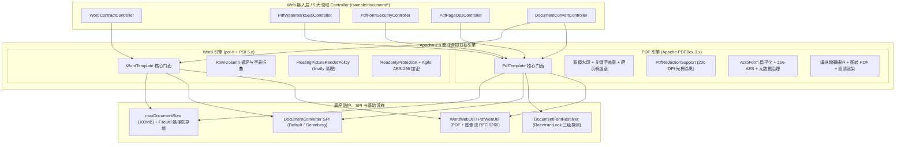

# ateng-boot-document 企业级 Word 模板填充与 PDF 综合治理底座 Starter

> 面向生产就绪的 Spring Boot 3 企业级办公文档全场景治理基础设施 Starter。坚持纯原生零臃肿依赖与 Apache 2.0 商业合规双核（`poi-tl` + `Apache PDFBox 3.x`）设计，提供 Word 契约模板渲染（行/列动态循环、空表折叠、SpringEL 默认关闭安全开关）、浮动公章、分页拼装、`ReadonlyProtection` 只读锁、Agile AES-256 文件打开级加解密、页眉 VML 水印与结构元数据自省，PDF 文本/图片双模防泄密暗水印（多行与旋转/CropBox 校准）、关键字自动盖章、跨页骑缝章无损切片、物理不可逆光栅涂黑脱敏（Redaction）、页面合并/拆分/提取/删除/重排/插入、多图合成 PDF、元数据增量更新与剥离、256 位 AES 权限锁与全量口令穿透、高清光栅渲染与图像流直出、虚拟线程安全 CJK 字体探测（`ReentrantLock`），以及条件装配的 `GotenbergDocumentConverter` 跨格式转换逃生舱。

---

## 0. 特性与公共 API 全景速查矩阵 (Feature & API Panorama Matrix)

| 特性分类 | 特性名称 | 核心门面 / 注解 / SPI | 关键配置项 (`ateng.boot.document.*`) | 关键 API 签名 / 核心行为 | 锚定验证源头 (*Test / Sample) |
| :--- | :--- | :--- | :--- | :--- | :--- |
| **Word 核心渲染** | 模板编译、SpringEL 安全开关与动态行/列循环 | `WordTemplate` | `word.template-base-dir`<br>`word.spring-el-enabled`<br>`word.spring-el-strict` | `of(...)`；`render(source, data, target[, configure])` / `renderToBytes(source, data[, configure])`；`compile(source[, configure])`；`configureBuilder()` / `configureBuilder(enableSpringEl)` / `createDefaultConfigure()`；`bindLoopRow(builder, tagNames)` / `bindLoopColumn(builder, tagNames)` / `bindFloatingPicture(builder, tagNames)`；支持 `Resource`、`InputStream`、`File`、`Path`、`byte[]`、`String`（带 `../` 路径防穿越） | `WordTemplateTest`<br>`WordContractController` |
| **Word 自省与合并** | AST 变量反查、纯文本抽取、元数据与表格合并 | `WordTemplate`<br>`WordMetadata` | - | `listVariableNames(source[, configure])`；`extractText(source)`；`inspectMetadata(source[, password])`（返回 `WordMetadata` 含段落/表格/图片数、页眉标志、只读/加密标志）；`mergeCellsHorizontal(table, row, fromCol, toCol)` / `mergeCellsVertical(table, col, fromRow, toRow)` | `WordTemplateTest`<br>`WordContractController` |
| **Word 拼装与水印** | 多文档分页拼装与页眉 VML 水印 | `WordTemplate`<br>`StitchOptions` | `watermark.*` | `stitch(target, docxSources[, options])` / `stitch(target, Object... docxSources)` / `stitchToBytes(...)`（支持 `StitchOptions.pageBreakBetween` 分页拼装）；`addWatermark(source, target[, text\|options])` / `addWatermarkToBytes(...)`（页眉 VML 对角动态宏水印） | `WordTemplateStitchAndProtectTest`<br>`WordContractController` |
| **Word 双轨安全** | `ReadonlyProtection` 编辑锁 vs Agile AES-256 加密 | `WordTemplate` | - | 只读编辑锁：`protect(source, target[, password])` / `protectToBytes(...)` / `unprotect(...)` / `isEnforcedReadonlyProtection(source)` / `validateProtectionPassword(source, password)`；文件打开加密：`encrypt(source, target, password)` / `encryptToBytes(...)` / `decrypt(source, target, password)` / `decryptToBytes(...)` / `isEncrypted(source)` | `WordTemplateStitchAndProtectTest`<br>`WordContractController` |
| **Word 浮动印章** | 独立浮动公章签名图层与线程清理 | `FloatingPicture`<br>`FloatingPictureRenderPolicy` | - | `FloatingPicture.of(pictureData[, dx, dy, relH, relV])` / `ofBytes(...)` / `ofFile(...)` / `ofStream(...)`；`WordTemplate.render` 外层 `finally` 调用 `FloatingPictureRenderPolicy.clear()` 确定性清理 ThreadLocal；可选图元为 `null` 时优雅清空 | `WordTemplateTest`<br>`WordContractController` |
| **Word 转档桥接** | Word 渲染直出 PDF 跨格式桥接 | `WordTemplate`<br>`DocumentConverter` | `converter.gotenberg.*` | `renderToPdf(source, data, target[, configure, converter])` / `renderToPdfToBytes(source, data[, configure, converter])`（内部委托 `DocumentConverter.docxToPdf`） | `WordTemplateTest`<br>`DocumentConvertController` |
| **PDF 双模暗水印** | 文本 + Logo 图片平铺矩阵水印与旋转校准 | `PdfTemplate`<br>`WatermarkOptions`<br>`WatermarkLayer` | `watermark.default-text`<br>`watermark.opacity`<br>`watermark.rotation`<br>`watermark.font-size`<br>`watermark.color`<br>`watermark.layer`<br>`watermark.row-spacing`<br>`watermark.col-spacing` | `addWatermark(source, target[, options\|watermarkText])` / `addWatermarkToBytes(...)`；`addImageWatermark(source, target, image[, options])` / `addImageWatermarkToBytes(...)`；支持多行 `\n`、`page.getRotation()` 与 `CropBox` 校准、`skipPages`、`targetPages`、`password`；`WatermarkOptions.ofDefault()` / `ofText(...)` / `ofImage(...)` | `PdfTemplateTest`<br>`PdfWatermarkSealController` |
| **PDF 盖章与骑缝章** | 绝对坐标盖章、关键字自动盖章与跨页骑缝章 | `PdfTemplate`<br>`ImageStampOptions`<br>`KeywordStampOptions`<br>`KeywordStampOccurrence`<br>`TextPositionMatch`<br>`CrossPageSealOptions`<br>`CrossPageSealEdge` | - | 绝对盖章：`addImageStamp(...)` / `addImageStampToBytes(...)`；关键字定位：`findTextPositions(source, keyword[, password])`、`stampAtKeyword(source, target, options)` / `stampAtKeywordToBytes(...)`（支持 `FIRST`/`LAST`/`ALL`、`offsetX`/`offsetY`、`failIfNotFound`）；跨页骑缝章：`stampCrossPageSeal(...)` / `stampCrossPageSealToBytes(...)` | `PdfTemplateTest`<br>`PdfTemplateCrossPageSealTest`<br>`PdfWatermarkSealController` |
| **PDF 物理涂黑脱敏** | 命中页高清光栅化不可逆遮罩重封 | `PdfTemplate`<br>`RedactOptions`<br>`RedactArea` | `pdf.redaction-dpi` | `redact(source, target, options)` / `redactToBytes(source, options)`；`redactKeywords(source, target, keywords[, password])` / `redactKeywordsToBytes(...)`；`redactAreas(source, target, areas[, password])` / `redactAreasToBytes(...)`；命中页按 `200 DPI` 光栅涂黑并 `image.flush()`，未命中页保持矢量无损 | `PdfTemplateTest`<br>`PdfFormSecurityController` |
| **PDF 元数据治理** | 11 维元数据自省、增量更新、隐私剥离与文本抽取 | `PdfTemplate`<br>`PdfMetadata`<br>`PdfMetadataUpdate` | - | `inspectMetadata(source[, password])`；`updateMetadata(source, target, update)` / `updateMetadataToBytes(...)`；`stripMetadata(source, target[, password])` / `stripMetadataToBytes(...)`；`extractText(source[, startPage, endPage, password])`；`getPageCount(source[, password])` | `PdfTemplateTest`<br>`PdfFormSecurityController`<br>`PdfPageOpsController` |
| **PDF 动态表单** | AcroForm 8 维自省、填报、矢量扁平化与 XFA 熔断 | `PdfTemplate`<br>`FormOptions`<br>`PdfFormFieldDescriptor`<br>`FieldCategory` | - | `fillForm(source, target, formData[, options])` / `fillFormToBytes(...)`；`listFormFields(source[, password])`；`getFormFields(source[, password])`；`hasAcroForm(source[, password])`；动态 XFA 强制抛出 `57008 PDF_XFA_UNSUPPORTED` | `PdfTemplateFormTest`<br>`PdfFormSecurityController` |
| **PDF 编排与图转** | 合并、拆分、提取、删除、重排、插入、旋转与图转 PDF | `PdfTemplate`<br>`ImageToPdfOptions`<br>`PageNumberOptions`<br>`PageNumberPosition` | - | `merge(...)` / `mergeToBytes(pdfSources[, password])`；`split(...)` / `splitToBytes(source[, splitAtPage, password])`；`extractPageRange*` / `extractPages*`；`deletePages*`；`reorderPages*`；`insertPages*`；`imagesToPdf(imageSources, target[, options])` / `imagesToPdfToBytes(...)`；`rotatePages*`；`addPageNumbers*`（支持全量 `password` 穿透） | `PdfTemplateTest`<br>`PdfPageOpsController` |
| **PDF 安全与渲染** | 256 位 AES 权限锁（随机默认管理密码）与防 OOM 渲染 | `PdfTemplate`<br>`SecurityOptions`<br>`PdfRenderOptions`<br>`PageImageConsumer` | `pdf.default-render-dpi`<br>`pdf.max-render-dpi`<br>`pdf.default-max-render-pages` | `protect(source, target, options\|userPassword, ownerPassword)` / `protectToBytes(...)`（未传 `ownerPassword` 时以 `SecureRandom` 随机生成）；`unprotect*` / `isEncrypted`；`renderPageToImage*` / `renderPageToPng*` / `renderPageToImageBytes` / `renderAllPagesToPng*` / `renderPages*` | `PdfTemplateRenderTest`<br>`PdfFormSecurityController`<br>`PdfPageOpsController` |
| **PDF 转档桥接** | DOCX / HTML 转 PDF 跨格式门面桥接 | `PdfTemplate`<br>`DocumentConverter` | `converter.gotenberg.*` | `fromDocx(docxSource, target[, converter])` / `fromDocxToBytes(...)`；`fromHtml(htmlSource, target[, converter])` / `fromHtmlToBytes(...)` | `PdfTemplateTest`<br>`DocumentConvertController` |
| **中文字体探测** | CJK 云原生三级探测（虚拟线程安全 `ReentrantLock`） | `DocumentFontResolver`<br>`ResolvedFont`<br>`FontResolutionTier` | `pdf.font-path`<br>`pdf.preferred-font-names` | `resolveFont()` / `loadFont(document[, customPath])` / `isFontAvailable()` / `clearCache()` / `getCachedFont()`；`FontResolutionTier`（实现 `IBaseEnum<String>`：`CONFIG` / `SYSTEM`）；纯 ASCII 回退、含中文缺失字形快速失败抛出 `57003` | `DocumentFontResolverTest`<br>`PdfPageOpsController` |
| **水印宏解析器** | 动态操作人、租户、时间宏解析与手机号脱敏掩码 | `WatermarkMacroParser` | `watermark.default-text` | `parse(templateString, variables)`；支持 `#{user.name}` / `#{user.nickname}`、`#{user.code}` / `#{user.username}`、`#{user.phone}` / `#{user.mobile}`（脱敏掩码）、`#{tenantId}`、`#{traceId}`、`#{now('pattern')}` 及 `!'默认值'` 回退 | `WatermarkMacroParserTest`<br>`PdfWatermarkSealController` |
| **跨格式转换 SPI** | Gotenberg `RestClient` 条件装配适配器与默认防卫 | `DocumentConverter`<br>`DefaultDocumentConverter`<br>`GotenbergDocumentConverter` | `converter.gotenberg.enabled`<br>`converter.gotenberg.base-url`<br>`converter.gotenberg.connect-timeout`<br>`converter.gotenberg.read-timeout` | `docxToPdf(InputStream)` / `htmlToPdf(InputStream)`；`GotenbergDocumentConverter` 以 `@ConditionalOnClass(RestClient.class)` + 属性开关条件装配，`Duration` 超时 + `maxDocumentSize` 容量熔断；缺省 `DefaultDocumentConverter` 快速失败抛 `57004` | `GotenbergDocumentConverterTest`<br>`DocumentConvertController` |
| **浏览器流式响应** | Word / PDF / 渲染图像 RFC 6266 流式直出 | `WordWebUtil`<br>`PdfWebUtil` | - | `WordWebUtil`：`prepareResponse` / `write` / `download` / `writeToResponse`；`PdfWebUtil`：`prepareResponse` / `prepareImageResponse` / `write` / `download` / `preview` / `writeToResponse` / `writeImageToResponse` / `previewImage` / `downloadImage`（自动识别 PNG/JPEG MIME 与防缓存头） | `WordWebUtilTest`<br>`PdfWebUtilTest`<br>`PdfPageOpsController` |
| **自动装配与配置** | 防御性自动装配、全局容量上限与枚举契约 | `AtengDocumentAutoConfiguration`<br>`DocumentProperties`<br>`DocumentWordProperties`<br>`DocumentPdfProperties`<br>`DocumentWatermarkProperties`<br>`DocumentConverterProperties` | `enabled`<br>`in-memory-threshold`<br>`max-document-size`<br>`temp-dir` | `@AutoConfiguration` + `@ConditionalOnMissingBean` 守卫；全局枚举统一实现 `IBaseEnum<String>`（`WatermarkLayer`、`PageNumberPosition`、`CrossPageSealEdge`、`KeywordStampOccurrence`、`FontResolutionTier`、`FieldCategory`）；`10MB` 溢盘 + `100MB` 硬熔断 | `AtengDocumentAutoConfigurationTest`<br>`DocumentEnumsTest`<br>`DocumentPropertiesTest` |
| **因果异常与点检** | 业务异常体系（`57000`~`57014`）与 16 场景落盘验真 | `DocumentException`<br>`WordRenderException`<br>`PdfOperationException`<br>`DocumentFontException`<br>`UnsupportedConversionException`<br>`DocumentResultCode`<br>`DocumentAuditExportTest` | - | 全部继承 `BusinessException` 并 100% 保留原始 `cause`；状态码覆盖 `57000`~`57014`；`DocumentAuditExportTest` 落盘 16 大场景产物并生成 `audit-manifest.json` SHA-256 验真清单 | `DocumentExceptionAndResultCodeTest`<br>`DocumentAuditExportTest` |

---

## 1. 模块定位与快速起步

### 1.1 模块定位
`ateng-boot-document` 是面向企业级生产环境的 Word 模板渲染与 PDF 综合治理基础设施 Starter：
- **纯 Apache 2.0 商业合规双核**：全面基于 `com.deepoove:poi-tl`（Apache POI 5.x）与 `org.apache.pdfbox:pdfbox:3.x` 双核构建，**彻底排除 iText 等商业排他性与 AGPLv3 传染性协议法律风险**；
- **全场景企业安全闭环**：拆分 Word 只读编辑锁与 Agile AES-256 文件打开级加密、默认禁用不可信模板 SpringEL 防注入、PDF 物理不可逆光栅涂黑脱敏与随机默认管理密码防后门；
- **虚拟线程友好与内存容量双熔断**：CJK 字体解析使用 `ReentrantLock` 消除 JDK 21+ Carrier Pinning；`100MB` 单文档容量熔断（`max-document-size`）+ `10MB` 溢盘阈值（`in-memory-threshold`）与 `finally` 确定性清理；
- **零强制依赖扩展逃生舱**：`GotenbergDocumentConverter` 仅通过 `<optional>true</optional>` `spring-web` 守卫条件装配，默认零外部进程依赖即可开箱运行。

### 1.2 引入依赖

**方式一：导入 `ateng-boot-bom`（推荐，免配版本号）**

```xml
<dependencyManagement>
    <dependencies>
        <dependency>
            <groupId>io.github.atengk</groupId>
            <artifactId>ateng-boot-bom</artifactId>
            <version>1.2.0</version>
            <type>pom</type>
            <scope>import</scope>
        </dependency>
    </dependencies>
</dependencyManagement>

<dependencies>
    <dependency>
        <groupId>io.github.atengk</groupId>
        <artifactId>ateng-boot-document</artifactId>
    </dependency>
</dependencies>
```

**方式二：独立显式版本号引入**

```xml
<dependency>
    <groupId>io.github.atengk</groupId>
    <artifactId>ateng-boot-document</artifactId>
    <version>1.2.0</version>
</dependency>
```

### 1.3 最小可用配置 (`application.yml`)
所有配置项均具备生产级默认值（以下默认值与 `DocumentProperties` 源码完全对齐），开箱即用：

```yaml
ateng:
  boot:
    document:
      enabled: true
      in-memory-threshold: 10MB
      max-document-size: 100MB
      temp-dir: ""
      word:
        template-base-dir: "classpath:/templates/word/"
        spring-el-enabled: false
        spring-el-strict: false
      pdf:
        font-path: ""
        preferred-font-names:
          - "SimSun"
          - "Microsoft YaHei"
          - "Source Han Sans CN"
          - "WenQuanYi Micro Hei"
          - "PingFang SC"
        default-render-dpi: 150.0
        max-render-dpi: 600.0
        default-max-render-pages: 50
        redaction-dpi: 200.0
      watermark:
        default-text: "#{user.nickname!''} #{now('yyyy-MM-dd')}"
        opacity: 0.2
        rotation: -30.0
        font-size: 24.0
        color: "#888888"
        layer: OVERLAY
        row-spacing: 150.0
        col-spacing: 200.0
      converter:
        gotenberg:
          enabled: false
          base-url: ""
          connect-timeout: 5s
          read-timeout: 60s
```

### 1.4 极简实战代码

```java
// 1. Word 合同渲染并无缝拼装保密协议附件（提取自 ContractService）
Map<String, Object> dataModel = buildDataModel(request);
byte[] mainContract = wordTemplate.renderToBytes("classpath:templates/contract-template.docx", dataModel);
byte[] mergedContract = wordTemplate.stitchToBytes(mainContract, "classpath:templates/attachment-clause.docx");

// 2. PDF 叠加防泄密动态宏水印并流式输出下载（提取自 FinanceStatementService）
WatermarkOptions watermarkOptions = WatermarkOptions.builder()
        .text("#{user.name} (#{user.code}) - #{user.phone} #{now('yyyy-MM-dd')}")
        .opacity(0.18f)
        .rotation(-30.0f)
        .fontSize(16.0f)
        .color("#990000")
        .layer(WatermarkLayer.OVERLAY)
        .variables(Map.of("user", Map.of("name", "李小四", "code", "FIN-001", "phone", "13812345678")))
        .build();
byte[] watermarkedPdf = pdfTemplate.addWatermarkToBytes("classpath:templates/sample-statement.pdf", watermarkOptions);
PdfWebUtil.download(response, "财务对账单_水印附件", watermarkedPdf);
```

---

## 2. 核心架构与设计不变量



- **双核 Apache 2.0 商业合规**：零 iText/AGPLv3 依赖，100% 基于 `poi-tl` 与 `Apache PDFBox 3.x`；
- **虚拟线程安全与容量双熔断**：`DocumentFontResolver` 使用 `ReentrantLock` 消除 Carrier Pinning；输入流统一受 `max-document-size`（`100MB`）截断与 `in-memory-threshold`（`10MB`）磁盘溢盘保护；
- **浏览器 RFC 6266 / RFC 5987 标头**：`WordWebUtil` 与 `PdfWebUtil` 统一经 `FileUtil.cleanFilename` 清洗并注入 UTF-8 `filename*=` 与 `Cache-Control: no-cache, no-store, must-revalidate`。

---

## 3. Word 企业级合同与文档套件

### 3.1 行/列动态循环、空表折叠与 SpringEL 安全开关

#### 本节专属 YAML 配置
```yaml
ateng:
  boot:
    document:
      word:
        template-base-dir: "classpath:/templates/" # Sample 工程覆写路径（默认 classpath:/templates/word/）
        spring-el-enabled: false # 默认关闭防不可信模板 SpEL 注入
        spring-el-strict: false
```

#### 真实业务 Java 示例（提取自 `ContractService`）
```java
// 1. 多行动态循环与空列表优雅折叠（默认关闭 SpringEL）
public byte[] generateContractDocx(ContractRenderRequest request) {
    Map<String, Object> dataModel = buildDataModel(request);
    byte[] mainContract = wordTemplate.renderToBytes(CONTRACT_TEMPLATE_PATH, dataModel);
    if (Boolean.FALSE.equals(request.getWithConfidentialityAgreement())) {
        return mainContract;
    }
    return wordTemplate.stitchToBytes(mainContract, ATTACHMENT_TEMPLATE_PATH);
}

// 2. 为内部可信报表模板按需开启 SpringEL 与横向动态列循环
public void exportQuarterlyColumnLoopContractToWeb(HttpServletResponse response, String department) {
    byte[] templateBytes = buildQuarterlyColumnTemplateBytes();
    ConfigureBuilder builder = wordTemplate.configureBuilder(true);
    wordTemplate.bindLoopColumn(builder, "quarters");
    Configure configure = builder.build();

    Map<String, Object> dataModel = new HashMap<>();
    dataModel.put("department", department);
    dataModel.put("quarters", List.of(
            Map.of("quarter", "2026 Q1", "budget", "120 万元"),
            Map.of("quarter", "2026 Q2", "budget", "150 万元"),
            Map.of("quarter", "2026 Q3", "budget", "180 万元")
    ));

    byte[] rendered = wordTemplate.renderToBytes(templateBytes, dataModel, configure);
    WordWebUtil.download(response, String.format("季度研发预算列循环报表_%s", department), rendered);
}
```

#### 核心机制与边界说明
- **SpringEL 默认安全关闭**：全局 `spring-el-enabled=false` 时阻断 `T(java.lang.System)` 等静态类表达式执行；仅对可信模板通过 `configureBuilder(true)` 显式放行；
- **空数据折叠**：`items` 为空集合时 `LoopRowTableRenderPolicy` 自动折叠模板行，零 `{{items}}`/`[field]` 语法残留；`bindLoopColumn` 封装 `LoopColumnTableRenderPolicy` 实现横向多季度列动态扩展。

---

### 3.2 OpenXML CTAnchor 浮动公章与线程上下文清理

#### 本节专属 YAML 配置
```yaml
ateng:
  boot:
    document:
      enabled: true
```

#### 真实业务 Java 示例（提取自 `ContractService`）
```java
if (!Boolean.FALSE.equals(req.getWithSeal())) {
    ClassPathResource sealRes = new ClassPathResource("images/company-seal.png");
    if (sealRes.exists()) {
        try (InputStream is = sealRes.getInputStream()) {
            byte[] sealBytes = is.readAllBytes();
            FloatingPicture seal = FloatingPicture.ofBytes(sealBytes, 120, 120, -80, -48);
            map.put("seal", seal);
        }
    }
}
```

#### 核心机制与边界说明
- 基于 OpenXML `CTAnchor` 将图片转换为浮于文字上方的相对锚点图层，不挤压正文段落排版；
- **确定性 ThreadLocal 清理**：`WordTemplate.render(...)` 在外层 `finally` 块中强制遍历已注册的 `FloatingPictureRenderPolicy` 并调用其实例方法 `clear()` 释放 `currentFloating` ThreadLocal，杜绝渲染前或渲染期异常导致的跨线程图层串染。

---

### 3.3 `StitchOptions` 分页拼装与表格跨行跨列合并

#### 本节专属 YAML 配置
```yaml
ateng:
  boot:
    document:
      enabled: true
```

#### 真实业务 Java 示例（提取自 `ContractService`）
```java
// 1. 按 StitchOptions 控制主合同与附件之间插入分页符拼装
public void exportStitchedContractToWeb(HttpServletResponse response, String employeeName, boolean pageBreakBetween) {
    ContractRenderRequest request = createDefaultRequest(employeeName);
    byte[] mainContract = renderMainContract(request);
    StitchOptions options = StitchOptions.builder()
            .pageBreakBetween(pageBreakBetween)
            .build();
    byte[] stitched = wordTemplate.stitchToBytes(List.of(mainContract, ATTACHMENT_TEMPLATE_PATH), options);
    WordWebUtil.download(response, String.format("劳动合同_分页拼装_%s", request.getEmployeeName()), stitched);
}

// 2. 底层表格跨列水平合并
WordTemplate.mergeCellsHorizontal(table, 0, 0, 1);
```

#### 核心机制与边界说明
- `StitchOptions.pageBreakBetween=true` 时在每个子文档拼接边界自动插入 `BreakType.PAGE` 分页符，避免附件协议紧贴主合同末尾；默认 `false` 保持连续无缝拼装。

---

### 3.4 `ReadonlyProtection` 只读编辑锁 vs Agile AES-256 文件打开级加密

#### 本节专属 YAML 配置
```yaml
ateng:
  boot:
    document:
      max-document-size: 100MB
```

#### 真实业务 Java 示例（提取自 `ContractService`）
```java
// 1. settings.xml 只读编辑锁定（ReadonlyProtection：文件仍可直接打开，仅锁定编辑）
byte[] protectedDocx = wordTemplate.protectToBytes(docx, password);
boolean matched = wordTemplate.validateProtectionPassword(protectedDocx, verifyPassword);

// 2. Agile AES-256（SHA-512）文件打开级加密信封与解密还原
public boolean verifyContractEncryptionPassword(String password, String verifyPassword) {
    byte[] docx = generateDefaultContractBytes("密钥校验员");
    byte[] encrypted = wordTemplate.encryptToBytes(docx, password);
    if (!wordTemplate.isEncrypted(encrypted)) {
        return false;
    }
    try {
        byte[] decrypted = wordTemplate.decryptToBytes(encrypted, verifyPassword);
        return !wordTemplate.isEncrypted(decrypted);
    } catch (WordRenderException e) {
        if (e.getResultCode() == DocumentResultCode.PASSWORD_ERROR) {
            return false;
        }
        throw e;
    }
}
```

#### 核心机制与边界说明
- **`protect/unprotect`（`ReadonlyProtection`）**：写入 `settings.xml` `w:documentProtection`，用于桌面编辑防误改；
- **`encrypt/decrypt/isEncrypted`（Agile AES-256）**：通过 Apache POI `POIFSFileSystem` + `EncryptionMode.agile`（`CipherAlgorithm.aes256` + `HashAlgorithm.sha512`）封装为加密 OLE2 信封，无正确打开密码无法解析正文。

---

### 3.5 页眉 VML 水印、`WordMetadata` 自省与变量/文本抽取

#### 本节专属 YAML 配置
```yaml
ateng:
  boot:
    document:
      watermark:
        default-text: "#{user.nickname!''} #{now('yyyy-MM-dd')}"
```

#### 真实业务 Java 示例（提取自 `ContractService`）
```java
// 1. 压印原生页眉 VML 对角动态宏文字水印
Map<String, Object> vars = Map.of("user", Map.of("name", operatorName));
WatermarkOptions options = WatermarkOptions.builder()
        .text("#{user.name} 内部合同 #{now('yyyy-MM-dd')}")
        .variables(vars)
        .build();
byte[] watermarked = wordTemplate.addWatermarkToBytes(docx, options);

// 2. 文档结构与安全元数据自省（支持 AES 加密口令穿透）
public WordMetadata inspectContractMetadata(String employeeName, String password) {
    byte[] docx = generateDefaultContractBytes(employeeName);
    if (password != null && !password.isBlank()) {
        byte[] encrypted = wordTemplate.encryptToBytes(docx, password);
        return wordTemplate.inspectMetadata(encrypted, password);
    }
    return wordTemplate.inspectMetadata(docx);
}
```

#### 核心机制与边界说明
- `addWatermark` 复用 `WatermarkMacroParser` 解析动态宏后通过 `XWPFHeaderFooterPolicy.createWatermark` 注入页眉 VML 对角水印；
- `inspectMetadata` 兼容明文 OOXML 与 Agile AES-256 加密信封（密文未传密码抛出 `57006 PASSWORD_ERROR`）；`listVariableNames` 与 `extractText` 分别完成 AST 变量逆向自省与正文纯文本抽取。

---

## 4. PDF 安全暗水印、印章与关键字盖章套件

### 4.1 文本与图片双模平铺暗水印（支持多行与旋转/CropBox 校准）

#### 本节专属 YAML 配置
```yaml
ateng:
  boot:
    document:
      watermark:
        default-text: "#{user.nickname!''} #{now('yyyy-MM-dd')}"
        opacity: 0.2
        rotation: -30.0
        font-size: 24.0
        color: "#888888"
        layer: OVERLAY
        row-spacing: 150.0
        col-spacing: 200.0
```

#### 真实业务 Java 示例（提取自 `FinanceStatementService`）
```java
// 1. 文本动态宏矩阵水印
WatermarkOptions watermarkOptions = WatermarkOptions.builder()
        .text("#{user.name} (#{user.code}) - #{user.phone} #{now('yyyy-MM-dd')}")
        .opacity(0.18f)
        .rotation(-30.0f)
        .fontSize(16.0f)
        .color("#990000")
        .layer(WatermarkLayer.OVERLAY)
        .variables(Map.of("user", Map.of("name", effectiveName, "code", effectiveCode, "phone", effectivePhone)))
        .build();
byte[] watermarkedPdf = pdfTemplate.addWatermarkToBytes(STATEMENT_TEMPLATE_PATH, watermarkOptions);

// 2. 企业 Logo 图片矩阵平铺水印（支持 skipPages / targetPages / password）
WatermarkOptions imageOptions = WatermarkOptions.builder()
        .image("classpath:images/company-seal.png")
        .imageWidth(76.0f)
        .imageHeight(76.0f)
        .opacity(0.18f)
        .rotation(-25.0f)
        .rowSpacing(160.0f)
        .colSpacing(190.0f)
        .skipPages(Math.max(0, skipPages))
        .layer(WatermarkLayer.OVERLAY)
        .build();
byte[] imgWatermarkedPdf = pdfTemplate.addWatermarkToBytes(STATEMENT_TEMPLATE_PATH, imageOptions);
```

#### 核心机制与边界说明
- **文本/图片双模**：`WatermarkOptions.image` 非空时优先按矩阵平铺图片水印（亦提供 `addImageWatermark*` 便捷重载）；文本水印支持 `\n` 多行拆分绘制，消除多行水印崩溃；
- **旋转与 CropBox 对齐**：水印坐标系优先对齐 `page.getCropBox()`（回退 `MediaBox`）并自适应补偿 `page.getRotation()`（90°/180°/270° 扫描件不倒置偏移）；含非 ASCII 中文而缺失中文字体时前置 Fail-Fast 抛出 `57003 DocumentFontException`；
- **动态宏与脱敏掩码规则（`WatermarkMacroParser`）**：

| 宏表达式 | 说明 | 示例输出 | 容错与保底机制 |
| :--- | :--- | :--- | :--- |
| `#{user.name}` / `#{user.nickname}` | 获取当前操作人姓名 | `李小四` | 依次探测 `variables["user"]`（`name` -> `nickname`）-> `UserContextHolder.get()` |
| `#{user.code}` / `#{user.username}` | 获取操作人工号/账号 | `FIN-001` | 依次探测 `variables["user"]`（`code` -> `username`） |
| `#{user.phone}` / `#{user.mobile}` | 获取手机号并自动脱敏 | `138****5678` | 经 `DesensitizeUtil.mobilePhone` 掩码，严守内存真明文输出脱敏 |
| `#{tenantId}` / `#{tenant_id}` | 多租户标识透传 | `tenant-001` | 依次探测 `variables` -> `TenantContextHolder.get()` -> `MDC` |
| `#{traceId}` / `#{trace_id}` | 全链路跟踪号透传 | `tr-7b9c2e` | 依次探测 `variables` -> `MDC` |
| `#{now('yyyy-MM-dd')}` | 格式化当前时间 | `2026-11-18` | 模式为空默认 `yyyy-MM-dd`，非法模式回退默认值 |
| `#{expr!'默认值'}` | 缺省回退值语法 | `内部受控` | 属性缺失或为空字符串时输出指定默认值 |

---

### 4.2 绝对坐标盖章与 `KeywordStampOptions` 关键字自动定位盖章

#### 本节专属 YAML 配置
```yaml
ateng:
  boot:
    document:
      enabled: true
```

#### 真实业务 Java 示例（提取自 `FinanceStatementService`）
```java
// 1. 绝对物理坐标压印（-1 表示最后一页）
ImageStampOptions stampOptions = ImageStampOptions.of(
        "classpath:images/company-seal.png", -1, 420.0f, 120.0f, 100.0f, 100.0f);
byte[] stampedPdf = pdfTemplate.addImageStampToBytes(watermarkedPdf, stampOptions);

// 2. 关键字物理左下角坐标检索与自动定位盖章
List<TextPositionMatch> positions = pdfTemplate.findTextPositions(STATEMENT_TEMPLATE_PATH, "Settled");
KeywordStampOptions kwOptions = KeywordStampOptions.builder()
        .keyword("Settled")
        .stampImage("classpath:images/company-seal.png")
        .width(96.0f)
        .height(96.0f)
        .offsetX(16.0f)
        .offsetY(-30.0f)
        .occurrence(KeywordStampOccurrence.LAST)
        .failIfNotFound(true)
        .build();
byte[] keywordStampedPdf = pdfTemplate.stampAtKeywordToBytes(STATEMENT_TEMPLATE_PATH, kwOptions);
```

#### 核心机制与边界说明
- `findTextPositions` 基于自定义 `PDFTextStripper` 提取 `TextPosition` 并统一换算为 PDF 左下角物理坐标系（单位 `pt`）；
- `KeywordStampOptions` 默认采用 `KeywordStampOccurrence.LAST`（落款优先）与 `failIfNotFound = true`（未命中快速失败抛出 `57012 KEYWORD_NOT_FOUND`）。

---

### 4.3 跨页骑缝章无损切片与跳过封面动态页码重算

#### 本节专属 YAML 配置
```yaml
ateng:
  boot:
    document:
      enabled: true
```

#### 真实业务 Java 示例（提取自 `FinanceStatementService`）
```java
// 1. 跨页骑缝章数学无损垂直切片贴合压印
byte[] sealedPdf = pdfTemplate.stampCrossPageSealToBytes(watermarkedPdf, "classpath:images/company-seal.png");

// 2. 跳过第 1 页封面动态重算页码
PageNumberOptions pageOptions = PageNumberOptions.builder()
        .format("第 {page} 页 / 共 {total} 页")
        .skipPages(Math.max(0, skipPages))
        .recalculateTotal(true)
        .position(PageNumberPosition.BOTTOM_CENTER)
        .fontSize(10.0f)
        .color("#666666")
        .build();
byte[] pagedPdf = pdfTemplate.addPageNumbersToBytes(STATEMENT_TEMPLATE_PATH, pageOptions);
```

#### 核心机制与边界说明
- 跨页骑缝章保留 PNG Alpha 透明通道并保证相邻页面切片总宽精确等于原图宽度，零缝隙露白；
- `addPageNumbers` 针对 0 页空 PDF 跳过写入避免重复耗尽输入流。

---

## 5. PDF 表单、物理涂黑脱敏与安全治理套件

### 5.1 AcroForm 8 维自省、矢量扁平化与 XFA 快速失败

#### 本节专属 YAML 配置
```yaml
ateng:
  boot:
    document:
      pdf:
        font-path: classpath:fonts/sample-cjk.ttf
```

#### 真实业务 Java 示例（提取自 `SupplierFormService`）
```java
// 1. 表单域 8 维元数据自省
List<PdfFormFieldDescriptor> fields = pdfTemplate.listFormFields(SUPPLIER_FORM_TEMPLATE_PATH);

// 2. 填报表单与矢量扁平化防篡改（flatten=true 销毁交互控件）
FormOptions options = FormOptions.builder().flatten(flatten).build();
byte[] pdfBytes = pdfTemplate.fillFormToBytes(SUPPLIER_FORM_TEMPLATE_PATH, formData, options);
```

#### 核心机制与边界说明
- 若检测到动态 Adobe XFA 结构立即快速失败抛出 `57008 PDF_XFA_UNSUPPORTED`；`hasAcroForm` 停止异常吞咽，文件缺失/损坏/密码错时均保留 `cause` 抛出 `PdfOperationException`。

---

### 5.2 敏感内容物理不可逆光栅涂黑脱敏 (`RedactOptions`)

#### 本节专属 YAML 配置
```yaml
ateng:
  boot:
    document:
      pdf:
        redaction-dpi: 200.0
```

#### 真实业务 Java 示例（提取自 `FinanceStatementService`）
```java
RedactOptions options = RedactOptions.builder()
        .keywords(request.getKeywords())
        .maskColor(request.getMaskColor() != null && !request.getMaskColor().isBlank() ? request.getMaskColor() : "#000000")
        .dpi(request.getDpi())
        .password(request.getPassword())
        .build();
byte[] redactedPdf = pdfTemplate.redactToBytes(STATEMENT_TEMPLATE_PATH, options);
```

#### 核心机制与边界说明
- **100% 物理不可逆清除**：仅对命中敏感关键字或指定物理区域（`RedactArea`）的页面执行高清光栅化重封（默认 `200 DPI`），遮罩像素级覆盖后在 `finally` 中 `image.flush()`；未命中敏感词页面保留原生矢量结构与可选中文本。

---

### 5.3 元数据增量更新、隐私剥离与 256 位 AES 全量口令穿透

#### 本节专属 YAML 配置
```yaml
ateng:
  boot:
    document:
      enabled: true
```

#### 真实业务 Java 示例（提取自 `FinanceStatementService`）
```java
// 1. 增量更新核心元数据（仅覆写非 null 字段）
PdfMetadataUpdate update = PdfMetadataUpdate.builder()
        .title(request.getTitle())
        .author(request.getAuthor())
        .subject(request.getSubject())
        .keywords(request.getKeywords())
        .creator(request.getCreator())
        .password(request.getPassword())
        .build();
byte[] updatedPdf = pdfTemplate.updateMetadataToBytes(STATEMENT_TEMPLATE_PATH, update);

// 2. 彻底剥离标准摘要与 XMP 隐私元数据
byte[] strippedPdf = pdfTemplate.stripMetadataToBytes(updatedPdf);

// 3. 256 位 AES 权限锁与加密文档口令穿透自省
SecurityOptions secOptions = SecurityOptions.builder()
        .userPassword(userPassword)
        .ownerPassword(ownerPassword)
        .canPrint(true)
        .canCopy(false)
        .canModify(false)
        .canAnnotate(false)
        .build();
byte[] protectedPdf = pdfTemplate.protectToBytes(watermarkedPdf, secOptions);
PdfMetadata encryptedMeta = pdfTemplate.inspectMetadata(protectedPdf, userPassword);
```

#### 核心机制与边界说明
- `PdfTemplate.protect` 未传 `ownerPassword` 时底层通过 `SecureRandom` 动态生成 32 位随机强密码（彻底消除硬编码管理密码隐患）；
- 全量核心操作（水印、盖章、涂黑、合并、拆分、提取、删排插、旋转、页码、渲染、元数据与表单）均开放带 `password` 参数重载实现透明口令穿透。

---

## 6. PDF 物理编排、图转 PDF 与高清图像预览流套件

### 6.1 合并、拆分、删除、重排、插入与多图合成 PDF

#### 本节专属 YAML 配置
```yaml
ateng:
  boot:
    document:
      max-document-size: 100MB
```

#### 真实业务 Java 示例（提取自 `FinanceStatementService`）
```java
// 1. 合并与单页切分
byte[] mergedPdf = pdfTemplate.mergeToBytes(List.of(pdf1, pdf2));
List<byte[]> splits = pdfTemplate.splitToBytes(STATEMENT_TEMPLATE_PATH, 1);

// 2. 删除、倒序重排与插入附页
byte[] deletedPdf = pdfTemplate.deletePagesToBytes(STATEMENT_TEMPLATE_PATH, pageIndex);
byte[] reorderedPdf = pdfTemplate.reorderPagesToBytes(STATEMENT_TEMPLATE_PATH, 1, 0);
byte[] insertedPdf = pdfTemplate.insertPagesToBytes(STATEMENT_TEMPLATE_PATH, SUPPLIER_FORM_TEMPLATE_PATH, insertAtPageIndex);

// 3. 企业印章/凭证图像合成 PDF（支持 fitToImage=true 按原图精确成页或默认 A4 自适应）
ImageToPdfOptions imgOptions = fitToImage ? ImageToPdfOptions.fitToImage() : ImageToPdfOptions.defaults();
byte[] imgPdf = pdfTemplate.imagesToPdfToBytes(List.of("classpath:images/company-seal.png"), imgOptions);
```

#### 核心机制与边界说明
- `merge` 统一流解析复用逻辑，全面支持 `classpath:` 字符串源与统一密码解密合并；`split` 前置清洗输出前缀防路径穿越；`deletePages` 强制至少保留 1 页。

---

### 6.2 高清光栅化渲染与 `PdfWebUtil` 图像流直出

#### 本节专属 YAML 配置
```yaml
ateng:
  boot:
    document:
      pdf:
        default-render-dpi: 150.0
        max-render-dpi: 600.0
        default-max-render-pages: 50
```

#### 真实业务 Java 示例（提取自 `FinanceStatementService`）
```java
public void renderPageWeb(HttpServletResponse response, int pageIndex, float dpi, boolean inline) {
    byte[] pngBytes = pdfTemplate.renderPageToPng(STATEMENT_TEMPLATE_PATH, pageIndex, dpi);
    String filename = String.format("财务对账单_第%d页_%s.png", pageIndex + 1, inline ? "高清预览" : "缩略图");
    PdfWebUtil.writeImageToResponse(response, filename, pngBytes, inline);
}
```

#### 核心机制与边界说明
- `PdfWebUtil.writeImageToResponse` / `previewImage` / `downloadImage` 自动识别 `.png`/`.jpg`/`.jpeg`/`.gif`/`.webp`/`.bmp` MIME 类型并注入 RFC 6266 UTF-8 标头与防缓存响应头；渲染超出 `max-render-dpi` 或 `default-max-render-pages` 时快速失败防 OOM。

---

## 7. 生产扩展接管与跨格式转换 SPI (Customization & Extensibility)

### 7.1 `GotenbergDocumentConverter` 零侵入条件装配与转档桥接

#### 本节专属 YAML 配置
```yaml
ateng:
  boot:
    document:
      converter:
        gotenberg:
          enabled: true
          base-url: "http://YOUR_GOTENBERG_HOST:3000"
          connect-timeout: 5s
          read-timeout: 60s
```

#### 真实业务 Java 示例（提取自 `DocumentConvertService`）
```java
// 1. Word 模板渲染后经由 DocumentConverter SPI 直接转换输出 PDF
public byte[] convertContractWordToPdf(ContractRenderRequest request) {
    Map<String, Object> dataModel = contractService.buildDataModel(request);
    return wordTemplate.renderToPdfToBytes(CONTRACT_TEMPLATE_PATH, dataModel);
}

// 2. HTML 字节流经由 DocumentConverter SPI 转换输出 PDF
public byte[] convertHtmlToPdf(HtmlToPdfRequest request) {
    byte[] htmlBytes = request.getHtmlContent().getBytes(StandardCharsets.UTF_8);
    return pdfTemplate.fromHtmlToBytes(htmlBytes);
}
```

#### 核心机制与边界说明
- **条件装配与隔离**：`GotenbergConverterConfiguration` 通过 `@ConditionalOnClass(RestClient.class)` 与 `@ConditionalOnProperty(..., gotenberg.enabled=true)` 激活，分别对接 `/forms/libreoffice/convert` 与 `/forms/chromium/convert/html`；未开启时默认回退 `DefaultDocumentConverter`（快速失败抛出 `57004 UNSUPPORTED_CONVERSION`）；
- **Sample 双模体验**：`ateng-boot-sample-document` 提供 `@Profile("!local")` 的 `OfflineSimulatedDocumentConverter` 离线模拟桩，无需启动 Gotenberg 容器即可跑通集成测试，激活 `local` Profile 并配置真实 `base-url` 即可平滑切换真实 Gotenberg 服务。

---

### 7.2 CJK 中文字体云原生两级探测与容器化部署

#### 本节专属 YAML 配置
```yaml
ateng:
  boot:
    document:
      pdf:
        font-path: "" # 支持物理绝对路径或 classpath:fonts/sample-cjk.ttf
        preferred-font-names:
          - "SimSun"
          - "Microsoft YaHei"
          - "Source Han Sans CN"
          - "WenQuanYi Micro Hei"
          - "PingFang SC"
```

#### 真实业务 Java 示例（提取自 `FinanceStatementService` & `PdfPageOpsController`）
```java
@GetMapping("/inspect/font")
public Result<ResolvedFont> inspectFont() {
    return Result.success(pdfTemplate.getFontResolver().resolveFont());
}
```

#### 核心机制与边界说明
`DocumentFontResolver` 按两级阶梯探测字体（临界区使用 `ReentrantLock` 保证虚拟线程不 Pinning）：
1. **Tier 1 (`FontResolutionTier.CONFIG`)**：`ateng.boot.document.pdf.font-path`（支持物理绝对路径或 `classpath:`）；
2. **Tier 2 (`FontResolutionTier.SYSTEM`)**：按 `preferred-font-names` 扫描 `/usr/share/fonts`、`/System/Library/Fonts`、`C:\Windows\Fonts`；
3. **智能 Fail-Fast**：纯 ASCII/WinAnsi 文本缺字体时优雅回退 `HELVETICA`；含非 ASCII 中文且无可用字体时前置抛出 `57003 DocumentFontException` 并输出 Dockerfile 安装指引：

```dockerfile
# Debian / Ubuntu
RUN apt-get update && apt-get install -y --no-install-recommends fonts-wqy-microhei && rm -rf /var/lib/apt/lists/*
# Alpine Linux
RUN apk add --no-cache font-noto-cjk
```

---

### 7.3 自定义 `DocumentConverter` Bean 与 `RenderPolicy` 扩展

#### 本节专属 YAML 配置
```yaml
ateng:
  boot:
    document:
      converter:
        gotenberg:
          enabled: false # 关闭内置 Gotenberg 适配器，交由自定义 DocumentConverter Bean 接管
```

#### 真实业务 Java 示例（提取自 `OfflineSimulatedDocumentConverter`）
```java
// 通过 @ConditionalOnMissingBean(DocumentConverter.class) 覆盖默认实现
@Component
@Profile("!local")
public class OfflineSimulatedDocumentConverter implements DocumentConverter {
    @Override
    public byte[] docxToPdf(InputStream docxInputStream) { /* 内存 POI+PDFBox 模拟转档 */ }

    @Override
    public byte[] htmlToPdf(InputStream htmlInputStream) { /* 内存 HTML->PDF 模拟转档 */ }
}
```

#### 核心机制与边界说明
- `AtengDocumentAutoConfiguration` 的 `DocumentConverter` 公共 Bean 标配 `@ConditionalOnMissingBean(DocumentConverter.class)`，应用层注入自定义 `DocumentConverter` 或通过 `wordTemplate.configureBuilder(...)` 绑定自定义 `RenderPolicy` 均可实现零侵入扩展。

---

## 8. 核心生产边界与非功能语义 (Production Boundary & Failure Modes)

1. **Apache 2.0 商业合规红线**：彻底排除 iText / Flying Saucer 等 AGPLv3 或商业排他依赖；
2. **双阈值内存防爆与路径防穿越**：所有文件流经 `DocumentWebHelper.readBytesBounded` 受 `max-document-size`（`100MB`）截断，超出 `in-memory-threshold`（`10MB`）溢出至 `FileUtil.getAppTempDirectory("ateng-boot-document")` 并在 `finally` 销毁；模板路径与下载文件名统一经 Core `FileUtil` 清洗防 `../` 路径穿越；
3. **无吞咽因果异常体系 (`DocumentResultCode`)**：子类全部继承 `BusinessException` 并 100% 保留原始 `cause`：

| 状态码 | 枚举名 | 说明 |
| :---: | :--- | :--- |
| `57000` | `DOCUMENT_OPERATION_FAILED` | 文档处理操作通用失败 |
| `57001` | `WORD_RENDER_FAILED` | Word 文档模板渲染失败 |
| `57002` | `PDF_OPERATION_FAILED` | PDF 处理操作失败 |
| `57003` | `FONT_NOT_FOUND` | 未找到可用的中文字体 |
| `57004` | `UNSUPPORTED_CONVERSION` | 不支持的文档格式转换 |
| `57005` | `TEMPLATE_NOT_FOUND` | Word 模板文件不存在 |
| `57006` | `PASSWORD_ERROR` | 文档密码错误或解密失败 |
| `57007` | `FORM_ERROR` | PDF 表单域处理异常 |
| `57008` | `PDF_XFA_UNSUPPORTED` | 不支持动态 XFA 格式表单 |
| `57009` | `PDF_PAGE_INDEX_OUT_OF_BOUNDS` | PDF 页面索引越界 |
| `57010` | `PDF_RENDER_EXCEEDED_MAX_PAGES` | PDF 页面渲染超出最大页数安全上限 |
| `57011` | `DOCUMENT_SIZE_EXCEEDED` | 文档大小超出允许的安全容量上限 |
| `57012` | `KEYWORD_NOT_FOUND` | 文档中未定位到目标关键字锚点 |
| `57013` | `CONVERSION_FAILED` | 文档跨格式转换失败 |
| `57014` | `ENCRYPTION_ERROR` | 文档加密保护或密码校验异常 |

---

## 9. 真实场景样例工程 (1:1 Verification Sandbox)

本模块 1:1 配套独立沙箱工程 [`ateng-boot-sample-document`](../ateng-boot-samples/ateng-boot-sample-document/README.md)，按领域拆分 5 大 `@RestController`（统一入参 DTO + JSR-303 校验、非流式返回 `Result<T>`）：

| 控制器类 | 路由前缀 | 覆盖场景 |
| :--- | :--- | :--- |
| `WordContractController` | `/sample/document/word/*` | 合同渲染、空表折叠、DTO 级联校验、AST 变量反查、纯文本抽取、只读锁、元数据自省、单元格合并、AES-256 加解密、页眉水印、`StitchOptions` 分页拼装、SpringEL + 列循环 |
| `PdfWatermarkSealController` | `/sample/document/pdf/stamp/*` | 文本暗水印预览/下载、Logo 图片矩阵水印、跨页骑缝章、绝对坐标盖章、关键字坐标检索与自动盖章、跳过封面页码重算 |
| `PdfFormSecurityController` | `/sample/document/pdf/*` | 表单域 8 维自省、交互/扁平化填报、256 位 AES 权限锁与口令穿透自省、物理光栅涂黑脱敏（GET/POST）、元数据更新与剥离 |
| `PdfPageOpsController` | `/sample/document/*` | 高清光栅图像流预览/下载、合并/拆分/旋转/删除/重排/插入页面、图像合成 PDF、11 维元数据与分页文本/字体探针自省 |
| `DocumentConvertController` | `/sample/document/convert/*` | SPI 状态查询、Word 合同转 PDF、HTML 转 PDF（`!local` 离线模拟桩与 `local` 真实 Gotenberg 无缝切换） |

[`DocumentAuditExportTest`](../ateng-boot-samples/ateng-boot-sample-document/src/test/java/io/github/atengk/boot/sample/document/DocumentAuditExportTest.java) 自动落盘 16 大企业级场景交付物至 `target/test-output/` 并生成 `audit-manifest.json` SHA-256 验真清单。本地回归命令：

```bash
mvn test -pl ateng-boot-document,ateng-boot-samples/ateng-boot-sample-document -am -T 1C -nsu -B
```

---

## 10. 完整 YAML 配置属性清单 (Full Configuration Reference)

| 配置属性键名 | 类型 | 默认值 | 描述说明 |
| :--- | :---: | :---: | :--- |
| `ateng.boot.document.enabled` | `boolean` | `true` | 是否启用文档治理 Starter 自动装配 |
| `ateng.boot.document.in-memory-threshold` | `DataSize` | `10MB` | 堆内存缓冲区容量上限，超出后溢出至磁盘临时目录 |
| `ateng.boot.document.max-document-size` | `DataSize` | `100MB` | 单文档输入与流加载最大容量硬熔断上限 |
| `ateng.boot.document.temp-dir` | `String` | `""` | 受管临时文件交换目录（留空回退系统临时目录下 `ateng-boot-document`） |
| `ateng.boot.document.word.template-base-dir` | `String` | `classpath:/templates/word/` | Word 模板扫描默认基准路径前缀 |
| `ateng.boot.document.word.spring-el-enabled` | `boolean` | `false` | 是否默认启用 poi-tl SpringEL（默认关闭防范注入） |
| `ateng.boot.document.word.spring-el-strict` | `boolean` | `false` | 开启 SpringEL 后缺失属性是否严格抛出异常 |
| `ateng.boot.document.pdf.font-path` | `String` | `""` | 自定义中文字体物理路径（支持绝对路径或 `classpath:`） |
| `ateng.boot.document.pdf.preferred-font-names` | `List<String>` | `SimSun, Microsoft YaHei, Source Han Sans CN, WenQuanYi Micro Hei, PingFang SC` | 系统字体自适应扫描候选偏好名称列表 |
| `ateng.boot.document.pdf.default-render-dpi` | `float` | `150.0` | PDF 页面转图像默认渲染分辨率 DPI |
| `ateng.boot.document.pdf.max-render-dpi` | `float` | `600.0` | PDF 页面渲染允许的最大 DPI 安全上限 |
| `ateng.boot.document.pdf.default-max-render-pages` | `int` | `50` | `renderAllPages*` 单次最多允许渲染页数安全上限 |
| `ateng.boot.document.pdf.redaction-dpi` | `float` | `200.0` | PDF 物理涂黑脱敏光栅化重封默认 DPI |
| `ateng.boot.document.watermark.default-text` | `String` | `#{user.nickname!''} #{now('yyyy-MM-dd')}` | 默认防泄密水印动态宏文本模板 |
| `ateng.boot.document.watermark.opacity` | `float` | `0.2` | 水印不透明度（0.0 ~ 1.0） |
| `ateng.boot.document.watermark.rotation` | `float` | `-30.0` | 水印旋转角度（度） |
| `ateng.boot.document.watermark.font-size` | `float` | `24.0` | 水印文字字号大小（pt） |
| `ateng.boot.document.watermark.color` | `String` | `#888888` | 水印十六进制 RGB 颜色值 |
| `ateng.boot.document.watermark.layer` | `WatermarkLayer` | `OVERLAY` | 水印图层模式（`OVERLAY` / `UNDERLAY`） |
| `ateng.boot.document.watermark.row-spacing` | `float` | `150.0` | 水印平铺网格行间距（pt） |
| `ateng.boot.document.watermark.col-spacing` | `float` | `200.0` | 水印平铺网格列间距（pt） |
| `ateng.boot.document.converter.gotenberg.enabled` | `boolean` | `false` | 是否启用开箱即用的 `GotenbergDocumentConverter` 适配器 |
| `ateng.boot.document.converter.gotenberg.base-url` | `String` | `""` | Gotenberg 服务基础地址（启用时须为合法 `http`/`https` URL） |
| `ateng.boot.document.converter.gotenberg.connect-timeout` | `Duration` | `5s` | Gotenberg HTTP 连接超时时长 |
| `ateng.boot.document.converter.gotenberg.read-timeout` | `Duration` | `60s` | Gotenberg HTTP 转换读取超时时长 |
