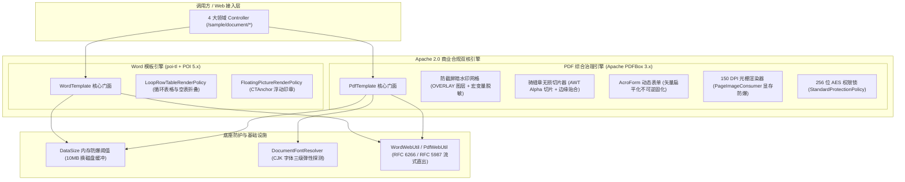

# ateng-boot-document 企业级 Word 模板填充与 PDF 综合治理底座 Starter

> 面向生产就绪的 Spring Boot 3 企业级办公文档全场景治理基础设施 Starter。坚持纯原生零臃肿依赖与 Apache 2.0 商业合规双核（poi-tl + Apache PDFBox 3.x）设计，提供 Word 契约模板渲染、动态表格循环追加与空表优雅折叠、单元格跨行跨列合并、浮动电子公章绝对相对定位、多文档物理无缝连续拼装、文档密码保护，以及 PDF 平铺防泄密暗水印（动态宏变量解析与手机号脱敏掩码）、绝对物理坐标盖章、多页跨页骑缝章无损切片压印、跳过封面页码重算、256 位 AES 权限安全锁、AcroForm 动态表单填报与矢量扁平化不可逆防篡改、150 DPI 高清单页光栅化预览图（显存防爆流式释放）、11 维核心元数据结构化自省、CJK 中文字体云原生容器三级弹性探测，以及 RFC 6266 标准化浏览器安全流式直出。

---

## 0. 特性与公共 API 全景速查矩阵 (Feature & API Panorama Matrix)

| 特性分类 | 特性名称 | 核心门面 / 注解 / SPI | 关键配置项 (`ateng.boot.document.*`) | 关键 API 签名 / 核心行为 | 锚定验证源头 (*Test / Sample) |
| :--- | :--- | :--- | :--- | :--- | :--- |
| **Word 核心渲染** | 统一模板编译与多源渲染门面 | `WordTemplate` | `ateng.boot.document.word.template-base-dir` | `render(source, data, target)` / `render(source, data, target, configure)`；`renderToBytes(source, data)` / `renderToBytes(source, data, configure)`；`compile(source)` / `compile(source, configure)`；`configureBuilder()` / `createDefaultConfigure()`；`bindLoopRow(builder, tagNames)` / `bindFloatingPicture(builder, tagNames)`；输入源自适应支持 `Resource`、`InputStream`、`File`、`Path`、`byte[]`、`String` | `WordTemplateTest`<br>`WordContractController` |
| **Word 变量与抽取** | 模板语法自省与正文纯文本抽取 | `WordTemplate` | - | `listVariableNames(source)`：逆向解析 AST 变量占位符清单（去重且保序）；`extractText(source)`：提取正文段落与多维表格纯文本 | `WordTemplateTest`<br>`WordContractController` |
| **Word 表格折叠** | 空数据安全折叠与图元清理 | `WordTemplate`<br>`LoopRowTableRenderPolicy`<br>`FloatingPictureRenderPolicy` | - | 动态表格列表为空（`items = []`）时自动折叠模板行无语法残留；可选图元（`seal = null`）优雅清空占位符且不阻断渲染 | `WordTemplateTest`<br>`WordContractController` |
| **Word 物理拼装** | 多文档物理无缝拼装 | `WordTemplate` | - | `stitch(target, docxSources)` / `stitch(target, Object... docxSources)`；`stitchToBytes(docxSources)` / `stitchToBytes(Object... docxSources)`；基于 OpenXML 底层结构按序合并多份独立 Docx 文档，保持段落格式、表格与图片上下文连续无缝拼装 | `WordTemplateStitchAndProtectTest`<br>`WordContractController` |
| **Word 密码保护** | 只读保护锁与密码验证 | `WordTemplate` | - | `protect(source, target, password)` / `protect(source, target)`；`protectToBytes(source, password)` / `protectToBytes(source)`；`unprotect(source, target)` / `unprotectToBytes(source)`；`isEnforcedReadonlyProtection(source)` / `validateProtectionPassword(source, password)`；兼容无 `settings.xml` 极简文档自愈防御初始化 | `WordTemplateStitchAndProtectTest`<br>`WordContractController` |
| **Word 单元格合并** | 动态表格跨行跨列合并工具 | `WordTemplate` | - | `mergeCellsHorizontal(table, row, fromCol, toCol)`（横向跨列合并）；`mergeCellsVertical(table, col, fromRow, toRow)`（纵向跨行合并）；直接基于 Apache POI `XWPFTable` 底层 XML 网格模型操作 | `WordTemplateTest`<br>`ContractService` |
| **Word 浮动印章** | 独立浮动公章签名图层 | `FloatingPicture`<br>`FloatingPictureRenderPolicy` | - | `FloatingPicture.of(pictureData, dx, dy[, relH, relV])`；`ofBytes(bytes, width, height, dx, dy[, relH, relV])`；`ofFile(file, width, height, dx, dy[, relH, relV])`；`ofStream(stream, width, height, dx, dy[, relH, relV])`；基于 OpenXML `CTAnchor` 浮动锚点渲染，支持字符（`CHARACTER`）与段落（`PARAGRAPH`）动态相对定位，彻底摆脱行内文字挤压变形，自动清理 ThreadLocal 防止图层泄漏 | `WordTemplateTest`<br>`WordContractController` |
| **PDF 防泄密水印** | 全场景平铺暗水印压印 | `PdfTemplate` | `ateng.boot.document.watermark.*` | `addWatermark(source, target, options)` / `addWatermark(source, target, watermarkText)` / `addWatermark(source, target)`；`addWatermarkToBytes(source, options)` / `addWatermarkToBytes(source, watermarkText)` / `addWatermarkToBytes(source)`；网格倾斜平铺矩阵覆盖，自动解析动态宏与手机号掩码脱敏 | `PdfTemplateTest`<br>`PdfWatermarkSealController` |
| **PDF 物理坐标盖章** | 绝对物理坐标电子公章压印 | `PdfTemplate` | - | `addImageStamp(source, target, options)` / `addImageStamp(source, target, image, pageIndex, x, y, width, height)`；`addImageStampToBytes(source, options)` / `addImageStampToBytes(source, image, pageIndex, x, y, width, height)`；支持指定任意页面（包含 `-1` 索引倒数盖章）与绝对物理坐标精准压印 | `PdfTemplateTest`<br>`PdfWatermarkSealController` |
| **PDF 跨页骑缝章** | 多页合同跨页骑缝章无损切片压印 | `PdfTemplate`<br>`CrossPageSealOptions`<br>`CrossPageSealEdge` | - | `stampCrossPageSeal(source, target, options)` / `stampCrossPageSeal(source, target, sealImage, options)` / `stampCrossPageSeal(source, target, sealImage)`；`stampCrossPageSealToBytes(...)`；数学无损等分垂直/水平条带切片（保留 Alpha 透明通道），支持右侧/左侧/顶部边缘贴合、skipCover、skipBackCover 及自定义 targetPages | `PdfTemplateCrossPageSealTest`<br>`PdfWatermarkSealController` |
| **PDF 页面高清预览** | 原生页面转高清预览图与防 OOM | `PdfTemplate`<br>`PdfRenderOptions`<br>`PageImageConsumer` | - | `renderPageToImage(source)` / `renderPageToImage(source, pageIndex, options)` / `renderPageToPng(source, pageIndex, dpi)` / `renderPageToImageBytes(source, pageIndex, options)` / `renderPageToBytes(source)` / `renderPageToBytes(source, pageIndex, options)` / `renderAllPagesToPng(source, dpi)`；`renderPages(source, startPage, endPage, options, consumer)`；流式消费并在回调后确定性执行 `image.flush()` 释放显存，DPI 72~600 范围保护 | `PdfTemplateRenderTest`<br>`PdfPageOpsController` |
| **PDF 元数据自省** | 核心元数据结构化自省与文本抽取 | `PdfTemplate`<br>`PdfMetadata` | - | `inspectMetadata(source)` / `inspectMetadata(source, password)`：自省标题、作者、创建修改时间、总页数、加密状态、PDF 版本等 11 维元数据；`extractText(source, startPage, endPage, password)`：起止范围分页受管纯文本抽取 | `PdfTemplateMetadataTest`<br>`PdfPageOpsController` |
| **PDF 动态表单** | AcroForm 表单填报与扁平化 | `PdfTemplate`<br>`PdfFormFieldDescriptor` | - | `fillForm(source, target, formData, options)` / `fillForm(source, target, formData)`；`fillFormToBytes(...)`；`listFormFields(source[, password])`（枚举 8 维表单字段元数据）；`getFormFields(source[, password])` / `hasAcroForm(source[, password])`；动态 XFA 结构探测与快速失败熔断；自动识别文本框与复选框，默认执行矢量扁平化（Flatten）彻底销毁交互控件防二次篡改 | `PdfTemplateFormTest`<br>`PdfFormSecurityController` |
| **PDF 物理编排** | 多文件物理合并与拆分 | `PdfTemplate` | - | `merge(target, pdfSources)` / `merge(target, Object... pdfSources)`；`mergeToBytes(pdfSources)` / `mergeToBytes(Object... pdfSources)`；`split(source, outputDir, prefix)`（逐页拆分为单页 PDF 文件）；`splitToBytes(source, pagesPerFile)`（按页数切分为内存列表） | `PdfTemplateTest`<br>`PdfPageOpsController` |
| **PDF 页面重组** | 页面精准提取与角度旋转 | `PdfTemplate` | - | `extractPages(source, target, fromPage, toPage)` / `extractPageRange(source, target, fromPage, toPage)` / `extractPages(source, target, int... pageIndexes)`；`extractPagesToBytes(...)` / `extractPageRangeToBytes(...)`；`rotatePages(source, target, angle, int... pageIndexes)` / `rotatePagesToBytes(...)`（支持 90°、180°、270° 顺时针旋转） | `PdfTemplateTest`<br>`PdfPageOpsController` |
| **PDF 页码压印** | 动态页码与跳过封面重算 | `PdfTemplate` | - | `addPageNumbers(source, target, options)` / `addPageNumbers(source, target)`；`addPageNumbersToBytes(source, options)` / `addPageNumbersToBytes(source)`；支持指定 6 种对齐方位、格式模板 `{page}` / `{total}`、跳过封面页码与有效总页数重新核算 | `PdfTemplateTest`<br>`PdfWatermarkSealController` |
| **PDF 权限加密** | 256 位 AES 权限锁与解密 | `PdfTemplate` | - | `protect(source, target, options)` / `protect(source, target, userPassword, ownerPassword)`；`protectToBytes(...)`；`unprotect(source, target, password)` / `unprotectToBytes(source, password)`；`isEncrypted(source)`；精细化控制打印、修改、文本复制、表单填报权限 | `PdfTemplateTest`<br>`PdfFormSecurityController` |
| **防泄密水印模型** | 水印领域参数与动态宏模型 | `WatermarkOptions`<br>`WatermarkMacroParser`<br>`WatermarkLayer` | `ateng.boot.document.watermark.default-text`<br>`ateng.boot.document.watermark.opacity`<br>`ateng.boot.document.watermark.rotation`<br>`ateng.boot.document.watermark.font-size`<br>`ateng.boot.document.watermark.color`<br>`ateng.boot.document.watermark.layer`<br>`ateng.boot.document.watermark.row-spacing`<br>`ateng.boot.document.watermark.col-spacing` | `WatermarkOptions.ofDefault()` / `ofText(text)`；链式构建 `opacity(float)`、`rotation(float)`、`fontSize(float)`、`color(hex)`、`layer(WatermarkLayer)`、`rowSpacing(float)`、`colSpacing(float)`；`addVariable(key, value)` / `setUser(nickname, username, phone)`；`WatermarkMacroParser.parse(text, vars)` 支持 `#{user.*}`、`#{traceId}`、`#{now('pattern')}` | `WatermarkMacroParserTest`<br>`PdfWatermarkSealController` |
| **盖章与骑缝章模型** | 盖章参数与跨页骑缝章模型 | `ImageStampOptions`<br>`CrossPageSealOptions`<br>`CrossPageSealEdge` | - | `ImageStampOptions.of(image, pageIndex, x, y, width, height)`；`CrossPageSealOptions.of(sealImage)` / `of(sealImage, width, height)` / `of(sealImage, edge)`；配置贴合边缘（`RIGHT`/`LEFT`/`TOP`/`BOTTOM`）、`margin`、`offset`、`skipCover`、`skipBackCover`、`targetPages`、`opacity`、`layer` | `PdfTemplateTest`<br>`PdfWatermarkSealController` |
| **页码与渲染模型** | 页码排版与高清渲染配置 | `PageNumberOptions`<br>`PageNumberPosition`<br>`PdfRenderOptions`<br>`PageImageConsumer` | - | `PageNumberOptions.skipCover(skipPages)` / `ofFormat(format)`；`PdfRenderOptions.of(dpi)` / `of(dpi, maxPages)` / `ofThumbnail(dpi)`；控制 `imageType`、`imageFormat`、`maxPages` 与流式消费回调 | `PdfTemplateTest`<br>`PdfPageOpsController` |
| **元数据与表单模型** | 自省元数据与表单填报模型 | `PdfMetadata`<br>`PdfFormFieldDescriptor`<br>`SecurityOptions`<br>`FormOptions` | - | `PdfMetadata` 结构化自省实体；`PdfFormFieldDescriptor` 8 维字段自省；`SecurityOptions.noPrintAndNoCopy(ownerPassword)` / `withPasswords(userPassword, ownerPassword)`；`FormOptions.defaults()` / `interactive()` | `PdfTemplateMetadataTest`<br>`PdfFormSecurityController` |
| **中文字体探测器** | CJK 云原生多级弹性自适应探测 | `DocumentFontResolver`<br>`ResolvedFont`<br>`FontResolutionTier` | `ateng.boot.document.pdf.font-path`<br>`ateng.boot.document.pdf.preferred-font-names` | `resolveFont()` / `loadFont(document)` / `loadFont(document, customPath)` / `isFontAvailable()` / `clearCache()` / `getCachedFont()`；按“1. 显式配置路径 -> 2. classpath 寻址 -> 3. 宿主机 OS 目录扫描 -> 4. 缺失时快速失败输出 Dockerfile 修复指引”多级解析 | `DocumentFontResolverTest`<br>`PdfPageOpsController` |
| **格式转换逃生舱** | 文档跨格式转换统一 SPI 契约 | `DocumentConverter`<br>`DefaultDocumentConverter` | - | `docxToPdf(InputStream)` / `htmlToPdf(InputStream)`；底座内置 `DefaultDocumentConverter` 优雅快速失败并提示扩展指引，应用层可无缝注册自定义 Bean 接管 Gotenberg / LibreOffice 集群 | `DocumentConverterTest` |
| **Word 浏览器直出** | Word 浏览器流式安全响应工具 | `WordWebUtil` | - | `prepareResponse(response, filename)`；`write(response, filename, ...)` / `download(response, filename, ...)`；`writeToResponse(response, filename, templateSource, data)` / `writeToResponse(response, filename, docxSource)` / `writeToResponse(response, filename, writer)`；RFC 6266 / RFC 5987 中文文件名标准化转码，自动补齐 `Content-Type`、`Content-Disposition` 与防页面缓存标头 (`Cache-Control: no-cache, no-store, must-revalidate`) | `WordWebUtilTest`<br>`WordContractController` |
| **PDF 浏览器直出** | PDF 浏览器安全流式预览与下载 | `PdfWebUtil` | - | `prepareResponse(response, filename)` / `prepareResponse(response, filename, inline)`；`write(response, filename, ...)` / `download(response, filename, ...)` / `preview(response, filename, ...)`；`writeToResponse(response, filename, source, inline)`；函数式写入器 `PdfWebWriter` 零缓冲写出，自动补齐 `Cache-Control` 防缓存标头 | `PdfWebUtilTest`<br>`PdfWatermarkSealController` |
| **可视化点检体系** | 9 大场景真实落盘与验真清单 | `DocumentAuditExportTest`<br>`audit-manifest.json` | - | 真实落盘 9 大场景交付物至 `target/test-output/`，伴生生成 SHA-256 结构化 JSON 清单与控制台 ASCII 点检表直达链接 | `DocumentAuditExportTest` |
| **自动装配与主配置** | 底座自动装配与强类型属性模型 | `AtengDocumentAutoConfiguration`<br>`DocumentProperties`<br>`DocumentWordProperties`<br>`DocumentPdfProperties`<br>`DocumentWatermarkProperties` | `ateng.boot.document.enabled`<br>`ateng.boot.document.in-memory-threshold`<br>`ateng.boot.document.temp-dir` | 装配类统配 `@AutoConfiguration` 并挂载缺省 Bean 守卫；统管内存防 OOM 阈值（默认 `10MB`，基于 `DataSize` 强类型）、受管临时交换目录、Word 模板基准路径、PDF 字体偏好与水印默认参数 | `AtengDocumentAutoConfigurationTest`<br>`DocumentPropertiesTest` |
| **因果异常体系** | 语义化异常与专用业务错误码 | `DocumentException`<br>`WordRenderException`<br>`PdfOperationException`<br>`DocumentFontException`<br>`UnsupportedConversionException`<br>`DocumentResultCode` | - | 继承 `BusinessException`，严禁吞咽异常，转译时 100% 传递原始 `cause`；统一状态码 `57000` 至 `57007`（包含 `WORD_RENDER_FAILED`、`PDF_OPERATION_FAILED`、`FONT_NOT_FOUND`、`UNSUPPORTED_CONVERSION`、`TEMPLATE_NOT_FOUND`、`PASSWORD_ERROR`、`FORM_ERROR`） | `DocumentExceptionAndResultCodeTest` |

---

## 1. 模块定位与快速起步

### 1.1 模块定位
`ateng-boot-document` 是面向企业级生产环境的 Word 模板渲染与 PDF 综合治理基础设施 Starter：
- **纯 Apache 2.0 商业合规双核**：全面基于 `com.deepoove:poi-tl`（Apache POI 驱动）与 `org.apache.pdfbox:pdfbox:3.x` 双核构建，**彻底排除 iText 等商业排他性与 AGPLv3 传染性协议法律风险**；
- **内存防爆与受管物理资源管理**：通过强类型 `DataSize`（默认 10MB）动态划分小文件内存缓冲与大文件磁盘临时文件交换，并在 `finally` 块中执行确定性物理销毁，杜绝堆内存 OOM 与临时文件膨胀；
- **云原生 CJK 字体自适应**：内置三级弹性探测机制，自适应容器与异构 OS 环境，提供贴心的 Dockerfile 修复指引；
- **传输契约与模型绝对解耦**：文档导出 Controller 边界严格遵循显式契约，100% 严禁直接接收或返回持久层实体。

### 1.2 引入依赖
在业务模块的 `pom.xml` 中引入（版本由 `ateng-boot-bom` 集中纳管，免配 `<version>`）：

```xml
<dependency>
    <groupId>io.github.atengk</groupId>
    <artifactId>ateng-boot-document</artifactId>
</dependency>
```

### 1.3 极简可用配置 (`application.yml`)
所有配置项均具备工业级生产默认值，开箱即用：

```yaml
ateng:
  boot:
    document:
      enabled: true
      # 堆内存缓冲区容量上限，超过此阈值的大文件自动溢出至磁盘临时交换目录防 OOM
      in-memory-threshold: 10MB
      # 受管临时文件交换目录（留空自动回退至系统临时目录下的 ateng-boot-document/）
      temp-dir: ""
      word:
        template-base-dir: "classpath:/templates/word/"
      pdf:
        font-path: ""
        preferred-font-names:
          - "SimSun"
          - "Microsoft YaHei"
          - "Source Han Sans CN"
          - "WenQuanYi Micro Hei"
          - "PingFang SC"
      watermark:
        default-text: "#{user.name} (#{user.code}) - #{user.phone} #{now('yyyy-MM-dd')}"
        opacity: 0.18
        rotation: -30.0
        font-size: 16.0
        color: "#990000"
        layer: OVERLAY
        row-spacing: 150.0
        col-spacing: 200.0
```

---

## 2. 核心架构与设计不变量



- **双核引擎 Apache 2.0 商业合规**：绝不依赖存在商业版权陷阱或 AGPLv3 传染性协议的类库（如 iText），全面采用 `poi-tl` 与 `Apache PDFBox 3.x`；
- **内存防爆动静阈值隔离**：小于 `in-memory-threshold`（默认 10MB）时全程在 JVM 堆内存解析，超过阈值自动溢出至磁盘临时交换目录，并在 `finally` 块中立即物理粉碎临时文件；
- **CJK 中文字体云原生三级弹性探测**：配置路径 -> 系统目录扫描 -> 快速失败指引，彻底消除由于缺字体导致的中文豆腐块或崩溃；
- **RFC 6266 / RFC 5987 浏览器防乱码标头**：自动注入标准 `Content-Disposition` 与 `Cache-Control: no-cache, no-store, must-revalidate`，防敏感商业文件被浏览器或代理缓存。

---

## 3. Word 企业级合同与文档套件

### 3.1 动态表格多行循环与空表优雅折叠

#### 专属 YAML 配置
```yaml
ateng:
  boot:
    document:
      word:
        template-base-dir: "classpath:/templates/word/"
```

#### 真实业务 Java 示例
```java
// ContractService.java
public byte[] generateContractDocx(ContractRenderRequest request) {
    Map<String, Object> dataModel = new HashMap<>();
    dataModel.put("employeeName", request.getEmployeeName());
    dataModel.put("idCard", request.getIdCard());
    dataModel.put("department", request.getDepartment());
    dataModel.put("postName", request.getPostName());
    dataModel.put("salary", request.getSalary());
    dataModel.put("signDate", request.getSignDate());
    // 动态表格行集合：包含多条项目履历
    dataModel.put("items", request.getItems());

    return wordTemplate.renderToBytes(CONTRACT_TEMPLATE_PATH, dataModel);
}

// 空数据优雅折叠（列表为空时不产生语法残留，保留表头）
public void exportEmptyTableContractToWeb(HttpServletResponse response, String employeeName) {
    ContractRenderRequest request = createDefaultRequest(employeeName);
    request.setItems(Collections.emptyList()); // 空列表安全折叠
    byte[] docx = generateContractDocx(request);
    WordWebUtil.download(response, "劳动合同_空表折叠_" + employeeName, docx);
}
```

#### 核心机制与边界说明
- 模板设计语法：首列占位符标记为 `{{items}}[projectName]`，后续列声明为 `[role]`、`[duration]`；
- 底层基于 `LoopRowTableRenderPolicy` 渲染。当 `items` 传入空集合时，框架自动清理模板行占位符，保留表头与表格结构完整，零语法报错与残留。

---

### 3.2 OpenXML CTAnchor 浮动公章绝对相对定位

#### 专属 YAML 配置
```yaml
ateng:
  boot:
    document:
      enabled: true
```

#### 真实业务 Java 示例
```java
// ContractService.java
ClassPathResource sealRes = new ClassPathResource(SEAL_IMAGE_PATH);
if (sealRes.exists()) {
    try (InputStream is = sealRes.getInputStream()) {
        byte[] sealBytes = is.readAllBytes();
        // 设定尺寸 120x120，相对段落锚点横向偏移 20pt，纵向偏移 -30pt
        FloatingPicture seal = FloatingPicture.ofBytes(sealBytes, 120, 120, 20, -30);
        dataModel.put("seal", seal);
    }
}
byte[] mainContract = wordTemplate.renderToBytes(CONTRACT_TEMPLATE_PATH, dataModel);
```

#### 核心机制与边界说明
- 基于 OpenXML `CTAnchor` 浮动锚点渲染，支持基于段落（`PARAGRAPH`）与字符（`CHARACTER`）双重相对物理定位；
- 彻底摆脱传统行内图片（Inline Picture）插入导致的文字挤压变形与排版破损；
- 渲染完毕后，底层在 `finally` 块中确定性调用 `FloatingPicture.clearCurrent()` 清理 ThreadLocal，杜绝图层信息跨线程污染。

---

### 3.3 多份 Docx 文档物理无缝连续拼装

#### 专属 YAML 配置
```yaml
ateng:
  boot:
    document:
      enabled: true
```

#### 真实业务 Java 示例
```java
// ContractService.java
public byte[] generateContractWithAttachment(ContractRenderRequest request) {
    byte[] mainContract = generateContractDocx(request);
    // 物理连续拼装《商业秘密保护与竞业限制协议》附件
    return wordTemplate.stitchToBytes(mainContract, ATTACHMENT_TEMPLATE_PATH);
}
```

#### 核心机制与边界说明
- 基于 Apache POI 底层 OpenXML 结构操作，按序读取附件文档的段落、表格与样式定义并安全合并至主文档；
- 保障页眉页脚、字体定义、列表编号和图片媒体上下文无缝连续拼装，无需启动任何外部 Office 进程。

---

### 3.4 模板 AST 变量反查与正文纯文本抽取

#### 专属 YAML 配置
```yaml
ateng:
  boot:
    document:
      enabled: true
```

#### 真实业务 Java 示例
```java
// WordContractController.java
@GetMapping("/contract/variables")
public Result<List<String>> listVariables() {
    return Result.success(contractService.listContractVariables());
}

@GetMapping("/contract/text")
public Result<String> extractText(@RequestParam(defaultValue = "张三") String employeeName) {
    return Result.success(contractService.extractContractText(employeeName));
}
```

#### 核心机制与边界说明
- `listVariableNames` 逆向解析 OpenXML 模板语法树，提取出模板声明的所有占位符（有序且去重），供前端动态生成填报表单；
- `extractText` 流式遍历段落与多维表格，提取出纯文本内容，用于文本检索、安全合规比对与全文索引。

---

### 3.5 只读保护锁与底层表格跨行跨列合并

#### 专属 YAML 配置
```yaml
ateng:
  boot:
    document:
      enabled: true
```

#### 真实业务 Java 示例
```java
// ContractService.java
public byte[] protectContract(byte[] docxBytes, String password) {
    return wordTemplate.protectToBytes(docxBytes, password);
}

public boolean verifyContractProtectionPassword(String password, String verifyPassword) {
    byte[] protectedDocx = protectContract(generateDefaultContractDocx(), password);
    return wordTemplate.validateProtectionPassword(protectedDocx, verifyPassword);
}

// 跨行跨列合并工具
public byte[] mergeContractTableCells(byte[] docxBytes) {
    try (ByteArrayInputStream bais = new ByteArrayInputStream(docxBytes);
         XWPFDocument document = new XWPFDocument(bais)) {
        if (!document.getTables().isEmpty()) {
            XWPFTable table = document.getTables().get(0);
            wordTemplate.mergeCellsHorizontal(table, 0, 0, 1); // 横向第 0 行第 0 列至第 1 列合并
        }
        ByteArrayOutputStream baos = new ByteArrayOutputStream();
        document.write(baos);
        return baos.toByteArray();
    } catch (Exception e) {
        throw new RuntimeException("合并单元格失败: " + e.getMessage(), e);
    }
}
```

#### 核心机制与边界说明
- 只读保护向 OpenXML `settings.xml` 注入 `w:documentProtection w:edit="readOnly"` 约束；
- 内置自愈防御：若模板文档缺少 `settings.xml`，框架自动初始化标准安全节点，保障口令哈希校验有效性。

---

## 4. PDF 安全暗水印与印章套件

### 4.1 全场景倾斜平铺防泄密暗水印与动态宏解析

#### 专属 YAML 配置
```yaml
ateng:
  boot:
    document:
      watermark:
        default-text: "#{user.name} (#{user.code}) - #{user.phone} #{now('yyyy-MM-dd')}"
        opacity: 0.18
        rotation: -30.0
        font-size: 16.0
        color: "#990000"
        layer: OVERLAY
        row-spacing: 150.0
        col-spacing: 200.0
```

#### 真实业务 Java 示例
```java
// FinanceStatementService.java
public byte[] generateWatermarkedStatement(String operatorName, String operatorCode, String operatorPhone) {
    Map<String, Object> userMap = Map.of(
            "name", operatorName != null ? operatorName : "财务专员",
            "code", operatorCode != null ? operatorCode : "FIN-001",
            "phone", operatorPhone != null ? operatorPhone : "13800138000"
    );
    Map<String, Object> vars = Map.of("user", userMap);

    WatermarkOptions watermarkOptions = WatermarkOptions.builder()
            .text("#{user.name} (#{user.code}) - #{user.phone} #{now('yyyy-MM-dd')}")
            .opacity(0.18f)
            .rotation(-30.0f)
            .fontSize(16.0f)
            .color("#990000")
            .layer(WatermarkLayer.OVERLAY)
            .variables(vars)
            .build();

    return pdfTemplate.addWatermarkToBytes(STATEMENT_TEMPLATE_PATH, watermarkOptions);
}
```

#### 核心机制与边界说明
- 动态宏解析：`#{user.phone}` 自动执行前 3 后 4 保留、中间 4 位 `****` 掩码脱敏，严守 ADR-0012 内存真明文与输出脱敏原则；
- 图层选择：`WatermarkLayer.OVERLAY` 挂载在页面最高内容流图层，牢牢压在图片、表格和背景之上，强力抗手机拍照与屏幕截图外泄溯源。

---

### 4.2 尾页/任意页绝对物理坐标电子公章精准压印

#### 专属 YAML 配置
```yaml
ateng:
  boot:
    document:
      enabled: true
```

#### 真实业务 Java 示例
```java
// FinanceStatementService.java
public void downloadAbsoluteSealStatementWeb(HttpServletResponse response, int pageIndex) {
    byte[] watermarkedPdf = generateWatermarkedStatement("财务总监", "FIN-000", "13800000000");
    ImageStampOptions stampOptions = ImageStampOptions.of(
            "classpath:images/company-seal.png",
            pageIndex, // 传入 -1 表示倒数第一页（尾页）
            420.0f,    // X 坐标
            120.0f,    // Y 坐标
            100.0f,    // 宽度
            100.0f     // 高度
    );
    byte[] stampedPdf = pdfTemplate.addImageStampToBytes(watermarkedPdf, stampOptions);
    PdfWebUtil.download(response, "财务对账单_尾页盖章", stampedPdf);
}
```

#### 核心机制与边界说明
- 支持绝对物理坐标（Point 单位）压印，页面索引支持负数寻址（`-1` 自动映射为文档末页）；
- 图像透明度保持：电子印章的 PNG Alpha 透明通道被完整保留，与正文文字自然叠盖。

---

### 4.3 跨页骑缝章数学无损切片与多页边缘贴合压印

#### 专属 YAML 配置
```yaml
ateng:
  boot:
    document:
      enabled: true
```

#### 真实业务 Java 示例
```java
// FinanceStatementService.java
public byte[] stampCrossPageSeal(Object sourcePdf, Object sealSource) {
    CrossPageSealOptions sealOptions = CrossPageSealOptions.builder()
            .sealImage(sealSource)
            .width(120.0f)
            .height(120.0f)
            .edge(CrossPageSealEdge.RIGHT) // 默认贴合页面右侧边缘
            .margin(0.0f)
            .skipCover(false)
            .skipBackCover(false)
            .opacity(0.85f)
            .build();
    return pdfTemplate.stampCrossPageSealToBytes(sourcePdf, sealOptions);
}
```

#### 核心机制与边界说明
- 数学等分切片：算法按目标页数将印章垂直等分切片，每个切片精准定位到对应页面的边缘（RIGHT / LEFT / TOP / BOTTOM）；
- 切片过程 100% 保留 PNG Alpha 透明度，打印后整份多页对折拼合呈现完整无缝圆形公章。

---

### 4.4 跳过封面动态页码排版与有效总页数重算

#### 专属 YAML 配置
```yaml
ateng:
  boot:
    document:
      enabled: true
```

#### 真实业务 Java 示例
```java
// FinanceStatementService.java
public void downloadPageNumberStatementWeb(HttpServletResponse response, int skipPages) {
    PageNumberOptions pageOptions = PageNumberOptions.builder()
            .format("第 {page} 页 / 共 {total} 页")
            .skipPages(Math.max(0, skipPages)) // 跳过封面页数
            .recalculateTotal(true)             // 重新核算排除封面后的总页数
            .position(PageNumberPosition.BOTTOM_CENTER)
            .fontSize(10.0f)
            .color("#666666")
            .build();
    byte[] pagedPdf = pdfTemplate.addPageNumbersToBytes(STATEMENT_TEMPLATE_PATH, pageOptions);
    PdfWebUtil.download(response, "财务对账单_重算页码", pagedPdf);
}
```

#### 核心机制与边界说明
- `recalculateTotal = true` 时，总页数 `{total}` 自动扣除跳过的封面页数；
- 避免传统报表封面出现页码的瑕疵，呈现严谨的企业级公文排版风格。

---

## 5. PDF AcroForm 表单与安全权限加密套件

### 5.1 8 维交互式表单字段元数据巡检自省

#### 专属 YAML 配置
```yaml
ateng:
  boot:
    document:
      enabled: true
```

#### 真实业务 Java 示例
```java
// PdfFormSecurityController.java
@GetMapping("/form/fields")
public Result<List<PdfFormFieldDescriptor>> listFields() {
    return Result.success(supplierFormService.listFormFields());
}
```

#### 核心机制与边界说明
- 自省字段描述符 `PdfFormFieldDescriptor` 包含短名称 `name`、完整层级名 `fullyQualifiedName`、字段类型（Text/CheckBox/Choice 等）、当前值、默认值、只读状态与必填约束；
- 前置安全防卫：动态检测 XFA 格式表单，若发现非标 XFA 格式立即触发 Fail-Fast 熔断，保障系统健壮性。

---

### 5.2 结构化数据填报与矢量扁平化不可逆防篡改

#### 专属 YAML 配置
```yaml
ateng:
  boot:
    document:
      enabled: true
```

#### 真实业务 Java 示例
```java
// SupplierFormService.java
public byte[] fillSupplierForm(SupplierFormRequest request, boolean flatten) {
    Map<String, Object> formData = new HashMap<>();
    formData.put("supplierName", request.getSupplierName());
    formData.put("contactPhone", request.getContactPhone());
    formData.put("qualificationPassed", Boolean.TRUE.equals(request.getQualificationPassed()));

    FormOptions options = FormOptions.builder()
            .flatten(flatten) // 生产防篡改核心开关
            .build();

    return pdfTemplate.fillFormToBytes(SUPPLIER_FORM_TEMPLATE_PATH, formData, options);
}

// PdfFormSecurityController.java
@PostMapping("/form/fill")
public void fillForm(HttpServletResponse response,
                     @Valid @RequestBody SupplierFormRequest request) {
    supplierFormService.downloadSupplierFormWeb(response, request);
}
```

#### 核心机制与边界说明
- 扁平化原理：`flatten = true` 会将交互式 AcroForm 文本框和复选框彻底销毁，将表单数据转译为不可编辑的物理矢量轮廓；
- 攻击者无法通过 PDF 编辑器二次改写或清空勾选，符合企业电子合同存证合规要求。

---

### 5.3 256 位 AES 权限安全锁加密保护与密码解锁校验

#### 专属 YAML 配置
```yaml
ateng:
  boot:
    document:
      enabled: true
```

#### 真实业务 Java 示例
```java
// FinanceStatementService.java
public byte[] protectStatement(byte[] sourcePdf, String userPassword, String ownerPassword) {
    SecurityOptions options = SecurityOptions.builder()
            .userPassword(userPassword)    // 打开密码
            .ownerPassword(ownerPassword)  // 管理员权限密码
            .canPrint(false)               // 严禁物理打印
            .canCopy(false)                // 严禁提取或复制文本
            .canModify(false)              // 严禁修改图层
            .canFillInForm(false)          // 严禁填报
            .build();
    return pdfTemplate.protectToBytes(sourcePdf, options);
}

public boolean verifyStatementPassword(String password, String verifyPassword) {
    try {
        byte[] watermarkedPdf = generateWatermarkedStatement("安全专员", "SEC-001", "13800138000");
        byte[] protectedPdf = protectStatement(watermarkedPdf, password, "AdminOwnerPass#2026");
        byte[] unprotected = pdfTemplate.unprotectToBytes(protectedPdf, verifyPassword);
        return !pdfTemplate.isEncrypted(unprotected);
    } catch (Exception e) {
        return false;
    }
}
```

#### 核心机制与边界说明
- 基于 PDFBox 原生 256 位 AES 加密机制（StandardProtectionPolicy, keyLength = 256）；
- 完美适配现代主流 PDF 阅读器（Adobe Reader、Chrome、Edge 等），严控打印、复制、修改与提取权限。

---

## 6. PDF 物理编排与高清光栅渲染套件

### 6.1 多 PDF 文档物理合并与单页按份切分

#### 专属 YAML 配置
```yaml
ateng:
  boot:
    document:
      enabled: true
```

#### 真实业务 Java 示例
```java
// FinanceStatementService.java
public byte[] mergeStatements(java.util.List<?> statements) {
    return pdfTemplate.mergeToBytes(statements);
}

public java.util.List<byte[]> splitStatement(Object statementPdf, int pagesPerFile) {
    return pdfTemplate.splitToBytes(statementPdf, pagesPerFile);
}
```

#### 核心机制与边界说明
- 合并（Merge）：按序读取多个 PDF 输入源并无损合并至单一 PDF 文档，页码与图层上下文完整保留；
- 切分（Split）：基于 `Splitter` 按固定页数分片，内存中返回 `List<byte[]>` 切片集合。

---

### 6.2 页面顺时针物理旋转校准

#### 专属 YAML 配置
```yaml
ateng:
  boot:
    document:
      enabled: true
```

#### 真实业务 Java 示例
```java
// FinanceStatementService.java
public byte[] rotateStatement(Object statementPdf, int angle, int... pages) {
    return pdfTemplate.rotatePagesToBytes(statementPdf, angle, pages);
}
```

#### 核心机制与边界说明
- 旋转角度限制：`angle` 必须为 90 的整数倍（90°、180°、270°）；
- 目标页索引支持多页指定或留空全部旋转，支持负数索引（如 `-1` 旋转尾页）。

---

### 6.3 150 DPI 高清预览图光栅化渲染与显存防爆

#### 专属 YAML 配置
```yaml
ateng:
  boot:
    document:
      enabled: true
```

#### 真实业务 Java 示例
```java
// FinanceStatementService.java
public void renderPageWeb(HttpServletResponse response, int pageIndex, float dpi, boolean inline) {
    byte[] pngBytes = renderStatementPageToPng(STATEMENT_TEMPLATE_PATH, pageIndex, dpi);
    String filename = String.format("财务对账单_第%d页_%s.png", pageIndex + 1, inline ? "高清预览" : "缩略图");

    response.setContentType("image/png");
    response.setHeader(HttpHeaders.CACHE_CONTROL, "no-cache, no-store, must-revalidate");
    ContentDisposition.Builder builder = inline ? ContentDisposition.inline() : ContentDisposition.attachment();
    response.setHeader(HttpHeaders.CONTENT_DISPOSITION, builder.filename(filename, StandardCharsets.UTF_8).build().toString());

    try {
        response.getOutputStream().write(pngBytes);
        response.getOutputStream().flush();
    } catch (Exception e) {
        throw new RuntimeException("流式写入 PNG 响应失败: " + e.getMessage(), e);
    }
}
```

#### 核心机制与边界说明
- DPI 有界防卫：支持 72.0f ~ 600.0f（默认 150.0f），过高分辨率会被前置卫语句拦截，防无界内存打爆；
- 显存防爆：流式逐页消费回调由 `PageImageConsumer` 承接，回调结束后立即调用 `image.flush()` 释放图形缓冲区，杜绝堆内存与显存溢出。

---

### 6.4 11 维核心元数据结构化自省与起止范围文本抽取

#### 专属 YAML 配置
```yaml
ateng:
  boot:
    document:
      enabled: true
```

#### 真实业务 Java 示例
```java
// FinanceStatementService.java
public PdfMetadata inspectStatementMetadata() {
    return pdfTemplate.inspectMetadata(STATEMENT_TEMPLATE_PATH);
}

public String extractStatementText(int startPage, int endPage) {
    return pdfTemplate.extractText(STATEMENT_TEMPLATE_PATH, startPage, endPage);
}
```

#### 核心机制与边界说明
- `inspectMetadata` 提取 11 维属性：总页数、PDF 版本、标题、作者、主题、关键词、创建工具、修改时间、加密状态等；
- `extractText` 支持 1-based 起止页码闭区间分页受管纯文本抽取，支持口令密文解密提取。

---

## 7. 生产扩展接管与逃生舱 (Customization & Extensibility)

### 7.1 CJK 中文字体云原生容器化部署与故障排查

PDFBox 渲染中文字符时必须内嵌真实物理字形数据。`DocumentFontResolver` 遵循三级阶梯解析策略：
1. **Tier 1（显式配置优先）**：读取 `ateng.boot.document.pdf.font-path`（支持绝对路径或 `classpath:`）；
2. **Tier 2（系统目录自适应扫描）**：扫描 `/usr/share/fonts`、`/System/Library/Fonts`、`C:\Windows\Fonts`，并按 `preferred-font-names`（思源黑体、微软雅黑、宋体等）匹配；
3. **Tier 3（快速失败防卫与指引）**：若宿主完全无中文字体，直接抛出 `DocumentFontException` 并输出精准的 Docker 修复命令。

#### 主流 Linux 基础镜像 Dockerfile 字体安装方案：

```dockerfile
# 方案 A：Debian / Ubuntu 镜像（如 eclipse-temurin:17-jre）
RUN apt-get update && apt-get install -y --no-install-recommends \
    fonts-wqy-microhei \
    && rm -rf /var/lib/apt/lists/*

# 方案 B：Alpine Linux 极简镜像（如 eclipse-temurin:17-jre-alpine）
RUN apk add --no-cache font-noto-cjk

# 方案 C：直接打包中文字体并配置
COPY simsun.ttc /app/fonts/simsun.ttc
# application.yml: ateng.boot.document.pdf.font-path: /app/fonts/simsun.ttc
```

---

### 7.2 跨格式转换逃生舱：接入 Gotenberg / LibreOffice 集群

底座默认提供 `DefaultDocumentConverter`，当未配置外部格式转换驱动时触发优雅快速失败。应用层仅需声明自定义 Bean 实现 [`DocumentConverter`](./src/main/java/io/github/atengk/boot/document/spi/DocumentConverter.java) 即可接入 Gotenberg：

```java
@Configuration
public class DocumentConverterConfiguration {

    @Bean
    public DocumentConverter documentConverter(RestClient.Builder restClientBuilder) {
        RestClient restClient = restClientBuilder
                .baseUrl("http://gotenberg-service.infrastructure:3000")
                .build();

        return new DocumentConverter() {
            @Override
            public byte[] docxToPdf(InputStream docxInputStream) {
                try {
                    byte[] docxBytes = docxInputStream.readAllBytes();
                    return restClient.post()
                            .uri("/forms/libreoffice/convert")
                            .contentType(MediaType.MULTIPART_FORM_DATA)
                            .body(new LinkedMultiValueMap<String, Object>() {{
                                add("files", new ByteArrayResource(docxBytes) {
                                    @Override
                                    public String getFilename() {
                                        return "document.docx";
                                    }
                                });
                            }})
                            .retrieve()
                            .body(byte[].class);
                } catch (IOException e) {
                    throw new DocumentException(DocumentResultCode.DOCUMENT_OPERATION_FAILED, "调用 Gotenberg 转换 Word 失败", e);
                }
            }

            @Override
            public byte[] htmlToPdf(InputStream htmlInputStream) {
                try {
                    byte[] htmlBytes = htmlInputStream.readAllBytes();
                    return restClient.post()
                            .uri("/forms/chromium/convert/html")
                            .contentType(MediaType.MULTIPART_FORM_DATA)
                            .body(new LinkedMultiValueMap<String, Object>() {{
                                add("files", new ByteArrayResource(htmlBytes) {
                                    @Override
                                    public String getFilename() {
                                        return "index.html";
                                    }
                                });
                            }})
                            .retrieve()
                            .body(byte[].class);
                } catch (IOException e) {
                    throw new DocumentException(DocumentResultCode.DOCUMENT_OPERATION_FAILED, "调用 Gotenberg 转换 HTML 失败", e);
                }
            }
        };
    }
}
```

---

### 7.3 自定义 POI-TL RenderPolicy 扩展接入

```java
Configure configure = Configure.builder()
        .bind("customSeal", new FloatingPictureRenderPolicy())
        .bind("chartData", new MyCustomChartRenderPolicy())
        .build();

wordTemplate.render(templateSource, dataModel, targetOutput, configure);
```

---

### 7.4 水印动态宏变量与安全掩码规则

| 宏表达式 | 说明 | 示例输出 | 容错与保底机制 |
| :--- | :--- | :--- | :--- |
| `#{user.name}` / `#{user.nickname}` | 获取当前操作人姓名 | `李云龙` | 优先取传入的 variables Map；缺失时自动回退读取 `UserContextHolder.get()` |
| `#{user.code}` / `#{user.username}` | 获取当前操作人工号/账号 | `FIN-886` | 优先取 variables Map 中的 `code` 或 `username` |
| `#{user.phone}` / `#{user.mobile}` | 获取操作人手机号并自动脱敏 | `138****5678` | **强制自动掩码**：前 3 后 4 保留，中间 4 位转为 `****`，严禁明文外泄 |
| `#{now('yyyy-MM-dd HH:mm')}` | 格式化当前系统时间 | `2026-10-23 14:30` | 格式不传时默认输出 `yyyy-MM-dd`；模式串非法时优雅保底 |
| `#{traceId}` / `#{trace_id}` | 全链路跟踪号透传 | `tr-7b9c2e` | 自动依次探测：变量字典 -> MDC 上下文 |
| `#{expr!'默认值'}` | 表达式缺省回退值 | `部门未分配` | 当属性为 null、空字符串或不存在时输出指定默认值 |

---

## 8. 核心生产边界与非功能语义 (Production Boundary & Failure Modes)

### 8.1 纯 Apache 2.0 商业合规防线
- **技术选型绝对合规**：绝不依赖存在商业版权陷阱或 AGPLv3 传染性开源协议的组件（如 iText 2.x/5.x/7.x、Flying Saucer 历史包袱等）；
- **商业友好生态**：`poi-tl` 与 `Apache PDFBox 3.x` 均基于纯 Apache License 2.0 授权，企业级商业闭源系统可 100% 放心免费商用、分发与修改，杜绝法务合规审计阻断风险。

### 8.2 内存防爆 (OOM 防御) 与临时文件确定性销毁
- **动静阈值隔离**：
  - 小于 `in-memory-threshold`（默认 10MB）时，PDFBox 全程在 JVM 堆内存（`RandomAccessReadBuffer`）完成解析与重构，极速吞吐零磁盘 IO 开销；
  - 超过 10MB 的超大 PDF 文档，框架自动切换至磁盘缓存（`RandomAccessReadBufferedFile`），以内存为代价换取系统在突发大并发、大文件导出时 100% 堆内存安全不崩盘；
- **确定性物理销毁**：
  门面内部所有对 PDF 的加载均封装于 `LoadedPdfDocument`，在 `close()` 的 `finally` 块中立即关闭底层句柄并调用 `tempFile.delete()` 物理粉碎临时交换文件，杜绝磁盘空间暗中膨胀泄漏。

### 8.3 OVERLAY 前置覆盖防抹除水印图层
- 水印支持 `WatermarkLayer.OVERLAY`（默认）与 `UNDERLAY`；
- **防泄密核心机理**：`OVERLAY` 模式将水印网格置于页面最高内容流图层（Top-most Content Stream），即使 PDF 页面包含纯色实心背景色块、扫描版位图图片或复杂表格，半透明文字水印依然牢牢覆盖于内容之上，用户手机拍照、截图或局部截取时无法剔除追溯水印。

### 8.4 AcroForm 矢量扁平化 (Flattening) 不可逆防篡改
- **客户端防篡改风险**：普通的交互式表单在客户端打开时，攻击者可直接篡改文本框数值或清空复选框；
- **底层防御原理**：`PdfTemplate.fillForm` 默认配置 `flatten = true`，填报完成后调用 `PDAcroForm.flatten(fields, false)`。该操作会将所有表单控件彻底销毁，将填写的文字和勾选符号转化为页面不可逆的物理矢量路径（PDF Path Operators），使其与正文彻底融为一体，生成不可二次编辑的合规电子凭单。

### 8.5 浏览器端 RFC 6266 / RFC 5987 文件名防乱码治理
- `WordWebUtil` 与 `PdfWebUtil` 遵循国际标准化组织 RFC 6266 与 RFC 5987 协议；
- **双模自适应输出标头**：
  - 纯 ASCII 文件名直接输出 `filename="sample.docx"`；
  - 包含中文或特殊字符的文件名，自动输出兼容现代浏览器的百分号编码格式：
    ```http
    Content-Disposition: attachment; filename="____________.docx"; filename*=UTF-8''%E5%8A%B3%E5%8A%A8%E5%90%88%E5%90%8C.docx
    ```
- **自动防页面缓存**：强制追加 `Cache-Control: no-cache, no-store, must-revalidate`，防御敏感商业凭证被代理服务器或浏览器本地历史缓存窃取。

### 8.6 PDF 256 位 AES 权限锁与 Adobe Acrobat Reader 跨平台兼容性
- `PdfTemplate.protect()` 默认采用标准 256 位 AES 算法（StandardProtectionPolicy, keyLength = 256），该机制完全兼容 Adobe Acrobat Reader DC、Foxit Reader 及主流现代浏览器（Chrome / Edge / Safari / Firefox）内建 PDF 渲染引擎；
- **无感安全阅览**：施加权限锁时，若仅设置 `ownerPassword` 而将 `userPassword` 置空，用户打开文档时无需输入密码，但在尝试打印、复制文本或修改文档时将被严格拦截，实现防爬防拷贝的无感阅览体验。

---

## 9. 真实场景样例工程 (1:1 Verification Sandbox)

本模块配备了 1:1 精确对应的场景自验沙箱工程：[`ateng-boot-sample-document`](../ateng-boot-samples/ateng-boot-sample-document/)。

### 9.1 场景工程结构与 4 大控制器映射

| 控制器类 | 路由挂载前缀 | 端点数量 | 覆盖业务场景 |
| :--- | :--- | :---: | :--- |
| **`WordContractController`** | `/sample/document/word/contract/*` | 7 | 主合同模板渲染、空表优雅折叠、保密协议附件拼装、AST 变量反查、纯文本抽取、只读保护锁下载与口令校验 |
| **`PdfWatermarkSealController`** | `/sample/document/pdf/stamp/*` | 5 | 操作人防泄密暗水印预览（inline）与附件下载（attachment）、多页跨页骑缝章无损压印、尾页绝对坐标盖章、跳过封面页码重算 |
| **`PdfFormSecurityController`** | `/sample/document/pdf/*` | 6 | 表单域 8 维元数据自省、交互控件保留下载、矢量扁平化防篡改下载、结构化 DTO 流式填报、256 位 AES 权限锁加密与口令校验 |
| **`PdfPageOpsController`** | `/sample/document/*` | 8 | 150 DPI 高清单页光栅化预览（inline，image/png）、72 DPI 缩略图下载、多文档物理合并、单页物理切分、顺时针旋转校准、11 维元数据自省、起止文本抽取与 CJK 字体自省 |

### 9.2 9 大企业场景端到端真实落盘与 SHA-256 验真
样例工程内置自动化落盘测试 [`DocumentAuditExportTest.java`](../ateng-boot-samples/ateng-boot-sample-document/src/test/java/io/github/atengk/boot/sample/document/DocumentAuditExportTest.java)，在执行构建时会自动将以下 9 大企业级场景交付物真实落盘至 `target/test-output/`，伴生生成 `audit-manifest.json` 与控制台 ASCII 审计表格：
1. `01_劳动合同_多行循环与浮动印章.docx`
2. `02_劳动合同_保密协议附件拼装.docx`
3. `03_财务对账单_平铺暗水印_重算页码.pdf`
4. `04_财务对账单_绝对物理坐标盖章.pdf`
5. `05_财务对账单_跨页骑缝章无损压印.pdf`
6. `06_供应商准入登记表_矢量扁平化防篡改.pdf`
7. `07_财务对账单_受控权限加密锁.pdf`
8. `08_财务对账单_页面高清预览图_第1页.png`
9. `09_财务对账单_多文档合并_双倍页数.pdf`

### 9.3 本地极速自验验证
```bash
# 执行场景工程端到端 29 项集成测试与 9 大场景可视化落盘验证（100% 全绿）
mvn test -pl ateng-boot-document,ateng-boot-samples/ateng-boot-sample-document -am -T 1C -nsu -B
```

---

## 10. 完整 YAML 配置属性清单 (Full Configuration Reference)

| 配置属性键名 | 类型 | 默认值 | 描述说明 | 生产推荐配置建议 |
| :--- | :---: | :---: | :--- | :--- |
| `ateng.boot.document.enabled` | `Boolean` | `true` | 是否启用文档治理 Starter 自动装配 | 生产环境保持 `true` |
| `ateng.boot.document.in-memory-threshold` | `DataSize` | `10MB` | 堆内存缓冲区容量上限，超出后溢出至磁盘防 OOM | 高内存服务器可调大至 `20MB`~`50MB`，紧凑容器推荐 `10MB` |
| `ateng.boot.document.temp-dir` | `String` | `""` | 受管大文件磁盘临时文件交换目录 | 留空使用系统临时目录，容器部署可挂载至 `/tmp/ateng-doc` |
| `ateng.boot.document.word.template-base-dir` | `String` | `classpath:/templates/word/` | Word 模板扫描默认基准类路径 | 规范放置在 resources 下模板目录 |
| `ateng.boot.document.pdf.font-path` | `String` | `""` | 自定义中文字体物理路径（支持绝对路径或 `classpath:`） | 容器化部署若未预装系统字体，可显式指定打包字体路径 |
| `ateng.boot.document.pdf.preferred-font-names` | `List<String>` | `SimSun, Microsoft YaHei, Source Han Sans CN, WenQuanYi Micro Hei, PingFang SC` | 宿主系统字体自适应探测候选偏好名称列表 | 按需添加企业专有字体名称 |
| `ateng.boot.document.watermark.default-text` | `String` | `#{user.name} (#{user.code}) - #{user.phone} #{now('yyyy-MM-dd')}` | 默认防泄密暗水印动态宏模板 | 按企业安全审计规约配置宏模板 |
| `ateng.boot.document.watermark.opacity` | `Float` | `0.18` | 水印图层不透明度（0.0 ~ 1.0） | 推荐 `0.15` ~ `0.20`，既能防拍照又不干扰正文阅读 |
| `ateng.boot.document.watermark.rotation` | `Float` | `-30.0` | 水印平铺倾斜旋转角度（度） | 推荐 `-30.0` 或 `-45.0` 倾斜覆盖 |
| `ateng.boot.document.watermark.font-size` | `Float` | `16.0` | 水印文字字号大小（pt） | 推荐 `14.0` ~ `18.0` |
| `ateng.boot.document.watermark.color` | `String` | `#990000` | 水印文字颜色（HEX 格式） | 浅灰推荐 `#666666`，警示红推荐 `#990000` |
| `ateng.boot.document.watermark.layer` | `WatermarkLayer` | `OVERLAY` | 水印覆盖图层（`OVERLAY` 覆盖 / `UNDERLAY` 底衬） | 生产防泄密溯源强制推荐 `OVERLAY` |
| `ateng.boot.document.watermark.row-spacing` | `Float` | `150.0` | 水印网格行间距（pt） | 推荐 `120.0` ~ `180.0` |
| `ateng.boot.document.watermark.col-spacing` | `Float` | `200.0` | 水印网格列间距（pt） | 推荐 `180.0` ~ `240.0` |
