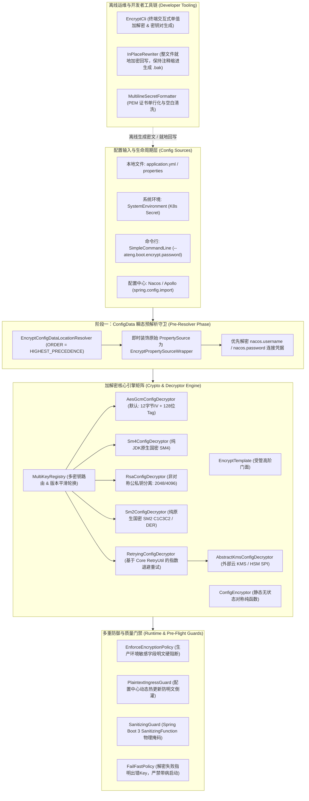

# ateng-boot-encrypt 配置安全加解密套件

> 零臃肿纯原生 Spring Boot 3 生产级配置加解密底座：支持现代高强 AES-GCM / 纯原生国密 SM2/SM4 / 非对称 RSA、动态多 Key 轮换路由、Actuator 物理脱敏防泄露、生产环境三道防误伤门禁过滤、Spring Cloud `{cipher}` 受控兼容、配置中心两阶段预解密 Hook、整文件就地无损智能回写与脱机安全运维 CLI 工具箱。

---

## 0. 特性与公共 API 全景速查矩阵 (维度零：100% 全覆盖)

| 特性分类 | 特性名称 | 核心门面 / 注解 / SPI | 关键配置项 (`ateng.boot.encrypt.*`) | 关键 API 签名 / 核心行为 | 锚定验证源头 (*Test / Sample) |
| :--- | :--- | :--- | :--- | :--- | :--- |
| **透明配置解密** | 运行时环境配置属性透明懒解密 | `EncryptPropertySourceWrapper`, `EncryptEnvironmentPostProcessor` | `enabled`, `password`, `algorithm`, `prefix`, `suffix`, `fail-on-error` | 拦截全量 `PropertySource`，识别 `ENC(...)` 密文并原子缓存解密结果；支持快速失败与容错逃生舱 | `EncryptDecryptionController.java`, `ConfigDecryptionScenarioService.java`, `EncryptPropertySourceWrapperTest.java` |
| **受管编程式门面** | Spring 单例受管加解密综合门面 | `EncryptTemplate` | `algorithm`, `prefix`, `suffix` | `encrypt(plain)`, `decrypt(token)`, `encryptRaw(plain)`, `decryptOrOriginal(cipher)`, `decryptOrDefault(cipher, def)` | `EncryptCryptoController.java`, `ProgrammaticCryptoScenarioService.java`, `EncryptTemplateTest.java` |
| **底层对称门面** | 纯原生静态加解密执行门面 | `ConfigEncryptor` | - | `encrypt(plain, pass, algo)`, `decrypt(cipher, pass, algo)`，对称支持 AES-GCM, AES-CBC, SM4-CBC, SM4-ECB, RSA, SM2 | `ProgrammaticCryptoScenarioService.java`, `ConfigEncryptorTest.java` |
| **多 Key 动态路由** | 多命名密钥隔离与平滑轮换机制 | `MultiKeyRegistry`, `KeyRotatedEvent` | `keys.<key-id>` | `registerKey(keyId, pass)`, `getKeyOrDefault(keyId)`, `addChangeListener(listener)`；支持 `ENC[keyId](...)` 标签定向路由 | `EncryptMultiKeyController.java`, `MultiKeyRoutingScenarioService.java`, `MultiKeyRegistryTest.java` |
| **纯原生国密 SM4** | 零外部依赖纯原生国密对称加解密 | `Sm4ConfigDecryptor`, `ConfigDecryptor` | `algorithm=SM4-CBC` 或 `SM4-ECB` | `encryptCbc(plain, pass)`, `decrypt(cipher, pass)`，标配 16 字节随机 IV 与 PKCS5Padding | `Sm4ConfigDecryptorTest.java`, `SampleEncryptWebControllerTest.java` |
| **纯原生国密 SM2** | 国标 GM/T 0003-2012 椭圆曲线非对称 | `Sm2ConfigDecryptor`, `Sm2Engine` | `algorithm=SM2` | `generateKeyPair()`, `encrypt(plain, pubHex)`, `decrypt(cipher, priHex)`, `c1c3c2ToDer(c1c3c2)`, `derToC1c3c2(der)` | `Sm2ConfigDecryptorTest.java`, `Sm2EngineTest.java` |
| **标准 RSA 非对称** | 2048/4096 位 RSA 密钥分域与 PEM 互通 | `RsaConfigDecryptor`, `ConfigDecryptor` | `algorithm=RSA` | `generateKeyPair(size)`, `encodePublicKeyToPem(pub)`, `encodePrivateKeyToPem(pri)`, `encrypt(plain, pemPub)`, `decrypt(cipher, pemPri)` | `RsaConfigDecryptorTest.java`, `EncryptCliTest.java` |
| **密文语法解析** | 令牌正则提取与 Spring Cloud 兼容 | `CiphertextParser`, `ParsedToken` | `prefix`, `suffix`, `compatible-cipher-prefix` | `hasEncrypted(text)`, `replaceTokens(text, fn)`, `formatToken(keyId, algo, cipher)`；受控兼容 `{cipher}...` 历史前缀 | `CiphertextParserTest.java`, `EncryptPropertySourceWrapperTest.java` |
| **生产防误伤门禁** | 生产强制加密与三道防误伤过滤链 | `EnforceEncryptionPolicy`, `PlaintextIngressGuard` | `enforce-encrypted`, `sensitive-key-pattern`, `ignored-keys` | URI 协议（`http://`, `https://`, `classpath:`, `file:`）与多级绝对路径（`/etc/...`）放行、标准日志级别放行（`DEBUG` 等）、白名单硬放行；裸明文敏感属性刚性拦截 | `EncryptGuardController.java`, `EnforceEncryptionPolicyTest.java`, `SampleEncryptWebControllerTest.java` |
| **配置热更新防御** | 配置中心热推送防倒灌与缓存置换 | `PlaintextIngressGuard` | `enforce-encrypted` | 监听 `EnvironmentChangeEvent` / `RefreshEvent`，原子置换清空解密缓存，拦截动态推送的裸明文敏感配置 | `EncryptGuardController.java`, `IngressGuardScenarioService.java`, `PlaintextIngressGuardTest.java` |
| **解密器装配工厂** | 解密器 SPI 发现与默认原生装配工厂 | `ConfigDecryptorFactory` | `retry.*` | `createDefaultDecryptors(custom, retry)`，统一收敛 ServiceLoader 发现、KMS 重试装饰器挂载与 JDK 原生解密器装配 | `ConfigDecryptorFactory.java`, `EncryptTemplateTest.java` |
| **外部 KMS SPI** | 外部云 KMS / HSM 抽象解密扩展基类 | `AbstractKmsConfigDecryptor`, `ConfigDecryptor` | `algorithm=KMS` | 继承并实现 `doDecrypt(ciphertext, keyIdOrPassword)`，无缝对接 AWS、阿里云、腾讯云 KMS 及硬件加密机 | `AbstractKmsConfigDecryptorTest.java` |
| **强类型弹性重试** | 远程云端解密指数退避重试装饰器 | `RetryingConfigDecryptor`, `EncryptRetryProperties` | `retry.delay`, `retry.max-delay`, `retry.multiplier`, `retry.jitter` | 装饰 `ConfigDecryptor`，基于 `Duration` 强类型参数进行退避重试，自动排除密码学错误快速失败 | `RetryingConfigDecryptorTest.java` |
| **Actuator 物理脱敏** | 监控端点物理掩码脱敏防泄露机制 | `SanitizingGuard` | - | 实现 Actuator `SanitizingFunction`，对 `/actuator/env` 等端点中包含密文或匹配敏感特征的属性物理掩码为 `******` | `EncryptSampleApplicationTest.java`, `SanitizingGuardTest.java` |
| **就地双模智能回写** | YAML/Properties 注释与格式保真重写 | `InPlaceRewriter`, `# @encrypt` 指令 | - | `rewriteEncrypt(file)`, `rewriteDecrypt(file)`，支持多文档 `---`、块标量 `\|`、占位符 `${...}` 免疫，自动生成 `.bak` 备份 | `EncryptInPlaceRewriteController.java`, `InPlaceRewriteScenarioService.java`, `InPlaceRewriterTest.java` |
| **脱机安全运维 CLI** | 终端脱机免 Spring 安全工具箱 | `EncryptCli` | - | `EncryptCli.main(args)`，支持命令行批处理（`--encrypt`, `--decrypt`, `--keygen`）与交互式控制台菜单 | `EncryptCliTest.java` |
| **多行大文本规范** | PEM 证书与多行私钥单行化互转 | `MultilineSecretFormatter` | - | `toSingleLine(pem)`, `toMultiLine(singleLinePem)`, `cleanCiphertext(text)`，清洗多行折行空白，保证 Base64 连续性 | `MultilineSecretFormatterTest.java` |
| **配置中心预解密 Hook** | 远端拉取前凭据预解密以防止 403 死锁 | `EncryptConfigDataLocationResolver` | - | 在 Spring Boot 3 `ConfigDataLocationResolver` 极早期穿透已加载配置，优先解密 Nacos/Apollo 用户名密码 | `EncryptConfigDataLocationResolverTest.java` |
| **密钥探测与防护** | 本地主密钥探测与自加密风险拦截 | `KeyDetector` | `password`, `keys.*` | 级联探测环境变量与系统属性；刚性拦截在本地配置源直接暴露主密钥的自加密高危行为 | `KeyDetectorTest.java`, `EncryptSampleApplicationTest.java` |

---

## 1. 模块定位与快速起步 (维度一：最小可用配置与极简实战代码)

### 1.1 一句话痛点与设计原则
在微服务与单体应用中，数据库连接密码、缓存凭据、第三方 API 令牌、证书私钥等明文写入配置文件存在极高泄露风险；而传统加密插件依赖重、启动慢、且容易因配置中心握手时序问题引发 403 认证死锁。`ateng-boot-encrypt` 专职解决企业级配置安全问题：
- **纯原生零依赖 (Zero-Bloat & Core-First)**：100% 依托 JDK 17+ 标准库与 Spring 6 原生能力，国密 SM2/SM3/SM4 纯算法内聚实现，**坚决不引入 BouncyCastle、Jasypt 等重型第三方依赖**；
- **透明无感懒解密 (Transparent Lazy Decryption)**：基于 Spring Boot `EnvironmentPostProcessor` 与 `ConfigData` 机制，在配置加载阶段透明懒解密，业务代码、`@ConfigurationProperties` 与 `@Value` 完全无感；
- **现代高强密码标配 (Modern Cryptography Defaults)**：默认采用具备 AEAD 完整性认证防篡改的 **AES-256-GCM** 算法，自动附带 12 字节安全随机 IV，彻底抛弃过时的 ECB/DES 模式；
- **多 Key 轮换与隔离 (Multi-Key Routing & Isolation)**：独创 `ENC[keyId](...)` 语义契约，支持不同组件独立密钥管理、`KeyRotatedEvent` 领域事件通知与无停机平滑轮换；
- **内存真明文原则 (In-Memory Plaintext Invariant)**：业务层与实体在内存中始终保持 100% 原始真实明文，只在向外暴露端点处执行掩码脱敏，杜绝脏数据写回。

### 1.2 引入依赖 (Maven)

推荐先通过 [`ateng-boot-bom`](../ateng-boot-bom/README.md) 统一管理版本（无需重复声明 `<version>`）：

```xml
<dependency>
    <groupId>io.github.atengk</groupId>
    <artifactId>ateng-boot-encrypt</artifactId>
</dependency>
```

> 若未导入 `ateng-boot-bom`，请显式指定版本号（如 `<version>1.2.0</version>`）。

### 1.3 最小可用配置 (`application.yml`)
提取自样例工程 `ateng-boot-samples/ateng-boot-sample-encrypt/src/main/resources/application.yml`：
```yaml
server:
  port: 8080

spring:
  application:
    name: ateng-boot-sample-encrypt

# ===================================================================
# ateng-boot 配置加解密底座核心配置
# ===================================================================
ateng:
  boot:
    encrypt:
      enabled: true
      algorithm: AES-GCM # 全局默认高强 AEAD 对称加密算法
      # 命名密钥映射表（KeyId -> Password/PrivateKey），用于多 Key 轮换与分域解密
      keys:
        redis-cluster: RedisSpecialClusterKey2026!

# ===================================================================
# 业务机密属性（配置已加密的密文，由 Starter 运行时透明懒解密还原）
# 注意：全局主解密密钥严禁硬编码在本地 application.yml 中，统一通过环境变量或启动参数注入！
# ===================================================================
sample:
  secret:
    # 数据库密码：采用默认 AES-GCM 算法加密
    database-password: ENC(CZAQmB7bsLk2Z8AWBDWuLuEdXBkLlPSelifEvpUKZF8hnxMYmS5qiJ0QPqAICQ==)
    # 缓存密码：指定多 Key 路由 [redis-cluster] 执行解密
    redis-password: ENC[redis-cluster](YbIg1S6F2964mdnyLgtvn1D4SjJ2QqxN8M45CBCnWs0VpgEJ4b5wEZyEKOJyDA==)
    # 第三方API令牌：显式指定国密 SM4-CBC 算法加解密
    third-party-token: ENC(SM4-CBC@ODPVE+KjssNqGN6yrBqMlXcYvDKQgNYADkGV+HV6vL+/H/Juo4KFpgIuVeRMmIT+)
```

### 1.4 业务代码透明无感使用与主密钥注入规范
业务代码完全无需感知密文，直接通过强类型属性对象获取已解密的真实明文：
```java
@Data
@ConfigurationProperties(prefix = "sample.secret")
public class SampleSecretProperties {
    private String databasePassword;
    private String redisPassword;
    private String thirdPartyToken;
}
```

专职场景服务透明注入与验证（提取自 `ConfigDecryptionScenarioService.java`）：
```java
@Service
@Getter
public class ConfigDecryptionScenarioService {
    private final SampleSecretProperties secretProperties;

    @Value("${sample.secret.database-password}")
    private String databasePasswordFromValue;

    public ConfigDecryptionScenarioService(SampleSecretProperties secretProperties) {
        this.secretProperties = secretProperties;
    }

    public String getDatabasePasswordFromProperties() {
        return secretProperties.getDatabasePassword();
    }
}
```

> [!IMPORTANT]
> **主密钥注入规范与防自加密铁律**：严禁将解密主密钥（`ateng.boot.encrypt.password`）写在本地 `application.yml` 中（Starter 将直接抛出 `ConfigSecurityException` 拦截自加密）。请统一通过环境变量或启动参数动态注入：
> ```bash
> # 生产标准推荐：环境变量
> export ATENG_BOOT_ENCRYPT_PASSWORD="SampleMasterSecretKey2026!"
> 
> # 或 JVM 启动参数
> java -Dateng.boot.encrypt.password=SampleMasterSecretKey2026! -jar app.jar
> ```

---

## 2. 核心架构拓扑与设计不变量



---

## 3. 环境属性透明懒解密与多算法协同套件

### 3.1 默认 AES-256-GCM AEAD 透明解密
- **专属配置片段**：
  ```yaml
  ateng:
    boot:
      encrypt:
        enabled: true
        algorithm: AES-GCM # 全局默认高强算法 (带 128 位抗篡改 Tag)
        prefix: "ENC("     # 密文起始标记
        suffix: ")"        # 密文结束标记
        fail-on-error: true # 解密失败立即阻断启动
  ```
- **业务 Java 示例**（提取自 `EncryptDecryptionController.java`）：
  ```java
  @GetMapping("/secrets")
  public Result<SampleSecretVO> getDecryptedSecrets() {
      SampleSecretVO vo = SampleSecretVO.builder()
              .databasePassword(decryptionScenarioService.getDatabasePasswordFromProperties())
              .redisPassword(decryptionScenarioService.getRedisPasswordFromProperties())
              .thirdPartyToken(decryptionScenarioService.getThirdPartyTokenFromProperties())
              .activeAlgorithm("AES-GCM")
              .decryptionStatus(decryptionScenarioService.verifyDecryptionConsistency() ? "VERIFIED_CONSISTENT" : "MISMATCH")
              .build();
      return Result.success(vo);
  }
  ```
- **核心机制与边界防御**：
  1. 采用具备 AEAD（Authenticated Encryption with Associated Data）认证的 AES-256-GCM 算法，每次加密生成 12 字节安全随机 IV，有效抵御密文篡改与重放攻击；
  2. 采用懒解密机制，在配置属性首次通过 `getProperty(name)` 访问时按需计算并原子写入内存缓存；解密失败时抛出语义化 `ConfigDecryptionException` 指明出错键名。

### 3.2 显式指定算法加解密 (SM4-CBC / SM2 / RSA)
- **专属配置片段**：
  ```yaml
  sample:
    secret:
      # 显式指定国密 SM4-CBC 算法解密（格式: ENC(SM4-CBC@<base64>)）
      third-party-token: ENC(SM4-CBC@ODPVE+KjssNqGN6yrBqMlXcYvDKQgNYADkGV+HV6vL+/H/Juo4KFpgIuVeRMmIT+)
  ```
- **业务 Java 示例**（提取自 `SampleEncryptWebControllerTest.java`）：
  ```java
  @Test
  void testDecryptedSecrets() throws Exception {
      mockMvc.perform(get("/sample/encrypt/decrypt/secrets"))
              .andExpect(status().isOk())
              .andExpect(jsonPath("$.data.thirdPartyToken").value("sm4ApiSecretToken888"));
  }
  ```
- **核心机制与边界防御**：
  1. 令牌解析器（`CiphertextParser`）支持在括号内以 `@` 前缀显式指定算法名称，如 `ENC(SM4-CBC@...)`、`ENC(RSA@...)`；
  2. 当密文内声明了显式算法时，其优先级高于全局默认 `ateng.boot.encrypt.algorithm`，实现混合多算法安全协同。

### 3.3 Spring Cloud `{cipher}` 历史前缀平滑兼容
- **专属配置片段**：
  ```yaml
  ateng:
    boot:
      encrypt:
        compatible-cipher-prefix: true # 开启历史 Spring Cloud Config {cipher} 前缀兼容
  ```
- **核心机制与边界说明**：
  当旧工程迁移至 `ateng-boot` 时，开启 `compatible-cipher-prefix: true` 后，解析器将透明剥离 `{cipher}` 前缀并调用解密引擎，实现零业务代码修改平滑迁移。

---

## 4. 统一编程式加解密与双层完备对称门面套件

### 4.1 Spring 受管 `EncryptTemplate` 业务门面
- **专属配置片段**：
  ```yaml
  ateng:
    boot:
      encrypt:
        enabled: true
        algorithm: AES-GCM
  ```
- **业务 Java 示例**（提取自 `EncryptCryptoController.java`）：
  ```java
  @PostMapping("/encrypt")
  public Result<CryptoResultVO> encryptDefault(@Valid @RequestBody CryptoEncryptRequest request) {
      String token = cryptoScenarioService.encryptDefault(request.getPlaintext());
      CryptoResultVO vo = CryptoResultVO.builder()
              .plaintext(request.getPlaintext())
              .token(token)
              .algorithm("AES-GCM")
              .build();
      return Result.success(vo);
  }

  @PostMapping("/decrypt")
  public Result<String> decrypt(@Valid @RequestBody CryptoDecryptRequest request) {
      String plain = cryptoScenarioService.decrypt(request.getCiphertext());
      return Result.success(plain);
  }
  ```
- **核心机制与边界防御说明**：
  `EncryptTemplate` 为 Spring 单例受管 Bean，具备完全对称语义（`encrypt` / `decrypt`），内部自动装配当前主密钥、算法与前后缀解析器，避免业务层手动解析 SPI。

### 4.2 `ConfigEncryptor` 静态无状态对称纯函数门面
- **业务 Java 示例**（提取自 `ProgrammaticCryptoScenarioService.java`）：
  ```java
  public String executeDirectStaticCrypto(String plaintext, String password, EncryptAlgorithm algorithm) {
      // 1. 底层纯函数加密
      String cipher = ConfigEncryptor.encrypt(plaintext, password, algorithm);
      // 2. 底层纯函数对称解密
      return ConfigEncryptor.decrypt(cipher, password, algorithm);
  }
  ```
- **核心机制与边界防御说明**：
  `ConfigEncryptor` 提供静态纯函数 API，具备严格对称语义，脱离 Spring 容器亦可直接运行，非常适合单测测试夹具或独立命令行工具调用。

### 4.3 纯 Base64 裸密文与容错逃生舱解密
- **业务 Java 示例**（提取自 `EncryptCryptoController.java`）：
  ```java
  @PostMapping("/encrypt-raw")
  public Result<String> encryptRaw(@Valid @RequestBody CryptoRawRequest request) {
      String raw = cryptoScenarioService.encryptRaw(request.getPlaintext());
      return Result.success(raw);
  }

  @PostMapping("/decrypt-safe")
  public Result<String> decryptSafe(@Valid @RequestBody CryptoSafeDecryptRequest request) {
      String safeValue = cryptoScenarioService.decryptOrDefault(request.getCiphertext(), request.getDefaultValue());
      return Result.success(safeValue);
  }
  ```
- **核心机制与边界说明**：
  `decryptOrDefault` 提供容错逃生舱机制：在面对外部网络传输损坏或非合规密文时，安全返回保底默认值，杜绝因单点解密失败瘫痪核心业务主流程。

---

## 5. 多 Key 命名路由与无感平滑轮换套件

### 5.1 `ENC[keyId](...)` 别名语义路由
- **专属配置片段**：
  ```yaml
  ateng:
    boot:
      encrypt:
        keys:
          redis-cluster: RedisSpecialClusterKey2026!
          payment-shard: PaymentMasterSecretPass888!

  sample:
    secret:
      redis-password: ENC[redis-cluster](YbIg1S6F2964mdnyLgtvn1D4SjJ2QqxN8M45CBCnWs0VpgEJ4b5wEZyEKOJyDA==)
  ```
- **业务 Java 示例**（提取自 `EncryptMultiKeyController.java`）：
  ```java
  @PostMapping("/decrypt-routed")
  public Result<String> decryptRoutedToken(@Valid @RequestBody RoutedDecryptRequest request) {
      String plain = multiKeyService.decryptRoutedToken(request.getToken());
      return Result.success(plain);
  }
  ```
- **核心机制与边界说明**：
  支持 `ENC[keyId](...)` 与 `ENC[keyId](algorithm@...)` 语法，解析器自动提取方括号内的 `keyId` 并路由至 `MultiKeyRegistry` 获取对应密钥，实现不同业务组件独立秘钥隔离。

### 5.2 动态密钥注册与平滑轮换
- **业务 Java 示例**（提取自 `EncryptMultiKeyController.java`）：
  ```java
  @PostMapping("/rotate")
  public Result<Boolean> rotateKey(@Valid @RequestBody KeyRotateRequest request) {
      multiKeyService.rotateKey(request.getKeyId(), request.getNewPassword());
      return Result.success(true);
  }
  ```
- **核心机制与边界防御说明**：
  调用 `MultiKeyRegistry.registerKey` 注册或更新密钥时，系统自动清空已代理属性源中的解密内存缓存，并通过领域事件通知下游监听器，零停机平滑轮换。

### 5.3 `KeyRotatedEvent` 领域事件与缓存原子置换
- **业务 Java 示例**（提取自 `MultiKeyRegistry.java`）：
  ```java
  @EventListener
  public void onKeyRotated(KeyRotatedEvent event) {
      log.info("监听到密钥轮换事件: keyId={}, timestamp={}", event.getKeyId(), event.getTimestamp());
  }
  ```
- **核心机制说明**：
  轮换触发后广播 Spring 上下文事件 `KeyRotatedEvent`，底层属性源装饰器执行原子置换 `AtomicReference<ConcurrentHashMap<String, Object>>`，并发读取线程既无锁竞争又绝对不会脏读旧明文。

---

## 6. 生产强制加密与三道防误伤门禁套件

### 6.1 `enforce-encrypted` 生产敏感明文刚性阻断
- **专属配置片段**：
  ```yaml
  ateng:
    boot:
      encrypt:
        enforce-encrypted: true # 生产环境建议开启：强制阻断裸明文密码
        sensitive-key-pattern: ".*password.*|.*secret.*|.*token.*|.*private-key.*"
  ```
- **业务 Java 实测断言**（提取自 `EncryptSampleApplicationTest.java`）：
  ```java
  @Test
  void testEnforceEncryptedBlocksUnencryptedSecretsInApplication() {
      assertThrows(Exception.class, () -> {
          new SpringApplicationBuilder(EncryptSampleApplication.class)
                  .properties("ateng.boot.encrypt.password=SampleMasterSecretKey2026!", "ateng.boot.encrypt.enforce-encrypted=true")
                  .initializers(context -> {
                      context.getEnvironment().getPropertySources().addFirst(
                              new MapPropertySource("external-source", Map.of("spring.datasource.password", "nakedPlaintextSecret999")));
                  })
                  .run();
      });
  }
  ```
- **核心机制与边界说明**：
  在应用启动前置扫描外部属性源，若命中敏感正则且属性值未以 `ENC(...)` 标记包裹（包括未加双引号的纯数字密码），抛出 `ConfigSecurityException` 立即熔断阻断启动。

### 6.2 三道防误伤过滤链 (协议/路径/日志级别/白名单)
- **专属配置片段**：
  ```yaml
  ateng:
    boot:
      encrypt:
        enforce-encrypted: true
        ignored-keys:
          - sample.secret.whitelist-key
  ```
- **业务 Java 示例**（提取自 `EncryptGuardController.java`）：
  ```java
  @GetMapping("/rules")
  public Result<IngressRuleVO> getIngressRules() {
      IngressRuleVO vo = IngressRuleVO.builder()
              .enforceEncrypted(false)
              .sensitivePattern(EnforceEncryptionPolicy.DEFAULT_SENSITIVE_KEY_PATTERN)
              .ignoredKeys(Set.of("sample.secret.whitelist-key"))
              .protocolImmunities(List.of("http://", "https://", "classpath:", "file:", "ws://", "wss://"))
              .logLevelImmunities(List.of("DEBUG", "INFO", "WARN", "ERROR", "TRACE"))
              .build();
      return Result.success(vo);
  }
  ```
- **核心机制说明**：
  1. **协议与多级路径特征豁免**：以 `http://`、`https://`、`classpath:`、`file:` 开头，或属于多级绝对路径（如 `/etc/ssl/cert.pem`）自动豁免；
  2. **日志级别特征豁免**：属性值为标准日志级别（`DEBUG`、`INFO` 等）时自动放行；
  3. **白名单硬放行**：`ateng.boot.encrypt.*` 属性与 `ignored-keys` 显式声明的属性跳过校验。

### 6.3 `PlaintextIngressGuard` 配置中心动态热推防倒灌
- **业务 Java 实测断言**（提取自 `EncryptSampleApplicationTest.java`）：
  ```java
  @Test
  void testPlaintextIngressGuardBlocksDynamicUnencryptedPush() {
      assertThrows(ConfigSecurityException.class, () -> {
          service.simulatePlaintextIngress("spring.datasource.password", "hotPushedPlaintext123");
      });
  }
  ```
- **核心机制说明**：
  监听 `EnvironmentChangeEvent` / `RefreshEvent` 事件，在配置中心热推送配置时持续校验，坚决拒绝生产环境动态推送裸明文敏感配置覆盖有效密文。

---

## 7. 配置文件就地双模智能回写与格式保真套件

### 7.1 YAML / Properties 注释与缩进格式保真就地回写
- **业务 Java 示例**（提取自 `EncryptInPlaceRewriteController.java`）：
  ```java
  @PostMapping("/encrypt-yaml")
  public Result<RewriteResultVO> encryptYaml(@Valid @RequestBody InPlaceRewriteRequest request) {
      RewriteResultVO vo = executeSandboxRewrite(request.getContent(), "yml", request.getPassword(), request.getAlgorithm(), true);
      return Result.success(vo);
  }
  ```
- **核心机制与边界防御说明**：
  `InPlaceRewriter` 原生解析文件流，识别包含 `# @encrypt` 指令的敏感字段行并原地替换为 `ENC(...)` 密文；100% 保持原始缩进、空行、行尾注释与换行符（CRLF/LF），重写前强制生成 `.bak` 备份文件保障 100% 可逆。

### 7.2 占位符 `${...}` 与 SpEL 免疫机制
- **核心机制说明**：
  在执行就地加密时，自动识别形如 `${spring.profiles.active}`、`${DB_PASS:root}` 的环境变量占位符或 SpEL 表达式并严格豁免加密，杜绝将动态外部注入变量固化为死密文。

### 7.3 脱机安全运维终端 CLI 工具箱 (`EncryptCli`)
- **终端交互式菜单**：
  ```bash
  java -cp ateng-boot-encrypt.jar io.github.atengk.boot.encrypt.cli.EncryptCli
  ```
- **命令行批处理（适配 CI/CD 流水线）**：
  ```bash
  # 1. 快速单值加密 (AES-GCM)
  java -cp ateng-boot-encrypt.jar io.github.atengk.boot.encrypt.cli.EncryptCli \
    --encrypt -v "mysqlRootPass2026!" -p "SampleMasterSecretKey2026!"

  # 2. 生成非对称 RSA 密钥对
  java -cp ateng-boot-encrypt.jar io.github.atengk.boot.encrypt.cli.EncryptCli --keygen -a RSA --key-size 2048

  # 3. 生成纯原生国密 SM2 密钥对
  java -cp ateng-boot-encrypt.jar io.github.atengk.boot.encrypt.cli.EncryptCli --keygen -a SM2
  ```

---

## 8. 运行时端点安全防御与物理脱敏套件

### 8.1 Actuator `/actuator/env` 物理掩码脱敏 (`SanitizingGuard`)
- **专属配置片段**：
  ```yaml
  management:
    endpoints:
      web:
        exposure:
          include: env,health,info
    endpoint:
      env:
        show-values: ALWAYS
  ```
- **业务 Java 实测断言**（提取自 `EncryptSampleApplicationTest.java`）：
  ```java
  @Test
  void testActuatorSanitizingGuardMasking() {
      SanitizingGuard sanitizingGuard = applicationContext.getBean(SanitizingGuard.class);
      SanitizableData sensitiveData = new SanitizableData(null, "sample.secret.database-password", "mysqlRootPass2026!");
      SanitizableData sanitized = sanitizingGuard.apply(sensitiveData);
      assertEquals("******", sanitized.getValue());
  }
  ```
- **核心机制说明**：
  基于 Spring Boot 3 `SanitizingFunction` 规范，对所有命中敏感正则或包含密文标记的配置在监控端点物理掩码为 `******`，彻底杜绝数据在运维端点明文外泄。

---

## 9. 生产扩展接管与核心非功能边界 (维度二 & 维度三)

### 9.1 扩展外部云 KMS / 硬件加密机 SPI (`AbstractKmsConfigDecryptor`)
- **扩展实现示例**：
  ```java
  @Component
  public class CustomAliyunKmsConfigDecryptor extends AbstractKmsConfigDecryptor {
      @Override
      protected String doDecrypt(String ciphertext, String keyIdOrPassword) throws Exception {
          return aliyunKmsClient.decrypt(ciphertext, keyIdOrPassword);
      }
  }
  ```

### 9.2 强类型弹性指数退避重试 (`RetryingConfigDecryptor`)
- **专属配置片段**：
  ```yaml
  ateng:
    boot:
      encrypt:
        retry:
          delay: 100ms     # 初始退避延迟 (java.time.Duration)
          max-delay: 5s    # 最大退避延迟 (java.time.Duration)
          multiplier: 2.0  # 指数退避乘数
          jitter: true     # 启用 Full Jitter 打散重试洪峰
  ```
- **边界防御说明**：
  内置密码学异常短路机制：遇到 `BadPaddingException`、`AEADBadTagException` 等密文/口令损坏错误时立即快速失败，杜绝盲目重试。

### 9.3 配置中心极早期穿透守卫 (`EncryptConfigDataLocationResolver`)
- **核心机制说明**：
  在 Spring Boot 3 `ConfigDataLocationResolver` 极早期阶段（`ORDER = HIGHEST_PRECEDENCE`），Nacos / Apollo 客户端发起网络连接握手前，守卫穿透已加载的贡献源优先解密连接凭据，彻底根除 403 认证死锁。

---

## 10. 完整 YAML 配置属性清单 (全量速查附录)

### 10.1 全量配置属性字典

| 配置项 | 类型 | 默认值 | 说明 |
| :--- | :--- | :--- | :--- |
| `ateng.boot.encrypt.enabled` | `Boolean` | `true` | 是否启用配置加解密透明解密底座 |
| `ateng.boot.encrypt.password` | `String` | `null` | 全局默认主解密密钥（严禁写入本地配置文件） |
| `ateng.boot.encrypt.algorithm` | `EncryptAlgorithm` | `AES-GCM` | 全局默认加密算法（支持 `AES-GCM`, `AES-CBC`, `SM4-CBC`, `SM4-ECB`, `RSA`, `SM2`, `KMS`） |
| `ateng.boot.encrypt.prefix` | `String` | `ENC(` | 密文起始包裹标记 |
| `ateng.boot.encrypt.suffix` | `String` | `)` | 密文结束包裹标记 |
| `ateng.boot.encrypt.fail-on-error` | `Boolean` | `true` | 解密失败时是否立即阻断启动（快速失败） |
| `ateng.boot.encrypt.compatible-cipher-prefix` | `Boolean` | `false` | 是否兼容解析 Spring Cloud Config `{cipher}` 历史前缀 |
| `ateng.boot.encrypt.enforce-encrypted` | `Boolean` | `false` | 生产环境强制加密门禁：检测到未加密敏感配置时阻断启动 |
| `ateng.boot.encrypt.sensitive-key-pattern` | `String` | `.*password.*\|.*secret.*\|.*token.*\|.*private-key.*` | 敏感属性键名正则表达式特征 |
| `ateng.boot.encrypt.ignored-keys` | `Set<String>` | `empty` | 生产强制加密门禁显式豁免白名单属性集合 |
| `ateng.boot.encrypt.keys.*` | `Map<String, String>` | `empty` | 多 Key 命名密钥映射表（KeyId -> Password/PrivateKey） |
| `ateng.boot.encrypt.retry.delay` | `Duration` | `100ms` | 远程云 KMS 调用初始退避重试延迟 |
| `ateng.boot.encrypt.retry.max-delay` | `Duration` | `5s` | 远程云 KMS 调用最大退避重试延迟 |
| `ateng.boot.encrypt.retry.multiplier` | `Double` | `2.0` | 指数退避乘数 |
| `ateng.boot.encrypt.retry.jitter` | `Boolean` | `true` | 是否启用 Full Jitter 抖动打散重试洪峰 |

### 10.2 样例工程 Controller 快速索引

| 业务领域 | Controller 类 | 根路由路径 | 核心体验动作 |
| :--- | :--- | :--- | :--- |
| **透明解密呈现** | `EncryptDecryptionController` | `/sample/encrypt/decrypt` | `GET /secrets`, `GET /property` |
| **编程式对称门面** | `EncryptCryptoController` | `/sample/encrypt/crypto` | `POST /encrypt`, `POST /decrypt`, `POST /encrypt-custom`, `POST /encrypt-raw`, `POST /decrypt-safe` |
| **多 Key 路由轮换** | `EncryptMultiKeyController` | `/sample/encrypt/multi-key` | `GET /keys`, `POST /decrypt-routed`, `POST /rotate` |
| **生产防倒灌守卫** | `EncryptGuardController` | `/sample/encrypt/guard` | `POST /refresh`, `POST /simulate-ingress`, `GET /rules` |
| **沙箱就地智能回写** | `EncryptInPlaceRewriteController` | `/sample/encrypt/rewrite` | `POST /encrypt-yaml`, `POST /decrypt-yaml`, `POST /encrypt-properties`, `POST /decrypt-properties` |
