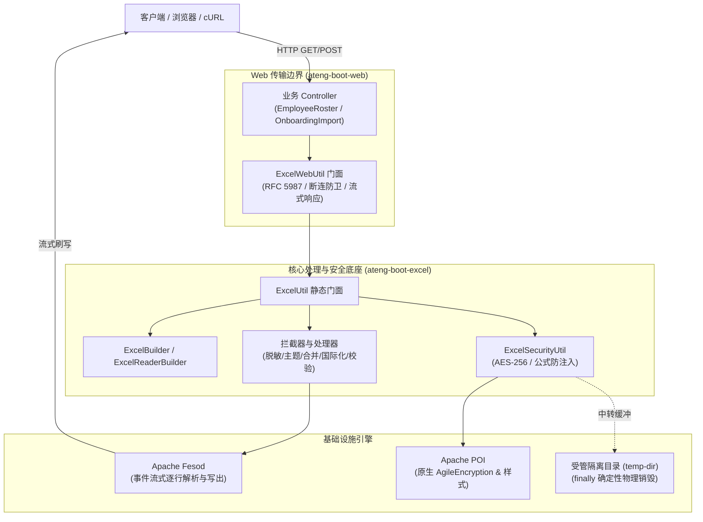

# ateng-boot-excel 基础设施 Starter

> 基于新一代 Apache Fesod (Incubating) 流式电子表格引擎打造，提供极致内存防爆（OOM 防御）、Web 安全防乱码下载、强类型同步读取与分批流式消费等企业级基础设施能力。

---

## 0. 特性与公共 API 全景速查矩阵

| 特性分类 | 特性名称 | 核心门面 / 注解 / SPI | 关键配置项 (`ateng.boot.excel.*`) | 关键 API 签名 / 核心行为 | 锚定验证源头 (*Test / Sample) |
| :--- | :--- | :--- | :--- | :--- | :--- |
| **基础运维** | 自动装配与主配置 | `ExcelProperties`<br>`AtengExcelAutoConfiguration` | `enabled`<br>`default-batch-size`<br>`max-sync-rows`<br>`temp-dir` | Starter 自动装配入口，受管临时目录贯通；标配 `@ConditionalOnMissingBean` 守卫，时序自动对齐 Redis 与 `MessageSource` | `AtengExcelAutoConfigurationTest`<br>`ExcelUtilTest` |
| **核心导出** | 强类型流式导出与元数据缓存 | `ExcelUtil`<br>`ExcelColumnMetadataResolver` | - | `export(out, list, clazz)` / `export(out, sheetName, list, clazz)`：流式写出并自适应释放底层流与临时资源；`ExcelColumnMetadataResolver.resolve(clazz)` 类级缓存统一对齐实体列序（含 `@ExcelIgnore` / `@ExcelIgnoreUnannotated` / 乱序 `index`） | `ExcelUtilTest`<br>`ExcelColumnMetadataResolverTest`<br>`EmployeeRosterController` |
| **动态列裁剪** | 强类型 VO 动态列投影与紧凑裁剪 | `ExcelUtil.export`<br>`ExcelUtil.resolveProjectedColumns` | - | `export(out, sheetName, list, clazz, includeColumns, excludeColumns)`：支持白名单包含与黑名单排除模式，自适应紧凑无缝排列，避免空列与类型擦除 | `ExcelColumnProjectionTest`<br>`EmployeeRosterController`<br>`SampleExcelIntegrationTest` |
| **Web 门面** | Web `ResponseEntity` 与流式下载断连防卫 | `ExcelWebUtil` | - | 一等公民全面提供对称 `toResponseEntity*` 系列：`toResponseEntity`（含回调/`cleanupHook`/裁剪/AES 加密）、`toResponseEntityDynamic`、`toResponseEntityTemplate`、`toResponseEntityFailedRows`、`toResponseEntityErrorFeedback`、`toResponseEntityFill`、`toResponseEntityStreaming`、`toResponseEntityStreamingByCursor`、`toResponseEntityWithWatermark`；另含 `prepareWebResponse`、`createDownloadHeaders`、`export`、`builder`；RFC 5987 / 6266 防乱码与 `ClientAbortException`/`Broken pipe` 静默抑制 | `ExcelWebUtilTest`<br>`EmployeeRosterController`<br>`OnboardingImportController`<br>`WorkbookReportController`<br>`PayrollSecurityController`<br>`OrderStreamingController` |
| **核心读取** | 同步全量与流式分批读取 | `ExcelUtil` | `default-batch-size`<br>`max-sync-rows` | `read(in, clazz)`（超限自动 Fail-Fast 阻断防 OOM）；`readBatch(in, clazz, batchSize, consumer)`（每次达到批次回调并即刻清空内存引用）；均支持带 `password` 透明解密重载 | `ExcelUtilTest`<br>`SampleExcelIntegrationTest` |
| **多表流式读取** | 异构多工作表校验读取构建器 | `ExcelReaderBuilder`<br>`ExcelMultiSheetResult`<br>`ExcelUtil.reader` | `default-batch-size`<br>`max-sync-rows`<br>`validation.header-strategy`<br>`validation.max-error-rows` | `ExcelUtil.reader(in, [password]).validate().headerStrategy(s).maxErrorRows(n).sheet(0, ClassA).sheet(1, ClassB, consumer).read()`：按 Sheet 绑定独立 VO 与每 Sheet 专属校验配置（`validate`/`failFast`/`headerStrategy`）；通过 `ExcelMultiSheetResult` 的 `getSheetErrors`、`getAllErrors`、`hasErrors`、`isCircuitBroken` 聚合跨表误差；默认全局 `maxTotalRows` 上限 `200,000` 行 | `ExcelReaderBuilderTest`<br>`WorkbookReportController`<br>`SampleExcelIntegrationTest` |
| **数据校验** | JSR-303 行级校验导入 | `ExcelUtil`<br>`BatchValidationListener`<br>`ExcelReadResult`<br>`ExcelErrorRow` | `validation.max-error-rows` | `readWithValidation(in, clazz)` / `readWithResult(in, clazz)` / `readBatchWithValidation(in, clazz, size, dataConsumer, errConsumer)`：精准捕获行号与列字段，聚合校验错误行与合法数据；均支持带 `password` 透明解密重载 | `ExcelValidationTest`<br>`OnboardingImportController`<br>`SampleExcelIntegrationTest` |
| **错题集隔离** | 差错数据隔离提取与无损标红回写 | `ExcelUtil`<br>`ExcelWebUtil`<br>`ExcelFeedbackUtil`<br>`FailSplitRowWriteHandler`<br>`TypeConvertUtil` | - | `exportFailedRows` / `toResponseEntityFailedRows`（仅提取失败数据生成独立纠错文件并高亮）；`exportErrorFeedback` / `toResponseEntityErrorFeedback`（通过 `ExcelFeedbackUtil.getOrCreateErrorHighlightStyle` 复用单元格字体边框并填充 ROSE 浅粉底色与浮动批注回写） | `ExcelFailSplitTest`<br>`OnboardingImportController`<br>`SampleExcelIntegrationTest` |
| **数据安全** | 导出动态脱敏 | `@ExcelSensitive`<br>`SensitiveCellWriteHandler` | - | `@ExcelSensitive(type, keepHead, keepTail, maskChar)`：写出时流式拦截掩码，源实体在 JVM 内存中 100% 保持原始明文不变量，彻底根除掩码脏写 | `ExcelSensitiveTest`<br>`EmployeeRosterController`<br>`SampleExcelIntegrationTest` |
| **企业主题** | 模版主题与智能列宽 | `@ExcelTheme`<br>`ExcelThemeEnum`<br>`ExcelThemeWriteHandler`<br>`SmartAutoColumnWidthWriteHandler` | `style.enabled`<br>`style.theme`<br>`style.zebra-stripe`<br>`style.auto-column-width`<br>`style.min-column-width`<br>`style.max-column-width`<br>`style.padding-column-width`<br>`style.font-name` | 5 套企业级内置主题（`MINIMAL_CLEAN`, `BUSINESS_BLUE`, `CLASSIC_GREY`, `FRESH_GREEN`, `WARM_ORANGE`）；中英文双字节补偿列宽防数值变 `###` | `ExcelThemeWriteHandlerTest`<br>`EmployeeRosterController`<br>`SampleExcelIntegrationTest` |
| **链式编排** | 多 Sheet 链式构建与整表加密 | `ExcelBuilder` | - | `ExcelUtil.builder(out, [password]).theme(theme).encrypt(password).sheet(name, clazz, list).sheetDynamic(...).finish()`：实现 `AutoCloseable`，单工作簿异构混排、独立样式隔离并原生支持 AES-256 加密流式闭环 | `ExcelAdvancedFeaturesTest`<br>`WorkbookReportController`<br>`SampleExcelIntegrationTest` |
| **枚举转义** | 字段级枚举映射 | `@ExcelEnum`<br>`ExcelEnumConverter`<br>`EnumMappingCache` | - | `@ExcelEnum(codeField = "code", textField = "description")`：双向自动转换实体枚举与表格文字，内置双向无锁并发缓存 | `ExcelEnumAndDictTest`<br>`EmployeeRosterController`<br>`SampleExcelIntegrationTest` |
| **字典翻译** | 动态数据字典 SPI | `@ExcelDict`<br>`DictProvider`<br>`DictProviderHolder`<br>`ExcelDictConverter` | - | `@ExcelDict("employee_status")` / `@ExcelDict(value = "employee_status", type = "employee_status")`：解耦数据库/Redis/枚举存储，通过 `toLabel(String dictType, Object code)` 与 `toCode(String dictType, String label)` 双向透明翻译 | `ExcelEnumAndDictTest`<br>`EmployeeRosterController`<br>`SampleExcelIntegrationTest` |
| **防呆设计** | 表头指南与超长隐藏字典下拉选单 | `@ExcelPrompt`<br>`@ExcelDropdown`<br>`DropdownProvider`<br>`DropdownSheetWriteHandler` | - | `@ExcelPrompt(value, title)` 表头批注；`@ExcelDropdown` 支持静态数组与动态 `DropdownProvider`（优先从 Spring 容器解析 Bean，未注册再回退无参构造）；当合并字符串超过 `200` 字符或含半角逗号时自动写入隐藏工作表 `_ateng_dropdown_dict` 并通过 Workbook `Name` 公式引用突破 `255` 字符上限 | `ExcelTemplateTest`<br>`OnboardingImportController`<br>`SampleExcelIntegrationTest` |
| **安全审计** | 防拍照暗水印与工作表保护 | `ExcelWatermarkUtil`<br>`ExcelUtil.protectSheet`<br>`WatermarkSheetWriteHandler` | - | `exportWithWatermark` / `toResponseEntityWithWatermark`：全屏 `-30°` 倾斜半透明平铺暗水印，零点击遮挡；支持工作表只读密码锁定 | `ExcelWatermarkAndProtectTest`<br>`PayrollSecurityController`<br>`SampleExcelIntegrationTest` |
| **整表强加密** | POI 原生 Agile AES-256 工作簿加解密 | `ExcelSecurityUtil`<br>`ExcelUtil.export(..., password)` | `temp-dir` | `ExcelUtil.export/fill/exportDynamic(..., password)`、`ExcelBuilder.encrypt`、`StreamingPageExportTemplate.encrypt` 与 `ExcelSecurityUtil.openTempPlainBuffer` / `writeWithOptionalEncryption` / `decryptWorkbookToTempFile` / `decryptIfEncrypted` / `isEncryptedWorkbook`；POI AES-256 + SHA-512 强加密，受管临时目录中转流式输出 | `ExcelWorkbookEncryptionTest`<br>`PayrollSecurityController`<br>`WorkbookReportController`<br>`SampleExcelIntegrationTest` |
| **多媒体与 SSRF** | 图片流式导出、行高自适应与网络安全 | `@ExcelImage`<br>`SmartImageConverter`<br>`ImageRowHeightWriteHandler` | `security.max-image-size`<br>`security.image-connect-timeout`<br>`security.image-read-timeout`<br>`security.block-internal-image-urls`<br>`security.allow-local-image-file`<br>`security.allowed-image-base-dir` | `@ExcelImage(rowHeight = 60, connectTimeout = 3000, readTimeout = 10000)`：支持 `byte[]`、`File`、Base64 与 URL，联动行高居中绘制；内置图片大小熔断、私网/环回/云元数据 SSRF 拦截与本地受管目录及路径穿越校验 | `ExcelImageTest` |
| **结构排版** | 单元格纵向合并 | `@ExcelMerge`<br>`MergeCellWriteHandler` | - | `@ExcelMerge(value, dependParent)`：对连续相同的数据单元格自动纵向合并，支持依赖前序关联列联动合并 | `ExcelAdvancedFeaturesTest`<br>`EmployeeRosterController`<br>`SampleExcelIntegrationTest` |
| **复杂报表** | 模板数据填充与响应封装 | `ExcelUtil.fill`<br>`ExcelWebUtil.fill` / `toResponseEntityFill` | - | `fill(out, templateIn, data, [fillConfig], [password])` 与 `toResponseEntityFill`：基于预设 `.xlsx` 模板，支持 `{name}` 占位符与 `{.list}` 循环填充及可选 AES-256 加密输出 | `ExcelTemplateTest`<br>`WorkbookReportController`<br>`SampleExcelIntegrationTest` |
| **动态导出** | 无实体动态流式导出 | `ExcelUtil.exportDynamic`<br>`ExcelWebUtil.exportDynamic` / `toResponseEntityDynamic` | - | `exportDynamic(out, [sheetName], headList, [dataKeys], dataList, [password])` 与 `toResponseEntityDynamic`：支持动态表头与 `List<Map>` / `List<List<?>>` 二维数据直接流式写出与加密 | `ExcelAdvancedFeaturesTest`<br>`WorkbookReportController`<br>`SampleExcelIntegrationTest` |
| **异步中心** | 大文件异步导出任务中心与存储防卫 | `AsyncExportTaskService`<br>`InMemoryAsyncExportTaskService`<br>`RedisAsyncExportTaskService`<br>`ExportFileStorage`<br>`LocalFileSystemStorage`<br>`ExportTask` / `ExportTaskStatus` | `async-export.enabled`<br>`async-export.temp-dir`<br>`async-export.download-url-prefix`<br>`async-export.retention-period`<br>`async-export.lease-timeout`<br>`async-export.core-pool-size`<br>`async-export.max-pool-size`<br>`async-export.queue-capacity`<br>`async-export.redis.*` | `submit(taskName, executor)` / `updateProgress(taskId, progress)` / `getTask(taskId)` / `cancel(taskId)` / `cleanExpiredTasks(retention)`：受管线程池与四维上下文透传、`RedisAsyncExportTaskService` ZSet `ZREM` 原子清理及 `DisposableBean` 优雅停机；`LocalFileSystemStorage` 内置 `ExcelSecurityUtil.resolveContainedPath` 防路径穿越 | `AsyncExportTaskServiceTest`<br>`RedisAsyncExportTaskServiceTest`<br>`LocalFileSystemStorageTest`<br>`ExcelAsyncExportController`<br>`SampleExcelIntegrationTest` |
| **流式分页** | 海量数据游标分页、进度回调与跨表轮转 | `StreamingPageExportTemplate`<br>`SheetNameFormatter`<br>`ExcelUtil.streaming`<br>`ExcelWebUtil.exportStreaming*` / `toResponseEntityStreaming*` | `streaming-export.max-rows-per-sheet`<br>`streaming-export.default-page-size` | 支持 `baseSheetName`、`sheetNameFormatter`（默认 `SheetNameFormatter.DEFAULT`）、`maxRowsPerSheet`、`encrypt(password)`、`expectedTotalRows(total)`、`onProgress(taskService, taskId)` / `onProgressDetail`、`writeBatch`、`exportByPage`、`exportByCursor` | `StreamingPageExportTemplateTest`<br>`OrderStreamingController`<br>`ExcelAsyncExportController`<br>`SampleExcelIntegrationTest` |
| **契约校验** | 导入预读首行表头校验 | `ExcelUtil.validateHeader`<br>`ExcelHeaderValidator`<br>`HeaderValidationStrategy`<br>`ExcelHeaderValidationException` | `validation.header-strategy` | `ExcelUtil.validateHeader(in, clazz, strategy, [password])` / `ExcelHeaderValidator.validate(targetClass, actualHeadRows, strategy)`：解析前轻量预读首行比对 `@ExcelProperty` 契约，顺序、名称与缺失列不符立即 Fail-Fast 阻断 | `ExcelHeaderValidatorTest`<br>`OnboardingImportController`<br>`SampleExcelIntegrationTest` |
| **错误熔断** | 行级校验错误阈值自动熔断 | `BatchValidationListener`<br>`ExcelValidationException` | `validation.max-error-rows` | `BatchValidationListener(clazz, validator, failFast, maxErrorRows)`：累计校验错误行达到阈值时主动中断解析，防止全量解析垃圾数据耗尽系统 CPU 与内存 | `ExcelCircuitBreakerTest`<br>`OnboardingImportController`<br>`SampleExcelIntegrationTest` |
| **注入防护** | CSV / Excel 公式注入主动防御 | `ExcelSecurityUtil`<br>`FormulaProtectionCellWriteHandler`<br>`@ExcelFormulaAllowed` | `security.formula-protection` | 自动拦截 `=,+,-,@,\t,\r` 前缀文本并转义为安全单引号 `'`，彻底防御 DDE 远程执行命令高危漏洞；支持 `@ExcelFormulaAllowed` 字段级白名单豁免 | `ExcelFormulaProtectionTest`<br>`PayrollSecurityController`<br>`SampleExcelIntegrationTest` |
| **列锁防呆** | 模板列级锁定与保护 | `@ExcelColumnLock`<br>`ColumnLockSheetWriteHandler`<br>`ExcelUtil.protectSheet` | - | `@ExcelColumnLock(locked = true)`：配合工作表只读保护密码，精准锁定固定列/序号列防篡改，其余可录入列保持编辑权限 | `ExcelColumnLockTest`<br>`PayrollSecurityController`<br>`SampleExcelIntegrationTest` |
| **多语言表头** | 国际化动态表头解析 | `I18nHeadWriteHandler` | `i18n.enabled` | 拦截 `@ExcelProperty("{i18n:key}")` 占位符，结合 Spring `MessageSource` 与请求 `LocaleContextHolder.getLocale()` 动态转译中英文多语言表头 | `I18nHeadWriteHandlerTest`<br>`EmployeeRosterController`<br>`SampleExcelIntegrationTest` |

---

## 1. 模块定位与 Maven 坐标

`ateng-boot-excel` 是面向企业级的高内聚、轻量级、开箱即用的 Excel 基础设施模块。
- **技术基线**：JDK 17 LTS，Spring Boot `3.3.13`，Apache Fesod `2.1.0-incubating`，Apache POI `5.2.5`；
- **纯净依赖**：仅必需依赖 `ateng-boot-core`，Servlet/Web 为可选依赖（optional），离线批处理脚本、后台异步导出与 Web 在线导出皆可纯净复用；
- **显式契约驱动**：提供显式静态门面 `ExcelUtil` 与 `ExcelWebUtil`，坚决杜绝黑盒切面侵入与隐式类型擦除。

### 方式一：通过 `ateng-boot-bom` 统管版本（推荐）

```xml
<dependency>
    <groupId>io.github.atengk</groupId>
    <artifactId>ateng-boot-excel</artifactId>
</dependency>
```

### 方式二：未引入 BOM 时显式声明版本号

```xml
<dependency>
    <groupId>io.github.atengk</groupId>
    <artifactId>ateng-boot-excel</artifactId>
    <version>1.2.0</version>
</dependency>
```

---

## 2. 核心架构与设计不变量



### 核心设计不变量 (Architectural Invariants)

1. **“内存真明文”不变量 (In-Memory Plaintext Invariant - ADR-0012)**：
   业务层与实体对象在 JVM 堆内存中始终保持 100% 原始真实明文（严禁在业务逻辑中对实体属性打星号）。动态脱敏通过 `SensitiveCellWriteHandler` 在写入 Excel 单元格时刻流式拦截掩码，彻底杜绝掩码脏数据回写数据库。
2. **显式强类型契约与零黑盒拦截 (ADR-0002)**：
   接口统一显式声明返回强类型 `Result<T>` 或 `ResponseEntity<StreamingResponseBody>`，坚决杜绝引入全局 `@ResponseBodyAdvice` 自动拦截包装；Web 下载文件名自适应装配 RFC 5987 / RFC 6266 标准防乱码响应头。
3. **确定性物理资源生命周期与受管清理 (Deterministic Lifecycle)**：
   凡涉及流、`Workbook`、临时磁盘文件等瞬态物理资源，必须且只能在 `try-with-resources` 或 `finally` 块中完成绝对可靠的释放；工作簿加密中转与大文件读取临时文件统一落入 `ateng.boot.excel.temp-dir` 受管目录并在完成或异常时立即物理销毁。
4. **分层双防校验体系 (Defense-in-Depth Validation - ADR-0027)**：
   导入前置通过 `ExcelHeaderValidator` 在零数据反序列化成本下轻量扫描表头行执行 Fail-Fast 阻断；数据行通过 `BatchValidationListener` 执行 JSR-303 行级格式校验并支持累计错误阈值自动熔断，业务语义校验统一由业务 Service 承接。
5. **防御性自动装配与扩展接管四道铁律**：
   全配置属性统配 `ateng.boot.excel.*` 前缀；对外暴露的公共 `@Bean` 显式标配 `@ConditionalOnMissingBean`（如 `ExportFileStorage`、`AsyncExportTaskService`、`DictProvider`），保障下游开发者能够平滑覆盖接管。

---

## 3. 核心导入导出、Web 流式响应与动态列投影

### 3.1 强类型流式导出与全量/分批同步读取

#### 本节专属 YAML 配置
```yaml
ateng:
  boot:
    excel:
      # 流式读取默认批次大小（默认 1000）
      default-batch-size: 1000
      # 同步全量读取最大允许行数上限（默认 100,000，超过时快速失败以防御内存 OOM）
      max-sync-rows: 100000
```

#### 实战业务代码范式
```java
import io.github.atengk.boot.excel.util.ExcelUtil;
import io.github.atengk.boot.sample.excel.vo.EmployeeRosterVO;

// 1. 导出实体集合至任意 OutputStream
try (FileOutputStream out = new FileOutputStream("员工花名册.xlsx")) {
    ExcelUtil.export(out, "员工花名册", rosterList, EmployeeRosterVO.class);
}

// 2. 小数据量同步全量读取（受 max-sync-rows 阈值防护）
try (InputStream in = new FileInputStream("员工花名册.xlsx")) {
    List<EmployeeRosterVO> list = ExcelUtil.read(in, EmployeeRosterVO.class);
}

// 3. 大数据量流式分批读取（每批 1000 条消费入库并即刻释放内存引用）
try (InputStream in = new FileInputStream("海量员工.xlsx")) {
    ExcelUtil.readBatch(in, EmployeeRosterVO.class, 1000, batchList -> {
        employeeService.saveBatch(batchList);
    });
}
```

#### 核心机制与边界防御
- **内存防爆阈值**：`ExcelUtil.read` 内置 `maxSyncRows`（默认 100,000 行）前置防卫，当单表行数超过阈值时立即抛出 `BusinessException` 快速失败，防止攻击者上传超大文件打爆堆内存；海量数据强制使用 `readBatch` 进行分批流式消费。

---

### 3.2 Web HTTP 流式写出与客户端提前中断防卫 (`ExcelWebUtil`)

#### 本节专属 YAML 配置
```yaml
ateng:
  boot:
    excel:
      # 大文件磁盘溢出临时目录（留空时使用系统默认临时目录）
      temp-dir: /data/tmp/ateng-excel
```

#### 实战业务代码范式（逆向提取自 `EmployeeRosterController`）
```java
import io.github.atengk.boot.excel.util.ExcelUtil;
import io.github.atengk.boot.excel.util.ExcelWebUtil;
import io.github.atengk.boot.sample.excel.vo.EmployeeRosterVO;
import jakarta.servlet.http.HttpServletResponse;
import org.springframework.http.ResponseEntity;
import org.springframework.web.bind.annotation.GetMapping;
import org.springframework.web.bind.annotation.RequestMapping;
import org.springframework.web.bind.annotation.RequestParam;
import org.springframework.web.bind.annotation.RestController;
import org.springframework.web.servlet.mvc.method.annotation.StreamingResponseBody;

import java.io.IOException;
import java.util.List;

@RestController
@RequestMapping("/sample/excel/roster")
public class EmployeeRosterController {

    /**
     * 模式一：基于 ResponseEntity<StreamingResponseBody> 流式回调导出（支持动态列裁剪）
     */
    @GetMapping("/export-response-entity")
    public ResponseEntity<StreamingResponseBody> exportByResponseEntity(
            @RequestParam(value = "includeColumns", required = false) List<String> includeColumns,
            @RequestParam(value = "excludeColumns", required = false) List<String> excludeColumns,
            @RequestParam(value = "fileName", defaultValue = "员工花名册_异步流式.xlsx") String fileName) {
        return ExcelWebUtil.toResponseEntity(fileName, outputStream -> {
            List<EmployeeRosterVO> data = createSampleRoster();
            ExcelUtil.export(outputStream, "员工花名册", data, EmployeeRosterVO.class, includeColumns, excludeColumns);
        });
    }

    /**
     * 模式二：基于 ResponseEntity 快捷实体导出重载（含可选动态列裁剪与整表 AES-256 加密）
     */
    @GetMapping("/export-entity-shortcut")
    public ResponseEntity<StreamingResponseBody> exportEntityShortcut(
            @RequestParam(value = "includeColumns", required = false) List<String> includeColumns,
            @RequestParam(value = "excludeColumns", required = false) List<String> excludeColumns,
            @RequestParam(value = "password", required = false) String password,
            @RequestParam(value = "fileName", defaultValue = "员工花名册_快捷流式.xlsx") String fileName) {
        List<EmployeeRosterVO> data = createSampleRoster();
        return ExcelWebUtil.toResponseEntity(fileName, "员工花名册", data, EmployeeRosterVO.class, includeColumns, excludeColumns, password);
    }

    /**
     * 模式三：基于 HttpServletResponse 原生同步流式写出
     */
    @GetMapping("/export-servlet-response")
    public void exportByServletResponse(
            HttpServletResponse response,
            @RequestParam(value = "fileName", defaultValue = "员工花名册_同步流式.xlsx") String fileName) throws IOException {
        List<EmployeeRosterVO> data = createSampleRoster();
        ExcelWebUtil.export(response, fileName, data, EmployeeRosterVO.class);
    }
}
```

#### 核心机制与边界防御
- **客户端提前断开静默抑制 (Client Abort Defense)**：在海量报表导出时，若用户提前关闭浏览器标签页或发生弱网连接重置，底层会抛出 Tomcat `ClientAbortException`、Jetty `EofException` 或携带 `Broken pipe` 特征的异常。`ExcelWebUtil` 自动识别此类异常并优雅降级为 `DEBUG`/`INFO` 日志，坚决杜绝监控系统产生 500 假报警；写出引擎在 `finally` 块中确定性回收流与临时中转文件，杜绝句柄泄露。

---

### 3.3 强类型 VO 动态列投影裁剪 (白名单与黑名单)

#### 实战业务代码范式
```java
import io.github.atengk.boot.excel.util.ExcelUtil;
import io.github.atengk.boot.sample.excel.vo.EmployeeRosterVO;

List<EmployeeRosterVO> rosterList = loadEmployeeData();

// 1. 白名单模式：仅导出工号与姓名列（严格按照 includeColumns 传入的顺序重排）
List<String> includeColumns = List.of("id", "name");
ExcelUtil.export(outputStream, "花名册精简", rosterList, EmployeeRosterVO.class, includeColumns, null);

// 2. 黑名单模式：排除身份证与手机号等敏感字段
List<String> excludeColumns = List.of("phone", "idCard");
ExcelUtil.export(outputStream, "公开花名册", rosterList, EmployeeRosterVO.class, null, excludeColumns);
```

#### 核心机制与边界防御
- **纯物理列裁剪**：裁剪后未选中的字段在生成的 XLSX 物理文件中完全不生成任何数据列与表头，剩余列自动紧凑无缝排列并保留原有列宽样式；坚决杜绝“设列宽为 0 导致客户端拉开即可越权窥视机密数据”的伪隐藏漏洞。

---

### 3.4 无实体动态表头流式导出 (`exportDynamic` & `toResponseEntityDynamic`)

#### 实战业务代码范式（逆向提取自 `WorkbookReportController`）
```java
import io.github.atengk.boot.excel.util.ExcelUtil;
import io.github.atengk.boot.excel.util.ExcelWebUtil;
import org.springframework.http.ResponseEntity;
import org.springframework.web.servlet.mvc.method.annotation.StreamingResponseBody;

List<List<String>> headList = List.of(
        List.of("部门名称"),
        List.of("年度预算"),
        List.of("实际支出")
);
List<List<Object>> dataList = List.of(
        List.of("研发中心", 5000000, 4820000),
        List.of("市场运营部", 3000000, 2910000)
);

// 1. 流式写出至 OutputStream（支持可选 AES-256 密码重载）
ExcelUtil.exportDynamic(outputStream, "财务预算动态表", headList, dataList);

// 2. Web ResponseEntity 对称导出（支持可选 AES-256 密码参数）
ResponseEntity<StreamingResponseBody> entity = ExcelWebUtil.toResponseEntityDynamic(
        "动态扩展属性报表.xlsx", "财务预算动态表", headList, dataList, password);
```

---

## 4. 数据语义转换、企业主题样式与报表模板引擎

### 4.1 业务枚举与数据字典双向映射 (`@ExcelEnum` & `@ExcelDict`)

#### 实战业务代码范式（逆向提取自 `EmployeeRosterVO`、`OnboardingImportVO` 与 `SampleDictProvider`）
```java
import io.github.atengk.boot.excel.annotation.ExcelDict;
import io.github.atengk.boot.excel.annotation.ExcelEnum;
import io.github.atengk.boot.excel.spi.DictProvider;
import io.github.atengk.boot.sample.excel.enums.EmployeeStatusEnum;
import io.github.atengk.boot.sample.excel.enums.SampleGenderEnum;
import org.apache.fesod.sheet.annotation.ExcelProperty;
import org.springframework.stereotype.Component;

public class EmployeeRosterVO {

    /**
     * 性别（枚举类标注 @ExcelEnum(codeField = "code", textField = "description")）
     */
    @ExcelProperty(value = "性别", index = 2)
    private SampleGenderEnum gender;

    /**
     * 在职状态（枚举类内部通过 @ExcelEnum(codeField = "code", textField = "description") 自动映射）
     */
    @ExcelProperty(value = "在职状态", index = 6)
    private EmployeeStatusEnum status;
}

public class OnboardingImportVO {

    /**
     * 在职状态（数据字典双向转义，依据 "1" -> "正式" 动态翻译）
     */
    @ExcelDict("employee_status")
    @ExcelProperty(value = "在职状态", index = 5)
    private String status;
}

/**
 * 业务数据字典 SPI 适配器
 */
@Component
public class SampleDictProvider implements DictProvider {

    @Override
    public String toLabel(String dictType, Object code) {
        if (code == null) {
            return "";
        }
        String codeStr = String.valueOf(code);
        if ("employee_status".equals(dictType)) {
            return switch (codeStr) {
                case "1" -> "正式";
                case "2" -> "试用";
                case "3" -> "实习";
                default -> codeStr;
            };
        }
        return codeStr;
    }

    @Override
    public String toCode(String dictType, String label) {
        if (label == null || label.isBlank()) {
            return "";
        }
        if ("employee_status".equals(dictType)) {
            return switch (label.trim()) {
                case "正式" -> "1";
                case "试用" -> "2";
                case "实习" -> "3";
                default -> label;
            };
        }
        return label;
    }
}
```

#### 核心机制与边界防御
- **真实签名规范**：`@ExcelEnum` 真实属性为 `codeField` 与 `textField`（支持挂载于枚举类头部或实体属性字段）；`DictProvider` 真实方法签名为 `toLabel(String dictType, Object code)` 与 `toCode(String dictType, String label)`，导出时将业务代码转为中文标签，导入时反向还原为原始业务代码。

---

### 4.2 企业级五大主题视觉定制与智能列宽 (`@ExcelTheme`)

#### 本节专属 YAML 配置
```yaml
ateng:
  boot:
    excel:
      style:
        # 是否启用全局样式拦截增强（默认 true）
        enabled: true
        # 主题风格名称：minimal-clean（默认）/ business-blue / classic-grey / fresh-green / warm-orange
        theme: business-blue
        # 是否开启奇偶行斑马纹交替底色（默认 true）
        zebra-stripe: true
        # 是否启用加权自适应列宽（默认 true）
        auto-column-width: true
        # 自适应最小/最大列宽字符数（默认 12 / 60）
        min-column-width: 12
        max-column-width: 60
        # 左右安全间距补偿字符数（默认 2，预留左右安全间隙，杜绝数值变 ###）
        padding-column-width: 2
```

#### 实战业务代码范式
```java
import io.github.atengk.boot.excel.annotation.ExcelTheme;
import io.github.atengk.boot.excel.builder.ExcelBuilder;
import io.github.atengk.boot.excel.enums.ExcelThemeEnum;
import io.github.atengk.boot.excel.util.ExcelWebUtil;
import jakarta.servlet.http.HttpServletResponse;

// 1. 在实体类声明默认主题
@ExcelTheme(theme = ExcelThemeEnum.BUSINESS_BLUE)
public class EmployeeRosterVO { ... }

// 2. 在 Web Controller 中动态覆盖主题
@GetMapping("/export-theme")
public void exportByTheme(
        HttpServletResponse response,
        @RequestParam(defaultValue = "WARM_ORANGE") ExcelThemeEnum theme) {
    List<EmployeeRosterVO> data = loadEmployeeData();
    try (ExcelBuilder builder = ExcelWebUtil.builder(response, "员工花名册_主题渲染.xlsx")) {
        builder.theme(theme)
                .zebraStripe(true)
                .autoColumnWidth(12, 60)
                .sheet("员工花名册", EmployeeRosterVO.class, data);
    }
}
```

---

### 4.3 国际化多语言动态表头解析 (`I18nHeadWriteHandler`)

#### 本节专属 YAML 配置
```yaml
ateng:
  boot:
    excel:
      i18n:
        # 是否开启多语言国际化表头动态转译（默认开启）
        enabled: true
```

#### 实战业务代码范式
```java
import io.github.atengk.boot.excel.util.ExcelWebUtil;
import jakarta.servlet.http.HttpServletResponse;
import org.apache.fesod.sheet.annotation.ExcelProperty;

public class I18nUserExcelVO {

    @ExcelProperty(value = "{i18n:user.id}", index = 0)
    private Long id;

    @ExcelProperty(value = "{i18n:user.name}", index = 1)
    private String name;
}
```

配套国际化资源文件（`src/main/resources/messages_zh_CN.properties` 与 `messages_en_US.properties`）：
```properties
# messages_zh_CN.properties
user.id=用户标识
user.name=用户名称

# messages_en_US.properties
user.id=User ID
user.name=User Name
```
- **核心机制**：框架拦截 `@ExcelProperty("{i18n:key}")` 占位符，结合 Spring `MessageSource` 与当前线程请求的 `LocaleContextHolder.getLocale()` 动态转译表头文字，客户端通过传入 `Accept-Language: en-US` 即可自动切换为英文表头。

---

### 4.4 声明式相邻行纵向单元格合并 (`@ExcelMerge`)

#### 实战业务代码范式（逆向提取自 `DepartmentAttendanceMergeVO`）
```java
import io.github.atengk.boot.excel.annotation.ExcelMerge;
import io.github.atengk.boot.excel.annotation.ExcelTheme;
import io.github.atengk.boot.excel.enums.ExcelThemeEnum;
import org.apache.fesod.sheet.annotation.ExcelProperty;

@ExcelTheme(theme = ExcelThemeEnum.BUSINESS_BLUE)
public class DepartmentAttendanceMergeVO {

    /**
     * 部门名称（相同部门相邻行自动纵向合并）
     */
    @ExcelMerge
    @ExcelProperty(value = "部门名称", index = 0)
    private String department;

    /**
     * 考勤日期（相同日期相邻行自动纵向合并）
     */
    @ExcelMerge
    @ExcelProperty(value = "考勤日期", index = 1)
    private String attendanceDate;

    @ExcelProperty(value = "员工姓名", index = 2)
    private String employeeName;

    @ExcelProperty(value = "打卡时间", index = 3)
    private String checkInTime;
}
```

---

### 4.5 模板占位符与列表循环填充 (`ExcelUtil.fill` & `toResponseEntityFill`)

#### 实战业务代码范式（逆向提取自 `WorkbookReportController`）
```java
import io.github.atengk.boot.excel.util.ExcelUtil;
import io.github.atengk.boot.excel.util.ExcelWebUtil;
import org.apache.fesod.sheet.write.metadata.fill.FillConfig;
import org.springframework.http.ResponseEntity;
import org.springframework.web.servlet.mvc.method.annotation.StreamingResponseBody;

import java.io.ByteArrayInputStream;
import java.io.FileOutputStream;
import java.io.InputStream;
import java.io.OutputStream;
import java.util.Map;

FillConfig fillConfig = FillConfig.builder().forceNewRow(Boolean.TRUE).build();
Map<String, Object> variables = Map.of("title", "2026年11月差旅报销");

// 1. 流式填充写入 OutputStream（参数顺序：out, templateIn, sheetName, objectData, listData, fillConfig, password）
try (InputStream templateIn = getClass().getResourceAsStream("/templates/报销单模板.xlsx");
     OutputStream out = new FileOutputStream("报销结算单.xlsx")) {
    ExcelUtil.fill(out, templateIn, "费用报销单", variables, items, fillConfig, password);
}

// 2. Web ResponseEntity 对称填充下载（先缓存字节数组，避免延迟执行 StreamingResponseBody 时流已被外层 try 关闭）
byte[] templateBytes = loadOrGenerateTemplate();
return ExcelWebUtil.toResponseEntityFill(
        "费用报销单_流式填充.xlsx",
        "费用报销单",
        new ByteArrayInputStream(templateBytes),
        variables,
        items,
        fillConfig,
        password
);
```

---

### 4.6 多媒体图文流式导出、行高联动与 SSRF 安全防护 (`@ExcelImage`)

#### 本节专属 YAML 配置
```yaml
ateng:
  boot:
    excel:
      security:
        # 单张多媒体图片最大允许字节容量（默认 10MB，防止超大图片或恶意分块响应导致 OOM）
        max-image-size: 10MB
        # 远程图片 HTTP 连接与读取超时时间（默认 3s / 10s）
        image-connect-timeout: 3s
        image-read-timeout: 10s
        # 是否拦截内网、环回地址与云元数据链路本地地址的图片 URL（默认 true，防御 SSRF）
        block-internal-image-urls: true
        # 是否允许从本地文件系统加载路径图片，以及允许访问的受管基目录（留空仅阻断路径穿越）
        allow-local-image-file: true
        allowed-image-base-dir: /data/assets/excel-images
```

#### 实战业务代码范式（逆向提取自 `ProductCatalogVO`）
```java
import io.github.atengk.boot.excel.annotation.ExcelImage;
import org.apache.fesod.sheet.annotation.ExcelProperty;

public class ProductCatalogVO {

    @ExcelProperty(value = "商品编号", index = 0)
    private Long id;

    @ExcelProperty(value = "商品名称", index = 1)
    private String name;

    @ExcelImage(rowHeight = 75, connectTimeout = 5000, readTimeout = 5000)
    @ExcelProperty(value = "商品效果图", index = 4)
    private byte[] image; // 亦支持 String(URL)、Base64、File、InputStream
}
```
- **核心机制与安全边界**：`@ExcelImage` 默认行高为 `60` pt（`connectTimeout` 默认 `3000` ms，`readTimeout` 默认 `10000` ms），`ImageRowHeightWriteHandler` 自动将包含图片的行高调整为注解指定值并居中绘制。`SmartImageConverter` 对外部 URL 强制执行内网/环回/云元数据地址 SSRF 拦截与响应字节上限熔断，对本地路径强制校验 `allowed-image-base-dir` 及路径穿越字符。

---

## 5. 数据防呆模板、前置契约校验与差错反馈闭环

### 5.1 智能防呆模板生成与超长隐藏字典下拉 (`@ExcelDropdown` & `@ExcelPrompt`)

#### 实战业务代码范式（逆向提取自 `OnboardingImportVO`、`OnboardingLongDropdownVO` 与 `OnboardingImportController`）
```java
import io.github.atengk.boot.excel.annotation.DropdownProvider;
import io.github.atengk.boot.excel.annotation.ExcelDict;
import io.github.atengk.boot.excel.annotation.ExcelDropdown;
import io.github.atengk.boot.excel.annotation.ExcelPrompt;
import io.github.atengk.boot.excel.util.ExcelWebUtil;
import io.github.atengk.boot.sample.excel.enums.SampleGenderEnum;
import io.github.atengk.boot.sample.excel.provider.SampleCostCenterDropdownProvider;
import io.github.atengk.boot.sample.excel.provider.SampleDepartmentDropdownProvider;
import jakarta.validation.constraints.Email;
import jakarta.validation.constraints.NotBlank;
import jakarta.validation.constraints.NotNull;
import jakarta.validation.constraints.Pattern;
import jakarta.validation.constraints.Positive;
import org.apache.fesod.sheet.annotation.ExcelProperty;
import org.apache.fesod.sheet.annotation.format.DateTimeFormat;
import org.springframework.http.ResponseEntity;
import org.springframework.web.servlet.mvc.method.annotation.StreamingResponseBody;

import java.math.BigDecimal;
import java.time.LocalDate;

public class OnboardingLongDropdownVO {

    @ExcelPrompt("请输入 2-20 位员工真实姓名")
    @ExcelProperty(value = "员工姓名", index = 0)
    private String name;

    @ExcelDropdown({"男", "女", "未知"})
    @ExcelProperty(value = "性别", index = 1)
    private String gender;

    /**
     * 超 255 字符动态下拉：自动切换隐藏工作表 _ateng_dropdown_dict 公式引用
     */
    @ExcelPrompt("请选择超过 255 字符隐藏字典表维护的成本中心编码与名称")
    @ExcelDropdown(source = SampleCostCenterDropdownProvider.class)
    @ExcelProperty(value = "归属成本中心", index = 2)
    private String costCenter;
}

// Controller 一行导出防呆模板（支持 ResponseEntity 快捷重载）
@GetMapping("/template-long-dropdown")
public ResponseEntity<StreamingResponseBody> downloadLongDropdownTemplate(
        @RequestParam(value = "fileName", defaultValue = "入职成本中心_超长下拉隐藏字典模板.xlsx") String fileName) {
    return ExcelWebUtil.toResponseEntityTemplate(fileName, "超长下拉入职模板", OnboardingLongDropdownVO.class);
}
```

#### 核心机制与生产边界
> [!IMPORTANT]
> **自动突破 Excel 255 字符行内下拉上限 (`DropdownSheetWriteHandler`)**：
> 1. **优先 Spring Bean 注入**：解析 `@ExcelDropdown(source = Provider.class)` 时优先从 Spring 容器查找匹配 Bean（支持在 Provider 中注入数据库 Mapper / Redis 服务动态查询候选列表），容器未注册时再平滑回退无参构造反射；
> 2. **双模自动切换（行内 vs 隐藏字典工作表）**：当合并候选项总长度不超过 `200` 字符且不含半角逗号时采用轻量化行内下拉；一旦超出 `200` 字符或选项文本包含半角逗号 `,`，自动创建隐藏字典工作表 `_ateng_dropdown_dict` 写入选项列并绑定工作簿级 `Name` 名称引用公式，彻底规避 Excel `255` 字符硬截断报错。

---

### 5.2 导入首行表头前置契约静态校验 (`validateHeader`)

#### 本节专属 YAML 配置
```yaml
ateng:
  boot:
    excel:
      validation:
        # 表头契约校验策略：STRICT (严格匹配列名与顺序) / LOOSE (宽松包含必需列) / DISABLED (关闭表头校验)
        header-strategy: STRICT
```

#### 实战业务代码范式（逆向提取自 `OnboardingImportController`）
```java
import io.github.atengk.boot.core.model.Result;
import io.github.atengk.boot.excel.enums.HeaderValidationStrategy;
import io.github.atengk.boot.excel.util.ExcelUtil;
import io.github.atengk.boot.sample.excel.vo.OnboardingImportVO;
import org.springframework.web.bind.annotation.PostMapping;
import org.springframework.web.bind.annotation.RequestParam;
import org.springframework.web.multipart.MultipartFile;

import java.io.InputStream;

@PostMapping("/validate-header")
public Result<String> validateHeader(
        @RequestParam("file") MultipartFile file,
        @RequestParam(defaultValue = "STRICT") HeaderValidationStrategy strategy) throws Exception {
    try (InputStream in = file.getInputStream()) {
        // 轻量预读首行即刻关闭，不解析后续海量数据行；不匹配时抛出 ExcelHeaderValidationException
        ExcelUtil.validateHeader(in, OnboardingImportVO.class, strategy);
        return Result.success("表头契约校验通过 [" + strategy.name() + "]");
    }
}
```

---

### 5.3 JSR-303 复合校验与错误阈值熔断 (`readWithResult`)

#### 本节专属 YAML 配置
```yaml
ateng:
  boot:
    excel:
      validation:
        # 错误行数熔断阈值（默认 500 行，达到时触发熔断终止解析，避免 CPU 与内存耗尽）
        max-error-rows: 500
```

#### 实战业务代码范式
```java
import io.github.atengk.boot.core.model.Result;
import io.github.atengk.boot.excel.enums.HeaderValidationStrategy;
import io.github.atengk.boot.excel.model.ExcelReadResult;
import io.github.atengk.boot.excel.util.ExcelUtil;
import io.github.atengk.boot.sample.excel.vo.OnboardingImportVO;

@PostMapping("/import-result")
public Result<ExcelReadResult<OnboardingImportVO>> importWithResult(
        @RequestParam("file") MultipartFile file) throws Exception {
    try (InputStream in = file.getInputStream()) {
        // 结构化读取与行级校验（不抛异常，聚合全部合法数据与错误明细）
        ExcelReadResult<OnboardingImportVO> result = 
                ExcelUtil.readWithResult(in, OnboardingImportVO.class, HeaderValidationStrategy.LOOSE, 100);
        return Result.success(result);
    }
}
```

---

### 5.4 差错数据独立剥离导出 (`exportFailedRows` & `toResponseEntityFailedRows`)

#### 实战业务代码范式（逆向提取自 `OnboardingImportController`）
```java
import io.github.atengk.boot.excel.model.ExcelReadResult;
import io.github.atengk.boot.excel.util.ExcelUtil;
import io.github.atengk.boot.excel.util.ExcelWebUtil;
import io.github.atengk.boot.sample.excel.vo.OnboardingImportVO;
import org.springframework.http.ResponseEntity;
import org.springframework.web.servlet.mvc.method.annotation.StreamingResponseBody;

@PostMapping("/export-failed-rows-entity")
public ResponseEntity<StreamingResponseBody> exportFailedRowsEntity(
        @RequestParam("file") MultipartFile file) throws Exception {
    try (InputStream in = file.getInputStream()) {
        ExcelReadResult<OnboardingImportVO> result = ExcelUtil.readWithResult(in, OnboardingImportVO.class);
        // 仅将校验失败的数据提取生成独立纠错 Excel，并在最后一列追加校验失败原因（亦支持 HttpServletResponse 同步 overload）
        return ExcelWebUtil.toResponseEntityFailedRows(
                "入职导入失败明细.xlsx", OnboardingImportVO.class, result.getFailedData(), result.getErrors());
    }
}
```

---

### 5.5 原表浅红高亮与浮动批注错题集回写 (`exportErrorFeedback` & `toResponseEntityErrorFeedback`)

#### 实战业务代码范式（逆向提取自 `OnboardingImportController`）
```java
import io.github.atengk.boot.excel.model.ExcelReadResult;
import io.github.atengk.boot.excel.util.ExcelUtil;
import io.github.atengk.boot.excel.util.ExcelWebUtil;
import io.github.atengk.boot.sample.excel.vo.OnboardingImportVO;
import org.springframework.http.ResponseEntity;
import org.springframework.web.servlet.mvc.method.annotation.StreamingResponseBody;

@PostMapping("/export-feedback-entity")
public ResponseEntity<StreamingResponseBody> exportErrorFeedbackEntity(
        @RequestParam("file") MultipartFile file) throws Exception {
    byte[] bytes = file.getBytes();
    ExcelReadResult<OnboardingImportVO> result;
    try (InputStream in = new ByteArrayInputStream(bytes)) {
        result = ExcelUtil.readWithResult(in, OnboardingImportVO.class);
    }

    // 原表无损回写：通过 ExcelFeedbackUtil.getOrCreateErrorHighlightStyle 保留原字体与边框，仅填充浅粉底色（ROSE）并挂载批注
    try (InputStream originalIn = new ByteArrayInputStream(bytes)) {
        return ExcelWebUtil.toResponseEntityErrorFeedback(
                "入职导入错误反馈_标红批注.xlsx", originalIn, result.getErrors());
    }
}
```

---

### 5.6 大数据量分批流式校验与消费 (`readBatchWithValidation`)

#### 实战业务代码范式
```java
import io.github.atengk.boot.core.model.Result;
import io.github.atengk.boot.excel.model.ExcelErrorRow;
import io.github.atengk.boot.excel.util.ExcelUtil;
import io.github.atengk.boot.sample.excel.vo.OnboardingImportVO;

@PostMapping("/import-batch")
public Result<Map<String, Object>> importBatch(
        @RequestParam("file") MultipartFile file,
        @RequestParam(defaultValue = "100") int batchSize) throws Exception {
    
    AtomicInteger totalSuccess = new AtomicInteger(0);
    List<ExcelErrorRow> errorRows = new CopyOnWriteArrayList<>();

    try (InputStream in = file.getInputStream()) {
        ExcelUtil.readBatchWithValidation(
                in,
                OnboardingImportVO.class,
                batchSize,
                batchList -> {
                    // 分批校验通过的合法数据即刻消费入库并清空内存引用
                    employeeService.saveBatch(batchList);
                    totalSuccess.addAndGet(batchList.size());
                },
                errorRows::addAll
        );
    }

    return Result.success(Map.of("totalSuccess", totalSuccess.get(), "totalErrors", errorRows.size()));
}
```

---

## 6. 多维安全防线：脱敏、公式防注入、暗水印与 AES-256 整工作簿加密

### 6.1 导出动态脱敏与内存真明文 (`@ExcelSensitive`)

#### 本节专属 YAML 配置
```yaml
# 依托 ateng-boot-core 脱敏模块原生驱动，写出阶段透明拦截
```

#### 实战业务代码范式
```java
import io.github.atengk.boot.core.enums.SensitiveType;
import io.github.atengk.boot.excel.annotation.ExcelSensitive;
import io.github.atengk.boot.excel.util.ExcelUtil;
import org.apache.fesod.sheet.annotation.ExcelProperty;

public class EmployeeSensitiveVO {

    @ExcelProperty("员工姓名")
    @ExcelSensitive(SensitiveType.CHINESE_NAME)
    private String name;

    @ExcelProperty("手机号码")
    @ExcelSensitive(SensitiveType.MOBILE_PHONE)
    private String phone;

    @ExcelProperty("身份证号")
    @ExcelSensitive(SensitiveType.ID_CARD)
    private String idCard;

    @ExcelProperty("首尾保留脱敏")
    @ExcelSensitive(type = SensitiveType.KEEP_HEAD_TAIL, keepHead = 2, keepTail = 2, maskChar = '#')
    private String secretCode;
}
```

---

### 6.2 CSV / Excel 公式注入主动防御 (`@ExcelFormulaAllowed`)

#### 本节专属 YAML 配置
```yaml
ateng:
  boot:
    excel:
      security:
        # 是否开启公式注入安全防御（默认开启）
        formula-protection: true
```

#### 实战业务代码范式
```java
import io.github.atengk.boot.excel.annotation.ExcelColumnLock;
import io.github.atengk.boot.excel.annotation.ExcelFormulaAllowed;
import org.apache.fesod.sheet.annotation.ExcelProperty;

public class SecurityFormulaVO {

    /**
     * 默认被 FormulaProtectionCellWriteHandler 拦截并在开头自动转义为单引号（如 '=cmd -> ''=cmd）
     */
    @ExcelProperty("外部输入文本")
    private String userInput;

    /**
     * 显式白名单豁免：允许合法公式计算（如 =SUM(A1:B1)）
     */
    @ExcelFormulaAllowed
    @ExcelProperty("计算公式")
    private String formula;

    /**
     * 列级只读锁定
     */
    @ExcelColumnLock(locked = true)
    @ExcelProperty("系统只读备注")
    private String remark;
}
```

---

### 6.3 防拍照全屏暗水印与工作表只读保护 (`ExcelWebUtil` & `ExcelUtil`)

#### 本节专属 YAML 配置
```yaml
# 水印与工作表保护为编程式与注解声明式驱动，免额外强制配置
```

#### 实战业务代码范式（逆向提取自 `PayrollSecurityController`）
```java
import io.github.atengk.boot.excel.util.ExcelUtil;
import io.github.atengk.boot.excel.util.ExcelWebUtil;
import jakarta.servlet.http.HttpServletResponse;
import org.springframework.http.ResponseEntity;
import org.springframework.web.servlet.mvc.method.annotation.StreamingResponseBody;

import java.io.FileOutputStream;
import java.io.OutputStream;

// 1. Web 场景导出：ResponseEntity 对称流式带全屏防拍照背景暗水印（-30° 倾斜、半透明）与只读保护
ResponseEntity<StreamingResponseBody> watermarkEntity = ExcelWebUtil.toResponseEntityWithWatermark(
        "薪酬机密_暗水印保护.xlsx",
        "薪酬机密",
        dataList,
        EmployeeRosterVO.class,
        "绝密 · 张三 (E1001) · 内部审计",
        "YOUR_SHEET_PROTECT_PASSWORD"
);

// 2. Web HttpServletResponse 与本地 OutputStream 场景导出
ExcelWebUtil.exportWithWatermark(
        response, "绝密花名册.xlsx", dataList, EmployeeRosterVO.class,
        "绝密 · 张三 (E1001) · 内部审计", "YOUR_SHEET_PROTECT_PASSWORD"
);

try (OutputStream out = new FileOutputStream("绝密花名册.xlsx")) {
    ExcelUtil.exportWithWatermark(
            out, "员工花名册", dataList, EmployeeRosterVO.class,
            "内部机密 · 请勿外传", "YOUR_SHEET_PROTECT_PASSWORD"
    );
}
```
- **核心机制**：暗水印基于 POI 底层关系注入全屏平铺背景（Background Picture），默认倾角为 `-30°`，完全不占用 Drawing 绘图层，零点击遮挡；工作表保护启用后，仅允许用户选中单元格查看，禁止编辑、插入行或格式调整。

---

### 6.4 整工作簿 POI 原生 Agile AES-256 强加解密 (`ExcelSecurityUtil` & `ExcelUtil`)

#### 本节专属 YAML 配置
```yaml
ateng:
  boot:
    excel:
      # 大文件加密磁盘中转隔离目录（留空使用系统默认临时目录）
      temp-dir: /data/tmp/ateng-excel-security
```

#### 实战业务代码范式（逆向提取自 `PayrollSecurityController` & `PayrollSecurityVO`）
```java
import io.github.atengk.boot.excel.model.ExcelReadResult;
import io.github.atengk.boot.excel.util.ExcelSecurityUtil;
import io.github.atengk.boot.excel.util.ExcelUtil;
import io.github.atengk.boot.excel.util.ExcelWebUtil;
import io.github.atengk.boot.sample.excel.vo.PayrollSecurityVO;
import jakarta.servlet.http.HttpServletResponse;
import org.springframework.http.ResponseEntity;
import org.springframework.web.servlet.mvc.method.annotation.StreamingResponseBody;

String password = "YOUR_EXCEL_PASSWORD";

// 1. 导出生成原生 AES-256 强加密工作簿（支持 ResponseEntity、HttpServletResponse 与本地 OutputStream）
ResponseEntity<StreamingResponseBody> encryptedEntity = ExcelWebUtil.toResponseEntity(
        "薪酬机密_AES256流式加密.xlsx", "薪酬机密", payrollList, PayrollSecurityVO.class, password);

ExcelWebUtil.export(response, "薪酬机密_AES256加密.xlsx", "薪酬机密", payrollList, PayrollSecurityVO.class, password);

try (FileOutputStream out = new FileOutputStream("薪酬机密_AES256加密.xlsx")) {
    ExcelUtil.export(out, "薪酬机密", payrollList, PayrollSecurityVO.class, null, null, password);
}

// 2. 密文工作簿流式解密输出
try (InputStream cipherIn = new FileInputStream("薪酬机密_AES256加密.xlsx");
     OutputStream plainOut = new FileOutputStream("薪酬机密_解密.xlsx")) {
    ExcelSecurityUtil.decryptWorkbook(cipherIn, plainOut, password);
}

// 3. 探针快速探测是否为加密工作簿（底层亦提供 decryptWorkbookToTempFile / decryptIfEncrypted）
try (InputStream in = new BufferedInputStream(new FileInputStream("薪酬机密_AES256加密.xlsx"))) {
    boolean encrypted = ExcelSecurityUtil.isEncryptedWorkbook(in); // true
}

// 4. 对称解密读取重载（加密工作簿自动解密并经由 JSR-303 防卫校验）
try (InputStream in = new FileInputStream("薪酬机密_AES256加密.xlsx")) {
    ExcelReadResult<PayrollSecurityVO> result = ExcelUtil.readWithResult(in, PayrollSecurityVO.class, password);
}
```

#### 核心机制与临时文件安全边界
> [!IMPORTANT]
> **临时文件零泄漏与确定性生命周期治理**：
> `ExcelSecurityUtil` 与 `ExcelUtil` 处理 AES-256 加解密与中转落盘时，采用受管物理隔离目录（`ateng.boot.excel.temp-dir`），并在底层框架执行中通过 `try-finally` 块与显式清理钩子（`cleanups.add(...)`）实现即刻物理删除与句柄闭合。杜绝依赖不可靠的 JVM 关闭钩子（如 `File.deleteOnExit()`），确保在高并发与异常中止场景下零临时文件残留。

---

## 7. 异构多 Sheet 编排、流式游标与异步大报表任务中心

### 7.1 Fluent 链式多 Sheet 独立编排、AES-256 加密与校验聚合读取 (`ExcelBuilder` & `ExcelReaderBuilder`)

#### 本节专属 YAML 配置
```yaml
ateng:
  boot:
    excel:
      # 同步全量读取最大允许行数上限（默认 100,000，多 Sheet 累计超过 maxTotalRows 时快速失败防御 OOM）
      max-sync-rows: 100000
      validation:
        header-strategy: LOOSE
        max-error-rows: 500
```

#### 实战业务代码范式（逆向提取自 `WorkbookReportController`）
```java
import io.github.atengk.boot.excel.builder.ExcelBuilder;
import io.github.atengk.boot.excel.enums.ExcelThemeEnum;
import io.github.atengk.boot.excel.enums.HeaderValidationStrategy;
import io.github.atengk.boot.excel.model.ExcelErrorRow;
import io.github.atengk.boot.excel.model.ExcelMultiSheetResult;
import io.github.atengk.boot.excel.util.ExcelUtil;
import io.github.atengk.boot.excel.util.ExcelWebUtil;
import io.github.atengk.boot.sample.excel.vo.DepartmentAttendanceMergeVO;
import io.github.atengk.boot.sample.excel.vo.OnboardingImportVO;
import jakarta.servlet.http.HttpServletResponse;

// 1. 写出多工作表（支持独立主题、动态表头与整工作簿 AES-256 加密）
try (ExcelBuilder builder = ExcelWebUtil.builder(response, "企业综合报表_AES256.xlsx", "YOUR_REPORT_PASSWORD")) {
    builder.theme(ExcelThemeEnum.BUSINESS_BLUE)
           .zebraStripe(true)
           .autoColumnWidth(12, 60)
           .sheet("入职审批清单", OnboardingImportVO.class, onboardingData)
           .theme(ExcelThemeEnum.MINIMAL_CLEAN)
           .sheet("部门考勤", DepartmentAttendanceMergeVO.class, attendanceData)
           .sheetDynamic("财务动态流水", dynamicHeaders, dynamicRows);
}

// 2. 带密码解密的异构多 Sheet 链式校验读取（按 Sheet 聚合合法数据与 JSR-303 错误明细）
try (InputStream in = file.getInputStream()) {
    ExcelMultiSheetResult result = ExcelUtil.reader(in, "YOUR_REPORT_PASSWORD")
            .maxTotalRows(200000) // 防御内存爆仓，累计总行数上限（默认 200,000）
            .validate()           // 开启 JSR-303 行级校验
            .headerStrategy(HeaderValidationStrategy.STRICT)
            .maxErrorRows(100)
            .sheet(0, OnboardingImportVO.class)
            .sheet(1, DepartmentAttendanceMergeVO.class)
            .read();

    List<OnboardingImportVO> onboardingValidList = result.getSheetData(0);
    List<DepartmentAttendanceMergeVO> attendanceList = result.getSheetData(1);
    List<ExcelErrorRow> sheet0Errors = result.getSheetErrors(0);
    boolean hasErrors = result.hasErrors();
    boolean broken = result.isCircuitBroken();
    List<ExcelErrorRow> allErrors = result.getAllErrors();
}
```

#### 核心机制与防卫边界
- **样式隔离与整表加密**：各工作表之间的单元格样式与配色方案相互隔离；通过 `ExcelBuilder.encrypt(password)` 或 `ExcelWebUtil.builder(response, fileName, password)` 在 `finish()` 阶段原生执行 Agile AES-256 流式加密并在 `finally` 清理临时中转文件。
- **全量行数熔断与单 Sheet 规则覆盖**：`ExcelReaderBuilder` 支持全局与每 Sheet 单独覆盖 `validate` / `failFast` / `headerStrategy`；内置 `maxTotalRows` 生产防卫阈值（默认 `200,000` 行），累计超出时抛出 `BusinessException`，杜绝恶意大文件击穿堆内存。

---

### 7.2 海量数据流式分页、实时进度与跨 Sheet 轮转 (`StreamingPageExportTemplate` & `readBatch`)

#### 本节专属 YAML 配置
```yaml
ateng:
  boot:
    excel:
      streaming-export:
        # 单个工作表最大允许写入行数（超过时自动换 Sheet，默认 1,000,000）
        max-rows-per-sheet: 1000000
        # 分页拉取步长（默认 1000）
        default-page-size: 1000
```

#### 实战业务代码范式（逆向提取自 `OrderStreamingController`）
```java
import io.github.atengk.boot.core.model.PageResult;
import io.github.atengk.boot.excel.streaming.SheetNameFormatter;
import io.github.atengk.boot.excel.streaming.StreamingPageExportTemplate;
import io.github.atengk.boot.excel.util.ExcelUtil;
import io.github.atengk.boot.excel.util.ExcelWebUtil;
import io.github.atengk.boot.sample.excel.vo.OrderBillVO;
import jakarta.servlet.http.HttpServletResponse;
import org.springframework.http.ResponseEntity;
import org.springframework.web.servlet.mvc.method.annotation.StreamingResponseBody;

// 1. ResponseEntity 流式分页与主键游标导出（彻底消除深分页性能雪崩）
@GetMapping("/export-page-entity")
public ResponseEntity<StreamingResponseBody> exportStreamingByPageEntity() {
    return ExcelWebUtil.toResponseEntityStreaming(
            "订单流水_分页流式实体.xlsx",
            "订单流水",
            OrderBillVO.class,
            pageNum -> orderService.fetchOrdersByPage(pageNum, 100) // 返回 PageResult<OrderBillVO>
    );
}

@GetMapping("/export-cursor-entity")
public ResponseEntity<StreamingResponseBody> exportStreamingByCursorEntity() {
    return ExcelWebUtil.toResponseEntityStreamingByCursor(
            "订单流水_游标流式实体.xlsx",
            "交易账单",
            OrderBillVO.class,
            0L,   // 初始游标
            100,  // 批次步长
            (cursorId, limit) -> orderService.fetchOrdersByCursor(cursorId, limit),
            OrderBillVO::getId
    );
}

// 2. 显式模板流式写控制（支持自定义表名格式、AES-256 加密与进度回调）
try (StreamingPageExportTemplate<OrderBillVO> template = ExcelWebUtil.streaming(response, "订单流水_模板控制导出.xlsx", OrderBillVO.class)) {
    template.baseSheetName("交易账单")
            .sheetNameFormatter(SheetNameFormatter.DEFAULT)
            .maxRowsPerSheet(500000)
            .encrypt("YOUR_STREAM_PASSWORD"); // 可选：流式导出加密

    List<OrderBillVO> batch;
    while (!(batch = fetchNextBatch()).isEmpty()) {
        template.writeBatch(batch);
    }
}

// 3. 大文件常量内存分批流式解析（readBatch）
try (InputStream in = file.getInputStream()) {
    ExcelUtil.readBatch(in, OrderBillVO.class, 1000, batchList -> {
        // 常量内存消费：每 1000 条消费一次并即刻释放对象引用，有效防御 OOM
        orderService.saveBatch(batchList);
    });
}
```

#### 核心机制与生产边界
- **平滑换表**：`StreamingPageExportTemplate` 内部维护行计数器，当累加行数达到 `maxRowsPerSheet` 时，借助 `SheetNameFormatter`（默认生成 `交易账单`、`交易账单_2`、`交易账单_3`）自动创建新 Sheet 并重新渲染表头，避免超出 Excel 单表 `1,048,576` 行硬性限制。
- **内存零膨胀**：`readBatch` 每次仅保留 `batchSize` 批次大小的数据，并在回调结束后清空缓冲区，GC 能够即时回收已消费对象。

---

### 7.3 海量数据异步导出任务中心 (`AsyncExportTaskService` & `ExportFileStorage`)

#### 本节专属 YAML 配置
```yaml
ateng:
  boot:
    excel:
      async-export:
        # 是否启用异步导出中心（默认 true）
        enabled: true
        # 异步导出产物物理文件落盘目录（留空时使用 java.io.tmpdir/ateng-excel-async）
        temp-dir: /data/tmp/ateng-excel-async
        # 异步文件下载前缀（用于拼接生成的 downloadUrl，默认 "/api/excel/async-download?taskId="）
        download-url-prefix: "/api/excel/async-download?taskId="
        # 核心/最大线程池大小与等待队列容量
        core-pool-size: 4
        max-pool-size: 8
        queue-capacity: 200
        # 产物保留过期时长（支持 24h、1d 等 Duration 标准单位，默认 24h）
        retention-period: 24h
        # 单任务执行租约超时时间（默认 30m，执行期间自动心跳续期，防宕机悬挂）
        lease-timeout: 30m
        # Redis 分布式集群模式（当引入 spring-boot-starter-data-redis 时自适应激活）
        redis:
          enabled: true
          key-prefix: "ateng:excel:async-task:"
          ttl: 24h
```

#### 实战业务代码范式（逆向提取自 `ExcelAsyncExportController`）
```java
import io.github.atengk.boot.core.exception.BusinessException;
import io.github.atengk.boot.core.model.Result;
import io.github.atengk.boot.excel.async.AsyncExportTaskService;
import io.github.atengk.boot.excel.async.ExportTask;
import io.github.atengk.boot.excel.async.ExportTaskStatus;
import io.github.atengk.boot.excel.async.storage.ExportFileStorage;
import io.github.atengk.boot.excel.streaming.StreamingPageExportTemplate;
import io.github.atengk.boot.excel.util.ExcelUtil;
import io.github.atengk.boot.sample.excel.vo.AsyncExportStatusVO;
import io.github.atengk.boot.sample.excel.vo.OrderBillVO;
import jakarta.servlet.http.HttpServletResponse;
import org.springframework.web.bind.annotation.GetMapping;
import org.springframework.web.bind.annotation.PostMapping;
import org.springframework.web.bind.annotation.RequestMapping;
import org.springframework.web.bind.annotation.RequestParam;
import org.springframework.web.bind.annotation.RestController;

import java.io.InputStream;
import java.net.URLEncoder;
import java.nio.charset.StandardCharsets;
import java.util.LinkedHashMap;
import java.util.Map;
import java.util.concurrent.atomic.AtomicReference;

@RestController
@RequestMapping("/sample/excel/async")
public class ExcelAsyncExportController {

    private final AsyncExportTaskService taskService;
    private final ExportFileStorage fileStorage;

    public ExcelAsyncExportController(AsyncExportTaskService taskService, ExportFileStorage fileStorage) {
        this.taskService = taskService;
        this.fileStorage = fileStorage;
    }

    // 1. 提交异步海量导出任务（受管线程池后台流式写出，实时推送百分比进度，自动透传四维上下文与 traceId）
    @PostMapping("/submit")
    public Result<Map<String, Object>> submitTask(
            @RequestParam(defaultValue = "海量交易账单异步导出") String taskName,
            @RequestParam(defaultValue = "300") int count) {

        final AtomicReference<String> taskIdHolder = new AtomicReference<>();
        String taskId = taskService.submit(taskName, outputStream -> {
            String tid = taskIdHolder.get();
            try (StreamingPageExportTemplate<OrderBillVO> template = ExcelUtil.streaming(outputStream, OrderBillVO.class)) {
                template.baseSheetName("交易账单")
                        .expectedTotalRows(count);
                if (tid != null) {
                    template.onProgress(taskService, tid); // 写出每批次自动计算进度 0~99%，完成后归位 100%
                }
                template.exportByCursor(0L, 50, (cursorId, limit) -> fetchOrders(cursorId, limit, count), OrderBillVO::getId);
            }
        });
        taskIdHolder.set(taskId);

        Map<String, Object> resp = new LinkedHashMap<>();
        resp.put("taskId", taskId);
        resp.put("taskName", taskName);
        resp.put("status", ExportTaskStatus.PENDING.name());
        return Result.success(resp);
    }

    // 2. 完整状态详情与实时进度百分比轮询
    @GetMapping("/status")
    public Result<AsyncExportStatusVO> getTaskStatus(@RequestParam("taskId") String taskId) {
        ExportTask task = taskService.getTask(taskId);
        if (task == null) {
            throw new BusinessException("异步导出任务不存在: " + taskId);
        }
        AsyncExportStatusVO vo = AsyncExportStatusVO.builder()
                .taskId(task.getTaskId())
                .taskName(task.getTaskName())
                .status(task.getStatus() != null ? task.getStatus().name() : null)
                .progress(task.getProgress())
                .fileSize(task.getFileSize())
                .downloadUrl(task.getDownloadUrl())
                .errorMsg(task.getErrorMsg())
                .createTime(task.getCreateTime())
                .finishTime(task.getFinishTime())
                .build();
        return Result.success(vo);
    }

    @GetMapping("/progress")
    public Result<Map<String, Object>> getTaskProgress(@RequestParam("taskId") String taskId) {
        ExportTask task = taskService.getTask(taskId);
        if (task == null) {
            throw new BusinessException("异步导出任务不存在: " + taskId);
        }
        Map<String, Object> resp = new LinkedHashMap<>();
        resp.put("taskId", task.getTaskId());
        resp.put("taskName", task.getTaskName());
        resp.put("status", task.getStatus() != null ? task.getStatus().name() : null);
        resp.put("progress", task.getProgress());
        resp.put("fileSize", task.getFileSize());
        resp.put("downloadUrl", task.getDownloadUrl());
        return Result.success(resp);
    }

    // 3. 取消排队中或执行中的任务
    @PostMapping("/cancel")
    public Result<Map<String, Object>> cancelTask(@RequestParam("taskId") String taskId) {
        boolean cancelled = taskService.cancel(taskId);
        Map<String, Object> resp = new LinkedHashMap<>();
        resp.put("taskId", taskId);
        resp.put("cancelled", cancelled);
        return Result.success(resp);
    }

    // 4. 受管流式文件下载（校验终态并配置 RFC 5987 兼容文件名响应头与文件长度）
    @GetMapping("/download")
    public void downloadExportFile(@RequestParam("taskId") String taskId, HttpServletResponse response) throws Exception {
        ExportTask task = taskService.getTask(taskId);
        if (task == null) {
            throw new BusinessException("异步导出任务不存在: " + taskId);
        }
        if (task.getStatus() != ExportTaskStatus.SUCCESS) {
            throw new BusinessException("异步导出任务尚未完成，当前状态: " + task.getStatus());
        }
        try (InputStream in = fileStorage.getInputStream(taskId, task.getStorageKey())) {
            if (in == null) {
                throw new BusinessException("异步导出文件不存在或已被自动清理: " + taskId);
            }
            String downloadFileName = (task.getTaskName() != null && !task.getTaskName().isBlank())
                    ? task.getTaskName() : "异步导出报表";
            if (!downloadFileName.endsWith(".xlsx")) {
                downloadFileName += ".xlsx";
            }
            String encodedFileName = URLEncoder.encode(downloadFileName, StandardCharsets.UTF_8).replace("+", "%20");
            response.setContentType("application/vnd.openxmlformats-officedocument.spreadsheetml.sheet");
            response.setHeader("Content-Disposition", "attachment; filename=\"" + encodedFileName + "\"");
            if (task.getFileSize() != null && task.getFileSize() > 0) {
                response.setContentLengthLong(task.getFileSize());
            }
            in.transferTo(response.getOutputStream());
            response.flushBuffer();
        }
    }
}
```

#### 核心机制与架构边界
- **全链路四维上下文透传**：`taskService.submit` 内部通过 `AsyncContext.wrap(...)` 捕获提交方线程的 MDC（`traceId`）、`UserContext`、`TenantContext` 等环境快照，在受管后台执行线程中透明恢复并在任务完成后严格清理现场；
- **实时流式进度百分比协同 (`updateProgress`)**：`AsyncExportTaskService.updateProgress` 配合 `StreamingPageExportTemplate.onProgress` / `onProgressDetail` 逐批上报 `0~99` 百分比进度并在终态后自动设为 `100`；Redis 模式下采用 Lua CAS 校验状态防并发覆盖，绝不逆转 `SUCCESS` / `FAILED` / `CANCELLED` 终态；
- **Redis 租约心跳、ZSet 原子过期回收与优雅停机**：`RedisAsyncExportTaskService` 在任务开始时初始化租约超时（`leaseTimeout`，默认 `30m`）并周期心跳续期；完成任务写入 `expire-index` ZSet 并为元数据 Key 额外保留 `+1h` 审计宽限期，清理调度器通过 `ZREM` 原子抢占到期条目并对称清理外部存储（失败自动重入队重试）；实现 `DisposableBean.destroy()` 在应用停机时平滑收口调度器与工作线程池；
- **存储路径穿越防卫与 `ExportFileStorage` SPI 扩展**：默认装配的 `LocalFileSystemStorage` 内部调用 `ExcelSecurityUtil.resolveContainedPath` 与 `hasTraversalSegment` 拦截恶意 `taskId` 路径穿越攻击；注册自定义 `ExportFileStorage` Bean 即可无缝替换为 MinIO / OSS / COS 直传架构。

---

## 8. 模块全量配置属性清单

与 `ExcelProperties` 及其 7 个嵌套配置类逐字段 100% 对齐的全量 YAML 字典：

```yaml
ateng:
  boot:
    excel:
      # 是否启用自动装配（默认 true）
      enabled: true
      # 流式读取默认批次大小（默认 1000）
      default-batch-size: 1000
      # 同步全量读取最大允许行数上限（默认 100,000，超过时快速失败以防御内存 OOM）
      max-sync-rows: 100000
      # 大文件磁盘溢出与加解密临时隔离目录（留空时使用系统默认临时目录）
      temp-dir: /data/tmp/ateng-excel

      # 样式与模版主题配置
      style:
        # 是否启用企业级优雅样式体系（设为 false 则完全还原为 Fesod 原生裸输出，默认 true）
        enabled: true
        # 全局预设主题名称（minimal-clean, business-blue, classic-grey, fresh-green, warm-orange，默认 minimal-clean）
        theme: minimal-clean
        # 是否开启正文奇偶行斑马纹交替浅底纹（默认 true）
        zebra-stripe: true
        # 是否开启中英文智能自适应列宽（默认 true）
        auto-column-width: true
        # 自适应最小列宽字符数（默认 12）
        min-column-width: 12
        # 自适应最大列宽字符数（默认 60）
        max-column-width: 60
        # 自适应内边距补偿字符数（默认 2）
        padding-column-width: 2
        # 全局字体族名称（默认 "微软雅黑"）
        font-name: "微软雅黑"

      # 异步导出任务中心配置
      async-export:
        # 是否启用异步导出中心（默认 true）
        enabled: true
        # 异步导出产物物理文件落盘目录（留空时使用 java.io.tmpdir/ateng-excel-async）
        temp-dir: /data/tmp/ateng-excel-async
        # 异步文件下载前缀（用于拼接生成的 downloadUrl，默认 "/api/excel/async-download?taskId="）
        download-url-prefix: "/api/excel/async-download?taskId="
        # 产物保留过期时长（支持 24h、1d 等 Duration 标准单位，默认 24h）
        retention-period: 24h
        # 单任务执行租约超时时间（默认 30m，执行期间自动心跳续期，防宕机悬挂）
        lease-timeout: 30m
        # 核心线程池大小（默认 4）
        core-pool-size: 4
        # 最大线程池大小（默认 8）
        max-pool-size: 8
        # 任务等待队列容量（默认 200）
        queue-capacity: 200
        # Redis 分布式任务中心配置
        redis:
          # 是否启用基于 Redis 的分布式异步导出任务中心（默认 true）
          enabled: true
          # 任务在 Redis 中的键前缀（默认 "ateng:excel:async-task:"）
          key-prefix: "ateng:excel:async-task:"
          # 任务元数据在 Redis 中的保留与有效时长（默认 24h）
          ttl: 24h

      # 海量数据流式分页导出配置
      streaming-export:
        # 单个工作表最大允许写入行数（超过时自动换 Sheet，默认 1,000,000）
        max-rows-per-sheet: 1000000
        # 分页拉取步长（默认 1000）
        default-page-size: 1000

      # 导入数据校验与错误熔断配置
      validation:
        # 导入表头契约校验策略（LOOSE / STRICT / DISABLED，默认 LOOSE）
        header-strategy: LOOSE
        # 错误行数熔断阈值（默认 500 行）
        max-error-rows: 500

      # 安全防护、公式注入与图片网络防护配置
      security:
        # 是否开启公式注入安全防御（默认 true）
        formula-protection: true
        # 单张多媒体图片最大允许字节容量（默认 10MB）
        max-image-size: 10MB
        # 远程图片 HTTP 连接与读取超时时间（默认 3s / 10s）
        image-connect-timeout: 3s
        image-read-timeout: 10s
        # 是否拦截内网、环回地址与云元数据链路本地地址的图片 URL（默认 true，防御 SSRF）
        block-internal-image-urls: true
        # 是否允许从本地文件系统加载 @ExcelImage 本地路径图片（默认 true）
        allow-local-image-file: true
        # 本地图片允许访问的受管基目录（留空则仅阻断路径穿越与系统敏感目录）
        allowed-image-base-dir:

      # 国际化多语言表头转译配置
      i18n:
        # 是否开启多语言国际化表头动态转译（默认 true）
        enabled: true
```

---

## 9. 生产扩展与高阶定制 (Customization & Extensibility)

`ateng-boot-excel` 遵循模块解耦与 SPI 扩展原则，对外暴露的所有公共 `@Bean` 均挂载了 `@ConditionalOnMissingBean` 守卫：

1. **自定义动态数据字典提供者 (`DictProvider` SPI)**：注册实现 `toLabel(dictType, code)` 与 `toCode(dictType, label)` 的 Bean 即可无缝桥接系统字典中心；
2. **自定义异步产物存储适配器 (`ExportFileStorage` SPI)**：注册实现 `store`、`getInputStream`、`getDownloadUrl`、`delete` 的 Bean 即可平滑将导出产物推送到 MinIO / OSS / COS 等对象存储；
3. **分布式集群异步导出任务中心 (`AsyncExportTaskService` / `RedisAsyncExportTaskService`)**：引入 `spring-boot-starter-data-redis` 并激活时自动无缝接管分布式状态、实时进度与租约清理，亦可通过自定义 Bean 完全覆写；
4. **自定义工作表下拉提供者 (`DropdownProvider` SPI)**：实现 `getOptions()` 返回动态候选文本数组并标注 `@Component`，支持通过 Spring 容器自动注入依赖业务服务并无缝接入超过 200 字符自动隐藏字典表能力；
5. **自定义流式分表命名格式化器 (`SheetNameFormatter`)**：向 `StreamingPageExportTemplate.sheetNameFormatter(...)` 传入 Lambda 实现（如按业务日期或分片规则命名工作表）。

---

## 10. 核心生产边界与非功能语义 (Production Boundary & Failure Modes)

1. **逐行事件流解析与常数级堆内存**：底层基于 Apache Fesod 事件监听调度，读取时逐行触发消费并清空内部引用，不滞留全表 DOM 树；
2. **单工作表物理行数极限**：Microsoft Excel 单 Sheet 物理容量上限为 1,048,576 行，`StreamingPageExportTemplate` 逼近 `maxRowsPerSheet` 时自动触发跨 Sheet 轮转；
3. **CSV/Excel 公式注入 (DDE) 沙箱防御**：写出文本单元格时主动拦截特殊前缀（`=`, `+`, `-`, `@`, `\t`, `\r`）并转义为安全单引号 `'`；
4. **确定性物理资源清理与安全闭环**：所有导出、加解密中转与临时文件严格在 `finally` 块中立即触发物理删除并注册销毁钩子，确保零资源泄漏与磁盘膨胀；
5. **客户端网络中断 (Client Abort) 优雅抑制**：Web 流式传输中优雅捕获客户端提前断开连接异常并降级为调试日志，保障监控无假报警与资源安全闭环。
