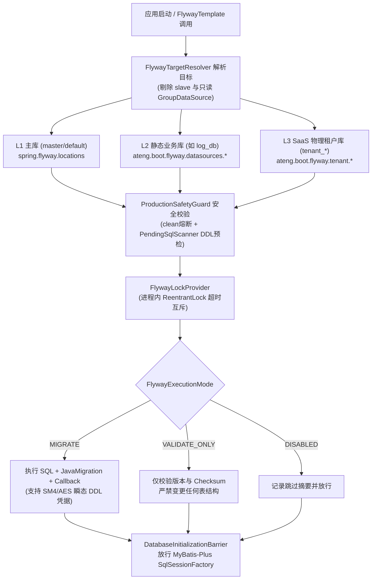
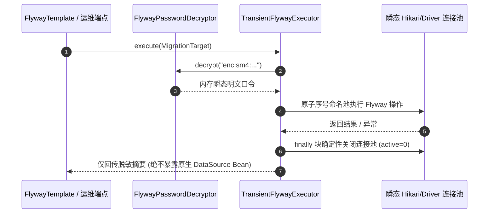
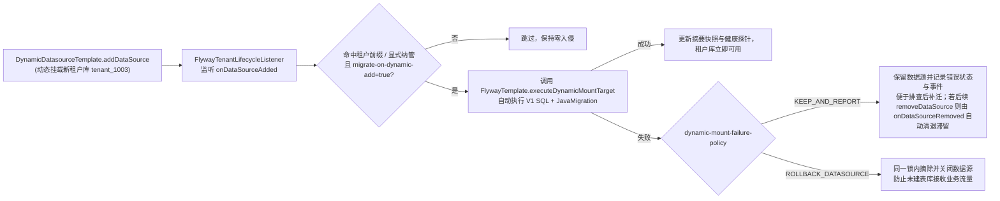

# ateng-boot-flyway 数据库版本化迁移与多数据源协同底座

> 基于 Flyway 10.10.0 与 Spring Boot 3.3.13 构建的生产就绪 Schema 版本化迁移基础设施：统一覆盖 L1 单库/主从锁主库迁移、L2 静态多业务库隔离迁移、L3 SaaS 物理多租户有界并发与动态挂载自愈、破坏性 `clean`/DDL SQL 双重硬守卫、SM4/AES 加密隔离式 DDL 瞬态连接治理、对称泛型批处理门面、MyBatis-Plus 启动顺序屏障及多目标低基数可观测闭环。

---

## 0. 特性与公共 API 全景速查矩阵 (Feature & API Panorama Matrix)

| 特性分类 | 特性名称 | 核心门面 / 枚举 / SPI | 关键配置项 (`ateng.boot.flyway.*`) | 关键 API 签名 / 核心行为 | 锚定验证源头 (*Test / Sample) |
| :--- | :--- | :--- | :--- | :--- | :--- |
| **启动治理** | 增强开关与三态运行模式 | `FlywayExecutionMode` (`IBaseEnum<String>`) | `ateng.boot.flyway.enabled`<br>`ateng.boot.flyway.mode`<br>`ateng.boot.flyway.primary-target-key` | `MIGRATE`（自动执行版本迁移）、`VALIDATE_ONLY`（仅只读校验 Checksum 与版本一致性，严禁变更表结构）、`DISABLED`（跳过启动迁移并记录全局跳过摘要，保留 `FlywayTemplate`）；`enabled=false` 或 `spring.flyway.enabled=false` 时完整退让 | `AtengFlywayAutoConfigurationTest`<br>`FlywayTemplateTest` |
| **启动治理** | Spring Bean 扩展透传与防重复抑制 | `AtengFlywayAutoConfiguration`<br>`AtengFlywayAutoConfigurationImportFilter` | `spring.flyway.*` | 优先于 Spring Boot `FlywayAutoConfiguration` 装配，100% 透传容器 `FlywayConfigurationCustomizer`、`JavaMigration`、`Callback` 与 `FlywayMigrationStrategy`；启用隔离 DDL 凭据时自动屏蔽原生 `FlywayAutoConfiguration` 与 `FlywayEndpointAutoConfiguration` | `AtengFlywayAutoConfigurationTest`<br>`V2__SeedPlatformPresetTenantMigration` |
| **顺序屏障** | MyBatis-Plus 启动初始化顺序屏障 | `AtengFlywayDatabaseInitializerDetector`<br>`AtengMybatisPlusDependsOnDatabaseInitializationDetector` | - | 通过 Spring Boot `DatabaseInitializationDependencyConfigurer` 声明 Flyway 迁移初始化器严格早于 `SqlSessionFactory`、`SqlSessionTemplate`、动态 SQL 预热与业务 Service Bean 初始化 | `FlywayMybatisPlusBarrierTest`<br>`FlywayMigrationController` |
| **对称门面** | 单目标迁移 / 校验 / 预检 / 探查 / 运维 | `FlywayTemplate` (`DisposableBean`) | `ateng.boot.flyway.primary-target-key` | `MigrationOutcome migrate()` / `migrate(String)`；`MigrationValidationResult validate()` / `validate(String)`；`List<MigrationScriptInfo> pending()` / `pending(String)`（Dry-Run）；`MigrationTargetInfo info()` / `info(String)`；`MigrationBaselineResult baseline()` / `baseline(String)` / `baseline(String, String, String)`；`MigrationRepairResult repair()` / `repair(String)`；`MigrationCleanResult clean()` / `clean(String)`；执行 `baseline`/`repair`/`clean` 后同步刷新 `getLastMigrationSummary()` 并递增 `getSummaryVersion()`；`destroy()` 停机协同取消并有限等待异步租户任务 | `FlywayTemplateTest`<br>`FlywayMigrationController`<br>`FlywayGovernanceController` |
| **对称门面** | 多目标批量迁移 / 校验 / 泛型批处理与兼容聚合 | `FlywayTemplate`<br>`BatchExecutionPolicy` (`IBaseEnum<String>`)<br>`BatchMigrationResult`<br>`BatchOperationResult<T>` | `ateng.boot.flyway.static-failure-policy` | `BatchMigrationResult migrateTargets(...)` / `validateTargets(...)`；泛型批处理 `BatchOperationResult<List<MigrationScriptInfo>> pendingTargets(...)`、`BatchOperationResult<MigrationRepairResult> repairTargets(...)`、`BatchOperationResult<MigrationBaselineResult> baselineTargets(...)`（含可选 `version`/`description` 重载）、`BatchOperationResult<MigrationTargetInfo> infoTargets(...)`；容错重载 `BatchOperationResult<MigrationTargetInfo> infoAll(BatchExecutionPolicy)` / `infoAll(Collection<String>, BatchExecutionPolicy)`；100% 保留兼容 `List<MigrationTargetInfo> infoAll()` / `infoAll(Collection<String>)`；显式集合入参空集/空白前置 Fail-Fast | `FlywayTemplateTest`<br>`DynamicDatasourceMultiTargetTest`<br>`FlywayMigrationController`<br>`FlywayGovernanceController` |
| **生产守卫** | 破坏性清理、Customizer 后置校验与 DDL 静态预检 | `ProductionSafetyGuard`<br>`PendingSqlScanner` | `ateng.boot.flyway.guard.enabled`<br>`ateng.boot.flyway.guard.protected-profiles`<br>`ateng.boot.flyway.guard.forbid-clean-in-protected-profiles`<br>`ateng.boot.flyway.guard.forbid-clean-always`<br>`ateng.boot.flyway.guard.forbid-clean-on-validation-error`<br>`ateng.boot.flyway.guard.forbid-destructive-ddl-in-protected-profiles`<br>`ateng.boot.flyway.guard.forbid-destructive-ddl-always`<br>`ateng.boot.flyway.guard.allow-destructive-ddl-annotation` | 受保护 Profile（`prod`/`production`/`prd`）物理锁定 `cleanDisabled=true`、拦截 `clean()`（无视 `spring.flyway.clean-disabled=false`）并在 `FlywayConfigurationCustomizer` 后置重验 `clean-on-validation-error`，抛出 `CLEAN_FORBIDDEN(62003)`；待执行 SQL 静态扫描未授权 `DROP TABLE`/`DROP DATABASE`/`DROP SCHEMA`/`TRUNCATE` 语句，无显式 `-- @ateng-allow-destructive-ddl` 豁免即抛出 `DESTRUCTIVE_DDL_FORBIDDEN(62010)` | `ProductionSafetyGuardTest`<br>`FlywayProtectedProfileGuardIntegrationTest`<br>`FlywayGovernanceController` |
| **凭据隔离** | SM4/AES 加密隔离 DDL 凭据与瞬态连接池 | `FlywayPasswordDecryptor`<br>`TransientFlywayExecutor`<br>`FlywayTemplate` | `ateng.boot.flyway.credential.*` (`enabled`, `url`, `driver-class-name`, `username`, `password`, `secret-key`, `iv`, `connect-timeout`) | `CryptoUtil` 内存瞬态解密 `enc:sm4:` / `enc:aes:` 口令，以原子递增池名构造短生命周期连接池并在 `finally` 确定性关池（零容器 `DataSource`/`Flyway` Bean 污染）；暴露 `executeTransient(MigrationTarget, Function<Flyway, T>)`、`getActiveTransientPoolCount()` / `getClosedTransientPoolCount()` | `IsolatedCredentialTest`<br>`FlywayGovernanceController`<br>`FlywayGovernanceService` |
| **多源协同** | 主从锁主库与静态业务库高阶参数隔离治理 | `DynamicDatasourceFlywayTargetResolver`<br>`SingleDataSourceFlywayTargetResolver`<br>`MigrationTargetKind` (`IBaseEnum<String>`)<br>`MigrationTarget` | `ateng.boot.flyway.routing.*` (`skip-slave`, `skip-read-only-group`, `excluded-data-sources`)<br>`ateng.boot.flyway.datasources.<dsKey>.*` (`enabled`, `locations`, `table`, `schemas`, `default-schema`, `baseline-*`, `validate-on-migrate`, `out-of-order`, `encoding`, `target`, `ignore-migration-patterns`, `installed-by`, `execute-in-transaction`, `group`, `mixed`, `placeholders`, `credential`) | 解包底层物理主库并永久排除 `slave`/`*_slave`/`slave_*` 与只读 `GroupDataSource`；`MigrationTargetKind` 包含 `PRIMARY`、`STATIC_DATASOURCE`、`TENANT`、`CUSTOM`；支持按 `<dsKey>` 独立覆写含目标版本 `target`、校验忽略 `ignore-migration-patterns`、操作人 `installed-by`、单/批/混用事务参数（`execute-in-transaction`、`group`、`mixed`）及目标级 `credential` | `AtengFlywayAutoConfigurationTest`<br>`DynamicDatasourceMultiTargetTest`<br>`FlywaySampleControllersMockMvcTest` |
| **SaaS 租户** | L3 物理租户有界并发全量批处理与摘要合并 | `FlywayTemplate` | `ateng.boot.flyway.tenant.*` (`enabled`, `migrate-on-startup`, `async-startup`, `concurrency`, `batch-timeout`, `failure-policy`, `data-source-prefix`, `locations` 及与 `DataSourceMigrationProperties` 同构的全量目标级覆写字段) | `BatchMigrationResult migrateAllTenants(...)` / `validateAllTenants(...)`；`BatchOperationResult` 重载 `pendingAllTenants(...)`、`repairAllTenants(...)`、`baselineAllTenants(...)`、`infoAllTenants(...)`；`CompletableFuture<BatchMigrationResult> getStartupTenantMigrationFuture()`；依托 Core 受管线程池与 `AsyncContext` 四维上下文透传 | `TenantMultiTenancyLifecycleTest`<br>`FlywayTenantController` |
| **SaaS 租户** | 运行期动态挂载迁移与摘除摘要自愈 | `FlywayTenantLifecycleListener`<br>`DynamicMountFailurePolicy` (`IBaseEnum<String>`) | `ateng.boot.flyway.tenant.migrate-on-dynamic-add`<br>`ateng.boot.flyway.tenant.dynamic-mount-failure-policy` | 监听 `onDataSourceAdded` 对命中租户/纳管库自动建表（失败按 `KEEP_AND_REPORT` 或 `ROLLBACK_DATASOURCE` 处置）；覆写 `onDataSourceRemoved(String)` 调用 `FlywayTemplate.removeTargetFromSummary(String, boolean)`（兼容重载 `removeTargetFromSummary(String)`）清理已下线故障租户滞留记录并递增 `summaryVersion` 即时失效观测缓存 | `TenantMultiTenancyLifecycleTest`<br>`FlywayObservabilityAndEventsTest`<br>`FlywayTenantController` |
| **脚本上下文** | 只读上下文迁移占位符注入 | `FlywayConfigurationSupport` | `ateng.boot.flyway.placeholder.enabled`<br>`ateng.boot.flyway.placeholder.ds-key-name`<br>`ateng.boot.flyway.placeholder.tenant-id-name` | 自动注入 `${ateng_ds_key}` 与 `${ateng_tenant_id}`，绝不覆盖用户显式声明的同名占位符 | `DynamicDatasourceMultiTargetTest` |
| **SPI 扩展** | 目标路由 / 虚拟线程互斥锁 / 生命周期监听 | `FlywayTargetResolver`<br>`FlywayLockProvider`<br>`DefaultFlywayLockProvider`<br>`FlywayMigrationListener` | `ateng.boot.flyway.lock-wait-timeout` | `FlywayTargetResolver` 定制发现逻辑；`DefaultFlywayLockProvider` 内置按 `targetKey` 隔离的进程内 `ReentrantLock.tryLock(timeout)` 互斥锁（零 `synchronized`，零持有原子回收）；`FlywayMigrationListener` 隔离回调 `onBeforeMigrate`/`onMigrationSucceeded`/`onMigrationFailed`（支持编程式 `addMigrationListener`/`removeMigrationListener`） | `FlywayObservabilityAndEventsTest`<br>`FlywayTemplateTest` |
| **事件与回执** | 领域事件与泛型/迁移聚合回执 | `FlywayMigrationCompletedEvent`<br>`FlywayMigrationFailedEvent`<br>`MigrationOutcome`<br>`MigrationSummary`<br>`BatchMigrationResult`<br>`BatchOperationResult<T>`<br>`TargetFailure` | - | 成功广播 `FlywayMigrationCompletedEvent`，失败广播脱敏 `FlywayMigrationFailedEvent`；`BatchMigrationResult` 与 `BatchOperationResult<T>` 统一提供 `isAllSuccess()` / `hasFailures()` / `getFailedTargets()` / `getTargetDurations()` | `FlywayTemplateTest`<br>`FlywayObservabilityAndEventsTest` |
| **可观测性** | 多目标健康探针与 Prometheus 低基数防线 | `FlywayHealthIndicator`<br>`FlywayMetricsBinder`<br>`ObservabilityTargetScope` (`IBaseEnum<String>`) | `ateng.boot.flyway.observability.health-enabled`<br>`ateng.boot.flyway.observability.health-cache-ttl`<br>`ateng.boot.flyway.observability.metrics-enabled`<br>`ateng.boot.flyway.observability.target-scope`<br>`ateng.boot.flyway.observability.fail-on-pending`<br>`ateng.boot.flyway.observability.aggregate-tenant-metrics` | `FlywayHealthIndicator` 按 `target-scope`（`PRIMARY`/`PRIMARY_AND_STATIC`/`ALL`）汇总目标状态与 `pendingCount`（单库失败隔离上报不掩盖其余库），`fail-on-pending=true`（含 `DISABLED` 模式）有待执行脚本即转 `DOWN`；`FlywayMetricsBinder` 绑定制约 `summaryVersion` 的 `pending` 缓存并在 `aggregate-tenant-metrics=true` 时将租户 `Counter`/`Timer` `target` 归一化为 `"tenant"` + `kind` 标签；内部路由辅助 `resolveObservableTargetKeys(ObservabilityTargetScope)` / `resolveTargetKind(String)` | `FlywayObservabilityAndEventsTest`<br>`FlywayGovernanceController`<br>`FlywaySampleControllersMockMvcTest` |
| **异常契约** | 脱敏因果异常与 `62001 ~ 62020` 号段错误码 | `FlywayException`<br>`FlywayResultCode` | - | 保留 `cause` 链并对 URL/口令全量脱敏：`62001` (`MIGRATION_FAILED`)、`62002` (`VALIDATION_FAILED`)、`62003` (`CLEAN_FORBIDDEN`)、`62004` (`TARGET_NOT_FOUND`)、`62005` (`BASELINE_FAILED`)、`62006` (`REPAIR_FAILED`)、`62007` (`CREDENTIAL_DECRYPT_FAILED`)、`62008` (`LOCK_TIMEOUT`)、`62009` (`CONFIG_INVALID`)、`62010` (`DESTRUCTIVE_DDL_FORBIDDEN`) | `FlywayTemplateTest`<br>`ProductionSafetyGuardTest`<br>`FlywaySampleControllersMockMvcTest` |

---

## 1. 模块定位与快速起步 (Quick Start)

`ateng-boot-flyway` 是针对 Spring Boot 3 企业工程演进设计的 Flyway 版本化 Schema 迁移 Starter，重点解决以下生产痛点：

- **统一接管但不吞并原生态**：复用 `spring.flyway.*` 原生配置作为真源，完整保留 `JavaMigration`、`Callback`、`FlywayConfigurationCustomizer` 与 `{vendor}` 占位符，同时注入 `ateng.boot.flyway.*` 企业级治理与对称编程式门面。
- **主从分离与多租户安全防线**：联动 `ateng-boot-datasource` 时自动拆包物理主库并永久屏蔽只读从库与 `GroupDataSource`；支持 L2 静态业务库独立历史表与高阶 Flyway 参数覆写，以及 L3 SaaS 物理多租户有界并发批量运维与动态挂/摘除自愈。
- **双重破坏性防线与 DDL 最小权限隔离**：受保护环境下无视误配物理封锁 `clean` 与 `clean-on-validation-error=true`，并在执行前静态扫描未授权破坏性 DDL（`DROP`/`TRUNCATE` -> `62010`）；支持 SM4/AES 密文高权限 DDL 凭据以短生命周期瞬态连接池执行迁移并在 `finally` 关闭，杜绝容器暴露高权限 `DataSource` Bean。
- **云原生低基数可观测闭环**：按 `ObservabilityTargetScope` 精确聚合并隔离单库异常，支持 `fail-on-pending` 就绪门禁与租户指标 `target="tenant"` 低基数归一化防 TSDB 指标爆炸。
- **按需正交引入**：不强制捆绑进 [`ateng-boot-all`](../ateng-boot-all/README.md)，对无状态边缘微服务与纯查询应用保持零运行时开销与零传递依赖负担。



### 1.1 Maven 坐标引入

> [!IMPORTANT]
> Flyway 10.x 已将各数据库方言适配器拆分为独立模块。除导入 `ateng-boot-flyway` 外，请务必根据目标数据库按需显式引入对应的 Flyway 方言依赖（如 `flyway-mysql`、`flyway-database-postgresql` 等；测试或嵌入式 H2 默认由 `flyway-core` 内置支持）。

#### 方式一：通过 `ateng-boot-bom` 统管版本按需引入（推荐）

```xml
<dependencyManagement>
    <dependencies>
        <dependency>
            <groupId>io.github.atengk</groupId>
            <artifactId>ateng-boot-bom</artifactId>
            <version>1.2.0</version>
            <type>pom</type>
            <scope>import</scope>
        </dependency>
    </dependencies>
</dependencyManagement>

<dependencies>
    <dependency>
        <groupId>io.github.atengk</groupId>
        <artifactId>ateng-boot-flyway</artifactId>
    </dependency>
    <!-- Flyway 10.x 模块化方言包：使用 MySQL / PostgreSQL 时按需二选一或按库叠加 -->
    <dependency>
        <groupId>org.flywaydb</groupId>
        <artifactId>flyway-mysql</artifactId>
    </dependency>
    <!-- 可选：需要多数据源 / 物理多租户协同或 Actuator 监控时按需引入 -->
    <dependency>
        <groupId>io.github.atengk</groupId>
        <artifactId>ateng-boot-datasource</artifactId>
    </dependency>
    <dependency>
        <groupId>org.springframework.boot</groupId>
        <artifactId>spring-boot-starter-actuator</artifactId>
    </dependency>
</dependencies>
```

#### 方式二：独立引入指定版本号

```xml
<dependency>
    <groupId>io.github.atengk</groupId>
    <artifactId>ateng-boot-flyway</artifactId>
    <version>1.2.0</version>
</dependency>
```

### 1.2 最小可运行配置（YAML）

以下配置即可启动单库版本化迁移与双重生产守卫（完整多库与租户拓扑见第 4、5 节及完整示例工程 [`ateng-boot-sample-flyway`](../ateng-boot-samples/ateng-boot-sample-flyway/README.md)）：

```yaml
spring:
  flyway:
    locations: classpath:db/migration/master
    baseline-on-migrate: false
    validate-on-migrate: true
    clean-disabled: true

ateng:
  boot:
    flyway:
      enabled: true
      mode: MIGRATE
      guard:
        enabled: true
        forbid-clean-in-protected-profiles: true
        forbid-clean-on-validation-error: true
        forbid-destructive-ddl-in-protected-profiles: true
```

### 1.3 开箱即用极简实战代码（提取自 `FlywayMigrationController`）

引入依赖并配置 `db/migration/master/V1__create_tenant_registry.sql` 后，应用启动即自动完成迁移；业务控制器直接注入 `FlywayTemplate` 即可编程触发单库或批量迁移、待执行预检与只读校验：

```java
@Validated
@RestController
@RequestMapping("/sample/flyway/migration")
@RequiredArgsConstructor
public class FlywayMigrationController {

    private final FlywayTemplate flywayTemplate;

    @PostMapping("/execute")
    public Result<MigrationOutcome> executeMigration(@Valid @RequestBody TargetOperationRequest request) {
        return Result.success(flywayTemplate.migrate(request.getTargetKey()));
    }

    @GetMapping("/pending")
    public Result<List<MigrationScriptInfo>> queryPendingScripts(
            @RequestParam(defaultValue = "master") @NotBlank(message = "targetKey 不能为空") String targetKey) {
        return Result.success(flywayTemplate.pending(targetKey));
    }

    @PostMapping("/pending-targets")
    public Result<BatchOperationResult<List<MigrationScriptInfo>>> queryPendingTargets(
            @Valid @RequestBody BatchTargetsRequest request) {
        return Result.success(flywayTemplate.pendingTargets(request.getTargetKeys(), request.getPolicy()));
    }

    @PostMapping("/validate")
    public Result<MigrationValidationResult> validateTarget(@Valid @RequestBody TargetOperationRequest request) {
        return Result.success(flywayTemplate.validate(request.getTargetKey()));
    }
}
```

---

## 2. 核心架构、对称门面与持久层顺序屏障

### 2.1 三态启动运行模式与 Spring Bean 迁移扩展

`ateng.boot.flyway.mode`（`FlywayExecutionMode`）提供三态控制，满足不同交付阶段对 Schema 变更权限的管控要求：
- `MIGRATE`（默认）：启动时依次对受管目标执行脚本迁移。
- `VALIDATE_ONLY`：启动仅校验已部署数据库与本地迁移脚本 Version/Checksum 是否匹配；适合无 DDL 权限的只读应用节点或灰度校验节点。
- `DISABLED`：跳过启动阶段自动迁移，记录各受管目标的跳过摘要（`skipped=true`），仍保留 `FlywayTemplate` 供运维管理端或定时触发。

#### 专属配置（YAML）

```yaml
spring:
  flyway:
    locations: classpath:db/migration/master
    validate-on-migrate: true

ateng:
  boot:
    flyway:
      enabled: true
      mode: MIGRATE # 可选值: MIGRATE | VALIDATE_ONLY | DISABLED
```

#### 真实 Java 扩展示例（提取自 `ateng-boot-sample-flyway`）

容器内声明的 `JavaMigration` 与 `Callback` Bean 会被 `AtengFlywayAutoConfiguration` 自动发现并注入到所有受管目标迁移流水线中：

```java
@Component
public class V2__SeedPlatformPresetTenantMigration extends BaseJavaMigration {

    @Override
    public void migrate(Context context) throws Exception {
        Connection connection = context.getConnection();
        if (tableExists(connection, "sys_tenant_registry")) {
            seedMasterTenantRegistry(connection);
        } else if (tableExists(connection, "biz_audit_log")) {
            seedAuditLog(connection);
        } else if (tableExists(connection, "biz_tenant_order")) {
            seedTenantOnboardingOrder(connection);
        }
    }
}
```

#### 原理与边界约束

- **顺序契约**：`@AutoConfiguration(before = FlywayAutoConfiguration.class)` 在装配阶段提前接管，当 `ateng.boot.flyway.enabled=false` 或 `spring.flyway.enabled=false` 时条件退出，完整交还 Spring Boot 原生生命周期。
- **幂等建议**：若多数据源共享 Spring 容器内的同一个 `@Component BaseJavaMigration`，脚本内部应通过目标表探查或 `${ateng_ds_key}` 区分作用域并保证自身幂等。

### 2.2 全维度对称编程式门面 `FlywayTemplate` 与 `BatchOperationResult<T>`

`FlywayTemplate` 对称覆盖**单目标（Primary / Designated Key）**、**指定或全部受管目标集合（`*Targets`）**及**全物理租户（`*AllTenants`）**四大运维操作家族（`migrate`、`validate`、`pending`、`info`、`baseline`、`repair` 以及受守卫 `clean`），并依托 `AtengMybatisPlusDependsOnDatabaseInitializationDetector` 确保容器内 `SqlSessionFactory` 绝对晚于 Flyway 迁移完成初始化。

#### 专属配置（YAML）

```yaml
ateng:
  boot:
    flyway:
      primary-target-key: default     # 单库缺省名；若同时启用多数据源则自动对齐 dynamic.primary (如 master)
      static-failure-policy: FAIL_FAST # L1/L2 批量调用默认失败策略: FAIL_FAST | FAIL_SAFE
      lock-wait-timeout: 30s
```

#### 真实 Sample 控制器代码（提取自 `FlywayGovernanceController`）

```java
@Validated
@RestController
@RequestMapping("/sample/flyway/governance")
@RequiredArgsConstructor
public class FlywayGovernanceController {

    private final FlywayTemplate flywayTemplate;

    @GetMapping("/info-batch")
    public Result<BatchOperationResult<MigrationTargetInfo>> infoAllBatch(
            @RequestParam(required = false) BatchExecutionPolicy policy) {
        return Result.success(flywayTemplate.infoAll(policy));
    }

    @PostMapping("/info-targets")
    public Result<BatchOperationResult<MigrationTargetInfo>> infoTargets(
            @Valid @RequestBody BatchTargetsRequest request) {
        return Result.success(flywayTemplate.infoTargets(request.getTargetKeys(), request.getPolicy()));
    }

    @PostMapping("/baseline-targets")
    public Result<BatchOperationResult<MigrationBaselineResult>> baselineTargets(
            @Valid @RequestBody BatchBaselineRequest request) {
        return Result.success(flywayTemplate.baselineTargets(
                request.getTargetKeys(), request.getVersion(), request.getDescription(), request.getPolicy()));
    }

    @PostMapping("/repair-targets")
    public Result<BatchOperationResult<MigrationRepairResult>> repairTargets(
            @Valid @RequestBody BatchTargetsRequest request) {
        return Result.success(flywayTemplate.repairTargets(request.getTargetKeys(), request.getPolicy()));
    }
}
```

#### 原理与边界约束

- **泛型不可变批处理回执（`BatchOperationResult<T>`）**：统一承载 `policy`、`executedAt`、`totalDuration`、`totalTargets`、`successCount`、`failedCount`、保序不可变 `results` 映射、`failures` 脱敏失败明细及 `isAllSuccess()`、`hasFailures()`、`getFailedTargets()`、`getTargetDurations()` 契约；集合与映射均做防御式不可变包装，修改触发 `UnsupportedOperationException`。
- **共享有界并发引擎 & 前置 Fail-Fast**：显式传入 `Collection<String> targetKeys` 时前置校空并逐项剔除空白/null 字符串（立即抛出 `IllegalArgumentException`）；未命中目标统一抛出脱敏 `TARGET_NOT_FOUND(62004)`；原有 `List<MigrationTargetInfo> infoAll()` 与 `infoAll(Collection<String>)` 保持 100% 向后兼容。
- **全操作摘要实时联动**：执行 `baseline`、`repair` 或 `clean` 后均自动刷新 `getLastMigrationSummary()` 并单调递增 `getSummaryVersion()`；其中 `clean` 成功会立即从摘要快照中清退已清库目标，彻底杜绝已清库仍虚报为已迁移成功。

---

## 3. 生产双重防误操作硬守卫与隔离式加密 DDL 凭据

### 3.1 `ProductionSafetyGuard` 破坏性 `clean` 与 `Customizer` 后置拦截

为杜绝因配置合并覆盖、误设 `spring.flyway.clean-disabled=false` 或业务侧注册 `FlywayConfigurationCustomizer` 篡改 `cleanOnValidationError(true)` 导致的生产删库事故，底层在构建配置（Customize 前与 Customize 后双重重验）及调用 `FlywayTemplate.clean*` 时执行硬校验。

#### 专属配置（YAML）

```yaml
ateng:
  boot:
    flyway:
      guard:
        enabled: true
        protected-profiles:
          - prod
          - production
          - prd
        forbid-clean-in-protected-profiles: true
        forbid-clean-always: false
        forbid-clean-on-validation-error: true
```

#### 真实 Sample 控制器代码（提取自 `FlywayGovernanceController`）

```java
@PostMapping("/clean")
public Result<MigrationCleanResult> cleanWithGuard(@Valid @RequestBody TargetOperationRequest request) {
    // 即使测试中误配 spring.flyway.clean-disabled=false，受保护环境下仍会被拦截并返回 62003
    return Result.success(flywayTemplate.clean(request.getTargetKey()));
}
```

#### 原理与边界约束

- **双保险物理拦截**：命中 `protected-profiles`（大小写不敏感）且 `forbid-clean-in-protected-profiles=true`，或 `forbid-clean-always=true` 时，自动覆盖底层 `FluentConfiguration.cleanDisabled(true)` 并在调用 `clean()` 时抛出 `FlywayException(FlywayResultCode.CLEAN_FORBIDDEN)`（错误码 `62003`）。
- **`Customizer` 防绕过校验**：执行完容器中所有 `FlywayConfigurationCustomizer` 后立即复检 `configuration.isCleanOnValidationError()`，防止定制代码绕过配置检查。

### 3.2 `PendingSqlScanner` 高危破坏性 DDL 静态预检（`62010`）

在执行每次 `migrate()` 之前，`ProductionSafetyGuard` 协同 `PendingSqlScanner` 对即将落地的待执行 SQL 脚本进行词法级安全扫描（剥离单行/多行注释与字符串字面量，防止误判业务注释与字段文本），精准拦截未授权的 `DROP TABLE`、`DROP DATABASE`、`DROP SCHEMA` 与 `TRUNCATE` 语句。

#### 专属配置（YAML）

```yaml
ateng:
  boot:
    flyway:
      guard:
        enabled: true
        forbid-destructive-ddl-in-protected-profiles: true # 受保护环境默认拦截未授权破坏性 DDL
        forbid-destructive-ddl-always: false               # 如需全环境零容忍可直接设为 true
        allow-destructive-ddl-annotation: true             # 允许经 DBA 审批脚本首部/注记标注显式放行标记
```

#### 真实 Sample 演练代码（提取自 `FlywayGovernanceController` 与 `FlywayGovernanceService`）

```java
@PostMapping("/destructive-ddl-guard/demo")
public Result<DestructiveDdlDemoResponse> demonstrateDestructiveDdlGuard(
        @Valid @RequestBody DestructiveDdlDemoRequest request) {
    return Result.success(governanceService.demonstrateDestructiveDdlGuard(request));
}
```

```java
AtengFlywayProperties guardProps = new AtengFlywayProperties();
guardProps.getGuard().setEnabled(true);
guardProps.getGuard().setForbidDestructiveDdlInProtectedProfiles(true);
guardProps.getGuard().setForbidDestructiveDdlAlways(true);
guardProps.getGuard().setAllowDestructiveDdlAnnotation(request.isAllowExemptionAnnotation());
ProductionSafetyGuard demoGuard = new ProductionSafetyGuard(guardProps, environment);

FlywayProperties flywayProps = new FlywayProperties();
flywayProps.setLocations(List.of("filesystem:" + tempDir.toAbsolutePath()));
Flyway flyway = FlywayConfigurationSupport.buildFlyway(
        "guard-demo",
        demoDataSource,
        flywayProps,
        new DefaultResourceLoader(),
        Collections.emptyList(),
        Collections.emptyList(),
        Collections.emptyList(),
        demoGuard
);

demoGuard.assertPendingSqlSafe("guard-demo", flyway);
MigrateResult migrateResult = flyway.migrate();
```

#### 原理与边界约束

- **豁免注释受控开关**：仅当 `allow-destructive-ddl-annotation=true`（默认）且脚本中包含 `-- @ateng-allow-destructive-ddl`（支持 `/* @ateng-allow-destructive-ddl */`）审批标注时放行；若运维开启全局强制策略（`allow-destructive-ddl-annotation=false`），注释豁免同样失效并返回 `62010`。
- **只拦截待执行增量**：仅扫描当前目标库的 `pending()` 待执行 SQL（且不越界误拦已完成历史记录中的旧脚本），兼顾历史包袱与增量红线。

### 3.3 隔离式加密 DDL 凭据与零泄漏瞬态连接池

日常应用 DML 账号应遵循最小权限原则（禁止 `CREATE`/`ALTER`/`DROP`）。启用 `ateng.boot.flyway.credential` 后，模块在需要执行 DDL 迁移或运维探查时才使用更高权限的密文凭据创建短生命周期连接池，执行完立即确定性销毁。



#### 专属配置（YAML）

```yaml
ateng:
  boot:
    flyway:
      credential:
        enabled: true
        username: YOUR_DDL_ADMIN_USERNAME
        # 支持明文及 enc:sm4: / enc:aes: 前缀密文：
        # 1) 内嵌密钥 CBC: enc:sm4:<key>:<iv>:<cipher> / enc:aes:<key>:<iv>:<cipher>
        # 2) 内嵌密钥 SM4 ECB: enc:sm4:<key>:<cipher>
        # 3) 配合全局 secret-key/iv: enc:sm4:<cipher> / enc:aes:<cipher>
        password: "enc:sm4:YOUR_SM4_KEY_BASE64:YOUR_SM4_IV_BASE64:YOUR_CIPHERTEXT_BASE64"
        connect-timeout: 10s
```

#### 真实 Sample 演练代码（提取自 `FlywayGovernanceService`）

```java
AtengFlywayProperties.CredentialProperties transientCred = new AtengFlywayProperties.CredentialProperties();
transientCred.setEnabled(true);
transientCred.setUsername(request.getUsername().trim());
transientCred.setPassword(encryptedPassword); // enc:sm4:<keyBase64>:<ivBase64>:<cipherBase64>

MigrationTarget credTarget = MigrationTarget.builder()
        .targetKey(baseTarget.getTargetKey())
        .kind(baseTarget.getKind())
        .tenantId(baseTarget.getTenantId())
        .dataSource(baseTarget.getDataSource())
        .credential(transientCred)
        .migrationConfig(baseTarget.getMigrationConfig())
        .failurePolicy(baseTarget.getFailurePolicy())
        .build();

ValidateResult result = flywayTemplate.executeTransient(credTarget, org.flywaydb.core.Flyway::validateWithResult);
// getActiveTransientPoolCount() 恒定归零 (0)，getClosedTransientPoolCount() 精确递增
```

#### 原理与边界约束

- **并发命名安全 & 零 Bean 污染**：`TransientFlywayExecutor` 通过 `AtomicLong` 生成全局唯一瞬态 Hikari 连接池名防并发碰撞，不注册 `@FlywayDataSource` 也不暴露持有已关闭连接池的原生 `Flyway` Bean（由 `AtengFlywayAutoConfigurationImportFilter` 自动拦截原生配置）。
- **凭据安全防线**：解密依托 Core 模块 `CryptoUtil` 完成，解密失败抛出 `CREDENTIAL_DECRYPT_FAILED(62007)`；日志与异常均经 `FlywayConfigurationSupport.sanitizeSensitiveText` 与 `DesensitizeUtil` 全量掩码。

---

## 4. 多数据源主从隔离与 L2 静态业务库治理

当工程同时引入 [`ateng-boot-datasource`](../ateng-boot-datasource/README.md) 时，`DynamicDatasourceFlywayTargetResolver` 自动解析所有已注册的数据源，按 `MigrationTargetKind`（实现 `IBaseEnum<String>`）归类为 **L1 主库（`PRIMARY`）**、**L2 静态业务库（`STATIC_DATASOURCE`）**、**L3 物理租户库（`TENANT`）** 及自定义扩展目标（`CUSTOM`）。

#### 专属配置（YAML，提取自 `ateng-boot-sample-flyway/src/main/resources/application.yml`；其中 H2 `sa` 与空密码仅限离线演示）

```yaml
spring:
  datasource:
    dynamic:
      primary: master
      datasource:
        master:
          url: jdbc:h2:mem:flyway_sample_master;DB_CLOSE_DELAY=-1;MODE=MySQL
          username: sa
          password: ""
          driver-class-name: org.h2.Driver
        slave:
          url: jdbc:h2:mem:flyway_sample_slave;DB_CLOSE_DELAY=-1;MODE=MySQL
          username: sa
          password: ""
          driver-class-name: org.h2.Driver
        log_db:
          url: jdbc:h2:mem:flyway_sample_log_db;DB_CLOSE_DELAY=-1;MODE=MySQL
          username: sa
          password: ""
          driver-class-name: org.h2.Driver
  flyway:
    locations: classpath:db/migration/master

ateng:
  boot:
    flyway:
      static-failure-policy: FAIL_FAST
      routing:
        skip-slave: true            # 永久跳过 slave / *_slave 只读从库
        skip-read-only-group: true  # 永久跳过读写分离只读集群 GroupDataSource
      datasources:
        log_db:
          enabled: true
          locations:
            - classpath:db/migration/log_db
          table: log_flyway_schema_history
          target: "2"               # 可选：目标级迁移版本锁定
          ignore-migration-patterns:
            - "*:ignored"
          installed-by: "platform-bot"
          execute-in-transaction: true
          group: false
          mixed: false
          placeholders:
            auditScope: platform-audit
```

#### 真实 Sample 调用代码（提取自 `FlywayMigrationController`）

```java
@PostMapping("/execute-static")
public Result<BatchMigrationResult> executeStaticTargets() {
    // 显式批量触发静态核心库与独立业务库迁移，按 static-failure-policy (默认 FAIL_FAST) 控制失败阻断
    return Result.success(flywayTemplate.migrateTargets(List.of("master", "log_db")));
}
```

#### 原理与边界约束

- **物理拆包（Zero-Routing-Pollution）**：解析目标时直接从 `DynamicRoutingDataSource.getDataSources()` 读取底层物理 `DataSource` 并递归拆包 `ItemDataSource`，规避向读写代理发 DDL 错落从库风险。
- **高阶参数全量继承覆盖**：`datasources.<dsKey>.*`（及单库模式下的 `datasources.default.*`）未配置字段自动继承 `spring.flyway.*`，包括 `target`、`ignore-migration-patterns`、`installed-by`、`execute-in-transaction`、`group` 与 `mixed`。
- **只读从库与第三方源零入侵**：`slave`/`*_slave`/`slave_*` 与只读 `GroupDataSource` 永久被排除；未在 `ateng.boot.flyway.datasources` 声明且非主/租户的辅助源亦零入侵跳过。

---

## 5. SaaS 物理多租户（L3）全量运维与动态挂/摘除自愈

面向 SaaS 物理多租户“每租户一库”架构，`ateng-boot-flyway` 打通启动批量迁检、全对称批处理运维及运行期动态挂载/下线自愈全生命周期闭环。



### 5.1 全租户有界并发批量迁移、对称批处理与停机优雅取消

开启 `ateng.boot.flyway.tenant.enabled=true` 后，系统自动识别匹配前缀（默认继承 `ateng.boot.datasource.multi-tenancy.data-source-prefix` 即 `tenant_`）或 `TenantDataSourceProvider` 注册的物理租户库，并与主库脚本目录物理隔离。

#### 专属配置（YAML）

```yaml
ateng:
  boot:
    flyway:
      placeholder:
        enabled: true
        ds-key-name: ateng_ds_key
        tenant-id-name: ateng_tenant_id
      tenant:
        enabled: true
        migrate-on-startup: true
        async-startup: false       # 大批量租户库可设为 true，容器销毁时自动触发协作式中断与 2s 有限等待收尾
        concurrency: 2             # 有界并发度（> 1 桥接 Core 受管线程池并透传四维 AsyncContext）
        batch-timeout: 5m          # 并发批量任务最大等待超时，严防无界挂起
        failure-policy: FAIL_SAFE  # 默认单租户失败不拖垮其余租户及主库上线
        locations:
          - classpath:db/migration/tenant
```

#### 真实 Sample 控制器代码（提取自 `FlywayTenantController`）

```java
@Validated
@RestController
@RequestMapping("/sample/flyway/tenant")
@RequiredArgsConstructor
public class FlywayTenantController {

    private final FlywayTemplate flywayTemplate;

    @PostMapping("/migrate-all")
    public Result<BatchMigrationResult> migrateAllTenants() {
        return Result.success(flywayTemplate.migrateAllTenants());
    }

    @PostMapping("/validate-all")
    public Result<BatchMigrationResult> validateAllTenants() {
        return Result.success(flywayTemplate.validateAllTenants());
    }

    @GetMapping("/pending-all")
    public Result<BatchOperationResult<List<MigrationScriptInfo>>> pendingAllTenants(
            @RequestParam(required = false) BatchExecutionPolicy policy) {
        return Result.success(flywayTemplate.pendingAllTenants(policy));
    }

    @GetMapping("/info-all")
    public Result<BatchOperationResult<MigrationTargetInfo>> infoAllTenants(
            @RequestParam(required = false) BatchExecutionPolicy policy) {
        return Result.success(flywayTemplate.infoAllTenants(policy));
    }

    @PostMapping("/repair-all")
    public Result<BatchOperationResult<MigrationRepairResult>> repairAllTenants(
            @Valid @RequestBody(required = false) BatchPolicyRequest request) {
        return Result.success(flywayTemplate.repairAllTenants(request != null ? request.getPolicy() : null));
    }

    @PostMapping("/baseline-all")
    public Result<BatchOperationResult<MigrationBaselineResult>> baselineAllTenants(
            @Valid @RequestBody(required = false) TenantBatchBaselineRequest request) {
        if (request == null) {
            return Result.success(flywayTemplate.baselineAllTenants());
        }
        return Result.success(flywayTemplate.baselineAllTenants(
                request.getVersion(), request.getDescription(), request.getPolicy()));
    }
}
```

#### 原理与边界约束

- **受管并发、停机协作中断与超时防悬挂**：当 `concurrency > 1` 时依托 Core 模块受管线程池启动有界 Worker，并透传 `<MDC, User, TenantId, IgnoreTenant>` 四维上下文，**严禁私自新建野线程**；容器触发 `DisposableBean#destroy()` 时，优先取消外露 `Future`、向活跃 Worker 线程发出精确 `interrupt()` 并在 `DataSource` 销毁前有限等待（2s）线程收尾，彻底消除关闭期间的连接池竞态报错。
- **上下文占位符防覆盖**：自动注入 `${ateng_ds_key}` 与 `${ateng_tenant_id}`，绝不覆盖显式声明的同名占位符。

### 5.2 运行期动态挂载自动建表与摘除摘要自愈

#### 专属配置（YAML）

```yaml
ateng:
  boot:
    flyway:
      tenant:
        enabled: true
        migrate-on-dynamic-add: true
        dynamic-mount-failure-policy: KEEP_AND_REPORT # 或 ROLLBACK_DATASOURCE
```

#### 真实 Sample 挂载与业务验证代码（提取自 `FlywayPlatformBusinessService`）

```java
if (!dynamicDatasourceTemplate.containsDataSource(dsKey)) {
    DataSourceProperty property = buildTenantDataSourceProperty(dsKey, request);
    // 触发 DynamicDatasourceLifecycleListener -> FlywayTenantLifecycleListener 自动完成建表与 V2 种子数据
    dynamicDatasourceTemplate.addDataSource(dsKey, property, false);
}
MigrationTargetInfo targetInfo = flywayTemplate.info(dsKey);
```

#### 原理与边界约束

- **动态挂载双模容错**：`KEEP_AND_REPORT`（默认）在自动迁移失败时保留连接并记入异常摘要以便修补重试；`ROLLBACK_DATASOURCE` 则在同一生命周期锁内回滚摘除并关池。
- **动态摘除自动自愈（`onDataSourceRemoved`）**：当运维或上层通过 `DynamicDatasourceTemplate#removeDataSource` 摘除曾失败或下线的租户库时，`FlywayTenantLifecycleListener#onDataSourceRemoved` 自动调用 `flywayTemplate.removeTargetFromSummary(dsKey)` 清退 `MigrationSummary` 中的失败滞留记录并递增 `summaryVersion`，立即使健康探针恢复 `UP`，避免下线故障租户永久拉低平台健康状态。

---

## 6. SPI 扩展定制、领域事件与多目标低基数可观测闭环

### 6.1 可扩展 SPI 与 Spring 领域事件总线

所有核心协作关节均提供带 `@ConditionalOnMissingBean` 保护的 SPI 与事件钩子，业务团队可按需零侵入替换：

| 扩展接口 / 事件 | 触发时机与职责 | 注册方式 / 缺省实现 |
| :--- | :--- | :--- |
| `FlywayTargetResolver` | 自定义发现和过滤受管控目标数据源 | 注册 `@Bean` 覆盖默认单源/多源路由器 |
| `FlywayLockProvider` | 多节点/进程内迁移互斥锁协同（`tryLock`/`unlock`/`executeWithLock`） | 注册 `@Bean` 覆盖默认 `DefaultFlywayLockProvider`（按 `targetKey` 隔离、基于虚拟线程友好的 `ReentrantLock.tryLock(timeout)` 且零持有原子清理） |
| `FlywayMigrationListener` | 监听 `onBeforeMigrate` / `onMigrationSucceeded` / `onMigrationFailed`（异常隔离） | 注册 `@Bean` 或调用 `flywayTemplate.addMigrationListener(...)` |
| `FlywayMigrationCompletedEvent` | 单库或任一目标迁移成功时广播（携带 `MigrationOutcome`） | `@EventListener` |
| `FlywayMigrationFailedEvent` | 单库或任一目标迁移失败时广播（异常消息已完成脱敏） | `@EventListener` |

#### 专属配置（YAML，提取自 `ateng-boot-sample-flyway/src/main/resources/application.yml`）

```yaml
ateng:
  boot:
    flyway:
      # 分布式/进程内并发互斥锁（FlywayLockProvider）最大等待超时时间，超时抛出 LOCK_TIMEOUT (62008)
      lock-wait-timeout: 30s
```

#### 真实事件监听代码（1:1 提取自 `SampleFlywayEventListener`）

```java
@Slf4j
@Component
public class SampleFlywayEventListener {

    private final AtomicInteger completedEventCount = new AtomicInteger(0);
    private final AtomicInteger failedEventCount = new AtomicInteger(0);

    @EventListener
    public void onCompleted(FlywayMigrationCompletedEvent event) {
        completedEventCount.incrementAndGet();
        MigrationOutcome outcome = event.getOutcome();
        log.info("[SampleFlyway] 迁移完成事件 [target={}, version={}, executed={}]",
                outcome.getTargetKey(), outcome.getTargetSchemaVersion(), outcome.getMigrationsExecuted());
    }

    @EventListener
    public void onFailed(FlywayMigrationFailedEvent event) {
        failedEventCount.incrementAndGet();
        log.error("[SampleFlyway] 迁移失败事件 [target={}, mode={}, reason={}]",
                event.getTargetKey(), event.getMode(), event.getErrorMessage());
    }
}
```

#### 原理与边界约束

- **虚拟线程无 Pinning 并发互斥锁**：`DefaultFlywayLockProvider` 全链路使用 `ReentrantLock` 替代 `synchronized`，严格校验 `isHeldByCurrentThread()` 后在 `finally` 释放，并依托持有与等待计数在零竞争时原子回收锁对象，严防长运行期内存泄漏。
- **事件载荷全量脱敏与监听异常隔离**：`FlywayMigrationFailedEvent.getErrorMessage()` 已掩码 JDBC 凭据；监听器回调异常仅记日志，绝不阻断主流程返回。

### 6.2 多目标 Actuator 健康探针与 Prometheus 低基数指标防线

#### 专属配置（YAML，提取自 `ateng-boot-sample-flyway/src/main/resources/application.yml`）

```yaml
ateng:
  boot:
    flyway:
      observability:
        health-enabled: true
        health-cache-ttl: 5s              # 生产推荐 30s，设为 PT0S 时每次实时探查；summaryVersion 变更自动即时失效
        metrics-enabled: true
        target-scope: PRIMARY_AND_STATIC  # 作用域: PRIMARY | PRIMARY_AND_STATIC (默认) | ALL
        fail-on-pending: false            # 是否将 pending > 0 视为 DOWN（含 DISABLED 模式）；默认 false 保持兼容
        aggregate-tenant-metrics: true    # 是否将物理租户指标 target 归一化为 "tenant" 并附带 kind 标签防 TSDB 爆炸

management:
  endpoints:
    web:
      exposure:
        include: health,info,metrics
  endpoint:
    health:
      show-details: always
```

#### 真实 Sample 探针与 Actuator 调用代码（提取自 `FlywayGovernanceController`）

```java
@GetMapping("/health")
public Result<MigrationHealthResponse> queryHealth() {
    return Result.success(governanceService.queryMigrationHealth());
}
```

#### 度量指标全集（`FlywayMetricsBinder`）

| 指标名称 | 指标类型 | 标签 (`Tags`) | 指标含义与低基数防护契约 |
| :--- | :---: | :---: | :--- |
| `ateng.flyway.migrations.total` | `Counter` | `target`, `kind`, `outcome` (`success` / `failure`) | 迁移触发总数；`kind` 取值 `PRIMARY`/`STATIC_DATASOURCE`/`TENANT`/`CUSTOM`；开启 `aggregate-tenant-metrics=true` 时租户 `target` 固定为 `"tenant"` |
| `ateng.flyway.migrations.executed` | `Counter` | `target`, `kind` | 实际成功执行脚本总数；同上受低基数租户归一化防线保护 |
| `ateng.flyway.migration.duration` | `Timer` | `target`, `kind`, `outcome` (`success` / `failure`) | 单目标单次迁移耗时分布；同上受低基数租户归一化防线保护 |
| `ateng.flyway.migrations.pending` | `Gauge` | - | 按 `target-scope` 汇总受控目标当前待执行迁移脚本总数（缓存绑定 `summaryVersion`，执行 `migrate`/`baseline`/`repair`/`clean`/`removeTargetFromSummary` 后即时失效刷新） |
| `ateng.flyway.failed.targets` | `Gauge` | - | 最近一次全局/批量迁移失败目标数量 |
| `ateng.flyway.success.targets` | `Gauge` | - | 最近一次全局/批量迁移成功目标数量 |

#### 原理与边界约束

- **多目标探针异常隔离**：`FlywayHealthIndicator` 基于 `ReentrantLock` 与 `summaryVersion` 版本化 TTL 缓存汇总 `targets` 明细（含每库 `kind`、`status`、`currentVersion`、`appliedCount`、`pendingCount`、`failedCount`）；单个业务库查询异常或超时仅将该目标标为 `ERROR` 并列入 `errors` 脱敏清单，绝不掩盖其余正常库的实时版本与健康状态。
- **`fail-on-pending` 门禁兼容契约**：默认 `fail-on-pending=false` 时（包含 `DISABLED` 模式），存在待执行脚本仍返回 `UP` 以保证零侵入升级；显式开启 `fail-on-pending=true` 后，作用域内任一目标出现待执行脚本即刻返回 `DOWN`（可用于严苛发版前门禁探针）。
- **TSDB 指标爆炸免疫**：千租户场景默认 `aggregate-tenant-metrics=true` 将所有租户迁移计数与耗时收口到 `target="tenant", kind="TENANT"` 单一时间序列；如需逐租户下钻分析，可按需设为 `false` 保留原始 `tenant_*` 键。

---

## 7. 生产级非功能边界、排障指南与避坑清单

### 7.1 `spring.flyway.*` 与 `ateng.boot.flyway.*` 优先级及共存规则

1. **全局与底层迁移参数**：`spring.flyway.*` 继续作为脚本编码、基线、历史表名、目标版本、校验忽略模式、操作人、事务组合、占位符与校验开关的原生真源；`ateng.boot.flyway.datasources.<dsKey>.*` 与 `ateng.boot.flyway.tenant.*` 仅针对特定目标库或租户分组增量覆写。
2. **上下文占位符不可逆越权原则**：自动注入的 `${ateng_ds_key}` 与 `${ateng_tenant_id}` 仅填充未显式声明的键，绝不会覆盖用户主动配置的同名占位符。
3. **关闭联动**：将 `ateng.boot.flyway.enabled=false` 时自动退让给 Spring Boot 原生 `FlywayAutoConfiguration`；将 `spring.flyway.enabled=false` 时会联动停止整个自动装配，确保测试切片与极简进程零开销启动。

### 7.2 常见状态码（分配号段 `62001 ~ 62020`，当前已定义 `62001 ~ 62010`）与高频排障手册

| 状态码 | 枚举名 | 常见根因与排查建议 |
| :---: | :--- | :--- |
| `62001` | `MIGRATION_FAILED` | SQL 语法错误、目标库方言包缺失（如 MySQL 未引入 `flyway-mysql`）或表锁冲突；检查 `FlywayMigrationFailedEvent` 中的脱敏摘要与底层 `cause` |
| `62002` | `VALIDATION_FAILED` | 本地 SQL 文件被篡改导致 Checksum 不一致、脚本缺失或处于 `VALIDATE_ONLY` 模式下存在未执行的 Pending 脚本；确认无历史回改风险后可在非保护链路执行 `repair` |
| `62003` | `CLEAN_FORBIDDEN` | 受保护环境命中 `protected-profiles`（默认 `prod`/`production`/`prd`）、`forbid-clean-always=true`、`forbid-clean-on-validation-error=true`（含 Customizer 篡改拦截）或 `spring.flyway.clean-disabled=true` |
| `62004` | `TARGET_NOT_FOUND` | 传入空值、不存在的数据源 Key，或传入了被路由规则永久屏蔽的从库（`slave`/`*_slave`）与只读分组名 |
| `62005` | `BASELINE_FAILED` | 对已经存在迁移历史且版本大于等于目标 `baseline-version` 的目标库重复执行 `baseline` |
| `62006` | `REPAIR_FAILED` | 修复迁移历史表校验和或清理失败记录时底层数据库连接或权限异常 |
| `62007` | `CREDENTIAL_DECRYPT_FAILED` | `enc:sm4:` / `enc:aes:` 密文段格式非法、Base64/Hex 编码损坏或全局 `secret-key`/`iv` 不匹配 |
| `62008` | `LOCK_TIMEOUT` | `FlywayLockProvider` 在 `ateng.boot.flyway.lock-wait-timeout` 窗口内未能获得目标库互斥锁，检查多实例并发部署锁持有人或数据库会话阻塞 |
| `62009` | `CONFIG_INVALID` | 非法配置组合（如含非法路径穿越字符、缺少有效路由目标或超出约束范围参数） |
| `62010` | `DESTRUCTIVE_DDL_FORBIDDEN` | `PendingSqlScanner` 在待执行 SQL 中检测到未授权 `DROP TABLE`/`DROP DATABASE`/`DROP SCHEMA`/`TRUNCATE`；受审脚本可加 `-- @ateng-allow-destructive-ddl` 并在允许豁免时放行，严苛生产建议保持拦截 |

### 7.3 工程红线与避坑清单

- **严禁声明持久化 `@FlywayDataSource` Bean**：使用高权限 DDL 账号时统一通过 `ateng.boot.flyway.credential.*` 或 `datasources.<dsKey>.credential.*` 配置，由底座创建瞬态连接池执行并在结束时关闭，避免污染容器内业务 `DataSource` 选择。
- **不建议将 `ateng-boot-flyway` 放入公共纯工具二方库传递暴露**：已确认 `ateng-boot-all` 与 `ateng-boot-sample-smoke-test` 不强依赖本模块，业务按需按 BOM 引入即可。
- **全架构设计权衡**：完整背景取舍、L1~L3 分级架构与增量演进记录见 [`ADR-0107`](../docs/adr/0107-flyway-database-migration-and-multi-datasource-architecture.md)。

---

## 8. 完整 YAML 配置附录 (Full Configuration Reference)

以下配置清单逐字段对齐 `AtengFlywayProperties`（前缀 `ateng.boot.flyway`），展示全部可用配置项及其默认值与强类型量纲：

```yaml
ateng:
  boot:
    flyway:
      enabled: true                            # 是否启用 ateng-boot-flyway 增强底座（关闭时完整退让给 Spring Boot 原生）
      primary-target-key: default              # 单数据源默认主目标标识（动态多源模式下自动对齐 dynamic.primary）
      mode: MIGRATE                            # 启动执行模式: MIGRATE | VALIDATE_ONLY | DISABLED
      static-failure-policy: FAIL_FAST         # L1/L2 静态目标批量执行失败策略: FAIL_FAST | FAIL_SAFE
      lock-wait-timeout: 30s                   # FlywayLockProvider 并发迁移锁最大等待超时（Duration）

      guard:
        enabled: true                                   # 是否启用生产防误操作硬守卫
        protected-profiles:                             # 受保护生产环境 Profile 列表（大小写不敏感匹配）
          - prod
          - production
          - prd
        forbid-clean-in-protected-profiles: true        # 受保护环境下是否物理禁止任何 clean（无视 spring.flyway.clean-disabled=false）
        forbid-clean-always: false                      # 是否无条件在全部环境永久禁止 clean
        forbid-clean-on-validation-error: true          # 受保护环境下是否 Fail-Fast 拦截 clean-on-validation-error=true（含 Customizer 后置重验）
        forbid-destructive-ddl-in-protected-profiles: true # 受保护环境下是否静态扫描拦截未授权 DROP/TRUNCATE（62010）
        forbid-destructive-ddl-always: false            # 是否无条件在所有环境下拦截未授权破坏性 DDL
        allow-destructive-ddl-annotation: true          # 是否允许脚本通过 "-- @ateng-allow-destructive-ddl" 注释显式审批豁免

      credential:
        enabled: true                          # 是否允许启用隔离式高权限 DDL 凭据（配置了 url/username/password 之一时激活）
        url:                                   # 可选：独立 DDL 连接 URL（缺省自动复用目标运行期 DataSource）
        driver-class-name:                     # 可选：JDBC 驱动全限定类名
        username:                              # 高权限 DDL 账号用户名
        password:                              # 高权限 DDL 账号口令（支持明文以及 enc:sm4: / enc:aes: 各格式密文）
        secret-key:                            # 可选：全局对称解密密钥（用于单载荷密文 enc:sm4:<cipher> / enc:aes:<cipher>）
        iv:                                    # 可选：全局初始向量 IV（用于使用全局密钥的 CBC 密文）
        connect-timeout: 10s                   # 瞬态 DDL 连接池连接超时时间（Duration）

      placeholder:
        enabled: true                          # 是否自动注入只读上下文占位符（绝不覆盖用户显式配置）
        ds-key-name: ateng_ds_key              # 目标数据源标识占位符变量名
        tenant-id-name: ateng_tenant_id        # 租户标识占位符变量名

      routing:
        skip-slave: true                       # 是否永久排除 slave 与 *_slave 从库目标
        skip-read-only-group: true             # 是否永久排除只读分组 GroupDataSource
        excluded-data-sources: []              # 额外强制排除的辅助数据源标识列表

      datasources:                             # 显式纳管的静态业务独立库（L2；单库模式可用 default 键），Key 为数据源标识
        log_db:
          enabled: true                        # 是否启用该目标迁移（false 时跳过）
          locations:                           # 独立脚本目录（未配置时默认隔离为 classpath:db/migration/{dsKey}）
            - classpath:db/migration/log_db
          table:                               # 可选：独立迁移历史记录表名（缺省继承 spring.flyway.table）
          schemas: []                          # 可选：独立受控 Schema 列表
          default-schema:                      # 可选：独立默认 Schema
          baseline-on-migrate:                 # 可选：目标级 baseline-on-migrate 覆写
          baseline-version:                    # 可选：目标级基线版本
          baseline-description:                # 可选：目标级基线描述
          validate-on-migrate:                 # 可选：目标级校验开关
          out-of-order:                        # 可选：目标级乱序开关
          encoding:                            # 可选：目标级脚本字符集编码（Charset）
          target:                              # 可选：目标迁移版本锁定（如 "1" / "2.0"）
          ignore-migration-patterns: []        # 可选：忽略迁移校验模式列表（如 "*:missing"、"*:pending"）
          installed-by:                        # 可选：历史记录操作人标识覆写
          execute-in-transaction:              # 可选：单脚本事务控制覆写
          group:                               # 可选：同批次全脚本合并单事务提交开关覆写
          mixed:                               # 可选：同脚本混用事务与非事务语句允许开关覆写
          placeholders: {}                     # 可选：目标级专属占位符（优先于全局配置及自动注入占位符）
          credential:                          # 可选：目标级独立隔离高权限 DDL 凭据
            enabled: true
            url:
            driver-class-name:
            username:
            password:
            secret-key:
            iv:
            connect-timeout: 10s

      tenant:                                  # SaaS 物理多租户（L3）治理配置
        enabled: false                         # 是否开启物理多租户迁移发现与生命周期同步
        migrate-on-startup: true               # 应用启动时是否自动迁移/校验全部已有租户库
        migrate-on-dynamic-add: true           # 运行期动态挂载新租户库时是否自动触发迁移/校验
        async-startup: false                   # 启动期全租户批量迁移是否异步执行（停机自动协作式取消与 2s 收尾等待）
        concurrency: 1                         # 有界并发度（> 1 启用 Core 受管线程池并透传四维上下文）
        batch-timeout: 10m                     # 并发批量协调等待最大超时时间（Duration）
        failure-policy: FAIL_SAFE              # 租户批量失败容错策略: FAIL_SAFE | FAIL_FAST
        dynamic-mount-failure-policy: KEEP_AND_REPORT # 动态挂载迁移失败策略: KEEP_AND_REPORT | ROLLBACK_DATASOURCE
        data-source-prefix:                    # 可选：租户库前缀覆写（缺省继承 ateng.boot.datasource.multi-tenancy.data-source-prefix）
        locations:
          - classpath:db/migration/tenant
        table:
        schemas: []
        default-schema:
        baseline-on-migrate:
        baseline-version:
        baseline-description:
        validate-on-migrate:
        out-of-order:
        encoding:
        target:
        ignore-migration-patterns: []
        installed-by:
        execute-in-transaction:
        group:
        mixed:
        placeholders: {}
        credential:                            # 可选：租户组级隔离高权限 DDL 凭据（完整子项同 ateng.boot.flyway.credential.*）
          enabled: true
          url:
          driver-class-name:
          username:
          password:
          secret-key:
          iv:
          connect-timeout: 10s

      observability:
        health-enabled: true                   # 是否注册 Actuator FlywayHealthIndicator
        health-cache-ttl: 30s                  # 健康探针与 pending 指标防击穿缓存窗口（Duration；PT0S 表示不缓存）
        metrics-enabled: true                  # 是否注册 Micrometer FlywayMetricsBinder 指标
        target-scope: PRIMARY_AND_STATIC       # 多目标观测作用域: PRIMARY | PRIMARY_AND_STATIC | ALL
        fail-on-pending: false                 # 作用域内存在 pending 脚本时是否降级 HEALTH DOWN（含 DISABLED 模式）
        aggregate-tenant-metrics: true         # 是否将物理租户指标 target 标签归一化为 "tenant" 并附带 kind 标签防 TSDB 爆炸
```
