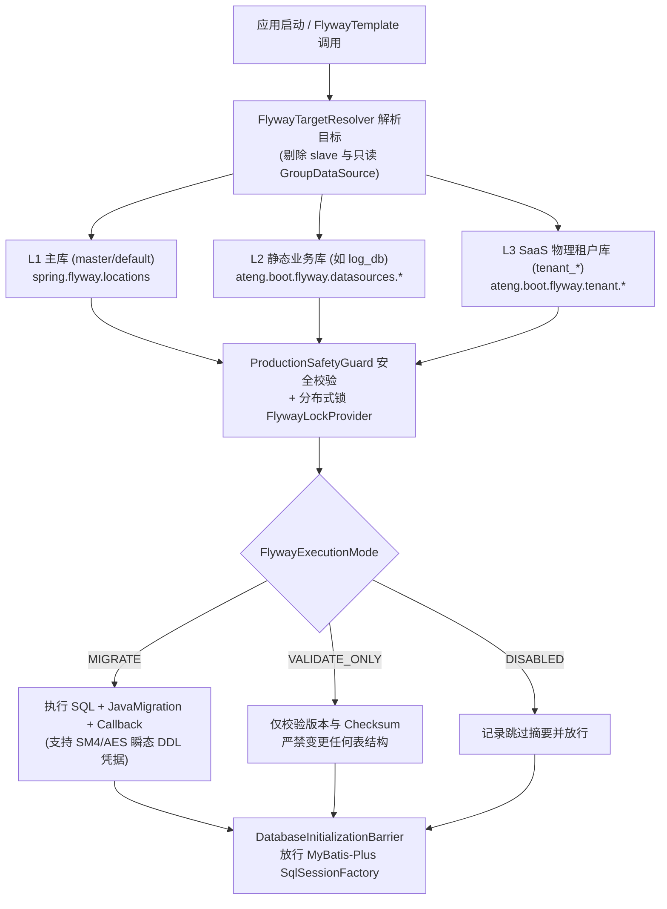
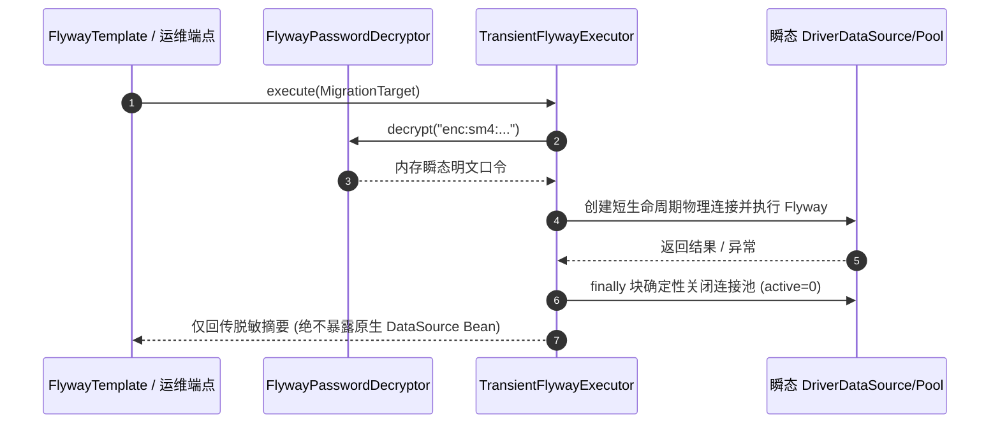
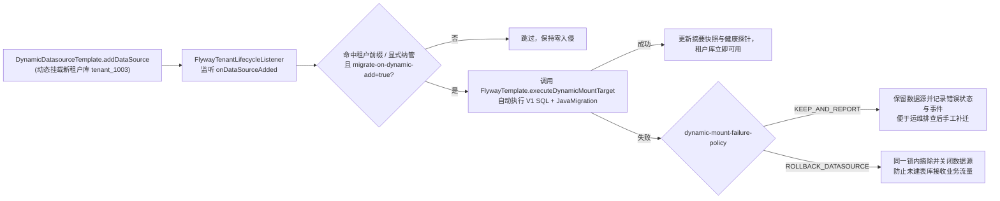

# ateng-boot-flyway 数据库版本化迁移与多数据源协同底座

> 基于 Flyway 10.10.0 与 Spring Boot 3.3.13 构建的生产就绪 Schema 版本化迁移基础设施：统一覆盖 L1 单库/主从锁主库迁移、L2 静态多业务库隔离迁移、L3 SaaS 物理多租户有界并发与动态挂载自动建表、生产 `clean` 强守卫硬熔断、SM4/AES 加密隔离式 DDL 瞬态连接治理、MyBatis-Plus 启动顺序屏障及 Actuator/Micrometer 可观测闭环。

---

## 0. 特性与公共 API 全景速查矩阵 (Feature & API Panorama Matrix)

| 特性分类 | 特性名称 | 核心门面 / 枚举 / SPI | 关键配置项 (`ateng.boot.flyway.*`) | 关键 API 签名 / 核心行为 | 锚定验证源头 (*Test / Sample) |
| :--- | :--- | :--- | :--- | :--- | :--- |
| **启动治理** | 增强开关与三态运行模式 | `FlywayExecutionMode` | `ateng.boot.flyway.enabled`<br>`ateng.boot.flyway.mode`<br>`ateng.boot.flyway.primary-target-key` | `MIGRATE`（自动执行版本迁移）、`VALIDATE_ONLY`（仅只读校验 Checksum 与版本一致性，严禁变更表结构）、`DISABLED`（跳过启动迁移并记录全局跳过摘要，仅保留 `FlywayTemplate` 编程门面）；`enabled=false` 或 `spring.flyway.enabled=false` 时完整退让 | `AtengFlywayAutoConfigurationTest` |
| **启动治理** | Spring Bean 扩展透传与防重复抑制 | `AtengFlywayAutoConfiguration`<br>`AtengFlywayAutoConfigurationImportFilter` | `spring.flyway.*` | 优先于 Spring Boot `FlywayAutoConfiguration` 装配，100% 透传容器 `FlywayConfigurationCustomizer`、`JavaMigration`、`Callback` 与 `FlywayMigrationStrategy`；启用隔离 DDL 凭据时自动屏蔽原生 `FlywayAutoConfiguration` 与 `FlywayEndpointAutoConfiguration` | `AtengFlywayAutoConfigurationTest`<br>`V2__SeedPlatformPresetTenantMigration` |
| **顺序屏障** | MyBatis-Plus 启动初始化顺序屏障 | `AtengFlywayDatabaseInitializerDetector`<br>`AtengMybatisPlusDependsOnDatabaseInitializationDetector` | - | 通过 Spring Boot `DatabaseInitializationDependencyConfigurer` 声明 Flyway 迁移初始化器严格早于 `SqlSessionFactory`、`SqlSessionTemplate`、动态 SQL 预热与业务 Service Bean 初始化 | `FlywayMybatisPlusBarrierTest`<br>`FlywayMigrationController` |
| **对称门面** | 单目标迁移 / 校验 / 预检 / 探查 | `FlywayTemplate` | `ateng.boot.flyway.primary-target-key` | `MigrationOutcome migrate()` / `migrate(String)`；`MigrationValidationResult validate()` / `validate(String)`；`List<MigrationScriptInfo> pending()` / `pending(String)`（Dry-Run）；`MigrationTargetInfo info()` / `info(String)`；`MigrationSummary getLastMigrationSummary()`；生命周期协同方法 `BatchMigrationResult executeStartupTargets(FlywayExecutionMode)`、`MigrationOutcome executeDynamicMountTarget(String, FlywayExecutionMode, boolean)`、`void recordSkippedStartupSummary()` | `FlywayTemplateTest`<br>`FlywayMigrationController`<br>`FlywayGovernanceController` |
| **对称门面** | 基线初始化 / 历史修复 / 受卫清理 | `FlywayTemplate` | - | `MigrationBaselineResult baseline()` / `baseline(String)` / `baseline(String, String, String)`；`MigrationRepairResult repair()` / `repair(String)`；`MigrationCleanResult clean()` / `clean(String)`（受 `ProductionSafetyGuard` 物理熔断守护） | `FlywayTemplateTest`<br>`FlywayGovernanceController` |
| **对称门面** | 多目标批量迁移 / 校验 / 汇总视图 | `FlywayTemplate`<br>`BatchExecutionPolicy` | `ateng.boot.flyway.static-failure-policy` | `BatchMigrationResult migrateTargets()` / `migrateTargets(BatchExecutionPolicy)` / `migrateTargets(Collection<String>)` / `migrateTargets(Collection<String>, BatchExecutionPolicy)`；`validateTargets(...)` 对称重载；`List<MigrationTargetInfo> infoAll()` / `infoAll(Collection<String>)`；`FAIL_FAST`（快速中断）vs `FAIL_SAFE`（隔离失败继续执行） | `DynamicDatasourceMultiTargetTest`<br>`FlywayMigrationController` |
| **生产守卫** | 破坏性清理与高危配置强熔断 | `ProductionSafetyGuard` | `ateng.boot.flyway.guard.enabled`<br>`ateng.boot.flyway.guard.protected-profiles`<br>`ateng.boot.flyway.guard.forbid-clean-in-protected-profiles`<br>`ateng.boot.flyway.guard.forbid-clean-always`<br>`ateng.boot.flyway.guard.forbid-clean-on-validation-error` | 受保护 Profile（默认 `prod`, `production`, `prd`，大小写不敏感）下物理锁定 `cleanDisabled=true`、拦截 `clean()`（无视 `spring.flyway.clean-disabled=false`）并 Fail-Fast 阻断 `clean-on-validation-error=true`，统一抛出 `CLEAN_FORBIDDEN(62003)` | `ProductionSafetyGuardTest`<br>`FlywayProtectedProfileGuardIntegrationTest`<br>`FlywayGovernanceController` |
| **凭据隔离** | SM4/AES 加密隔离 DDL 凭据与瞬态连接池 | `FlywayPasswordDecryptor`<br>`TransientFlywayExecutor`<br>`FlywayTemplate` | `ateng.boot.flyway.credential.enabled`<br>`ateng.boot.flyway.credential.url`<br>`ateng.boot.flyway.credential.driver-class-name`<br>`ateng.boot.flyway.credential.username`<br>`ateng.boot.flyway.credential.password`<br>`ateng.boot.flyway.credential.secret-key`<br>`ateng.boot.flyway.credential.iv`<br>`ateng.boot.flyway.credential.connect-timeout` | 复用 `CryptoUtil` 内存瞬态解密 `enc:sm4:` / `enc:aes:` 口令，构造短生命周期连接池并在 `finally` 块确定性关闭；绝不向容器注册持久化 DDL `DataSource` 或闭池原生 `Flyway` Bean；`getActiveTransientPoolCount()` / `getClosedTransientPoolCount()` 用于防泄漏核验 | `IsolatedCredentialTest`<br>`FlywayGovernanceController`<br>`FlywayGovernanceService` |
| **多源协同** | 主从锁主库与静态业务库独立治理 | `DynamicDatasourceFlywayTargetResolver`<br>`SingleDataSourceFlywayTargetResolver`<br>`MigrationTargetKind` | `ateng.boot.flyway.routing.skip-slave`<br>`ateng.boot.flyway.routing.skip-read-only-group`<br>`ateng.boot.flyway.routing.excluded-data-sources`<br>`ateng.boot.flyway.datasources.<dsKey>.*` | 联动 `ateng-boot-datasource` 物理拆包主库，永久排除 `slave`/`*_slave`/`slave_*` 与只读 `GroupDataSource`；`MigrationTargetKind` 包含 `PRIMARY`、`STATIC_DATASOURCE`、`TENANT`、`CUSTOM`；支持按 `<dsKey>` 独立覆写 `enabled`、`locations`（缺省 `classpath:db/migration/{dsKey}`）、`table`、`schemas`、`default-schema`、`baseline-*`、`validate-on-migrate`、`out-of-order`、`encoding`、`placeholders` 与目标级 `credential` | `DynamicDatasourceMultiTargetTest`<br>`FlywaySampleControllersMockMvcTest` |
| **SaaS 租户** | L3 物理租户有界并发批量迁移与校验 | `FlywayTemplate` | `ateng.boot.flyway.tenant.enabled`<br>`ateng.boot.flyway.tenant.migrate-on-startup`<br>`ateng.boot.flyway.tenant.async-startup`<br>`ateng.boot.flyway.tenant.concurrency`<br>`ateng.boot.flyway.tenant.batch-timeout`<br>`ateng.boot.flyway.tenant.failure-policy`<br>`ateng.boot.flyway.tenant.data-source-prefix`<br>`ateng.boot.flyway.tenant.locations` | `BatchMigrationResult migrateAllTenants()` / `migrateAllTenants(BatchExecutionPolicy)`；`BatchMigrationResult validateAllTenants()` / `validateAllTenants(BatchExecutionPolicy)`；`CompletableFuture<BatchMigrationResult> getStartupTenantMigrationFuture()`；复用 Core 受管线程池与 `AsyncContext` 四维上下文透传；并支持继承与 `datasources.<dsKey>.*` 同构的 `table`/`schemas`/`default-schema`/`baseline-*`/`validate-on-migrate`/`out-of-order`/`encoding`/`placeholders`/`credential` 覆写 | `TenantMultiTenancyLifecycleTest`<br>`FlywayTenantController` |
| **SaaS 租户** | 运行期动态挂载租户库自动迁移与失败回滚 | `FlywayTenantLifecycleListener`<br>`DynamicMountFailurePolicy` | `ateng.boot.flyway.tenant.migrate-on-dynamic-add`<br>`ateng.boot.flyway.tenant.dynamic-mount-failure-policy` | 监听 `DynamicDatasourceTemplate.addDataSource` / 差量同步新增，命中租户前缀或显式纳管库立即触发建表/校验；失败按 `KEEP_AND_REPORT`（默认保留并上报）或 `ROLLBACK_DATASOURCE`（同锁临界区内摘除并关闭数据源）处置 | `TenantMultiTenancyLifecycleTest`<br>`FlywayTenantController` |
| **脚本上下文** | 只读上下文迁移占位符注入 | `FlywayConfigurationSupport` | `ateng.boot.flyway.placeholder.enabled`<br>`ateng.boot.flyway.placeholder.ds-key-name`<br>`ateng.boot.flyway.placeholder.tenant-id-name` | 执行迁移前自动注入 `ateng_ds_key` 与 `ateng_tenant_id`（仅在未显式配置同名占位符时兜底补全，绝不覆盖用户显式配置） | `DynamicDatasourceMultiTargetTest` |
| **SPI 扩展** | 迁移目标路由 / 并发互斥锁 / 生命周期监听 | `FlywayTargetResolver`<br>`FlywayLockProvider`<br>`DefaultFlywayLockProvider`<br>`FlywayMigrationListener` | `ateng.boot.flyway.lock-wait-timeout` | `FlywayTargetResolver` 定制目标发现；`FlywayLockProvider`（`tryLock` / `unlock` / `executeWithLock`）定制分布式互斥锁；`FlywayMigrationListener`（`onBeforeMigrate` / `onMigrationSucceeded` / `onMigrationFailed`）扩展回调，支持 `FlywayTemplate.addMigrationListener` / `removeMigrationListener` | `FlywayObservabilityAndEventsTest`<br>`FlywayTemplateTest` |
| **事件模型** | 迁移完成与失败领域事件及结构化结果 | `FlywayMigrationCompletedEvent`<br>`FlywayMigrationFailedEvent`<br>`MigrationOutcome`<br>`BatchMigrationResult` | - | 迁移成功发布 `FlywayMigrationCompletedEvent`，失败发布含脱敏原因的 `FlywayMigrationFailedEvent`；批量回执提供 `isAllSuccess()` / `hasFailures()` / `getFailedTargets()` / `getTargetDurations()` / `getOutcomes()` / `getFailures()` | `FlywayObservabilityAndEventsTest` |
| **可观测性** | 缓存感知健康探针与 Micrometer 指标 | `FlywayHealthIndicator`<br>`FlywayMetricsBinder` | `ateng.boot.flyway.observability.health-enabled`<br>`ateng.boot.flyway.observability.health-cache-ttl`<br>`ateng.boot.flyway.observability.metrics-enabled` | Actuator `/actuator/health` 注册 `flyway` 组件（Bean `flywayHealthIndicator`，`ReentrantLock` + TTL 防 DB 击穿，迁移回调自动 `invalidateCache()`）；Micrometer 绑定 6 大指标：`ateng.flyway.migrations.total`、`ateng.flyway.migrations.executed`、`ateng.flyway.migration.duration`、`ateng.flyway.migrations.pending`（统计默认主目标库待执行脚本数）、`ateng.flyway.failed.targets`、`ateng.flyway.success.targets` | `FlywayObservabilityAndEventsTest`<br>`FlywayGovernanceController` |
| **异常契约** | 脱敏语义异常与 62001~62020 号段错误码 | `FlywayException`<br>`FlywayResultCode` | - | 继承 `BusinessException` 并完整保留 `cause` 链与 URL/密码脱敏（分配号段 `62001~62020`，当前已定义 `62001~62009`）：`62001` (`MIGRATION_FAILED`)、`62002` (`VALIDATION_FAILED`)、`62003` (`CLEAN_FORBIDDEN`)、`62004` (`TARGET_NOT_FOUND`)、`62005` (`BASELINE_FAILED`)、`62006` (`REPAIR_FAILED`)、`62007` (`CREDENTIAL_DECRYPT_FAILED`)、`62008` (`LOCK_TIMEOUT`)、`62009` (`CONFIG_INVALID`) | `FlywayTemplateTest`<br>`ProductionSafetyGuardTest`<br>`FlywaySampleControllersMockMvcTest` |

---

## 1. 模块定位与快速起步 (Quick Start)

`ateng-boot-flyway` 是针对 Spring Boot 3 企业工程演进设计的 Flyway 版本化 Schema 迁移 Starter，重点解决以下生产痛点：

- **统一接管但不吞并原生态**：复用 `spring.flyway.*` 原生配置作为真源，完整保留 `JavaMigration`、`Callback`、`FlywayConfigurationCustomizer` 等原生扩展点，同时注入 `ateng.boot.flyway.*` 企业级治理与编程式门面。
- **主从分离与多租户安全防线**：联动 `ateng-boot-datasource` 时自动拆包物理主库并永久屏蔽只读从库与 `GroupDataSource`；支持 L2 静态业务库独立历史表与脚本路径，以及 L3 SaaS 物理多租户有界并发批量迁移与动态挂载自动建表。
- **高危清库物理熔断与 DDL 最小权限隔离**：在 `prod`/`production`/`prd` 等受保护环境下无视误配强制禁止 `clean`；支持 SM4/AES 密文高权限 DDL 凭据以短生命周期瞬态连接池执行迁移并在 `finally` 关闭，杜绝容器暴露高权限 `DataSource` Bean。
- **按需正交引入**：不强制捆绑进 [`ateng-boot-all`](../ateng-boot-all/README.md)，对无状态边缘微服务与纯查询应用保持零运行时开销与零传递依赖负担。



### 1.1 Maven 坐标引入

> [!IMPORTANT]
> Flyway 10.x 已将各数据库方言适配器拆分为独立模块。除导入 `ateng-boot-flyway` 外，请务必根据目标数据库按需显式引入对应的 Flyway 方言依赖（如 `flyway-mysql`、`flyway-database-postgresql` 等；测试或嵌入式 H2 默认由 `flyway-core` 内置支持）。

#### 方式一：通过 `ateng-boot-bom` 统管版本按需引入（推荐）

```xml
<dependencyManagement>
    <dependencies>
        <dependency>
            <groupId>io.github.atengk</groupId>
            <artifactId>ateng-boot-bom</artifactId>
            <version>1.2.0</version>
            <type>pom</type>
            <scope>import</scope>
        </dependency>
    </dependencies>
</dependencyManagement>

<dependencies>
    <dependency>
        <groupId>io.github.atengk</groupId>
        <artifactId>ateng-boot-flyway</artifactId>
    </dependency>
    <!-- Flyway 10.x 模块化方言包：使用 MySQL / PostgreSQL 时按需二选一或按库叠加 -->
    <dependency>
        <groupId>org.flywaydb</groupId>
        <artifactId>flyway-mysql</artifactId>
    </dependency>
    <!-- 可选：需要多数据源 / 物理多租户协同或 Actuator 监控时按需引入 -->
    <dependency>
        <groupId>io.github.atengk</groupId>
        <artifactId>ateng-boot-datasource</artifactId>
    </dependency>
    <dependency>
        <groupId>org.springframework.boot</groupId>
        <artifactId>spring-boot-starter-actuator</artifactId>
    </dependency>
</dependencies>
```

#### 方式二：独立引入指定版本号

```xml
<dependency>
    <groupId>io.github.atengk</groupId>
    <artifactId>ateng-boot-flyway</artifactId>
    <version>1.2.0</version>
</dependency>
```

### 1.2 最小可运行配置（YAML）

以下配置即可启动单库版本化迁移与生产守卫（完整多库与租户拓扑见第 4、5 节及完整示例工程 [`ateng-boot-sample-flyway`](../ateng-boot-samples/ateng-boot-sample-flyway/README.md)）：

```yaml
spring:
  flyway:
    locations: classpath:db/migration/master
    baseline-on-migrate: false
    validate-on-migrate: true
    clean-disabled: true

ateng:
  boot:
    flyway:
      enabled: true
      mode: MIGRATE
      guard:
        enabled: true
        forbid-clean-in-protected-profiles: true
        forbid-clean-on-validation-error: true
```

---

## 2. 单库启动接管、三态模式与持久层顺序屏障

### 2.1 三态启动运行模式与 Spring Bean 迁移扩展

`ateng.boot.flyway.mode` 提供三态控制，满足不同交付阶段对 Schema 变更权限的管控要求：
- `MIGRATE`（默认）：启动时依次对受管目标执行脚本迁移。
- `VALIDATE_ONLY`：启动仅校验已部署数据库与本地迁移脚本 Version/Checksum 是否匹配；适合无 DDL 权限的只读应用节点或灰度校验节点。
- `DISABLED`：跳过启动阶段自动迁移，记录各受管目标的跳过摘要（`skipped=true`），仍保留 `FlywayTemplate` 供运维管理端或定时触发。

#### 专属配置（YAML）

```yaml
spring:
  flyway:
    locations: classpath:db/migration/master
    validate-on-migrate: true

ateng:
  boot:
    flyway:
      enabled: true
      mode: MIGRATE # 可选值: MIGRATE | VALIDATE_ONLY | DISABLED
```

#### 真实 Java 扩展示例（提取自 `ateng-boot-sample-flyway`）

容器内声明的 `JavaMigration` 与 `Callback` Bean 会被 `AtengFlywayAutoConfiguration` 自动发现并注入到所有受管目标迁移流水线中：

```java
@Component
public class V2__SeedPlatformPresetTenantMigration extends BaseJavaMigration {

    @Override
    public void migrate(Context context) throws Exception {
        Connection connection = context.getConnection();
        if (tableExists(connection, "sys_tenant_registry")) {
            seedMasterTenantRegistry(connection);
        } else if (tableExists(connection, "biz_audit_log")) {
            seedAuditLog(connection);
        } else if (tableExists(connection, "biz_tenant_order")) {
            seedTenantOnboardingOrder(connection);
        }
    }
}
```

#### 原理与边界约束

- **顺序契约**：`@AutoConfiguration(before = FlywayAutoConfiguration.class)` 在装配阶段提前接管，当 `ateng.boot.flyway.enabled=false` 或 `spring.flyway.enabled=false` 时条件退出，完整交还 Spring Boot 原生生命周期。
- **幂等建议**：若多数据源共享 Spring 容器内的同一个 `@Component BaseJavaMigration`，脚本内部应通过目标表探查或 `${ateng_ds_key}` 区分作用域并保证自身幂等。

### 2.2 对称编程式门面 `FlywayTemplate` 与 MyBatis-Plus 顺序屏障

`FlywayTemplate` 将 Flyway 的运行态、校验、预检与历史运维能力收敛为统一强类型契约，并依托 `AtengMybatisPlusDependsOnDatabaseInitializationDetector` 确保容器内 `SqlSessionFactory` 绝对晚于 Flyway 迁移完成初始化。

#### 专属配置（YAML）

```yaml
ateng:
  boot:
    flyway:
      primary-target-key: default # 单库缺省名；若同时启用多数据源则自动对齐 dynamic.primary (如 master)
      lock-wait-timeout: 30s
```

#### 真实 Sample 控制器代码（提取自 `FlywayMigrationController` 与 `FlywayGovernanceController`）

```java
@Validated
@RestController
@RequestMapping("/sample/flyway/migration")
@RequiredArgsConstructor
public class FlywayMigrationController {

    private final FlywayTemplate flywayTemplate;
    private final FlywayPlatformBusinessService platformBusinessService;

    @PostMapping("/execute")
    public Result<MigrationOutcome> executeMigration(@Valid @RequestBody TargetOperationRequest request) {
        return Result.success(flywayTemplate.migrate(request.getTargetKey()));
    }

    @GetMapping("/pending")
    public Result<List<MigrationScriptInfo>> queryPendingScripts(
            @RequestParam(defaultValue = "master") @NotBlank(message = "targetKey 不能为空") String targetKey) {
        return Result.success(flywayTemplate.pending(targetKey));
    }

    @PostMapping("/validate")
    public Result<MigrationValidationResult> validateTarget(@Valid @RequestBody TargetOperationRequest request) {
        return Result.success(flywayTemplate.validate(request.getTargetKey()));
    }

    @GetMapping("/platform/tenants")
    public Result<List<TenantRegistryResponse>> listPlatformTenants() {
        return Result.success(platformBusinessService.listPlatformTenants());
    }
}
```

#### 原理与边界约束

- **目标寻址 Fail-Fast**：传入未纳管或不存在的 `targetKey`（包含显式排除的从库）时，立即抛出 `FlywayException(FlywayResultCode.TARGET_NOT_FOUND)`（状态码 `62004`）。
- **空安全返参**：`pending()` 与 `infoAll()` 无记录时固定返回不可变空集合（`Collections.emptyList()`），绝不返回 `null`。
- **已有历史执行 `baseline`**：若目标库已存在高于目标 Baseline 版本的有效迁移历史，Flyway 拒绝覆盖并由门面转译为 `FlywayException(FlywayResultCode.BASELINE_FAILED)`（状态码 `62005`）。

---

## 3. 生产防误操作硬守卫与隔离式加密 DDL 凭据

### 3.1 `ProductionSafetyGuard` 破坏性清理硬熔断

为杜绝因配置合并覆盖、误设 `spring.flyway.clean-disabled=false` 或 `spring.flyway.clean-on-validation-error=true` 导致的生产删库事故，底层在构建配置与调用 `FlywayTemplate.clean*` 时执行双重硬校验。

#### 专属配置（YAML）

```yaml
ateng:
  boot:
    flyway:
      guard:
        enabled: true
        protected-profiles:
          - prod
          - production
          - prd
        forbid-clean-in-protected-profiles: true
        forbid-clean-always: false
        forbid-clean-on-validation-error: true
```

#### 真实 Sample 控制器与测试锚点（提取自 `FlywayGovernanceController`）

```java
@PostMapping("/clean")
public Result<MigrationCleanResult> cleanWithGuard(@Valid @RequestBody TargetOperationRequest request) {
    // 即使在测试中误配 spring.flyway.clean-disabled=false，受保护环境下仍会被拦截并返回 62003
    return Result.success(flywayTemplate.clean(request.getTargetKey()));
}
```

#### 原理与边界约束

- **双保险物理拦截**：当命中 `protected-profiles`（如 `prod`、`prd`，大小写不敏感）且 `forbid-clean-in-protected-profiles=true`，或 `forbid-clean-always=true` 时，自动覆盖底层 `FluentConfiguration.cleanDisabled(true)`，并在调用 `clean()` 时抛出 `FlywayException(FlywayResultCode.CLEAN_FORBIDDEN)`（错误码 `62003`）。
- **默认禁止原则**：非生产环境下若 Spring 原生 `spring.flyway.clean-disabled` 保持默认 `true`，`clean()` 同样被拦截拒绝；仅当非受保护环境显式开启允许且 `forbid-clean-always=false` 时方可放行。

### 3.2 隔离式加密 DDL 凭据与零泄漏瞬态连接池

日常应用 DML 账号应遵循最小权限原则（禁止 `CREATE`/`ALTER`/`DROP`）。启用 `ateng.boot.flyway.credential` 后，模块在需要执行 DDL 迁移或运维探查时才使用更高权限的密文凭据创建短生命周期连接池，执行完立即确定性销毁。



#### 专属配置（YAML）

```yaml
ateng:
  boot:
    flyway:
      credential:
        enabled: true
        username: YOUR_DDL_ADMIN_USERNAME
        # 支持明文及 enc:sm4: / enc:aes: 前缀密文：
        # 1) 内嵌密钥 CBC: enc:sm4:<key>:<iv>:<cipher> / enc:aes:<key>:<iv>:<cipher>
        # 2) 内嵌密钥 SM4 ECB: enc:sm4:<key>:<cipher>
        # 3) 配合全局 secret-key/iv: enc:sm4:<cipher> / enc:aes:<cipher>
        password: "enc:sm4:YOUR_SM4_KEY_BASE64:YOUR_SM4_IV_BASE64:YOUR_CIPHERTEXT_BASE64"
        connect-timeout: 10s
```

#### 真实 Sample 演练代码（提取自 `FlywayGovernanceService`）

```java
AtengFlywayProperties.CredentialProperties transientCred = new AtengFlywayProperties.CredentialProperties();
transientCred.setEnabled(true);
transientCred.setUsername(request.getUsername().trim());
transientCred.setPassword(encryptedPassword); // enc:sm4:<keyBase64>:<ivBase64>:<cipherBase64>

MigrationTarget credTarget = MigrationTarget.builder()
        .targetKey(baseTarget.getTargetKey())
        .kind(baseTarget.getKind())
        .tenantId(baseTarget.getTenantId())
        .dataSource(baseTarget.getDataSource())
        .credential(transientCred)
        .migrationConfig(baseTarget.getMigrationConfig())
        .failurePolicy(baseTarget.getFailurePolicy())
        .build();

ValidateResult result = transientExecutor.execute(credTarget, org.flywaydb.core.Flyway::validateWithResult);
// activeTransientPoolCount 恒定归零 (0)，closedTransientPoolCount 精确递增
```

#### 原理与边界约束

- **绝不污染容器候选 `DataSource`**：不会创建标注 `@FlywayDataSource` 的持久化 `DataSource` Bean，也不会暴露持有关闭连接池的原生 `Flyway` Bean（由 `AtengFlywayAutoConfigurationImportFilter` 自动拦截 `FlywayAutoConfiguration` 与 `FlywayEndpointAutoConfiguration`），避免与 MyBatis-Plus/业务数据源竞争主源或导致 `/actuator/flyway` 报错。
- **凭据安全防线**：解密依托 Core 模块 `CryptoUtil` 完成，解密失败抛出 `CREDENTIAL_DECRYPT_FAILED(62007)`；所有日志与异常文本均经 `FlywayConfigurationSupport.sanitizeSensitiveText` 与 `DesensitizeUtil` 掩码，禁止出现明文密钥或连接串账号口令。

---

## 4. 多数据源主从隔离与 L2 静态业务库治理

当工程同时引入 [`ateng-boot-datasource`](../ateng-boot-datasource/README.md) 时，`DynamicDatasourceFlywayTargetResolver` 自动解析所有已注册的数据源，按 `MigrationTargetKind` 将目标归类为 **L1 主库（`PRIMARY`）**、**L2 静态业务库（`STATIC_DATASOURCE`）**、**L3 物理租户库（`TENANT`）** 及自定义扩展目标（`CUSTOM`）。

#### 专属配置（YAML，提取自 `ateng-boot-sample-flyway/src/main/resources/application.yml`；其中 H2 `sa` 与空密码仅限离线演示）

```yaml
spring:
  datasource:
    dynamic:
      primary: master
      datasource:
        master:
          url: jdbc:h2:mem:flyway_sample_master;DB_CLOSE_DELAY=-1;MODE=MySQL
          username: sa
          password: ""
          driver-class-name: org.h2.Driver
        slave:
          url: jdbc:h2:mem:flyway_sample_slave;DB_CLOSE_DELAY=-1;MODE=MySQL
          username: sa
          password: ""
          driver-class-name: org.h2.Driver
        log_db:
          url: jdbc:h2:mem:flyway_sample_log_db;DB_CLOSE_DELAY=-1;MODE=MySQL
          username: sa
          password: ""
          driver-class-name: org.h2.Driver
  flyway:
    locations: classpath:db/migration/master

ateng:
  boot:
    flyway:
      static-failure-policy: FAIL_FAST
      routing:
        skip-slave: true            # 永久跳过 slave / *_slave 只读从库
        skip-read-only-group: true  # 永久跳过读写分离只读集群 GroupDataSource
      datasources:
        log_db:
          enabled: true
          locations:
            - classpath:db/migration/log_db
          table: log_flyway_schema_history
          placeholders:
            auditScope: platform-audit
```

#### 真实 Sample 调用代码（提取自 `FlywayMigrationController`）

```java
@PostMapping("/execute-static")
public Result<BatchMigrationResult> executeStaticTargets() {
    // 显式批量触发静态核心库与独立业务库迁移，按 static-failure-policy (默认 FAIL_FAST) 控制失败阻断
    return Result.success(flywayTemplate.migrateTargets(List.of("master", "log_db")));
}
```

#### 原理与边界约束

- **物理拆包（Zero-Routing-Pollution）**：解析目标是直接从 `DynamicRoutingDataSource.getDataSources()` 读取底层物理 `DataSource` 并拆包 `ItemDataSource`，规避直接向读写路由代理发 DDL 导致串库或错发从库的风险。
- **只读从库零入侵**：`slave`、`*_slave`、`slave_*` 以及只读分组连接池（`GroupDataSource` 及含 `readonly`/`read_only`/`read-only` 标识分组）默认永久被过滤在目标列表之外；未在 `ateng.boot.flyway.datasources` 声明且非 `master`/非租户前缀的第三方辅助源同样保持零入侵跳过。
- **自定义目标扩展**：若未配置 `datasources.<dsKey>.locations`，静态业务库默认隔离扫描 `classpath:db/migration/{dsKey}`，严防与主库脚本混淆执行。

---

## 5. SaaS 物理多租户（L3）批量并发迁移与动态挂载生命周期

面向 SaaS 物理多租户“每租户一库”架构，`ateng-boot-flyway` 打通静态启动批量建表与运行期新租户动态开通挂载自动建表全链路。



### 5.1 全租户有界并发批量迁移与只读上下文占位符

开启 `ateng.boot.flyway.tenant.enabled=true` 后，系统自动识别匹配前缀（默认复用 `ateng.boot.datasource.multi-tenancy.data-source-prefix` 即 `tenant_`）或 `TenantDataSourceProvider` 注册的物理租户库，并与主库脚本目录隔离（默认扫描 `classpath:db/migration/tenant`）。

#### 专属配置（YAML）

```yaml
ateng:
  boot:
    flyway:
      placeholder:
        enabled: true
        ds-key-name: ateng_ds_key
        tenant-id-name: ateng_tenant_id
      tenant:
        enabled: true
        migrate-on-startup: true
        async-startup: false       # 大批量租户库场景可设为 true，启动后异步执行并通过 getStartupTenantMigrationFuture() 获取结果
        concurrency: 2             # 有界并发度（> 1 时自动桥接 Core 受管线程池并透传 AsyncContext）
        batch-timeout: 5m          # 并发批量任务最大等待超时，严防无界挂起
        failure-policy: FAIL_SAFE  # 默认单租户失败不阻断其余租户及平台主库上线
        locations:
          - classpath:db/migration/tenant
```

#### 真实 Sample 控制器代码（提取自 `FlywayTenantController`）

```java
@PostMapping("/migrate-all")
public Result<BatchMigrationResult> migrateAllTenants() {
    return Result.success(flywayTemplate.migrateAllTenants());
}

@PostMapping("/validate-all")
public Result<BatchMigrationResult> validateAllTenants() {
    return Result.success(flywayTemplate.validateAllTenants());
}
```

#### 原理与边界约束

- **严格线程安全与超时防悬挂**：当 `concurrency > 1` 时依托 Core 模块受管线程池启动有界 Worker 任务并发池（上限 `min(concurrency, total)`，由 `AtomicInteger` 游标分派任务），并透传 `<MDC, User, TenantId, IgnoreTenant>` 四维上下文，**严禁私自新建野线程**；总协调受 `batch-timeout`（默认 `PT10M`）刚性约束，超时抛出受管异常。
- **上下文占位符防覆盖原则**：迁移前置自动向每个目标注入 `${ateng_ds_key}` 与 `${ateng_tenant_id}`（仅当用户未在 `spring.flyway.placeholders` 或 `datasources.<key>.placeholders` / `tenant.placeholders` 中显式配置同名变量时生效）。

### 5.2 运行期动态挂载新租户库与失败处置策略

#### 专属配置（YAML）

```yaml
ateng:
  boot:
    flyway:
      tenant:
        enabled: true
        migrate-on-dynamic-add: true
        dynamic-mount-failure-policy: KEEP_AND_REPORT # 或 ROLLBACK_DATASOURCE
```

#### 真实 Sample 挂载与业务验证代码（提取自 `FlywayPlatformBusinessService`）

```java
if (!dynamicDatasourceTemplate.containsDataSource(dsKey)) {
    DataSourceProperty property = buildTenantDataSourceProperty(dsKey, request);
    // 触发 DynamicDatasourceLifecycleListener -> FlywayTenantLifecycleListener 自动完成建表与 V2 种子数据
    dynamicDatasourceTemplate.addDataSource(dsKey, property, false);
}
MigrationTargetInfo targetInfo = flywayTemplate.info(dsKey);
```

#### 原理与边界约束

- **双模容错语义**：默认 `KEEP_AND_REPORT` 在自动迁移失败时保留数据源连接并写入全局失败摘要与 `FlywayMigrationFailedEvent`，便于人工修补后再次调用 `flywayTemplate.migrate(dsKey)` 重试；切换为 `ROLLBACK_DATASOURCE` 后，系统在同一生命周期链路中调用 `DynamicDatasourceTemplate.removeDataSource(dsKey, true)` 摘除缺表租户源，并受核心白名单保护不误删 `master`。
- **异步启动并发协调**：`async-startup=true` 时，可通过 `flywayTemplate.getStartupTenantMigrationFuture()` 跟踪启动期异步租户迁移进展，任务完毕后自动将结果增量归并至 `getLastMigrationSummary()`。

---

## 6. SPI 扩展定制、领域事件与云原生可观测闭环

### 6.1 可扩展 SPI 与 Spring 领域事件总线

所有核心协作关节均提供带 `@ConditionalOnMissingBean` 保护的 SPI 与事件钩子，业务团队可按需零侵入替换：

| 扩展接口 / 事件 | 触发时机与职责 | 注册方式 |
| :--- | :--- | :--- |
| `FlywayTargetResolver` | 自定义发现和过滤受管控目标数据源 | 注册 Spring `@Bean` 覆盖默认路由器 |
| `FlywayLockProvider` | 接入基于 Redis / ZooKeeper 的跨节点迁移互斥锁 | 注册 Spring `@Bean` 覆盖默认 `DefaultFlywayLockProvider` |
| `FlywayMigrationListener` | 监听 `onBeforeMigrate` / `onMigrationSucceeded` / `onMigrationFailed`（异常隔离） | 注册 Spring `@Bean` 或调用 `flywayTemplate.addMigrationListener(...)` |
| `FlywayMigrationCompletedEvent` | 单库或任一目标迁移成功时广播（携带 `MigrationOutcome`） | `@EventListener` |
| `FlywayMigrationFailedEvent` | 单库或任一目标迁移失败时广播（异常消息已完成脱敏） | `@EventListener` |

#### 专属配置（YAML，提取自 `ateng-boot-sample-flyway/src/main/resources/application.yml`）

```yaml
ateng:
  boot:
    flyway:
      # 分布式并发互斥锁（FlywayLockProvider）最大等待超时时间，超时抛出 LOCK_TIMEOUT (62008)
      lock-wait-timeout: 30s
```

#### 真实事件监听代码（1:1 提取自 `SampleFlywayEventListener`）

```java
@Slf4j
@Component
public class SampleFlywayEventListener {

    private final AtomicInteger completedEventCount = new AtomicInteger(0);
    private final AtomicInteger failedEventCount = new AtomicInteger(0);

    @EventListener
    public void onCompleted(FlywayMigrationCompletedEvent event) {
        completedEventCount.incrementAndGet();
        MigrationOutcome outcome = event.getOutcome();
        log.info("[SampleFlyway] 迁移完成事件 [target={}, version={}, executed={}]",
                outcome.getTargetKey(), outcome.getTargetSchemaVersion(), outcome.getMigrationsExecuted());
    }

    @EventListener
    public void onFailed(FlywayMigrationFailedEvent event) {
        failedEventCount.incrementAndGet();
        log.error("[SampleFlyway] 迁移失败事件 [target={}, mode={}, reason={}]",
                event.getTargetKey(), event.getMode(), event.getErrorMessage());
    }
}
```

#### 原理与边界约束

- **监听异常严格隔离**：容器与编程注册的 `FlywayMigrationListener` 回调异常均被捕获记录日志，绝不反向污染单库迁移返回结果。
- **并发锁对称释锁**：自定义实现 `FlywayLockProvider`（`tryLock(String, Duration)` / `unlock(String)`）后，框架在 `executeWithLock` 的 `finally` 块保证对称解锁；等待超时统一抛出 `FlywayException(FlywayResultCode.LOCK_TIMEOUT)`（错误码 `62008`）。
- **事件载荷全量脱敏**：`FlywayMigrationFailedEvent.getErrorMessage()` 已通过 `FlywayConfigurationSupport.sanitizeSensitiveText` 自动掩码 JDBC 凭据与口令，防止凭据经事件总线二次扩散。

### 6.2 Actuator 健康探针与 Micrometer 指标体系

#### 专属配置（YAML）

```yaml
ateng:
  boot:
    flyway:
      observability:
        health-enabled: true
        health-cache-ttl: 5s # 生产推荐 30s，设为 PT0S 时每次探查均直连校验；迁移回调自动失效缓存
        metrics-enabled: true

management:
  endpoints:
    web:
      exposure:
        include: health,info,metrics
  endpoint:
    health:
      show-details: always
```

#### 真实 Sample 探针调用代码（提取自 `FlywayGovernanceController`）

```java
@GetMapping("/health")
public Result<MigrationHealthResponse> queryHealth() {
    return Result.success(governanceService.queryMigrationHealth());
}
```

#### 度量指标全集（`FlywayMetricsBinder`）

| 指标名称 | 指标类型 | 标签 (`Tags`) | 指标含义 |
| :--- | :---: | :---: | :--- |
| `ateng.flyway.migrations.total` | `Counter` | `target`, `outcome` (`success` / `failure`) | 各目标库累计迁移触发次数 |
| `ateng.flyway.migrations.executed` | `Counter` | `target` | 各目标库实际成功执行的版本脚本累计数量 |
| `ateng.flyway.migration.duration` | `Timer` | `target`, `outcome` (`success` / `failure`) | 各目标库单次迁移耗时分布 |
| `ateng.flyway.migrations.pending` | `Gauge` | - | 默认主目标数据源待执行迁移脚本实时数量（内置 TTL 防抓取风暴缓存） |
| `ateng.flyway.failed.targets` | `Gauge` | - | 最近一次全局/批量迁移失败目标数量 |
| `ateng.flyway.success.targets` | `Gauge` | - | 最近一次全局/批量迁移成功目标数量 |

#### 原理与边界约束

- **健康探针防雪崩与虚拟线程友好**：`FlywayHealthIndicator` 使用 `ReentrantLock` 替代 `synchronized` 守护缓存快照更新（杜绝 JDK 21+ 虚拟线程 Carrier Pinning）；任何迁移成功或失败均通过 `FlywayMigrationListener` 自动调用 `invalidateCache()`，无需等待缓存过期。
- **启动早于 `MeterRegistry` 时序兼容**：`FlywayMetricsBinder` 内置有界缓冲队列（`MAX_PENDING_OUTCOMES = 1024`），即使启动期迁移早于 Micrometer 注册表装配完成，在 `bindTo(MeterRegistry)` 时仍会自动补账回放，超限丢弃并告警防 OOM。

---

## 7. 生产级非功能边界、排障指南与避坑清单

### 7.1 `spring.flyway.*` 与 `ateng.boot.flyway.*` 优先级及共存规则

1. **全局与底层迁移参数**：`spring.flyway.*` 继续作为脚本编码、基线、历史表名、占位符、校验开关的原生真源；`ateng.boot.flyway.datasources.<dsKey>.*` 与 `ateng.boot.flyway.tenant.*` 仅针对特定目标库或租户分组增量覆写。
2. **上下文占位符不可逆越权原则**：自动注入的 `${ateng_ds_key}` 与 `${ateng_tenant_id}` 仅填充未显式声明的键，绝不会覆盖用户主动配置的同名占位符。
3. **关闭联动**：将 `ateng.boot.flyway.enabled=false` 时自动退让给 Spring Boot 原生 `FlywayAutoConfiguration`；将 `spring.flyway.enabled=false` 时会联动停止整个自动装配，确保测试切片与极简进程零开销启动。

### 7.2 常见状态码（分配号段 `62001 ~ 62020`，当前已定义 `62001 ~ 62009`）与高频排障手册

| 状态码 | 枚举名 | 常见根因与排查建议 |
| :---: | :--- | :--- |
| `62001` | `MIGRATION_FAILED` | SQL 语法错误、目标库方言包缺失（如 MySQL 未引入 `flyway-mysql`）或表锁冲突；检查 `FlywayMigrationFailedEvent` 中的脱敏摘要与底层 `cause` |
| `62002` | `VALIDATION_FAILED` | 本地 SQL 文件被篡改导致 Checksum 不一致、脚本缺失或处于 `VALIDATE_ONLY` 模式下存在未执行的 Pending 脚本；确认无历史回改风险后可在非保护链路执行 `repair` |
| `62003` | `CLEAN_FORBIDDEN` | 受保护环境命中 `protected-profiles`（默认 `prod`/`production`/`prd`）、`forbid-clean-always=true` 或 `spring.flyway.clean-disabled=true`（默认）；受保护环境下请严格禁止任何清库行为 |
| `62004` | `TARGET_NOT_FOUND` | 传入空值、不存在的数据源 Key，或传入了被路由规则永久屏蔽的从库（`slave`/`*_slave`）与只读分组名 |
| `62005` | `BASELINE_FAILED` | 对已经存在迁移历史且版本大于等于目标 `baseline-version` 的目标库重复执行 `baseline` |
| `62006` | `REPAIR_FAILED` | 修复迁移历史表校验和或清理失败记录时底层数据库连接或权限异常 |
| `62007` | `CREDENTIAL_DECRYPT_FAILED` | `enc:sm4:` / `enc:aes:` 密文段格式非法、Base64/Hex 编码损坏或全局 `secret-key`/`iv` 不匹配 |
| `62008` | `LOCK_TIMEOUT` | `FlywayLockProvider` 在 `ateng.boot.flyway.lock-wait-timeout` 窗口内未能获得目标库互斥锁，检查多实例并发部署锁持有人或数据库会话阻塞 |
| `62009` | `CONFIG_INVALID` | 非法配置组合（如缺少有效路由目标或超出约束范围参数） |

### 7.3 工程红线与避坑清单

- **严禁声明持久化 `@FlywayDataSource` Bean**：使用高权限 DDL 账号时统一通过 `ateng.boot.flyway.credential.*` 或 `datasources.<dsKey>.credential.*` 配置，由底座创建瞬态连接池执行并在结束时关闭，避免污染容器内业务 `DataSource` 选择。
- **不建议将 `ateng-boot-flyway` 放入公共纯工具二方库传递暴露**：已确认 `ateng-boot-all` 与 `ateng-boot-sample-smoke-test` 不强依赖本模块，业务按需按 BOM 引入即可。
- **全架构设计权衡**：完整背景取舍、L1~L3 分级架构与隔离式连接池设计推导见 [`ADR-0107`](../docs/adr/0107-flyway-database-migration-and-multi-datasource-architecture.md)。

---

## 8. 完整 YAML 配置附录 (Full Configuration Reference)

以下配置清单逐字段对齐 `AtengFlywayProperties`（前缀 `ateng.boot.flyway`），展示全部可用配置项及其默认值与强类型量纲：

```yaml
ateng:
  boot:
    flyway:
      enabled: true                            # 是否启用 ateng-boot-flyway 增强底座（关闭时完整退让给 Spring Boot 原生）
      primary-target-key: default              # 单数据源默认主目标标识（动态多源模式下自动对齐 dynamic.primary）
      mode: MIGRATE                            # 启动执行模式: MIGRATE | VALIDATE_ONLY | DISABLED
      static-failure-policy: FAIL_FAST         # L1/L2 静态目标批量执行失败策略: FAIL_FAST | FAIL_SAFE
      lock-wait-timeout: 30s                   # FlywayLockProvider 分布式迁移锁最大等待超时（Duration）

      guard:
        enabled: true                          # 是否启用生产防误操作硬守卫
        protected-profiles:                    # 受保护生产环境 Profile 列表（大小写不敏感匹配）
          - prod
          - production
          - prd
        forbid-clean-in-protected-profiles: true # 受保护环境下是否物理禁止任何 clean（无视 spring.flyway.clean-disabled=false）
        forbid-clean-always: false               # 是否无条件在全部环境永久禁止 clean
        forbid-clean-on-validation-error: true   # 受保护环境下是否 Fail-Fast 拦截 clean-on-validation-error=true

      credential:
        enabled: true                          # 是否允许启用隔离式高权限 DDL 凭据（配置了 url/username/password 之一时激活）
        url:                                   # 可选：独立 DDL 连接 URL（缺省自动复用目标运行期 DataSource）
        driver-class-name:                     # 可选：JDBC 驱动全限定类名
        username:                              # 高权限 DDL 账号用户名
        password:                              # 高权限 DDL 账号口令（支持明文以及 enc:sm4:<key>:<iv>:<cipher> / enc:sm4:<key>:<cipher> / enc:aes:<key>:<iv>:<cipher> / 全局密文 enc:sm4:<cipher> / enc:aes:<cipher>）
        secret-key:                            # 可选：全局对称解密密钥（用于使用全局密钥的单载荷密文 enc:sm4:<cipher> / enc:aes:<cipher>）
        iv:                                    # 可选：全局初始向量 IV（用于使用全局密钥的 CBC 密文）
        connect-timeout: 10s                   # 瞬态 DDL 连接池连接超时时间（Duration）

      placeholder:
        enabled: true                          # 是否自动注入只读上下文占位符（绝不覆盖用户显式配置）
        ds-key-name: ateng_ds_key              # 目标数据源标识占位符变量名
        tenant-id-name: ateng_tenant_id        # 租户标识占位符变量名

      routing:
        skip-slave: true                       # 是否永久排除 slave 与 *_slave 从库目标
        skip-read-only-group: true             # 是否永久排除只读分组 GroupDataSource
        excluded-data-sources: []              # 额外强制排除的辅助数据源标识列表

      datasources:                             # 显式纳管的静态业务独立库（L2），Key 为数据源标识（如 log_db）
        log_db:
          enabled: true                        # 是否启用该目标迁移（false 时跳过）
          locations:                           # 独立脚本目录（未配置时默认隔离为 classpath:db/migration/{dsKey}）
            - classpath:db/migration/log_db
          table:                               # 可选：独立迁移历史记录表名（缺省继承 spring.flyway.table）
          schemas: []                          # 可选：独立受控 Schema 列表
          default-schema:                      # 可选：独立默认 Schema
          baseline-on-migrate:                 # 可选：目标级 baseline-on-migrate 覆写
          baseline-version:                    # 可选：目标级基线版本
          baseline-description:                # 可选：目标级基线描述
          validate-on-migrate:                 # 可选：目标级校验开关
          out-of-order:                        # 可选：目标级乱序开关
          encoding:                            # 可选：目标级脚本字符集编码（Charset）
          placeholders: {}                     # 可选：目标级专属占位符（优先于全局配置及自动注入占位符）
          credential:                          # 可选：目标级独立隔离高权限 DDL 凭据
            enabled: true
            url:
            driver-class-name:
            username:
            password:
            secret-key:
            iv:
            connect-timeout: 10s

      tenant:                                  # SaaS 物理多租户（L3）治理配置
        enabled: false                         # 是否开启物理多租户迁移发现与生命周期同步
        migrate-on-startup: true               # 应用启动时是否自动迁移/校验全部已有租户库
        migrate-on-dynamic-add: true           # 运行期动态挂载新租户库时是否自动触发迁移/校验
        async-startup: false                   # 启动期全租户批量迁移是否异步执行（避免阻断启动端口就绪）
        concurrency: 1                         # 有界并发度（> 1 启用 Core 受管线程池并透传四维上下文）
        batch-timeout: 10m                     # 并发批量协调等待最大超时时间（Duration）
        failure-policy: FAIL_SAFE              # 租户批量失败容错策略: FAIL_SAFE | FAIL_FAST
        dynamic-mount-failure-policy: KEEP_AND_REPORT # 动态挂载迁移失败策略: KEEP_AND_REPORT | ROLLBACK_DATASOURCE
        data-source-prefix:                    # 可选：租户库前缀覆写（缺省继承 ateng.boot.datasource.multi-tenancy.data-source-prefix）
        locations:
          - classpath:db/migration/tenant
        table:
        schemas: []
        default-schema:
        baseline-on-migrate:
        baseline-version:
        baseline-description:
        validate-on-migrate:
        out-of-order:
        encoding:
        placeholders: {}
        credential:                            # 可选：租户组级隔离高权限 DDL 凭据（完整子项同 ateng.boot.flyway.credential.*）
          enabled: true
          url:
          driver-class-name:
          username:
          password:
          secret-key:
          iv:
          connect-timeout: 10s

      observability:
        health-enabled: true                   # 是否注册 Actuator FlywayHealthIndicator
        health-cache-ttl: 30s                  # 健康探针防击穿缓存窗口（Duration；PT0S 表示不缓存）
        metrics-enabled: true                  # 是否注册 Micrometer FlywayMetricsBinder 指标
```
