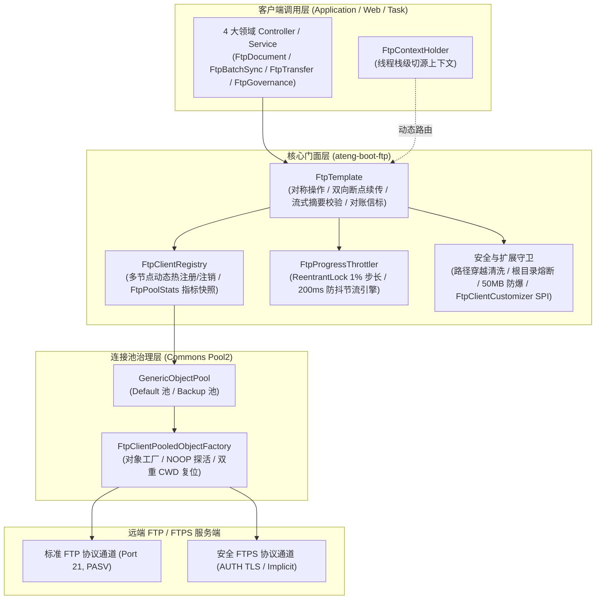
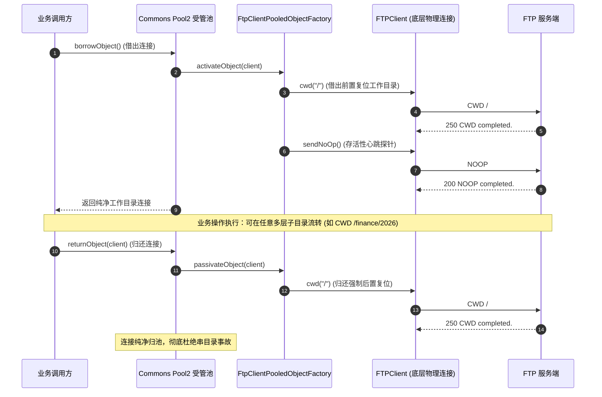
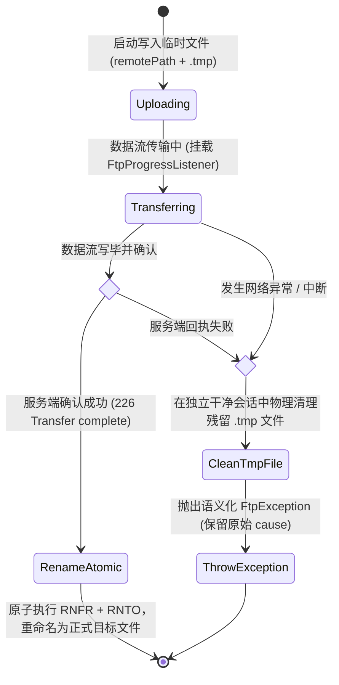

# ateng-boot-ftp 基础设施 Starter

> 面向企业级高可靠生产环境的纯原生 FTP / FTPS 双模基础设施 Starter。基于 Apache Commons Net 与 Commons Pool2 受管对象池构建，提供连接池心跳保活断线自愈、双重工作目录复位防串目录、`FtpContextHolder` 线程栈级动态切源与 `FtpClientRegistry` 运行期动态节点热注册/注销、全目录递归镜像同步与 Fail-Safe 容错批处理引擎、大文件双向断点续传（`APPE`/`REST` + 非对称服务端防重兜底）、零落盘 O(1) 流式摘要校验（`MD5`/`SHA-256`）、两阶段对账就绪信标伴随上传（`.ok`/`.sha256`/`.md5`）、`FtpProgressListener` 虚拟线程安全防抖节流监听、`FtpClientCustomizer` 原生定制 SPI、50MB 堆内存防爆与根路径删除熔断守卫。

---

## 0. 特性与公共 API 全景速查矩阵 (Feature & API Panorama Matrix)

| 特性分类 | 特性名称 | 核心门面 / 注解 / SPI | 关键配置项 (`ateng.boot.ftp.*`) | 关键 API 签名 / 核心行为 | 锚定验证源头 (`*Test` / `Controller`) |
| :--- | :--- | :--- | :--- | :--- | :--- |
| **基础连接与模式** | 主节点连接与协议基础配置 | `FtpProperties`<br>`FtpMode`<br>`FtpFileType` | `enabled`、`host`、`port`<br>`username`、`password`<br>`mode`、`file-type`<br>`connect-timeout`、`data-timeout`<br>`control-keep-alive-timeout` | 默认 `PASSIVE` 被动传输 + `BINARY` 二进制防哈希篡改；支持 NAT 穿透矫正、`NOOP` 空闲心跳防云防火墙截断 | `FtpPropertiesTest`<br>`FtpClientPooledObjectFactoryTest` |
| **基础上传** | 流式/表单/磁盘/字节对称上传 | `FtpTemplate` | `enabled`<br>`buffer-size` | `upload(String, InputStream)` / `upload(String, File)` / `upload(String, byte[])` / `upload(String, Resource)`，全对称读写，支持表单与输入流上传 | `FtpTemplateTest`<br>`FtpDocumentController`<br>`SampleFtpWebIntegrationTest` |
| **原子上传守护** | 临时文件缓冲与原子重命名 | `FtpTemplate` | `atomic-upload`<br>`temp-file-suffix` | 先写入 `.tmp` 临时文件，完整传输后原子执行 `RNFR` + `RNTO`；普通上传中断或异常时在独立会话物理清理残留脏文件，杜绝下游消费残缺半截文件 | `FtpTemplateTest`<br>`FtpDocumentController`<br>`SampleFtpWebIntegrationTest` |
| **对称流式下载** | 输出流/本地文件/字节数组下载 | `FtpTemplate` | `max-download-bytes` | `download(String, OutputStream)` / `download(String, File)` / `downloadToBytes(String)`，内置 50MB 堆内存防爆阈值守护，超限立即熔断抛出异常 | `FtpTemplateTest`<br>`FtpDocumentController`<br>`SampleFtpWebIntegrationTest` |
| **受管闭包消费** | 闭包式受管输入流消费 | `FtpTemplate`<br>`Consumer<InputStream>` | - | `downloadStream(String, Consumer<InputStream>)`，强制在回调闭包内完成流消费并在 `finally` 确定性闭合，安全调用 `completePendingCommand` 闭合挂起指令 | `FtpTemplateTest` |
| **便捷文本存取** | 字符串便捷写入与读取 | `FtpTemplate` | `control-encoding` | `writeString(String, String)` / `writeString(String, String, Charset)` / `readString(String)` / `readString(String, Charset)`，默认 UTF-8 编码，免除样板流代码 | `FtpTemplateTest`<br>`FtpDocumentController`<br>`SampleFtpWebIntegrationTest` |
| **增量追加写** | RFC 959 原生增量追加 | `FtpTemplate` | `control-encoding` | `append(String, InputStream)` / `append(String, byte[])` / `append(String, String)` / `append(String, String, Charset)`，基于 `APPE` 指令在远端已有文件末尾追加写入 | `FtpTemplateTest`<br>`FtpDocumentController`<br>`SampleFtpWebIntegrationTest` |
| **受管管道流复制** | 跨路径管道流原子对拷 | `FtpTemplate` | `atomic-upload` | `copy(String, String)`，在受管管道中执行单文件流式对拷，目标端挂载原子上传守护，严格限定单文件防止长耗时阻塞 | `FtpTemplateTest`<br>`FtpDocumentController`<br>`SampleFtpWebIntegrationTest` |
| **重命名与移动** | 跨路径秒级重命名与移动 | `FtpTemplate` | `auto-create-directories` | `rename(String, String)` / `move(String, String)`，同级重命名或移动到目标父目录，自动完成目标父目录探测级联创建 | `FtpTemplateTest`<br>`FtpDocumentController`<br>`SampleFtpWebIntegrationTest` |
| **目录与删除管理** | 级联建目录、确定性删除与根路径熔断 | `FtpTemplate` | `auto-create-directories` | `makeDirectories(String)` 级联 `mkdir -p` 建目录；`deleteFile(String)` / `deleteDirectory(String)` / `deleteDirectory(String, boolean)` 物理删除，内置 Root Path Deletion Guard 严禁删除 `"/"` | `FtpTemplateTest`<br>`FtpDocumentController`<br>`SampleFtpWebIntegrationTest` |
| **路径存在探测** | 文件与目录存在性探测 | `FtpTemplate` | - | `exists(String)`，优先探测 RFC 3659 `MLST` 指令，平滑降级为 `LIST` 与 `CWD` 校验工作目录并可靠复位现场 | `FtpTemplateTest`<br>`FtpDocumentController`<br>`SampleFtpWebIntegrationTest` |
| **强类型元数据** | 单文件/目录详细元数据 | `FtpTemplate`<br>`FtpFileInfo` | - | `getFileInfo(String)`，优先 `MLST` 降级父目录枚举 / 单文件列表 / `CWD` 目录探测，标准化返回文件名、路径、字节数、`Instant` 时间戳与类型 | `FtpTemplateTest`<br>`FtpDocumentController`<br>`SampleFtpWebIntegrationTest` |
| **机器可读目录** | RFC 3659 MLSD 目录列举 | `FtpTemplate`<br>`FtpFileInfo` | - | `listFiles(String)` / `listFiles(String, Predicate<FtpFileInfo>)` / `listDirectories(String)`，解决传统 LIST 跨操作系统解析差异，支持条件过滤 | `FtpTemplateTest`<br>`FtpDocumentController`<br>`SampleFtpWebIntegrationTest` |
| **零落盘流式摘要** | 受管流边读边算与常量时间校验 | `FtpTemplate` | `buffer-size` | `calculateHash(String, String)` / `verifyHash(String, String, String)`，受管流直通 `MessageDigest`（零临时文件、O(1) 堆内存），支持 `MD5`/`SHA-256` 小写十六进制及 `MessageDigest.isEqual` 常量时间比对 | `FtpTemplateTest`<br>`FtpDocumentController`<br>`SampleFtpWebIntegrationTest` |
| **全目录递归同步** | 镜像递归上传与下载 | `FtpTemplate` | `auto-create-directories` | `uploadDirectory(File, String)` / `uploadDirectory(File, String, Predicate<File>, boolean)` / `downloadDirectory(String, File)` / `downloadDirectory(String, File, Predicate<FtpFileInfo>, boolean)`，内置 32 层最大递归深度防卫 | `FtpTemplateTest`<br>`FtpBatchSyncController`<br>`SampleFtpWebIntegrationTest` |
| **对账信标上传** | 两阶段主文件与就绪信标伴随上传 | `FtpTemplate` | `atomic-upload`<br>`temp-file-suffix` | `uploadWithSentinel(String, File, String)`，先原子上传并转正主文件，再生成伴随信标文件（默认 `.ok` 含 SHA-256 + 文件名 + 字节数；`.sha256`/`.md5` 写入标准校验行），严防后缀路径穿越 | `FtpTemplateTest`<br>`FtpBatchSyncController`<br>`SampleFtpWebIntegrationTest` |
| **Fail-Safe 批处理** | 容错聚合回执与失败隔离 | `BatchTransferResult`<br>`TransferFailureItem` | - | 批量传输默认采用 Fail-Safe 模型，单文件失败不中断批次，返回聚合回执（总数/成功/失败/跳过/字节量/耗时及失败明细）；支持 `failFast=true` 熔断 | `BatchTransferResultTest`<br>`FtpBatchSyncController`<br>`SampleFtpWebIntegrationTest` |
| **宿主隐性过滤** | 操作系统元数据自动剔除 | `FtpTemplate` | - | `isSystemOrHiddenFile(String)`，自动过滤 Windows `desktop.ini`/`Thumbs.db`、macOS `.DS_Store`/`._*` 与 Linux `.git` | `FtpTemplateTest`<br>`FtpBatchSyncController`<br>`SampleFtpWebIntegrationTest` |
| **流式进度监听** | 传输进度监听与防抖节流 | `FtpTemplate`<br>`FtpProgressListener`<br>`FtpProgressThrottler` | `buffer-size` | `upload(..., FtpProgressListener)` / `download(..., FtpProgressListener)`，底层 `ProgressInputStream`/`ProgressOutputStream` + `ReentrantLock` 无 Pinning 节流引擎（1% 步长或 200ms 防抖 + 100% 满额保底） | `FtpProgressListenerTest`<br>`FtpTransferController`<br>`SampleFtpWebIntegrationTest` |
| **双向断点续传** | 大文件上传与下载断点续传 | `FtpTemplate`<br>`FtpProgressListener` | `atomic-upload`<br>`temp-file-suffix` | `uploadResume(String, File)` / `uploadResume(String, File, FtpProgressListener)`（`.tmp` 探测/`APPE` 续写/脏分片清理/失败保留 `.tmp`）；`downloadResume(String, File)` / `downloadResume(String, File, FtpProgressListener)`（`REST` 偏移续传与 `500/502/504`/忽略 `REST` 防重兜底） | `FtpTemplateTest`<br>`FtpTransferController`<br>`SampleFtpWebIntegrationTest` |
| **内存防爆熔断** | 堆内存 OOM 物理安全阈值 | `FtpTemplate` | `max-download-bytes` | `downloadToBytes` 与 `readString` 门面内置默认 50MB 阈值，超过限制立即熔断抛出异常防御 JVM 堆内存击穿 | `FtpTemplateTest`<br>`FtpTransferController`<br>`SampleFtpWebIntegrationTest` |
| **动态切源路由** | 线程栈级多节点动态切换 | `FtpContextHolder` | `servers.*` | `setServer(String)` / `getServer()` / `clear()` / `runWith(String, Runnable)` / `runWith(String, Supplier<T>)`，支持栈式嵌套并在 `finally` 确定性复位现场 | `FtpContextHolderTest`<br>`FtpDynamicRoutingAndAutoConfigurationTest`<br>`FtpGovernanceController` |
| **多节点注册治理** | 运行期节点动态注册/注销与池化纳管 | `FtpClientRegistry` | `servers.*` | `register(String, FtpProperties)` / `register(String, FtpTemplate, ObjectPool<FTPClient>)` / `unregister(String)` / `getTemplate(String)` / `getDefaultTemplate()` / `getPool(String)` / `getDefaultPool()` / `contains(String)` / `getServerNames()` / `createObjectPool(String, FtpProperties)` / `close()`，禁注销 `default` 节点 | `FtpClientRegistryTest`<br>`FtpGovernanceController`<br>`SampleFtpWebIntegrationTest` |
| **连接池指标快照** | 实时连接池运行态观测指标 | `FtpTemplate`<br>`FtpClientRegistry`<br>`FtpPoolStats` | `pool.*` | `getPoolStats()` / `getPoolStats(String)` / `getAllPoolStats()` / `FtpClientRegistry.buildPoolStats(String, ObjectPool<FTPClient>)`，返回活跃/空闲/等待/容量不可变快照 | `FtpTemplateTest`<br>`FtpClientRegistryTest`<br>`FtpGovernanceController`<br>`SampleFtpWebIntegrationTest` |
| **连通性健康探针** | 零副作用物理连通性自验 | `FtpTemplate` | `pool.test-on-borrow` | `testConnection()` / `testConnection(String)` / `testConnectionOrThrow()` / `testConnectionOrThrow(String)`，发送 `NOOP` 指令毫秒级测活并立即归还，全程零文件读写 | `FtpTemplateTest`<br>`FtpGovernanceController`<br>`SampleFtpWebIntegrationTest` |
| **连接池心跳自愈** | 借还生命周期与断线自愈 | `FtpClientPooledObjectFactory`<br>`FtpPoolProperties` | `pool.*` | 基于 Commons Pool2 与 `AtengFtpAutoConfiguration`，借出/归还双重 `cwd("/")` 复位防串目录；借出校验 `NOOP`；IO 异常自动 `invalidateObject` 剔除坏连接 | `FtpClientPooledObjectFactoryTest`<br>`FtpPropertiesTest`<br>`FtpDynamicRoutingAndAutoConfigurationTest` |
| **客户端定制 SPI** | 原生 `FTPClient` 定制扩展点 | `FtpClientCustomizer` | - | `customize(String, FTPClient, FtpProperties)`，在建连登录并完成基础初始化后按序触发回调，支持自定义解析器、代理或传输缓冲区微调 | `FtpClientPooledObjectFactoryTest`<br>`FtpClientRegistryTest`<br>`SampleFtpCustomizerConfig`<br>`SampleFtpWebIntegrationTest` |
| **FTPS 安全加密** | SSL / TLS 传输层安全通道 | `FtpsProperties`<br>`FtpsDataChannelProtection` | `ftps.enabled`<br>`ftps.protocol`<br>`ftps.implicit`<br>`ftps.data-channel-protection`<br>`ftps.trust-all`<br>`ftps.trust-store-*`<br>`ftps.key-store-*` | 支持显式（`AUTH TLS`）与隐式 FTPS（Port 990）、数据通道保护级别（`PROT P`/`PROT C`）及双向证书认证 | `FtpPropertiesTest`<br>`FtpClientPooledObjectFactoryTest`<br>`SampleFtpIntegrationTest` |
| **路径清洗与转码** | 路径穿越拦截与 RFC 959 线缆转码 | `FtpTemplate` | `control-encoding`<br>`server-time-zone` | `cleanAndValidatePath(String)` / `getParentPath(String)` / `getFileName(String)` / `normalizePath(String, String)` / `toWirePath(String)` / `fromWirePath(String)`，拦截 `..` 与 `\0` 注入并消除中文乱码 | `FtpTemplateTest`<br>`FtpDocumentController` |
| **原生会话逃逸舱** | 底层原生 `FTPClient` 透传 | `FtpTemplate`<br>`FtpClientCallback<T>` | - | `execute(FtpClientCallback<T>)`，安全借用原生客户端执行底层协议扩展指令并在 `finally` 归还，IO 断开自动剔除失效连接 | `FtpTemplateTest` |
| **因果异常与错误码** | 语义化业务异常与全量错误码枚举 | `FtpException`<br>`FtpResultCode` | - | 拦截底层 Socket/Commons Net 异常转译并 100% 保留 `cause` 链；完整覆盖 `CONNECT_FAILED(51001)`、`AUTH_FAILED(51002)`、`FILE_NOT_FOUND(51003)`、`UPLOAD_FAILED(51004)`、`DOWNLOAD_FAILED(51005)`、`DELETE_FAILED(51006)`、`INVALID_PATH(51007)`、`POOL_EXHAUSTED(51008)`、`OPERATION_FAILED(51009)`、`SERVER_NOT_FOUND(51010)` | `FtpTemplateTest`<br>`SampleFtpWebIntegrationTest` |

---

## 1. 模块定位与快速起步

### 1.1 模块定位、核心价值与 Maven 引入
`ateng-boot-ftp` 是面向生产环境的工业级轻量 FTP/FTPS 协议客户端 Starter：
- **纯原生依赖与零臃肿**：以 Apache Commons Net 与 Commons Pool2 为核心底座，拒绝引入任何臃肿第三方工具包；
- **长连接池化治理**：彻底终结短连接频繁握手与野线程创建，提供高并发连接池复用、心跳存活探针、异常坏连接自动剔除与运行期动态节点增删；
- **零目录污染不变量**：借出与归还双重执行 `cwd("/")` 复位，彻底消除传统 FTP 状态机串目录隐患；
- **全场景工业级加固**：全目录递归镜像同步、大文件双向断点续传、零落盘流式摘要校验、对账就绪信标伴随上传、平滑防抖进度监听、连通性健康探针、增量追加写与受管管道流对拷；
- **传输安全与数据防护**：前置拦截路径穿越漏洞与根目录删除熔断，50MB 内存防爆熔断守护，临时文件原子写入（`.tmp` + `rename`），宿主隐性系统文件自动过滤。

**方式一：导入 `ateng-boot-bom` 统一版本管控（推荐）**
```xml
<dependencyManagement>
    <dependencies>
        <dependency>
            <groupId>io.github.atengk</groupId>
            <artifactId>ateng-boot-bom</artifactId>
            <version>1.2.0</version>
            <type>pom</type>
            <scope>import</scope>
        </dependency>
    </dependencies>
</dependencyManagement>

<dependencies>
    <dependency>
        <groupId>io.github.atengk</groupId>
        <artifactId>ateng-boot-ftp</artifactId>
    </dependency>
</dependencies>
```

**方式二：独立显式版本号引入**
```xml
<dependency>
    <groupId>io.github.atengk</groupId>
    <artifactId>ateng-boot-ftp</artifactId>
    <version>1.2.0</version>
</dependency>
```

### 1.2 最小可用配置 (Happy Path)
在 `application.yml` 中配置最少 4 项核心连接信息即可开箱使用：
```yaml
ateng:
  boot:
    ftp:
      enabled: true
      host: 127.0.0.1
      port: 21
      username: admin
      password: YOUR_PASSWORD
```

### 1.3 极简开箱实战
（示例代码 1:1 逆向提取自已跑通的 `DocumentSyncScenarioService`）
```java
@Service
@RequiredArgsConstructor
public class DocumentSyncScenarioService {

    private final FtpTemplate ftpTemplate;

    public boolean writeText(String remotePath, String content) {
        return ftpTemplate.writeString(remotePath, content);
    }

    public String readText(String remotePath) {
        return ftpTemplate.readString(remotePath);
    }

    public boolean uploadFile(String remotePath, File localFile) {
        return ftpTemplate.upload(remotePath, localFile);
    }

    public boolean downloadToFile(String remotePath, File localFile) {
        return ftpTemplate.download(remotePath, localFile);
    }
}
```

---

## 2. 核心架构与设计不变量

### 2.1 架构拓扑与双模通道


### 2.2 工作目录双重复位防串目录时序 (Dual-CWD Reset Invariant)
FTP 协议具有全局工作目录（CWD）有状态特性。若业务 A 切换至 `/data/tenantA` 后发生异常或未还原，后续复用该连接的业务 B 将发生严重的串目录读写事故。框架在连接池生命周期的借出与归还两端强制执行 `cwd("/")` 双重锁定：



### 2.3 原子上传守护状态机 (.tmp + RNTO)
为了彻底根除网络抖动引发的残缺半截文件污染下游，框架默认开启 `atomic-upload=true`：



---

## 3. 文件流式存取与文档生命周期套件

### 3.1 纯文本与 JSON 快捷存取
免除手动编排流通道的样板代码，默认采用 UTF-8 编码安全读写配置文件、合同批注与 JSON 报文。

```yaml
ateng:
  boot:
    ftp:
      control-encoding: UTF-8                     # 控制通道编码（默认 UTF-8）
```

（逆向提取自 `FtpDocumentController` 与 `DocumentSyncScenarioService`）
```java
// 1. 写入纯文本内容至远程文件
ftpTemplate.writeString("/docs/policy.txt", "Enterprise Security Policy v1.0");

// 2. 快捷读取文本内容
String content = ftpTemplate.readString("/docs/policy.txt");
```
- **核心机制**：底层自动探测父目录是否存在，若缺失则自动级联建目录；读取时挂载 50MB 内存防爆守卫。

### 3.2 文件与输入流原子上传
支持通过表单 `MultipartFile`、本地磁盘 `File`、`InputStream` 或 Spring `Resource` 对称上传。

```yaml
ateng:
  boot:
    ftp:
      atomic-upload: true                         # 开启原子上传机制（默认 true）
      temp-file-suffix: .tmp                      # 原子上传临时后缀（默认 .tmp）
      buffer-size: 64KB                           # 数据传输缓冲区（默认 64KB）
```

（逆向提取自 `FtpDocumentController` 与 `DocumentSyncScenarioService`）
```java
// 1. 表单文件原子上传
@PostMapping(value = "/upload", consumes = MediaType.MULTIPART_FORM_DATA_VALUE)
public Result<FtpFileInfoVO> uploadMultipartFile(
        @RequestParam("file") MultipartFile file,
        @RequestParam(value = "remotePath", required = false) String remotePath) throws IOException {
    String originalFilename = file.getOriginalFilename();
    String targetPath = StringUtils.hasText(remotePath)
            ? remotePath
            : "/upload/" + (StringUtils.hasText(originalFilename) ? originalFilename : "unnamed.bin");
    try (InputStream in = file.getInputStream()) {
        documentSyncService.uploadStream(targetPath, in);
    }
    return Result.success(toVO(documentSyncService.getDocumentInfo(targetPath)));
}

// 2. 本地磁盘文件上传
documentSyncService.uploadFile("/docs/contract.pdf", new File("/tmp/contract.pdf"));
```
- **核心机制**：上传过程中先写入 `.tmp` 临时文件；传输完整闭合后原子发送 `RNFR` + `RNTO` 重命名，异常时在独立会话中物理清理脏文件。

### 3.3 对称流式下载与消费闭包
支持直接下载至本地 `File`、`OutputStream`、内存字节或受管输入流闭包。

```yaml
ateng:
  boot:
    ftp:
      data-timeout: 30s                           # 数据通道传输超时（默认 30s）
```

（逆向提取自 `FtpDocumentController` 与 `FtpTemplateTest`）
```java
// 1. 下载至 HTTP 响应流
@GetMapping("/download")
public void downloadFile(
        @RequestParam("remotePath") @NotBlank(message = "远程文件路径不能为空") String remotePath,
        HttpServletResponse response) throws IOException {
    String filename = remotePath.contains("/") ? remotePath.substring(remotePath.lastIndexOf('/') + 1) : remotePath;
    String encodedFilename = URLEncoder.encode(filename, StandardCharsets.UTF_8).replace("+", "%20");
    response.setContentType(MediaType.APPLICATION_OCTET_STREAM_VALUE);
    response.setHeader(HttpHeaders.CONTENT_DISPOSITION,
            "attachment; filename=\"" + encodedFilename + "\"; filename*=UTF-8''" + encodedFilename);
    documentSyncService.downloadToStream(remotePath, response.getOutputStream());
    response.flushBuffer();
}

// 2. 受管消费闭包（闭包退出自动执行 completePendingCommand）
ByteArrayOutputStream sink = new ByteArrayOutputStream();
ftpTemplate.downloadStream("/docs/policy.txt", inputStream -> {
    try {
        inputStream.transferTo(sink);
    } catch (IOException e) {
        throw new UncheckedIOException(e);
    }
});
```
- **核心机制**：下载流遵循 `try-with-resources` 严密生命周期管理；`downloadStream` 闭包执行完毕后在 `finally` 中严格调用 `completePendingCommand()` 确认协议通道闭合，若未正常闭合自动断开连接触发连接池失效剔除。

### 3.4 RFC 959 增量追加写
面向日志采集、交易流水与审计凭证生成场景，支持原生增量追加写（`APPE` 指令），无需下载整文件重传。

```yaml
ateng:
  boot:
    ftp:
      control-encoding: UTF-8
```

（逆向提取自 `FtpDocumentController`）
```java
// 在已有文件末尾增量追加文本
ftpTemplate.append("/docs/audit.log", "\n[2026-11-10] User admin logged in.", StandardCharsets.UTF_8);
```
- **核心机制**：基于 FTP 原生 `APPE` 命令；若远端文件不存在，服务端自动退化为新建文件，天然具备操作幂等韧性。

### 3.5 受管管道流原子对拷
在远端 FTP 服务端不支持自定义复制指令时，通过受管管道流实现单文件内存级安全对拷。

```yaml
ateng:
  boot:
    ftp:
      atomic-upload: true
```

（逆向提取自 `FtpDocumentController`）
```java
// 单文件受管管道原子对拷
ftpTemplate.copy("/docs/policy.txt", "/docs/policy-bak.txt");
```
- **核心机制**：借用 FTP 客户端在受管流间建立双向数据中转，目标端挂载原子上传守护，严格限定单文件防止阻塞长耗时。

### 3.6 重命名与跨目录移动
毫秒级完成同目录重命名与跨目录安全移动。

```yaml
ateng:
  boot:
    ftp:
      auto-create-directories: true               # 移动时自动递归创建不存在的目标父目录
```

（逆向提取自 `FtpDocumentController`）
```java
// 1. 同级重命名
ftpTemplate.rename("/docs/policy.txt", "/docs/policy-v2.txt");

// 2. 跨目录移动（自动探测并递归创建 /archive 目标目录）
ftpTemplate.move("/docs/policy-v2.txt", "/archive");
```
- **核心机制**：跨目录移动时自动解析目标目录路径并调用 `makeDirectories` 完成 `mkdir -p` 级联建目录。

### 3.7 确定性删除、根路径熔断守卫与 RFC 3659 MLSD 机器解析
提供单文件删除、目录级联清空、根目录误删硬熔断与跨平台机器格式目录列举。

```yaml
ateng:
  boot:
    ftp:
      server-time-zone: Asia/Shanghai             # 服务端时区标识（用于传统 LIST 时间戳矫正）
```

（逆向提取自 `FtpDocumentController`）
```java
// 1. 删除单个文件
ftpTemplate.deleteFile("/docs/temp.bin");

// 2. 递归清空删除目录及其所有子文件（传入 "/" 将触发 Root Path Deletion Guard 拒绝拦截）
ftpTemplate.deleteDirectory("/archive", true);

// 3. RFC 3659 MLSD 机器列表解析
List<FtpFileInfo> files = ftpTemplate.listFiles("/docs");
for (FtpFileInfo file : files) {
    log.info("文件: {}, 大小: {} bytes, 时间: {}", file.getName(), file.getSize(), file.getLastModified());
}
```
- **核心机制**：采用 RFC 3659 `MLSD` 指令解决传统 `LIST` 跨操作系统与语言的时间格式差异；`getFileInfo` 支持 `MLST -> 父目录 LIST -> 单文件 LIST -> CWD` 四级平滑探测；`deleteDirectory` 内置 **Root Path Deletion Guard**，严格拦截对根目录 `"/"` 的删除请求防止整盘清空事故。

### 3.8 零落盘流式摘要校验 (Streaming Checksum)
在电子合同存证、清算对账前核验等场景下，直接基于受管数据流计算或比对远程文件摘要（`MD5` / `SHA-256`），全程不落盘本地临时文件。

```yaml
ateng:
  boot:
    ftp:
      buffer-size: 64KB                           # 流式摘要读取单缓冲区上限（最大 1MB，O(1) 恒定堆内存）
      data-timeout: 30s                           # 数据流读取超时阈值
```

（逆向提取自 `FtpDocumentController` 与 `DocumentSyncScenarioService`）
```java
// 1. 零落盘流式计算远程文件 SHA-256（或 MD5）小写十六进制摘要
String actualSha256 = documentSyncService.calculateHash("/transfer/resume-sample.bin", "SHA-256");

// 2. 忽略大小写与首尾空白的常量时间摘要比对
boolean matched = documentSyncService.verifyHash(
        "/transfer/resume-sample.bin", expectedSha256.toUpperCase(Locale.ROOT), "SHA-256");
```
- **核心机制**：`calculateHash` 通过受管 `downloadStream` 将网络字节流直通 `MessageDigest`，堆内存占用恒定为单缓冲区大小（O(1)）且不生成任何磁盘临时文件；非法摘要算法在建立连接前即快速失败抛出 `IllegalArgumentException`；`verifyHash` 使用 `MessageDigest.isEqual` 执行常量时间比对，防御计时侧信道差异。

---

## 4. 全目录递归同步与 Fail-Safe 批处理套件

### 4.1 全目录镜像同步、Fail-Safe 容错与安全防卫
在金融日结对账与大数据批量归档场景中，需要对整批次多层级子目录执行树状镜像同步，并在单文件失败时提供容错隔离与强类型聚合回执。

```yaml
ateng:
  boot:
    ftp:
      auto-create-directories: true               # 自动递归创建多层子目录（mkdir -p）
      atomic-upload: true                         # 批量子文件逐个挂载原子临时上传守护
```

（逆向提取自 `FtpBatchSyncController` 与 `SettlementBatchSyncScenarioService`）
```java
@PostMapping("/upload-directory")
public Result<BatchTransferResultVO> uploadDirectory(@Valid @RequestBody DirectorySyncRequest request) {
    File localDir = new File(request.getLocalDir());
    BatchTransferResult result;
    if (StringUtils.hasText(request.getFilterExtension())) {
        String ext = request.getFilterExtension();
        result = settlementBatchSyncService.syncSettlementToRemote(
                localDir, request.getRemoteDir(), f -> f.getName().endsWith(ext), request.isFailFast());
    } else {
        result = settlementBatchSyncService.syncSettlementToRemote(
                localDir, request.getRemoteDir(), null, request.isFailFast());
    }
    return Result.success(toVO(result));
}
```
- **核心机制与边界防御**：
  - **宿主隐性文件过滤**：目录扫描内置 `isSystemOrHiddenFile` 过滤器，自动过滤 Windows `desktop.ini`/`Thumbs.db`、macOS `.DS_Store`/`._*` 与 Linux `.git`，杜绝操作系统隐性垃圾文件污染远端或本地目录；
  - **Fail-Safe 与聚合回执**：默认采用容错模型，单文件权限不足或失败仅记入 `TransferFailureItem` 并继续同步其余文件，最终返回 `BatchTransferResult`（总文件数、成功/失败/跳过数、总字节量、耗时及明细）；传入 `failFast=true` 时遇首错立即熔断；
  - **32 层递归深度防卫**：内置 `MAX_DIRECTORY_DEPTH = 32` 安全上限，严防软链接环路或恶意超深目录引发 `StackOverflowError`。

### 4.2 对账就绪信标文件伴随上传 (Sentinel File)
遵循金融结算对账“先主数据文件原子转正、后落盘就绪信标”两阶段提交契约，彻底防止下游轮询消费端在主文件传输未完或重命名未完成时提前读取半截数据。

```yaml
ateng:
  boot:
    ftp:
      atomic-upload: true                         # 主文件强制先写入 .tmp 并原子转正，随后再写入信标文件
      temp-file-suffix: .tmp                      # 原子上传临时后缀
      control-encoding: UTF-8                     # 信标文件文本编码
```

（逆向提取自 `FtpBatchSyncController` 与 `SettlementBatchSyncScenarioService`）
```java
@PostMapping("/upload-with-sentinel")
public Result<SentinelUploadResultVO> uploadWithSentinel(@Valid @RequestBody SentinelUploadRequest request) {
    File localFile = new File(request.getLocalPath());
    // 1. 原子上传主文件并在转正后伴随写入信标文件（默认 .ok；支持 .done/.sha256/.md5）
    String sentinelPath = settlementBatchSyncService.uploadWithSentinel(
            request.getRemotePath(), localFile, request.getSentinelSuffix());
    // 2. 读取信标清单正文回执
    String sentinelContent = settlementBatchSyncService.readSentinelContent(sentinelPath);
    return Result.success(SentinelUploadResultVO.builder()
            .remotePath(request.getRemotePath())
            .sentinelPath(sentinelPath)
            .fileSize(localFile.length())
            .sentinelContent(sentinelContent)
            .build());
}
```
- **核心机制与格式契约**：`sentinelSuffix` 为空/空白默认 `.ok`，缺少前导 `.` 自动补全，包含 `/`、`\`、`..` 或 `\0` 路径穿越序列立即抛出 `FtpException(INVALID_PATH)`；当后缀为 `.sha256`/`.md5`（不区分大小写）时写入标准校验和行 `<hex_digest>  <file_name>\n`，其余通用后缀默认采用 SHA-256 写入 `<sha256_hex>  <file_name>  <size_bytes>\n`。

---

## 5. 大文件传输与平滑防抖进度监听套件

### 5.1 FtpProgressListener 流式双向进度监听与防抖节流
传输数十 MB 至数 GB 的大文件时，挂载 `FtpProgressListener` 实时监听传输进度与字节量。

```yaml
ateng:
  boot:
    ftp:
      buffer-size: 64KB                           # 数据传输缓冲区大小
      data-timeout: 30s                           # 大文件数据通道读取超时
```

（逆向提取自 `FtpTransferController` 与 `LargeFileTransferScenarioService`）
```java
largeFileTransferService.uploadLargeFile(request.getRemotePath(), tempFile,
        (bytesTransferred, totalBytes, percentage) -> progressRef.set(
                createProgressVO(request.getRemotePath(), bytesTransferred, totalBytes, percentage)));
```
- **核心机制与边界防御**：
  - **虚拟线程防 Pinning 节流引擎**：底层 `FtpProgressThrottler` 采用 `ReentrantLock` 同步状态并在锁外派发回调，消除 JDK 21+ 虚拟线程 Carrier Pinning 风险；仅当进度跨越 1% 步长或时间流逝超过 200ms 时触发回调，杜绝高频回调 CPU 争用与日志风暴；
  - **100% 满额终态保底**：流安全关闭完成传输时强制补发一次 `100.0%` 满额通知，确保前端与运维监控精确收敛至完成态。

### 5.2 50MB 堆内存防爆熔断守护 (max-download-bytes)
面向未知体积的远程文件字节读取场景，防御大文件直接拉入堆内存触发 JVM OOM。

```yaml
ateng:
  boot:
    ftp:
      max-download-bytes: 50MB                    # 内存字节下载最大允许容量（默认 50MB）
```

（逆向提取自 `FtpTransferController`）
```java
@GetMapping("/download-safe")
public Result<Integer> downloadSafe(@RequestParam("remotePath") @NotBlank(message = "远程文件路径不能为空") String remotePath) {
    byte[] bytes = ftpTemplate.downloadToBytes(remotePath);
    return Result.success(bytes != null ? bytes.length : 0);
}
```
- **核心机制与边界防御**：`downloadToBytes` 与 `readString` 在读取期间实时累加字节计数，一旦突破 `max-download-bytes`（默认 50MB）立即中断流读取并抛出 `FtpException(DOWNLOAD_FAILED)`；大文件下载请使用 `download(String, File)`、`download(String, OutputStream)` 或 `downloadResume`。

### 5.3 大文件双向断点续传与防重兜底 (Resumable Transfer)
面向弱网闪断与超大二进制归档场景，提供双向偏移探测与断点续传能力，支持挂载 `FtpProgressListener` 从初始断点百分比平滑递增至 `100.0%`。

```yaml
ateng:
  boot:
    ftp:
      atomic-upload: true                         # true 时 uploadResume 自动探测并续写 .tmp 临时分片
      temp-file-suffix: .tmp                      # 断点分片后缀
      buffer-size: 64KB                           # 传输缓冲区大小
      data-timeout: 30s                           # 数据通道超时阈值
```

（逆向提取自 `FtpTransferController` 与 `LargeFileTransferScenarioService`）
```java
// 1. 断点续传上传（自动探测 .tmp 偏移，APPE 追加剩余字节，中断保留 .tmp）
@PostMapping("/upload-resume")
public Result<TransferProgressVO> uploadResume(@Valid @RequestBody ResumeTransferRequest request) {
    AtomicReference<TransferProgressVO> progressRef = new AtomicReference<>(
            createProgressVO(request.getRemotePath(), 0L, -1L, 0.0));
    largeFileTransferService.uploadResume(request.getRemotePath(), new File(request.getLocalPath()),
            (bytesTransferred, totalBytes, percentage) -> progressRef.set(
                    createProgressVO(request.getRemotePath(), bytesTransferred, totalBytes, percentage)));
    return Result.success(progressRef.get());
}

// 2. 断点续传下载（探测本地偏移，REST 续写并兼容拒绝或忽略 REST 的服务端）
@PostMapping("/download-resume")
public Result<TransferProgressVO> downloadResume(@Valid @RequestBody ResumeTransferRequest request) {
    AtomicReference<TransferProgressVO> progressRef = new AtomicReference<>(
            createProgressVO(request.getRemotePath(), 0L, -1L, 0.0));
    largeFileTransferService.downloadResume(request.getRemotePath(), new File(request.getLocalPath()),
            (bytesTransferred, totalBytes, percentage) -> progressRef.set(
                    createProgressVO(request.getRemotePath(), bytesTransferred, totalBytes, percentage)));
    return Result.success(progressRef.get());
}
```
- **核心机制与边界防御**：
  - **`uploadResume`**：若远端分片大于本地文件，视为脏分片自动删除后从零重传；若等长且非空，跳过字节传输直接原子转正并回调 `100.0%`；若续传中途异常，**刻意保留 `.tmp` 分片**以便下次续传恢复（有别于普通 `upload` 的失败删片清理策略）。
  - **`downloadResume`**：前置探测远端元数据（缺失抛 `FILE_NOT_FOUND`，目录抛 `INVALID_PATH`）；本地与远端等长时跳过下载并触发 `100.0%` 回调；本地大于远端时清零偏移覆盖重下；部分已下载时通过 `REST` 偏移追加（`finally` 恒定复位 `setRestartOffset(0)`），当远端未声明 `FEAT REST STREAM`、忽略 `REST` 重发全量或返回 `500/502/504` 拒绝 `REST` 时，自动通过临时 `.part` 文件跳过本地已有字节防重防溢出并清理现场。

---

## 6. 多节点动态切源与连接池治理套件

### 6.1 FtpContextHolder 线程栈级切源上下文
支持在 `application.yml` 中声明主节点与具名备用节点：

```yaml
ateng:
  boot:
    ftp:
      enabled: true
      host: 127.0.0.1
      port: 2121
      username: admin
      password: YOUR_PASSWORD
      servers:
        backup:
          host: 127.0.0.1
          port: 2122
          username: backup_user
          password: YOUR_BACKUP_PASSWORD
```

（逆向提取自 `FtpGovernanceController` 与 `DynamicRoutingScenarioService`）
```java
// 动态切源写入内容至 backup 节点 (执行完毕自动复位现场)
FtpContextHolder.runWith("backup", () -> {
    ftpTemplate.writeString("/routing/backup-notice.txt", "Backup Datacenter Payload");
    return null;
});
```
- **核心机制与边界防御**：`FtpContextHolder` 基于 `ThreadLocal` 存储节点标识；`runWith` 作用域进入前保存外层 `previous` 节点并在 `finally` 中严格恢复或 `clear()`，支持多层栈式嵌套而不产生线程池脏读；若目标具名节点不存在，则立即快速失败抛出 `FtpException(SERVER_NOT_FOUND)`。

### 6.2 FtpClientRegistry 多节点动态热注册、热替换与安全注销
除了启动期 YAML 静态声明的多节点配置，支持在运行期按需热注册新租户 FTP 节点或安全下线废弃节点，底层采用 `ReentrantLock` 守护生命周期状态迁移并自动完成旧连接池关闭。

```yaml
ateng:
  boot:
    ftp:
      connect-timeout: 10s                        # 新建注册节点未单独指定时，自动从 default 主配置继承连接参数
      data-timeout: 30s
      pool:
        max-total: 16                             # 默认继承主节点连接池上限
```

（逆向提取自 `FtpGovernanceController` 与 `DynamicRoutingScenarioService`）
```java
// 1. 运行期动态构建连接池并热注册/热替换具名 FTP 节点
public FtpPoolStats registerNode(RegisterNodeRequest request) {
    FtpProperties nodeProps = new FtpProperties();
    nodeProps.setHost(request.getHost());
    nodeProps.setPort(request.getPort());
    nodeProps.setUsername(request.getUsername());
    nodeProps.setPassword(request.getPassword() != null ? request.getPassword() : "");
    if (request.getMode() != null) {
        nodeProps.setMode(request.getMode());
    }
    ftpClientRegistry.register(request.getServerName(), nodeProps);
    return ftpTemplate.getPoolStats(request.getServerName());
}

// 2. 运行期对称注销指定具名节点并确定性关闭连接池
public boolean unregisterNode(String serverName) {
    return ftpClientRegistry.unregister(serverName);
}

// 调用示例（与 SampleFtpWebIntegrationTest 一致）
boolean removed = unregisterNode("tenant-dynamic");
```
- **核心机制与边界防御**：
  - **继承不覆盖**：通过 `nodeProps.mergeFrom(defaultProperties)` 仅补全未显式设置的参数，绝不覆盖显式配置；
  - **热替换平滑关旧池**：同名节点重复调用 `register` 时，在 `ReentrantLock` 外安全关闭旧 `ObjectPool<FTPClient>`；
  - **默认主节点防空悬**：严禁调用 `unregister("default")` 注销主节点，违规调用直接抛出 `FtpException(OPERATION_FAILED)`；容器停机时 `close()` 确定性关闭全部注册池。

### 6.3 零物理副作用连通性健康探针与连接池自愈
面向运维巡检、服务保活与管理后台节点验证，提供零物理文件读写的 `NOOP` 心跳探针，并联动连接池借还存活检测与坏连接销毁实现断线自愈。

```yaml
ateng:
  boot:
    ftp:
      connect-timeout: 10s                        # 连接握手超时时间
      pool:
        test-on-borrow: true                      # 借出连接时自动发送 NOOP 探活（默认 true）
        test-while-idle: true                     # 后台空闲巡检定时校验连接存活性
```

（逆向提取自 `FtpGovernanceController` 与 `ConnectivityProbeScenarioService`）
```java
// 1. 无副作用探测指定节点连通性 (返回 true/false)
boolean healthy = ftpTemplate.testConnection("backup");

// 2. 强校验断言（失败抛出受管 FtpException）
ftpTemplate.testConnectionOrThrow("backup");
```
- **核心机制与边界防御**：
  - **零副作用 NOOP 探活**：`testConnection` 从连接池借出连接并发送 `NOOP` 指令毫秒级验证 TCP 通道与鉴权会话可用性后立即安全归还，不读写任何磁盘或远程文件；
  - **断线自愈与坏连接剔除**：`test-on-borrow=true` 会在借出前自动剔除半开死连接并触发新建；业务执行期遇到 `IOException` 或连接断开时，`execute` 会主动调用 `invalidateObject` 物理销毁坏连接，防止污染后续请求。

### 6.4 FtpPoolStats 连接池运行指标实时快照
提供单节点与全节点连接池的不可变运行时观测快照，直接支撑运维大盘、容量告警与动态注册验证。

```yaml
ateng:
  boot:
    ftp:
      pool:
        max-total: 16                             # 最大总连接数（对应 maxTotal）
        max-idle: 8                               # 最大空闲连接数（对应 maxIdle）
        min-idle: 2                               # 最小空闲连接数（对应 minIdle）
```

（逆向提取自 `FtpGovernanceController` 与 `DynamicRoutingScenarioService`）
```java
// 1. 查询指定节点（默认回退 default 主节点）连接池运行指标快照
FtpPoolStats defaultStats = ftpTemplate.getPoolStats("default");
int active = defaultStats.getActiveConnections();
int idle = defaultStats.getIdleConnections();
int waiting = defaultStats.getWaitingBorrowers();

// 2. 一次性获取所有已注册节点的指标只读快照映射
Map<String, FtpPoolStats> allStats = ftpTemplate.getAllPoolStats();
```
- **核心机制与边界防御**：`FtpPoolStats` 为 `@Value @Builder` 不可变快照对象，仅读取 Commons Pool2 `GenericObjectPool` 计数状态，无连接借出阻塞开销且线程安全。

---

## 7. 生产扩展接管与核心非功能边界

### 7.1 FTPS TLS 传输层安全加密与双向证书认证
全面支持标准显式 FTPS（`AUTH TLS`）与隐式 FTPS（Port 990），支持数据通道安全保护级别（`PROT P`/`PROT C`）与客户端双向证书认证：

```yaml
ateng:
  boot:
    ftp:
      host: ftps.example.com
      port: 21
      ftps:
        enabled: true                             # 是否启用 FTPS TLS 安全加密（默认 false）
        protocol: TLSv1.3                         # SSL/TLS 协议版本（默认 TLSv1.3，兼容 TLSv1.2）
        implicit: false                           # false 为显式 AUTH TLS（21端口），true 为隐式 FTPS（990端口）
        data-channel-protection: PRIVATE          # 数据通道保护级别：PRIVATE(PROT P 加密, 默认) / CLEAR(PROT C 明文)
        trust-all: false                          # 是否信任所有证书（仅限本地测试自签名，生产严禁开启）
        trust-store-path: classpath:truststore.p12
        trust-store-password: YOUR_TRUSTSTORE_PASSWORD
        key-store-path: classpath:keystore.p12    # 客户端证书库（双向认证时配置）
        key-store-password: YOUR_KEYSTORE_PASSWORD
```

（连接池工厂 `FtpClientPooledObjectFactory` 自动按配置创建 `FTPSClient` 并执行 TLS 保护升级；如需微调校验器可结合 `FtpClientCustomizer` 定制）
```java
@Bean
public FtpClientCustomizer ftpsEndpointVerificationCustomizer() {
    return (serverName, client, properties) -> {
        if (client instanceof FTPSClient ftpsClient) {
            ftpsClient.setEndpointCheckingEnabled(true);
        }
    };
}
```
- **核心机制与边界防御**：`ftps.enabled=true` 时，连接登录后自动下发 `PBSZ 0` 与 `PROT P`（`PRIVATE`）或 `PROT C`（`CLEAR`）；生产环境必须保持 `trust-all: false` 并配置 `trust-store-path`，加载证书异常统一转译为 `FtpException(CONNECT_FAILED)`。

### 7.2 原生客户端定制 SPI (`FtpClientCustomizer`) 与 Bean 覆盖接管
支持以轻量级 SPI 按节点名称定制底层 `FTPClient`，以及通过 `@ConditionalOnMissingBean` 覆盖默认核心 Bean：

```yaml
ateng:
  boot:
    ftp:
      enabled: true
      servers:
        backup:                                   # 目标节点名称，传入 FtpClientCustomizer#customize(serverName, ...)
          host: 127.0.0.1
          port: 2122
          username: backup_user
          password: YOUR_BACKUP_PASSWORD
          mode: PASSIVE
```

（逆向提取自 `SampleFtpCustomizerConfig`）
```java
@Configuration
public class SampleFtpCustomizerConfig {

    // 1. 注入 FtpClientCustomizer SPI：建连登录并完成基础协议初始化后按序回调，免覆盖整体连接池工厂
    @Bean
    public FtpClientCustomizer backupRemoteVerificationCustomizer() {
        return (serverName, client, properties) -> {
            if ("backup".equals(serverName)) {
                client.setRemoteVerificationEnabled(false);
            }
        };
    }
}
```
- **核心机制与边界防御**：
  - **按序非侵入扩展**：自动装配通过 `ObjectProvider<FtpClientCustomizer>` 收集全部定制器并在 `FtpClientPooledObjectFactory.create()` 完成连接、登录及超时配置后按序回调，同时覆盖 `default`、静态 `servers.*` 与运行期动态 `register` 节点；
  - **幂等与防覆盖**：若需在多定制器间约束顺序，可配合 `@Order`；如需完全接管核心门面，可声明自定义 `FtpTemplate` / `FtpClientRegistry` Bean 利用 `@ConditionalOnMissingBean` 平滑替换。

### 7.3 原生会话逃逸舱机制 (execute)
当需要调用 Apache Commons Net 的底层专有协议指令时，通过逃逸舱机制安全借用原生客户端，并在 `finally` 绝对安全归还连接池。

```yaml
ateng:
  boot:
    ftp:
      connect-timeout: 10s                        # 会话建连超时阈值
      data-timeout: 30s                           # 指令/数据读超时阈值
```

```java
String systemType = ftpTemplate.execute(client -> {
    // 直接操作原生 FTPClient
    return client.getSystemType();
});
```
- **核心机制与边界防御**：`execute` 从当前上下文路由的节点池借出并激活连接，回调结束在 `finally` 保证 `cwd("/")` 复位并归还连接；若期间发生 `IOException` 或 `!client.isConnected()`，强制标记 `invalidateObject` 物理销毁连接并转译为 `FtpException(OPERATION_FAILED)` 保留原始 `cause`；**严禁**在回调内部手动关闭或 `disconnect` 正常连接。

### 7.4 严格路径穿越清洗与线缆转码
- **路径穿越防御**：所有文件与目录操作入口强制经过 `cleanAndValidatePath` 清洗，统一替换分隔符为 `/`，严格拦截 `..` 越权逃逸序列与 `\0` 空字符截断注入，防范任意文件读取或覆盖；
- **线缆转码（Wire Transcoding）**：在发送指令前自动根据 `control-encoding` 进行合规转码，杜绝跨语言与操作系统的中文乱码。

---

## 8. 完整 YAML 配置属性清单 (YAML Reference)

```yaml
ateng:
  boot:
    ftp:
      enabled: true                               # 是否启用 FTP 自动装配（默认 true）
      host: localhost                             # FTP 服务端主机地址或域名（默认 localhost）
      port: 21                                    # FTP 服务端端口（标准 FTP 默认 21，隐式 FTPS 默认 990）
      username: anonymous                         # 认证用户名（默认 anonymous）
      password: ""                                # 认证密码
      mode: PASSIVE                               # 传输模式：PASSIVE(本地被动, 默认) / ACTIVE(本地主动)
      file-type: BINARY                           # 传输文件类型：BINARY(二进制, 默认) / ASCII(文本)
      control-encoding: UTF-8                     # 控制通道编码（默认 UTF-8，支持 GBK、ISO-8859-1）
      connect-timeout: 10s                        # 连接握手超时时间（默认 10s）
      data-timeout: 30s                           # 数据通道传输与 Socket 读取超时时间（默认 30s）
      control-keep-alive-timeout: 30s             # 控制通道空闲保活超时（默认 30s，传输期间自动发送 NOOP 防防火墙截断）
      buffer-size: 64KB                           # 数据传输缓冲区大小（默认 64KB）
      max-download-bytes: 50MB                    # 内存下载最大允许容量（默认 50MB，超限熔断防 OOM）
      atomic-upload: true                         # 是否开启原子上传机制（先写入 .tmp 临时文件，成功后原子 rename）
      temp-file-suffix: .tmp                      # 原子上传临时文件后缀名（默认 .tmp）
      auto-create-directories: true               # 上传或移动时是否自动递归创建不存在的父目录（mkdir -p）
      server-time-zone: Asia/Shanghai             # 服务端时区标识（用于 LIST 解析时间戳矫正，默认 Asia/Shanghai）

      # Commons Pool2 连接池精细调优
      pool:
        max-total: 16                             # 最大总连接数（默认 16）
        max-idle: 8                               # 最大空闲连接数（默认 8）
        min-idle: 2                               # 最小空闲连接数（默认 2）
        max-wait: 5s                              # 从连接池借出连接的最大等待超时时间（默认 5s，超时抛 POOL_EXHAUSTED）
        test-on-borrow: true                      # 借出连接时是否发送 NOOP 验证存活性（默认 true）
        test-on-return: false                     # 归还连接时是否验证存活性（默认 false）
        test-while-idle: true                     # 空闲连接在池中是否被后台逐出线程校验（默认 true）
        time-between-eviction-runs: 1m            # 空闲连接后台逐出线程巡检周期（默认 1m）
        min-evictable-idle-time: 5m               # 连接在池中保持空闲而不被逐出的最小存活时间（默认 5m）

      # FTPS 安全传输加密扩展（可选）
      ftps:
        enabled: false                            # 是否启用 FTPS 安全加密传输（默认 false）
        protocol: TLSv1.3                         # FTPS 协议版本（默认 TLSv1.3，兼容 TLSv1.2）
        implicit: false                           # 是否为隐式 FTPS（默认 false 为显式 AUTH TLS）
        data-channel-protection: PRIVATE          # 数据传输通道安全级别（默认 PRIVATE 即 PROT P / 可选 CLEAR）
        trust-all: false                          # 是否信任所有证书（默认 false，仅限开发环境自签名调试）
        trust-store-path: ""                      # TrustStore 信任证书库文件路径（支持 classpath: 或绝对路径）
        trust-store-password: ""                  # TrustStore 访问密码
        key-store-path: ""                        # 客户端 KeyStore 证书库文件路径（双向认证时配置）
        key-store-password: ""                    # KeyStore 访问密码

      # 命名多服务节点配置字典（主节点自动作为 default 节点）
      servers:
        backup:
          host: 192.168.1.100
          port: 21
          username: backup_user
          password: YOUR_PASSWORD
          mode: PASSIVE
          pool:
            max-total: 8
```
