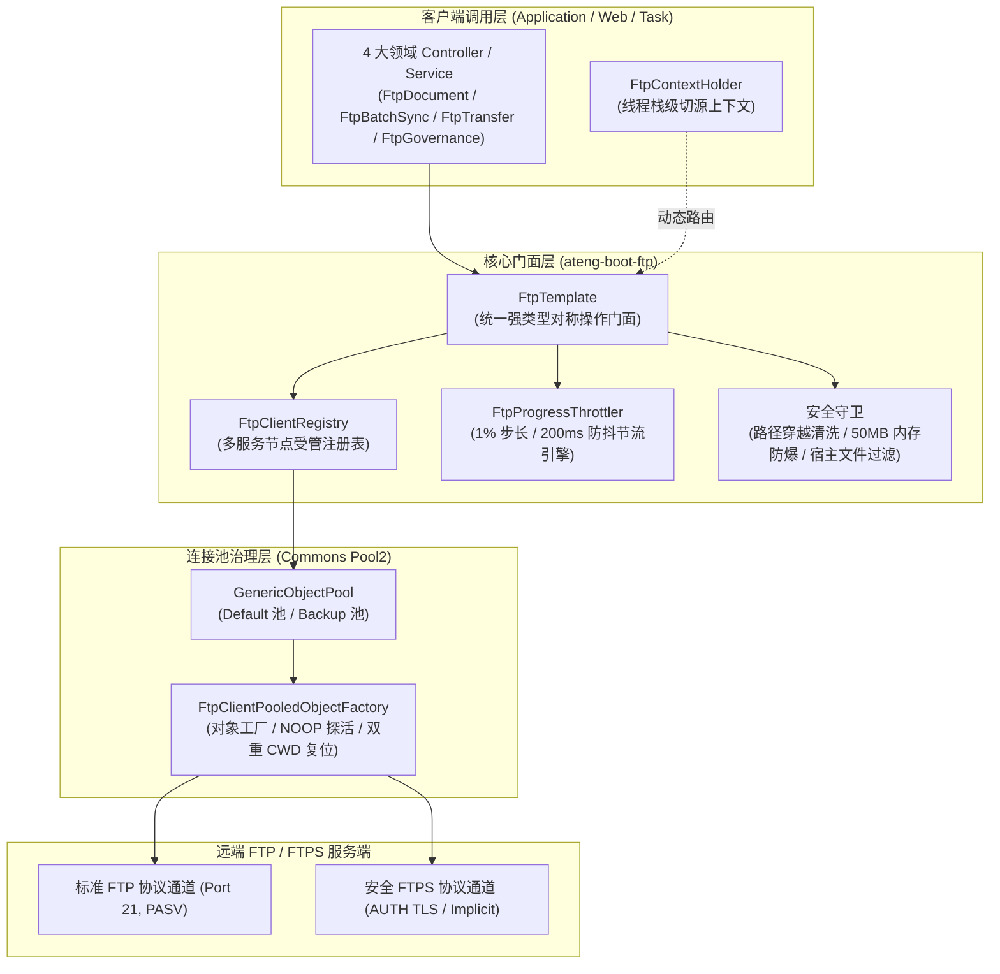
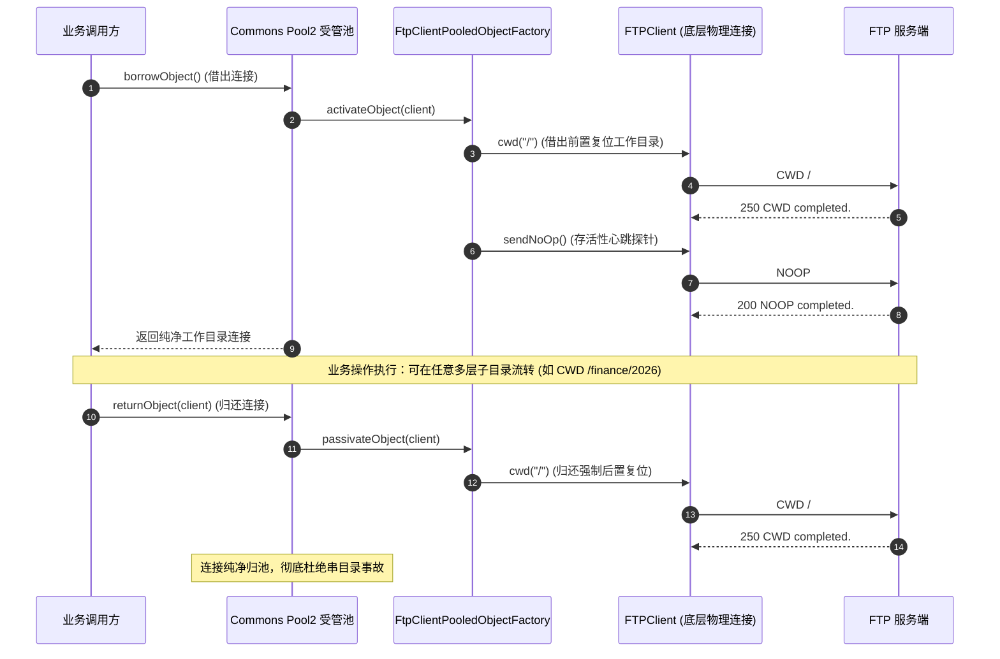
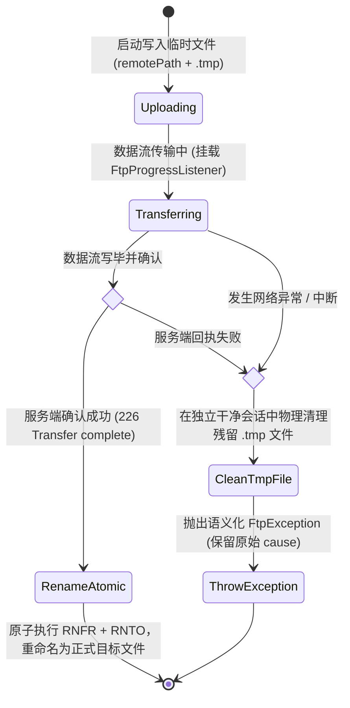

# ateng-boot-ftp 基础设施 Starter

> 面向企业级高可靠生产环境的纯原生 FTP / FTPS 双模基础设施 Starter。基于 Apache Commons Net 与 Commons Pool2 受管对象池构建，提供连接池心跳保活断线自愈、双重工作目录复位防串目录、`FtpContextHolder` 线程栈级动态切源路由、全目录递归镜像同步与 Fail-Safe 容错批处理引擎、`FtpProgressListener` 进度监听与平滑防抖节流引擎、原子上传守护（`.tmp` + `rename`）、RFC 3659 MLSD 机器可读目录解析、环境宿主中立系统隐性文件过滤、严格路径穿越安全清洗、50MB 堆内存防爆熔断守护、零物理副作用连通性健康探针与原生会话逃逸舱机制。

---

## 0. 特性与公共 API 全景速查矩阵 (Feature & API Panorama Matrix)

| 特性分类 | 特性名称 | 核心门面 / 注解 / SPI | 关键配置项 (`ateng.boot.ftp.*`) | 关键 API 签名 / 核心行为 | 锚定验证源头 (*Test / Controller) |
| :--- | :--- | :--- | :--- | :--- | :--- |
| **基础上传** | 流式/表单/磁盘/字节对称上传 | `FtpTemplate` | `enabled`<br>`buffer-size` | `upload(String, InputStream)` / `upload(String, File)` / `upload(String, byte[])` / `upload(String, Resource)`，全对称读写，支持表单与输入流上传 | `FtpTemplateTest`<br>`FtpDocumentController`<br>`SampleFtpWebIntegrationTest` |
| **原子上传守护** | 临时文件缓冲与原子重命名 | `FtpTemplate` | `atomic-upload`<br>`temp-file-suffix` | 先写入 `.tmp` 临时文件，完整传输后原子执行 `RNFR` + `RNTO`；上传中断或异常时在独立会话物理清理残留脏文件，杜绝下游消费残缺半截文件 | `FtpTemplateTest`<br>`FtpDocumentController`<br>`SampleFtpWebIntegrationTest` |
| **对称流式下载** | 输出流/本地文件/字节数组下载 | `FtpTemplate` | `max-download-bytes` | `download(String, OutputStream)` / `download(String, File)` / `downloadToBytes(String)`，内置 50MB 堆内存防爆阈值守护，超限立即熔断抛出异常 | `FtpTemplateTest`<br>`FtpDocumentController`<br>`SampleFtpWebIntegrationTest` |
| **受管闭包消费** | 闭包式受管输入流消费 | `FtpTemplate`<br>`Consumer<InputStream>` | - | `downloadStream(String, Consumer<InputStream>)`，强制在回调闭包内完成流消费并在 `finally` 确定性闭合，安全调用 `completePendingCommand` 闭合挂起指令 | `FtpTemplateTest` |
| **便捷文本存取** | 字符串便捷写入与读取 | `FtpTemplate` | `control-encoding` | `writeString(String, String)` / `writeString(String, String, Charset)` / `readString(String)` / `readString(String, Charset)`，默认 UTF-8 编码，免除样板流代码 | `FtpTemplateTest`<br>`FtpDocumentController`<br>`SampleFtpWebIntegrationTest` |
| **增量追加写** | RFC 959 原生增量追加 | `FtpTemplate` | `control-encoding` | `append(String, InputStream)` / `append(String, byte[])` / `append(String, String)` / `append(String, String, Charset)`，基于 `APPE` 指令在远端已有文件末尾追加写入 | `FtpTemplateTest`<br>`FtpDocumentController`<br>`SampleFtpWebIntegrationTest` |
| **受管管道流复制** | 跨路径管道流原子对拷 | `FtpTemplate` | `atomic-upload` | `copy(String, String)`，在受管管道中执行单文件流式对拷，目标端挂载原子上传守护，严格限定单文件防止长耗时阻塞 | `FtpTemplateTest`<br>`FtpDocumentController`<br>`SampleFtpWebIntegrationTest` |
| **重命名与移动** | 跨路径秒级重命名与移动 | `FtpTemplate` | `auto-create-directories` | `rename(String, String)` / `move(String, String)`，同级重命名或移动到目标父目录，自动完成目标父目录探测级联创建 | `FtpTemplateTest`<br>`FtpDocumentController`<br>`SampleFtpWebIntegrationTest` |
| **文件与目录删除** | 确定性删除与目录级联清空 | `FtpTemplate` | - | `deleteFile(String)` / `deleteDirectory(String)` / `deleteDirectory(String, boolean)`，物理删除单文件并支持级联递归清空删除非空目录树 | `FtpTemplateTest`<br>`FtpDocumentController`<br>`SampleFtpWebIntegrationTest` |
| **路径存在探测** | 文件与目录存在性探测 | `FtpTemplate` | - | `exists(String)`，优先探测 RFC 3659 `MLST` 指令，平滑降级为 `LIST` 与 `CWD` 校验工作目录并可靠复位现场 | `FtpTemplateTest`<br>`FtpDocumentController`<br>`SampleFtpWebIntegrationTest` |
| **强类型元数据** | 单文件/目录详细元数据 | `FtpTemplate`<br>`FtpFileInfo` | - | `getFileInfo(String)`，标准化获取文件名、绝对路径、字节大小、时间戳（`Instant`）与目录/文件标志 | `FtpTemplateTest`<br>`FtpDocumentController`<br>`SampleFtpWebIntegrationTest` |
| **机器可读目录** | RFC 3659 MLSD 目录列举 | `FtpTemplate`<br>`FtpFileInfo` | - | `listFiles(String)` / `listFiles(String, Predicate<FtpFileInfo>)` / `listDirectories(String)`，解决传统 LIST 跨操作系统语言解析格式差异，支持条件过滤 | `FtpTemplateTest`<br>`FtpDocumentController`<br>`SampleFtpWebIntegrationTest` |
| **全目录递归同步** | 镜像递归上传与下载 | `FtpTemplate` | `auto-create-directories` | `uploadDirectory(File, String)` / `uploadDirectory(File, String, Predicate<File>, boolean)` / `downloadDirectory(String, File)` / `downloadDirectory(String, File, Predicate<FtpFileInfo>, boolean)`，递归镜像多层级目录树 | `FtpTemplateTest`<br>`FtpBatchSyncController`<br>`SampleFtpWebIntegrationTest` |
| **Fail-Safe 批处理** | 容错聚合回执与失败隔离 | `BatchTransferResult`<br>`TransferFailureItem` | - | 批量传输默认采用 Fail-Safe 容错模型，单文件失败不中断批次，返回强类型聚合回执（记录成功/失败/跳过/字节量/耗时及失败明细列表）；支持 `failFast=true` 快速熔断 | `BatchTransferResultTest`<br>`FtpBatchSyncController`<br>`SampleFtpWebIntegrationTest` |
| **宿主隐性过滤** | 操作系统元数据自动剔除 | `FtpTemplate` | - | `isSystemOrHiddenFile(String)`，内置宿主中立过滤器，自动过滤 Windows `desktop.ini`、`Thumbs.db`、macOS `.DS_Store`、`._*` 苹果双分支元数据与 Linux `.git` | `FtpTemplateTest`<br>`FtpBatchSyncController`<br>`SampleFtpWebIntegrationTest` |
| **流式进度监听** | 传输进度监听与防抖节流 | `FtpTemplate`<br>`FtpProgressListener` | `buffer-size` | `upload(String, InputStream, long, FtpProgressListener)` / `upload(String, File, FtpProgressListener)` / `download(String, OutputStream, FtpProgressListener)` / `download(String, File, FtpProgressListener)`，内置 1% 步长或 200ms 防抖节流与 100% 满额保底 | `FtpProgressListenerTest`<br>`FtpTransferController`<br>`SampleFtpWebIntegrationTest` |
| **内存防爆熔断** | 堆内存 OOM 物理安全阈值 | `FtpTemplate` | `max-download-bytes` | `downloadToBytes` 与 `readString` 门面内置最大 50MB 阈值，超过限制立即熔断，抛出规范受管异常防御 JVM 堆内存击穿 | `FtpTemplateTest`<br>`FtpTransferController`<br>`SampleFtpWebIntegrationTest` |
| **动态切源路由** | 线程栈级多节点动态切换 | `FtpContextHolder` | `servers.*` | `setServer(String)` / `getServer()` / `clear()` / `runWith(String, Runnable)` / `runWith(String, Supplier<T>)`，支持栈式嵌套作用域并在 `finally` 确定性复位现场 | `FtpContextHolderTest`<br>`FtpGovernanceController`<br>`SampleFtpWebIntegrationTest` |
| **多节点受管注册** | 具名连接池与模板注册表 | `FtpClientRegistry` | `servers.*` | `getTemplate(String)` / `getDefaultTemplate()` / `getPool(String)` / `getDefaultPool()` / `contains(String)` / `getServerNames()` / `register(...)` / `close()`，支持停机确定性销毁所有连接池 | `FtpClientRegistryTest`<br>`FtpGovernanceController`<br>`SampleFtpWebIntegrationTest` |
| **连通性健康探针** | 零副作用物理连通性自验 | `FtpTemplate` | `pool.test-on-borrow` | `testConnection()` / `testConnection(String)` / `testConnectionOrThrow()` / `testConnectionOrThrow(String)`，借出连接发送 `NOOP` 指令毫秒级检测心跳并安全归还，全程零物理文件读写副作用 | `FtpTemplateTest`<br>`FtpGovernanceController`<br>`SampleFtpWebIntegrationTest` |
| **连接池心跳自愈** | 借还生命周期与断线自愈 | `FtpClientPooledObjectFactory`<br>`FtpPoolProperties` | `pool.*` | 基于 Commons Pool2 实现，借出归还双重 `cwd("/")` 复位防串目录；借出校验 `NOOP` 存活心跳；IO 异常主动标记 `invalidateObject` 剔除坏连接 | `FtpClientPooledObjectFactoryTest`<br>`FtpGovernanceController`<br>`SampleFtpWebIntegrationTest` |
| **FTPS 安全加密** | SSL / TLS 传输层安全通道 | `FtpsProperties`<br>`FtpClientPooledObjectFactory` | `ftps.*` | 支持显式与隐式 FTPS（`AUTH TLS`）、支持客户端证书双向认证与 TrustStore/KeyStore 配置 | `FtpPropertiesTest`<br>`SampleFtpIntegrationTest` |
| **路径穿越清洗** | 路径遍历漏洞前置拦截 | `FtpTemplate` | - | `cleanAndValidatePath(String)`，统一转义分隔符，严格拦截 `..` 越权逃逸序列与 `\0` 空字符截断注入，防范任意文件读取或覆盖 | `FtpTemplateTest`<br>`FtpDocumentController`<br>`SampleFtpWebIntegrationTest` |
| **原生会话逃逸舱** | 底层原生 FTPClient 透传 | `FtpTemplate`<br>`FtpClientCallback<T>` | - | `execute(FtpClientCallback<T>)`，从受管池安全借用原生客户端，支持执行任意底层协议扩展指令并在 `finally` 绝对归还 | `FtpTemplateTest` |
| **因果异常体系** | 语义化异常与统一错误码 | `FtpException`<br>`FtpResultCode` | - | 转译底层 Socket/Commons Net 异常为语义化业务异常，赋予规范错误码（`51001`~`51010`）并 100% 保留原始因果堆栈 | `FtpTemplateTest`<br>`SampleFtpWebIntegrationTest` |

---

## 1. 模块定位与快速起步

### 1.1 模块定位与核心价值
`ateng-boot-ftp` 是面向生产环境的工业级轻量 FTP/FTPS 协议客户端 Starter：
- **纯原生依赖与零臃肿**：以 Apache Commons Net 与 Commons Pool2 为核心底座，拒绝引入任何臃肿第三方工具包；
- **长连接池化治理**：彻底终结短连接频繁握手与野线程创建，提供高并发连接池复用、心跳存活探针与异常坏连接自动剔除；
- **零目录污染不变量**：借出与归还双重执行 `cwd("/")` 复位，彻底消除传统 FTP 状态机串目录隐患；
- **全场景工业级加固**：全目录递归镜像同步、大文件流式进度监听、连通性健康探针、增量追加写与受管管道流对拷；
- **传输安全与数据防护**：前置拦截路径穿越漏洞，50MB 内存防爆熔断守护，临时文件原子写入（`.tmp` + `rename`），宿主隐性系统文件自动过滤。

```xml
<dependency>
    <groupId>io.github.atengk</groupId>
    <artifactId>ateng-boot-ftp</artifactId>
</dependency>
```

### 1.2 最小可用配置 (Happy Path)
在 `application.yml` 中配置最少 4 项核心连接信息即可开箱使用：
```yaml
ateng:
  boot:
    ftp:
      enabled: true
      host: 127.0.0.1
      port: 21
      username: admin
      password: YOUR_PASSWORD
```

### 1.3 极简开箱实战
（示例代码 1:1 逆向提取自已跑通的 `DocumentSyncScenarioService`）
```java
@Service
@RequiredArgsConstructor
public class DocumentSyncScenarioService {

    private final FtpTemplate ftpTemplate;

    // 1. 纯文本快捷写入与读取
    public void syncConfig() {
        ftpTemplate.writeString("/docs/policy.txt", "Enterprise Security Policy v1.0");
        String content = ftpTemplate.readString("/docs/policy.txt");
    }

    // 2. 本地文档原子上传
    public void uploadDocument(File localFile) {
        ftpTemplate.upload("/docs/" + localFile.getName(), localFile);
    }

    // 3. 流式下载到本地磁盘
    public void downloadDocument(String remotePath, File localTargetFile) {
        ftpTemplate.download(remotePath, localTargetFile);
    }
}
```

---

## 2. 核心架构与设计不变量

### 2.1 架构拓扑与双模通道


### 2.2 工作目录双重复位防串目录时序 (Dual-CWD Reset Invariant)
FTP 协议具有全局工作目录（CWD）有状态特性。若业务 A 切换至 `/data/tenantA` 后发生异常或未还原，后续复用该连接的业务 B 将发生严重的串目录读写事故。框架在连接池生命周期的借出与归还两端强制执行 `cwd("/")` 双重锁定：



### 2.3 原子上传守护状态机 (.tmp + RNTO)
为了彻底根除网络抖动引发的残缺半截文件污染下游，框架默认开启 `atomic-upload=true`：



---

## 3. 文件流式存取与文档生命周期套件

### 3.1 纯文本与 JSON 快捷存取
免除手动编排流通道的样板代码，默认采用 UTF-8 编码安全读写配置文件、合同批注与 JSON 报文。

```yaml
ateng:
  boot:
    ftp:
      control-encoding: UTF-8                     # 控制通道编码（默认 UTF-8）
```

（逆向提取自 `FtpDocumentController` 与 `DocumentSyncScenarioService`）
```java
// 1. 写入纯文本内容至远程文件
ftpTemplate.writeString("/docs/policy.txt", "Enterprise Security Policy v1.0");

// 2. 快捷读取文本内容
String content = ftpTemplate.readString("/docs/policy.txt");
```
- **核心机制**：底层自动探测父目录是否存在，若缺失则自动级联建目录；读取时挂载 50MB 内存防爆守卫。

### 3.2 文件与输入流原子上传
支持通过表单 `MultipartFile`、本地磁盘 `File`、`InputStream` 或 Spring `Resource` 对称上传。

```yaml
ateng:
  boot:
    ftp:
      atomic-upload: true                         # 开启原子上传机制（默认 true）
      temp-file-suffix: .tmp                      # 原子上传临时后缀（默认 .tmp）
      buffer-size: 64KB                           # 数据传输缓冲区（默认 64KB）
```

（逆向提取自 `FtpDocumentController`）
```java
// 1. 表单文件原子上传
@PostMapping(value = "/upload", consumes = MediaType.MULTIPART_FORM_DATA_VALUE)
public Result<FtpFileInfoVO> uploadMultipartFile(
        @RequestParam("file") MultipartFile file,
        @RequestParam(value = "remotePath", required = false) String remotePath) throws IOException {
    String targetPath = StringUtils.hasText(remotePath) ? remotePath : "/upload/" + file.getOriginalFilename();
    try (InputStream in = file.getInputStream()) {
        ftpTemplate.upload(targetPath, in);
    }
    return Result.success(toVO(ftpTemplate.getFileInfo(targetPath)));
}

// 2. 本地文件直接上传
ftpTemplate.upload("/docs/contract.pdf", new File("/tmp/contract.pdf"));
```
- **核心机制**：上传过程中先写入 `.tmp` 临时文件；传输完整闭合后原子发送 `RNFR` + `RNTO` 重命名，异常时在独立会话中物理清理脏文件。

### 3.3 对称流式下载与消费闭包
支持直接下载至本地 `File`、`OutputStream`、内存字节或受管输入流闭包。

```yaml
ateng:
  boot:
    ftp:
      data-timeout: 30s                           # 数据通道传输超时（默认 30s）
```

（逆向提取自 `FtpDocumentController`）
```java
// 1. 下载至 HTTP 响应流
@GetMapping("/download")
public void downloadFile(@RequestParam("remotePath") String remotePath, HttpServletResponse response) throws IOException {
    response.setContentType(MediaType.APPLICATION_OCTET_STREAM_VALUE);
    response.setHeader(HttpHeaders.CONTENT_DISPOSITION, "attachment; filename=\"download.bin\"");
    ftpTemplate.download(remotePath, response.getOutputStream());
    response.flushBuffer();
}

// 2. 受管消费闭包（闭包退出自动执行 completePendingCommand）
ftpTemplate.downloadStream("/docs/report.xlsx", inputStream -> {
    // 在闭包内完成流消费，资源确定性闭合
    processExcel(inputStream);
});
```
- **核心机制**：下载流遵循 `try-with-resources` 严密生命周期管理；`downloadStream` 闭包执行完毕后在 `finally` 中严格调用 `completePendingCommand()` 确认协议通道闭合。

### 3.4 RFC 959 增量追加写
面向日志采集、交易流水与审计凭证生成场景，支持原生增量追加写（`APPE` 指令），无需下载整文件重传。

```yaml
ateng:
  boot:
    ftp:
      control-encoding: UTF-8
```

（逆向提取自 `FtpDocumentController`）
```java
// 在已有文件末尾增量追加文本
ftpTemplate.append("/docs/audit.log", "\n[2026-11-10] User admin logged in.", StandardCharsets.UTF_8);
```
- **核心机制**：基于 FTP 原生 `APPE` 命令；若远端文件不存在，服务端自动退化为新建文件，天然具备操作幂等韧性。

### 3.5 受管管道流原子对拷
在远端 FTP 服务端不支持自定义复制指令时，通过受管管道流实现单文件内存级安全对拷。

```yaml
ateng:
  boot:
    ftp:
      atomic-upload: true
```

（逆向提取自 `FtpDocumentController`）
```java
// 单文件受管管道原子对拷
ftpTemplate.copy("/docs/policy.txt", "/docs/policy-bak.txt");
```
- **核心机制**：借用 FTP 客户端在受管流间建立双向数据中转，目标端挂载原子上传守护，严格限定单文件防止阻塞长耗时。

### 3.6 重命名与跨目录移动
毫秒级完成同目录重命名与跨目录安全移动。

```yaml
ateng:
  boot:
    ftp:
      auto-create-directories: true               # 移动时自动递归创建不存在的目标父目录
```

（逆向提取自 `FtpDocumentController`）
```java
// 1. 同级重命名
ftpTemplate.rename("/docs/policy.txt", "/docs/policy-v2.txt");

// 2. 跨目录移动（自动探测并递归创建 /archive 目标目录）
ftpTemplate.move("/docs/policy-v2.txt", "/archive");
```
- **核心机制**：跨目录移动时自动解析目标目录路径并调用 `makeDirectories` 完成 `mkdir -p` 级联建目录。

### 3.7 确定性删除与 RFC 3659 MLSD 机器解析
提供单文件删除、目录级联清空与跨平台机器格式目录列举。

```java
// 1. 删除单个文件
ftpTemplate.deleteFile("/docs/temp.bin");

// 2. 递归清空删除目录及其所有子文件
ftpTemplate.deleteDirectory("/archive", true);

// 3. RFC 3659 MLSD 机器目录解析
List<FtpFileInfo> files = ftpTemplate.listFiles("/docs");
for (FtpFileInfo file : files) {
    log.info("文件: {}, 大小: {} bytes, 时间: {}", file.getName(), file.getSize(), file.getLastModified());
}
```
- **核心机制**：采用 RFC 3659 MLSD 指令解决传统 `LIST` 跨操作系统（Windows vs Unix）、跨语言（中文月份 vs 英文月份）解析格式差异。

---

## 4. 全目录递归同步与 Fail-Safe 批处理套件

### 4.1 全目录镜像上传与下载
在金融日结对账与大数据批量归档场景中，需要对整批次多层级子目录执行树状镜像同步。

```yaml
ateng:
  boot:
    ftp:
      auto-create-directories: true               # 自动递归创建多层子目录
```

（逆向提取自 `FtpBatchSyncController` 与 `SettlementBatchSyncScenarioService`）
```java
@PostMapping("/upload-directory")
public Result<BatchTransferResultVO> uploadDirectory(@Valid @RequestBody DirectorySyncRequest request) {
    File localDir = new File(request.getLocalDir());
    // 镜像递归上传本地结算目录至远端（支持断言过滤与 Fail-Fast / Fail-Safe 双模）
    BatchTransferResult result = settlementBatchSyncService.syncSettlementToRemote(
            localDir, request.getRemoteDir(),
            file -> file.getName().endsWith(".csv"), request.isFailFast());
    return Result.success(toVO(result));
}
```

### 4.2 宿主中立系统隐性文件过滤
批量上传与下载遍历目录时，内置宿主中立文件过滤器，自动过滤 Windows 的 `desktop.ini`、`Thumbs.db`、macOS 的 `.DS_Store`、`._*` 苹果双分支元数据与 Linux 的 `.git`，彻底杜绝操作系统隐性垃圾文件污染远端服务器或本地审计目录。

### 4.3 Fail-Safe 容错批处理模型与强类型聚合回执
- **Fail-Safe 容错模型**：批量同步过程中，单文件传输因权限不足或被锁定导致失败时，不中断整体批次，自动记录错误明细至 `TransferFailureItem` 并继续同步剩余项；
- **聚合回执契约**：最终返回强类型 `BatchTransferResult`，包含总文件数、成功数、失败数、跳过数、总传输字节量、耗时及失败条目清单；
- **Fail-Fast 熔断**：传入 `failFast=true` 时遇首错立即熔断抛出异常。

### 4.4 32 层递归深度安全防卫
内置 `MAX_DIRECTORY_DEPTH = 32` 递归层级安全守卫，严防由于软链接环路或恶意深层目录引发 JVM 栈溢出（StackOverflowError）。

---

## 5. 大文件传输与平滑防抖进度监听套件

### 5.1 FtpProgressListener 流式双向进度监听
传输数十 MB 至数 GB 的大文件时，挂载 `FtpProgressListener` 监听传输进度。

```yaml
ateng:
  boot:
    ftp:
      buffer-size: 64KB                           # 数据传输缓冲区大小
```

（逆向提取自 `FtpTransferController` 与 `LargeFileTransferScenarioService`）
```java
ftpTemplate.upload("/transfer/large-payload.bin", localLargeFile, 
    (bytesTransferred, totalBytes, percentage) -> {
        log.info("[PROGRESS] 已传输: {}/{} bytes ({})",
                bytesTransferred, totalBytes, String.format("%.2f%%", percentage));
    });
```

### 5.2 1% 步长 / 200ms 防抖节流引擎与 100% 满额保底
- **防抖节流**：内置 `FtpProgressThrottler` 节流引擎，仅在进度跨越 1% 步长或时间流逝超过 200ms 时才触发监听回调，杜绝高频刷新引发的系统 CPU 飙升与日志风暴；
- **100% 满额保底**：数据流关闭时，强制触发最终一次 100.0% 满额终态回调，确保前端进度条与运维监控可靠收敛至完成状态。

### 5.3 50MB 堆内存防爆熔断守护 (max-download-bytes)
- `downloadToBytes` 与 `readString` 门面内置堆内存防爆阈值守护（默认阈值 50MB，由 `max-download-bytes` 配置）；
- 若文件超过安全阈值，立即熔断截断传输并抛出 `FtpException(DOWNLOAD_FAILED)`，严防大文件直接撑爆 JVM 堆内存。大文件传输请使用 `download(String, OutputStream)` 或挂载进度监听器的流式 API。

---

## 6. 多节点动态切源与连接池治理套件

### 6.1 FtpContextHolder 线程栈级切源上下文
支持在 `application.yml` 中声明主节点与具名备用节点：

```yaml
ateng:
  boot:
    ftp:
      enabled: true
      host: 127.0.0.1
      port: 2121
      username: admin
      password: password123
      servers:
        backup:
          host: 127.0.0.1
          port: 2122
          username: backup_user
          password: backup_password
```

使用 `FtpContextHolder.runWith` 在指定节点作用域下执行操作，支持栈式嵌套作用域，并在 `finally` 自动复位现场：
```java
// 动态切源写入内容至 backup 节点 (执行完毕自动复位现场)
FtpContextHolder.runWith("backup", () -> {
    ftpTemplate.writeString("/routing/backup-notice.txt", "Backup Datacenter Payload");
    return null;
});
```

### 6.2 FtpClientRegistry 多节点受管注册表
- 纳管系统中所有具名 FTP 节点的操作门面与底层连接池；
- 支持编程式动态注册新节点与容器停机确定性销毁所有连接池。

### 6.3 零物理副作用连通性健康探针
面向运维巡检、服务保活与管理后台节点验证，借出连接发送 `NOOP` 指令毫秒级检测控制通道，全程零物理文件读写副作用：
```java
// 1. 无副作用探测连通性 (返回 true/false)
boolean healthy = ftpTemplate.testConnection("backup");

// 2. 强校验断言（失败抛出受管 FtpException）
ftpTemplate.testConnectionOrThrow("backup");
```

### 6.4 连接池借还心跳与断线自愈 (test-on-borrow)
- **存活心跳**：开启 `pool.test-on-borrow=true` 时，连接借出自动发送 `NOOP` 探活，断线自动平滑剔除并重建；
- **坏连接剔除**：操作发生 IO 异常时自动标记 `invalidateObject`，物理销毁坏连接，严防故障连接污染连接池。

---

## 7. 生产扩展接管与核心非功能边界

### 7.1 FTPS TLS 传输层安全加密与双向证书认证
全面支持标准显式 FTPS（`AUTH TLS`）与隐式 FTPS（Port 990），支持客户端双向证书认证：

```yaml
ateng:
  boot:
    ftp:
      host: ftps.example.com
      port: 21
      ftps:
        protocol: TLS                             # 协议版本 (TLS / SSL)
        implicit: false                           # false 为显式 AUTH TLS，true 为隐式 990
        key-store-path: classpath:keystore.p12    # 客户端证书库
        key-store-password: YOUR_KEYSTORE_PASSWORD
        trust-store-path: classpath:truststore.p12
        trust-store-password: YOUR_TRUSTSTORE_PASSWORD
        need-client-auth: false                   # 是否强制要求客户端证书认证
```

### 7.2 自定义 Bean 覆盖接管 (@ConditionalOnMissingBean)
核心组件均标配 `@ConditionalOnMissingBean`，支持下游业务声明自定义 Bean 平滑接管：
```java
@Configuration
public class CustomFtpConfig {

    @Bean
    public FtpTemplate customFtpTemplate(FtpClientRegistry registry) {
        return registry.getDefaultTemplate();
    }
}
```

### 7.3 原生会话逃逸舱机制 (execute)
当需要调用 Apache Commons Net 的底层专有协议指令时，通过逃逸舱机制安全借用原生客户端，并在 `finally` 绝对安全归还连接池：
```java
String systemType = ftpTemplate.execute(client -> {
    // 直接操作原生 FTPClient
    return client.getSystemType();
});
```

### 7.4 严格路径穿越清洗与线缆转码
- **路径穿越防御**：所有文件与目录操作入口强制经过 `cleanAndValidatePath` 清洗，统一替换分隔符为 `/`，严格拦截 `..` 越权逃逸序列与 `\0` 空字符截断注入，防范任意文件读取或覆盖；
- **线缆转码（Wire Transcoding）**：在发送指令前自动根据 `control-encoding` 进行合规转码，杜绝跨语言与操作系统的中文乱码。

---

## 8. 完整 YAML 配置属性清单 (YAML Reference)

```yaml
ateng:
  boot:
    ftp:
      enabled: true                               # 是否启用 FTP 自动装配（默认 true）
      host: 127.0.0.1                             # FTP 服务端主机地址或域名（默认 localhost）
      port: 21                                    # FTP 服务端端口（标准 FTP 默认 21，隐式 FTPS 默认 990）
      username: anonymous                         # 认证用户名（默认 anonymous）
      password: ""                                # 认证密码
      mode: PASSIVE                               # 传输模式：PASSIVE(本地被动, 推荐) / ACTIVE(本地主动)
      file-type: BINARY                           # 传输文件类型：BINARY(二进制, 推荐) / ASCII(文本)
      control-encoding: UTF-8                     # 控制通道编码（默认 UTF-8，支持 GBK、ISO-8859-1）
      connect-timeout: 10s                        # 连接握手超时时间（默认 10s）
      data-timeout: 30s                           # 数据通道传输与 Socket 读取超时时间（默认 30s）
      control-keep-alive-timeout: 30s             # 控制通道空闲保活超时（传输期间自动发送 NOOP 防止防火墙截断）
      buffer-size: 64KB                           # 数据传输缓冲区大小（默认 64KB）
      max-download-bytes: 50MB                    # 内存下载最大允许容量（默认 50MB，超限熔断防 OOM）
      atomic-upload: true                         # 是否开启原子上传机制（先写入 .tmp 临时文件，成功后原子 rename）
      temp-file-suffix: .tmp                      # 原子上传临时文件后缀名（默认 .tmp）
      auto-create-directories: true               # 上传或移动时是否自动递归创建不存在的父目录（mkdir -p）
      server-time-zone: Asia/Shanghai             # 服务端时区标识（用于 LIST 解析时间戳矫正）

      # Commons Pool2 连接池精细调优
      pool:
        max-total: 8                              # 最大连接数（默认 8）
        max-idle: 8                               # 最大空闲连接数（默认 8）
        min-idle: 0                               # 最小空闲连接数（默认 0）
        max-wait: -1                              # 从连接池借出连接的最大等待时间（负数表示无限等待）
        min-evictable-idle-time: 30m              # 连接在池中保持空闲而不被逐出的最小时间（默认 30m）
        time-between-eviction-runs: -1            # 空闲连接逐出线程运行间隔（负数表示不启动逐出线程）
        test-on-borrow: true                      # 借出连接时是否发送 NOOP 验证存活性（默认 true，推荐生产开启）
        test-on-return: false                     # 归还连接时是否验证存活性（默认 false）
        test-while-idle: true                     # 空闲逐出时是否验证存活性（默认 true）

      # FTPS 安全传输加密扩展（可选）
      ftps:
        protocol: TLS                             # FTPS 协议版本（TLS / SSL，默认 TLS）
        implicit: false                           # 是否为隐式 FTPS（默认 false 为显式 AUTH TLS）
        key-store-path: ""                        # 客户端 KeyStore 路径（双向认证时配置）
        key-store-password: ""                    # KeyStore 访问密码
        trust-store-path: ""                      # TrustStore 证书库路径
        trust-store-password: ""                  # TrustStore 访问密码
        need-client-auth: false                   # 是否强制要求客户端证书认证

      # 命名多服务节点配置字典（主节点自动作为 default 节点）
      servers:
        backup:
          host: 192.168.1.100
          port: 21
          username: backup_user
          password: YOUR_PASSWORD
          mode: PASSIVE
          pool:
            max-total: 5
```
