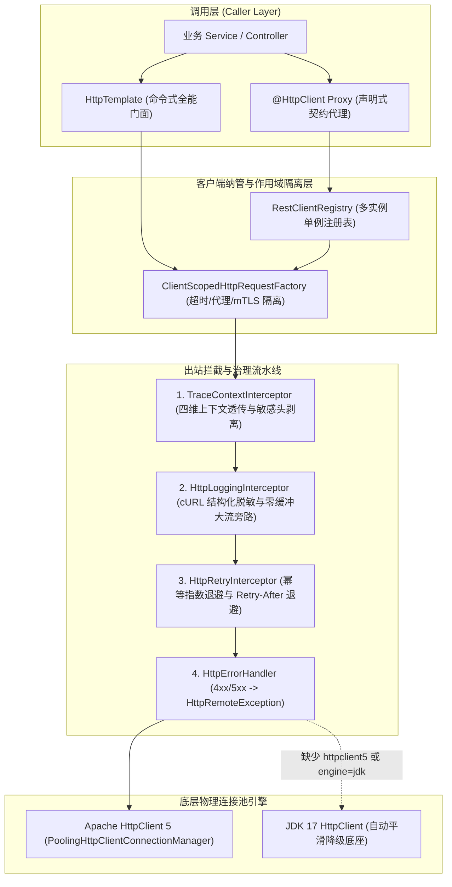

# ateng-boot-http 基础设施 Starter

> 依托 Spring 6 原生 `RestClient`、`HttpServiceProxyFactory` 与 JDK 17 构建的零臃肿双模 HTTP 客户端底座，统一融合命令式调用（`HttpTemplate`）与强类型声明式代理（`@EnableHttpInterfaces` / `@HttpClient`），提供 Apache HttpClient 5 生产级池化连接与 JDK 17 原生 `HttpClient` 自适应平滑降级、多命名客户端注册表（`RestClientRegistry`）、四维全链路上下文出站透传与外部公网敏感头安全剥离、RFC 3986 查询参数安全转译与动态单次超时覆盖、cURL 结构化脱敏日志、幂等动词指数退避重试及语义化因果异常转译。

---

## 0. 特性与公共 API 全景速查矩阵 (Feature & API Panorama Matrix)

| 特性分类 | 特性名称 | 核心门面 / 注解 / SPI | 关键配置项 (`ateng.boot.http.*`) | 关键 API 签名 / 核心行为 | 锚定验证源头 (`*Test` / `Sample`) |
| :--- | :--- | :--- | :--- | :--- | :--- |
| **命令式通信** | 全动词 REST 门面 | `HttpTemplate` | `enabled` | `get` / `post` / `postForm` / `put` / `patch` / `delete` / `exchange`，均支持 `Class<T>`、`ParameterizedTypeReference<T>` 与 `RequestOptions` 完整重载组合 | `HttpTemplateSampleTest` / `HttpTemplateController` |
| **元数据与空安全** | 探测与响应实体提取 | `HttpTemplate` | - | `head` / `options` / `optionsForAllow` 提取 `HttpHeaders` 与 `Allow` 动词集合；`getOptional` 将 HTTP `404` 自动转换为 `Optional.empty()`；`getEntity` 提取完整 `ResponseEntity<T>` | `HttpTemplateSampleTest` / `HttpTemplateController` |
| **流式与异步传输** | 零缓冲流式与异步编排 | `HttpTemplate` | `logging.max-buffer-capacity` | `upload`（支持单 `Resource` 与 `MultiValueMap<String, Object>`）、`download`（直通 `OutputStream` / `Path`）、`consumeStream`（SSE 行流消费）、`executeAsync`（透传四维上下文返回 `CompletableFuture<T>`）、`getClient` / `getStreamingClient` | `HttpTemplateScenarioTest` / `HttpTemplateScenarioService` |
| **单次动态参数** | 单次超时与请求头治理 | `RequestOptions`<br>`RequestOptionsApplier`<br>`HttpRequestContextHolder` | - | `RequestOptions.of(...)` / `empty()` / `builder().readTimeout(Duration).connectTimeout(Duration).header(...).queryParam(...).uriVariable(...).propagateContext(...).clientName(...).build()`，RFC 3986 转译并在退出时严格恢复线程现场 | `HttpTemplateSampleTest` / `HttpTemplateScenarioService` |
| **方法级超时** | 方法/接口级超时声明 | `@HttpTimeout` | - | `@HttpTimeout(readTimeout = "300ms", connectTimeout = "1s")`，优先级：方法级 `@HttpTimeout` > 接口级 `@HttpTimeout` > `clients.<name>` > 全局默认，异常或退出均对称清理 | `HttpDeclarativeScenarioTest` / `OrderServiceClient` |
| **声明式客户端** | 契约接口与包扫描降级 | `@EnableHttpInterfaces`<br>`@HttpClient`<br>`HttpInterfaceRegistrar`<br>`HttpInterfaceFactoryBean` | `clients.<name>.*` | `@EnableHttpInterfaces(basePackages / basePackageClasses / clients)` 扫描 `@HttpClient(name, url, fallback, primary)`，结合 `@HttpExchange` 生成动态代理；4xx/5xx/超时自动回落至 `fallback` Bean | `HttpDeclarativeScenarioTest` / `SampleHttpApplication` |
| **多命名客户端** | 单例注册表与差异隔离 | `RestClientRegistry`<br>`ClientScopedHttpRequestFactory` | `clients.<name>.base-url`<br>`clients.<name>.default-headers`<br>`clients.<name>.connect-timeout`<br>`clients.<name>.read-timeout` | `getClient(name, url)` / `getClient(name)` / `register` / `unregister` / `contains` / `size` / `clear` / `getClientNames` / `resolveBaseUrl`；复用全局连接池并按客户端隔离超时、默认请求头、代理与证书 | `HttpGovernanceScenarioTest` / `HttpGovernanceController` |
| **物理连接池** | 双模池化连接与虚拟线程安全 | `ClientHttpRequestFactoryBuilder`<br>`ApacheHttpClient5Factory`<br>`JdkHttpClientFactory` | `engine`<br>`pool.*` | 优先装配 Apache HttpClient 5 `PoolingHttpClientConnectionManager`（后台空闲连接驱逐），无驱动时降级 JDK 17 `HttpClient`；基于 `ReentrantLock` 避免 JDK 21+ 虚拟线程 Pinning | `DeclarativeClientScenarioTest` / `HttpGovernanceScenarioTest` |
| **安全通道与代理** | 双向 mTLS 证书与正向代理 | `HttpSslUtil`<br>`HttpSslProperties`<br>`HttpProxyProperties` | `ssl.*` / `clients.<name>.ssl.*`<br>`clients.<name>.key-store*`<br>`proxy.*` / `clients.<name>.proxy.*` | `HttpSslUtil.loadKeyStore(ssl)` / `loadKeyManagers(ssl)` 加载 PKCS12/JKS 客户端私钥用于金融级 mTLS；支持全局与客户端级独立 HTTP 正向代理、`username`/`password` 认证及 `non-proxy-hosts` 白名单直连放行 | `HttpGovernanceIntegrationTest` / `application.yml` |
| **全链路上下文** | 四维透传与非信任域隔离 | `TraceContextInterceptor`<br>`HttpInterceptorUtil` | `tracing.*`<br>`clients.<name>.propagate-context` | 出站注入 `traceId`（缺省通过 `IdUtil.fastSimpleUUID()` 生成）、`TenantId`、`UserId`、`IgnoreTenant`；按最长前缀匹配或显式声明，对公网 `propagate-context: false` 客户端物理剥离内网身份头仅保留 `X-Trace-Id` | `HttpGovernanceIntegrationTest` / `ExternalPaymentScenarioService` |
| **出站审计日志** | cURL 日志与敏感字段脱敏 | `HttpLoggingInterceptor`<br>`HttpLoggingLevel` | `logging.enabled`<br>`logging.level` (`NONE`/`BASIC`/`HEADERS`/`FULL`)<br>`logging.mask-headers`<br>`logging.mask-params`<br>`logging.max-body-length`<br>`logging.max-buffer-capacity` | 按日志级别输出结构化摘要或终端可复现 cURL；对 `mask-headers` 与 `mask-params` 命中的凭据打星号掩码；超限大流或流式上传下载自动旁路响应体缓冲防 OOM | `HttpGovernanceIntegrationTest` / `HttpGovernanceController` |
| **弹性指数退避** | 幂等重试与 `Retry-After` 自愈 | `HttpRetryInterceptor` | `retry.*`<br>`clients.<name>.retry.*` | 默认仅对幂等动词（`GET`/`HEAD`）在 `429`/`502`/`503`/`504` 或网络瞬断时接入 Core `RetryUtil` 执行指数退避 + Equal Jitter 抖动重试，自适应解析 `Retry-After` 响应头，每次重试前显式关闭旧响应流 | `HttpGovernanceIntegrationTest` / `ExternalPaymentScenarioService` |
| **因果异常转译** | 状态码映射与错误体提取 | `HttpErrorHandler`<br>`HttpRemoteException`<br>`HttpResultCode` | - | 将 4xx/5xx 响应（提取截断最多 2048 字符且跳过二进制流）封装为受管 `HttpRemoteException`（保留原始 cause），映射 8 个专职 `HttpResultCode`（`40001`~`50004`）并支持 `getResponseBodyAs` 强类型反序列化 | `HttpGovernanceIntegrationTest` / `HttpGovernanceController` |
| **扩展与兼容 SPI** | 容器配置对齐与扩展钩子 | `AtengHttpAutoConfiguration`<br>`HttpClient5Customizer`<br>`RestClientCustomizer` | - | 自动对接 `RestClientBuilderConfigurer` 继承 Actuator Micrometer 度量与 JSON 转换器；支持注入 `HttpClient5Customizer`、`RestClientCustomizer` 及向 `RestClientRegistry` 注册动态实例 | `HttpTemplateSampleTest` / `SampleHttpApplication` |

---

## 1. 模块定位与快速起步 (Quick Start)

### 1.1 引入依赖（BOM 统管与独立版本双模）

- **方式一：引入 `ateng-boot-bom`（推荐，免配版本号）**：

```xml
<dependencyManagement>
    <dependencies>
        <dependency>
            <groupId>io.github.atengk</groupId>
            <artifactId>ateng-boot-bom</artifactId>
            <version>1.2.0</version>
            <type>pom</type>
            <scope>import</scope>
        </dependency>
    </dependencies>
</dependencyManagement>

<dependencies>
    <dependency>
        <groupId>io.github.atengk</groupId>
        <artifactId>ateng-boot-http</artifactId>
    </dependency>
</dependencies>
```

- **方式二：独立引入（显式声明版本号）**：

```xml
<dependency>
    <groupId>io.github.atengk</groupId>
    <artifactId>ateng-boot-http</artifactId>
    <version>1.2.0</version>
</dependency>
```

> 说明：`ateng-boot-http` 默认引入 `httpclient5` 启用生产级连接池；若业务需极限精简、完全依托 JDK 17 原生 `java.net.http.HttpClient`，可排除 `httpclient5` 或将 `ateng.boot.http.engine` 设为 `jdk`。

### 1.2 最小可用配置

在 `application.yml` 中配置全局连接池与目标命名客户端（1:1 提取自 Sample `application.yml`）：

```yaml
ateng:
  boot:
    http:
      enabled: true
      engine: auto
      pool:
        max-connections: 200
        max-per-route: 50
        connect-timeout: 3s
        read-timeout: 10s
      clients:
        user-service:
          base-url: ${sample.user-service.url:http://localhost:8080/mock/provider}
          connect-timeout: 2s
          read-timeout: 5s
          propagate-context: true
```

### 1.3 极简双模实战验证

#### 步骤 1：在启动类激活声明式接口包扫描 (`SampleHttpApplication.java`)

```java
@EnableHttpInterfaces(basePackages = "io.github.atengk.boot.sample.http.client")
@SpringBootApplication
public class SampleHttpApplication {
    public static void main(String[] args) {
        SpringApplication.run(SampleHttpApplication.class, args);
    }
}
```

#### 步骤 2：声明强类型客户端契约 (`UserServiceClient.java`)

```java
@HttpClient(name = "user-service", url = "${sample.user-service.url:http://localhost:8080}")
@HttpExchange
public interface UserServiceClient {

    @GetExchange("/users/{id}")
    UserResponse getUserById(@PathVariable("id") Long id);

    @PostExchange("/users")
    UserResponse createUser(@RequestBody UserRequest user);
}
```

#### 步骤 3：业务层直接注入调度 (`UserClientScenarioService.java`)

```java
@Slf4j
@Service
@RequiredArgsConstructor
public class UserClientScenarioService {

    private final UserServiceClient userServiceClient;

    public UserResponse getUserById(Long id) {
        log.info("[UserClientService] Calling declarative getUserById for id: {}", id);
        return userServiceClient.getUserById(id);
    }
}
```

---

## 2. 核心架构与设计不变量 (Core Architecture & Design Invariants)

### 2.1 架构拓扑交互图



### 2.2 四项核心设计不变量

1. **物理连接池与作用域正交隔离**：全应用共享唯一 `PoolingHttpClientConnectionManager` 物理连接池；客户端维度的超时（`connect-timeout` / `read-timeout`）、出口正向代理与双向 mTLS 证书通过 `ClientScopedHttpRequestFactory` 与 `RestClientRegistry` 作用域隔离，兼顾高并发句柄复用与租户/站点异构需求。
2. **四维上下文闭环与公网零泄漏**：自动捕捉 `MDC traceId`、`UserContextHolder`、`TenantContextHolder` 与 `IgnoreTenant`；对内部微服务（`propagate-context: true`）透传四维请求头，对外部非信任第三方（`propagate-context: false`）在 Socket 出站前物理剥离 `X-Tenant-Id`、`X-User-Id`、`X-Ignore-Tenant` 及框架内部标记头 `X-Ateng-Internal-*`。
3. **非阻塞流式防 OOM 与确定性资源回收**：`upload` 通过独立 `streamingRestClient` 走无缓冲 Multipart 直传管道，`download` 与 `consumeStream` 通过 `restClient` 携带 `X-Ateng-Internal-Stream-Transfer` 内部标记走零缓冲回调直读通道；`HttpLoggingInterceptor` 遇到该流式标记或超过 `max-buffer-capacity`（默认 `64KB`）的响应时自动跳过响应体缓冲；单次重试与异常提取前显式关闭响应流，严防连接泄漏。
4. **Controller 边界 Zero-Entity-Leakage**：所有演示端点均显式返回 `Result<T>` 强类型包装 DTO/VO，彻底隔离持久层实体。

---

## 3. 声明式 HTTP 通信套件 (Declarative Client Suite)

### 3.1 强类型微服务 RPC 与包扫描 (`@HttpClient` / `@HttpExchange`)

#### 专属 YAML 配置片段

```yaml
ateng:
  boot:
    http:
      clients:
        user-service:
          base-url: ${sample.user-service.url:http://localhost:8080/mock/provider}
          connect-timeout: 2s
          read-timeout: 5s
          propagate-context: true
```

#### 业务 Java 示例（1:1 提取自 `UserServiceClient.java` & `UserClientScenarioService.java`）

```java
@HttpClient(name = "user-service", url = "${sample.user-service.url:http://localhost:8080}")
@HttpExchange
public interface UserServiceClient {

    @GetExchange("/users/{id}")
    UserResponse getUserById(@PathVariable("id") Long id);

    @PostExchange("/users")
    UserResponse createUser(@RequestBody UserRequest user);
}

@Slf4j
@Service
@RequiredArgsConstructor
public class UserClientScenarioService {

    private final UserServiceClient userServiceClient;

    public UserResponse getUserById(Long id) {
        log.info("[UserClientService] Calling declarative getUserById for id: {}", id);
        return userServiceClient.getUserById(id);
    }

    public UserResponse createUser(UserRequest request) {
        log.info("[UserClientService] Calling declarative createUser with: {}", request);
        return userServiceClient.createUser(request);
    }
}
```

#### 核心机制与边界说明

- **轻量原生扫描器**：`@EnableHttpInterfaces` 驱动 `HttpInterfaceRegistrar` 扫描候选包（或精准导入 `clients` 类列表），桥接 Spring 6 `HttpServiceProxyFactory` 注册为容器单例 Bean；
- **地址覆盖优先级**：`ateng.boot.http.clients.<name>.base-url` > `@HttpClient(url = ...)`（均支持 `${...}` 环境变量占位符）。

---

### 3.2 方法级 `@HttpTimeout` 与本地 `fallback` 优雅降级

#### 专属 YAML 配置片段

```yaml
ateng:
  boot:
    http:
      clients:
        order-service:
          base-url: ${sample.order-service.url:http://localhost:8080/mock/provider}
          connect-timeout: 2s
          read-timeout: 5s
          propagate-context: true
```

#### 业务 Java 示例（1:1 提取自 `OrderServiceClient.java` & `OrderServiceClientFallback.java`）

```java
@HttpClient(
        name = "order-service",
        url = "${sample.order-service.url:http://localhost:8080}",
        fallback = OrderServiceClientFallback.class
)
@HttpExchange
public interface OrderServiceClient {

    @GetExchange("/orders/{orderId}")
    @HttpTimeout(readTimeout = "300ms", connectTimeout = "1s")
    OrderResponse getOrderById(@PathVariable("orderId") String orderId);

    @GetExchange("/orders/{orderId}/status")
    OrderResponse getOrderStatus(@PathVariable("orderId") String orderId);
}

@Component
public class OrderServiceClientFallback implements OrderServiceClient {

    public static final String STATUS_DEGRADED = "DEGRADED";
    public static final String STATUS_UNKNOWN = "UNKNOWN";

    @Override
    public OrderResponse getOrderById(String orderId) {
        return OrderResponse.builder()
                .orderId(orderId)
                .status(STATUS_DEGRADED)
                .message("远端服务异常，已触发本地优雅降级兜底")
                .build();
    }

    @Override
    public OrderResponse getOrderStatus(String orderId) {
        return OrderResponse.builder()
                .orderId(orderId)
                .status(STATUS_UNKNOWN)
                .message("远端订单状态查询降级")
                .build();
    }
}
```

#### 核心机制与边界说明

- **精确超时下发与现场还原**：`@HttpTimeout` 支持纯数字毫秒（`"500"`）、Duration 格式（`"300ms"` / `"1s"`）与占位符表达式，进入方法前暂存至 `HttpRequestContextHolder` 并在 `finally` 中精确还原旧值，绝不污染线程池复用线程；
- **异常兜底范围**：当调用抛出 `HttpRemoteException`、连接超时、`ResourceAccessException` 等受管远程故障时自动切入 `fallback` Bean 执行降级逻辑；`primary = true` 确保按接口自动装配无歧义。

---

## 4. 命令式 HTTP 通信套件 (Imperative HttpTemplate Suite)

### 4.1 核心 REST CRUD 与 `PATCH` 局部更新

#### 专属 YAML 配置片段

```yaml
ateng:
  boot:
    http:
      enabled: true
      pool:
        connect-timeout: 3s
        read-timeout: 10s
```

#### 业务 Java 示例（1:1 提取自 `HttpTemplateScenarioService.java`）

```java
@Slf4j
@Service
@RequiredArgsConstructor
public class HttpTemplateScenarioService {

    private final HttpTemplate httpTemplate;

    public UserResponse getUserById(Long id) {
        String url = getBaseUrl() + "/mock/provider/users/" + id;
        return httpTemplate.get(url, UserResponse.class);
    }

    public UserResponse createUser(UserRequest request) {
        String url = getBaseUrl() + "/mock/provider/users";
        return httpTemplate.post(url, request, UserResponse.class);
    }

    public UserResponse updateUser(Long id, UserRequest request) {
        String url = getBaseUrl() + "/mock/provider/users/" + id;
        return httpTemplate.put(url, request, UserResponse.class);
    }

    public UserResponse patchUser(Long id, UserPatchRequest request) {
        String url = getBaseUrl() + "/mock/provider/users/" + id;
        return httpTemplate.patch(url, request, UserResponse.class);
    }

    @SuppressWarnings("unchecked")
    public Map<String, Object> deleteUser(Long id) {
        String url = getBaseUrl() + "/mock/provider/users/" + id;
        return httpTemplate.delete(url, Map.class);
    }
}
```

#### 核心机制与边界说明

- **对称动词与双模泛型**：`get` / `post` / `put` / `patch` / `delete` / `exchange` 均支持 `Class<T>` 与 `ParameterizedTypeReference<T>` 重载，解决泛型集合反序列化擦除问题。

---

### 4.2 端点元数据探测（`HEAD`/`OPTIONS`）、`getOptional` 与 `getEntity`

#### 专属 YAML 配置片段

```yaml
ateng:
  boot:
    http:
      enabled: true
      logging:
        enabled: true
        level: BASIC
```

#### 业务 Java 示例（1:1 提取自 `HttpTemplateScenarioService.java`）

```java
public EndpointMetadataVO probeUserMetadata(Long id) {
    String url = getBaseUrl() + "/mock/provider/users/" + id;
    HttpHeaders headHeaders = httpTemplate.head(url);
    HttpHeaders optionsHeaders = httpTemplate.options(url);
    Set<HttpMethod> allowed = httpTemplate.optionsForAllow(url);
    Set<String> sortedMethods = allowed.stream()
            .map(HttpMethod::name)
            .collect(Collectors.toCollection(TreeSet::new));
    return EndpointMetadataVO.builder()
            .resourceId(id)
            .contentType(headHeaders != null && headHeaders.getContentType() != null
                    ? headHeaders.getContentType().toString() : null)
            .contentLength(headHeaders != null ? headHeaders.getContentLength() : -1L)
            .resourceVersion(headHeaders != null ? headHeaders.getFirst("X-Resource-Version") : null)
            .endpointCapability(optionsHeaders != null ? optionsHeaders.getFirst("X-Endpoint-Capability") : null)
            .allowedMethods(sortedMethods)
            .optionsHeaderCount(optionsHeaders != null ? optionsHeaders.size() : 0)
            .build();
}

public OptionalLookupVO getUserOptional(Long id) {
    String url = getBaseUrl() + "/mock/provider/users/" + id;
    Optional<UserResponse> result = httpTemplate.getOptional(url, UserResponse.class);
    return OptionalLookupVO.builder()
            .id(id)
            .found(result.isPresent())
            .statusSummary(result.isPresent() ? "FOUND" : "NOT_FOUND_EMPTY")
            .user(result.orElse(null))
            .build();
}

public ResponseEntityVO getUserEntity(Long id) {
    String url = getBaseUrl() + "/mock/provider/users/" + id;
    ResponseEntity<UserResponse> entity = httpTemplate.getEntity(url, UserResponse.class);
    return ResponseEntityVO.builder()
            .httpStatus(entity.getStatusCode().value())
            .resourceVersion(entity.getHeaders().getFirst("X-Resource-Version"))
            .contentType(entity.getHeaders().getContentType() != null
                    ? entity.getHeaders().getContentType().toString() : null)
            .body(entity.getBody())
            .build();
}
```

#### 核心机制与边界说明

- **`404` 空安全收敛**：`getOptional` 仅将 HTTP `404` 语义转换为 `Optional.empty()`；遇到 `401`/`403`/`5xx` 等真实错误仍严格抛出 `HttpRemoteException`（快速失败，不吞异常）；
- **轻量元数据抓取**：`head`、`options`、`optionsForAllow` 通过 `ResponseEntity<Void>` 仅抓取响应头，零开销获取资源大小、版本与可用方法。

---

### 4.3 单次 `RequestOptions` 动态覆盖与标准表单提交

#### 专属 YAML 配置片段

```yaml
ateng:
  boot:
    http:
      enabled: true
      pool:
        connect-timeout: 3s
        read-timeout: 10s
```

#### 业务 Java 示例（1:1 提取自 `HttpTemplateScenarioService.java`）

```java
public UserResponse getUserWithOptions(UserOptionsRequest request) {
    String url = getBaseUrl() + "/mock/provider/users/" + request.getId();
    RequestOptions.Builder builder = RequestOptions.builder();
    if (request.getReadTimeoutMillis() != null && request.getReadTimeoutMillis() > 0) {
        builder.readTimeout(Duration.ofMillis(request.getReadTimeoutMillis()));
    }
    if (request.getCustomHeader() != null) {
        builder.header("X-Custom-Option-Header", request.getCustomHeader());
    }
    if (request.getCustomQueryParam() != null) {
        builder.queryParam("customParam", request.getCustomQueryParam());
    }
    RequestOptions options = builder.build();
    return httpTemplate.get(url, options, UserResponse.class);
}

public UserResponse submitUserForm(UserFormRequest request) {
    String url = getBaseUrl() + "/mock/provider/users/form";
    MultiValueMap<String, String> formData = new LinkedMultiValueMap<>();
    formData.add("username", request.getUsername());
    if (request.getEmail() != null) {
        formData.add("email", request.getEmail());
    }
    if (request.getRole() != null) {
        formData.add("role", request.getRole());
    }
    return httpTemplate.postForm(url, formData, UserResponse.class);
}
```

#### 核心机制与边界说明

- **`RequestOptions` 不可变设计**：同时支持 `readTimeout(Duration)`、`connectTimeout(Duration)`、`header`、`queryParam`、`uriVariable`、`propagateContext(Boolean)`、`clientName(String)`；查询参数自动经 RFC 3986 安全转译防拼接注入。

---

### 4.4 零缓冲 Multipart 上传、大文件流式下载与 SSE 事件消费

#### 专属 YAML 配置片段

```yaml
ateng:
  boot:
    http:
      enabled: true
      pool:
        read-timeout: 30s
      logging:
        max-buffer-capacity: 64KB
```

#### 业务 Java 示例（1:1 提取自 `HttpTemplateScenarioService.java`）

```java
public FileUploadVO uploadFile(MultipartFile file, String bizType) {
    if (file == null || file.isEmpty()) {
        throw new BusinessException(HttpResultCode.REMOTE_HTTP_CLIENT_ERROR, "上传文件不能为空");
    }
    String resolvedBizType = StringUtils.hasText(bizType) ? bizType.trim() : "sample-attachment";
    String url = getBaseUrl() + "/mock/provider/files/upload";
    MultiValueMap<String, Object> parts = new LinkedMultiValueMap<>();
    parts.add("file", file.getResource());
    parts.add("bizType", resolvedBizType);
    RequestOptions options = RequestOptions.builder()
            .header("X-Upload-Biz-Type", resolvedBizType)
            .build();
    return httpTemplate.upload(url, parts, options, FileUploadVO.class);
}

public FileDownloadVO downloadFile() {
    String url = getBaseUrl() + "/mock/provider/files/download";
    ByteArrayOutputStream outputStream = new ByteArrayOutputStream();
    httpTemplate.download(url, outputStream);
    byte[] bytes = outputStream.toByteArray();
    return FileDownloadVO.builder()
            .size(bytes.length)
            .filename("sample-file.txt")
            .previewContent(new String(bytes, StandardCharsets.UTF_8))
            .build();
}

public SseStreamVO consumeSseStream() {
    String url = getBaseUrl() + "/mock/provider/stream/sse";
    List<String> events = new ArrayList<>();
    httpTemplate.consumeStream(url, line -> {
        if (line != null && !line.isBlank()) {
            events.add(line);
        }
    });
    return SseStreamVO.builder()
            .eventCount(events.size())
            .events(events)
            .build();
}
```

#### 核心机制与边界说明

- **流式零缓冲通道**：`upload` 经由 `streamingRestClient` 执行无内存堆积 Multipart 分片上传；`download`（支持 `OutputStream` 与 `Path` 直写）与 `consumeStream` 经由 `restClient` 附加 `X-Ateng-Internal-Stream-Transfer` 标记旁路日志缓冲管道；内部标记头在拦截器出站前严格剥离，绝不泄漏到物理网络报文。

---

### 4.5 受管线程池异步调用与四维上下文保真透传

#### 专属 YAML 配置片段

```yaml
ateng:
  boot:
    http:
      tracing:
        enabled: true
        trace-id-header: X-Trace-Id
        tenant-id-header: X-Tenant-Id
        user-id-header: X-User-Id
        ignore-tenant-header: X-Ignore-Tenant
```

#### 业务 Java 示例（1:1 提取自 `HttpTemplateScenarioService.java`）

```java
public AsyncContextVO executeAsyncContext() {
    UserContextHolder.UserSnapshot previousUser = UserContextHolder.capture();
    TenantContextHolder.TenantSnapshot previousTenant = TenantContextHolder.capture();
    String previousTraceId = MDC.get("traceId");

    String callerTraceId = StringUtils.hasText(previousTraceId) ? previousTraceId : IdUtil.fastSimpleUUID();
    MDC.put("traceId", callerTraceId);
    UserContextHolder.setUserId("USER_ASYNC_777");
    TenantContextHolder.setTenantId("TENANT_ASYNC_999");
    TenantContextHolder.setIgnoreTenant(true);
    try {
        String url = getBaseUrl() + "/mock/provider/users/1001";
        CompletableFuture<AsyncContextVO> future = httpTemplate.executeAsync(() -> {
            String asyncTraceId = MDC.get("traceId");
            String asyncUserId = UserContextHolder.getUserId();
            String asyncTenantId = TenantContextHolder.getTenantId();
            boolean asyncIgnoreTenant = TenantContextHolder.isIgnoreTenant();
            UserResponse remoteUser = httpTemplate.get(url, UserResponse.class);
            boolean propagatedAllFour = callerTraceId.equals(asyncTraceId)
                    && "USER_ASYNC_777".equals(asyncUserId)
                    && "TENANT_ASYNC_999".equals(asyncTenantId)
                    && asyncIgnoreTenant;
            return AsyncContextVO.builder()
                    .callerTraceId(callerTraceId)
                    .asyncTraceId(asyncTraceId)
                    .asyncUserId(asyncUserId)
                    .asyncTenantId(asyncTenantId)
                    .asyncIgnoreTenant(asyncIgnoreTenant)
                    .propagatedAllFour(propagatedAllFour)
                    .remoteUser(remoteUser)
                    .build();
        });
        return future.get(5, TimeUnit.SECONDS);
    } catch (InterruptedException ex) {
        Thread.currentThread().interrupt();
        throw new BusinessException(HttpResultCode.REMOTE_HTTP_SERVER_ERROR, "异步执行四维上下文演示任务被中断", ex);
    } catch (TimeoutException ex) {
        throw new BusinessException(HttpResultCode.REMOTE_HTTP_TIMEOUT, "异步执行四维上下文演示任务超时", ex);
    } catch (ExecutionException ex) {
        throw new BusinessException(HttpResultCode.REMOTE_HTTP_SERVER_ERROR, "异步执行四维上下文演示任务失败", ex);
    } finally {
        TenantContextHolder.restore(previousTenant);
        UserContextHolder.restore(previousUser);
        if (previousTraceId == null) {
            MDC.remove("traceId");
        } else {
            MDC.put("traceId", previousTraceId);
        }
    }
}
```

#### 核心机制与边界说明

- **接入 Core 受管并发**：`executeAsync` 强制复用容器受管异步 `Executor`（挂载 `ContextCopyingTaskDecorator`），将 $\langle\text{MDC traceId}, \text{UserId}, \text{TenantId}, \text{IgnoreTenant}\rangle$ 完整拷贝进子线程并透传至异步发出的 HTTP 出站请求；杜绝自建野线程。

---

## 5. 出站治理与生产防卫套件 (Outbound Governance & Security Suite)

### 5.1 多命名客户端注册表、实例级正向代理与双向 mTLS 证书

#### 专属 YAML 配置片段（1:1 提取自 Sample `application.yml`）

```yaml
ateng:
  boot:
    http:
      clients:
        scoped-proxy-client:
          base-url: http://proxy-target.internal:8080
          connect-timeout: 2s
          read-timeout: 5s
          proxy:
            enabled: true
            host: 127.0.0.1
            port: 8888
        mtls-service:
          base-url: https://mtls.internal:8443
          connect-timeout: 2s
          read-timeout: 5s
          ssl:
            key-store: ${sample.mtls-service.key-store:classpath:certs/sample-client-cert.p12}
            key-store-password: ${sample.mtls-service.key-store-password:YOUR_KEYSTORE_PASSWORD}
            key-store-type: PKCS12
```

#### 业务 Java 示例（1:1 提取自 `ExternalPaymentScenarioService.java`）

```java
public RegistryInspectVO inspectRegistryMetadata() {
    Map<String, HttpClientItemProperties> configuredClients = httpProperties.getClients();
    if (configuredClients != null) {
        configuredClients.keySet().forEach(name -> {
            if (!restClientRegistry.contains(name)) {
                restClientRegistry.getClient(name);
            }
        });
    }

    List<String> registeredNames = new ArrayList<>(restClientRegistry.getClientNames());
    Collections.sort(registeredNames);

    List<RegistryClientItemVO> items = new ArrayList<>();
    if (configuredClients != null) {
        List<String> sortedKeys = new ArrayList<>(configuredClients.keySet());
        Collections.sort(sortedKeys);
        for (String clientName : sortedKeys) {
            HttpClientItemProperties item = configuredClients.get(clientName);
            HttpProxyProperties proxy = item != null ? item.getProxy() : null;
            HttpSslProperties ssl = item != null ? item.getResolvedSsl() : null;
            boolean proxyEnabled = proxy != null && proxy.isEnabled() && StringUtils.hasText(proxy.getHost());
            boolean sslEnabled = ssl != null && (ssl.hasKeyStore() || ssl.isInsecure());
            items.add(RegistryClientItemVO.builder()
                    .clientName(clientName)
                    .registered(restClientRegistry.contains(clientName))
                    .baseUrl(restClientRegistry.resolveBaseUrl(clientName, null))
                    .propagateContext(item != null && item.isPropagateContext())
                    .retryEnabled(item != null && item.getRetry() != null && item.getRetry().isEnabled())
                    .proxyEnabled(proxyEnabled)
                    .proxyEndpoint(proxyEnabled ? proxy.getHost() + ":" + proxy.getPort() : null)
                    .sslEnabled(sslEnabled)
                    .keyStoreType(ssl != null ? ssl.getKeyStoreType() : null)
                    .build());
        }
    }

    return RegistryInspectVO.builder()
            .registeredCount(restClientRegistry.size())
            .registeredClientNames(registeredNames)
            .clients(items)
            .build();
}
```

#### 核心机制与边界说明

- **对称管理与异构隔离**：`RestClientRegistry` 通过 `getClient`、`register`、`unregister`、`contains`、`size`、`clear` 提供完整生命周期；单个客户端可独立挂载专属正向代理（带 `non-proxy-hosts` 白名单）、`default-headers`、超时、重试策略或 PKCS12/JKS mTLS 客户端证书，且绝不泄露密码明文。

---

### 5.2 四维上下文信任域透传与公网敏感头物理剥离

#### 专属 YAML 配置片段（1:1 提取自 Sample `application.yml`）

```yaml
ateng:
  boot:
    http:
      tracing:
        enabled: true
        trace-id-header: X-Trace-Id
        tenant-id-header: X-Tenant-Id
        user-id-header: X-User-Id
        ignore-tenant-header: X-Ignore-Tenant
      clients:
        wechat-pay:
          base-url: ${sample.wechat-pay.url:http://localhost:8080/mock/provider/wechat}
          connect-timeout: 2s
          read-timeout: 5s
          propagate-context: false
```

#### 业务 Java 示例（1:1 提取自 `ExternalPaymentScenarioService.java`）

```java
public WechatPaymentVO createWechatOrder(WechatNativeOrderRequest request) {
    UserContextHolder.UserSnapshot previousUser = UserContextHolder.capture();
    TenantContextHolder.TenantSnapshot previousTenant = TenantContextHolder.capture();
    String previousTraceId = MDC.get("traceId");
    boolean mdcInjected = false;
    String currentTraceId = previousTraceId;
    if (currentTraceId == null || currentTraceId.isBlank()) {
        currentTraceId = IdUtil.fastSimpleUUID();
        MDC.put("traceId", currentTraceId);
        mdcInjected = true;
    }

    TenantContextHolder.setTenantId("TENANT_SAMPLE_888");
    UserContextHolder.setUserId("USER_SAMPLE_9999");
    try {
        WechatNativeOrderResponse response = wechatPayClient.createNativeOrder(request);

        String checkUrl = getBaseUrl() + "/mock/provider/wechat/last-headers";
        @SuppressWarnings("unchecked")
        Map<String, String> headers = httpTemplate.get(checkUrl, Map.class);

        boolean tenantStripped = !headers.containsKey("x-tenant-id");
        boolean userStripped = !headers.containsKey("x-user-id");

        return WechatPaymentVO.builder()
                .outTradeNo(request.getOutTradeNo())
                .codeUrl(response.getCodeUrl())
                .contextStripped(tenantStripped && userStripped)
                .traceId(headers.get("x-trace-id"))
                .build();
    } finally {
        TenantContextHolder.restore(previousTenant);
        UserContextHolder.restore(previousUser);
        if (mdcInjected) {
            MDC.remove("traceId");
        }
    }
}
```

#### 核心机制与边界说明

- **非信任域物理剥离**：当客户端配置 `propagate-context: false` 或单次 `RequestOptions` 显式关闭上下文透传时，`TraceContextInterceptor` 在报文发送前物理剔除 `X-Tenant-Id`、`X-User-Id`、`X-Ignore-Tenant`，仅保留 `X-Trace-Id` 用于分布式排障。

---

### 5.3 幂等动词弹性指数退避重试与 `RFC Retry-After` 自愈

#### 专属 YAML 配置片段（1:1 提取自 Sample `application.yml`）

```yaml
ateng:
  boot:
    http:
      retry:
        enabled: false
        max-attempts: 3
        delay: 50ms
        multiplier: 2.0
        max-delay: 2s
        jitter: true
        retry-status-codes: [429, 502, 503, 504]
        retry-methods: [GET, HEAD]
      clients:
        flaky-service:
          base-url: ${sample.flaky-service.url:http://localhost:8080}/mock/provider/flaky
          retry:
            enabled: true
            max-attempts: 3
            delay: 50ms
            multiplier: 2.0
            max-delay: 2s
            jitter: true
            retry-status-codes: [429, 502, 503, 504]
            retry-methods: [GET, HEAD]
```

#### 业务 Java 示例（1:1 提取自 `ExternalPaymentScenarioService.java`）

```java
public RetrySimulationVO simulateFlakyRetry(int failTimes) {
    httpTemplate.get(getBaseUrl() + "/mock/provider/flaky/reset", Map.class);

    String url = getBaseUrl() + "/mock/provider/flaky?failTimes=" + failTimes;

    @SuppressWarnings("unchecked")
    Map<String, Object> result = httpTemplate.get(url, Map.class);

    int attempts = ((Number) result.get("successfulAttempt")).intValue();
    return RetrySimulationVO.builder()
            .status((String) result.get("status"))
            .totalAttempts(attempts)
            .message("成功完成指数退避重试并在第 " + attempts + " 次请求自愈恢复")
            .build();
}
```

#### 核心机制与边界说明

- **幂等安全与实例级优先级**：支持全局关闭而按需为指定 `clients.<name>` 开启重试；仅允许 `retry-methods` 白名单内的幂等动词触发重试；自动识别响应头 `Retry-After`（秒数或 HTTP 日期），每次重试前确保关闭上一次响应连接防止池耗尽。

---

### 5.4 出站 cURL 结构化日志与敏感凭据自动脱敏

#### 专属 YAML 配置片段

```yaml
ateng:
  boot:
    http:
      logging:
        enabled: true
        level: BASIC # 可选：NONE / BASIC / HEADERS / FULL
        max-body-length: 1024
        max-buffer-capacity: 64KB
        mask-headers:
          - Authorization
          - Cookie
          - Set-Cookie
          - X-Api-Key
          - token
          - access-token
        mask-params:
          - secret
          - password
          - token
          - apiKey
          - api_key
          - key
          - access_token
```

#### 业务 Java 示例（1:1 提取自 `ExternalPaymentScenarioService.java`）

```java
public LoggingDemoVO triggerMaskedLoggingDemo(String sensitiveToken, String password) {
    String url = getBaseUrl() + "/mock/provider/headers/echo";
    RequestOptions options = RequestOptions.builder()
            .header("Authorization", "Bearer " + sensitiveToken)
            .header("X-Token", sensitiveToken)
            .queryParam("token", sensitiveToken)
            .queryParam("password", password)
            .build();

    @SuppressWarnings("unchecked")
    Map<String, Object> result = httpTemplate.get(url, options, Map.class);

    return LoggingDemoVO.builder()
            .requestUrl(url + "?token=******&password=******")
            .maskedNotice("出站请求 Authorization/X-Token 请求头及 token/password 参数已在控制台日志中自动掩码脱敏")
            .status("SUCCESS")
            .build();
}
```

#### 核心机制与边界说明

- **四级日志模型**：`NONE`（静默）、`BASIC`（动词、URL、状态码、耗时）、`HEADERS`（附加脱敏头）、`FULL`（输出终端可直接复现的脱敏 cURL 与安全截断载荷）；
- **全维度脱敏与容限截断**：响应体超过 `max-buffer-capacity`（`64KB`）或文本超过 `max-body-length`（`1024` 字符）时安全截断/旁路，守护日志收集链路与堆内存稳定。

---

### 5.5 因果异常转译与结构化错误体反序列化 (`HttpRemoteException`)

#### 专属 YAML 配置片段

```yaml
ateng:
  boot:
    http:
      enabled: true
```

#### 业务 Java 示例（1:1 提取自 `ExternalPaymentScenarioService.java`）

```java
public ErrorTranslationVO demonstrateErrorTranslation(int statusCode) {
    String url = getBaseUrl() + "/mock/provider/errors/" + statusCode;
    try {
        httpTemplate.get(url, Map.class);
        throw new IllegalStateException("Expected HttpRemoteException from " + url);
    } catch (HttpRemoteException ex) {
        RemoteErrorPayload payload = ex.getResponseBodyAs(RemoteErrorPayload.class);
        return ErrorTranslationVO.builder()
                .mappedResultCode(ex.getResultCode().getCode())
                .mappedResultMessage(ex.getResultCode().getMsg())
                .httpStatusCode(ex.getHttpStatusCode())
                .requestUrl(url)
                .remoteErrorCode(payload != null ? payload.getErrorCode() : null)
                .remoteErrorMessage(payload != null ? payload.getErrorMessage() : null)
                .remoteRequestId(payload != null ? payload.getRequestId() : null)
                .responseBodyTranslated(payload != null && StringUtils.hasText(payload.getErrorCode()))
                .build();
    }
}
```

#### 核心机制与边界说明

`HttpErrorHandler` 将远端 4xx/5xx 响应统一封装为 `HttpRemoteException`（100% 保留原始 `cause` 链，截断保留前 `2048` 字符文本体并省略二进制体），按 `HttpResultCode#fromHttpStatus(int)` 精确映射结果码：

| HTTP 状态码 | 映射 `HttpResultCode` 枚举常量 | 结果码 | 默认业务语义 |
| :---: | :--- | :---: | :--- |
| `400` / 其余 `4xx` | `REMOTE_HTTP_CLIENT_ERROR` | `40001` | 远程服务客户端请求错误 |
| `401` | `REMOTE_HTTP_UNAUTHORIZED` | `40002` | 远程服务访问未授权或身份无效 |
| `403` | `REMOTE_HTTP_FORBIDDEN` | `40003` | 远程服务拒绝当前请求访问 |
| `404` | `REMOTE_HTTP_NOT_FOUND` | `40004` | 远程服务目标资源不存在 |
| `500` / 其余 `5xx` | `REMOTE_HTTP_SERVER_ERROR` | `50001` | 远程服务内部发生异常 |
| `502` | `REMOTE_HTTP_GATEWAY_ERROR` | `50002` | 远程网关或上游服务器响应错误 |
| `503` | `REMOTE_HTTP_SERVICE_UNAVAILABLE` | `50003` | 远程服务暂时不可用或处于维护过载状态 |
| `504` | `REMOTE_HTTP_TIMEOUT` | `50004` | 远程服务网关调用响应超时 |

---

## 6. 生产扩展接管与核心非功能边界 (Extensibility & Production Boundary)

### 6.1 三种标准扩展 SPI

1. **Apache HttpClient 5 底层定制器 (`HttpClient5Customizer`，1:1 提取自 `SampleHttpApplication.java`)**：
   ```java
   @Bean
   public HttpClient5Customizer sampleHttpClient5Customizer() {
       return (clientBuilder, connectionManagerBuilder) ->
               clientBuilder.setUserAgent("ateng-sample-agent/1.0.0");
   }
   ```
2. **Spring 官方 `RestClientCustomizer`（1:1 提取自 `SampleHttpApplication.java`）**：
   ```java
   @Bean
   public RestClientCustomizer sampleRestClientCustomizer() {
       return restClientBuilder -> restClientBuilder.defaultHeader("X-Custom-Client", "ateng-http-sample");
   }
   ```
3. **运行期动态注册/注销命名客户端（`RestClientRegistry`）**：
   ```java
   RestClient customClient = RestClient.builder().baseUrl("https://special-gateway.internal").build();
   restClientRegistry.register("special-gateway", customClient);
   // 对称清理注销
   restClientRegistry.unregister("special-gateway");
   ```

### 6.2 虚拟线程防 Pinning 与平滑降级边界

- **零 Carrier Pinning**：连接作用域包装器及动态代理缓存均避免 `synchronized`，改用 `ReentrantLock` 与并发容器，在 JDK 21+ 虚拟线程（`spring.threads.virtual.enabled: true`）高并发下无 Carrier 线程钉死风险；
- **Actuator 度量融合**：`AtengHttpAutoConfiguration` 自动委托 Spring Boot `RestClientBuilderConfigurer` 配置所有 `RestClient.Builder`，开箱支持 Micrometer `http.client.requests` 指标。

---

## 7. 完整 YAML 配置属性清单 (Configuration Property Appendix)

以下清单 100% 依据 `HttpProperties` 及全部子属性类源码生成，零虚构键：

| 配置属性键名 | 类型 | 默认值 | 说明与生产建议 |
| :--- | :---: | :---: | :--- |
| `ateng.boot.http.enabled` | `Boolean` | `true` | 是否启用 HTTP 模块自动装配 |
| `ateng.boot.http.engine` | `HttpEngineType` | `AUTO` | 通信引擎：`AUTO`（优先 HttpClient 5，缺省回退 JDK 17）、`HTTPCLIENT5`、`JDK` |
| `ateng.boot.http.pool.max-connections` | `Integer` | `200` | 全局连接池物理最大连接总数 |
| `ateng.boot.http.pool.max-per-route` | `Integer` | `50` | 每个目标路由（域名+端口）最大并发连接数 |
| `ateng.boot.http.pool.connect-timeout` | `Duration` | `3s` | TCP 握手建联超时时间 |
| `ateng.boot.http.pool.read-timeout` | `Duration` | `10s` | Socket 读取远端响应超时时间 |
| `ateng.boot.http.pool.connection-request-timeout` | `Duration` | `2s` | 从连接池租借连接的最大等待超时（超时快速失败防堆积） |
| `ateng.boot.http.pool.idle-timeout` | `Duration` | `60s` | 空闲连接最大保活驱逐时间（由后台守护线程主动清理） |
| `ateng.boot.http.pool.validate-after-inactivity` | `Duration` | `2s` | 空闲连接借用前保活探测静默间隔阈值 |
| `ateng.boot.http.ssl.insecure` | `Boolean` | `false` | 是否跳过 SSL 证书合法性与主机名校验（生产环境务必保持 `false`） |
| `ateng.boot.http.ssl.key-store` | `String` | - | 全局 mTLS 客户端私钥证书密钥库路径（支持 `classpath:` 或文件绝对路径） |
| `ateng.boot.http.ssl.key-store-password` | `String` | - | 客户端私钥密钥库访问密码（推荐使用 `${KEYSTORE_PASSWORD}` 注入） |
| `ateng.boot.http.ssl.key-store-type` | `String` | `PKCS12` | 密钥库格式类型（支持 `PKCS12`、`JKS`） |
| `ateng.boot.http.proxy.enabled` | `Boolean` | `false` | 是否启用全局出口 HTTP 正向代理 |
| `ateng.boot.http.proxy.host` | `String` | - | 代理服务器主机名或 IP 地址 |
| `ateng.boot.http.proxy.port` | `Integer` | `8080` | 代理服务器端口号 |
| `ateng.boot.http.proxy.username` | `String` | - | 代理认证用户名（可选） |
| `ateng.boot.http.proxy.password` | `String` | - | 代理认证密码（可选，推荐使用环境变量注入） |
| `ateng.boot.http.proxy.non-proxy-hosts` | `List<String>` | `[localhost, 127.0.0.1, 10.*, 172.16.*, 192.168.*]` | 不经代理直连放行的主机通配白名单，防止内网流量误走外部代理 |
| `ateng.boot.http.tracing.enabled` | `Boolean` | `true` | 是否启用四维上下文出站透传拦截器 |
| `ateng.boot.http.tracing.trace-id-header` | `String` | `X-Trace-Id` | 链路追踪标识请求头键名 |
| `ateng.boot.http.tracing.tenant-id-header` | `String` | `X-Tenant-Id` | 多租户标识请求头键名 |
| `ateng.boot.http.tracing.user-id-header` | `String` | `X-User-Id` | 当前登录用户标识请求头键名 |
| `ateng.boot.http.tracing.ignore-tenant-header` | `String` | `X-Ignore-Tenant` | 忽略租户过滤标识请求头键名 |
| `ateng.boot.http.logging.enabled` | `Boolean` | `true` | 是否启用出站 HTTP 结构化日志拦截器 |
| `ateng.boot.http.logging.level` | `HttpLoggingLevel` | `BASIC` | 日志级别：`NONE`、`BASIC`、`HEADERS`、`FULL` |
| `ateng.boot.http.logging.mask-headers` | `List<String>` | `[Authorization, Cookie, Set-Cookie, X-Api-Key, token, access-token]` | 请求头/响应头敏感脱敏黑名单（不区分大小写） |
| `ateng.boot.http.logging.mask-params` | `List<String>` | `[secret, password, token, apiKey, api_key, key, access_token]` | URL 查询参数敏感脱敏黑名单（不区分大小写） |
| `ateng.boot.http.logging.max-body-length` | `Integer` | `1024` | `FULL` 级别下请求/响应体最大打印字符数（超限截断） |
| `ateng.boot.http.logging.max-buffer-capacity` | `DataSize` | `64KB` | 单次响应体最大安全缓冲容量上限（超限放弃缓冲直接流透传） |
| `ateng.boot.http.retry.enabled` | `Boolean` | `false` | 全局是否开启弹性指数退避重试（默认关闭，建议按客户端按需开启） |
| `ateng.boot.http.retry.max-attempts` | `Integer` | `3` | 最大尝试总次数（含首次请求） |
| `ateng.boot.http.retry.delay` | `Duration` | `500ms` | 初始退避重试等待时长 |
| `ateng.boot.http.retry.multiplier` | `Double` | `2.0` | 指数退避增长倍数因子 |
| `ateng.boot.http.retry.max-delay` | `Duration` | `3s` | 单次退避等待时长上限 |
| `ateng.boot.http.retry.jitter` | `Boolean` | `true` | 是否开启 Equal Jitter 随机抖动打散重试洪峰 |
| `ateng.boot.http.retry.retry-methods` | `List<String>` | `[GET, HEAD]` | 允许自动重试的 HTTP 动词白名单（严格限定幂等方法） |
| `ateng.boot.http.retry.retry-status-codes` | `List<Integer>` | `[429, 502, 503, 504]` | 允许触发重试的远端 HTTP 状态码列表 |
| `ateng.boot.http.clients.<name>.base-url` | `String` | - | 命名客户端基础请求根路径（优先级高于 `@HttpClient.url`） |
| `ateng.boot.http.clients.<name>.connect-timeout` | `Duration` | - | 命名客户端专属建联超时（缺省继承 `pool.connect-timeout`） |
| `ateng.boot.http.clients.<name>.read-timeout` | `Duration` | - | 命名客户端专属读取响应超时（缺省继承 `pool.read-timeout`） |
| `ateng.boot.http.clients.<name>.propagate-context` | `Boolean` | `true` | 是否向该客户端透传四维内网上下文（公网第三方须显式设为 `false`） |
| `ateng.boot.http.clients.<name>.default-headers` | `Map<String, String>` | - | 命名客户端专属默认请求头映射（支持 `${...}` 占位符解析） |
| `ateng.boot.http.clients.<name>.key-store` | `String` | - | 命名客户端专属私钥证书路径便捷项（与 `ssl.key-store` 二选一） |
| `ateng.boot.http.clients.<name>.key-store-password` | `String` | - | 命名客户端专属私钥证书密码便捷项 |
| `ateng.boot.http.clients.<name>.key-store-type` | `String` | `PKCS12` | 命名客户端专属证书库格式类型 |
| `ateng.boot.http.clients.<name>.ssl.*` | `HttpSslProperties` | - | 命名客户端专属 SSL/mTLS 全量配置（支持 `insecure`、`key-store*`） |
| `ateng.boot.http.clients.<name>.proxy.*` | `HttpProxyProperties` | - | 命名客户端专属正向代理配置（支持 `enabled`、`host`、`port`、`username`、`password`、`non-proxy-hosts`） |
| `ateng.boot.http.clients.<name>.retry.*` | `HttpRetryProperties` | - | 命名客户端专属指数退避重试策略（覆盖全局 `retry.*`） |

---

> 运行与自验完整 25 端点样例工程请参阅：[ateng-boot-sample-http 体验工程](../ateng-boot-samples/ateng-boot-sample-http/README.md)。
