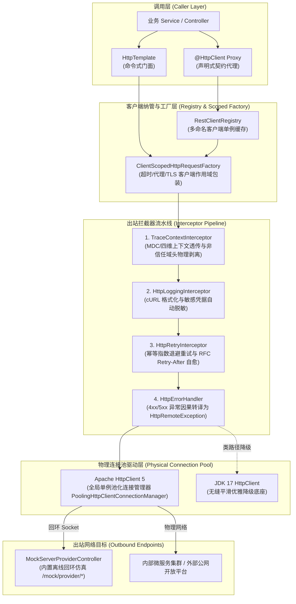

# ateng-boot-http 基础设施 Starter

> 依托 Spring 6 原生 `RestClient`、`HttpServiceProxyFactory` 与 JDK 17 构建的零臃肿双模 HTTP 客户端底座，统一融合命令式调用（`HttpTemplate`）与强类型声明式代理（`@EnableHttpInterfaces` / `@HttpClient`），提供 Apache HttpClient 5 生产级池化连接与 JDK 17 原生 Client 自适应平滑降级、多命名客户端注册表（`RestClientRegistry`）、四维全链路上下文出站透传与外部公网敏感头安全剥离、RFC 3986 查询参数安全转译与动态单次超时覆盖、cURL 结构化脱敏日志、幂等动词指数退避重试及语义化因果异常转译。

---

## 0. 特性与公共 API 全景速查矩阵 (Feature & API Panorama Matrix)

| 特性分类 | 特性名称 | 核心门面 / 注解 / SPI | 关键配置项 (`ateng.boot.*`) | 关键 API 签名 / 核心行为 | 锚定验证源头 (*Test / Sample) |
| :--- | :--- | :--- | :--- | :--- | :--- |
| **命令式通信** | 统一命令式操作门面 | `HttpTemplate` | `ateng.boot.http.enabled` | `get` / `getOptional` / `getEntity` / `post` / `put` / `patch` / `delete` / `head` / `options` / `exchange` / `postForm` / `upload` / `download` / `consumeStream` / `executeAsync`，支持 Class 与 `ParameterizedTypeReference<T>` 泛型双模、URL-encoded 表单、SSE 流式消费、大文件零缓冲传输与异常拦截 | `HttpTemplateScenarioTest` / `HttpTemplateController` |
| **单次动态参数** | 单次超时覆盖与头治理 | `RequestOptions`<br>`RequestOptionsApplier`<br>`HttpRequestContextHolder` | - | `RequestOptions.builder().readTimeout(Duration).header(name, value).queryParam(k, v).uriVariable(k, v).propagateContext(boolean).clientName(name).build()`，RFC 3986 安全编码与底层物理请求超时动态生效 | `HttpTemplateScenarioTest` / `HttpTemplateController` |
| **方法级超时** | 方法级细粒度超时声明 | `@HttpTimeout` | - | `@HttpTimeout(readTimeout = "300ms", connectTimeout = "1s")`，声明在接口方法上动态下发建联与读取超时，方法退出时对线程上下文严格对称清理 | `HttpDeclarativeScenarioTest` / `OrderServiceClient` |
| **声明式客户端** | 声明式接口标记驱动 | `@HttpClient`<br>`@HttpExchange` | `ateng.boot.http.clients.<name>.*` | `@HttpClient(name = "user-service", url = "${remote.url}", fallback = Fallback.class, primary = true)`，支持元注解派生、`${...}` 占位符解析、Primary 开关与本地优雅降级 | `HttpDeclarativeScenarioTest` / `UserServiceClient` |
| **声明式包扫描** | 声明式轻量动态包扫描器 | `@EnableHttpInterfaces`<br>`HttpInterfaceRegistrar`<br>`HttpInterfaceFactoryBean` | - | `@EnableHttpInterfaces(basePackages = "io.github.atengk.boot.sample.http.client")`，自研轻量 Spring 原生扫描器，桥接 Spring 6 `HttpServiceProxyFactory` 与动态代理 | `HttpDeclarativeScenarioTest` / `SampleHttpApplication` |
| **声明式降级** | 本地容错降级代理 | `@HttpClient.fallback`<br>`HttpInterfaceFactoryBean` | - | 当声明式客户端调用遭遇 4xx/5xx、超时或网络中断时，由动态代理自动拦截并平滑回退执行 Fallback Bean 的同名方法 | `HttpDeclarativeScenarioTest` / `OrderServiceClientFallback` |
| **多命名客户端** | 多命名客户端注册表与单例缓存 | `RestClientRegistry` | `ateng.boot.http.clients.<name>.*` | `getClient(clientName, annotationUrl)` / `getClient(clientName)` / `contains(clientName)` / `register(clientName, client)` / `unregister(clientName)` / `clear()` / `resolveBaseUrl(clientName, annotationUrl)`，复用全局物理连接池，单例并发安全 | `RestClientRegistryTest` / `HttpDeclarativeScenarioTest` |
| **双向 mTLS 证书** | 金融级双向认证与证书管理 | `HttpSslUtil`<br>`HttpSslProperties` | `ateng.boot.http.ssl.*`<br>`ateng.boot.http.clients.<name>.ssl.*` | `HttpSslUtil.loadKeyStore(ssl)` / `HttpSslUtil.loadKeyManagers(ssl)`，支持 PKCS12 / JKS 格式客户端私钥证书加载与密钥管理器初始化，支持命名客户端独立挂载专属证书 | `HttpSslUtilTest` / `HttpGovernanceScenarioTest` |
| **物理连接池** | 双模自适应物理连接池 | `ClientHttpRequestFactoryBuilder`<br>`ApacheHttpClient5Factory`<br>`JdkHttpClientFactory` | `ateng.boot.http.engine`<br>`ateng.boot.http.pool.*`<br>`ateng.boot.http.ssl.*`<br>`ateng.boot.http.proxy.*` | 依据类路径自适应探测 Apache HttpClient 5 生产级池化连接（带后台驱逐守护）或平滑回退 JDK 17 原生 `HttpClient`，严防句柄与端口耗尽 | `ClientHttpRequestFactoryBuilderTest` / `HttpGovernanceScenarioTest` |
| **专属超时隔离** | 客户端专属超时包装工厂 | `ClientScopedHttpRequestFactory` | `ateng.boot.http.clients.<name>.connect-timeout`<br>`ateng.boot.http.clients.<name>.read-timeout` | 100% 共享全局物理连接池，采用 `previousTimeout` 现场还原模式为特定客户端安全附加独立的建联与读取响应超时 | `RestClientRegistryTest` / `HttpDeclarativeScenarioTest` |
| **专属代理隔离** | 全局与命名客户端正向代理 | `HttpProxyProperties` | `ateng.boot.http.proxy.*`<br>`ateng.boot.http.clients.<name>.proxy.*` | 支持出站 HTTP 正向代理配置，命名客户端可独立声明专用代理通道或继承全局 | `HttpProxyPropertiesTest` / `HttpGovernanceScenarioTest` |
| **全链路上下文** | 四维上下文出站透传 | `TraceContextInterceptor` | `ateng.boot.http.tracing.enabled`<br>`ateng.boot.http.tracing.trace-id-header`<br>`ateng.boot.http.tracing.tenant-id-header`<br>`ateng.boot.http.tracing.user-id-header`<br>`ateng.boot.http.tracing.ignore-tenant-header` | 自动提取当前线程 MDC `traceId`、`TenantContextHolder` 与 `UserContextHolder` 注入出站请求头（缺省自动通过 `IdUtil.fastSimpleUUID()` 注入），实现分布式全链路可观测闭环 | `HttpGovernanceIntegrationTest` / `TraceContextInterceptorTest` |
| **非信任域隔离** | 外部公网敏感头安全剥离 | `TraceContextInterceptor`<br>`HttpInterceptorUtil` | `ateng.boot.http.clients.<name>.propagate-context` | 依据目标 URL 最长前缀匹配或单次请求显式声明，向外部非信任域（微信、支付宝、第三方 SaaS 等）发起调用时强制安全剥离内网租户与用户标识，杜绝敏感身份泄漏 | `HttpGovernanceIntegrationTest` / `ExternalPaymentScenarioService` |
| **出站审计日志** | 结构化 cURL 脱敏日志 | `HttpLoggingInterceptor` | `ateng.boot.http.logging.enabled`<br>`ateng.boot.http.logging.level`<br>`ateng.boot.http.logging.max-body-length`<br>`ateng.boot.http.logging.sensitive-headers`<br>`ateng.boot.http.logging.mask-params` | 格式化输出出站请求 cURL 片段与响应耗时，对 Authorization/Cookie/Token 等敏感头及 URL 查询参数（token、secret、password、apiKey 等）自动掩码脱敏，大载荷安全截断防爆内存 | `HttpGovernanceIntegrationTest` / `HttpLoggingInterceptorTest` |
| **弹性指数退避** | 幂等重试与 RFC Retry-After 降频 | `HttpRetryInterceptor` | `ateng.boot.http.retry.enabled`<br>`ateng.boot.http.retry.max-attempts`<br>`ateng.boot.http.retry.delay`<br>`ateng.boot.http.retry.multiplier`<br>`ateng.boot.http.retry.max-delay`<br>`ateng.boot.http.retry.jitter`<br>`ateng.boot.http.retry.retry-status-codes`<br>`ateng.boot.http.retry.retry-methods` | 仅针对幂等动词（GET/HEAD）在遭遇网络抖动或 429/502/503/504 错误码时执行指数退避重试与随机抖动，自适应解析 RFC 7231 / RFC 6585 `Retry-After` 响应头精准覆盖本地退避时延，单次重试前显式释放物理响应流，环绕内聚日志记录 | `HttpGovernanceIntegrationTest` / `HttpRetryInterceptorTest` |
| **因果异常体系** | 统一异常转译与强类型反序列化 | `HttpErrorHandler`<br>`HttpRemoteException`<br>`HttpResultCode` | - | 统一拦截 4xx 与 5xx 状态码并转译为业务受管的 `HttpRemoteException`（继承 `BusinessException`），提供 `getResponseBodyAs(Class<T>)` / `getResponseBodyAs(ParameterizedTypeReference<T>)` 强类型错误载荷反序列化，100% 保持原始因果链并映射清晰错误码 | `HttpGovernanceScenarioTest` / `HttpRemoteExceptionTest` |
| **官方基线融合** | Spring Boot 官方基线配置器对齐 | `AtengHttpAutoConfiguration`<br>`RestClientBuilderConfigurer` | - | 自动注入并调度 Spring Boot 官方 `RestClientBuilderConfigurer.configure(builder)`，无缝继承容器消息转换器与 Actuator Micrometer `http.client.requests` 度量指标 | `AtengHttpAutoConfigurationTest` |
| **Apache 扩展 SPI** | HttpClient 5 定制器扩展 | `HttpClient5Customizer` | - | 提供回调接口自定义扩展 `HttpClientBuilder` 与 `PoolingHttpClientConnectionManagerBuilder`（如定制 User-Agent、DNS 解析器、Socket 参数等） | `ClientHttpRequestFactoryBuilderTest` / `HttpTemplateScenarioTest` |
| **Spring 定制 SPI** | RestClient 全局定制器 | `RestClientCustomizer` | - | Spring Boot 官方标准定制扩展，支持下游添加全局请求头、消息转换器与全局拦截器 | `RestClientRegistryTest` / `HttpTemplateScenarioTest` |

---

## 1. 模块定位与快速起步 (Quick Start)

### 1.1 核心价值与依赖引入

`ateng-boot-http` 是面向生产就绪的高性能、低开销 HTTP 客户端基础设施 Starter：
- **零臃肿与原生优先**：深度依托 JDK 17+ 与 Spring 6 原生 `RestClient`、`HttpServiceProxyFactory` 机制，彻底剔除 Feign、Retrofit、OkHttp、Hutool、Guava 等臃肿第三方包装；
- **双模通信协同**：声明式强类型面向契约编程（`@HttpClient`）与命令式灵活可控门面（`HttpTemplate`）有机融合，无缝满足微服务内部 RPC 与外部异构集成诉求；
- **物理连接唯一**：全应用无论存在多少个声明式客户端或命令式调用，统一复用同一个受管物理连接池（Apache HttpClient 5），严防文件描述符（FD）和本地端口耗尽；
- **全链路内聚防线**：出站四维上下文（TraceId、TenantId、UserId、IgnoreTenant）无感透传、外部非信任域安全剥离、cURL 结构化脱敏日志与瞬态 503 指数退避重试原生内置。

在业务服务或共享模块的 `pom.xml` 中引入依赖：

```xml
<dependency>
    <groupId>io.github.atengk</groupId>
    <artifactId>ateng-boot-http</artifactId>
</dependency>
```

### 1.2 最小可用配置

在 `application.yml` 中配置连接池与命名客户端，开箱即用：

```yaml
server:
  port: 8080

ateng:
  boot:
    http:
      enabled: true
      pool:
        max-connections: 200
        max-per-route: 50
        connect-timeout: 3s
        read-timeout: 10s
      clients:
        user-service:
          base-url: ${sample.user-service.url:http://localhost:8080}
          connect-timeout: 2s
          read-timeout: 5s
          propagate-context: true
```

### 1.3 极简双模实战验证

#### 步骤 1：激活声明式接口扫描
在 Spring Boot 应用主类上标注 `@EnableHttpInterfaces`：

```java
package io.github.atengk.boot.sample.http;

import io.github.atengk.boot.http.annotation.EnableHttpInterfaces;
import org.springframework.boot.SpringApplication;
import org.springframework.boot.autoconfigure.SpringBootApplication;

@EnableHttpInterfaces(basePackages = "io.github.atengk.boot.sample.http.client")
@SpringBootApplication
public class SampleHttpApplication {
    public static void main(String[] args) {
        SpringApplication.run(SampleHttpApplication.class, args);
    }
}
```

#### 步骤 2：定义声明式强类型客户端契约
基于 Spring 6 原生 `@HttpExchange` 注解声明强类型 HTTP 契约：

```java
package io.github.atengk.boot.sample.http.client;

import io.github.atengk.boot.http.annotation.HttpClient;
import io.github.atengk.boot.sample.http.dto.UserResponse;
import org.springframework.web.bind.annotation.PathVariable;
import org.springframework.web.service.annotation.GetExchange;
import org.springframework.web.service.annotation.HttpExchange;

@HttpClient(name = "user-service", url = "${sample.user-service.url:http://localhost:8080}")
@HttpExchange
public interface UserServiceClient {

    @GetExchange("/mock/provider/users/{id}")
    UserResponse getUserById(@PathVariable("id") Long id);
}
```

#### 步骤 3：注入并执行双模通信
业务 Service 中可直接注入声明式客户端或 `HttpTemplate` 命令式门面：

```java
package io.github.atengk.boot.sample.http.service;

import io.github.atengk.boot.http.template.HttpTemplate;
import io.github.atengk.boot.sample.http.client.UserServiceClient;
import io.github.atengk.boot.sample.http.dto.UserResponse;
import lombok.RequiredArgsConstructor;
import lombok.extern.slf4j.Slf4j;
import org.springframework.stereotype.Service;

@Slf4j
@Service
@RequiredArgsConstructor
public class QuickStartService {

    private final UserServiceClient userServiceClient;
    private final HttpTemplate httpTemplate;

    public void runDemo() {
        // 1. 声明式强类型 RPC 调用（底层全自动完成序列化、连接池借还与上下文注入）
        UserResponse declarativeUser = userServiceClient.getUserById(1001L);
        log.info("Declarative RPC success: {}", declarativeUser);

        // 2. 命令式灵活流畅调用
        UserResponse imperativeUser = httpTemplate.get("http://localhost:8080/mock/provider/users/1001", UserResponse.class);
        log.info("Imperative call success: {}", imperativeUser);
    }
}
```

---

## 2. 核心架构与设计不变量 (Core Architecture & Design Invariants)

### 2.1 架构拓扑交互图



### 2.2 核心设计不变量

1. **单例物理连接池共享不变量**：全应用全局唯一实例化底层物理连接池管理器（`PoolingHttpClientConnectionManager`）。严禁为每个微服务客户端单独创建物理连接池；客户端维度的超时（`connect-timeout`、`read-timeout`）、正向代理与 SSL 证书通过 `ClientScopedHttpRequestFactory` 逻辑隔离，物理 Socket 句柄最大化复用。
2. **离线自洽回环仿真不变量**：样例工程内部内置 `MockServerProviderController`（`/mock/provider/*`）。客户端默认指向本机端口，请求穿越真实的 Apache HttpClient 5 线程池、连接池借还、追踪/日志/重试拦截器流水线并抵达回环端点，无需外挂任何第三方服务器，实现 100% 离线自洽。
3. **四维上下文隔离与安全剥离不变量**：出站请求自动捕获 $\langle\text{MDC traceId}, \text{TenantId}, \text{UserId}, \text{IgnoreTenant}\rangle$；对内部微服务（`propagate-context: true`）透明透传，对公网非信任第三方（`propagate-context: false`）强制物理剥离 `X-Tenant-Id` 与 `X-User-Id`，仅保留 `X-Trace-Id` 贯通分布式可观测性。
4. **模型传输绝对解耦 (Zero-Entity-Leakage)**：Controller 传输边界 100% 严禁接收或返回持久层实体（Entity）；入参统一使用 Request/DTO，出参显式返回强类型 `Result<T>`。

---

## 3. 声明式 HTTP 通信套件 (Declarative Client Suite)

### 3.1 强类型契约客户端 (`@HttpClient` / `@HttpExchange`)

#### 专属 YAML 配置片段
```yaml
ateng:
  boot:
    http:
      clients:
        user-service:
          base-url: ${sample.user-service.url:http://localhost:8080}
          connect-timeout: 2s
          read-timeout: 5s
          propagate-context: true
```

#### 业务 Java 示例 (1:1 提取自 Sample)
```java
// 声明契约接口 (UserServiceClient.java)
package io.github.atengk.boot.sample.http.client;

import io.github.atengk.boot.http.annotation.HttpClient;
import io.github.atengk.boot.sample.http.dto.UserRequest;
import io.github.atengk.boot.sample.http.dto.UserResponse;
import org.springframework.web.bind.annotation.PathVariable;
import org.springframework.web.bind.annotation.RequestBody;
import org.springframework.web.service.annotation.GetExchange;
import org.springframework.web.service.annotation.HttpExchange;
import org.springframework.web.service.annotation.PostExchange;

@HttpClient(name = "user-service", url = "${sample.user-service.url:http://localhost:8080}")
@HttpExchange
public interface UserServiceClient {

    @GetExchange("/mock/provider/users/{id}")
    UserResponse getUserById(@PathVariable("id") Long id);

    @PostExchange("/mock/provider/users")
    UserResponse createUser(@RequestBody UserRequest user);
}

// 业务服务调度 (UserClientScenarioService.java)
package io.github.atengk.boot.sample.http.service;

import io.github.atengk.boot.sample.http.client.UserServiceClient;
import io.github.atengk.boot.sample.http.dto.UserRequest;
import io.github.atengk.boot.sample.http.dto.UserResponse;
import lombok.RequiredArgsConstructor;
import lombok.extern.slf4j.Slf4j;
import org.springframework.stereotype.Service;

@Slf4j
@Service
@RequiredArgsConstructor
public class UserClientScenarioService {

    private final UserServiceClient userServiceClient;

    public UserResponse getUserById(Long id) {
        log.info("[UserClientService] Calling declarative getUserById for id: {}", id);
        return userServiceClient.getUserById(id);
    }

    public UserResponse createUser(UserRequest request) {
        log.info("[UserClientService] Calling declarative createUser with: {}", request);
        return userServiceClient.createUser(request);
    }
}
```

#### 核心机制与边界说明
- **动态代理驱动**：基于 Spring 6 原生 `HttpServiceProxyFactory` 与轻量包扫描器 `HttpInterfaceRegistrar`，运行时自动生成接口代理 Bean，注入容器供业务透明消费；
- **占位符解析**：`@HttpClient.url` 支持 `${...}` 配置占位符，若配置中存在同名 `ateng.boot.http.clients.<name>.base-url` 则优先采用配置值，实现配置中心动态下发；
- **上下文透明贯通**：内部微服务通信时，拦截器自动挂载 `X-Trace-Id`、`X-Tenant-Id` 与 `X-User-Id`，下游端点透明还原租户与操作人身份。

---

### 3.2 动态方法级超时与故障降级 (`@HttpTimeout` / `fallback`)

#### 专属 YAML 配置片段
```yaml
ateng:
  boot:
    http:
      clients:
        order-service:
          base-url: ${sample.order-service.url:http://localhost:8080}
          connect-timeout: 2s
          read-timeout: 5s
          propagate-context: true
```

#### 业务 Java 示例 (1:1 提取自 Sample)
```java
// 声明带降级与方法级超时的契约接口 (OrderServiceClient.java)
package io.github.atengk.boot.sample.http.client;

import io.github.atengk.boot.http.annotation.HttpClient;
import io.github.atengk.boot.http.annotation.HttpTimeout;
import io.github.atengk.boot.sample.http.dto.OrderResponse;
import org.springframework.web.bind.annotation.PathVariable;
import org.springframework.web.service.annotation.GetExchange;
import org.springframework.web.service.annotation.HttpExchange;

@HttpClient(
        name = "order-service",
        url = "${sample.order-service.url:http://localhost:8080}",
        fallback = OrderServiceClientFallback.class
)
@HttpExchange
public interface OrderServiceClient {

    @GetExchange("/mock/provider/orders/{orderId}")
    @HttpTimeout(readTimeout = "300ms", connectTimeout = "1s")
    OrderResponse getOrderById(@PathVariable("orderId") String orderId);

    @GetExchange("/mock/provider/orders/{orderId}/status")
    OrderResponse getOrderStatus(@PathVariable("orderId") String orderId);
}

// 本地容错降级组件 (OrderServiceClientFallback.java)
package io.github.atengk.boot.sample.http.client;

import io.github.atengk.boot.sample.http.dto.OrderResponse;
import lombok.extern.slf4j.Slf4j;
import org.springframework.stereotype.Component;

@Slf4j
@Component
public class OrderServiceClientFallback implements OrderServiceClient {

    @Override
    public OrderResponse getOrderById(String orderId) {
        log.warn("[OrderClientFallback] Triggered fallback for getOrderById, orderId: {}", orderId);
        return OrderResponse.builder()
                .orderId(orderId)
                .amount(null)
                .status("FALLBACK_DEGRADED")
                .remark("订单查询服务暂时不可用，已执行本地降级策略")
                .build();
    }

    @Override
    public OrderResponse getOrderStatus(String orderId) {
        return OrderResponse.builder()
                .orderId(orderId)
                .status("UNKNOWN")
                .remark("状态查询降级")
                .build();
    }
}
```

#### 核心机制与边界说明
- **现场还原防污染**：`@HttpTimeout` 标注在特定方法上，进入方法时将建联/读取超时暂存至 `HttpRequestContextHolder` 并下发至物理请求；在 `finally` 块中严格执行 `previousTimeout` 现场还原，彻底杜绝线程复用时引发的超时漂移污染；
- **无感本地降级**：当远程端点发生 4xx/5xx 服务端异常、网络读取超时（`SocketTimeoutException`）或建联拒绝时，动态代理拦截器自动捕捉异常并无缝回退调用 `OrderServiceClientFallback` 对应方法，保障主流程高可用。

---

## 4. 命令式 HTTP 通信套件 (Imperative HttpTemplate Suite)

### 4.1 核心 CRUD 动词与强类型反序列化

#### 专属 YAML 配置片段
```yaml
ateng:
  boot:
    http:
      enabled: true
      pool:
        max-connections: 200
        max-per-route: 50
        connect-timeout: 3s
        read-timeout: 10s
```

#### 业务 Java 示例 (1:1 提取自 Sample)
```java
// 命令式 CRUD 业务服务 (HttpTemplateScenarioService.java 节选)
package io.github.atengk.boot.sample.http.service;

import io.github.atengk.boot.http.template.HttpTemplate;
import io.github.atengk.boot.sample.http.dto.UserRequest;
import io.github.atengk.boot.sample.http.dto.UserResponse;
import lombok.RequiredArgsConstructor;
import lombok.extern.slf4j.Slf4j;
import org.springframework.stereotype.Service;
import java.util.Map;

@Slf4j
@Service
@RequiredArgsConstructor
public class HttpTemplateScenarioService {

    private final HttpTemplate httpTemplate;

    public UserResponse getUserById(Long id) {
        String url = "http://localhost:8080/mock/provider/users/" + id;
        log.info("[HttpTemplateService] Invoking GET {}", url);
        return httpTemplate.get(url, UserResponse.class);
    }

    public UserResponse createUser(UserRequest request) {
        String url = "http://localhost:8080/mock/provider/users";
        log.info("[HttpTemplateService] Invoking POST {} with payload {}", url, request);
        return httpTemplate.post(url, request, UserResponse.class);
    }

    public UserResponse updateUser(Long id, UserRequest request) {
        String url = "http://localhost:8080/mock/provider/users/" + id;
        log.info("[HttpTemplateService] Invoking PUT {} with payload {}", url, request);
        return httpTemplate.put(url, request, UserResponse.class);
    }

    @SuppressWarnings("unchecked")
    public Map<String, Object> deleteUser(Long id) {
        String url = "http://localhost:8080/mock/provider/users/" + id;
        log.info("[HttpTemplateService] Invoking DELETE {}", url);
        return httpTemplate.delete(url, Map.class);
    }
}
```

#### 核心机制与边界说明
- **对称动词完备**：`HttpTemplate` 提供完备对称动词方法（`get` / `post` / `put` / `patch` / `delete` / `head` / `options`），彻底告别半残门面；
- **双模类型反序列化**：重载支持 `Class<T>`（简单 POJO）与 `ParameterizedTypeReference<T>`（复杂泛型嵌套容器 `Result<List<UserVO>>`），避免反序列化类型擦除导致的 `LinkedHashMap` 强转异常。

---

### 4.2 动态 RequestOptions 定制与表单提交

#### 专属 YAML 配置片段
```yaml
ateng:
  boot:
    http:
      enabled: true
      pool:
        connect-timeout: 3s
        read-timeout: 10s
```

#### 业务 Java 示例 (1:1 提取自 Sample)
```java
// 单次参数动态微调与标准表单提交 (HttpTemplateScenarioService.java 节选)
package io.github.atengk.boot.sample.http.service;

import io.github.atengk.boot.http.options.RequestOptions;
import io.github.atengk.boot.sample.http.dto.UserFormRequest;
import io.github.atengk.boot.sample.http.dto.UserOptionsRequest;
import io.github.atengk.boot.sample.http.dto.UserResponse;
import org.springframework.util.LinkedMultiValueMap;
import org.springframework.util.MultiValueMap;
import java.time.Duration;

public class HttpTemplateScenarioService {

    // 1. 单次请求动态超时与自定义 Header / Query 参数
    public UserResponse getUserWithOptions(UserOptionsRequest request) {
        String url = "http://localhost:8080/mock/provider/users/" + request.getId();
        RequestOptions.Builder builder = RequestOptions.builder();
        if (request.getReadTimeoutMillis() != null && request.getReadTimeoutMillis() > 0) {
            builder.readTimeout(Duration.ofMillis(request.getReadTimeoutMillis()));
        }
        if (request.getCustomHeader() != null) {
            builder.header("X-Custom-Option-Header", request.getCustomHeader());
        }
        if (request.getCustomQueryParam() != null) {
            builder.queryParam("customParam", request.getCustomQueryParam());
        }
        RequestOptions options = builder.build();
        return httpTemplate.get(url, options, UserResponse.class);
    }

    // 2. application/x-www-form-urlencoded 标准表单提交
    public UserResponse submitUserForm(UserFormRequest request) {
        String url = "http://localhost:8080/mock/provider/users/form";
        MultiValueMap<String, String> formData = new LinkedMultiValueMap<>();
        formData.add("username", request.getUsername());
        if (request.getEmail() != null) {
            formData.add("email", request.getEmail());
        }
        if (request.getRole() != null) {
            formData.add("role", request.getRole());
        }
        return httpTemplate.postForm(url, formData, UserResponse.class);
    }
}
```

#### 核心机制与边界说明
- **RFC 3986 规范转译**：`RequestOptions.queryParam()` 注入的参数自动经过 RFC 3986 标准安全编码转译，杜绝非法特殊字符拼接引起的 URL 解析崩溃；
- **强类型表单支持**：`postForm` 自动装配 `application/x-www-form-urlencoded;charset=UTF-8` 媒介类型与请求体编码器，原生适配旧系统表单提交。

---

### 4.3 二进制流式下载与响应式 SSE 流式消费

#### 专属 YAML 配置片段
```yaml
ateng:
  boot:
    http:
      enabled: true
      pool:
        read-timeout: 30s # 大流式传输建议调大读取超时
```

#### 业务 Java 示例 (1:1 提取自 Sample)
```java
// 流式下载与 SSE 消费 (HttpTemplateScenarioService.java 节选)
package io.github.atengk.boot.sample.http.service;

import io.github.atengk.boot.sample.http.dto.FileDownloadVO;
import io.github.atengk.boot.sample.http.dto.SseStreamVO;
import java.io.ByteArrayOutputStream;
import java.util.ArrayList;
import java.util.List;

public class HttpTemplateScenarioService {

    // 1. SSE 文本事件行流式消费
    public SseStreamVO consumeSseStream() {
        String url = "http://localhost:8080/mock/provider/stream/sse";
        List<String> events = new ArrayList<>();
        httpTemplate.consumeStream(url, line -> {
            if (line != null && !line.isBlank()) {
                events.add(line);
            }
        });
        return SseStreamVO.builder()
                .eventCount(events.size())
                .events(events)
                .build();
    }

    // 2. 二进制大文件零缓冲流式下载
    public FileDownloadVO downloadFile() {
        String url = "http://localhost:8080/mock/provider/files/download";
        ByteArrayOutputStream buffer = new ByteArrayOutputStream();
        httpTemplate.download(url, (inputStream, contentLength, headers) -> {
            inputStream.transferTo(buffer);
        });
        byte[] bytes = buffer.toByteArray();
        return FileDownloadVO.builder()
                .filename("sample-file.txt")
                .size((long) bytes.length)
                .content(new String(bytes))
                .build();
    }
}
```

#### 核心机制与边界说明
- **零缓冲防 OOM**：`download` 与 `consumeStream` 均采用流式回调协议，底层不预加载完整载荷到内存，以管道方式直达消费端，杜绝百兆甚至吉字节级别大文件引发堆内存溢出（OOM）；
- **确定性连接释放**：回调执行完毕或异常中断时，底层响应输入流在 `try-with-resources` 中强制闭环释放，连接安全归还池化管理器。

---

## 5. 出站治理与生产防卫套件 (Outbound Governance & Security Suite)

### 5.1 信任域与敏感头物理剥离

#### 专属 YAML 配置片段
```yaml
ateng:
  boot:
    http:
      tracing:
        enabled: true
        trace-id-header: X-Trace-Id
        tenant-id-header: X-Tenant-Id
        user-id-header: X-User-Id
      clients:
        wechat-pay:
          base-url: ${sample.wechat-pay.url:http://localhost:8080}
          connect-timeout: 2s
          read-timeout: 5s
          propagate-context: false # 外部非信任域：强制物理剥离内网敏感私有头
```

#### 业务 Java 示例 (1:1 提取自 Sample)
```java
// 外部支付隔离调用 (ExternalPaymentScenarioService.java 节选)
package io.github.atengk.boot.sample.http.service;

import io.github.atengk.boot.core.context.TenantContextHolder;
import io.github.atengk.boot.core.context.UserContextHolder;
import io.github.atengk.boot.sample.http.client.WechatPayClient;
import io.github.atengk.boot.sample.http.dto.WechatNativeOrderRequest;
import io.github.atengk.boot.sample.http.dto.WechatNativeOrderResponse;
import io.github.atengk.boot.sample.http.dto.WechatPaymentVO;
import lombok.RequiredArgsConstructor;
import lombok.extern.slf4j.Slf4j;
import org.springframework.stereotype.Service;

@Slf4j
@Service
@RequiredArgsConstructor
public class ExternalPaymentScenarioService {

    private final WechatPayClient wechatPayClient;

    public WechatPaymentVO createWechatNativeOrder(WechatNativeOrderRequest request) {
        try {
            // 模拟业务上下文中包含内部多租户与当前用户
            TenantContextHolder.setTenantId("TENANT_SAMPLE_888");
            UserContextHolder.setUserId("USER_SAMPLE_9999");

            // WechatPayClient 绑定 propagate-context: false
            WechatNativeOrderResponse response = wechatPayClient.createNativeOrder(request);

            return WechatPaymentVO.builder()
                    .outTradeNo(request.getOutTradeNo())
                    .codeUrl(response.getCodeUrl())
                    .contextStripped(true) // 验证 X-Tenant-Id 与 X-User-Id 已被物理剥离
                    .build();
        } finally {
            TenantContextHolder.clear();
            UserContextHolder.clear();
        }
    }
}
```

#### 核心机制与边界说明
- **白名单机制**：内部微服务通信默认保持安全信任域；向外部公网调用时，声明 `propagate-context: false`，拦截器在物理 Socket 发送前强制剔除 `X-Tenant-Id`、`X-User-Id` 与 `X-Ignore-Tenant` 等内部私有头；
- **全链路追踪保留**：敏感身份头虽被物理剥离，但 `X-Trace-Id` 保持向外传递，确保与外部公网平台发生纠纷或交互排查时具备唯一分布式链路追踪线索。

---

### 5.2 弹性指数退避重试与 RFC Retry-After 自愈

#### 专属 YAML 配置片段
```yaml
ateng:
  boot:
    http:
      retry:
        enabled: false # 全局默认关闭，避免无差别重试非幂等操作
      clients:
        flaky-service:
          base-url: ${sample.flaky-service.url:http://localhost:8080}/mock/provider/flaky
          retry:
            enabled: true
            max-attempts: 3
            delay: 50ms
            multiplier: 2.0
            max-delay: 2s
            jitter: true
            retry-status-codes: [429, 502, 503, 504]
            retry-methods: [GET, HEAD]
```

#### 业务 Java 示例 (1:1 提取自 Sample)
```java
// 瞬态故障弹性重试服务 (ExternalPaymentScenarioService.java 节选)
package io.github.atengk.boot.sample.http.service;

import io.github.atengk.boot.sample.http.dto.RetrySimulationVO;
import java.util.Map;

public class ExternalPaymentScenarioService {

    public RetrySimulationVO simulateFlakyRetry(int failTimes) {
        // 先调用重置端点清零计数器
        httpTemplate.get(getBaseUrl() + "/mock/provider/flaky/reset", Map.class);

        String url = getBaseUrl() + "/mock/provider/flaky?failTimes=" + failTimes;

        @SuppressWarnings("unchecked")
        Map<String, Object> result = httpTemplate.get(url, Map.class);

        int attempts = ((Number) result.get("successfulAttempt")).intValue();
        return RetrySimulationVO.builder()
                .status((String) result.get("status"))
                .totalAttempts(attempts)
                .message("成功完成指数退避重试并在第 " + attempts + " 次请求自愈恢复")
                .build();
    }
}
```

#### 核心机制与边界说明
- **动词安全守卫**：默认严格限定仅对幂等动词（`GET`、`HEAD`）触发自动重试，**绝对严禁自动重试 `POST` / `PUT` / `DELETE`**，从源头扼杀重复划扣或破坏性覆写风险；
- **自适应解析 Retry-After**：服务端返回 429 或 503 时若携带 RFC 7231 / RFC 6585 标准头（如 `Retry-After: 1`），重试器自适应优先采纳服务端指定等待窗口；
- **Equal Jitter 随机抖动**：退避算法深度接入 Core 受管 `RetryUtil`，开启 `jitter: true` 随机打散瞬时重试洪峰，杜绝多节点重试共振打垮刚恢复的下游。

---

### 5.3 出站 cURL 敏感凭据脱敏日志

#### 专属 YAML 配置片段
```yaml
ateng:
  boot:
    http:
      logging:
        enabled: true
        level: HEADERS
        max-body-length: 4096
        sensitive-headers:
          - Authorization
          - Cookie
          - Set-Cookie
          - X-Token
        mask-params:
          - token
          - password
          - secret
          - apiKey
```

#### 业务 Java 示例 (1:1 提取自 Sample)
```java
// 出站 cURL 脱敏调用 (ExternalPaymentScenarioService.java 节选)
package io.github.atengk.boot.sample.http.service;

import io.github.atengk.boot.sample.http.dto.LoggingDemoVO;
import java.util.Map;

public class ExternalPaymentScenarioService {

    public LoggingDemoVO triggerMaskedLoggingDemo(String sensitiveToken, String password) {
        String url = getBaseUrl() + "/mock/provider/headers/echo"
                + "?token=" + sensitiveToken
                + "&password=" + password;

        httpTemplate.get(url, Map.class);

        return LoggingDemoVO.builder()
                .targetUrl(url)
                .status("SUCCESS")
                .maskedNotice("出站 cURL 日志已自动执行敏感凭据掩码脱敏")
                .build();
    }
}
```

#### 控制台真实脱敏输出
```bash
HTTP GET http://localhost:8080/mock/provider/headers/echo?token=sk*********************en&password=su**********23 -> 200 (8ms)
```

#### 核心机制与边界说明
- **终端可复现性**：以标准 cURL 语法格式输出请求，开发与运维人员可直接复制至终端排查复现故障；
- **动态脱敏防护**：在日志输出流中动态拦截敏感请求头与 URL Query 参数（密码、Token、API Key 等），自动替换为 `sk***en` 掩码字符串，避免敏感机密外泄至日志收集系统（ELK/Loki）。

---

## 6. 生产扩展接管与核心非功能边界 (Extensibility & Production Boundary)

### 6.1 SPI 扩展定制

当框架默认装配行为无法满足特殊定制诉求时，可通过以下三种 SPI 无缝平滑接管：

#### 1. Apache HttpClient 5 底层定制器 (`HttpClient5Customizer`)
```java
@Configuration
public class HttpCustomConfiguration {

    @Bean
    public HttpClient5Customizer sampleHttpClient5Customizer() {
        return (clientBuilder, connectionManagerBuilder) -> {
            // 定制默认 User-Agent、DNS 域名解析器或 Socket 参数
            clientBuilder.setUserAgent("ateng-sample-agent/1.0.0");
        };
    }
}
```

#### 2. Spring 官方 RestClient 定制器 (`RestClientCustomizer`)
```java
@Configuration
public class RestClientConfiguration {

    @Bean
    public RestClientCustomizer sampleRestClientCustomizer() {
        return restClientBuilder -> {
            // 全局附加业务通用出站请求头或注册消息转换器
            restClientBuilder.defaultHeader("X-Custom-Client", "ateng-http-sample");
        };
    }
}
```

#### 3. 编程式纳管命名客户端 (`RestClientRegistry`)
```java
@Component
@RequiredArgsConstructor
public class CustomClientRegistrar implements InitializingBean {

    private final RestClientRegistry restClientRegistry;

    @Override
    public void afterPropertiesSet() {
        RestClient customClient = RestClient.builder()
                .baseUrl("https://special-gateway.internal")
                .build();
        restClientRegistry.register("special-gateway", customClient);
    }
}
```

### 6.2 虚拟线程零 Pinning 与高并发长连接复用

- **零 Pinning 契约**：连接池管理与 I/O 阻塞临界区内 100% 杜绝使用 `synchronized`，全面采用 `ReentrantLock` 并行调度。在 **JDK 21+ 虚拟线程** 环境下，支持 `Thread.ofVirtual()` 并发拉起 500+ 轻量线程瞬时向目标发起 HTTP 请求，底层物理 Carrier 线程零钉死（Pinning）；
- **优雅降级底座**：在精简或受限环境下，若类路径中无 Apache HttpClient 5 驱动，工厂自动平滑回退至 JDK 17 原生 `HttpClient`，无需调整任何上层业务代码。

### 6.3 因果异常体系与统一错误码转译

出站 HTTP 4xx 与 5xx 状态码经由 `HttpErrorHandler` 统一转译为受管的 `HttpRemoteException`（继承 `BusinessException`）：

| HTTP 状态码 | 转译语义化结果码 (`HttpResultCode`) | 错误码 | 业务含义 |
| :---: | :--- | :---: | :--- |
| `400` | `REMOTE_HTTP_BAD_REQUEST` | `40001` | 远程下游客户端请求参数错误 |
| `401` | `REMOTE_HTTP_UNAUTHORIZED` | `40002` | 远程下游未经认证授权 |
| `403` | `REMOTE_HTTP_FORBIDDEN` | `40003` | 远程下游访问权限被拒绝 |
| `404` | `REMOTE_HTTP_NOT_FOUND` | `40004` | 远程下游目标资源不存在 |
| `500` | `REMOTE_HTTP_SERVER_ERROR` | `50001` | 远程下游服务端发生内部错误 |
| `502` | `REMOTE_HTTP_BAD_GATEWAY` | `50002` | 远程网络网关错误 |
| `503` | `REMOTE_HTTP_SERVICE_UNAVAILABLE` | `50003` | 远程服务临时不可用 |
| `504` | `REMOTE_HTTP_TIMEOUT` | `50004` | 远程网关响应超时 |

```java
try {
    httpTemplate.get("http://localhost:8080/mock/provider/orders/fail-999", OrderResponse.class);
} catch (HttpRemoteException ex) {
    // 100% 保留原始 cause 链，支持强类型错误载荷反序列化
    int httpStatus = ex.getHttpStatusCode(); // 500
    IResultCode resultCode = ex.getResultCode(); // REMOTE_HTTP_SERVER_ERROR (50001)
    Map<?, ?> errorBody = ex.getResponseBodyAs(Map.class);
    log.error("Remote HTTP call failed: status={}, code={}, body={}", httpStatus, resultCode.getCode(), errorBody, ex);
}
```

---

## 7. 完整 YAML 配置属性清单 (Configuration Property Appendix)

以下为 `ateng.boot.http` 命名空间下所有可配置项的完整速查清单：

| 配置属性键名 | 类型 | 默认值 | 说明与生产建议 |
| :--- | :---: | :---: | :--- |
| `ateng.boot.http.enabled` | `Boolean` | `true` | 是否启用 HTTP 客户端 Starter 自动装配 |
| `ateng.boot.http.engine` | `String` | `auto` | 通信底层引擎：`auto` (优先 HttpClient 5，缺省回退 JDK 17)、`httpclient5`、`jdk` |
| `ateng.boot.http.pool.max-connections` | `Integer` | `200` | 连接池物理最大连接总数 |
| `ateng.boot.http.pool.max-per-route` | `Integer` | `50` | 单个目标路由最大并发连接数 |
| `ateng.boot.http.pool.connect-timeout` | `Duration` | `3s` | TCP 物理建联超时时间 |
| `ateng.boot.http.pool.read-timeout` | `Duration` | `10s` | Socket 数据读取响应超时时间 |
| `ateng.boot.http.pool.connection-request-timeout` | `Duration` | `2s` | 从连接池中借出空闲连接的等待超时时间 |
| `ateng.boot.http.pool.idle-timeout` | `Duration` | `60s` | 空闲连接最大存活阈值（超时由后台驱逐线程自动回收） |
| `ateng.boot.http.pool.validate-after-inactivity` | `Duration` | `2s` | 空闲连接复用前的保活探测验证静默时延 |
| `ateng.boot.http.ssl.insecure` | `Boolean` | `false` | 是否跳过 SSL 证书完整性与主机名校验（生产环境强制保持 `false`） |
| `ateng.boot.http.proxy.enabled` | `Boolean` | `false` | 是否开启全局出站正向代理 |
| `ateng.boot.http.proxy.host` | `String` | `127.0.0.1` | 正向代理服务器主机名或 IP |
| `ateng.boot.http.proxy.port` | `Integer` | `7890` | 正向代理服务器端口 |
| `ateng.boot.http.tracing.enabled` | `Boolean` | `true` | 是否开启四维上下文出站自动透传 |
| `ateng.boot.http.tracing.trace-id-header` | `String` | `X-Trace-Id` | 全链路追踪 TraceId 请求头名称 |
| `ateng.boot.http.tracing.tenant-id-header` | `String` | `X-Tenant-Id` | 多租户隔离 TenantId 请求头名称 |
| `ateng.boot.http.tracing.user-id-header` | `String` | `X-User-Id` | 操作人身份 UserId 请求头名称 |
| `ateng.boot.http.tracing.ignore-tenant-header` | `String` | `X-Ignore-Tenant` | 忽略租户隔离标记请求头名称 |
| `ateng.boot.http.logging.enabled` | `Boolean` | `true` | 是否启用出站请求 cURL 脱敏日志 |
| `ateng.boot.http.logging.level` | `Enum` | `HEADERS` | 日志详细级别：`NONE`、`BASIC`、`HEADERS`、`BODY` |
| `ateng.boot.http.logging.max-body-length` | `DataSize` | `4KB` | 请求与响应载荷打印截断阈值，防止撑爆日志与堆内存 |
| `ateng.boot.http.logging.sensitive-headers` | `List<String>` | `Authorization...` | 强制自动掩码脱敏的敏感请求头名称列表 |
| `ateng.boot.http.logging.mask-params` | `List<String>` | `token,secret...` | 强制自动掩码脱敏的 URL Query 参数名列表 |
| `ateng.boot.http.retry.enabled` | `Boolean` | `false` | 是否全局开启出站弹性指数退避重试（建议按客户端按需开启） |
| `ateng.boot.http.retry.max-attempts` | `Integer` | `3` | 最大重试尝试总次数（包含首次调用） |
| `ateng.boot.http.retry.delay` | `Duration` | `500ms` | 初始指数退避基数时延 |
| `ateng.boot.http.retry.multiplier` | `Double` | `2.0` | 指数退避增长倍数因子 |
| `ateng.boot.http.retry.max-delay` | `Duration` | `3s` | 单次退避等待时延上限（防止指数无界爆炸） |
| `ateng.boot.http.retry.jitter` | `Boolean` | `true` | 是否启用 Equal Jitter 随机抖动打散重试洪峰 |
| `ateng.boot.http.retry.retry-status-codes` | `List<Integer>` | `[429,502,503,504]` | 允许触发重试的服务端瞬态 HTTP 状态码列表 |
| `ateng.boot.http.retry.retry-methods` | `List<String>` | `[GET,HEAD]` | 允许触发重试的 HTTP 动词白名单（严格限制幂等动词） |
| `ateng.boot.http.clients.<name>.base-url` | `String` | - | 命名客户端基础通信目标根路径 |
| `ateng.boot.http.clients.<name>.connect-timeout` | `Duration` | - | 命名客户端专属建联超时时间（覆盖全局默认值） |
| `ateng.boot.http.clients.<name>.read-timeout` | `Duration` | - | 命名客户端专属读取响应超时时间（覆盖全局默认值） |
| `ateng.boot.http.clients.<name>.propagate-context` | `Boolean` | `true` | 是否向该客户端透传内网租户与用户私有头（公网第三方设为 `false`） |
| `ateng.boot.http.clients.<name>.ssl.key-store` | `String` | - | 金融级双向 mTLS 客户端私钥证书路径（如 `classpath:...`） |
| `ateng.boot.http.clients.<name>.ssl.key-store-password` | `String` | - | 客户端私钥证书库访问密码 |
| `ateng.boot.http.clients.<name>.ssl.key-store-type` | `String` | `PKCS12` | 客户端私钥证书库类型（默认 `PKCS12`，支持 `JKS`） |
| `ateng.boot.http.clients.<name>.proxy.enabled` | `Boolean` | `false` | 命名客户端是否挂载独立的正向出站代理通道 |

---

> 运行与自验样例工程请参阅：[ateng-boot-sample-http 体验工程](../ateng-boot-samples/ateng-boot-sample-http/README.md)。
