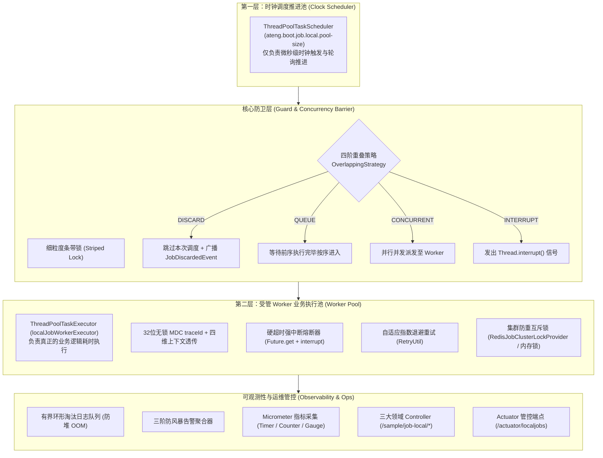

# ateng-boot-job-local 基础设施 Starter

> 面向单机定时调度与轻量分布式集群防重的生产级调度基础设施 Starter，坚持纯原生零重型臃肿依赖设计。基于 Spring `ThreadPoolTaskScheduler` 时钟调度器与受管 Worker 线程池双层物理隔离体系，提供声明式 `@LocalJob` 注解与对称操作门面 `LocalJobTemplate`、四阶重叠并发防卫策略（`OverlappingStrategy`）、硬超时强中断熔断与指数退避重试、强类型 DTO 入参绑定与 JSR-303 Fail-Fast 防卫、SaaS 多租户全模态隔离与 Fail-Safe 容错、三阶防风暴告警聚合器与故障自愈通知、原生零臃肿 Redis 轻量集群互斥锁与原子防误删、32 位无锁 MDC `traceId` 全链路追踪、有界环形淘汰防堆 OOM、云原生 Micrometer 监控指标度量、三大高内聚领域体验 Controller、`SmartLifecycle` 确定性停机排空以及 `/actuator/localjobs` 生产级运维管控端点。

---

## 0. 特性与公共 API 全景速查矩阵 (维度零：100% 全覆盖)

| 特性分类 | 特性名称 | 核心门面 / 注解 / SPI | 关键配置项 (`ateng.boot.job.local.*`) | 关键 API 签名 / 核心行为 | 锚定验证源头 (*Test / Sample) |
| :--- | :--- | :--- | :--- | :--- | :--- |
| **声明式调度** | 声明式任务注解 | `@LocalJob` | `enabled` | `@LocalJob(...)` 标注于受管 Bean 方法，自动扫描并注册纳管 | `LocalJobSchedulingTest`<br>`DailyReconciliationScenarioJob` |
| **声明式调度** | 任务标识名称 | `@LocalJob.value` / `name` | - | `String name()`，任务唯一标识，缺省为空时自动推导为 `类名#方法名` | `LocalJobSchedulingTest`<br>`DailyReconciliationScenarioJob` |
| **声明式调度** | 标准 Cron 表达式 | `@LocalJob.cron` | - | `String cron()`，支持标准 Spring 6 位 Cron 表达式（如 `0 0 2 * * ?`） | `LocalJobSchedulingTest`<br>`DailyReconciliationScenarioJob` |
| **声明式调度** | 固定频率调度 | `@LocalJob.fixedRate` | - | `String fixedRate()`，强类型时间（如 `5s`），上次开始到本次开始的间隔 | `LocalJobSchedulingTest`<br>`SystemMetricsSamplingScenarioJob` |
| **声明式调度** | 固定延迟调度 | `@LocalJob.fixedDelay` | - | `String fixedDelay()`，强类型时间（如 `10s`），上次结束到本次开始的间隔 | `LocalJobSchedulingTest`<br>`OrderTimeoutCancelScenarioJob` |
| **声明式调度** | 初始启动延迟 | `@LocalJob.initialDelay` | - | `String initialDelay()`，强类型时间（如 `1h`），容器启动后的首次调度延迟 | `LocalJobSchedulingTest`<br>`OrderTimeoutCancelScenarioJob` |
| **声明式调度** | 并发重叠防卫策略 | `@LocalJob.strategy` | - | `OverlappingStrategy strategy()`，默认 `DISCARD`，支持 `QUEUE` / `CONCURRENT` / `INTERRUPT` | `LocalJobOverlappingAndFacadeTest`<br>`SampleJobLocalIntegrationTest` |
| **声明式调度** | 单次执行硬超时阈值 | `@LocalJob.timeout` | - | `String timeout()`，单次执行超时强行中断阈值（如 `300ms`），缺省不限时 | `LocalJobTimeoutRetryAndMdcTest`<br>`OrderTimeoutCancelScenarioJob` |
| **声明式调度** | 失败指数重试次数 | `@LocalJob.maxRetries` | - | `int maxRetries()`，任务失败后最大自适应重试次数，默认 0 不重试 | `LocalJobTimeoutRetryAndMdcTest`<br>`OrderTimeoutCancelScenarioJob` |
| **声明式调度** | 失败重试退避间隔 | `@LocalJob.retryInterval` | - | `String retryInterval()`，重试退避初始间隔（默认 `1s`），联动 `RetryUtil` 指数退避 | `LocalJobTimeoutRetryAndMdcTest`<br>`OrderTimeoutCancelScenarioJob` |
| **声明式调度** | 轻量集群互斥防重 | `@LocalJob.clusterLock` | `cluster-lock.enabled` | `boolean clusterLock()`，开启多节点集群互斥锁，抢锁失败安全跳过，默认 false | `LocalJobClusterLockTest`<br>`ClusterDeduplicationScenarioJob` |
| **声明式调度** | 集群互斥锁租约时长 | `@LocalJob.clusterLockLeaseTime` | `cluster-lock.default-lease-time` | `String clusterLockLeaseTime()`，防死锁安全租约时长（默认 `5m`） | `LocalJobClusterLockTest`<br>`ClusterDeduplicationScenarioJob` |
| **声明式调度** | SaaS 多租户调度模态 | `@LocalJob.tenantMode` | - | `JobTenantMode tenantMode()`，默认 `IGNORE`，支持 `PARAM` 单租户与 `ITERATE` 全租户轮询 | `LocalJobMultiTenantTest`<br>`MultiTenantBillingScenarioJob` |
| **声明式调度** | 任务人读描述 | `@LocalJob.description` | - | `String description()`，任务中文业务说明，用于 Actuator 与看板展示 | `LocalJobActuatorAndEventTest`<br>`DailyReconciliationScenarioJob` |
| **声明式调度** | 任务静态启用开关 | `@LocalJob.enabled` | - | `boolean enabled()`，单任务静态启动开关，默认 true | `LocalJobSchedulingTest` |
| **操作门面** | 手动立即触发任务 | `LocalJobTemplate` | - | `JobResult trigger(String jobName)`，手动立即触发执行一次指定任务 | `LocalJobFacadeAndQueryTest`<br>`LocalJobScheduleController` |
| **操作门面** | 手动带参立即触发 | `LocalJobTemplate` | - | `JobResult trigger(String jobName, Map<String, Object> params)`，携带参数触发 | `LocalJobParamValidationTest`<br>`LocalJobScheduleController` |
| **操作门面** | 暂停周期性调度 | `LocalJobTemplate` | - | `boolean pause(String jobName)`，暂停周期自动触发，状态置为 `PAUSED` | `LocalJobFacadeAndQueryTest`<br>`LocalJobManageController` |
| **操作门面** | 恢复周期性调度 | `LocalJobTemplate` | - | `boolean resume(String jobName)`，恢复暂停的任务，重新挂载至时钟调度池 | `LocalJobFacadeAndQueryTest`<br>`LocalJobManageController` |
| **操作门面** | 动态修改 Cron 周期 | `LocalJobTemplate` | - | `boolean updateCron(String jobName, String cronExpression)`，动态重置周期并重调度 | `LocalJobFacadeAndQueryTest`<br>`LocalJobManageController` |
| **操作门面** | 动态修改固定频率周期 | `LocalJobTemplate` | - | `boolean updateFixedRate(String jobName, Duration newFixedRate)`，修改频率并重调度 | `LocalJobFacadeAndQueryTest`<br>`LocalJobManageController` |
| **操作门面** | 动态修改固定延迟周期 | `LocalJobTemplate` | - | `boolean updateFixedDelay(String jobName, Duration newFixedDelay)`，修改延迟并重调度 | `LocalJobFacadeAndQueryTest`<br>`LocalJobManageController` |
| **操作门面** | 编程式注册通用任务 | `LocalJobTemplate` | - | `boolean register(JobDefinition definition, JobHandler handler)`，完整元数据注册 | `LocalJobFacadeAndQueryTest` |
| **操作门面** | 编程式极简注册 Cron | `LocalJobTemplate` | - | `boolean registerCron(String jobName, String cron, Runnable runnable)`，快捷注册 | `LocalJobFacadeAndQueryTest`<br>`LocalJobManageController` |
| **操作门面** | 编程式注册固定频率 | `LocalJobTemplate` | - | `boolean registerFixedRate(String jobName, Duration fixedRate, Runnable runnable)` | `LocalJobFacadeAndQueryTest` |
| **操作门面** | 编程式注册固定延迟 | `LocalJobTemplate` | - | `boolean registerFixedDelay(String jobName, Duration fixedDelay, Runnable runnable)` | `LocalJobFacadeAndQueryTest` |
| **操作门面** | 注销并移除任务 | `LocalJobTemplate` | - | `boolean remove(String jobName)`，停止调度并从注册表彻底注销移除任务 | `LocalJobFacadeAndQueryTest`<br>`LocalJobManageController` |
| **操作门面** | 查询单任务运行状态 | `LocalJobTemplate` | - | `JobInfo getJob(String jobName)`，获取任务定义、运行状态、统计指标与最近日志 | `LocalJobFacadeAndQueryTest`<br>`LocalJobAuditController` |
| **操作门面** | 巡检所有受管任务清单 | `LocalJobTemplate` | - | `List<JobInfo> listJobs()`，获取系统内全量任务运行时清单（非 null 空安全） | `LocalJobFacadeAndQueryTest`<br>`LocalJobAuditController` |
| **操作门面** | 查询最近执行审计日志 | `LocalJobTemplate` | - | `List<JobExecutionRecord> listRecentLogs(String jobName, int limit)`，回查审计记录 | `LocalJobStorageAndLifecycleTest`<br>`LocalJobAuditController` |
| **操作门面** | 滚动清理过期历史日志 | `LocalJobTemplate` | `log-retention-days` | `int cleanExpiredLogs(Duration retentionDuration)`，清理过期历史记录 | `LocalJobStorageAndLifecycleTest`<br>`LocalJobAuditController` |
| **操作门面** | 判断任务是否存在 | `LocalJobTemplate` | - | `boolean exists(String jobName)`，判断指定任务是否已存在于调度注册表中 | `LocalJobFacadeAndQueryTest` |
| **操作门面** | 探测任务是否在执行中 | `LocalJobTemplate` | - | `boolean isExecuting(String jobName)`，判断任务当前是否处于 Worker 活跃运行中 | `LocalJobFacadeAndQueryTest` |
| **操作门面** | Cron 语法合法性校验 | `LocalJobTemplate` | - | `boolean isValidCron(String cronExpression)`，校验 6 位标准 Cron 语法 | `LocalJobFacadeAndQueryTest`<br>`LocalJobAuditController` |
| **操作门面** | Cron 未来触发时序预演 | `LocalJobTemplate` | - | `List<Instant> getNextExecutionTimes(String cron, int count, [Instant fromTime])` | `LocalJobFacadeAndQueryTest`<br>`LocalJobAuditController` |
| **上下文句柄** | 强类型入参 DTO 绑定 | `JobContext` | - | `<T> T bind(Class<T> targetClass)`，反序列化入参并触发 JSR-303 Fail-Fast 校验 | `LocalJobParamValidationTest`<br>`TypedParamArchivingScenarioJob` |
| **上下文句柄** | 结构化任务日志追加 | `JobContext` | - | `context.log(String message)`，在任务执行中记录结构化审计日志并持久化 | `LocalJobFacadeAndQueryTest`<br>`DailyReconciliationScenarioJob` |
| **上下文句柄** | 获取当前任务名称 | `JobContext` | - | `String getJobName()`，返回当前正在执行的任务唯一标识 | `LocalJobFacadeAndQueryTest` |
| **上下文句柄** | 获取链路追踪 ID | `JobContext` | - | `String getTraceId()`，返回自动生成的 32 位无锁全局链路追踪 MDC traceId | `LocalJobTimeoutRetryAndMdcTest`<br>`DailyReconciliationScenarioJob` |
| **上下文句柄** | 获取当前租户标识 | `JobContext` | - | `String getTenantId()`，返回当前调度的租户标识（非租户或 IGNORE 模态为 null） | `LocalJobMultiTenantTest`<br>`MultiTenantBillingScenarioJob` |
| **上下文句柄** | 获取任务启动时间 | `JobContext` | - | `Instant getFireTime()`，返回本次调度的实际触发启动时间戳 | `LocalJobFacadeAndQueryTest` |
| **上下文句柄** | 获取调度自定义参数 | `JobContext` | - | `Map<String, Object> getParams()`，获取手动触发时传入的自定义业务参数 | `LocalJobParamValidationTest`<br>`TypedParamArchivingScenarioJob` |
| **产物模型** | 成功结果快速构建 | `JobResult` | - | `JobResult.success()` / `JobResult.success(msg)` / `JobResult.success(msg, data)` | `LocalJobFacadeAndQueryTest`<br>`DailyReconciliationScenarioJob` |
| **产物模型** | 失败结果快速构建 | `JobResult` | - | `JobResult.failure(String message)`，构建显式失败产物（记录失败状态与告警） | `LocalJobFacadeAndQueryTest`<br>`MultiTenantBillingScenarioJob` |
| **多租户模态** | SaaS 租户隔离枚举 | `JobTenantMode` | - | `IGNORE`（忽略租户）、`PARAM`（入参指定租户）、`ITERATE`（全租户轮询遍历） | `LocalJobMultiTenantTest`<br>`MultiTenantBillingScenarioJob` |
| **多租户发现** | 租户发现服务 SPI | `TenantProvider` | - | `List<String> getTenantIds()`，为 `ITERATE` 模态提供活跃租户标识列表 | `LocalJobMultiTenantTest`<br>`SampleTenantProvider` |
| **集群互斥** | 集群互斥锁 SPI | `JobClusterLockProvider` | `cluster-lock.*` | `JobLockHandle tryLock(String jobName, Duration leaseTime)`，抢锁失败返回 null | `LocalJobClusterLockTest`<br>`ClusterDeduplicationScenarioJob` |
| **集群互斥** | Redis 轻量互斥锁实现 | `RedisJobClusterLockProvider` | `cluster-lock.type=AUTO/REDIS`<br>`cluster-lock.key-prefix` | 原生 `SET NX PX` 原子抢占，Lua 脚本原子校验属主安全释放，防误删防死锁 | `RedisJobClusterLockProviderTest`<br>`ClusterDeduplicationScenarioJob` |
| **告警防风暴** | 三阶告警聚合器 | `AntiStormJobAlertAggregator` | `alert.anti-storm.*` | 首发即送、滑动窗口累计降噪、阶段聚合汇总、自愈恢复绿色通知 | `AntiStormJobAlertAggregatorTest`<br>`SampleJobLocalIntegrationTest` |
| **告警扩展** | 异常失败告警转发 SPI | `JobAlertHandler` | `alert.enabled`<br>`alert.channel` | `void handleAlert(JobAlertContext context)`，接收告警上下文并转发通知平台 | `LocalJobActuatorAndEventTest`<br>`SampleCustomJobAlertHandler` |
| **监控指标** | Micrometer 指标度量 | `LocalJobMetricsBinder` | `metrics.enabled` | 导出 Timer (`ateng.job.local.execution`)、Counter (`discarded`)、Gauge (`active`) | `LocalJobMetricsTest`<br>`SystemMetricsSamplingScenarioJob` |
| **领域事件** | 任务调度生命周期事件 | `JobEvent` 族 | - | `JobStartingEvent`、`JobSuccessEvent`、`JobFailedEvent`、`JobTimeoutEvent`、`JobDiscardedEvent` | `LocalJobActuatorAndEventTest`<br>`SampleJobEventListener` |
| **存储扩展** | 任务元数据仓储 SPI | `JobMetadataRepository` | `prefer-database-config` | `save` / `findById` / `findAll` / `deleteById`，支持数据库配置仲裁覆盖代码 | `LocalJobStorageAndLifecycleTest`<br>`InMemoryJobMetadataRepository` |
| **存储扩展** | 日志存储与防 OOM SPI | `JobLogStorageProvider` | `in-memory-log-capacity` | `saveRecord` / `findRecentLogs` / `cleanExpiredLogs`，有界环形淘汰防堆溢出 | `LocalJobStorageAndLifecycleTest`<br>`InMemoryJobLogStorageProvider` |
| **运维监控** | 任务管控 Actuator 端点 | `LocalJobEndpoint` | `actuator.enabled` | `/actuator/localjobs`，支持任务巡检、Cron 触发预演、即时触发、暂停与恢复 | `LocalJobActuatorAndEventTest`<br>`SampleJobLocalIntegrationTest` |
| **运维体验端** | 调度触发控制器 | `LocalJobScheduleController` | - | `POST /sample/job-local/schedule/*`，支持即时触发、带参归档校验、多租户轮询 | `SampleJobLocalIntegrationTest`<br>`LocalJobScheduleController` |
| **运维体验端** | 生命周期管控控制器 | `LocalJobManageController` | - | `POST/DELETE /sample/job-local/manage/*`，支持启停、动态更新周期、注册注销 | `SampleJobLocalIntegrationTest`<br>`LocalJobManageController` |
| **运维体验端** | 状态巡检与审计控制器 | `LocalJobAuditController` | - | `GET/POST/DELETE /sample/job-local/audit/*`，支持全量巡检、详情、日志、预演 | `SampleJobLocalIntegrationTest`<br>`LocalJobAuditController` |
| **生命周期** | 延迟就绪与停机排空 | `LocalJobLifecycleManager` | `shutdown-await-termination-period` | Spring `SmartLifecycle` phase=`MAX-100`，容器就绪后激活，退出时排空 Worker | `LocalJobStorageAndLifecycleTest`<br>`SampleJobLocalIntegrationTest` |
| **自动装配** | 模块核心自动装配入口 | `AtengJobLocalAutoConfiguration` | `enabled` | 标准 Spring Boot 3 自动装配，全套 `@ConditionalOnMissingBean` 守卫与显式时序 | `AtengJobLocalAutoConfigurationTest` |

---

## 1. 模块定位与快速起步 (维度一：极简三步起步)

`ateng-boot-job-local` 专为单体应用与轻量微服务架构打造，彻底消除对 XXL-JOB、PowerJob、Quartz 等沉重外部服务中心与持久化中间件的强依赖：

* **零膨胀原生内核**：100% 依托 Spring 6 原生 `ThreadPoolTaskScheduler`、JDK 17 LTS 并发原语与 Spring Boot 3.3.13，免除任何第三方调度框架侵入；
* **双层物理隔离防护**：调度引擎将“时钟推进唤醒”与“Worker 业务执行”实施物理线程池级彻底隔离，杜绝因单任务耗时阻塞影响全局任务调度；
* **全面的 Sample-First 体验端体系**：在样例工程中提供按领域拆分的 Schedule / Manage / Audit 三大高内聚 Controller，100% 返回强类型 `Result<T>`，提供开箱即用的 cURL 与 Web 调试交互；
* **多租户与微服务集群原生就绪**：内置 SaaS 多租户全模态编排、原生零臃肿 Redis 集群互斥锁、三阶防风暴告警聚合器与云原生 Micrometer 指标度量。

### Maven 坐标引入

在已导入 `ateng-boot-bom` 的工程中，直接引入 Starter 即可（免配 `<version>` 标签）：

```xml
<dependency>
    <groupId>io.github.atengk</groupId>
    <artifactId>ateng-boot-job-local</artifactId>
</dependency>
```

### 极简起步三步走

#### 步骤一：配置参数 (`application.yml`)

```yaml
ateng:
  boot:
    job:
      local:
        enabled: true
        pool-size: 5
        in-memory-log-capacity: 50
        log-retention-days: 7
        shutdown-await-termination-period: 30s
        actuator:
          enabled: true
```

#### 步骤二：声明受管定时任务 (`DailyReconciliationScenarioJob.java`)

```java
package io.github.atengk.boot.sample.job.local.job;

import io.github.atengk.boot.job.local.annotation.LocalJob;
import io.github.atengk.boot.job.local.model.JobContext;
import io.github.atengk.boot.job.local.model.JobResult;
import org.slf4j.Logger;
import org.slf4j.LoggerFactory;
import org.springframework.stereotype.Component;

@Component
public class DailyReconciliationScenarioJob {

    private static final Logger log = LoggerFactory.getLogger(DailyReconciliationScenarioJob.class);

    @LocalJob(name = "dailyReconciliationJob", description = "每日定时财务对账 Cron 任务", cron = "0 0 2 * * ?")
    public JobResult executeDailyReconciliation(JobContext context) {
        context.log("开始执行对账数据巡检...");
        context.log("对账批次加载完成，匹配记录数: 1200 条");
        log.info("dailyReconciliationJob executed successfully, traceId={}", context.getTraceId());
        return JobResult.success("对账完成，匹配成功: 1200 条，异常 0 条");
    }
}
```

#### 步骤三：通过对偶门面或 HTTP 体验端即时触发

业务代码直接注入 `LocalJobTemplate` 或发起 HTTP 请求体验：

```bash
# 通过 Sample 领域控制器立即触发执行一次
curl -X POST "http://localhost:8080/sample/job-local/schedule/trigger/dailyReconciliationJob"
```

---

## 2. 核心架构与设计不变量 (架构拓扑与双池物理隔离)

调度引擎恪守双层物理隔离与生产韧性防线设计：



---

## 3. 声明式定时调度套件 (Capability Domain: Declarative Scheduling)

本套件提供标准 Cron、固定频率（`fixedRate`）与固定延迟（`fixedDelay`）全场景声明式支持。

### 3.1 标准 Cron 定时财务对账 (Cron 调度与结构化日志)

适用于跨天、跨月对账及固定时刻数据汇算场景。

#### 本节专属 YAML 配置片段

```yaml
ateng:
  boot:
    job:
      local:
        enabled: true
        pool-size: 5
```

#### 真实业务 Java 示例 (`DailyReconciliationScenarioJob.java`)

```java
@Component
public class DailyReconciliationScenarioJob {

    private static final Logger log = LoggerFactory.getLogger(DailyReconciliationScenarioJob.class);

    @LocalJob(name = "dailyReconciliationJob", description = "每日定时财务对账 Cron 任务", cron = "0 0 2 * * ?")
    public JobResult executeDailyReconciliation(JobContext context) {
        context.log("开始执行对账数据巡检...");
        context.log("对账批次加载完成，匹配记录数: 1200 条");
        log.info("dailyReconciliationJob executed successfully, traceId={}", context.getTraceId());
        return JobResult.success("对账完成，匹配成功: 1200 条，异常 0 条");
    }
}
```

#### 核心机制与边界防御说明
1. **标准 6 位 Cron 解析**：底层基于 Spring 6 `CronExpression` 进行严格校验与时钟推进，支持标准 Spring 定时格式（秒 分 时 日 月 周）；
2. **上下文现场日志与 MDC 追踪**：通过入参注入 `JobContext`，`context.log(...)` 收集的结构化日志自动关联生成的 32 位无锁 MDC `traceId`，并写入有界存储供回查；
3. **强类型结果反馈**：显式返回 `JobResult.success(...)` 或 `JobResult.failure(...)`，调度引擎据此统计执行终态并更新看板状态。

---

### 3.2 固定频率系统指标采样 (FixedRate 周期调度与自动包装)

适用于高频指标采样、轻量级心跳与队列状态周期检测。

#### 本节专属 YAML 配置片段

```yaml
ateng:
  boot:
    job:
      local:
        enabled: true
        metrics:
          enabled: true
```

#### 真实业务 Java 示例 (`SystemMetricsSamplingScenarioJob.java`)

```java
@Component
public class SystemMetricsSamplingScenarioJob {

    private static final Logger log = LoggerFactory.getLogger(SystemMetricsSamplingScenarioJob.class);
    private final AtomicInteger sampleCounter = new AtomicInteger(0);

    @LocalJob(name = "systemMetricsSamplingJob", description = "系统指标周期性采样监控任务", fixedRate = "5s")
    public String executeMetricsSampling(JobContext context) {
        int count = sampleCounter.incrementAndGet();
        log.info("SystemMetricsSampling executed: count={}, traceId={}", count, context.getTraceId());
        return "指标采集正常，活跃线程数: 8, 内存占用: 24%";
    }
}
```

#### 核心机制与边界防御说明
1. **固定频率语义**：`fixedRate = "5s"` 表示**上次任务开始到本次任务开始**的固定间隔，无论上次是否长耗时，时钟调度器均按既定时间基准推进；
2. **非 JobResult 结果自适应包装**：方法返回值无论为 `String`、基本类型还是自定义 DTO，反射处理器均自动包装为 `JobResult.success(returnValue.toString())`，保证结果模型的统一归一化。

---

### 3.3 固定延迟订单超时关单 (FixedDelay 与初始启动延迟)

适用于前序任务处理量动态波动、必须等待前序彻底完成后再间隔固定时长的业务场景。

#### 本节专属 YAML 配置片段

```yaml
ateng:
  boot:
    job:
      local:
        enabled: true
        shutdown-await-termination-period: 30s
```

#### 真实业务 Java 示例 (`OrderTimeoutCancelScenarioJob.java`)

```java
@Component
public class OrderTimeoutCancelScenarioJob {

    @LocalJob(
            name = "orderTimeoutCancelJob",
            description = "订单超时自动关单与库存回补任务",
            fixedDelay = "10s",
            initialDelay = "1h",
            timeout = "300ms",
            maxRetries = 2,
            retryInterval = "50ms"
    )
    public JobResult executeOrderTimeoutCancel(JobContext context) throws InterruptedException {
        // 扫描并批量关单，耗时超过 300ms 调度器自动发出 Thread.interrupt() 中断并按指数退避重试
        return JobResult.success("扫描并关闭超时订单: 5 笔");
    }
}
```

#### 核心机制与边界防御说明
1. **固定延迟语义**：`fixedDelay = "10s"` 表示**上次任务结束到本次任务开始**的严格等待间隔，彻底杜绝任务自我堆叠；
2. **初始启动延迟**：配置 `initialDelay = "1h"`（支持 `10s`、`5m`、`1h` 等强类型时间），应用刚启动时不立刻调度，等待容器预热与核心缓存就绪。

---

## 4. 高可用并发协同与执行防卫套件 (Capability Domain: Concurrency & Resilience)

本套件专注于高并发、慢任务、脏参数与下游假死场景下的底层韧性防卫。

### 4.1 四阶重叠并发防卫策略 (`OverlappingStrategy`)

当任务单次执行耗时超过触发周期时，调度引擎依托细粒度条带锁实施防卫：

#### 本节专属 YAML 配置片段

```yaml
ateng:
  boot:
    job:
      local:
        enabled: true
        pool-size: 5
```

#### 策略全景对照表

| 策略枚举 | 防卫行为 | 适用典型场景 | 底层实现原语 |
| :--- | :--- | :--- | :--- |
| **`DISCARD`**（默认） | 抢占条带锁失败时**立即安全跳过**，发布 `JobDiscardedEvent` 并累加度量计数 | 周期性报表聚合、防雪崩巡检、不可并发任务 | `lock.tryLock()` 失败即退出 |
| **`QUEUE`** | 后序调度在条带锁前排队等待，前序完成后按序进入 Worker 线程池顺序执行 | 顺序消息搬运、流水号增量滚动、账单平滑处理 | `lock.lock()` 顺序阻塞进入 |
| **`CONCURRENT`** | 绕过条带锁限制，允许多个周期在 Worker 线程池中**并行并发**执行 | 幂等日志清理、独立分片数据清洗、并行采集 | 无锁派发至 `WorkerExecutor` |
| **`INTERRUPT`** | 新周期到达时，主动向前序仍在执行的 Worker 线程发送 `Thread.interrupt()` 中断信号 | 时效性极强的心跳探针、旧数据刷新被新数据取代 | 跟踪前序 `Future` 发送中断 |

---

### 4.2 硬超时强中断熔断与指数退避重试

#### 本节专属 YAML 配置片段

```yaml
ateng:
  boot:
    job:
      local:
        alert:
          enabled: true
          channel: ops-robot
```

#### 真实业务 Java 示例

```java
@LocalJob(
        name = "orderTimeoutCancelJob",
        fixedDelay = "10s",
        timeout = "300ms",     // 单次执行硬超时阈值，超时强行中断
        maxRetries = 2,        // 失败后自适应重试 2 次（累计最多执行 3 次）
        retryInterval = "50ms" // 初始重试退避间隔，联动 RetryUtil 指数退避
)
public JobResult executeOrderTimeoutCancel(JobContext context) throws InterruptedException {
    // 若下游 RPC 卡死超过 300ms，自动触发 JobTimeoutException 并自适应退避重试
    return JobResult.success("关单处理成功");
}
```

#### 核心机制与边界防御说明
1. **确定性超时强中断**：时钟线程调度任务提交至 Worker 后，Worker 线程在超时阈值到达时被发送 `Thread.interrupt()`，阻塞 I/O 或循环等待立即感知中断退出，杜绝死锁与无界挂起；
2. **自适应指数退避**：重试并非无脑重试，而是联动 Core 模块原生 `RetryUtil` 以 $2^n$ 指数递增等待时延，防止击垮处于故障中的下游中间件。

---

### 4.3 强类型 DTO 入参绑定与 JSR-303 Fail-Fast 防卫

彻底告别 `Map<String, Object>` 裸参数与弱类型手动强转风险。

#### 本节专属 YAML 配置片段

```yaml
ateng:
  boot:
    job:
      local:
        enabled: true
```

#### 业务 DTO 定义 (`ArchivingJobParam.java`)

```java
@Data
@Builder
@NoArgsConstructor
@AllArgsConstructor
public class ArchivingJobParam implements Serializable {

    @NotBlank(message = "业务表名不能为空")
    private String tableName;

    @Min(value = 1, message = "归档保留天数必须大于0")
    @Builder.Default
    private int retentionDays = 30;

    @Min(value = 1, message = "单批次处理容量必须大于0")
    @Builder.Default
    private int batchSize = 1000;

    private boolean dryRun;
}
```

#### 真实业务 Java 示例 (`TypedParamArchivingScenarioJob.java`)

```java
@Component
public class TypedParamArchivingScenarioJob {

    @LocalJob(name = "typedParamArchivingJob", description = "历史数据冷归档与压缩清理任务", fixedDelay = "1h", initialDelay = "1h")
    public JobResult executeArchiving(ArchivingJobParam param, JobContext context) {
        context.log("开始归档业务表 [" + param.getTableName() + "], 保留天数: " + param.getRetentionDays());
        return JobResult.success("表 [" + param.getTableName() + "] 历史记录归档完成");
    }
}
```

#### 核心机制与边界防御说明
1. **多参数签名智能分发**：调度处理器智能识别方法入参，支持 `(DTO, JobContext)`、`(JobContext, DTO)` 或单入参自适应注入；
2. **第一道防线 Fail-Fast 校验阻断**：当通过 Controller 或 Actuator 传入不符合 JSR-303 注解约束的参数时（如 `tableName` 为空或 `retentionDays < 1`），调度引擎在前置阶段立即拦截并抛出 `BusinessException`，严禁脏数据穿透至业务底层。

---

## 5. 企业级 SaaS 与轻量集群套件 (Capability Domain: Multi-Tenant & Cluster Lock)

面向现代 SaaS 架构与微服务多 Pod 容器化部署提供开箱即用支持。

### 5.1 SaaS 多租户全模态隔离与 Fail-Safe 容错

#### 本节专属 YAML 配置片段

```yaml
ateng:
  boot:
    job:
      local:
        enabled: true
```

#### 租户发现服务 SPI 实现 (`SampleTenantProvider.java`)

```java
@Component
public class SampleTenantProvider implements TenantProvider {

    @Override
    public List<String> getTenantIds() {
        // 从租户管理中台或配置中心拉取当前活跃租户列表
        return List.of("tenant-corp-a", "tenant-corp-b", "tenant-corp-c");
    }
}
```

#### 真实业务 Java 示例 (`MultiTenantBillingScenarioJob.java`)

```java
@Component
public class MultiTenantBillingScenarioJob {

    @LocalJob(
            name = "multiTenantBillingJob",
            description = "多租户账单自动化结算与出账任务",
            tenantMode = JobTenantMode.ITERATE, // 声明为全租户轮询模态
            fixedDelay = "1h",
            initialDelay = "1h"
    )
    public JobResult executeMultiTenantBilling(JobContext context) {
        String currentTenant = context.getTenantId();
        // 调度引擎已自动绑定当前租户至 TenantContextHolder 与 MDC
        return JobResult.success("租户 [" + currentTenant + "] 账单核算成功");
    }
}
```

#### 核心机制与边界防御说明
1. **三阶模态隔离**：
   - `IGNORE`（默认）：忽略租户概念，全局单次执行；
   - `PARAM`：从触发入参提取 `tenantId` 并在当前租户上下文中执行；
   - `ITERATE`：全租户轮询模态，由调度器驱动逐个遍历 `TenantProvider` 提供的租户列表；
2. **Fail-Safe 容错不雪崩**：在 `ITERATE` 模态下，若某单个租户核算失败（抛出异常），调度引擎自动捕获并记录该租户失败，**绝对不阻断后续其他正常租户的调度执行**，最终聚合输出完整统计报告（如 `完成 3/3 租户调度，成功 2，失败 1`）。

---

### 5.2 原生零臃肿 Redis 轻量集群互斥防重与租约防死锁

无需引入重量级 Redisson 或大型分布式调度中心，仅依托 Spring Data Redis 原生原子原语实现轻量集群防重。

#### 本节专属 YAML 配置片段 (`application.yml` 与 `application-local.yml`)

```yaml
# 默认配置（保障 CI 离线 100% 自洽）
ateng:
  boot:
    job:
      local:
        cluster-lock:
          enabled: true
          type: LOCAL                  # 默认单机内存锁保底，CI 零外部依赖风险
          key-prefix: "ateng:job:lock:"
          default-lease-time: 5m

# 本地联调或生产集群配置 (application-local.yml / 生产环境)
spring:
  data:
    redis:
      host: YOUR_REDIS_HOST
      port: 6379
ateng:
  boot:
    job:
      local:
        cluster-lock:
          type: AUTO                   # 自动装配 RedisJobClusterLockProvider
```

#### 真实业务 Java 示例 (`ClusterDeduplicationScenarioJob.java`)

```java
@Component
public class ClusterDeduplicationScenarioJob {

    @LocalJob(
            name = "clusterDeduplicationJob",
            description = "分布式多节点集群防重互斥调度任务",
            fixedDelay = "10s",
            clusterLock = true,            // 开启集群互斥防重
            clusterLockLeaseTime = "1m"     // 安全租约时长 1 分钟
    )
    public JobResult executeClusterDeduplication(JobContext context) {
        return JobResult.success("集群防重互斥锁获取成功，成功执行分布式排他对账");
    }
}
```

#### 核心机制与边界防御说明
1. **原子租约抢占 (SET NX PX)**：多节点并发触发时，首个向 Redis 执行 `SET ateng:job:lock:<jobName> <nodeId@uuid> PX 60000 NX` 成功的节点获得执行权；抢锁失败的节点安全跳过当前周期，记录丢弃度量；
2. **原子属主校验防误删 (Atomic Lua Script)**：释放锁时执行原子比对 Lua 脚本：
   ```lua
   if redis.call('get', KEYS[1]) == ARGV[1] then
       return redis.call('del', KEYS[1])
   else
       return 0
   end
   ```
   严禁因任务长耗时超出租期后误释放其他节点已获取的新锁；
3. **租约防死锁安全网**：若节点宕机或断电，锁在 `leaseTime` 到期后由 Redis 自动清理，彻底杜绝死锁停摆。

---

## 6. 生产扩展接管与可观测性套件 (Capability Domain: Extensibility & Observability)

所有扩展点均基于标准 SPI 与 `@ConditionalOnMissingBean` 契约，支持企业级生产接管。

### 6.1 三阶告警防风暴聚合器 (`AntiStormJobAlertAggregator`)

针对高频失败任务可能导致群机器人消息爆炸被打爆封禁的痛点，Starter 标配三阶告警聚合器：
1. **首发即送**：首次发生失败立即推送高危告警，保障告警实时性；
2. **滑动窗口累计**：在静默期内（默认 5 分钟）抑制后续重复告警，仅原子累加错误计数与最近异常上下文；
3. **聚合阶段汇报与自愈恢复**：窗口期满仍未恢复时推送汇总统计；任务重新调度成功时，自动推送绿色**故障自愈通知**闭环。

可通过实现 `JobAlertHandler` SPI 接管最终消息渠道（钉钉、企业微信、飞书机器人）：

```java
@Component
public class SampleCustomJobAlertHandler implements JobAlertHandler {

    @Override
    public void handleAlert(JobAlertContext context) {
        // 自定义对接企业内部告警监控平台或协同群机器人
    }
}
```

---

### 6.2 监听 Spring 领域事件总线 (`JobEvent` 族)

调度引擎在调度各生命周期节点广播强类型领域事件：

```java
@Component
public class SampleJobEventListener {

    @EventListener
    public void onJobStarting(JobStartingEvent event) {
        // 捕获任务启动：event.getJobName(), event.getTraceId()
    }

    @EventListener
    public void onJobSuccess(JobSuccessEvent event) {
        // 捕获执行成功：event.getDurationMs(), event.getResult()
    }

    @EventListener
    public void onJobFailed(JobFailedEvent event) {
        // 捕获执行失败：event.getErrorMsg(), event.getRetryCount()
    }

    @EventListener
    public void onJobTimeout(JobTimeoutEvent event) {
        // 捕获硬超时熔断：event.getTimeout()
    }

    @EventListener
    public void onJobDiscarded(JobDiscardedEvent event) {
        // 捕获并发丢弃或集群抢锁失败：event.getReason()
    }
}
```

---

### 6.3 云原生 Micrometer 监控指标度量 (`LocalJobMetricsBinder`)

引入 `MeterRegistry` 即可自动导出云原生监控指标至 Prometheus / Grafana：
* **`ateng.job.local.execution` (Timer)**：度量任务执行耗时分布（P95/P99）与执行频次，携带标签 `jobName`、`status`、`triggerType`；
* **`ateng.job.local.discarded` (Counter)**：统计因并发重叠或集群抢锁失败导致的跳过次数，标签 `jobName`、`reason`、`triggerType`；
* **`ateng.job.local.active` (Gauge)**：实时度量当前系统正在运行中的活跃 Worker 任务数。

---

### 6.4 内存有界环形淘汰防 OOM 与存储 SPI

1. **有界环形淘汰防堆 OOM**：默认实现 `InMemoryJobLogStorageProvider` 为每个任务分配固定容量的环形队列（由 `in-memory-log-capacity` 控制，默认 100 条），新记录自动淘汰最旧记录，彻底杜绝内存泄漏；
2. **滚动过期清理**：支持调用 `localJobTemplate.cleanExpiredLogs(Duration)` 按照时间窗口滚动清理历史审计日志；
3. **元数据存储 SPI**：实现 `JobMetadataRepository` 可将任务配置持久化至数据库，实现控制台动态配置覆盖代码静态注解。

---

## 7. 生产运维管控实测 (Capability Domain: Operations & Verification)

提供三大领域高内聚 `@RestController` 与 Spring Boot Actuator 原生端点双重运维体验。

### 7.1 Sample 领域 Controller 接口实测体验

样例工程在 `/sample/job-local/*` 下提供标准化 HTTP 体验端点（返回统一强类型 `Result<T>`）：

#### 1. 手动即时触发任务
```bash
curl -X POST "http://localhost:8080/sample/job-local/schedule/trigger/dailyReconciliationJob"
```
响应示例：
```json
{
  "code": 200,
  "msg": "操作成功",
  "data": {
    "success": true,
    "message": "对账完成，匹配成功: 1200 条，异常 0 条",
    "data": null
  },
  "timestamp": 1731300000000,
  "success": true,
  "traceId": "9ed454e2dbea7c2c5d884bf42f735627"
}
```

#### 2. 携带业务参数触发归档与 JSR-303 防卫验证
```bash
# 合规入参触发
curl -X POST "http://localhost:8080/sample/job-local/schedule/trigger/archiving" \
  -H "Content-Type: application/json" \
  -d '{"tableName":"t_order_history","retentionDays":90,"batchSize":500,"dryRun":true}'

# 非法入参触发（自动阻断返回 400 校验异常）
curl -X POST "http://localhost:8080/sample/job-local/schedule/trigger/archiving" \
  -H "Content-Type: application/json" \
  -d '{"tableName":"","retentionDays":-5}'
```

#### 3. 动态生命周期管控 (暂停 / 恢复 / 动态注册 / 注销)
```bash
# 暂停任务周期自动调度
curl -X POST "http://localhost:8080/sample/job-local/manage/pause/dailyReconciliationJob"

# 恢复任务周期自动调度
curl -X POST "http://localhost:8080/sample/job-local/manage/resume/dailyReconciliationJob"

# 动态修改 Cron 周期为每日凌晨 3 点
curl -X POST "http://localhost:8080/sample/job-local/manage/update/cron" \
  -H "Content-Type: application/json" \
  -d '{"jobName":"dailyReconciliationJob","cronExpression":"0 0 3 * * ?"}'

# 编程式动态注册新任务
curl -X POST "http://localhost:8080/sample/job-local/manage/dynamic/register" \
  -H "Content-Type: application/json" \
  -d '{"jobName":"dynamicCleanupJob","cron":"0 0 4 * * ?","description":"动态清理任务"}'

# 动态注销任务
curl -X DELETE "http://localhost:8080/sample/job-local/manage/dynamicCleanupJob"
```

#### 4. 任务状态全量巡检与审计日志回查
```bash
# 巡检全量任务清单
curl -X GET "http://localhost:8080/sample/job-local/audit/jobs"

# 查询单任务详情
curl -X GET "http://localhost:8080/sample/job-local/audit/jobs/dailyReconciliationJob"

# 回查最近 5 条执行审计日志
curl -X GET "http://localhost:8080/sample/job-local/audit/jobs/dailyReconciliationJob/logs?limit=5"

# Cron 触发时序预演未来 3 次时钟点
curl -X POST "http://localhost:8080/sample/job-local/audit/cron/preview" \
  -H "Content-Type: application/json" \
  -d '{"cron":"0 0 2 * * ?","count":3}'
```

---

### 7.2 Actuator 运维管控端点实测 (`/actuator/localjobs`)

适用于云原生监控系统（K8s 探针、自动化运维平台）直接集成：

```bash
# 1. 全量任务巡检
curl -X GET "http://localhost:8080/actuator/localjobs"

# 2. 单任务详情与最近日志
curl -X GET "http://localhost:8080/actuator/localjobs/dailyReconciliationJob"

# 3. 预演未来触发时钟点
curl -X GET "http://localhost:8080/actuator/localjobs?cron=0+0+2+*+*+?&count=3"

# 4. 手动立即触发任务
curl -X POST "http://localhost:8080/actuator/localjobs/dailyReconciliationJob" \
  -H "Content-Type: application/json" \
  -d '{"action": "trigger"}'

# 5. 暂停任务自动调度
curl -X POST "http://localhost:8080/actuator/localjobs/dailyReconciliationJob" \
  -H "Content-Type: application/json" \
  -d '{"action": "pause"}'

# 6. 恢复任务自动调度
curl -X POST "http://localhost:8080/actuator/localjobs/dailyReconciliationJob" \
  -H "Content-Type: application/json" \
  -d '{"action": "resume"}'
```

---

## 8. 完整 YAML 配置属性清单 (维度三：全量速查附录)

以下为 `ateng.boot.job.local` 前缀下所有支持的强类型配置属性：

```yaml
ateng:
  boot:
    job:
      local:
        # 是否开启单机定时任务基础设施，默认 true
        enabled: true
        # 调度线程池核心大小，默认 5
        pool-size: 5
        # 调度线程名称前缀，默认 "local-job-task-"
        thread-name-prefix: "local-job-task-"
        # 内存中每个任务保留的历史执行日志最大条数，默认 100 条 (超出后 FIFO 环形淘汰防堆 OOM)
        in-memory-log-capacity: 100
        # 历史日志默认保留天数，默认 7 天
        log-retention-days: 7
        # 优雅停机最大等待完成时长，默认 30s
        shutdown-await-termination-period: 30s
        # 是否优先使用数据库中的配置覆盖代码注解配置，默认 false
        prefer-database-config: false
        # Actuator 运维端点配置
        actuator:
          # 是否启用 /actuator/localjobs 运维管控端点，默认 true
          enabled: true
        # 告警与通知配置
        alert:
          # 是否开启任务失败与超时告警通知，默认 false
          enabled: false
          # 告警渠道标识 (如 "ops-robot", "dingtalk", "wecom", "feishu")
          channel: "ops-robot"
          # 三阶告警防风暴聚合器配置
          anti-storm:
            # 是否开启防风暴聚合抑制，默认 true
            enabled: true
            # 滑动静默窗口时长，默认 5m (在此期间内高频持续失败不重复发警报)
            silence-window: 5m
            # 静默期内最大累计错误条数阈值，默认 50 次 (达到阈值时推送阶段聚合汇总)
            max-storm-count: 50
        # 云原生监控度量指标配置
        metrics:
          # 是否开启 Micrometer 调度指标导出，默认 true
          enabled: true
        # 轻量集群互斥防重锁配置
        cluster-lock:
          # 是否全局开启集群互斥防重锁支持，默认 false
          enabled: false
          # 集群互斥锁提供者类型: AUTO (自动探测降级) / REDIS (强制Redis) / LOCAL (强制单机内存保底)
          type: AUTO
          # Redis 互斥锁键名前缀，默认 "ateng:job:lock:"
          key-prefix: "ateng:job:lock:"
          # 互斥锁默认防死锁安全租约时长，默认 5m
          default-lease-time: 5m
```
