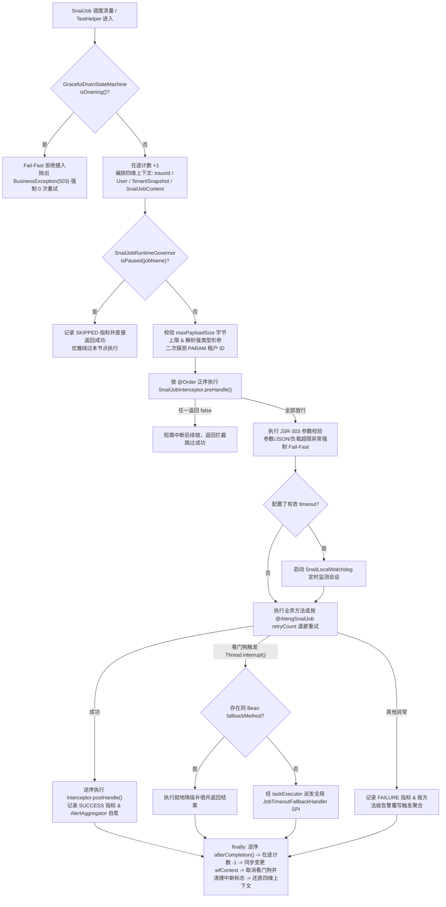
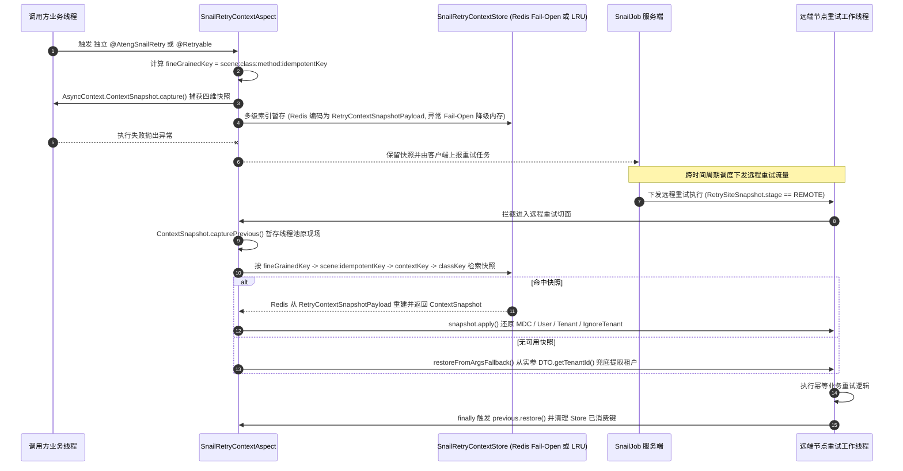
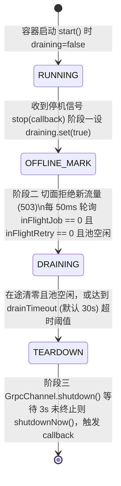

# ateng-boot-job-snail 分布式任务调度与协同重试加固底座

`ateng-boot-job-snail` 是面向生产环境的企业级 SnailJob（`1.10.0` 基线）分布式任务调度与协同重试双擎基础设施 Starter，依托 Spring Boot `3.3.13` 与 JDK `17` 原生能力（兼容 JDK `21+` 虚拟线程无 Pinning 运行）打造。组件在不破坏 SnailJob 官方注解与执行器模型的前提下，提供**独立单注解 `@AtengSnailJob` / `@AtengSnailRetry` 自动扫描注册、四维全链路上下文 `RedisSnailRetryContextStore` Fail-Open 集群还原、双向 `maxPayloadSize` 护栏与 SLF4J 日志镜像、JSR-303 参数防卫、本地硬看门狗超时降级与方法级退避重试/告警覆写、MapReduce 切片防线、大数据游标防 OOM 与多租户并发背压模板（`BatchFailureHandler`）、非阻塞缓存双擎健康探针、三阶告警防风暴自愈、节点级运行时动态治理、OpenAPI 编程式管理、K8s 三阶平滑停机排空**及**全自洽脱网单测沙箱**。

---

## 0. 特性与公共 API 全景速查矩阵

### 0.1 核心门面与增强组件 API 清单

| 组件类型 / 包路径 | 核心公开 API 签名与主要职责 | 所属章节 |
| :--- | :--- | :--- |
| **`SnailJobContext`**<br>`...snail.context` | 调度与工作流强类型上下文（含常量 `ROOT_MAP_NAME`、`MAX_MAP_SUBTASK_SIZE = 500`）：`current()`、`fromNative(JobContext)`、`getWfParam(key)`、`getWfParam(key, Class<T>)`、`getWfParam(key, TypeReference<T>)`、`getWfParamOrDefault(key, defaultValue)`、`appendWfContext(key, val)`、`appendWfContext(Map)`、`getWfContext()`、`getChangeWfContext()`、`doMap(taskList, nextTaskName)`、`getSharding()`、`isWorkflow()`、`isSharded()`；静态方法 `getWorkflowParam(...)`、`appendWorkflowContext(...)`、`getShardingContext()`、`dispatchMap(...)`、`setCustomSubtaskDispatcher(...)` / `getCustomSubtaskDispatcher()` 及任务标识/参数 Getter/Setter | [第 3 章](#3-分布式声明式调度与参数防卫套件)<br>[第 4 章](#4-mapreduce-动态切片与多阶段规约套件) |
| **`SnailJobContextHolder`**<br>`...snail.context` | 线程上下文持有器：`get()`、`getContext()`、`set(SnailJobContext)`、`remove()`、`clear()`、`getTraceId()`、`getTenantId()` | [第 2 章](#2-核心架构与设计不变量) |
| **`ShardingContext`**<br>`...snail.model` | 分布式静态分片模型：`current()`、`isSharded()`、`isFirst()`、`isLast()`、`match(long id)`（非负余数取模）、`match(String key)`（字符串哈希非负余数取模）、`getShardIndex()`、`getShardTotal()` | [第 6 章](#6-大数据流式批处理与分片防-oom-套件) |
| **`TenantJobTemplate`**<br>`...snail.template` | 多租户沙箱遍历与受管并发模板（默认 `DEFAULT_MAX_CONCURRENCY = 8`、`ReentrantLock` + Core `taskExecutor`）：`executeForEachTenant(...)`（4 组重载）、`executeForEachTenantWithResult(...)`（5 组重载，返回结构化 `BatchExecutionResult<String>` 与 `BatchFailureHandler<String>` 回调）、`executeForEachTenantParallel(...)`（7 组重载，`Semaphore` 背压并发透传四维及 `SnailJobContext`）、`getDefaultMaxConcurrency()`、`getEffectiveExecutor()`（存在 `PlatformTransactionManager` 时自动启用 `PROPAGATION_REQUIRES_NEW`） | [第 3 章](#3-分布式声明式调度与参数防卫套件) |
| **`SnailShardingBatchTemplate`**<br>`...snail.template` | 游标分片防 OOM 批处理模板（`DEFAULT_BATCH_SIZE = 1000`、`DEFAULT_MAX_CONCURRENCY = 8`、`DEFAULT_PROGRESS_LOG_INTERVAL = 5000`）：不可变派生视图 `withFailFast(boolean)`、`withProgressLogInterval(int)`、`withMaxConcurrency(int)`；执行方法 `executeStep(...)`、`executeStepForEach(...)`、`executeShardedStep(...)`、`executeShardedStepForEach(...)`、`executeStepParallel(...)`、`executeShardedStepParallel(...)`（全部支持 `BatchFailureHandler<ID>` / `BatchFailureHandler<Long>` 回调）及 `getDefaultBatchSize()`、`getDefaultMaxConcurrency()`、`isFailFast()`、`getProgressLogInterval()`、`getMaxFailedItems()`、`getDefaultFailureHandler()`、`getEffectiveExecutor()` | [第 6 章](#6-大数据流式批处理与分片防-oom-套件) |
| **`SnailMyBatisStreamingTemplate`**<br>`...snail.template` | 继承 `SnailShardingBatchTemplate`，适配 MyBatis `Cursor<T>` 与 `StreamingQueryTemplate`：派生视图 `withFailFast(boolean)`、`withProgressLogInterval(int)`、`withMaxConcurrency(int)`；流式方法 `executeStreaming(...)`、`executeStreamingParallel(...)`（均支持 `BatchFailureHandler`）及 `getStreamingQueryTemplate()`、`setStreamingQueryTemplate(StreamingQueryTemplate)` | [第 6 章](#6-大数据流式批处理与分片防-oom-套件) |
| **`BatchExecutionResult<K>` / `FailedBatch<K>`**<br>`...snail.template` | 批处理统计与死信切片模型（默认失败列表上限 `MAX_FAILED_ITEMS = 500`）：`isSuccess()`、`hasFailures()`、`totalCount()` / `getTotalCount()`、`successCount()` / `getSuccessCount()`、`failCount()` / `getFailCount()`、`batchCount()` / `getBatchCount()`、`duration()` / `getDuration()`、`failedBatches()` / `getFailedBatches()`、`failedBatchCount()` / `getFailedBatchCount()`、`isTruncatedFailures()` / `getTruncatedFailures()`；`FailedBatch<K>` 提供 `cursorStart`、`cursorEnd`、`shardIndex`、`batchIndex`、`itemCount`、`throwable` 及 `get*()`、`getCause()` 访问器 | [第 6 章](#6-大数据流式批处理与分片防-oom-套件) |
| **`SnailRetryTemplate`**<br>`...snail.retry.template` | 编程式分布式重试门面：`execute(scene, RetryCallback<T>)`、`execute(scene, Runnable)`、`executeWithIdempotent(scene, idempotentId, RetryCallback<T>)`、`executeWithIdempotent(scene, idempotentId, bizNo, RetryCallback<T>)`、`executeWithIdempotent(scene, idempotentId, Runnable)`、`reportManualRetry(scene, targetClassName, params)`、`reportManualRetry(scene, targetClassName, params, idempotentId, bizNo)`（受 `retry.local-max-attempts` 与 `retry.local-backoff` 控制） | [第 5 章](#5-分布式协同重试与死信现场还原套件) |
| **`SpelIdempotentIdGenerator` / `ArgsHashIdempotentIdGenerator`**<br>`...snail.retry.generator` | 重试幂等键生成器：`idGenerate(IdempotentIdContext)`。优先解析 `@AtengSnailRetry.idempotentSpel()`，失败平滑降级为参数 SHA-256 64 位散列值 | [第 5 章](#5-分布式协同重试与死信现场还原套件) |
| **`SnailRetryContextRegistry` / `RedisSnailRetryContextStore` / `InMemorySnailRetryContextStore`**<br>`...snail.retry.context` | 重试四维上下文快照静态注册与双模存储：`SnailRetryContextRegistry`（`setStore`、`getStore`、`put`、`get`、`remove`、`clear`）；存在 `StringRedisTemplate` 时优先装配 Fail-Open 的 `RedisSnailRetryContextStore`（前缀 `KEY_PREFIX = "ateng:boot:job:snail:retry:ctx:"`，借助扁平载体 `RetryContextSnapshotPayload` 与 Core 公开原语安全序列化，Redis 异常降级内存）；单机/兜底装配 `ReentrantLock` 保护的 `InMemorySnailRetryContextStore`（直连默认 `4096`，自动装配 `in-memory-max-size = 10000`） | [第 2 章](#2-核心架构与设计不变量)<br>[第 5 章](#5-分布式协同重试与死信现场还原套件) |
| **`AtengSnailJobScanner` / `AtengSnailRetryScanner`**<br>`...scanner` / `...retry.scanner` | 独立高阶注解扫描注册器（实现官方 `Scanner` SPI）：`doScan()` 自动扫描并注册独立 `@AtengSnailJob`（含方法级与类级 `Map/Reduce/MergeReduce` 调度任务，重复命名启动期 Fail-Fast）及独立 `@AtengSnailRetry`（联动 `AtengSnailRetryPointcutAdvisor` + `AtengSnailRetryInterceptor`），对显式共存的原生 `@JobExecutor` / `@Retryable` 幂等让渡 | [第 3 章](#3-分布式声明式调度与参数防卫套件)<br>[第 5 章](#5-分布式协同重试与死信现场还原套件) |
| **`SnailJobRuntimeGovernor`**<br>`...snail.governor` | 节点级运行时动态治理总线：`pause(handler)`、`resume(handler)`、`isPaused(handler)`（支持冒号分级继承 `root:slice`）、`getPausedHandlers()`、`resumeAll()`、`getPausedCount()` | [第 7 章](#7-运行时动态治理灰度拦截与告警自愈套件) |
| **`SnailJobAlertAggregator`**<br>`...snail.alert` | 三阶告警防风暴聚合与自愈引擎：`onJobFailure(...)`（3 组重载，支持方法级抑制阈值覆写）、`onJobSuccess(...)`（2 组重载）、`onRetryFailure(...)`（2 组重载）、`onRetrySuccess(...)`（2 组重载）、`onRetryDeadLetter(...)` | [第 7 章](#7-运行时动态治理灰度拦截与告警自愈套件) |
| **`SnailJobAdminTemplate`**<br>`...snail.template` | SnailJob OpenAPI 编程式管理门面：任务 CRUD 与启停触发（`addJob` / `updateJob` / `getJobDetail` / `getJobBatchDetail` / `triggerJob` / `updateJobStatus` / `enableJob` / `disableJob` / `deleteJob` / `deleteJobs` / `existsJobById` / `existsJob` 及全套 `*ByBizId`）、工作流控制（`getWorkflowBatchDetail` / `triggerWorkflow` / `updateWorkflowStatus` / `enableWorkflow` / `disableWorkflow` / `deleteWorkflow` / `deleteWorkflows` / `existsWorkflowById` / `existsWorkflow` 及全套 `*ByBizId`）、重试运维（`queryRetryTask` / `triggerRetryTask` / `updateRetryTaskStatus`）、底层客户端获取（`getJobClient()` / `getRetryClient()`） | [第 8 章](#8-调度中心-openapi-编程式管理与脱网极速调试套件) |
| **`SnailJobTestHelper` & `SnailJobInvocationSupport`**<br>`...helper` / `...support` | 脱网纯内存调试驱动器与共享调度解析内核：`SnailJobInvocationSupport` 集中收口 `@JobExecutor` / 独立 `@AtengSnailJob` / `@Retryable` / `@AtengSnailRetry` 扫描、多参数绑定、`maxPayloadSize` 字节守卫、`@Valid` 校验与暂停拦截；`SnailJobTestHelper` 提供 `triggerJob(...)`（6 组重载）、`triggerMap`、`triggerReduce`、`triggerMergeReduce`、`triggerRetry`、`triggerRetryWithExecutor`、`clear()`、`getRegisteredJobNames()`、`getRegisteredRetryScenes()` | [第 8 章](#8-调度中心-openapi-编程式管理与脱网极速调试套件) |
| **`SnailLocalWatchdog` & `GracefulDrainStateMachine`**<br>`...snail.watchdog` / `...drain` | 本地硬超时看门狗：`startWatch(thread, timeout, metadata)`、`getGracePeriod()`、`getFallbackHandlers()`、`destroy()`（`WatchdogSession`：`cancel()` / `isTimedOut()` / `isCancelled()`）；平滑停机排空状态机（`SmartLifecycle`，`phase=Integer.MAX_VALUE`）：`isDraining()`、`setDraining(boolean)`、`incrementInFlightJob()` / `decrementInFlightJob()` / `getInFlightJobCount()`、`incrementInFlightRetry()` / `decrementInFlightRetry()` / `getInFlightRetryCount()`、`getTotalInFlightCount()`、`start()`、`stop()` / `stop(Runnable)`、`destroy()`、`isRunning()`、`getPhase()`、`isAutoStartup()` | [第 2 章](#2-核心架构与设计不变量)<br>[第 9 章](#9-生产扩展接管与核心非功能边界) |
| **`SnailJobEndpoint` / `SnailJobHealthIndicator` / `SnailJobMetricsBinder`**<br>`...actuator` / `...metrics` | 运维管控、健康探针与观测指标：`SnailJobEndpoint`（`GET /actuator/snailjobs`、`GET /actuator/snailjobs/{name}`、`POST /actuator/snailjobs/{jobName}`、`POST /actuator/snailjobs`）；`SnailJobHealthIndicator#health()`（`ReentrantLock` TTL 缓存 + 受管并发有界 Socket 探活，多活节点至少 1 个可达返回 `UP` 并透出 `degraded` 与在线/离线列表，无 `GrpcChannel` 反射）；`SnailJobMetricsBinder`（`bindTo`、`recordJobExecution`、`recordRetryExecution`、`getRegistry`） | [第 9 章](#9-生产扩展接管与核心非功能边界) |
| **`SnailJobLogbackAppender` & `Registrar`**<br>`...snail.log` | SLF4J 日志无感镜像扩展：`isTaskActive()`、`attachToRootLogger()`、`detachFromRootLogger()`、`setMaxPayloadBytes(long)`、`getMaxPayloadBytes()`、`setMirrorConsumer(Consumer)`；`SnailJobLogbackAppenderRegistrar`（`getAppender()`、`afterSingletonsInstantiated()`、`destroy()`） | [第 2 章](#2-核心架构与设计不变量) |

### 0.2 增强注解与枚举契约

| 注解 / 枚举 | 核心属性与可选值 | 默认值 | 作用说明 |
| :--- | :--- | :--- | :--- |
| **`@AtengSnailJob`**<br>(`METHOD`, `TYPE`) | `value` / `name`（互为 `@AliasFor` 别名）、`method`（类级执行方法名）、`timeout`（如 `"500ms"` / `"30s"`）、`tenantMode`（`JobTenantMode`）、`alert`（旧告警开关）、`alertEnabled`（方法级告警开关）、`alertSuppressThreshold`（方法级告警抑制阈值）、`retryCount`（方法级本地退避重试次数）、`retryInterval`（本地退避间隔 `Duration`）、`fallbackMethod`（同 Bean 超时降级方法名） | `value=""`, `name=""`, `method="jobExecute"`, `timeout=""`, `tenantMode=IGNORE`, `alert=true`, `alertEnabled=true`, `alertSuppressThreshold=-1`, `retryCount=0`, `retryInterval="1s"`, `fallbackMethod=""` | 既可独立声明执行器并由 `AtengSnailJobScanner` 自动注册，也可增强原生 `@JobExecutor` / MapReduce 切片注解；提供看门狗硬超时降级、瞬态本地退避重试、方法级告警覆写与多租户沙箱 |
| **`@AtengSnailRetry`**<br>(`METHOD`, `TYPE`) | `scene` / `value`（互为 `@AliasFor` 别名）、`idempotentSpel`（SpEL 幂等表达式）、`idempotentId`（生成器类）、`retryCompleteCallback`（完成/死信回调类）、`bizNo`（SpEL 业务单号）、`retryStrategy`（`RetryType`）、`localTimes`、`localInterval`、`isThrowException`、`include`、`exclude`、`tenantMode` | `scene=""`, `value=""`, `retryStrategy=LOCAL_REMOTE`, `localTimes=3`, `localInterval=2`, `isThrowException=true`, `idempotentId=SpelIdempotentIdGenerator.class`, `retryCompleteCallback=SnailRetryDeadLetterCallback.class`, `tenantMode=PARAM` | 既可独立单注解完成服务端注册（`AtengSnailRetryScanner`）与 AOP 重试闭环（`AtengSnailRetryPointcutAdvisor`），也可兼容 `@Retryable` 混用（显式 `@Retryable` 优先生效） |
| **`JobTenantMode`** | `IGNORE`（平台全局忽略租户限制）、`PARAM`（从调度入参或 DTO 提取 `tenantId`）、`ITERATE`（交由 `TenantJobTemplate` 逐租户独立事务沙箱或并发背压遍历） | 调度默认 `IGNORE`<br>重试默认 `PARAM` | 显式划定多租户数据权限边界，杜绝串租户或越权扫描 |

### 0.3 配置前缀、SPI 扩展点、领域事件与观测指标全景

| 类别 | 标识 / 接口 / 指标名 | 核心契约与默认行为 | 扩展 / 消费方式 |
| :--- | :--- | :--- | :--- |
| **配置前缀** | `ateng.boot.job.snail.*`（40 项强类型属性） | 顶层核心：`enabled`、`server`、`group`、`namespace`、`token`、`port`、`timeout`、`drain-timeout`、`default-job-timeout`、`watchdog-grace-period`、`log-mirror-enabled`、`managed-pool-enabled`、`max-payload-size`、`health-cache-ttl`、`health-probe-timeout`；嵌套分域：`job.*`（4 项）、`retry.*`（6 项）、`batch.*`（4 项）、`openapi.*`（8 项）、`alert.*`（3 项） | 全量类型、默认值与模板详见 [第 10 章](#10-完整-yaml-配置属性清单) |
| **SPI 接口 (6 个)** | `SnailJobInterceptor`<br>`JobTimeoutFallbackHandler`<br>`TenantListProvider`<br>`SnailRetryContextStore`<br>`BatchFailureHandler<K>`<br>`RetryCompleteCallback`（默认 `SnailRetryDeadLetterCallback`） | 所有 SPI 与内置 `@Bean` 均支持 Spring 注入与 `@Order` 排序或 `@ConditionalOnMissingBean` 接管（其中 `BatchFailureHandler` 与 `SnailRetryContextStore` 支持全局默认 Bean 与局部/条件覆盖） | 注册为 Spring Bean 即可无感生效，详见 [第 9 章](#9-生产扩展接管与核心非功能边界) |
| **领域事件 (3 类)** | `SnailJobAlertEvent`（`INITIAL_FAILURE` / `FAILURE_SUMMARY` / `RECOVERY`）<br>`SnailJobTimeoutEvent`<br>`SnailRetryDeadLetterEvent` | 故障首报、防风暴聚合、恢复自愈、硬看门狗超时中断与重试最大次数死信均广播标准 `ApplicationEvent` | 使用 `@EventListener` 消费对接外部工单/审计系统 |
| **Micrometer 指标** | `ateng.job.snail.job.execution`<br>`ateng.job.snail.retry.execution`<br>`ateng.job.snail.job.inflight`<br>`ateng.job.snail.retry.inflight` | Tag 维度：`job` / `scene`、`status`（`SUCCESS` / `FAILURE` / `SKIPPED`）、`tenant`；发布 `P50 / P95 / P99` 耗时百分位 | 接入 Prometheus / Grafana 自动采集 |
| **Actuator 端点** | `/actuator/snailjobs`<br>`/actuator/snailjobs/{name}`<br>`/actuator/health` | 暴露已注册执行器、在途计数、暂停列表，支持在线 `pause` / `resume` / `resumeAll` / 脱机 `trigger`；`health` 透出非阻塞缓存探测及 `degraded` 多活节点态 | 通过 `management.endpoints.web.exposure.include` 暴露 |

---

## 1. 模块定位、Maven 坐标与快速起步

### 1.1 技术基线与依赖坐标

`ateng-boot-job-snail` 严格遵循 `ateng-boot` 零臃肿依赖与 BOM 统管原则：
- **底层基线**：JDK `17` LTS（兼容 JDK `21+` 虚拟线程运行，全模块已清除 `synchronized` 与 `ForkJoinPool.commonPool()`）、Spring Boot `3.3.13`、SnailJob `1.10.0`（`snail-job-client-starter`、`snail-job-client-job-core`、`snail-job-client-retry-core`）。
- **底座复用**：强绑定 [`ateng-boot-core`](../ateng-boot-core/README.md)，复用 `BusinessException` / `CommonResultCode`、`AsyncContext`、`TenantContextHolder`、`UserContextHolder`、`JsonUtil`、`ValidatorUtil`、`RetryUtil`、`DigestUtil`、`IdUtil` 与 Core 受管异步线程池（`taskExecutor`，在 `AtengAsyncAutoConfiguration` 之后自动装配）。
- **按需可选依赖（`<optional>true</optional>`）**：按需在业务微服务的 `pom.xml` 中引入对应增强模块后自动激活能力：
  - `spring-boot-starter-data-redis`：当容器存在 `StringRedisTemplate` Bean 且未自定义 `SnailRetryContextStore` 时，自动激活 `RedisSnailRetryContextStore`（集群共享重试上下文 + Fail-Open 本地兜底）；
  - `spring-boot-starter-actuator`：激活 `/actuator/snailjobs` 与 `/actuator/health` 非阻塞缓存健康探针；
  - `io.micrometer:micrometer-core`：激活 P50/P95/P99 执行吞吐量与在途并发度指标；
  - `io.github.atengk:ateng-boot-notification`：激活 `SnailJobAlertAggregator` 向协同群聊机器人推送高危故障与恢复通知卡片；
  - `io.github.atengk:ateng-boot-mybatis-plus`：激活 `SnailMyBatisStreamingTemplate` MyBatis 游标流式分片消费。

在业务微服务 `pom.xml` 中引入（版本由根 `pom.xml` / `ateng-boot-bom` 统管，无需声明 `<version>`）：

```xml
<dependency>
    <groupId>io.github.atengk</groupId>
    <artifactId>ateng-boot-job-snail</artifactId>
</dependency>
```

### 1.2 最小配置与第一个任务（5 分钟跑通）

在 `application.yml` 中配置 SnailJob 基础连接坐标（当 `ateng.boot.job.snail.server` 留空时，自动装配会打印警告日志并平滑旁路，绝不阻断本地无调度中心启动）：

```yaml
ateng:
  boot:
    job:
      snail:
        enabled: true
        server: "127.0.0.1:17888"
        group: "${spring.application.name}"
        namespace: "default"
        token: "YOUR_SNAIL_JOB_TOKEN"
        port: 17889
```

编写首个分布式任务执行器（源码摘自样例工程 [`WarmupAndProbeJobHandler.java`](../ateng-boot-samples/ateng-boot-sample-job-snail/src/main/java/io/github/atengk/boot/sample/job/snail/handler/WarmupAndProbeJobHandler.java)，同时支持原生 `@JobExecutor` 与独立单注解 `@AtengSnailJob(name = "...")`）：

```java
@Slf4j
@Component
public class WarmupAndProbeJobHandler {

    @JobExecutor(name = "systemWarmupJob")
    public ExecuteResult systemWarmupJob() {
        String traceId = SnailJobContextHolder.getTraceId();
        log.info("[WarmupAndProbeJobHandler] 执行系统热点缓存预热与健康巡检任务, traceId: {}", traceId);
        return ExecuteResult.success("System warmup and health check completed with traceId: " + traceId);
    }
}
```

---

## 2. 核心架构与设计不变量

### 2.1 `SnailJobContextAspect` 调度增强切面全链路管线

所有 `@JobExecutor`、`@MapExecutor`、`@ReduceExecutor`、`@MergeReduceExecutor`、独立 `@AtengSnailJob` 方法（由 `AtengSnailJobScanner` 注册）及原生接口实现均由 `@Order(Ordered.HIGHEST_PRECEDENCE + 100)` 的 `SnailJobContextAspect` 无感接管，严格执行有序拦截与确定性 `finally` 现场清理：



### 2.2 四维全链路上下文跨节点/跨时间保真还原（`SnailRetryContextAspect`）

SnailJob 的 `@Retryable` / 独立 `@AtengSnailRetry`（由 `AtengSnailRetryScanner` 与 `AtengSnailRetryPointcutAdvisor` 织入）在“本地重试失败后异步上报服务端，再由服务端定时下发给集群任意节点的远程重试线程”场景中，原生的 `ThreadLocal` 上下文（MDC `traceId`、操作人、`TenantContextHolder`）会彻底丢失。`SnailRetryContextAspect` 通过多级索引快照机制与 Fail-Open Redis 集群存储根除远程重试期间的跨租户数据越权隐患：



### 2.3 K8s 三阶平滑停机排空与防资源泄漏（`GracefulDrainStateMachine`）

为防止滚动发布或 Pod 缩容期间正在执行的批处理与异步重试被 `SIGTERM` 强制腰斩，`GracefulDrainStateMachine` 实现 `SmartLifecycle`（返回 `Integer.MAX_VALUE` 最高停机优先级）与 `DisposableBean`：



### 2.4 本地硬看门狗与 SLF4J 双轨 `maxPayloadSize` 日志镜像

- **本地硬超时看门狗（`SnailLocalWatchdog`）**：基于 Netty 时间轮在工作线程外独立监测方法执行耗时。一旦超出 `@AtengSnailJob(timeout=...)` 或全局 `default-job-timeout`（默认 `1h`），立即 `workerThread.interrupt()` 强中断任务并发布 `SnailJobTimeoutEvent`；若工作线程处于不响应中断的阻塞状态并在 `watchdog-grace-period`（默认 `2s`）后仍存活，第二级紧急定时任务会通过 Core 受管异步线程池 `taskExecutor`（未启用时退化为当前看门狗线程同步执行，绝不私建野线程）回调所有 `JobTimeoutFallbackHandler` SPI。切面 `finally` 块自动调用 `Thread.interrupted()` 清除线程中断标记，避免污染线程池复用的下一批调度任务。
- **SLF4J 动态日志镜像与 `maxPayloadSize` 双轨护栏**：`SnailJobLogbackAppender` 自动挂载至 Logback `ROOT` Logger（可通过 `log-mirror-enabled: false` 关闭）。在日志发生瞬间探测 `SnailJobLogManager.getLogMeta()`、`SnailJobContextHolder.get()` 与 `JobContextManager.getJobContext()`，脱离任务线程直接旁路跳过；处于任务执行期时通过 `ThreadLocal<Boolean> IN_MIRROR` 与 `MDC.get("remote")` 双重防递归护栏防镜像风暴。`SnailJobLogbackAppenderRegistrar` 将 `ateng.boot.job.snail.max-payload-size`（默认 `1MB`）同步注入 `maxPayloadBytes`，在镜像出口对超长单条或堆栈日志执行 UTF-8 字节安全截断（与入参入口 `maxPayloadSize` Fail-Fast 拦截构成双轨缓冲区防护）。

---

## 3. 分布式声明式调度与参数防卫套件

### 3.1 独立 `@AtengSnailJob`、强类型 DTO 绑定、JSR-303 防卫与方法级退避重试

**专属 YAML 片段**：

```yaml
ateng:
  boot:
    job:
      snail:
        max-payload-size: 1MB
        default-job-timeout: 1h
        job:
          enabled: true
          context-aspect-enabled: true
```

**真实 Sample 源码实现**（摘自 [`UserSyncParam.java`](../ateng-boot-samples/ateng-boot-sample-job-snail/src/main/java/io/github/atengk/boot/sample/job/snail/dto/UserSyncParam.java)、[`ParamValidationJobHandler.java`](../ateng-boot-samples/ateng-boot-sample-job-snail/src/main/java/io/github/atengk/boot/sample/job/snail/handler/ParamValidationJobHandler.java) 与 [`StandaloneLocalRetryJobHandler.java`](../ateng-boot-samples/ateng-boot-sample-job-snail/src/main/java/io/github/atengk/boot/sample/job/snail/handler/StandaloneLocalRetryJobHandler.java)）：

```java
@Data
public class UserSyncParam implements Serializable {
    @NotBlank(message = "同步批次标识不能为空")
    private String batchNo;

    @NotNull(message = "单批同步数量不能为空")
    @Min(value = 1, message = "单批同步数量必须大于0")
    private Integer batchSize;

    private String departmentId;
}

// 范式 A：独立 @AtengSnailJob 单注解声明（无需双写 @JobExecutor）+ 自动 DTO 反序列化 + @Valid + 方法级本地退避重试与告警覆写
@Slf4j
@Component
public class StandaloneLocalRetryJobHandler {

    private final ConcurrentHashMap<String, AtomicInteger> attemptCounters = new ConcurrentHashMap<>();

    @AtengSnailJob(
            name = "localRetrySyncJob",
            retryCount = 2,
            retryInterval = "25ms",
            alertEnabled = true,
            alertSuppressThreshold = 1
    )
    public ExecuteResult localRetrySyncJob(JobArgs jobArgs, @Valid UserSyncParam param) {
        String batchKey = param.getBatchNo();
        AtomicInteger counter = attemptCounters.computeIfAbsent(batchKey, ignored -> new AtomicInteger(0));
        int attempt = counter.incrementAndGet();

        String departmentId = param.getDepartmentId();
        if (departmentId != null && departmentId.startsWith("TRANSIENT-FAIL-") && attempt < 2) {
            throw new IllegalStateException("模拟下游瞬态网络抖动，触发本地退避重试 attempt=" + attempt);
        }

        attemptCounters.remove(batchKey, counter);
        if ("EXHAUST-FAIL".equals(departmentId)) {
            throw new IllegalStateException("模拟不可恢复同步失败以验证计数器清理 attempt=" + attempt);
        }
        return ExecuteResult.success(Map.of(
                "batchNo", batchKey,
                "batchSize", param.getBatchSize(),
                "attempts", attempt,
                "standaloneMode", true
        ));
    }
}

// 范式 B：手工接收 JobArgs 后借助 Core ValidatorUtil 执行第二道编程式防卫校验
@JobExecutor(name = "userSyncJob")
public ExecuteResult userSyncJob(JobArgs args) {
    Object rawParams = args != null ? args.getJobParams() : null;
    UserSyncParam param;
    if (rawParams instanceof UserSyncParam userSyncParam) {
        param = userSyncParam;
    } else if (rawParams instanceof String json && StringUtils.hasText(json)) {
        param = JsonUtil.parseObject(json, UserSyncParam.class);
    } else {
        return ExecuteResult.failure("任务参数缺失或格式不合法");
    }

    // 第二道防线：基于 ValidatorUtil 编程式强校验业务不变量
    ValidatorUtil.validate(param);
    return ExecuteResult.success("Sync completed for batch " + param.getBatchNo());
}
```

**核心机制与边界说明**：
- **独立注解一键注册**：仅声明 `@AtengSnailJob(name = "...")` 或 `@AtengSnailJob("...")` 即可由 `AtengSnailJobScanner` 扫描生成 `JobExecutorInfo`（留空回退方法名），类级注解默认调度方法为 `method = "jobExecute"`，并对跨方法同名任务在启动期 Fail-Fast 报错阻断；若方法已共存原生 `@JobExecutor` 则幂等让渡由原生扫描接管。
- **双轨 `maxPayloadSize` 与两道校验防线**：入口侧在进入拦截链前后对调度原始 JSON 载荷校验 `ateng.boot.job.snail.max-payload-size`（默认 `1MB`）超限抛出 `BusinessException(400)`；切面按形参自动反序列化 DTO 并对 `@Valid` / `@Validated` 形参执行 JSR-303 Fail-Fast；若调度入参携带 `traceId` 或 `userId` 字段，自动同步绑定至 MDC 与 `UserContextHolder`。
- **方法级本地退避重试与快速失败边界**：当 `@AtengSnailJob(retryCount > 0)` 时，仅对**业务执行期瞬态异常**按 `retryInterval` 执行方法级退避重试（若触发中断则恢复中断标记立即退出）；对于参数校验失败、JSON 解析错误、`maxPayloadSize` 超限、看门狗超时、节点治理暂停或停机排空拒绝，强制执行 **0 次重试（Fail-Fast）**。

### 3.2 本地硬超时看门狗与同 Bean `fallbackMethod` 就地降级补偿

**专属 YAML 片段**：

```yaml
ateng:
  boot:
    job:
      snail:
        default-job-timeout: 1h
        watchdog-grace-period: 2s
```

**真实 Sample 源码实现**（摘自 [`HistoryDataArchiveJobHandler.java`](../ateng-boot-samples/ateng-boot-sample-job-snail/src/main/java/io/github/atengk/boot/sample/job/snail/handler/HistoryDataArchiveJobHandler.java)）：

```java
@Slf4j
@Component
public class HistoryDataArchiveJobHandler {

    @JobExecutor(name = "historyDataArchiveJob")
    @AtengSnailJob(timeout = "80ms", fallbackMethod = "executeFallbackCompensation")
    public ExecuteResult executeWithTimeout(JobArgs args) throws InterruptedException {
        log.info("[HistoryDataArchiveJobHandler] 开始执行历史冷数据归档耗时任务 (模拟执行 500ms)...");
        Thread.sleep(500);
        return ExecuteResult.success("Normal data archive completed unexpectedly");
    }

    public ExecuteResult executeFallbackCompensation(JobArgs args) {
        String params = args != null && args.getJobParams() != null ? String.valueOf(args.getJobParams()) : "default";
        log.warn("[HistoryDataArchiveJobHandler] 触发归档超时就地降级补偿逻辑, params: {}", params);
        return ExecuteResult.success("Fallback archive compensation executed successfully: " + params);
    }
}
```

**核心机制与边界说明**：
- `@AtengSnailJob#timeout` 支持 Spring `DurationStyle` 表达（如 `"80ms"`、`"500ms"`、`"30s"`、`"PT5M"`）；未显式配置时自动继承全局 `default-job-timeout`（默认 `1h`）。样例工程 [`WarmupAndProbeJobHandler.java`](../ateng-boot-samples/ateng-boot-sample-job-snail/src/main/java/io/github/atengk/boot/sample/job/snail/handler/WarmupAndProbeJobHandler.java) 中的 `timeoutGuardedJob()` 亦演示了声明 `@AtengSnailJob(timeout = "500ms")` 为普通无降级任务挂载本地硬超时守卫。
- 仅配置无效或非正数超时（如 `"0s"` / `"-1s"`）时看门狗安全旁路（`WatchdogSession.NOOP`）。
- 当看门狗中断工作线程且 `fallbackMethod` 非空时，切面通过反射在同 Bean 内定位最匹配签名的补偿方法就地完成降级并向调度中心返回补偿结果；若未声明就地补偿或补偿失败，则平滑升级触发全局 `JobTimeoutFallbackHandler` SPI。

### 3.3 多租户三模隔离与 `TenantJobTemplate` 独立事务/并发背压沙箱

**专属 YAML 片段**：

```yaml
ateng:
  boot:
    job:
      snail:
        managed-pool-enabled: true
        job:
          tenant-template-enabled: true
        batch:
          default-max-concurrency: 8
          max-failed-items: 500
```

**真实 Sample 源码实现**（摘自 [`TenantJobHandler.java`](../ateng-boot-samples/ateng-boot-sample-job-snail/src/main/java/io/github/atengk/boot/sample/job/snail/handler/TenantJobHandler.java)）：

```java
@Slf4j
@Component
@RequiredArgsConstructor
public class TenantJobHandler {

    private final TenantJobTemplate tenantJobTemplate;

    // 模式一：平台级全局扫描，忽略多租户过滤标记
    @AtengSnailJob(tenantMode = JobTenantMode.IGNORE)
    @JobExecutor(name = "globalArchiveJob")
    public ExecuteResult globalArchiveJob() {
        boolean ignoreTenant = TenantContextHolder.isIgnoreTenant();
        return ExecuteResult.success("Global archive finished, ignoreTenant=" + ignoreTenant);
    }

    // 模式二：单租户限定，从调度入参自动提取 tenantId 挂载当前线程
    @AtengSnailJob(tenantMode = JobTenantMode.PARAM)
    @JobExecutor(name = "tenantScopedJob")
    public ExecuteResult tenantScopedJob(JobArgs args) {
        String currentTenant = TenantContextHolder.getTenantId();
        return ExecuteResult.success("Tenant job finished for tenant=" + currentTenant);
    }

    // 模式三 A：多租户顺序沙箱轮询（单租户包裹独立 REQUIRES_NEW 事务）
    @AtengSnailJob(tenantMode = JobTenantMode.ITERATE)
    @JobExecutor(name = "tenantBatchJob")
    public ExecuteResult tenantBatchJob() {
        List<String> tenants = List.of("tenant-alpha", "tenant-beta");
        BatchExecutionResult<String> result = tenantJobTemplate.executeForEachTenant(tenants, false, tenantId -> {
            log.info("正在沙箱执行租户 [{}] 的结算逻辑, 当前上下文租户={}",
                    tenantId, TenantContextHolder.getTenantId());
        });
        return ExecuteResult.success("Tenant batch finished: total=" + result.totalCount() + ", success=" + result.successCount());
    }

    // 模式三 B：独立 @AtengSnailJob 多租户受管并发背压遍历 + BatchFailureHandler 回调
    @AtengSnailJob(name = "tenantParallelBatchJob", tenantMode = JobTenantMode.ITERATE)
    public ExecuteResult tenantParallelBatchJob(JobArgs args) {
        String param = args != null && args.getJobParams() != null ? String.valueOf(args.getJobParams()) : "";
        boolean injectTenantFail = "FAIL_ONE".equalsIgnoreCase(param);
        List<String> tenants = injectTenantFail
                ? List.of("tenant-alpha", "tenant-bad", "tenant-gamma")
                : List.of("tenant-alpha", "tenant-beta", "tenant-gamma");

        BatchExecutionResult<String> result = tenantJobTemplate.executeForEachTenantParallel(
                tenants,
                2,
                false,
                tenantId -> {
                    if (injectTenantFail && "tenant-bad".equals(tenantId)) {
                        throw new IllegalStateException("模拟并发多租户单租户异常: " + tenantId);
                    }
                },
                failed -> log.warn("[TenantJobHandler] 捕获并发租户失败回调: tenant={}, reason={}",
                        failed.cursorStart(), failed.getCause() != null ? failed.getCause().getMessage() : "unknown")
        );

        return ExecuteResult.success("Tenant parallel finished: total=" + result.totalCount()
                + ", success=" + result.successCount() + ", fail=" + result.failCount());
    }
}
```

**核心机制与边界说明**：
- **`IGNORE`（默认）**：自动设置 `TenantContextHolder.setIgnoreTenant(true)`，并在任务结束时精确恢复快照。
- **`PARAM`**：按“调度参数 JSON `tenantId` -> 已反序列化实参 `getTenantId()`”二级探测并绑定租户 ID。
- **`ITERATE`**：切面先显式清空外部残留租户，配合 `TenantJobTemplate` 遍历 `TenantListProvider`（或指定租户集合）；顺序（`executeForEachTenant` / `executeForEachTenantWithResult`）与受管并发（`executeForEachTenantParallel`，依托 Core 线程池 `taskExecutor` 与 `Semaphore` 背压限流）模式均会为每个租户开启独立的 `TransactionDefinition.PROPAGATION_REQUIRES_NEW` 事务沙箱（存在事务管理器时）并透传还原四维及 `SnailJobContext` 上下文。
- **失败采集与防 OOM 截断**：支持全局 `@Bean BatchFailureHandler<String>` 自动注入或方法参数显式局部回调（二者不重复触发），失败记录按 `batch.max-failed-items`（默认 `500`）上限截断收集并标记 `truncatedFailures`。

---

## 4. MapReduce 动态切片与多阶段规约套件

### 4.1 三阶切片拆分分发、阶段规约与 `SnailJobContext` 工作流上下文传递

**专属 YAML 片段**：

```yaml
ateng:
  boot:
    job:
      snail:
        max-payload-size: 1MB
        job:
          enabled: true
          context-aspect-enabled: true
```

**真实 Sample 源码实现**（摘自 [`BillSettlementJobHandler.java`](../ateng-boot-samples/ateng-boot-sample-job-snail/src/main/java/io/github/atengk/boot/sample/job/snail/handler/BillSettlementJobHandler.java)）：

```java
@Slf4j
@Component
@JobExecutor(name = "billSettlementJob")
public class BillSettlementJobHandler {

    // 阶段 1：Map 动态步长切片计算与分发
    @MapExecutor(taskName = "splitTask")
    public ExecuteResult splitTask(MapArgs args, MapHandler<String> handler) {
        String rawParams = args != null ? String.valueOf(args.getJobParams()) : null;
        List<String> subTasks = calculateDynamicSlices(rawParams);
        if (handler != null) {
            ExecuteResult mapRes = handler.doMap(subTasks, "processTask");
            log.info("[BillSettlementJobHandler] doMap 分发账单切片完成 (共 {} 个切片): {}", subTasks.size(), mapRes);
        }
        return ExecuteResult.success("Map slice splitTask executed with " + subTasks.size() + " subtasks");
    }

    @MapExecutor(taskName = "processTask")
    public ExecuteResult processTask(MapArgs args) {
        String subTask = args != null ? String.valueOf(args.getJobParams()) : "default";
        return ExecuteResult.success("Processed: " + subTask);
    }

    // 阶段 2：Reduce 节点阶段规约汇总
    @ReduceExecutor
    public ExecuteResult reduceTask(ReduceArgs args) {
        return ExecuteResult.success("Reduce aggregated batches");
    }

    // 阶段 3：MergeReduce 全局最终合并对齐
    @MergeReduceExecutor
    public ExecuteResult mergeReduceTask(MergeReduceArgs args) {
        return ExecuteResult.success("MergeReduce completed globally");
    }
}
```

在复杂 DAG 工作流或需统一护栏的场景中，推荐使用 [`SnailJobContext`](./src/main/java/io/github/atengk/boot/job/snail/context/SnailJobContext.java) 强类型门面（用法验证自 [`SnailJobContextTest.java`](./src/test/java/io/github/atengk/boot/job/snail/context/SnailJobContextTest.java)）：

```java
SnailJobContext ctx = SnailJobContext.current();
// 1. 读取上游工作流节点传递的强类型 POJO 或复杂泛型结构
OrderDto order = ctx.getWfParam("orderJson", OrderDto.class);
List<String> tags = ctx.getWfParam("tags", new TypeReference<List<String>>() {});
String mode = ctx.getWfParamOrDefault("nonExist", "default-str");
// 2. 安全派发下一级 Map 子任务并向工作流共享上下文追加变更
ExecuteResult res = ctx.doMap(List.of("chunk1", "chunk2", "chunk3"), "calculateShardNode");
ctx.appendWfContext("step1Result", "SUCCESS");
```

**核心机制与边界说明**：
- **`MAX_MAP_SUBTASK_SIZE = 500` 硬防线**：调用 `SnailJobContext#doMap` 派发子任务时，强校验列表非空且数量禁止超过 `500` 条，且严禁将 `nextTaskName` 指定为 `ROOT_MAP`（防止递归派发死循环）。
- **工作流变更上下文自动回写**：切面退出 `finally` 块时自动将 `changeWfContext` 的增量键值回写至原生 `jobArgs.appendContext(...)`，并在任务名称形如 `billSettlementJob:splitTask` 时同步将子任务名写入 MDC `snail.taskName`。
- **脱网拦截联动**：`SnailJobContext.setCustomSubtaskDispatcher(...)` 支持测试期接管子任务分发，配合 `SnailJobTestHelper.triggerMap` / `triggerReduce` / `triggerMergeReduce` 可免服务端纯内存验证三阶全流程。

---

## 5. 分布式协同重试与死信现场还原套件

### 5.1 独立 `@AtengSnailRetry` 单注解声明、SpEL 幂等键生成与现场还原

**专属 YAML 片段**：

```yaml
ateng:
  boot:
    job:
      snail:
        retry:
          enabled: true
          context-aspect-enabled: true
          context-ttl: 24h
          in-memory-max-size: 10000
```

**真实 Sample 源码实现**（摘自 [`RetryDemoService.java`](../ateng-boot-samples/ateng-boot-sample-job-snail/src/main/java/io/github/atengk/boot/sample/job/snail/service/RetryDemoService.java)）：

```java
// 1. 独立 @AtengSnailRetry 单注解声明（无需双写 @Retryable）
@AtengSnailRetry(scene = "orderPayRetry", idempotentSpel = "#p0", bizNo = "#p0")
public String payOrder(String orderId, BigDecimal amount) {
    int currentAttempt = attemptCount.incrementAndGet();
    String currentTenant = TenantContextHolder.getTenantId();
    log.info("[RetryDemoService] 正在处理支付请求: orderId={}, amount={}, 租户={}, 尝试次数={}",
            orderId, amount, currentTenant, currentAttempt);

    if ("FAIL_ORDER".equals(orderId)) {
        throw new IllegalStateException("模拟支付网关网络超时 [orderId: " + orderId + "]");
    }

    return "PAY_SUCCESS:" + orderId + ":TENANT_" + currentTenant + ":ATTEMPT_" + currentAttempt;
}

// 2. value() 别名等价声明方式
@AtengSnailRetry(value = "orderRefundRetry", idempotentSpel = "#p0", bizNo = "#p0")
public String refundOrder(String refundNo, BigDecimal amount) {
    int currentAttempt = attemptCount.incrementAndGet();
    if ("FAIL_REFUND".equals(refundNo)) {
        throw new IllegalStateException("模拟退款通道瞬时熔断 [refundNo: " + refundNo + "]");
    }
    return "REFUND_SUCCESS:" + refundNo + ":TENANT_" + TenantContextHolder.getTenantId();
}

// 3. 向后兼容：显式混用 @Retryable 时由原生 @Retryable 优先生效
@AtengSnailRetry(scene = "ignoredFallbackScene", idempotentSpel = "#p0", bizNo = "#p0")
@Retryable(scene = "legacyDualCompatRetry")
public String legacyDualCompatNotify(String orderId) {
    attemptCount.incrementAndGet();
    return "LEGACY_COMPAT_OK:" + orderId;
}
```

**核心机制与边界说明**：
- **单注解闭环与向后兼容**：仅标注 `@AtengSnailRetry` 时，启动期由 `AtengSnailRetryScanner` 对接 `RetryableRegistrar` 自动上报场景元数据，运行时由 `AtengSnailRetryPointcutAdvisor` 联动 `AtengSnailRetryInterceptor` 执行官方本地/远程重试闭环；若同一方法显式同时标注 `@Retryable`，扫描器自动幂等让渡并保证显式 `@Retryable` 100% 优先生效。
- **幂等键两级降级生成**：`SpelIdempotentIdGenerator` 优先解析 `@AtengSnailRetry#idempotentSpel`（支持 `#p0` / `#a0` / 真实形参名及单参数根对象，格式如 `#order.orderNo`），若解析异常或未配置表达式，自动平滑降级为 `ArgsHashIdempotentIdGenerator` 生成参数序列化后的确定性 `64` 位 SHA-256 摘要，杜绝重复上报。
- **细粒度多租户防串写与 Redis Fail-Open 存储**：`SnailRetryContextAspect` 使用 `scene + ":" + executorClassName + ":" + methodName + ":" + idempotentKey` 作为首层快照主键；若容器中装配有 `StringRedisTemplate`，自动启用 `RedisSnailRetryContextStore`（将四维上下文编码为扁平可序列化模型 `RetryContextSnapshotPayload` 写入 Redis 并绑定 `retry.context-ttl`），并在 Redis 网络抖动或反序列化失败时自动 Fail-Open 降级读写内置有界内存缓存（由 `ReentrantLock` 保护、`retry.in-memory-max-size` 限流）。

### 5.2 `SnailRetryTemplate` 编程式闭包与对称手动上报

**专属 YAML 片段**：

```yaml
ateng:
  boot:
    job:
      snail:
        retry:
          enabled: true
          local-max-attempts: 3
          local-backoff: 200ms
```

**真实 Sample 源码实现**（摘自 [`RetryDemoService.java`](../ateng-boot-samples/ateng-boot-sample-job-snail/src/main/java/io/github/atengk/boot/sample/job/snail/service/RetryDemoService.java)）：

```java
// 1. 编程式幂等重试闭包（内置指数退避并在耗尽后自动上报至 SnailJob 服务端）
public String executeWithProgrammaticRetry(String orderId) {
    return retryTemplate.executeWithIdempotent("orderPayRetry", orderId, "BIZ-" + orderId, () -> {
        log.info("[RetryDemoService] 编程式重试闭包执行中, orderId={}", orderId);
        return "SUCCESS:" + orderId;
    });
}

// 2. 异步或脱机失败后的对称手动上报门面
public boolean reportFailedOrder(String orderId) {
    log.info("[RetryDemoService] 手动上报失败重试任务: orderId={}", orderId);
    return retryTemplate.reportManualRetry("orderPayRetry", getClass().getName(),
            new Object[]{orderId, new BigDecimal("100.00")}, orderId, "BIZ-" + orderId);
}
```

**核心机制与边界说明**：
- **本地指数退避转远程兜底**：`SnailRetryTemplate` 基于 Core `RetryUtil` 执行本地有界退避重试（默认读取 `retry.local-max-attempts = 3`、初始延迟 `retry.local-backoff = 200ms`、退避倍数 `1.5`），耗尽后自动调用 `reportManualRetry` 向服务端上报异步远程重试，最终将因果异常转译为 `BusinessException`（100% 保留原始 `cause` 链）并在 `finally` 移除快照键防内存泄漏。
- **离线自洽保底**：当未装配 SnailJob `Report` 客户端实例（如单元测试环境）时，`reportManualRetry` 记录调试日志并平滑返回 `true`，不阻碍离线单测流程。

### 5.3 重试死信沉降回调（`SnailRetryDeadLetterCallback`）

**专属 YAML 片段**：

```yaml
ateng:
  boot:
    job:
      snail:
        retry:
          enabled: true
        alert:
          enabled: true
```

**真实测试调用与可扩展边界**（摘自 [`SnailJobAlertAggregatorTest.java`](./src/test/java/io/github/atengk/boot/job/snail/alert/SnailJobAlertAggregatorTest.java) 与 [`AtengSnailJobAutoConfiguration.java`](./src/main/java/io/github/atengk/boot/job/snail/autoconfigure/AtengSnailJobAutoConfiguration.java)）：

```java
// 1. 当重试耗尽进入死信时由 SnailRetryDeadLetterCallback 触发告警聚合
SnailRetryDeadLetterCallback callback =
        new SnailRetryDeadLetterCallback(beanFactory.getBeanProvider(SnailJobAlertAggregator.class));
callback.doMaxRetryCallback("userSyncScene", "UserService", new Object[]{"userId=123"});

// 2. 若需完全接管默认死信处理，可在业务侧自定义 RetryCompleteCallback Bean（覆盖 @ConditionalOnMissingBean）
// @Bean
// public RetryCompleteCallback customRetryCompleteCallback() { ... }
```

**核心机制与边界说明**：
- **死信元数据提取与高危路由**：当 SnailJob 重试任务达到最大重试次数仍无法恢复时，自动装配的 [`SnailRetryDeadLetterCallback`](./src/main/java/io/github/atengk/boot/job/snail/retry/callback/SnailRetryDeadLetterCallback.java)（实现 `RetryCompleteCallback`）会在 `doMaxRetryCallback` 中提取当前 `MDC.get("traceId")`、`RetryerInfoCache.get(sceneName, executorName)` 元数据（`localTimes`、`bizNo`，未命中时保底 `retryCount = 1`）与通过 `JsonUtil.toJsonString` 序列化的入参，路由至 `SnailJobAlertAggregator#onRetryDeadLetter` 发布 `SnailRetryDeadLetterEvent` 领域事件并推送高危红色告警卡片。
- **条件覆盖保底**：`AtengSnailJobAutoConfiguration` 通过 `@ConditionalOnMissingBean(RetryCompleteCallback.class)` 注册默认实例，业务工程注册自定义 `RetryCompleteCallback` Bean 即可无缝替代。

---

## 6. 大数据流式批处理与分片防 OOM 套件

### 6.1 游标步进、广播分片过滤与 `BatchFailureHandler` 死信切片收集

**专属 YAML 片段**：

```yaml
ateng:
  boot:
    job:
      snail:
        managed-pool-enabled: true
        job:
          batch-template-enabled: true
        batch:
          default-batch-size: 1000
          default-max-concurrency: 8
          progress-log-interval: 5000
          max-failed-items: 500
```

**真实 Sample 源码实现**（摘自 [`LogisticsBatchJobHandler.java`](../ateng-boot-samples/ateng-boot-sample-job-snail/src/main/java/io/github/atengk/boot/sample/job/snail/handler/LogisticsBatchJobHandler.java)）：

```java
@Slf4j
@Component
@RequiredArgsConstructor
public class LogisticsBatchJobHandler {

    private final SnailShardingBatchTemplate shardingBatchTemplate;
    private final List<FailedBatch<Long>> deadLetterBatches = new CopyOnWriteArrayList<>();
    private final ReentrantLock deadLetterLock = new ReentrantLock();

    @JobExecutor(name = "logisticsStatusSyncJob")
    public ExecuteResult logisticsStatusSyncJob(JobArgs args) {
        ShardingContext sharding = ShardingContext.current();
        String params = args != null && args.getJobParams() != null ? String.valueOf(args.getJobParams()) : "";
        boolean shouldFail = "FAIL".equalsIgnoreCase(params);

        AtomicInteger processedItems = new AtomicInteger(0);
        BatchFailureHandler<Long> deadLetterHandler = failedBatch -> {
            deadLetterLock.lock();
            try {
                deadLetterBatches.add(failedBatch);
            } finally {
                if (deadLetterLock.isHeldByCurrentThread()) {
                    deadLetterLock.unlock();
                }
            }
        };

        BatchExecutionResult<Long> result = shardingBatchTemplate.withFailFast(false).executeShardedStep(
                sharding,
                0L,
                10,
                false,
                (lastId, limit) -> queryLogisticsIdsAfter(lastId, limit),
                id -> id,
                matchedBatch -> {
                    if (shouldFail && matchedBatch.contains(15L)) {
                        throw new IllegalStateException("Simulated logistics status sync network timeout for batch starting at 11");
                    }
                    processedItems.addAndGet(matchedBatch.size());
                },
                deadLetterHandler
        );

        return ExecuteResult.success("Logistics batch completed, scanned=" + result.totalCount()
                + ", processed=" + processedItems.get() + ", failedBatches=" + result.failedBatches().size());
    }
}
```

**核心机制与边界说明**：
- **杜绝深分页与堆内存 OOM**：严格采用基于主键游标（`WHERE id > #{lastId} ORDER BY id LIMIT #{batchSize}`，默认 `batch.default-batch-size = 1000`）步进拉取，禁止 `OFFSET` 深分页与一次性 `selectList` 加载全表；游标按底层原始拉取数据的末尾 ID 持续推进，确保即便当前切片过滤后无匹配记录也不会漏单或死循环。
- **不可变派生视图与失败切片收集**：单机单例 `SnailShardingBatchTemplate` 支持调用 `withFailFast(...)`、`withProgressLogInterval(...)`、`withMaxConcurrency(...)` 返回全新线程安全的不可变派生实例，杜绝状态互串；`BatchExecutionResult.failedBatches()` 按 `batch.max-failed-items`（默认 `500`）有界不可变收集（超限设置 `truncatedFailures=true` 防异常风暴 OOM），并支持 `BatchFailureHandler<K>` SPI（显式回调优先于全局默认 `@Bean`，不重复触发）。

### 6.2 受管线程池并发背压与 MyBatis-Plus 游标流式协同

**专属 YAML 片段**：

```yaml
ateng:
  boot:
    job:
      snail:
        managed-pool-enabled: true
        job:
          batch-template-enabled: true
        batch:
          default-max-concurrency: 8
```

**真实测试与编程使用范式**（摘自 [`SnailShardingBatchTemplateTest.java`](./src/test/java/io/github/atengk/boot/job/snail/template/SnailShardingBatchTemplateTest.java)，依托 `ateng-boot-mybatis-plus` 自动条件装配注入 [`SnailMyBatisStreamingTemplate`](./src/main/java/io/github/atengk/boot/job/snail/template/SnailMyBatisStreamingTemplate.java)）：

```java
// 1. 游标步进 + 受管线程池并发背压（Semaphore 控制最大在途批次数，并自动透传四维上下文 + SnailJobContext）
//    分片场景可调用 executeShardedStepParallel(ShardingContext.current(), lastId, batchSize, maxConcurrency, failFast, ...)
BatchExecutionResult<Long> parallelRes = shardingBatchTemplate
        .withMaxConcurrency(2)
        .executeStepParallel(
                0L,
                3,
                2,
                (lastId, batchSize) -> mockDb.stream().filter(id -> id > lastId).limit(batchSize).toList(),
                id -> id,
                batch -> parallelConsumed.addAll(batch)
        );

// 2. MyBatis 流式 Cursor 分批消费（支持 executeStreamingParallel 并发背压与 BatchFailureHandler 回调）
if (shardingBatchTemplate instanceof SnailMyBatisStreamingTemplate streamingTemplate) {
    BatchExecutionResult<?> streamRes = streamingTemplate.executeStreaming(
            () -> cursor,
            2,
            consumed::addAll
    );
}
```

**核心机制与边界说明**：
- 当类路径同时存在 `StreamingQueryTemplate` 与 `org.apache.ibatis.cursor.Cursor` 时，自动装配条件配置优先注册 `SnailMyBatisStreamingTemplate` 作为 `SnailShardingBatchTemplate` Bean 实例；否则降级装配标准 `SnailShardingBatchTemplate`。
- 并发分片方法 `executeStepParallel` / `executeShardedStepParallel` / `executeStreamingParallel` 默认采用 `batch.default-max-concurrency = 8` 个 `Semaphore` 并发许可证实现上游拉取背压限流（防大量切片堆积内存引起 OOM），默认注入 Core 受管线程池 `taskExecutor`（`managed-pool-enabled=true` 时生效，关闭或缺失时退化调用线程同步执行，绝不使用 `ForkJoinPool.commonPool()`），并将父线程的 `MDC`、`TenantContextHolder`、`UserContextHolder` 与 `SnailJobContextHolder` 安全透传至每个并发子任务且在 `finally` 彻底清理。

---

## 7. 运行时动态治理、灰度拦截与告警自愈套件

### 7.1 `SnailJobRuntimeGovernor` 节点级暂停/恢复与冒号分级继承

**专属 YAML 片段**：

```yaml
management:
  endpoints:
    web:
      exposure:
        include: health,info,metrics,snailjobs
```

**真实 Sample 源码实现**（摘自 [`SnailJobGovernorController.java`](../ateng-boot-samples/ateng-boot-sample-job-snail/src/main/java/io/github/atengk/boot/sample/job/snail/controller/SnailJobGovernorController.java)）：

```java
@PostMapping("/pause/{jobName}")
public Result<GovernorStatusVO> pauseJob(@PathVariable String jobName) {
    boolean success = governor.pause(jobName);
    GovernorStatusVO vo = GovernorStatusVO.builder()
            .targetJob(jobName)
            .action("PAUSE")
            .success(success)
            .pausedCount(governor.getPausedCount())
            .pausedJobs(new ArrayList<>(governor.getPausedHandlers()))
            .build();
    return Result.success(vo);
}
```

**核心机制与边界说明**：
- **冒号分级继承语义**：底层维护线程安全的 `ConcurrentHashMap.newKeySet()`；当执行 `governor.pause("billSettlementJob")` 暂停根任务时，检查所有冒号子级切片（如 `governor.isPaused("billSettlementJob:splitTask")`）均自动判定为 `true` 实现全链摘流，而单独暂停子切片不影响同级其它任务。
- **无痛跳过且指标可观测**：被节点暂停的任务在切面最前段直接短路放行并返回成功结果，不消耗业务线程池也不触发无意义重试；同时向 Micrometer 记录 `status=SKIPPED` 次数，且该状态纯驻留于本 Pod 内存，实例重启或通过 `/actuator/snailjobs` 下发 `resumeAll` 即刻恢复服务。

### 7.2 `SnailJobInterceptor` 三阶责任链与金丝雀灰度拦截

**专属 YAML 片段**：

```yaml
ateng:
  boot:
    job:
      snail:
        job:
          context-aspect-enabled: true
```

**真实 Sample 源码实现**（摘自 [`SampleAuditJobInterceptor.java`](../ateng-boot-samples/ateng-boot-sample-job-snail/src/main/java/io/github/atengk/boot/sample/job/snail/interceptor/SampleAuditJobInterceptor.java)）：

```java
@Slf4j
@Component
@Order(10)
public class SampleAuditJobInterceptor implements SnailJobInterceptor {

    @Override
    public boolean preHandle(SnailJobExecutionContext context) {
        preHandleCount.incrementAndGet();
        String jobName = context.getMetadata() != null ? context.getMetadata().getJobName() : "";
        Object[] args = context.getArgs();

        // 1. 金丝雀灰度特征检查：若任务名称为 vipChannelProbeJob 或参数携带 canary-bypass，触发优雅跳过
        boolean isCanaryBypass = "vipChannelProbeJob".equals(jobName) || "canaryBypassJob".equals(jobName);
        if (!isCanaryBypass && args != null) {
            for (Object arg : args) {
                if (arg instanceof String s && s.contains("canary-bypass")) {
                    isCanaryBypass = true;
                    break;
                }
            }
        }

        if (isCanaryBypass) {
            canaryBypassCount.incrementAndGet();
            log.info("[SampleAuditJobInterceptor] 命中金丝雀灰度绕过策略，优雅跳过任务执行: jobName={}", jobName);
            return false;
        }

        // 2. 正常任务记录前置审计追踪并挂载阶段起始时间
        context.setAttribute("auditStartTimeNanos", System.nanoTime());
        log.info("[SampleAuditJobInterceptor] 调度前置审计放行: jobName={}, method={}",
                jobName, context.getMethod() != null ? context.getMethod().getName() : "unknown");
        return true;
    }

    @Override
    public void postHandle(SnailJobExecutionContext context, Object result) {
        postHandleCount.incrementAndGet();
        String jobName = context.getMetadata() != null ? context.getMetadata().getJobName() : "";
        log.info("[SampleAuditJobInterceptor] 调度后置审计完成: jobName={}, result={}", jobName, result);
    }

    @Override
    public void afterCompletion(SnailJobExecutionContext context, Object result, Throwable ex) {
        afterCompletionCount.incrementAndGet();
        String jobName = context.getMetadata() != null ? context.getMetadata().getJobName() : "";
        Long startNanos = context.getAttribute("auditStartTimeNanos", Long.class);
        long elapsedNanos = startNanos != null ? (System.nanoTime() - startNanos) : 0L;
        executionDurationMap.put(jobName, elapsedNanos);

        log.info("[SampleAuditJobInterceptor] 调度终态审计闭环: jobName={}, elapsedNs={}, error={}",
                jobName, elapsedNanos, ex != null ? ex.getMessage() : "none");
    }
}
```

**核心机制与边界说明**：
- 切面按 Spring `@Order` / `Ordered` 排序执行 `preHandle` 链（执行早于 JSR-303 校验以便灰度/停机短路）；若某节点返回 `false`，立即短路终止并**逆序仅对已放行的前置拦截器**回调 `afterCompletion` 完成资源释放，`postHandle` 仅在目标方法正常（或降级补偿）返回后逆序执行。

### 7.3 `SnailJobAlertAggregator` 三阶告警防风暴聚合、方法级覆写与自愈恢复

**专属 YAML 片段**：

```yaml
ateng:
  boot:
    job:
      snail:
        alert:
          enabled: true
          suppress-duration: 30s # Starter 默认 5m（样例工程演示覆写为 30s）
          suppress-threshold: 3
```

**真实 Sample 源码实现**（摘自 [`OrderReconciliationJobHandler.java`](../ateng-boot-samples/ateng-boot-sample-job-snail/src/main/java/io/github/atengk/boot/sample/job/snail/handler/OrderReconciliationJobHandler.java)）：

```java
@Slf4j
@Component
@RequiredArgsConstructor
public class OrderReconciliationJobHandler {

    private final SnailJobAlertAggregator alertAggregator;

    @JobExecutor(name = "orderReconciliationJob")
    public ExecuteResult orderReconciliationJob(JobArgs args) {
        String jobName = "orderReconciliationJob";
        String param = args != null && args.getJobParams() != null ? String.valueOf(args.getJobParams()) : "";
        boolean shouldFail = "FAIL".equalsIgnoreCase(param);

        if (shouldFail) {
            log.warn("[OrderReconciliationJobHandler] 订单对账演练任务注入差错故障触发失败");
            alertAggregator.onJobFailure(jobName, param, null, 150L, new IllegalStateException("Simulated bank reconciliation timeout error"));
            return ExecuteResult.failure("Simulated reconciliation mismatch occurred");
        }

        alertAggregator.onJobSuccess(jobName);
        log.info("[OrderReconciliationJobHandler] 订单对账演练任务执行成功，账目平账并记录自愈现场");
        return ExecuteResult.success("Order reconciliation job succeeded and balanced");
    }
}
```

**核心机制与边界说明**：
- **三阶段防风暴状态机**：① 故障首发时（第 1 次失败）立即发布 `AlertType.INITIAL_FAILURE`；② 后续静默窗口期内的高频失败自动抑制静默计数，仅当累计失败达到 `suppress-threshold`（默认 `3` 次）或距上次摘要超出 `suppress-duration`（默认 `5m`）时合并输出一次 `AlertType.FAILURE_SUMMARY`；③ 故障恢复首次成功后立即触发 `AlertType.RECOVERY` 绿色通知并重置故障状态；若项目引入 `ateng-boot-notification`，将自动并发推送群聊 Markdown 卡片。
- **方法级细粒度告警覆写**：在任务上通过 `@AtengSnailJob(alertEnabled = false)` 可静音高频非关键探测任务，或通过 `alertSuppressThreshold = N` 单独覆写连续失败抑制阈值（`<= 0` 时继承全局配置）。

---

## 8. 调度中心 OpenAPI 编程式管理与脱网极速调试套件

### 8.1 `SnailJobAdminTemplate` 全对称 OpenAPI 管理门面

**专属 YAML 片段**：

```yaml
ateng:
  boot:
    job:
      snail:
        openapi:
          enabled: true
          host: "" # 留空时默认取 server 首地址主机段
          port: 8080
          prefix: "snail-job"
          https: false
          timeout: 10s
          max-retries: 3
          retry-interval: 500ms
```

**真实 Sample 源码实现**（摘自 [`SnailJobAdminController.java`](../ateng-boot-samples/ateng-boot-sample-job-snail/src/main/java/io/github/atengk/boot/sample/job/snail/controller/SnailJobAdminController.java)）：

```java
@PostMapping("/jobs")
public Result<Long> createJob(@Valid @RequestBody AdminJobSaveDTO dto) {
    Long jobId = adminTemplate.addJob(dto.toJobRequest());
    log.info("[SnailJobAdminController] 编程式注册任务: {}, jobId: {}", dto.getJobName(), jobId);
    return Result.success(requireNonNullResult(jobId, "注册调度任务"));
}

@PutMapping("/jobs")
public Result<Boolean> updateJob(@Valid @RequestBody AdminJobSaveDTO dto) {
    BusinessAssert.notNull(dto.getId(), "更新调度任务时任务 ID 不能为空");
    Boolean updated = adminTemplate.updateJob(dto.toJobRequest());
    log.info("[SnailJobAdminController] 编程式更新任务 [jobId={}, jobName={}]: {}", dto.getId(), dto.getJobName(), updated);
    return Result.success(requireSuccessResult(updated, "更新调度任务"));
}

@PostMapping("/jobs/{jobId}/enable")
public Result<Boolean> enableJob(
        @PathVariable @NotNull(message = "任务 ID 不能为空") @Min(value = 1, message = "任务 ID 必须大于 0") Long jobId) {
    Boolean enabled = adminTemplate.enableJob(jobId);
    return Result.success(requireSuccessResult(enabled, "启用调度任务"));
}

@PostMapping("/workflows/{workflowId}/enable")
public Result<Boolean> enableWorkflow(
        @PathVariable @NotNull(message = "工作流 ID 不能为空") @Min(value = 1, message = "工作流 ID 必须大于 0") Long workflowId) {
    Boolean enabled = adminTemplate.enableWorkflow(workflowId);
    log.info("[SnailJobAdminController] 启用工作流 [workflowId={}]: {}", workflowId, enabled);
    return Result.success(requireSuccessResult(enabled, "启用工作流"));
}

@DeleteMapping("/workflows/{workflowId}")
public Result<Boolean> deleteWorkflow(
        @PathVariable @NotNull(message = "工作流 ID 不能为空") @Min(value = 1, message = "工作流 ID 必须大于 0") Long workflowId) {
    Boolean deleted = adminTemplate.deleteWorkflow(workflowId);
    log.info("[SnailJobAdminController] 删除工作流 [workflowId={}]: {}", workflowId, deleted);
    return Result.success(requireSuccessResult(deleted, "删除工作流"));
}
```

**核心机制与边界说明**：
- 门面同时覆盖基于数值 ID（`Long`）与业务唯一标识（`String jobBizId` / `workflowBizId`）的全对称任务（含 `updateJobStatus` / `enableJob` / `disableJob`）、DAG 工作流与重试任务 OpenAPI 运维方法。
- 底层内置指数退避重试（基于 Core `RetryUtil`，默认 `maxRetries = 3`、初始间隔 `500ms`、乘数 `1.5`）与 `CompletableFuture.get(timeout)` 阻塞防悬挂控制；当官方客户端通信或远程响应异常时统一包装抛出 `BusinessException` 并 **100% 保留底层 `cause` 链**，严禁静默吞异常。

### 8.2 `SnailJobTestHelper` 脱网反射调试门面与双模 `@Profile("!local")` 隔离桩

**专属 YAML 片段**（摘自 [`application.yml`](../ateng-boot-samples/ateng-boot-sample-job-snail/src/main/resources/application.yml) 与 [`application-local.example.yml`](../ateng-boot-samples/ateng-boot-sample-job-snail/src/main/resources/application-local.example.yml)）：

```yaml
spring:
  config:
    import: "optional:classpath:application-local.yml"
```

**真实 Sample 源码实现**（摘自 [`SampleJobSnailTestConfig.java`](../ateng-boot-samples/ateng-boot-sample-job-snail/src/test/java/io/github/atengk/boot/sample/job/snail/config/SampleJobSnailTestConfig.java) 与 [`SnailJobScenarioService.java`](../ateng-boot-samples/ateng-boot-sample-job-snail/src/main/java/io/github/atengk/boot/sample/job/snail/service/SnailJobScenarioService.java)）：

```java
// 1. 测试隔离桩：CI 与离线本地默认禁用外部 OpenAPI 网络调用
@TestConfiguration(proxyBeanMethods = false)
public class SampleJobSnailTestConfig {

    @Bean
    @Primary
    @Profile("!local")
    public SnailJobAdminTemplate mockSnailJobAdminTemplate() {
        SnailJobAdminTemplate mock = Mockito.mock(SnailJobAdminTemplate.class);
        when(mock.addJob(any())).thenReturn(1001L);
        when(mock.updateJob(any())).thenReturn(true);
        when(mock.triggerJob(anyLong())).thenReturn(true);
        when(mock.updateJobStatus(anyLong(), anyInt())).thenReturn(true);
        when(mock.enableJob(anyLong())).thenReturn(true);
        when(mock.disableJob(anyLong())).thenReturn(true);
        when(mock.deleteJob(anyLong())).thenReturn(true);
        // ...工作流（trigger/enable/disable/delete/getWorkflowBatchDetail）与重试 OpenAPI 打桩
        return mock;
    }
}

// 2. 业务编排与脱网静态一键触发（完整走通 ContextAspect / Watchdog / Governor / Interceptor 全切面链）
public SnailJobTestResult executeTenantScoped(String tenantId) {
    log.info("[SnailJobScenarioService] 触发单租户限定场景: tenantId={}", tenantId);
    return SnailJobTestHelper.triggerJob("tenantScopedJob", null, 0, 1, tenantId);
}
```

**核心机制与边界说明**：
- `SnailJobTestHelper` 与 `SnailJobEndpoint` 共同委托底层 [`SnailJobInvocationSupport`](./src/main/java/io/github/atengk/boot/job/snail/support/SnailJobInvocationSupport.java)，统一扫描容器内原生 `@JobExecutor` / `@Retryable` 与独立 `@AtengSnailJob` / `@AtengSnailRetry` 执行器；脱网调用前置执行 `SnailJobRuntimeGovernor` 暂停拦截、`maxPayloadSize` 字节校验与 `@Valid` JSR-303 校验（JSON 解析异常显式抛语义异常），并确定性组装及还原四维上下文（`MDC traceId`、`TenantContextHolder`、`UserContextHolder` 与 `SnailJobContextHolder`），实现 CI 100% 离线毫秒级自洽回归。

---

## 9. 生产扩展接管与核心非功能边界

### 9.1 六大 SPI 扩展点自定义接管与 Redis 上下文存储指南

`AtengSnailJobAutoConfiguration` 所有公共组件均标配 `@ConditionalOnMissingBean` 或支持多实现排序集合注入，生产环境可按以下范式平滑接管：

| 扩展点接口 | 接管声明方式 | 典型生产实战场景 |
| :--- | :--- | :--- |
| **`SnailJobInterceptor`** | 注册多个 Spring Bean 并配合 `@Order` / `Ordered` 排序 | 统一任务审计落库、多数据源动态路由、金丝雀灰度路由、鉴权拦截 |
| **`JobTimeoutFallbackHandler`** | 注册一个或多个 `@Component` / `@Bean`（按 `@Order` 顺序触发） | 无就地 `fallbackMethod` 或线程僵死时的分布式锁解锁、任务状态机回滚、死信工单生成 |
| **`TenantListProvider`** | 注册单一 `@Bean` 实现 `getTenantIds()` | 对接租户中心查询所有激活状态租户清单供 `TenantJobTemplate.executeForEachTenant*()` 全库轮询 |
| **`SnailRetryContextStore`** | 引入 `StringRedisTemplate` 开箱即用 [`RedisSnailRetryContextStore`](./src/main/java/io/github/atengk/boot/job/snail/retry/context/RedisSnailRetryContextStore.java)；或声明自定义 `@Bean SnailRetryContextStore` | 多 Pod 集群环境下实现跨节点远程重试 100% 四维上下文还原；内置 Redis 故障 Fail-Open 降级 |
| **`BatchFailureHandler<K>`** | 注册全局默认 `@Bean BatchFailureHandler<?>` 或在单次模板调用入参覆盖 | 统一将大数据分片、MyBatis 流式消费或并发多租户的失败单元 `FailedBatch<K>` 沉降落库或告警 |
| **`RetryCompleteCallback`** | 声明自定义 `@Bean RetryCompleteCallback` 覆盖默认 `SnailRetryDeadLetterCallback` | 定制重试彻底成功或达到最大重试次数沉降死信后的专用业务补偿回调 |

> **开箱即用与序列化安全提示**：引入 `spring-boot-starter-data-redis` 并配置好 Redis 连接后，Starter 将自动注入 Fail-Open 的 `RedisSnailRetryContextStore`（无需手写实现）；若需对接自研存储（如 Etcd、数据库或自定义序列化中心），务必通过可序列化传输载体 [`RetryContextSnapshotPayload`](./src/main/java/io/github/atengk/boot/job/snail/retry/context/RetryContextSnapshotPayload.java) 编码/还原，**切勿直接对 `AsyncContext.ContextSnapshot` 调用 `JsonUtil.parseObject`（因运行时快照含私有构造器及内部状态容器）**。扩展验证参考 [`RedisSnailRetryContextStoreTest.java`](./src/test/java/io/github/atengk/boot/job/snail/retry/RedisSnailRetryContextStoreTest.java)：

```java
@Bean
public SnailRetryContextStore customSnailRetryContextStore(StringRedisTemplate redisTemplate) {
    return new SnailRetryContextStore() {
        @Override
        public void put(String key, AsyncContext.ContextSnapshot snapshot) {
            AsyncContext.ContextSnapshot previous = AsyncContext.ContextSnapshot.capturePrevious();
            try {
                snapshot.apply();
                RetryContextSnapshotPayload payload = RetryContextSnapshotPayload.builder()
                        .mdc(MDC.getCopyOfContextMap())
                        .traceId(MDC.get("traceId"))
                        .userId(UserContextHolder.getExplicit())
                        .tenantId(TenantContextHolder.getExplicit())
                        .ignoreTenant(TenantContextHolder.isIgnoreTenant())
                        .capturedAtEpochMillis(System.currentTimeMillis())
                        .build();
                redisTemplate.opsForValue().set(
                        "snail:retry:ctx:" + key, JsonUtil.toJsonString(payload), Duration.ofHours(24));
            } finally {
                previous.restore();
            }
        }

        @Override
        public AsyncContext.ContextSnapshot get(String key) {
            String json = redisTemplate.opsForValue().get("snail:retry:ctx:" + key);
            RetryContextSnapshotPayload payload = StringUtils.hasText(json)
                    ? JsonUtil.parseObject(json, RetryContextSnapshotPayload.class) : null;
            if (payload == null) {
                return null;
            }
            AsyncContext.ContextSnapshot previous = AsyncContext.ContextSnapshot.capturePrevious();
            try {
                if (payload.getMdc() != null) {
                    MDC.setContextMap(payload.getMdc());
                } else {
                    MDC.clear();
                }
                UserContextHolder.clear();
                if (StringUtils.hasText(payload.getUserId())) {
                    UserContextHolder.set(payload.getUserId());
                }
                TenantContextHolder.clear();
                if (StringUtils.hasText(payload.getTenantId())) {
                    TenantContextHolder.setTenantId(payload.getTenantId());
                }
                if (payload.isIgnoreTenant()) {
                    TenantContextHolder.setIgnoreTenant(true);
                }
                return AsyncContext.ContextSnapshot.capture();
            } finally {
                previous.restore();
            }
        }

        @Override
        public void remove(String key) {
            redisTemplate.delete("snail:retry:ctx:" + key);
        }

        @Override
        public void clear() {
            // 分布式存储严禁执行 FLUSH，按前缀使用 SCAN 有界分批清理
        }
    };
}
```

### 9.2 领域事件订阅（`@EventListener`）

```java
@Component
public class SnailJobDomainEventListener {

    @EventListener
    public void onTimeout(SnailJobTimeoutEvent event) {
        // 携带 jobName、jobId、taskBatchId、timeoutDuration、elapsedDuration、threadName、traceId
    }

    @EventListener
    public void onDeadLetter(SnailRetryDeadLetterEvent event) {
        // 携带 scene、idempotentId、bizNo、executorClassName、argsStr、retryCount、throwable、traceId
    }

    @EventListener
    public void onAlert(SnailJobAlertEvent event) {
        // AlertType: INITIAL_FAILURE / FAILURE_SUMMARY / RECOVERY
    }
}
```

### 9.3 Actuator 运维管控与 Micrometer 度量指标

- **`/actuator/snailjobs` 运维端点**：
  - `GET /actuator/snailjobs`：汇总输出 `group`、`namespace`、`server`、`port`、`draining`、`inFlightJobs`、`inFlightRetries`、`pausedJobs`、`jobs` 与 `retryScenes`；
  - `GET /actuator/snailjobs/{name}`：查询指定执行器或重试场景的 `parameterTypes`、MapReduce 拓扑标记、本地重试次数与当前暂停态；
  - `POST /actuator/snailjobs/{jobName}`：传入 `{"action":"pause"}` 或 `{"action":"resume"}` 实施单任务动态启停，或传入 `{"action":"trigger","args":"..."}` 脱机触发并回显 `traceId` 与耗时；
  - `POST /actuator/snailjobs`：传入 `{"action":"resumeAll"}` 一键恢复全部已暂停任务。
- **`/actuator/health` 双擎非阻塞缓存健康探针**：
  - 未启用（`enabled=false`）时返回 `UP`（`status=DISABLED`）；
  - 未配置 `server` 时返回 `UNKNOWN`（`status=BYPASSED`）；
  - 基于 `ReentrantLock` 保护的 `health-cache-ttl`（默认 `10s`）缓存与受管并行有界 Socket 探活（单节点探测超时 `health-probe-timeout = 800ms`），彻底移除对底层 `GrpcChannel` 私有字段的反射耦合；多活服务端节点至少 1 个可达返回 `UP`（部分节点失联时显式标注 `degraded=true` 并列出 `onlineServers` / `offlineServers`），全部节点失联返回 `DOWN`，且无论是否命中缓存均实时透出 `draining`、`inFlightJobs` 与 `inFlightRetries`。
- **Micrometer 度量指标（`SnailJobMetricsBinder`）**：
  - `ateng.job.snail.job.execution` / `ateng.job.snail.retry.execution`：Timer，按 `job`（或 `scene`）、`status`（`SUCCESS` / `FAILURE` / `SKIPPED`）、`tenant` 打点并发布 `0.5 / 0.95 / 0.99` 耗时百分位；
  - `ateng.job.snail.job.inflight` / `ateng.job.snail.retry.inflight`：Gauge，实时反映当前 Pod 在途调度与重试并发数。

### 9.4 核心生产保护边界清单

1. **受管并发、无野线程与虚拟线程零 Pinning（ADR-0029）**：`SnailShardingBatchTemplate`、`TenantJobTemplate`、`SnailJobHealthIndicator` 与 `SnailLocalWatchdog` 绝不私自 `new Thread()`、使用无界 `Executors` 或 `ForkJoinPool.commonPool()`；所有并发经由 Core 受管线程池 `taskExecutor` 与 `Semaphore` 上限控制（默认 `batch.default-max-concurrency = 8`），全部同步临界区均采用 `ReentrantLock`（判断 `isHeldByCurrentThread()` 后在 `finally` 释放）或 `ConcurrentHashMap` / 原子原语，全面消除 JDK 21+ 虚拟线程 Carrier Pinning。
2. **反大载荷与扇出防爆保护**：全局 `max-payload-size`（默认 `DataSize.ofMegabytes(1)`）同时约束调度入参 Fail-Fast 拒绝与 SLF4J 日志镜像 UTF-8 截断；`SnailJobContext.MAX_MAP_SUBTASK_SIZE = 500` 与 `BatchExecutionResult.MAX_FAILED_ITEMS = 500` 分别封顶单批 Map 分发规模与失败分片采集容量。
3. **重型内存缓存与本地退避有界化**：单机 `InMemorySnailRetryContextStore` 自动装配上限为 `retry.in-memory-max-size = 10000`（直连默认 `4096`），配合 `retry.context-ttl = 24h` 惰性过期；`SnailRetryTemplate` 受 `retry.local-max-attempts = 3` 与 `retry.local-backoff = 200ms` 约束有界退出。
4. **K8s 停机协调约束**：配置 Kubernetes `terminationGracePeriodSeconds` 时，务必保留略大于 `ateng.boot.job.snail.drain-timeout`（默认 `30s`）+ gRPC 关闭缓冲（`3s`）的时间窗口，防止容器被 `SIGKILL` 强杀。

---

## 10. 完整 YAML 配置属性清单

所有 `40` 项属性收敛于 `ateng.boot.job.snail.*`（对应 [`SnailJobProperties.java`](./src/main/java/io/github/atengk/boot/job/snail/properties/SnailJobProperties.java)），时间统一使用 `java.time.Duration`，容量统一使用 `org.springframework.util.unit.DataSize`：

| 配置键路径 | 类型 | 默认值 | 核心说明与条件装配影响 |
| :--- | :--- | :--- | :--- |
| `ateng.boot.job.snail.enabled` | `boolean` | `true` | 全局双擎增强底座总开关；设为 `false` 时全量关闭自动装配 |
| `ateng.boot.job.snail.server` | `String` | `"127.0.0.1:17888"` | 调度服务端地址（支持逗号分隔多活节点地址）；置空时打印警告并进入静默旁路模式 |
| `ateng.boot.job.snail.group` | `String` | `""` | 执行器分组名（为空时自动同步映射为 `spring.application.name`） |
| `ateng.boot.job.snail.namespace` | `String` | `"default"` | SnailJob 隔离命名空间 ID |
| `ateng.boot.job.snail.token` | `String` | `"default_token"` | 客户端接入调度服务端校验 Token（生产环境须替换并外置） |
| `ateng.boot.job.snail.port` | `Integer` | `17889` | 本地执行器 Netty / gRPC 监听端口 |
| `ateng.boot.job.snail.timeout` | `Duration` | `10s` | 客户端基础网络通信与心跳超时时间 |
| `ateng.boot.job.snail.drain-timeout` | `Duration` | `30s` | `GracefulDrainStateMachine` 平滑停机在途任务等待超时上限 |
| `ateng.boot.job.snail.default-job-timeout` | `Duration` | `1h` | 全局兜底调度任务硬超时阈值（方法未声明 `@AtengSnailJob#timeout` 时生效） |
| `ateng.boot.job.snail.watchdog-grace-period` | `Duration` | `2s` | 看门狗强中断后工作线程若仍未退出时，触发全局降级 SPI 的宽限等待期 |
| `ateng.boot.job.snail.log-mirror-enabled` | `boolean` | `true` | 是否自动挂载 `SnailJobLogbackAppenderRegistrar` 将任务态 SLF4J 日志镜像至服务端 |
| `ateng.boot.job.snail.managed-pool-enabled` | `boolean` | `true` | 是否强制关联 Core 受管异步线程池（`taskExecutor`）用于批处理/租户并发、健康探活与应急降级 |
| `ateng.boot.job.snail.max-payload-size` | `DataSize` | `1MB` | 调度入参载荷 Fail-Fast 上限与 SLF4J 镜像日志 UTF-8 安全截断上限 |
| `ateng.boot.job.snail.health-cache-ttl` | `Duration` | `10s` | `/actuator/health` 服务端连通性探测结果缓存有效期（设为 `0s` 关闭缓存实时探测） |
| `ateng.boot.job.snail.health-probe-timeout` | `Duration` | `800ms` | `/actuator/health` 单节点 TCP Socket 探测超时阈值 |
| `ateng.boot.job.snail.job.enabled` | `boolean` | `true` | 是否激活调度执行引擎与独立 `@AtengSnailJob` 扫描增强特性 |
| `ateng.boot.job.snail.job.context-aspect-enabled` | `boolean` | `true` | 是否启用 `SnailJobContextAspect` 切面（停用则同时关闭参数校验/拦截器/看门狗/方法级重试） |
| `ateng.boot.job.snail.job.batch-template-enabled` | `boolean` | `true` | 是否装配 `SnailShardingBatchTemplate` / `SnailMyBatisStreamingTemplate` |
| `ateng.boot.job.snail.job.tenant-template-enabled` | `boolean` | `true` | 是否装配 `TenantJobTemplate` 多租户顺序/并发沙箱模板 |
| `ateng.boot.job.snail.retry.enabled` | `boolean` | `true` | 是否启用分布式协同重试、独立 `@AtengSnailRetry` 扫描与 `SnailRetryTemplate` |
| `ateng.boot.job.snail.retry.context-aspect-enabled` | `boolean` | `true` | 是否启用 `SnailRetryContextAspect` 远程四维快照保存与跨节点还原切面 |
| `ateng.boot.job.snail.retry.context-ttl` | `Duration` | `24h` | 重试四维上下文快照持久化有效期（作用于 `RedisSnailRetryContextStore` 与内存惰性淘汰） |
| `ateng.boot.job.snail.retry.local-max-attempts` | `int` | `3` | `SnailRetryTemplate` 编程式本地退避重试最大尝试次数（含首次） |
| `ateng.boot.job.snail.retry.local-backoff` | `Duration` | `200ms` | `SnailRetryTemplate` 编程式本地退避重试初始等待间隔 |
| `ateng.boot.job.snail.retry.in-memory-max-size` | `int` | `10000` | `InMemorySnailRetryContextStore`（含 Redis Fail-Open 本地兜底层）LRU 最大缓存条数 |
| `ateng.boot.job.snail.batch.default-batch-size` | `int` | `1000` | `SnailShardingBatchTemplate` 默认单批拉取大小 |
| `ateng.boot.job.snail.batch.default-max-concurrency` | `int` | `8` | 批处理与多租户并发模式默认最大 `Semaphore` 并发许可证上限 |
| `ateng.boot.job.snail.batch.progress-log-interval` | `int` | `5000` | 批处理大表游标进度日志周期打印步长（条数） |
| `ateng.boot.job.snail.batch.max-failed-items` | `int` | `500` | 单次批处理或租户执行结果中保留的最大 `FailedBatch` 失败明细条数（防 OOM） |
| `ateng.boot.job.snail.openapi.enabled` | `boolean` | `true` | 是否启用并装配 `SnailJobAdminTemplate` OpenAPI 编程式管理门面 |
| `ateng.boot.job.snail.openapi.host` | `String` | `""` | SnailJob Admin Web/OpenAPI 主机地址（为空时自动从 `server` 首地址提取主机名） |
| `ateng.boot.job.snail.openapi.port` | `int` | `8080` | SnailJob Admin Web/OpenAPI 通信端口 |
| `ateng.boot.job.snail.openapi.prefix` | `String` | `"snail-job"` | Admin Web/OpenAPI 上下文根路径前缀 |
| `ateng.boot.job.snail.openapi.https` | `boolean` | `false` | OpenAPI 通信是否启用 HTTPS |
| `ateng.boot.job.snail.openapi.timeout` | `Duration` | `10s` | OpenAPI 调用同步阻塞等待超时期限 |
| `ateng.boot.job.snail.openapi.max-retries` | `int` | `3` | OpenAPI 请求网络抖动时最大退避重试次数 |
| `ateng.boot.job.snail.openapi.retry-interval` | `Duration` | `500ms` | OpenAPI 初始重试退避基准间隔 |
| `ateng.boot.job.snail.alert.enabled` | `boolean` | `true` | 是否激活 `SnailJobAlertAggregator` 三阶告警防风暴与自愈引擎 |
| `ateng.boot.job.snail.alert.suppress-duration` | `Duration` | `5m` | 持续失败静默窗口时长（样例工程演示覆写为 `30s`） |
| `ateng.boot.job.snail.alert.suppress-threshold` | `int` | `3` | 静默窗口内触发一次汇总告警（`FAILURE_SUMMARY`）的失败次数阈值 |

全量生产参考配置模板（所有凭据字段均已抽象为环境变量/占位符）：

```yaml
ateng:
  boot:
    job:
      snail:
        enabled: true
        server: "${SNAIL_JOB_SERVER:127.0.0.1:17888}"
        group: "${spring.application.name}"
        namespace: "${SNAIL_JOB_NAMESPACE:default}"
        token: "${SNAIL_JOB_TOKEN:YOUR_SNAIL_JOB_TOKEN}"
        port: 17889
        timeout: 10s
        drain-timeout: 30s
        default-job-timeout: 1h
        watchdog-grace-period: 2s
        log-mirror-enabled: true
        managed-pool-enabled: true
        max-payload-size: 1MB
        health-cache-ttl: 10s
        health-probe-timeout: 800ms
        job:
          enabled: true
          context-aspect-enabled: true
          batch-template-enabled: true
          tenant-template-enabled: true
        retry:
          enabled: true
          context-aspect-enabled: true
          context-ttl: 24h
          local-max-attempts: 3
          local-backoff: 200ms
          in-memory-max-size: 10000
        batch:
          default-batch-size: 1000
          default-max-concurrency: 8
          progress-log-interval: 5000
          max-failed-items: 500
        openapi:
          enabled: true
          host: ""
          port: 8080
          prefix: "snail-job"
          https: false
          timeout: 10s
          max-retries: 3
          retry-interval: 500ms
        alert:
          enabled: true
          suppress-duration: 5m
          suppress-threshold: 3
```

---

## 11. 场景样例工程索引、双轨测试矩阵与一键体验

### 11.1 1:1 场景沙箱工程索引

完整的可运行 **5 大领域控制器**、**9 个真实调度/重试执行器组件**、双模隔离配置（含 `application-local.example.yml` Redis + SnailJob 占位模板）与 **51 组（HTTP + Actuator）** 现成体验命令均已沉淀至独立样例工程：

- [**ateng-boot-sample-job-snail 四段式极简体验卡**](../ateng-boot-samples/ateng-boot-sample-job-snail/README.md)（启动端口、双模切换、`curl` 一键体验全集）
- [**ateng-boot-job-snail 领域统一语言词汇表**](./CONTEXT.md)
- [**ADR-0076 架构决策记录：SnailJob 双擎生产级加固架构**](../docs/adr/0076-snail-job-dual-engine-production-hardening-and-resilient-distributed-architecture.md)
- [**ADR-0104 架构决策记录：Sample 多控制器拆解与五维文档规约**](../docs/adr/0104-snail-job-sample-multi-controller-and-documentation-specification-architecture.md)

| Sample 领域控制器 / 组件 | 覆盖的核心场景与路由前缀 |
| :--- | :--- |
| **`SnailJobTriggerController`** | `/sample/job-snail/trigger/*`：系统冷启动预热、DTO + JSR-303 校验防卫、独立 `@AtengSnailJob` 本地退避重试（`local-retry`）、MapReduce 三阶账单结算、订单对账差错与平账自愈、80ms 硬看门狗超时就地降级、VIP 专线灰度绕过、物流广播分片与 `BatchFailureHandler` 收集、单租户/顺序多租户/`Semaphore` 受管并发多租户（`tenant/parallel`）/全局忽略全模态 |
| **`SnailJobRetryController`** | `/sample/job-snail/retry/*`：独立声明式 `@AtengSnailRetry`（`scene`/`value` 别名：`pay`、`refund`）、`@AtengSnailRetry` 与 `@Retryable` 混用显式优先兼容（`legacy-compat`）、`SnailRetryTemplate` 编程式幂等闭包、`reportManualRetry` 对称手动上报、重试统计查询 |
| **`SnailJobGovernorController`** | `/sample/job-snail/governor/*`：单节点动态暂停（含冒号分级继承 `root:slice`）、动态恢复、一键恢复全节点与暂停清单查询 |
| **`SnailJobAdminController`** | `/sample/job-snail/admin/*`：OpenAPI 任务增改查触删（含 `jobs/{jobId}/status`、`enable`、`disable` 启停切换）、工作流 DAG 启停删与批次详情查询、重试任务查询触发及状态更新 |
| **`SnailJobDeadLetterController`** | `/sample/job-snail/dead-letter/*`：流式批处理 `FailedBatch` 死信切片回查、受控补偿重放与现场清理 |

### 11.2 自动化双轨全真回归验证矩阵

通过阶梯二定向联调回归命令即可在 100% 离线自洽模式下同步验证 **Starter 单元测试**（`20` 个测试类、**190** 项用例）与 **Sample 端到端/Web 契约测试**（`SampleJobSnailIntegrationTest` **17** 项 + `SampleJobSnailWebControllerTest` **25** 项 = **42** 项，合计 **232** 项全绿）：

```bash
mvn test -pl ateng-boot-job-snail,ateng-boot-samples/ateng-boot-sample-job-snail -am -T 1C -nsu -B
```

各测试套件逐类说明与 `-Dspring-boot.run.profiles=local` 真实 SnailJob / Redis 联调命令请以单一事实源 [**ateng-boot-sample-job-snail 第 4 节：全真自动化回归命令**](../ateng-boot-samples/ateng-boot-sample-job-snail/README.md#4-全真自动化回归命令) 为准。
