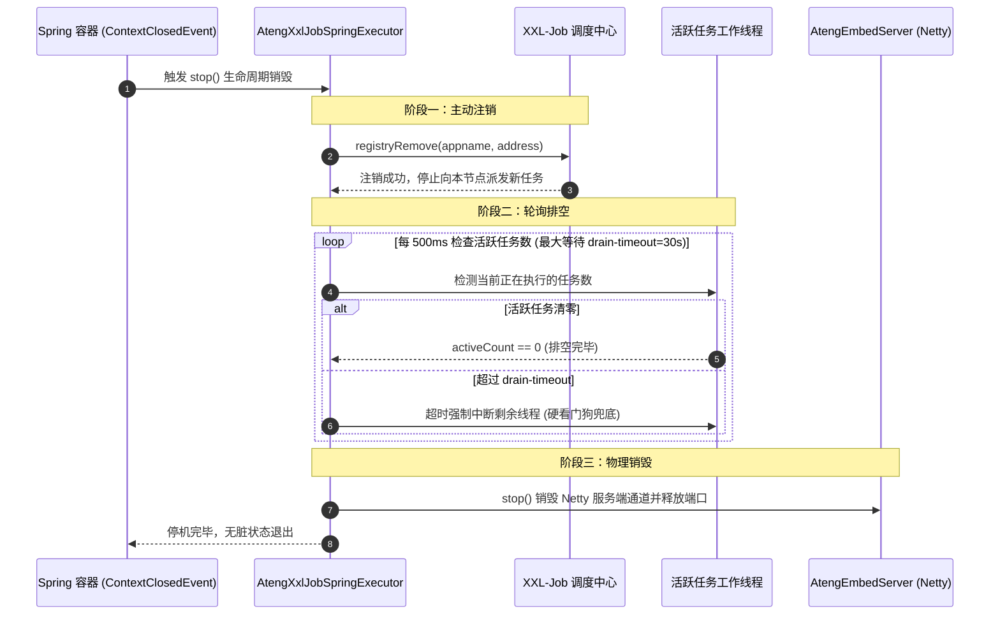
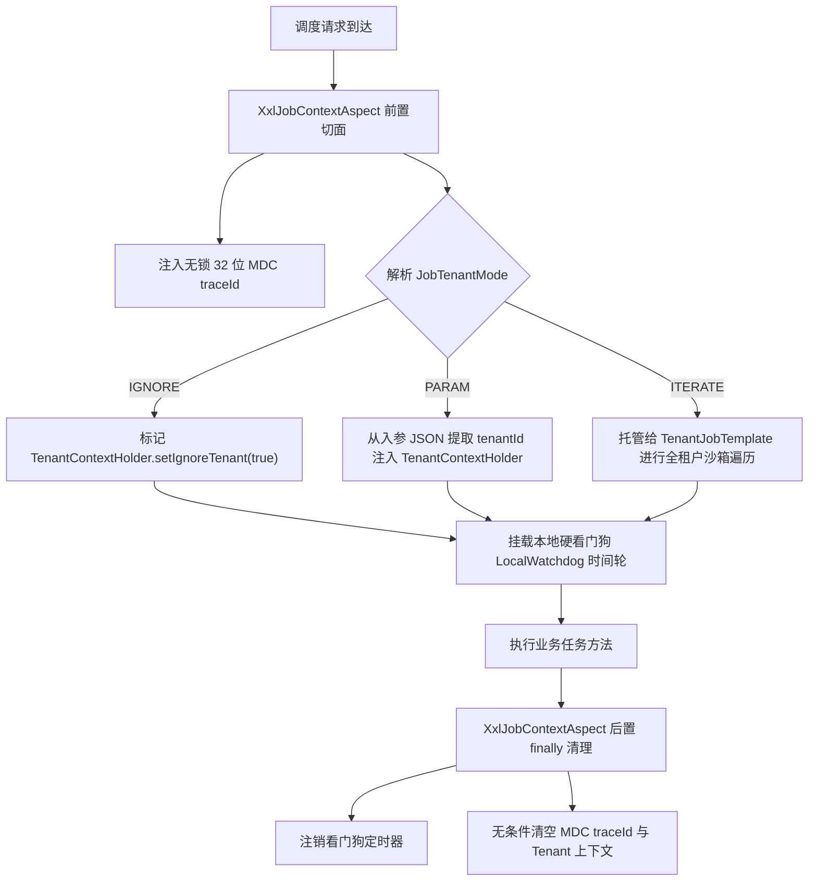

# ateng-boot-job-xxl 分布式任务调度增强基础设施 Starter

> 面向生产级分布式环境的 XXL-Job 分布式任务调度增强基础设施 Starter，坚持纯原生、零臃肿依赖与显式强类型契约设计。提供方法级 `@AtengXxlJob` 生产增强注解、三阶平滑停机排空状态机（`registryRemove` -> 轮询排空 -> Netty 销毁）、本地硬超时强中断看门狗与两级降级补偿机制（同 Bean 就地补偿 + `JobTimeoutFallbackHandler` 全局 SPI）、任务执行切面责任链拦截器 SPI（`XxlJobInterceptor` 优雅拦截跳过防告警风暴）、节点级任务运行时治理总线（`JobRuntimeGovernor` 内存动态静默与恢复）、SLF4J 动态日志双写镜像（`XxlJobLogbackAppenderRegistrar`）、四维全链路上下文与租户透传（MDC `traceId` / 操作人 / 租户模式）、大数据游标流式分片防 OOM 模板（`XxlShardingBatchTemplate`，含 `FailedBatch<T>` 失败切片收集与进度打卡）、多租户隔离与受管并发遍历模板（`TenantJobTemplate.executeForEachTenantParallel` 信号量背压并发）、官方 3.x OpenAPI 容灾门面（`XxlJobAdminTemplate`）、告警风暴抑制三阶状态机（首发告警 / 聚合摘要 / 故障自愈）、Spring Boot Actuator 运维管控端点（`/actuator/xxljobs`）、健康探针（`/actuator/health`）、Micrometer 监控度量（`ateng.job.xxl.execution`）及脱网极速调试门面（`XxlJobTestHelper` 支持 POJO 自动序列化绑定与 JSR-303 防卫）。

---

## 0. 特性与公共 API 全景速查矩阵 (Feature & API Panorama Matrix)

| 特性分类 | 特性名称 | 核心门面 / 注解 / SPI | 关键配置项 (`ateng.boot.job.xxl.*`) | 关键 API 签名 / 核心行为 | 锚定验证源头 (*Test / Sample) |
| :--- | :--- | :--- | :--- | :--- | :--- |
| **声明式增强** | 增强任务注解 | `@AtengXxlJob` | `enabled`<br>`context-aspect-enabled` | 声明式标注在 `@XxlJob` 方法上，按需织入四维上下文、本地硬超时、租户模式与降级补偿 | `XxlJobContextAspectTest` / `SystemWarmupJobHandler` |
| **声明式增强** | 任务标识名称 | `@AtengXxlJob.value` | - | `String value()`，指定 JobHandler 标识名称（默认留空，优先以 `@XxlJob.value()` 为准） | `XxlJobContextAspectTest` / `SystemWarmupJobHandler` |
| **声明式增强** | 本地硬超时阈值 | `@AtengXxlJob.timeout` | `default-job-timeout` | `String timeout()`，声明式本地硬超时字符串（如 `200ms`、`30s`），看门狗超限强行中断工作线程 | `LocalWatchdogTest` / `HistoryDataArchiveJobHandler` |
| **声明式增强** | 多租户隔离模式 | `@AtengXxlJob.tenantMode` | - | `JobTenantMode tenantMode()`，支持 `IGNORE`（忽略租户）、`PARAM`（入参绑定）、`ITERATE`（全租户遍历） | `XxlJobContextAspectTest` / `TenantJobHandler` |
| **声明式增强** | 超时降级补偿方法 | `@AtengXxlJob.fallback` | - | `String fallback()`，指定同 Bean 降级补偿方法名，任务超时中断后就地异步触发补偿逻辑 | `LocalWatchdogTest` / `HistoryDataArchiveJobHandler` |
| **声明式增强** | 方法级告警开关 | `@AtengXxlJob.alertEnabled` | `alert-enabled` | `boolean alertEnabled()`，方法级精细化静音开关，默认 true | `XxlJobAlertAggregatorTest` / `OrderReconciliationJobHandler` |
| **声明式增强** | 方法级失败抑制阈值 | `@AtengXxlJob.alertSuppressThreshold` | `alert-suppress-threshold` | `int alertSuppressThreshold()`，方法级连续失败告警触发阈值（-1 表示继承全局配置） | `XxlJobAlertAggregatorTest` / `OrderReconciliationJobHandler` |
| **参数防卫校验** | JSR-303 快速失败 | 方法形参声明 `@Valid` | - | 切面自动将调度 JSON 入参反序列化为形参强类型 DTO 并执行 JSR-303 防卫与 Fail-Fast 阻断 | `XxlJobContextAspectTest` / `ParamValidationJobHandler` |
| **切面拦截责任链** | 任务执行切面拦截器 SPI | `XxlJobInterceptor` | - | 三阶段切面扩展点：`preHandle`、`postHandle`、`afterCompletion`，支持企业级灰度与审计 | `XxlJobContextAspectTest` / `CanaryAuditJobInterceptor` |
| **切面拦截责任链** | 灰度跳过优雅终止 | `XxlJobInterceptor.preHandle` | - | `boolean preHandle(XxlJobExecutionContext context)`，返回 false 时优雅终止并返回 200 SUCCESS 防告警风暴 | `XxlJobContextAspectTest` / `CanaryAuditJobInterceptor` |
| **切面拦截责任链** | 任务执行后置处理 | `XxlJobInterceptor.postHandle` | - | `void postHandle(XxlJobExecutionContext context, Object result)`，任务成功执行后调用 | `XxlJobContextAspectTest` / `CanaryAuditJobInterceptor` |
| **切面拦截责任链** | 任务完成终态清理 | `XxlJobInterceptor.afterCompletion` | - | `void afterCompletion(XxlJobExecutionContext context, Throwable throwable)`，在 finally 块逆序触发终态归档 | `XxlJobContextAspectTest` / `CanaryAuditJobInterceptor` |
| **切面拦截责任链** | 执行上下文模型 | `XxlJobExecutionContext` | - | 携带 `jobHandler`、`jobId`、`traceId`、`tenantId`、`shardIndex`、`jobParam`、`targetMethod` 与扩展属性 | `XxlJobContextAspectTest` / `CanaryAuditJobInterceptor` |
| **运行时治理** | 节点级任务治理总线 | `JobRuntimeGovernor` | - | 内存单例总线，支持在单个节点维度对特定任务实施临时静默与恢复，随 Pod 重启自复位 | `JobRuntimeGovernorTest` / `XxlJobGovernorController` |
| **运行时治理** | 暂停任务处理器 | `JobRuntimeGovernor.pause` | - | `void pause(String handler)`，将指定任务加入内存静默名单，被调度触发时直接旁路跳过 | `JobRuntimeGovernorTest` / `XxlJobGovernorController` |
| **运行时治理** | 恢复任务处理器 | `JobRuntimeGovernor.resume` | - | `void resume(String handler)`，将指定任务移出静默名单，恢复正常调度执行 | `JobRuntimeGovernorTest` / `XxlJobGovernorController` |
| **运行时治理** | 静默状态判定与列表 | `JobRuntimeGovernor.isPaused` | - | `boolean isPaused(String handler)` 与 `Set<String> getPausedHandlers()` 查询当前节点静默清单 | `JobRuntimeGovernorTest` / `XxlJobGovernorController` |
| **超时降级补偿** | 本地硬超时守护时间轮 | `LocalWatchdog` | `default-job-timeout` | 基于 Netty `HashedWheelTimer` 与受管线程工厂，超限强行中断工作线程并广播 `JobTimeoutEvent` | `LocalWatchdogTest` / `HistoryDataArchiveJobHandler` |
| **超时降级补偿** | 全局超时降级处理器 SPI | `JobTimeoutFallbackHandler` | - | `void onTimeout(JobExecutionMetadata metadata, Duration elapsed)`，全局超时异步补偿回调 | `LocalWatchdogTest` / `HistoryDataArchiveJobHandler` |
| **超时降级补偿** | 任务超时领域事件 | `JobTimeoutEvent` | - | Spring 领域事件，携带 `jobId`、`jobHandler`、`timeout`、`elapsed` 耗时元数据 | `LocalWatchdogTest` |
| **分片流式批处理** | 步长流式顺序消费 | `XxlShardingBatchTemplate` | `batch-size` | `executeStep(initialId, batchSize, queryFunc, idExtractor, consumer, failureHandler)` 游标拉取 | `XxlShardingBatchTemplateTest` / `ShardingBatchJobHandler` |
| **分片流式批处理** | 步长逐条流式消费 | `XxlShardingBatchTemplate` | `batch-size` | `executeStepForEach(initialId, batchSize, queryFunc, idExtractor, itemConsumer, failureHandler)` | `XxlShardingBatchTemplateTest` |
| **分片流式批处理** | 分片智能过滤流式消费 | `XxlShardingBatchTemplate` | `batch-size` | `executeShardedStep(sharding, initialId, batchSize, queryFunc, idExtractor, consumer, failureHandler)` | `XxlShardingBatchTemplateTest` / `ShardingBatchJobHandler` |
| **分片流式批处理** | 步长受管并发消费 | `XxlShardingBatchTemplate` | `batch-max-concurrency` | `executeStepParallel(...)` 结合信号量背压并发分片拉取，透传四维上下文与死信收集 | `XxlShardingBatchTemplateTest` |
| **分片流式批处理** | 分片广播受管并发消费 | `XxlShardingBatchTemplate` | `batch-max-concurrency` | `executeShardedStepParallel(...)` 广播分片智能切片 + 受管线程池并发消费 | `XxlShardingBatchTemplateTest` |
| **分片流式批处理** | 失败切片死信模型 | `FailedBatch<T>` | - | 封装 `items`（失败明细）、`batchIndex`、`cursorId`、`cause`，供补偿回调持久化死信 | `XxlShardingBatchTemplateTest` / `XxlJobDeadLetterController` |
| **分片流式批处理** | 执行结果统计模型 | `BatchExecutionResult` | - | 封装总数、成功数、失败数、批次数、耗时与有界失败集合（`MAX_FAILED_ITEMS=1000` 截断防 OOM） | `XxlShardingBatchTemplateTest` / `ShardingBatchJobHandler` |
| **分片流式批处理** | 实时流式进度打卡 | `XxlShardingBatchTemplate` | `progress-log-interval` | 定期输出结构化进度日志（默认每 5000 条输出一次已推进总数与耗时），消除长任务盲盒 | `XxlShardingBatchTemplateTest` / `ShardingBatchJobHandler` |
| **多租户遍历** | 顺序多租户隔离遍历 | `TenantJobTemplate` | - | `executeForEachTenant(action)`，在独立租户沙箱中流式遍历各租户执行，杜绝数据串写 | `TenantJobTemplateTest` / `TenantJobHandler` |
| **多租户遍历** | 受管并发多租户遍历 | `TenantJobTemplate` | `batch-max-concurrency` | `executeForEachTenantParallel(action)`，基于信号量背压与受管线程池并发遍历，透传上下文 | `TenantJobTemplateTest` / `TenantJobHandler` |
| **多租户遍历** | 租户列表提供者 SPI | `TenantListProvider` | - | `List<String> getTenantIds()`，供业务系统注册有效租户提供者，配合模板遍历 | `TenantJobTemplateTest` / `TenantJobHandler` |
| **ORM 流式扩展** | MyBatis-Plus 游标批处理 | `XxlMyBatisStreamingTemplate` | - | `executeStreaming(...)` 联动 `StreamingQueryTemplate` 与 `Cursor` 顺序/并发流式拉取 | `XxlShardingBatchTemplateTest` |
| **OpenAPI 门面** | 调度任务生命周期管理 | `XxlJobAdminTemplate` | `admin-addresses`<br>`access-token` | `addJob`、`updateJob`、`startJob`、`stopJob`、`removeJob`、`triggerJob`，支持集群多节点故障转移 | `XxlJobAdminTemplateTest` / `XxlJobAdminController` |
| **脱网极速调试** | 脱网单测手动触发 | `XxlJobTestHelper` | - | `trigger(handler, paramObject, shardIndex, shardTotal, tenantId)`，支持 POJO 自动序列化与 JSR-303 防卫 | `XxlJobTestHelperTest` / `XxlJobTriggerController` |
| **运维端点** | 全量 Handler 状态清单 | `XxlJobEndpoint` | `enabled` | `GET /actuator/xxljobs`，列出已注册的 JobHandler 概览、执行器端口、元数据及静默状态 | `XxlJobEndpointTest` / `SampleJobXxlIntegrationTest` |
| **运维端点** | 单 Handler 详情与诊断 | `XxlJobEndpoint` | `enabled` | `GET /actuator/xxljobs/{handler}`，查询指定 Handler 的反射元数据、目标类与当前静默状态 | `XxlJobEndpointTest` / `SampleJobXxlIntegrationTest` |
| **运维端点** | 动态节点治理操作 | `XxlJobEndpoint` | `enabled` | `POST /actuator/xxljobs/{handler}/pause` 与 `/resume`，在线一键暂停与恢复单节点任务 | `XxlJobEndpointTest` / `XxlJobGovernorController` |
| **运维端点** | 动态脱网运维触发 | `XxlJobEndpoint` | `enabled` | `POST /actuator/xxljobs/{handler}`，请求体传入 param 与分片参数，在线手动触发 | `XxlJobEndpointTest` / `SampleJobXxlIntegrationTest` |
| **执行器加固** | 生产增强执行器 | `AtengXxlJobSpringExecutor` | `admin-addresses`<br>`appname`<br>`port`<br>`ip`<br>`address` | 继承官方执行器，装配三阶停机排空、CIDR 防火墙与端口冲突顺延自愈 | `AtengXxlJobSpringExecutorTest` / `SampleJobXxlApplication` |
| **执行器加固** | 优雅停机状态机 | `AtengXxlJobSpringExecutor.stop()` | `drain-timeout` | 阶段一主动注销（`registryRemove`）-> 阶段二轮询排空 -> 阶段三物理销毁 Netty | `AtengXxlJobSpringExecutorTest` |
| **安全防火墙** | 入站 CIDR 白名单 | `XxlJobFirewallInboundHandler` | `cidr-whitelist` | 支持单个 IP 与 CIDR 掩码段（如 `192.168.0.0/16`），非白名单入站连接直接阻断 | `XxlJobFirewallTest` / `AtengEmbedServerTest` |
| **安全防火墙** | 令牌防空鉴权 | `XxlJobFirewallInboundHandler` | `access-token`<br>`require-access-token` | 校验调度请求头中的 AccessToken，支持启动期未配置令牌时 Fail-Fast 快速拦截 | `XxlJobFirewallTest` / `AtengXxlJobAutoConfigurationTest` |
| **告警自愈** | 告警风暴抑制器 | `XxlJobAlertAggregator` | `alert-enabled`<br>`alert-suppress-duration`<br>`alert-suppress-threshold` | 聚合失败异常，首发立即告警 -> 抑制窗口内静默聚合为富文本摘要 -> 成功时自愈恢复 | `XxlJobAlertAggregatorTest` / `OrderReconciliationJobHandler` |
| **告警自愈** | 告警领域事件 | `XxlJobAlertEvent` | - | Spring 标准领域事件，携带 `alertType` (`INITIAL_FAILURE` / `FAILURE_SUMMARY` / `RECOVERY`)、`failureCount`、`throwable` | `XxlJobAlertAggregatorTest` / `SampleJobXxlIntegrationTest` |
| **健康探针** | 执行器健康状态检测 | `XxlJobHealthIndicator` | `enabled` | 暴露于 `/actuator/health`，优先读取执行器运行时顺延自愈端口与 IP，上报网络连通性 | `XxlJobEndpointTest` / `SampleJobXxlIntegrationTest` |
| **监控度量** | Micrometer 核心指标 | `XxlJobMetricsBinder` | - | 发布 `ateng.job.xxl.execution` Timer 指标（Throughput、Failures、P50/P95/P99 分位数耗时） | `XxlJobEndpointTest` / `SampleJobXxlIntegrationTest` |
| **日志镜像** | SLF4J 双写动态桥接 | `XxlJobLogbackAppenderRegistrar` | `log-mirror-enabled` | 自动向 Logback Root Logger 挂载动态 Appender，在调度线程将日志镜像至调度中心 | `XxlJobLogbackAppenderRegistrarTest` / `SystemWarmupJobHandler` |
| **日志治理** | 历史日志防崩安全清理 | `AtengJobLogFileCleanHelper` | `log-path`<br>`log-retention-days` | 重构历史日志清理器，强制执行路径防卫与跨平台文件句柄防崩容错 | `AtengJobLogFileCleanHelperTest` |
| **上下文传播** | 调度上下文异步全链路传播 | `XxlJobContextSnapshotProvider` | - | 实现 `AsyncContextSnapshotProvider` SPI，治理 `InheritableThreadLocal` 跨池浅拷贝污染 | `XxlJobContextSnapshotProviderTest` |
| **自动装配** | 模块自动装配入口 | `AtengXxlJobAutoConfiguration` | `enabled` | Spring Boot 3 标准自动装配，平滑探测调度中心配置，标配完整缺省 Bean 守卫 | `AtengXxlJobAutoConfigurationTest` |

---

## 1. 模块定位与快速起步 (Quick Start)

### 1.1 核心痛点与生产级增强宣言

原生开源版 XXL-Job 在企业级微服务上云落地过程中，常见以下痛点：
- **发布停机杀任务引发脏数据**：默认停机策略直接关闭执行器 Netty，运行中的耗时长任务被硬杀，导致数据库与中间件数据不一致；
- **内网安全防御薄弱**：默认执行器端口直接向整个网络开放，缺乏入站网络白名单，容易受到伪造调度或端口扫描渗透；
- **失败重试导致告警风暴**：高频调度或分片任务连续失败时，产生数以千计的重复告警短信/邮件，淹没值班人员；
- **大数据量批处理易 OOM**：缺乏统一流式防 OOM 规范，一次性拉取海量数据极易造成 JVM 堆溢出或无界悬挂；
- **单节点异常无法热治理**：单个 Pod 偶发硬件故障或网络抖动时，无法在线静默该节点的任务，只能重启或摘除 Pod；
- **日志两头割裂**：开发者在业务代码中打 `log.info`，调度中心管理台却无法实时查看，必须手动调用 `XxlJobHelper.log` 双重维护。

`ateng-boot-job-xxl` 专为解决上述痛点而设计，提供 100% 原生、零臃肿的开箱即用加固能力。

### 1.2 Maven 坐标引入

在已导入 `ateng-boot-bom` 的工程中，无需声明版本号即可直接引入：

```xml
<dependency>
    <groupId>io.github.atengk</groupId>
    <artifactId>ateng-boot-job-xxl</artifactId>
</dependency>
```

### 1.3 最小起步配置 (`application.yml`)

```yaml
server:
  port: 8080

ateng:
  boot:
    job:
      xxl:
        enabled: true                                      # 是否启用执行器自动装配
        admin-addresses: http://127.0.0.1:8080/xxl-job-admin # 调度中心核心服务地址
        appname: xxl-job-sample-executor                   # 执行器应用标识
        access-token: default_token                        # 通信访问令牌
        port: 9999                                         # 执行器 Netty 通信端口 (支持冲突顺延自愈)
        log-path: ./logs/xxl-job/jobhandler                # 日志存储根目录
        log-retention-days: 7                              # 日志清理保留天数
        timeout: 30s                                       # RPC 通信超时阈值
        drain-timeout: 30s                                 # 平滑停机最大排空等待时长
        default-job-timeout: 1h                            # 默认看门狗硬超时阈值 (防无界挂起)
```

### 1.4 编写第一个声明式增强任务 (`SystemWarmupJobHandler`)

以下代码 100% 逆向提取自场景样例工程 [`ateng-boot-sample-job-xxl`](../ateng-boot-samples/ateng-boot-sample-job-xxl)：

```java
package io.github.atengk.boot.sample.job.xxl.handler;

import com.xxl.job.core.context.XxlJobHelper;
import com.xxl.job.core.handler.annotation.XxlJob;
import io.github.atengk.boot.job.xxl.annotation.AtengXxlJob;
import org.slf4j.Logger;
import org.slf4j.LoggerFactory;
import org.slf4j.MDC;
import org.springframework.stereotype.Component;

/**
 * 系统冷启动预热巡检与基础调度任务处理器
 */
@Component
public class SystemWarmupJobHandler {

    private static final Logger log = LoggerFactory.getLogger(SystemWarmupJobHandler.class);

    @XxlJob("systemWarmupJob")
    @AtengXxlJob(value = "systemWarmupJob", timeout = "5s")
    public void executeSystemWarmup() {
        String param = XxlJobHelper.getJobParam();
        String traceId = MDC.get("traceId");

        // 业务日志：通过 XxlJobLogbackAppenderRegistrar 自动实时镜像推送到调度中心
        log.info(">>>>>> [SystemWarmupJobHandler] 执行系统热点缓存预热与巡检, 入参: {}, traceId: {}", param, traceId);
        XxlJobHelper.log("执行器日志镜像已同步: traceId={}", traceId);

        XxlJobHelper.handleSuccess("系统预热巡检任务执行完毕，入参: " + param);
    }
}
```

---

## 2. 核心架构与设计不变量 (Architecture & Invariants)

### 2.1 三阶平滑停机排空状态机 (Graceful Shutdown State Machine)

当应用接收到停机信号（如 K8s SIGTERM 或 JVM Shutdown Hook）时，框架不会粗暴杀死正在运行的任务，而是执行确定性的三阶平滑停机排空流程：



### 2.2 入站 CIDR 白名单安全防火墙

`AtengEmbedServer` 在 Netty Channel 入站握手阶段执行前置网络防火墙校验：
1. **网络层 IP 匹配**：读取客户端对端 `InetSocketAddress`，与配置的 `ateng.boot.job.xxl.cidr-whitelist` 进行 CIDR 掩码匹配；若配置非空且不匹配，立即断开 Channel 连接；
2. **应用层 Token 鉴权**：校验 HTTP Header 中的 `XXL-JOB-ACCESS-TOKEN`；若启用 `require-access-token: true` 且未配 Token，应用启动阶段直接 Fail-Fast 拦截。

### 2.3 四维上下文透传与多租户隔离时序

每次调度请求进入切面后，框架自动生成无锁 MDC `traceId`，挂载操作人与租户沙箱，并在 `finally` 块中 100% 确保资源无泄漏清理：



---

## 3. 声明式调度与强类型防御套件 (Declarative & Type-Safe)

### 3.1 `@AtengXxlJob` 声明式增强与四维上下文透传

#### 专属 YAML 配置片段

```yaml
ateng:
  boot:
    job:
      xxl:
        context-aspect-enabled: true                       # 是否启用调度任务执行切面 (默认 true)
        default-job-timeout: 1h                            # 默认任务看门狗硬超时阈值 (默认 1 小时)
        managed-pool-enabled: false                        # 是否将调度方法提交至 Core 受管异步线程池
```

#### 实战业务代码 (`SystemWarmupJobHandler`)

```java
package io.github.atengk.boot.sample.job.xxl.handler;

import com.xxl.job.core.context.XxlJobHelper;
import com.xxl.job.core.handler.annotation.XxlJob;
import io.github.atengk.boot.job.xxl.annotation.AtengXxlJob;
import org.slf4j.Logger;
import org.slf4j.LoggerFactory;
import org.slf4j.MDC;
import org.springframework.stereotype.Component;

@Component
public class SystemWarmupJobHandler {

    private static final Logger log = LoggerFactory.getLogger(SystemWarmupJobHandler.class);

    @XxlJob("systemWarmupJob")
    @AtengXxlJob(value = "systemWarmupJob", timeout = "5s")
    public void executeSystemWarmup() {
        String param = XxlJobHelper.getJobParam();
        String traceId = MDC.get("traceId");

        log.info(">>>>>> [SystemWarmupJobHandler] 执行系统热点缓存预热与巡检, 入参: {}, traceId: {}", param, traceId);
        XxlJobHelper.log("执行器日志镜像已同步: traceId={}", traceId);

        XxlJobHelper.handleSuccess("系统预热巡检任务执行完毕，入参: " + param);
    }
}
```

#### 核心机制与边界防御
- **四维上下文注入**：切面在方法执行前自动生成 32 位无锁 UUID 作为 MDC `traceId`，使调度日志与下游微服务 RPC / MQ 具备全链路可观测性；
- **异步安全与严格清理**：当配置 `managed-pool-enabled: true` 时，任务被提交至 Core 受管线程池执行；切面在 `finally` 块中无条件执行 `MDC.remove("traceId")` 与上下文清理，彻底杜绝线程复用引发的上下文串染。

---

### 3.2 JSR-303 强类型参数校验与 POJO 自动绑定防卫

#### 专属 YAML 配置片段

```yaml
ateng:
  boot:
    job:
      xxl:
        context-aspect-enabled: true                       # 依赖切面执行入参自动反序列化与 JSR-303 防卫
```

#### 实战业务代码 (`UserSyncParam` + `ParamValidationJobHandler`)

```java
package io.github.atengk.boot.sample.job.xxl.dto;

import jakarta.validation.constraints.Max;
import jakarta.validation.constraints.Min;
import jakarta.validation.constraints.NotBlank;
import jakarta.validation.constraints.NotNull;
import java.io.Serializable;

public class UserSyncParam implements Serializable {
    private static final long serialVersionUID = 1L;

    @NotBlank(message = "同步批次号 batchNo 不能为空")
    private String batchNo;

    @NotNull(message = "批大小 batchSize 不能为空")
    @Min(value = 1, message = "批大小不能小于 1")
    @Max(value = 1000, message = "单批同步上限不能超过 1000")
    private Integer batchSize;

    private String tenantId;
    // Getters & Setters...
}
```

```java
package io.github.atengk.boot.sample.job.xxl.handler;

import com.xxl.job.core.context.XxlJobHelper;
import com.xxl.job.core.handler.annotation.XxlJob;
import io.github.atengk.boot.job.xxl.annotation.AtengXxlJob;
import io.github.atengk.boot.sample.job.xxl.dto.UserSyncParam;
import jakarta.validation.Valid;
import org.slf4j.Logger;
import org.slf4j.LoggerFactory;
import org.springframework.stereotype.Component;

@Component
public class ParamValidationJobHandler {

    private static final Logger log = LoggerFactory.getLogger(ParamValidationJobHandler.class);

    @XxlJob("userSyncJob")
    @AtengXxlJob(value = "userSyncJob")
    public void executeUserSync(@Valid UserSyncParam param) {
        log.info(">>>>>> [ParamValidationJobHandler] 开始执行用户同步任务, 批次: {}, 批大小: {}, 租户: {}",
                param.getBatchNo(), param.getBatchSize(), param.getTenantId());

        XxlJobHelper.log("用户同步批次 [{}] 校验通过，正在处理 {} 条数据...", param.getBatchNo(), param.getBatchSize());
        XxlJobHelper.handleSuccess("同步任务成功完成, 处理批大小: " + param.getBatchSize());
    }
}
```

#### 核心机制与边界防御
- **Fail-Fast 快速失败**：切面感知方法形参带有 `@Valid` 注解时，使用 `JsonUtil` 将调度传入的 JSON 字符串反序列化为目标 POJO，并调用 `ValidatorUtil.validate(obj)` 执行防卫校验；
- **异常阻断与精准日志**：若参数格式非法或字段缺失，直接阻断业务逻辑执行，并向调度中心记录详尽的违规字段明细，触发首发告警，避免脏入参引发数据库脏数据。

---

## 4. 高可靠韧性保障套件 (Resilience & Reliability)

### 4.1 本地硬看门狗超时强中断与同 Bean 就地降级补偿

#### 专属 YAML 配置片段

```yaml
ateng:
  boot:
    job:
      xxl:
        default-job-timeout: 1h                            # 默认任务本地硬看门狗超时时限 (如方法未单独配置时生效)
```

#### 实战业务代码 (`HistoryDataArchiveJobHandler`)

```java
package io.github.atengk.boot.sample.job.xxl.handler;

import com.xxl.job.core.context.XxlJobHelper;
import com.xxl.job.core.handler.annotation.XxlJob;
import io.github.atengk.boot.job.xxl.annotation.AtengXxlJob;
import io.github.atengk.boot.job.xxl.watchdog.JobExecutionMetadata;
import org.slf4j.Logger;
import org.slf4j.LoggerFactory;
import org.springframework.stereotype.Component;

import java.time.Duration;

@Component
public class HistoryDataArchiveJobHandler {

    private static final Logger log = LoggerFactory.getLogger(HistoryDataArchiveJobHandler.class);

    /**
     * 历史冷数据归档任务：设置 200ms 硬看门狗超时时限，超时后自动回调 onArchiveTimeoutFallback
     */
    @XxlJob("historyDataArchiveJob")
    @AtengXxlJob(value = "historyDataArchiveJob", timeout = "200ms", fallback = "onArchiveTimeoutFallback")
    public void executeHistoryDataArchive() {
        log.info(">>>>>> [HistoryDataArchiveJobHandler] 开始执行历史冷数据大批量归档扫描...");
        try {
            Thread.sleep(1500); // 模拟耗时超过看门狗 200ms 阈值
        } catch (InterruptedException e) {
            log.warn(">>>>>> [HistoryDataArchiveJobHandler] 捕获到硬看门狗线程中断信号并优雅退出！");
            XxlJobHelper.handleSuccess("归档任务超时被看门狗中断，触发就地降级补偿: historyDataArchiveJob");
            return;
        }
        XxlJobHelper.handleSuccess("未超时正常执行完成");
    }

    /**
     * 就地降级补偿方法：支持自动注入 JobExecutionMetadata 与已耗时 Duration
     */
    public void onArchiveTimeoutFallback(JobExecutionMetadata metadata, Duration elapsed) {
        log.warn(">>>>>> [HistoryDataArchiveJobHandler] 触发就地降级补偿回调! 任务: {}, 耗时: {}ms",
                metadata.getJobName(), elapsed.toMillis());
        // 生产实践：释放分布式事务锁、标记批次状态为待人工冲正，或异步发布死信告警
    }
}
```

#### 核心机制与边界防御
- **时间轮强中断**：底层基于 Netty `HashedWheelTimer` 构建轻量无锁看门狗，超限时向执行线程发送 `Thread.interrupt()` 中断信号；
- **两级降级补偿**：优先就地调用同 Bean 的 `fallback` 声明方法（支持参数自动匹配）；若未声明就地方法，则兜底调用 Spring 上下文中的 `JobTimeoutFallbackHandler` 全局 SPI，最后发布 `JobTimeoutEvent` 领域事件供监控大盘消费。

---

### 4.2 告警风暴抑制三阶状态机与自动自愈

#### 专属 YAML 配置片段

```yaml
ateng:
  boot:
    job:
      xxl:
        alert-enabled: true                                # 是否启用告警防风暴聚合
        alert-suppress-duration: 5m                        # 告警风暴抑制周期时限 (在此周期内的连续重复失败将被聚合)
        alert-suppress-threshold: 3                        # 触发告警摘要的连续失败次数阈值
```

#### 实战业务代码 (`OrderReconciliationJobHandler`)

```java
package io.github.atengk.boot.sample.job.xxl.handler;

import com.xxl.job.core.context.XxlJobHelper;
import com.xxl.job.core.handler.annotation.XxlJob;
import io.github.atengk.boot.job.xxl.annotation.AtengXxlJob;
import org.slf4j.Logger;
import org.slf4j.LoggerFactory;
import org.springframework.stereotype.Component;

import java.util.concurrent.atomic.AtomicBoolean;

@Component
public class OrderReconciliationJobHandler {

    private static final Logger log = LoggerFactory.getLogger(OrderReconciliationJobHandler.class);
    private final AtomicBoolean faultInjected = new AtomicBoolean(false);

    public void setFaultInjected(boolean fault) {
        this.faultInjected.set(fault);
    }

    @XxlJob("orderReconciliationJob")
    @AtengXxlJob(value = "orderReconciliationJob", alertEnabled = true, alertSuppressThreshold = 3)
    public void executeOrderReconciliation() {
        String param = XxlJobHelper.getJobParam();
        boolean hasDiff = faultInjected.get() || (param != null && param.contains("hasDiff=true"));
        if (hasDiff) {
            log.error(">>>>>> [OrderReconciliationJobHandler] 发现订单与支付渠道对账差错，借贷金额不平！");
            throw new RuntimeException("对账发现金额差错不平，触发差错调账告警！");
        }
        log.info(">>>>>> [OrderReconciliationJobHandler] 订单每日对账完成，借贷平衡。");
        XxlJobHelper.handleSuccess("订单每日对账完成，平账成功");
    }
}
```

#### 核心机制与边界防御
- **状态转移三阶段**：
  1. `INITIAL_FAILURE`（首发告警）：首次失败立即投递，告警信息包含完整堆栈；
  2. `FAILURE_SUMMARY`（静默聚合）：窗口内连续失败被抑制，累计达到阈值或窗口期满时发出包含累计次数与最新异常的摘要卡片；
  3. `RECOVERY`（故障自愈）：经历连续失败后首次成功，自动发出绿色自愈通知并重置失败计数器；
- **方法级精细化静音**：可通过 `@AtengXxlJob(alertEnabled = false)` 针对低优先级离线跑轰任务独立静音。

---

### 4.3 SLF4J 动态日志双写镜像与调度中心实时追踪

#### 专属 YAML 配置片段

```yaml
ateng:
  boot:
    job:
      xxl:
        log-mirror-enabled: true                           # 是否启用 SLF4J 日志自动镜像至调度执行日志文件
        log-path: ./logs/xxl-job/jobhandler                # 执行器本地调度日志根路径
        log-retention-days: 7                              # 本地历史日志清理保留天数
```

#### 实战业务代码

```java
// 开发者无需关心 XXL-Job 专属 API，直接使用标准 SLF4J 打印日志：
log.info(">>>>>> 开始执行批量订单核销, 当前节点: {}", nodeAddress);
// 框架自动通过 XxlJobLogbackAppenderRegistrar 拦截当前调度线程日志并镜像写入 XXL-Job 本地日志文件
```

#### 核心机制与边界防御
- **动态 Logback 挂载**：启动期由 `XxlJobLogbackAppenderRegistrar` 动态向 Logback Root Logger 挂载镜像 Appender；
- **线程上下文隔离**：仅拦截当前线程且 `XxlJobContext.getXxlJobContext() != null` 的调度线程日志，业务普通 Web 线程零性能开销；
- **历史日志防崩清理**：`AtengJobLogFileCleanHelper` 重构清理器，在多实例共享磁盘与 Windows 平台下执行路径防卫与安全句柄释放，彻底解决原生开源版文件清理报 NPE 或锁死崩溃的缺陷。

---

## 5. 分布式分片与多租户并发套件 (Sharding & Multitenancy)

### 5.1 大数据游标流式分片防 OOM 与死信收集 (`XxlShardingBatchTemplate`)

#### 专属 YAML 配置片段

```yaml
ateng:
  boot:
    job:
      xxl:
        batch-size: 1000                                   # 分片流式批处理默认单批条数
        batch-max-concurrency: 8                           # 分片流式批处理默认最大并发度
        progress-log-interval: 5000                        # 分片批处理实时进度打卡步长间隔条数
```

#### 实战业务代码 (`ShardingBatchJobHandler`)

```java
package io.github.atengk.boot.sample.job.xxl.handler;

import com.xxl.job.core.context.XxlJobHelper;
import com.xxl.job.core.handler.annotation.XxlJob;
import io.github.atengk.boot.job.xxl.annotation.AtengXxlJob;
import io.github.atengk.boot.job.xxl.model.ShardingContext;
import io.github.atengk.boot.job.xxl.template.BatchExecutionResult;
import io.github.atengk.boot.job.xxl.template.FailedBatch;
import io.github.atengk.boot.job.xxl.template.XxlShardingBatchTemplate;
import org.slf4j.Logger;
import org.slf4j.LoggerFactory;
import org.springframework.stereotype.Component;

import java.util.List;
import java.util.concurrent.CopyOnWriteArrayList;

@Component
public class ShardingBatchJobHandler {

    private static final Logger log = LoggerFactory.getLogger(ShardingBatchJobHandler.class);
    private final XxlShardingBatchTemplate batchTemplate;
    private final List<FailedBatch<MockOrder>> deadLetters = new CopyOnWriteArrayList<>();

    public ShardingBatchJobHandler(XxlShardingBatchTemplate batchTemplate) {
        this.batchTemplate = batchTemplate;
    }

    @XxlJob("shardingBatchDeadLetterJob")
    @AtengXxlJob(value = "shardingBatchDeadLetterJob", timeout = "30s")
    public void executeShardingBatchWithDeadLetter(ShardingContext shardingContext) {
        log.info(">>>>>> [ShardingBatchJobHandler] 开始执行带死信补偿回调的分片批处理任务...");
        deadLetters.clear();

        BatchExecutionResult summary = batchTemplate.executeShardedStep(
                shardingContext,
                0L,                  // 初始游标 ID
                100,                 // 每批拉取 100 条
                300L,                // 预估总条数，用于实时进度打卡
                false,               // failFast = false: 容错继续处理其余切片并收集死信
                (lastId, limit) -> orderRepository.selectNextBatch(lastId, limit),
                MockOrder::id,       // 主键提取器
                batch -> {
                    for (MockOrder order : batch) {
                        if (order.id() == 8L) {
                            throw new RuntimeException("订单 [ID=" + order.id() + "] 模拟业务处理失败");
                        }
                    }
                },
                failedBatch -> {
                    log.warn(">>>>>> [DeadLetter] 捕获失败切片进入死信回调: 批次 {}, 失败条数 {}",
                            failedBatch.getBatchIndex(), failedBatch.getItems().size());
                    deadLetters.add(failedBatch); // 投递至死信队列或存储死信表
                }
        );

        XxlJobHelper.handleSuccess(String.format("分片批处理完成: 成功 %d 条, 失败 %d 条, 死信收集 %d 批",
                summary.getSuccessCount(), summary.getFailCount(), deadLetters.size()));
    }

    public record MockOrder(Long id, String orderNo, Integer amount) {}
}
```

#### 核心机制与边界防御
- **主键游标分页**：基于 `WHERE id > :lastId ORDER BY id ASC LIMIT :batchSize` 模式，杜绝深分页 `OFFSET` 性能恶化；
- **分片智能过滤**：`executeShardedStep` 结合 `id % shardTotal == shardIndex` 自动识别当前分片归属，消除重复消费；
- **堆内存防 OOM 刚性熔断**：`BatchExecutionResult` 强制实施 `MAX_FAILED_ITEMS = 1000` 截断防线，即便下游存储大面积故障，也不会将海量实体驻留堆内存导致 JVM 崩溃。

---

### 5.2 多租户隔离全模态与受管并发遍历 (`TenantJobTemplate`)

#### 专属 YAML 配置片段

```yaml
ateng:
  boot:
    job:
      xxl:
        batch-max-concurrency: 8                           # 多租户受管并发遍历的最大并行租户数
```

#### 实战业务代码 (`TenantJobHandler`)

```java
package io.github.atengk.boot.sample.job.xxl.handler;

import com.xxl.job.core.context.XxlJobHelper;
import com.xxl.job.core.handler.annotation.XxlJob;
import io.github.atengk.boot.core.context.TenantContextHolder;
import io.github.atengk.boot.job.xxl.annotation.AtengXxlJob;
import io.github.atengk.boot.job.xxl.annotation.JobTenantMode;
import io.github.atengk.boot.job.xxl.template.BatchExecutionResult;
import io.github.atengk.boot.job.xxl.template.TenantJobTemplate;
import org.springframework.stereotype.Component;

@Component
public class TenantJobHandler {

    private final TenantJobTemplate tenantJobTemplate;

    public TenantJobHandler(TenantJobTemplate tenantJobTemplate) {
        this.tenantJobTemplate = tenantJobTemplate;
    }

    // 1. 声明式：全局系统级任务（忽略租户隔离）
    @XxlJob("globalArchiveJob")
    @AtengXxlJob(value = "globalArchiveJob", tenantMode = JobTenantMode.IGNORE)
    public void executeGlobalArchive() {
        boolean ignoreTenant = TenantContextHolder.isIgnoreTenant(); // true
        XxlJobHelper.handleSuccess("全局归档成功, ignoreTenant=" + ignoreTenant);
    }

    // 2. 声明式：参数绑定单租户任务（从任务入参解析并挂载当前租户）
    @XxlJob("tenantScopedJob")
    @AtengXxlJob(value = "tenantScopedJob", tenantMode = JobTenantMode.PARAM)
    public void executeTenantScoped() {
        String currentTenant = TenantContextHolder.getTenantId();
        XxlJobHelper.handleSuccess("特定租户任务完成, 当前租户=" + currentTenant);
    }

    // 3. 编程式：全租户沙箱受管并发遍历
    @XxlJob("parallelTenantJob")
    @AtengXxlJob(value = "parallelTenantJob", tenantMode = JobTenantMode.ITERATE)
    public void executeParallelTenant() {
        BatchExecutionResult result = tenantJobTemplate.executeForEachTenantParallel(tenantId -> {
            String currentTenant = TenantContextHolder.getTenantId(); // 严格等于当前并发分发租户
            billingService.generateMonthlyBill(currentTenant);
        });

        XxlJobHelper.handleSuccess(String.format("多租户并发遍历完成: 总数 %d, 成功 %d, 失败 %d",
                result.getTotalCount(), result.getSuccessCount(), result.getFailCount()));
    }
}
```

#### 核心机制与边界防御
- **多租户全模态支持**：涵盖 `IGNORE`（系统级全表归档）、`PARAM`（指定租户触发）与 `ITERATE`（全量租户轮流遍历）；
- **信号量背压并发**：`executeForEachTenantParallel` 基于 Core 受管线程池与 `Semaphore` 背压限流，为每个并发线程深拷贝独立租户沙箱并在执行完毕后执行清理，彻底杜绝数据串写。

---

## 6. 运行时节点治理与安全套件 (Governance & Security)

### 6.1 `JobRuntimeGovernor` 节点级任务动态静默与恢复

#### 专属 YAML 配置片段

```yaml
ateng:
  boot:
    job:
      xxl:
        enabled: true
management:
  endpoints:
    web:
      exposure:
        include: "health,info,metrics,xxljobs"             # 暴露 xxljobs 治理端点
```

#### 实战业务代码

```java
@Autowired
private JobRuntimeGovernor governor;

public void hotIsolateTask(String handlerName) {
    // 1. 内存级临时暂停任务（随 Pod 重启自复位，不影响集群中其他节点）
    governor.pause(handlerName);
    
    // 2. 状态查询
    boolean paused = governor.isPaused(handlerName);
    Set<String> pausedList = governor.getPausedHandlers();
    
    // 3. 恢复调度执行
    governor.resume(handlerName);
}
```

#### 核心机制与边界防御
- **单节点热隔离**：当某个 Pod 的本地缓存或下游通道出现异常时，无需下线整个 Pod，直接通过治理总线静默该任务，被调度触发时切面直接报告 200 SUCCESS 跳过；
- **随 Pod 声明周期自复位**：治理状态基于内存线程安全集合维护，Pod 重启后自动恢复默认调度态，避免遗留脏配置导致任务长期漏跑。

---

### 6.2 入站 CIDR 白名单安全防火墙与令牌防空防卫

#### 专属 YAML 配置片段

```yaml
ateng:
  boot:
    job:
      xxl:
        access-token: "PRODUCTION_SECRET_TOKEN"            # 通信交互访问令牌
        require-access-token: true                         # 强制要求令牌配置，未配时应用启动 Fail-Fast
        cidr-whitelist:                                    # 执行器入站网络白名单 (支持单 IP 与 CIDR 子网掩码)
          - 127.0.0.1
          - 10.0.0.0/8
          - 172.16.0.0/12
          - 192.168.0.0/16
```

#### 核心机制与边界防御
- **握手前置阻断**：非白名单来源的 HTTP 请求在 Netty 握手与 Channel 注册阶段直接断开连接，消耗极少 CPU 资源；
- **令牌防空拦截**：`requireAccessToken: true` 能够在微服务部署时防止因研发漏配令牌导致暴露在内网中的执行器接口被恶意伪造调用。

---

### 6.3 端口冲突顺延自愈与三阶平滑停机排空

#### 专属 YAML 配置片段

```yaml
ateng:
  boot:
    job:
      xxl:
        port: 9999                                         # 执行器首选监听端口
        port-detection-max-retry: 100                      # 端口冲突探测最大顺延重试步长 (9999 -> 10099)
        drain-timeout: 30s                                 # 容器平滑停机任务排空最大等待超时时限
```

#### 核心机制与边界防御
- **单机多实例端口自愈**：在本地开发或单物理机混合部署场景下，若首选端口 9999 被占用，`XxlJobPortResolver` 自动向后探测递增端口（9999 -> 10000 -> 10001），成功绑定后自动将新端口上报给调度中心；
- **确定性排空保证**：平滑停机期间持续轮询活跃任务计数，达到 `drain-timeout` 后触发强中断释放，确保服务能平滑准出。

---

## 7. OpenAPI 集群编程式管控与脱网调试套件 (OpenAPI & Testing)

### 7.1 `XxlJobAdminTemplate` 调度中心生命周期管理与故障转移

#### 专属 YAML 配置片段

```yaml
ateng:
  boot:
    job:
      xxl:
        admin-addresses: http://10.0.0.1:8080/xxl-job-admin,http://10.0.0.2:8080/xxl-job-admin # 多节点集群逗号分隔
        access-token: "ADMIN_API_TOKEN"
        timeout: 10s                                       # 门面 RPC 调用超时阈值
```

#### 实战业务代码

```java
@Autowired
private XxlJobAdminTemplate adminTemplate;

public void dynamicScheduleOperations() {
    // 1. 编程式动态新增调度任务
    JobAddRequest addRequest = new JobAddRequest();
    addRequest.setJobGroup(1);
    addRequest.setName("每日凌晨数据清洗任务");
    addRequest.setExecutorHandler("dailyCleanJob");
    addRequest.setScheduleType("CRON");
    addRequest.setScheduleConf("0 0 2 * * ?");
    int newJobId = adminTemplate.addJobAndGetId(addRequest);

    // 2. 启动与停止任务
    adminTemplate.startJob(newJobId);
    adminTemplate.stopJob(newJobId);

    // 3. 编程式即时触发一次执行
    adminTemplate.triggerJob(newJobId, "manual-trigger-param");

    // 4. 清理注销任务
    adminTemplate.removeJob(newJobId);
}
```

#### 核心机制与边界防御
- **集群故障转移（Failover Retry）**：当配置多个调度中心地址时，任一节点发生网络抖动或宕机，门面自动平滑切换至下一健康节点发起重试；
- **强类型契约响应**：屏蔽底层非标准 JSON 响应结构，统一转译为类型安全的 Java DTO 并保留底层异常因果链。

---

### 7.2 `XxlJobTestHelper` 本地脱网自验门面

#### 实战单测与本地体验代码

```java
@Test
void testOfflineExecution() {
    // 1. 无参快速脱网触发
    XxlJobTestResult result = XxlJobTestHelper.trigger("systemWarmupJob");
    assertTrue(result.isSuccess());
    assertEquals(200, result.handleCode());

    // 2. 强类型 POJO 自动序列化并触发 JSR-303 防卫校验
    UserSyncParam param = new UserSyncParam();
    param.setBatchNo("BATCH-20261111-001");
    param.setBatchSize(200);
    param.setTenantId("TENANT-001");

    XxlJobTestResult pojoResult = XxlJobTestHelper.trigger("userSyncJob", param);
    assertTrue(pojoResult.isSuccess());
    assertEquals(200, pojoResult.handleCode());

    // 3. 模拟分布式广播分片 (当前分片 0，总分片 2)
    XxlJobTestResult shardResult = XxlJobTestHelper.trigger("shardingBatchJob", null, 0, 2);
    assertTrue(shardResult.isSuccess());
}
```

#### 核心机制与边界防御
- **零环境依赖**：无需启动 XXL-Job 调度中心服务端与数据库，直接在本地单测进程中构建无锁虚拟上下文并触发任务；
- **全真实切面织入**：100% 触发 JSR-303 格式校验、本地看门狗超时监控与切面拦截器，单测通过即可保证生产执行行为一致。

---

## 8. 生产扩展接管与核心非功能边界 (Customization & Boundaries)

### 8.1 任务执行切面责任链拦截器 SPI (`XxlJobInterceptor`)

实现 `XxlJobInterceptor` SPI，可非侵入式织入节点准入预检、金丝雀灰度放行与终态审计。

```java
package io.github.atengk.boot.sample.job.xxl.interceptor;

import io.github.atengk.boot.job.xxl.interceptor.XxlJobExecutionContext;
import io.github.atengk.boot.job.xxl.interceptor.XxlJobInterceptor;
import org.slf4j.Logger;
import org.slf4j.LoggerFactory;
import org.springframework.stereotype.Component;

@Component
public class CanaryAuditJobInterceptor implements XxlJobInterceptor {

    private static final Logger log = LoggerFactory.getLogger(CanaryAuditJobInterceptor.class);

    @Override
    public boolean preHandle(XxlJobExecutionContext context) throws Exception {
        String jobName = context.getJobName();

        // 灰度拦截跳过规则：若任务名为 canarySkipJob，则优雅拦截并直接报告 200 SUCCESS
        if ("canarySkipJob".equalsIgnoreCase(jobName)) {
            log.warn(">>>>>> [CanaryAuditJobInterceptor] 任务 [{}] 命中灰度拦截跳过规则，优雅终止执行！", jobName);
            return false;
        }

        log.info(">>>>>> [CanaryAuditJobInterceptor] [preHandle] 任务 [{}] 准入审计放行, traceId: {}",
                jobName, context.getTraceId());
        return true;
    }

    @Override
    public void afterCompletion(XxlJobExecutionContext context, Throwable throwable) throws Exception {
        log.info(">>>>>> [CanaryAuditJobInterceptor] [afterCompletion] 任务 [{}] 执行终态归档, 异常: {}",
                context.getJobName(), throwable != null ? throwable.getMessage() : "none");
    }
}
```

### 8.2 全局超时降级处理器 SPI (`JobTimeoutFallbackHandler`)

当任务超时且未声明同 Bean 就地 `fallback` 时，系统自动回调全局降级 SPI：

```java
@Component
public class GlobalJobTimeoutFallbackHandler implements JobTimeoutFallbackHandler {

    private static final Logger log = LoggerFactory.getLogger(GlobalJobTimeoutFallbackHandler.class);

    @Override
    public void onTimeout(JobExecutionMetadata metadata, Duration elapsed) {
        log.error(">>>>>> [全局任务超时告警] 任务 [{}] 在经过 {}ms 后被硬看门狗中断执行！",
                metadata.getJobName(), elapsed.toMillis());
        // 生产实践：统一投递企业微信 / 钉钉超时卡片，或者记录告警事件至审计中心
    }
}
```

### 8.3 堆内存防 OOM 刚性熔断不变量 (`MAX_FAILED_ITEMS = 1000`)
- 在千万级数据分片处理中，若下游存储发生全局故障，可能会连续产生数万条失败明细；
- 为防止将海量失败实体缓存在 `BatchExecutionResult` 中引发 JVM 堆内存溢出（OOM），框架在 `BatchExecutionResult` 中硬编码刚性上限 `MAX_FAILED_ITEMS = 1000`；溢出部分自动截断并置位 `truncatedFailures = true`，同时完整保留 `failCount` 失败计数，坚守内存确定性生命周期防线。

### 8.4 拦截器返回值语义规范 (`preHandle` 返回 `false` 报告 200 SUCCESS)
- 在微服务集群进行金丝雀灰度发布或节点预检时，若某节点判定该任务不应在本机执行，拦截器 `preHandle` 返回 `false`；
- 框架与 XXL-Job 调度中心协议达成共识：此时切面自动拦截并向调度中心报告 `200 SUCCESS` 并在消息中标记 `[INTERCEPTED]`，防止调度中心判定为网络或业务故障引发重试与报警风暴。

### 8.5 Actuator 运维管控端点与 Micrometer 度量
- **Actuator 运维端点**：
  - `GET /actuator/xxljobs`：获取所有受管 `@XxlJob` 列表、增强元数据与单节点静默状态；
  - `GET /actuator/xxljobs/{handler}`：查询指定 Handler 的反射元数据、目标 Bean、方法签名与静默状态；
  - `POST /actuator/xxljobs/{handler}`：在线脱网运维手动触发一次执行；
  - `POST /actuator/xxljobs/{handler}/pause`：单节点运行时动态暂停任务；
  - `POST /actuator/xxljobs/{handler}/resume`：单节点运行时动态恢复任务；
- **健康探针 (`/actuator/health`)**：
  - 探针 `XxlJobHealthIndicator` 动态探测执行器运行时顺延自愈端口与 IP，上报网络监听连通性；
- **Micrometer 指标**：
  - 发布 `ateng.job.xxl.execution` Timer 度量，携带 `handler`、`status`（success / failure）、`tenant` 标签，全真上报吞吐量与耗时分布。

---

## 9. 完整 YAML 配置属性清单 (Full Configuration Properties)

| 配置属性路径 (`ateng.boot.job.xxl.*`) | 数据类型 | 默认值 | 详细配置说明 | 生产推荐与调优建议 |
| :--- | :--- | :--- | :--- | :--- |
| `enabled` | `boolean` | `true` | 是否启用 XXL-Job 执行器自动装配 | 基础开关，仅在非调度节点显式关闭 |
| `admin-addresses` | `String` | - | 调度中心核心服务地址列表，多个以英文逗号分隔 | 生产环境必须配置多个节点以实现自动容灾故障转移 |
| `access-token` | `String` | - | 执行器与调度中心交互鉴权访问令牌 (AccessToken) | 生产环境严禁留空，必须配置强密码凭据 |
| `require-access-token` | `boolean` | `false` | 是否强制要求配置有效 AccessToken | 建议生产开启，启动期未配置直接 Fail-Fast 拦截 |
| `appname` | `String` | `xxl-job-executor-ateng` | 执行器应用标识，用于调度中心执行器管理与分组路由 | 建议对齐微服务应用名并全局唯一命名 |
| `address` | `String` | - | 执行器注册地址，优先于 ip:port 格式使用 | 适用于容器外网映射、反向代理域名或特定集群穿透 |
| `ip` | `String` | - | 执行器绑定与上报 IP 地址 | 未配置时自动探测可用网卡或 POD_IP，推荐由容器平台注入 |
| `port` | `int` | `9999` | 执行器 Netty 监听端口 | 若被占用，框架自动以 1 为步长顺延探测可用空闲端口 |
| `log-path` | `String` | `logs/xxl-job/jobhandler` | 执行器运行期调度日志本地物理存储根目录 | 建议挂载至独立持久化卷或高速挂载点 |
| `log-retention-days` | `int` | `30` | 执行器日志本地清理保留天数 | 生产建议配置为 7~15 天，防日志把 Pod 磁盘打爆 |
| `timeout` | `Duration` | `30s` | 执行器与调度中心网络 RPC 通信超时阈值 | 建议 10s~30s，网络不稳定时可适当延长 |
| `log-mirror-enabled` | `boolean` | `true` | 是否启用 SLF4J 日志自动镜像至 XXL-Job 调度执行日志文件 | 建议保持开启，实现开发打日志与调度台查看合二为一 |
| `context-aspect-enabled` | `boolean` | `true` | 是否启用调度任务执行切面 (自动注入 MDC traceId 与多租户上下文) | 核心切面，不建议关闭 |
| `default-job-timeout` | `Duration` | `1h` | 默认任务本地硬看门狗超时时限 (防无界悬挂) | 建议全局配置合理上限（如 30m~1h），防止死锁悬挂 |
| `managed-pool-enabled` | `boolean` | `false` | 是否将调度方法提交至 Core 受管异步线程池执行 | 若任务需要纳入 Core 统一线程池治理可开启 |
| `cidr-whitelist` | `List<String>` | `[]` | 执行器入站 CIDR 白名单网段列表 | 强烈建议配置调度中心机器所属私网网段（如 `10.0.0.0/8`） |
| `drain-timeout` | `Duration` | `30s` | 容器平滑停机任务排空最大等待超时时限 | 生产建议与容器平滑下线优雅终止周期对齐（如 30s~60s） |
| `port-detection-max-retry` | `int` | `100` | 端口冲突探测最大顺延重试步长 | 默认 100 步长足以应对单机密集多节点场景 |
| `alert-enabled` | `boolean` | `true` | 是否启用任务三阶告警防风暴与自愈通知 | 生产建议保持开启，有效防御告警风暴 |
| `alert-suppress-duration` | `Duration` | `5m` | 告警防风暴聚合抑制周期时限 | 建议配置为 5m~15m，避免同一异常短时间内反复告警 |
| `alert-suppress-threshold` | `int` | `10` | 告警防风暴聚合连续失败次数阈值 | 连续失败达到该阈值时触发摘要通知，建议 5~10 次 |
| `batch-size` | `int` | `1000` | 分片流式批处理默认单批条数 | 根据单条业务实体大小合理调优，防止单批内存过大 |
| `batch-max-concurrency` | `int` | `8` | 分片流式批处理与多租户遍历默认最大并发度 | 建议设置为 CPU 核心数或受管线程池允许并发上限 |
| `progress-log-interval` | `int` | `5000` | 分片流式批处理实时进度打卡步长间隔条数 | 消除长耗时批处理盲盒，建议配置 1000~5000 条 |

---

## 附录：场景样例工程与 Controller 体验矩阵 (Sample Controllers)

本 Starter 具备 1:1 独立场景体验工程 [`ateng-boot-sample-job-xxl`](../ateng-boot-samples/ateng-boot-sample-job-xxl)。该工程已引入 Web 底座并按领域拆分为 4 大专属 `@RestController`，所有接口均返回统一强类型 `Result<T>`：

| 领域控制器 | 体验端点与请求方式 | 业务场景描述 | 快速体验 cURL 命令 |
| :--- | :--- | :--- | :--- |
| **`XxlJobTriggerController`** | `POST /sample/job-xxl/trigger/warmup` | 手动触发系统冷启动热点缓存预热巡检任务 | `curl -X POST "http://localhost:8080/sample/job-xxl/trigger/warmup?param=system-init"` |
| **`XxlJobTriggerController`** | `POST /sample/job-xxl/trigger/user-sync` | 触发强类型参数校验任务（支持 JSR-303 防卫） | `curl -X POST -H "Content-Type: application/json" -d '{"batchNo":"B001","batchSize":100}' "http://localhost:8080/sample/job-xxl/trigger/user-sync"` |
| **`XxlJobTriggerController`** | `POST /sample/job-xxl/trigger/sharding-batch` | 模拟大数据流式分片广播与进度打卡 | `curl -X POST "http://localhost:8080/sample/job-xxl/trigger/sharding-batch?shardIndex=0&shardTotal=2"` |
| **`XxlJobTriggerController`** | `POST /sample/job-xxl/trigger/reconciliation` | 模拟订单对账与注入借贷不平衡差错告警 | `curl -X POST "http://localhost:8080/sample/job-xxl/trigger/reconciliation?faultInjected=true"` |
| **`XxlJobTriggerController`** | `POST /sample/job-xxl/trigger/timeout-archive` | 模拟历史数据归档扫描超时与就地降级补偿 | `curl -X POST "http://localhost:8080/sample/job-xxl/trigger/timeout-archive"` |
| **`XxlJobTriggerController`** | `POST /sample/job-xxl/trigger/tenant/parallel`| 触发多租户沙箱受管并发遍历核算任务 | `curl -X POST "http://localhost:8080/sample/job-xxl/trigger/tenant/parallel"` |
| **`XxlJobGovernorController`** | `POST /sample/job-xxl/governor/pause/{handler}` | 单节点内存级在线暂停特定任务 | `curl -X POST "http://localhost:8080/sample/job-xxl/governor/pause/pausableTaskJob"` |
| **`XxlJobGovernorController`** | `POST /sample/job-xxl/governor/resume/{handler}`| 单节点内存级在线恢复特定任务 | `curl -X POST "http://localhost:8080/sample/job-xxl/governor/resume/pausableTaskJob"` |
| **`XxlJobGovernorController`** | `GET /sample/job-xxl/governor/paused-handlers` | 查看当前节点被动态静默的任务清单 | `curl -X GET "http://localhost:8080/sample/job-xxl/governor/paused-handlers"` |
| **`XxlJobAdminController`** | `POST /sample/job-xxl/admin/jobs` | 依托 OpenAPI 动态向调度中心注册新任务 | `curl -X POST -H "Content-Type: application/json" -d '{"jobGroup":1,"name":"动态任务","executorHandler":"testJob","scheduleType":"CRON","scheduleConf":"0 0 1 * * ?"}' "http://localhost:8080/sample/job-xxl/admin/jobs"` |
| **`XxlJobAdminController`** | `POST /sample/job-xxl/admin/jobs/{jobId}/start` | 启动调度中心指定 ID 的任务 | `curl -X POST "http://localhost:8080/sample/job-xxl/admin/jobs/1/start"` |
| **`XxlJobAdminController`** | `POST /sample/job-xxl/admin/jobs/{jobId}/trigger`| 远程即时触发一次调度中心任务 | `curl -X POST "http://localhost:8080/sample/job-xxl/admin/jobs/1/trigger?param=instant-run"` |
| **`XxlJobDeadLetterController`** | `GET /sample/job-xxl/dead-letter/list` | 查询分片批处理捕获的死信切片队列 | `curl -X GET "http://localhost:8080/sample/job-xxl/dead-letter/list"` |
| **`XxlJobDeadLetterController`** | `POST /sample/job-xxl/dead-letter/replay` | 手动重放死信切片 | `curl -X POST "http://localhost:8080/sample/job-xxl/dead-letter/replay"` |
| **`XxlJobDeadLetterController`** | `DELETE /sample/job-xxl/dead-letter/clear` | 清理已解决的死信切片明细 | `curl -X DELETE "http://localhost:8080/sample/job-xxl/dead-letter/clear"` |
