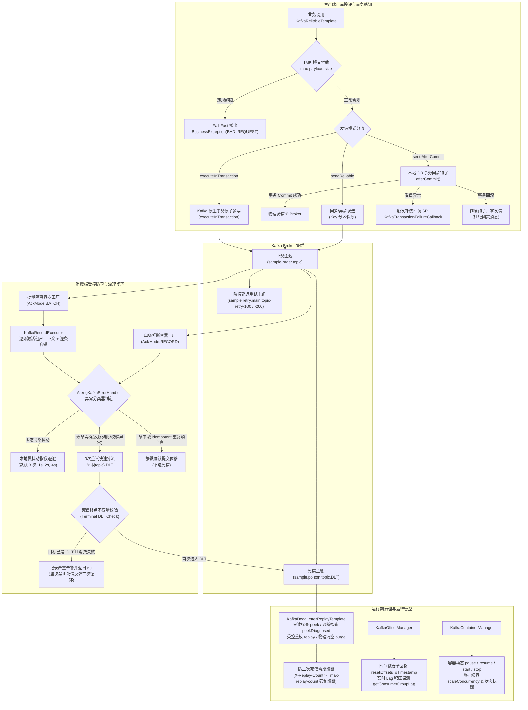

# ateng-boot-kafka 工业级全场景流批通信、死信治理与运维监控 Starter

> 基于 Spring 官方 Spring Kafka 生态与 JDK 17/21+ 构建的工业级流批消息通信底座，集成微批高吞吐调优（32KB batch + 10ms linger + Snappy 压缩 + 幂等生产）、本地事务防幽灵发信（`sendAfterCommit` + `KafkaTransactionFailureCallback` 补偿 SPI）、原生 Kafka 分布式事务（`executeInTransaction`）、微服务推断反序列化解耦（`ByteArrayJsonMessageConverter` 彻底打破微服务类路径绑定并封杀 `__TypeId__` 反序列化漏洞）、死信受控治理闭环（`KafkaDeadLetterReplayTemplate` 探查、安全重放与防二次雪崩熔断、`KafkaDeadLetterHelper` 7 类 DLT 结构化标头双模解析）、双轨协同重试体系（本地快速指数退避 + `@RetryableTopic` 官方非阻塞阶梯延迟主题）、位移治理与实时 Lag 积压监控（`KafkaOffsetManager`）、运行期消费容器动态流控（`KafkaContainerManager`）与再均衡扩展点（`KafkaRebalanceListener` SPI）、双监听容器正交共存（单条 `kafkaListenerContainerFactory` 与批量 `batchKafkaListenerContainerFactory`）、批量拉取多租户安全隔离执行器（`KafkaRecordExecutor` 杜绝多租户与链路追踪串门）、声明式拓扑构建器（`KafkaTopicBuilder` 日志压实与强类型大报文策略）、云原生协作再均衡（`CooperativeStickyAssignor`）、10 秒优雅停机排空以及 100% 离线自洽测试沙箱。

---

## 0. 特性与公共 API 全景速查矩阵 (Feature & API Panorama Matrix)

| 特性分类 | 特性名称 | 核心门面 / 注解 / SPI | 关键配置项 (`ateng.boot.kafka.*`) | 关键 API 签名 / 核心行为 | 锚定验证源头 (*Test / Sample) |
| :--- | :--- | :--- | :--- | :--- | :--- |
| **可靠投递门面** | 生产端可靠投递与事务感知门面 | `KafkaReliableTemplate` | `enabled`<br>`auto-create-topics`<br>`producer.send-timeout`<br>`producer.max-payload-size`<br>`producer.default-tuning-enabled`<br>`producer.batch-size` / `linger`<br>`producer.compression-type`<br>`producer.buffer-memory` / `max-block`<br>`producer.max-batch-size` | `sendReliable(..., [customHeaders], [timeout])`<br>`sendReliableAsync(..., [customHeaders])`<br>`sendAfterCommit(..., [customHeaders], [timeout])`<br>`executeInTransaction(callback)`<br>`sendBatch` / `sendBatchRecords` / `sendBatchAsync` / `sendBatchRecordsAsync`<br>`sendBatchAfterCommit` / `sendBatchRecordsAfterCommit`<br>`getKafkaTemplate()`：同步/异步单条与批量发送、自定义头传递、两阶段批量前置防卫（默认上限 1000）、Murmur2 Key 分区保序、物理 Partition 定向投递、本地 DB 事务感知与原生分布式事务、1MB 报文 Fail-Fast、四维上下文透明注入 | `KafkaReliableTemplateTest`<br>`KafkaTransactionReliableTemplateTest`<br>`KafkaProduceController` (`/sample/kafka/produce/*`)<br>`KafkaBatchController` (`/sample/kafka/batch/*`)<br>`SampleKafkaE2eTest` |
| **死信治理门面** | 死信探查、受控重放与物理清空门面 | `KafkaDeadLetterReplayTemplate` | `dead-letter.default-replay-limit`<br>`dead-letter.max-replay-count`<br>`dead-letter.replay-group-id`<br>`dead-letter.peek-timeout`<br>`dead-letter.operation-timeout` | `peek(dlqTopic, [limit])`：非破坏性只读探查 DLT 原始消息，不提交消费位移（硬上限 1000）<br>`peekDiagnosed(dlqTopic, [limit])`：只读探查并解析返回强类型 `DeadLetterRecord` 诊断列表（硬上限 1000）<br>`replay(dlqTopic, targetTopic, [limit], [filter])`：受控重放死信回业务主题，清洗 `kafka_dlt-*` 头，注入 `X-Dead-Letter-Replayed`、时间戳与递增 `X-Replay-Count`；超限自动熔断防二次雪崩<br>`purge(dlqTopic)`：推进起始位移物理清空死信积压 | `KafkaDeadLetterReplayTemplateTest`<br>`KafkaDeadLetterController` (`/sample/kafka/dead-letter/*`)<br>`SampleKafkaE2eTest` |
| **死信诊断与消息工具** | 死信结构化诊断与消息头内聚工具 | `KafkaDeadLetterHelper`<br>`DeadLetterRecord`<br>`KafkaMessageHelper` | - | `extractDeadLetterRecord(record/headers)` / `parse(record/headers)`：解析 7 类 DLT 元数据（原主题/分区/位移/时间戳、`exceptionClassName()`、`exceptionMessage()`、`exceptionStackTrace()`）及 `key`/`payload`，返回 11 参数不可变 `DeadLetterRecord`（保留 9 参数向后兼容构造器）<br>`KafkaMessageHelper`：提取 UTF-8 消息头、三级自适应补齐 `X-Biz-Key`、解包异常因果链 | `KafkaDeadLetterHelperTest`<br>`KafkaDeadLetterController` (`/sample/kafka/dead-letter/audit-records`)<br>`SampleKafkaE2eTest` |
| **位移与积压治理** | 运行期消费位移回拨与实时 Lag 积压探测 | `KafkaOffsetManager`<br>`ConsumerGroupLag` | `offset.timeout` | `getConsumerGroupOffsets(groupId, [topic])`：查询消费组已提交位移与元数据<br>`resetOffsetsToTimestamp(groupId, topic, timestamp)`：按时间戳精准回溯重置位移（自动超出 LEO 边界降级防护）<br>`resetOffsetsToEarliest(groupId, topic)` / `resetOffsetsToLatest(groupId, topic)`：位移重置至首末端<br>`getConsumerGroupLag(groupId, topic)`：并行拉取最新 LEO 与提交位移，精确计算每个分区的 Lag 及全主题总积压 `totalLag`（防负数安全防护） | `KafkaOffsetManagerTest`<br>`KafkaOpsController` (`/sample/kafka/ops/*`)<br>`SampleKafkaE2eTest` |
| **容器动态流控与观测** | 运行期消费容器流控、热扩缩容与状态快照 | `KafkaContainerManager`<br>`KafkaContainerStatus` | - | `pause(idOrTopic)` / `resume(idOrTopic)` / `stop(idOrTopic)` / `start(idOrTopic)`：按 Listener ID 或 Topic 启停与流控<br>`scaleConcurrency(idOrTopic, concurrency)`：运行期热调整容器并发消费者数量<br>`getContainerStatuses()` / `getContainerStatus(idOrTopic)`：获取不可变 `KafkaContainerStatus` 快照<br>`pauseAll()` / `resumeAll()` / `stopAll()` / `startAll()`：全局容器批量管控 | `KafkaContainerManagerTest`<br>`KafkaOpsController` (`/sample/kafka/ops/container*`)<br>`SampleKafkaE2eTest` |
| **再均衡与管理 SPI** | 消费者再均衡与 AdminClient 工厂扩展点 | `KafkaRebalanceListener`<br>`KafkaAdminClientFactory` | - | `KafkaRebalanceListener`：提供 `onPartitionsAssigned`、`onPartitionsRevoked` 与 `onPartitionsLost` 生命周期钩子，双容器工厂自动扫描并注入全部实现<br>`KafkaAdminClientFactory`：函数式 SPI 接口，支持在离线仿真或自定义安全认证环境下接管 `AdminClient` 创建 | `KafkaContainerManagerTest`<br>`KafkaOffsetManagerTest`<br>`SampleKafkaE2eTest` |
| **拓扑构建器** | 声明式流畅 Topic 构建器 (Fluent DSL) | `KafkaTopicBuilder` | `auto-create-topics` | `topic(name)`<br>`.partitions(n)`<br>`.replicas(n)`<br>`.minInSyncReplicas(n)`<br>`.retention(duration)`<br>`.segmentSize(dataSize)`<br>`.compact()`：配置 `cleanup.policy=compact` 开启日志压实<br>`.deleteAndCompact()`：配置 `cleanup.policy=delete,compact` 双重策略<br>`.maxMessageBytes(dataSize)`：强类型消除单位歧义配置单条消息上限<br>`.compressionType(type)`：主题端压缩算法覆盖<br>`.withDlt([suffix], [customizer])`<br>`.withoutDlt()`<br>`.buildMain()` / `.buildDlt()` / `.buildList()` / `.build()`：返回 `KafkaAdmin.NewTopics` 集合 Bean | `KafkaTopicBuilderTest`<br>`KafkaTopicBuilderExtendedTest`<br>`KafkaScenarioTopologyConfig`<br>`SampleKafkaE2eTest` |
| **双轨协同重试** | 本地轻量退避与非阻塞阶梯重试 | `AtengKafkaErrorHandler`<br>`@RetryableTopic` | `consumer.max-retries`<br>`consumer.retry-interval`<br>`consumer.retry-multiplier`<br>`consumer.max-retry-interval` | 本地退避：针对瞬态网络抖动快速自愈（默认 3 次，1s, 2s, 4s，受 `max-retry-interval` 上限 30s 保护）；<br>非阻塞阶梯主题：适配 `@RetryableTopic`（如 `sample.retry.main.topic-retry-100`、`sample.retry.main.topic-retry-200`、`sample.retry.main.topic-dlt`），慢业务分流至延迟主题，四维上下文全链路穿透 | `AtengKafkaErrorHandlerTest`<br>`KafkaRetryController` (`/sample/kafka/retry/*`)<br>`SampleKafkaE2eTest` |
| **批量隔离执行器** | 批量消息多租户安全隔离与容错执行器 | `KafkaRecordExecutor` | - | `generateBatchTraceId()`<br>`runInContext(record, consumer/biConsumer)`<br>`callInContext(record, function/biFunction)`<br>`processBatchSafely(records, processor, [failureHandler])`：在批量拉取场景下生成批次全局 TraceId，逐条激活单条消息的四维上下文（MDC、TenantId、UserId），在 `finally` 中严格清理现场，杜绝租户脏读串门；提供逐条异常容错回调，防止单条失败阻断整批 Offset 提交 | `KafkaRecordExecutorTest`<br>`KafkaBatchController` (`/sample/kafka/batch/*`)<br>`SampleKafkaE2eTest` |
| **毒丸错误处理** | 生产级错误处理器与致命异常快速隔离 | `AtengKafkaErrorHandler` | `consumer.max-retries`<br>`consumer.retry-interval`<br>`consumer.retry-multiplier`<br>`consumer.max-retry-interval` | 继承 `DefaultErrorHandler`，整合 `FatalExceptionClassifier` 判定致命不可自愈毒丸（反序列化失败、JSR-303 参数校验违规、类型转换异常等）执行 0 次重试；可自愈异常执行本地指数退避重试；配置 `setCommitRecovered(true)` 与 `setAckAfterHandle(true)` 确保恢复后正常提交 Offset | `AtengKafkaErrorHandlerTest`<br>`KafkaDeadLetterController` (`/sample/kafka/dead-letter/trigger-poison`)<br>`SampleKafkaE2eTest` |
| **死信路由恢复** | 生产级死信发布恢复器与终点防卫 | `AtengDeadLetterPublishingRecoverer` | `consumer.dlt-suffix` | `resolveDestination(record, exception, [properties])`：拦截 `IdempotentException` 触发静默提交；校验死信终点不变量（Terminal Invariant），Topic 为 `.DLT` 消费失败时记录严重告警并返回 `null`，严禁死信循环反弹；其余不可自愈消息路由至 `${topic}.DLT` | `AtengDeadLetterPublishingRecovererTest`<br>`KafkaDeadLetterController`<br>`SampleKafkaE2eTest` |
| **事务发信补偿** | 事务提交后发信失败补偿 SPI | `KafkaTransactionFailureCallback` | - | `onFailure(topic, partition, key, payload, bizKey, traceId, cause)`：当 `sendAfterCommit` 或 `sendBatchAfterCommit` 在本地数据库事务物理 Commit 成功后因网络断连发信失败时被触发，供业务将失败消息写入补偿表或推送到告警平台 | `KafkaReliableTemplateTest`<br>`KafkaProduceController` (`/sample/kafka/produce/order-tx-*`)<br>`SampleKafkaE2eTest` |
| **单条/批量拦截** | 上下文环绕与结构化审计拦截器 | `KafkaRecordInterceptor`<br>`KafkaBatchInterceptor` | - | 实现 Spring Kafka 原生 `RecordInterceptor` 与 `BatchInterceptor`，在消费前后透明激活/还原四维上下文，并在消费成功或异常时打印结构化审计日志 | `KafkaRecordInterceptorTest`<br>`KafkaBatchInterceptorTest`<br>`SampleKafkaE2eTest` |
| **消息类型推断** | 泛型推断反序列化消息转换器 | `ByteArrayJsonMessageConverter` | - | 默认注入基于 `JsonUtil.getObjectMapper()` 构建的 `ByteArrayJsonMessageConverter`（启用 Jackson 默认 `TypePrecedence.INFERRED`），消费端 100% 依监听方法参数推断反序列化，解耦微服务契约，杜绝 `__TypeId__` / `@class` 注入漏洞 | `KafkaMessageConverterTest`<br>`SampleKafkaE2eTest` |
| **双监听容器工厂** | 单条与批量正交共存监听容器工厂 | `ConcurrentKafkaListenerContainerFactory` | `consumer.concurrency`<br>`consumer.batch-concurrency`<br>`consumer.shutdown-timeout` | 自动装配并正交暴露 `KafkaConstants.DEFAULT_CONTAINER_FACTORY`（单条 `AckMode.RECORD`）与 `KafkaConstants.BATCH_CONTAINER_FACTORY`（批量 `setBatchListener(true)`、`AckMode.BATCH`），统配 10 秒优雅停机超时与虚拟线程支持 | `AtengKafkaAutoConfigurationTest`<br>`SampleKafkaE2eTest` |
| **只读拓扑安全** | 拓扑自动声明开关与权限安全防卫 | `AtengKafkaAutoConfiguration` (`kafkaAdminPostProcessor`) | `auto-create-topics` | 内部装配 `BeanPostProcessor` 监听 `KafkaAdmin`，当 `auto-create-topics` 置为 `false` 时自动将 `KafkaAdmin.autoCreate` 设为 `false`，生产只读账号不主动向 Broker 发起声明，防御 403 启动崩溃 | `AtengKafkaAutoConfigurationTest` |

---

## 1. 模块定位与快速起步 (Quick Start & Maven Coordinates)

`ateng-boot-kafka` 是面向企业级高吞吐流批处理、分布式可靠事务事件、状态快照与 SRE 智能治理的生产就绪 Starter：
- **纯原生零依赖**：100% 基于 Spring 官方 `spring-kafka`（3.1+）与 JDK 17，坚持纯原生标准库优先，严禁引入第三方臃肿工具包；
- **微批高吞吐预调优**：开箱默认注入 `acks=all`、`idempotence=true`、`batch.size=32KB`、`linger.ms=10ms`、`compression.type=snappy`，榨干网络系统调用性能；
- **事务防幽灵消息与原生分布式事务**：提供 `sendAfterCommit` 门面（数据库事务 Commit 后才发信）与 `executeInTransaction`（纯 Kafka 多主题原子生产与流式处理），杜绝幽灵消息；
- **死信治理与防二次雪崩**：提供 `KafkaDeadLetterReplayTemplate`（`peek`、`peekDiagnosed`、`replay`、`purge`）与 `KafkaDeadLetterHelper`（11 参数 `DeadLetterRecord` 与 7 类 DLT 头结构化解析），注入重放计数并在超限后强制熔断，封死死循环雪崩；
- **双轨协同重试体系**：毫秒级抖动本地快速退避 + 慢业务 `@RetryableTopic` 阶梯延迟主题，兼顾高吞吐与防分区卡死；
- **运行期位移治理与容器动态流控**：提供 `KafkaOffsetManager` 实现时间戳回拨对账重放与各分区实时 Lag 计算，提供 `KafkaContainerManager` 支持维护窗口动态暂停/恢复消费、热扩缩容（`scaleConcurrency`）及不可变状态快照（`KafkaContainerStatus`）。

### Maven 坐标引入

#### 方式一：配合 `ateng-boot-bom` 统一纳管（推荐）

```xml
<dependency>
    <groupId>io.github.atengk</groupId>
    <artifactId>ateng-boot-kafka</artifactId>
</dependency>
```

#### 方式二：独立显式指定版本号

```xml
<dependency>
    <groupId>io.github.atengk</groupId>
    <artifactId>ateng-boot-kafka</artifactId>
    <version>1.2.0</version>
</dependency>
```

### 最小可用配置 (`application.yml`)

```yaml
spring:
  kafka:
    bootstrap-servers: localhost:9092
    consumer:
      group-id: trade-order-group
      auto-offset-reset: earliest

ateng:
  boot:
    kafka:
      enabled: true
      auto-create-topics: true
      producer:
        send-timeout: 5s
        max-payload-size: 1MB
        default-tuning-enabled: true
      consumer:
        concurrency: 3
        batch-concurrency: 3
        max-retries: 3
        retry-interval: 1s
        retry-multiplier: 2.0
        shutdown-timeout: 10s
      dead-letter:
        default-replay-limit: 100
        max-replay-count: 1
        replay-group-id: ateng-kafka-dlt-replay-group
      offset:
        timeout: 10s
```

### 开箱极简代码示例

#### 1. 生产者端（可靠投递）

```java
@Service
@RequiredArgsConstructor
public class TradeKafkaScenarioService {

    private final KafkaReliableTemplate kafkaReliableTemplate;

    public SendResult<Object, Object> sendSyncOrder(OrderMessage order) {
        // 同步阻塞确认，支持 Murmur2 Key 分区哈希保序
        return kafkaReliableTemplate.sendReliable(KafkaScenarioTopologyConfig.TOPIC_ORDER, order.getOrderId(), order);
    }
}
```

#### 2. 消费者端（单条推断消费）

```java
@Component
@Slf4j
public class OrderSingleRecordConsumer {

    @KafkaListener(topics = KafkaScenarioTopologyConfig.TOPIC_ORDER, containerFactory = KafkaConstants.DEFAULT_CONTAINER_FACTORY)
    public void onOrderMessage(@Payload OrderMessage order, @Header(name = KafkaHeaders.RECEIVED_KEY, required = false) String key) {
        // 自动还原 MDC traceId 与业务载荷
        log.info("消费订单成功: key={}, orderId={}, amount={}", key, order.getOrderId(), order.getAmount());
    }
}
```

---

## 2. 核心架构与设计不变量 (Architecture & Core Invariants)



### 核心设计不变量 (Core Invariants)

1. **四维上下文透明流转不变量 (Four-Dimensional Context Invariant)**：
   每次消息投递与消费，$\langle\text{MDC traceId}, \text{UserContext}, \text{TenantContext}, \text{IgnoreTenant}\rangle$ 自动序列化进 Kafka Headers；消费拦截器自动恢复并保证在 `finally` 中严格清理，严禁多租户串门与链路泄露。
2. **致命毒丸 0 次重试与死信终点不变量 (Poison-Pill 0-Retry & Terminal DLT Invariant)**：
   反序列化失败、JSR-303 参数校验违规等致命异常直接 0 次重试快速进 DLT；若 `.DLT` 自身消费再次失败，触发终点防卫不变量，绝对禁止向死信主题二次转发死信。
3. **死信受控重放与防二次雪崩熔断不变量 (Anti-Avalanche Replay Circuit Breaker)**：
   重放死信时自动清洗底层 `kafka_dlt-*` 头并递增 `X-Replay-Count`；若重放后再次进入死信且超出 `max-replay-count`（默认 1 次），系统强制阻断重放，彻底杜绝主题间无限死循环雪崩。
4. **传输契约与持久层绝对解耦不变量 (Zero-Entity-Leakage)**：
   Controller 边界 100% 严禁接收或返回持久层 ORM Entity，统一使用 DTO/Request 与 `Result<T>`。

---

## 3. 生产端高可靠投递与原生分布式事务套件

### 3.1 Key 分区保序与同步/异步可靠投递

#### 专属 YAML 配置片段
```yaml
ateng:
  boot:
    kafka:
      producer:
        send-timeout: 5s
        max-payload-size: 1MB
```

#### 实战业务 Java 代码
```java
@Service
@RequiredArgsConstructor
public class TradeKafkaScenarioService {

    private final KafkaReliableTemplate kafkaReliableTemplate;

    // 1. 同步按 Key 发送订单并支持透传自定义业务头（Murmur2 Hash 保序投递至固定分区）
    public SendResult<Object, Object> sendSyncOrder(OrderMessage order, Map<String, String> customHeaders) {
        return kafkaReliableTemplate.sendReliable(
                KafkaScenarioTopologyConfig.TOPIC_ORDER,
                order.getOrderId(),
                order,
                customHeaders
        );
    }

    // 2. 异步非阻塞投递（支持 customHeaders 扩展头）
    public CompletableFuture<SendResult<Object, Object>> sendAsyncUserEvent(UserEventMessage event) {
        return kafkaReliableTemplate.sendReliableAsync(
                KafkaScenarioTopologyConfig.TOPIC_USER,
                event.getUserId(),
                event
        );
    }

    // 3. 定向物理分区投递并携带自定义头
    public SendResult<Object, Object> sendPartitionDirected(int partition, String key, Object payload,
                                                            Map<String, String> customHeaders) {
        return kafkaReliableTemplate.sendReliable(
                KafkaScenarioTopologyConfig.TOPIC_ORDER,
                partition,
                key,
                payload,
                null,
                null,
                customHeaders
        );
    }
}
```

#### 机制边界说明
- 同步发信显式配置 `send-timeout`（默认 5 秒），防止 Broker 宕机导致线程挂起；
- 指定相同 `key` 的消息通过 Kafka 默认 Murmur2 分区器强绑定至同一分区，保障顺序消费。

---

### 3.2 本地事务提交感知发信与补偿 SPI (`sendAfterCommit`)

#### 专属 YAML 配置片段
```yaml
ateng:
  boot:
    kafka:
      producer:
        send-timeout: 5s
```

#### 实战业务 Java 代码
```java
@Service
@RequiredArgsConstructor
@Slf4j
public class TradeKafkaScenarioService {

    private final KafkaReliableTemplate kafkaReliableTemplate;
    private final MockOrderRepository mockOrderRepository;

    // 1. 本地 DB 事务成功提交后触发网络发信（支持携带自定义业务消息头）
    @Transactional
    public void createOrderWithSendAfterCommit(OrderMessage order, Map<String, String> customHeaders) {
        log.info("[DB-SAVE] 订单数据落库成功: orderId={}", order.getOrderId());
        mockOrderRepository.save(order.getOrderId());
        kafkaReliableTemplate.sendAfterCommit(
                KafkaScenarioTopologyConfig.TOPIC_ORDER,
                order.getOrderId(),
                order,
                customHeaders
        );
    }

    // 2. 本地 DB 事务异常回滚：零发信，杜绝幽灵消息
    @Transactional
    public void createOrderWithRollback(OrderMessage order) {
        mockOrderRepository.save(order.getOrderId());
        kafkaReliableTemplate.sendAfterCommit(
                KafkaScenarioTopologyConfig.TOPIC_ORDER,
                order.getOrderId(),
                order
        );
        throw new IllegalStateException("模拟业务异常，触发事务回滚: orderId=" + order.getOrderId());
    }
}
```

#### 机制边界说明
- `sendAfterCommit` 注册 Spring `TransactionSynchronization.afterCommit` 钩子；
- 数据库物理提交成功后才发起网络发信；若本地事务发生任何异常导致回滚，发信钩子自动作废，杜绝幽灵消息；
- 若本地事务提交后网络异常发信失败，自动触发 `KafkaTransactionFailureCallback` SPI 进行本地扫表补偿或告警。

---

### 3.3 Kafka 原生分布式事务原子多写 (`executeInTransaction`)

#### 专属 YAML 配置片段
```yaml
spring:
  kafka:
    producer:
      transaction-id-prefix: tx-trade-
```

#### 实战业务 Java 代码
```java
@Service
@RequiredArgsConstructor
public class TradeKafkaScenarioService {

    private final KafkaReliableTemplate kafkaReliableTemplate;

    public String executeTradeAtomicMultiSend(OrderMessage order, String auditPayload) {
        return kafkaReliableTemplate.executeInTransaction(operations -> {
            operations.send(KafkaScenarioTopologyConfig.TOPIC_ORDER, order.getOrderId(), order);
            operations.send(KafkaScenarioTopologyConfig.TOPIC_USER, order.getUserId(), auditPayload);
            return "SUCCESS";
        });
    }
}
```

#### 机制边界说明
- 封装 `KafkaTemplate.executeInTransaction`，由 Coordinator 管理分布式事务；
- 多主题写入具有全原子性，消费端配置 `isolation.level=read_committed` 可实现纯净的事务读写隔离。

---

### 3.4 1MB 报文超限 Fail-Fast 与微批高吞吐调优

#### 专属 YAML 配置片段
```yaml
ateng:
  boot:
    kafka:
      producer:
        send-timeout: 5s
        max-payload-size: 1MB
        default-tuning-enabled: true
        batch-size: 32KB
        linger: 10ms
        compression-type: snappy
        buffer-memory: 32MB
        max-block: 60s
```

#### 实战业务 Java 代码
```java
@Service
@RequiredArgsConstructor
public class TradeKafkaScenarioService {

    private final KafkaReliableTemplate kafkaReliableTemplate;

    public SendResult<Object, Object> sendLargePayload(byte[] payload) {
        return kafkaReliableTemplate.sendReliable(KafkaScenarioTopologyConfig.TOPIC_ORDER, "large-key", payload);
    }

    public String executeNativeTxLargePayload(byte[] payload) {
        return kafkaReliableTemplate.executeInTransaction(operations -> {
            operations.send(KafkaScenarioTopologyConfig.TOPIC_ORDER, "large-tx-key", payload);
            return "SUCCESS";
        });
    }
}
```

#### 机制边界说明
- `KafkaReliableTemplate` 在将消息交由底层序列化前前置校验报文体积；同时底座默认代理层也在原生事务 `operations.send(...)` 路径同步实施载荷门禁，超出 `max-payload-size`（默认 `1MB`）立即抛出 `BusinessException(BAD_REQUEST)` 进行 Fail-Fast 拦截，保护 Broker 不被巨型报文打崩；
- 当 `default-tuning-enabled: true`（默认开启）时，Starter 自动注入可独立覆写的微批与可靠性默认参数（`batch-size: 32KB`、`linger: 10ms`、`compression-type: snappy`、`buffer-memory: 32MB`、`max-block: 60s`、`acks=all` 与 `enable.idempotence=true`），大幅降低网络系统调用频次。

---

### 3.5 两阶段批量投递、异步批量与事务后批量发信

#### 专属 YAML 配置片段
```yaml
ateng:
  boot:
    kafka:
      producer:
        send-timeout: 5s
        max-payload-size: 1MB
        max-batch-size: 1000
```

#### 实战业务 Java 代码
```java
@Service
@RequiredArgsConstructor
public class TradeKafkaScenarioService {

    private final KafkaReliableTemplate kafkaReliableTemplate;
    private final MockOrderRepository mockOrderRepository;

    // 1. 异步批量可靠发送（保留重复 orderId 多条记录，阶段 1 全量前置校验）
    public CompletableFuture<List<SendResult<Object, Object>>> sendBatchOrdersAsync(List<OrderMessage> orders) {
        List<ProducerRecord<Object, Object>> records = orders.stream()
                .map(o -> new ProducerRecord<Object, Object>(KafkaScenarioTopologyConfig.TOPIC_BATCH, o.getOrderId(), o))
                .toList();
        return kafkaReliableTemplate.sendBatchRecordsAsync(records);
    }

    // 2. 本地 DB 事务提交后批量发信（提交前全量校验并捕获四维上下文快照）
    @Transactional
    public void createBatchOrdersWithSendAfterCommit(List<OrderMessage> orders) {
        List<ProducerRecord<Object, Object>> records = orders.stream()
                .map(o -> new ProducerRecord<Object, Object>(KafkaScenarioTopologyConfig.TOPIC_BATCH, o.getOrderId(), o))
                .toList();
        kafkaReliableTemplate.sendBatchRecordsAfterCommit(records);
        for (OrderMessage order : orders) {
            mockOrderRepository.save(order.getOrderId());
        }
    }
}
```

#### 机制边界说明
- `sendBatch` / `sendBatchRecords` / `sendBatchAsync` / `sendBatchRecordsAsync` / `sendBatchAfterCommit` / `sendBatchRecordsAfterCommit` 均采用两阶段防卫：阶段 1 对全批执行空元素检查、批次上限（`producer.max-batch-size` 默认 `1000`）与 `max-payload-size` 全量 Fail-Fast 校验，任何一条不合规即整批拒绝写入；
- `sendBatchAfterCommit` 在事务提交前即捕获调用线程的四维上下文快照与全量消息体，事务物理 Commit 后透传原上下文并发出；若单条在 `afterCommit` 网络异常失败，逐条触发 `KafkaTransactionFailureCallback` 回调进行补偿落库且不阻断后续正常记录发送。

---

## 4. 声明式流式拓扑构建套件 (KafkaTopicBuilder)

### 4.1 业务主题与一键配属死信主题 (`.withDlt()`)

#### 专属 YAML 配置片段
```yaml
ateng:
  boot:
    kafka:
      auto-create-topics: true
```

#### 实战业务 Java 代码
```java
@Configuration(proxyBeanMethods = false)
public class KafkaScenarioTopologyConfig {

    public static final String TOPIC_ORDER = "sample.order.topic";

    @Bean
    public KafkaAdmin.NewTopics orderTopics() {
        return KafkaTopicBuilder.topic(TOPIC_ORDER)
                .partitions(3)
                .replicas(1)
                .minInSyncReplicas(1)
                .retention(Duration.ofDays(7))
                .withDlt() // 一键声明对应的 sample.order.topic.DLT 死信主题
                .build();
    }
}
```

#### 机制边界说明
- `.withDlt()` 自动配属以 `.DLT` 为后缀的死信主题，其分区数与主主题保持一致，方便精准路由。

---

### 4.2 状态快照与日志压实拓扑 (`.compact()`)

#### 专属 YAML 配置片段
```yaml
ateng:
  boot:
    kafka:
      auto-create-topics: true
```

#### 实战业务 Java 代码
```java
@Configuration(proxyBeanMethods = false)
public class KafkaScenarioTopologyConfig {

    public static final String TOPIC_STATE_COMPACT = "sample.state.compact.topic";

    @Bean
    public KafkaAdmin.NewTopics stateCompactTopics() {
        return KafkaTopicBuilder.topic(TOPIC_STATE_COMPACT)
                .partitions(3)
                .compact() // 自动注入 cleanup.policy=compact
                .build();
    }
}
```

#### 机制边界说明
- `.compact()` 用于键控状态快照场景（如用户最新余额、配置同步），Broker 仅保留每个 Key 的最新 Value，压缩历史数据。

---

### 4.3 强类型容量与单条消息超限防御 (`.maxMessageBytes(DataSize)`)

#### 专属 YAML 配置片段
```yaml
ateng:
  boot:
    kafka:
      auto-create-topics: true
```

#### 实战业务 Java 代码
```java
// 通过 KafkaTopicBuilder 流式声明主题与单条消息容量上限（扩展用法演示）
KafkaAdmin.NewTopics largePayloadTopics = KafkaTopicBuilder.topic("sample.large.payload.topic")
        .partitions(2)
        .replicas(1)
        .maxMessageBytes(DataSize.ofMegabytes(10)) // 强类型 DataSize 消除单位歧义
        .segmentSize(DataSize.ofMegabytes(100))
        .build();
```

#### 机制边界说明
- 显式使用 `DataSize` 强类型定义 `max.message.bytes`，规避整型字节数计算错误与单位歧义。

---

## 5. 消费端推断反序列化与双监听容器套件

### 5.1 泛型推断反序列化解耦 (`ByteArrayJsonMessageConverter`)

#### 专属 YAML 配置片段
```yaml
spring:
  kafka:
    consumer:
      key-deserializer: org.apache.kafka.common.serialization.StringDeserializer
      value-deserializer: org.apache.kafka.common.serialization.ByteArrayDeserializer
```

#### 实战业务 Java 代码
```java
@Component
@Slf4j
public class OrderSingleRecordConsumer {

    @KafkaListener(
            topics = KafkaScenarioTopologyConfig.TOPIC_ORDER,
            containerFactory = KafkaConstants.DEFAULT_CONTAINER_FACTORY
    )
    public void onOrderMessage(
            @Payload OrderMessage order,
            @Header(KafkaHeaders.RECEIVED_KEY) String key,
            @Header(KafkaHeaders.RECEIVED_PARTITION) int partition,
            @Header(KafkaHeaders.OFFSET) long offset) {
        log.info("消费订单成功: key={}, orderId={}, partition={}, offset={}",
                key, order.getOrderId(), partition, offset);
    }
}
```

#### 机制边界说明
- 默认装配 `ByteArrayJsonMessageConverter`，开启 `TypePrecedence.INFERRED`；
- 消费端完全基于方法签名强类型泛型推断反序列化，彻底打破微服务间类路径强绑定，同时封杀 `__TypeId__` / `@class` 反序列化安全漏洞。

---

### 5.2 双监听容器工厂正交共存

#### 专属 YAML 配置片段
```yaml
ateng:
  boot:
    kafka:
      consumer:
        concurrency: 3
        batch-concurrency: 3
        shutdown-timeout: 10s
```

#### 实战业务 Java 代码
```java
// 1. 单条消费工厂：KafkaConstants.DEFAULT_CONTAINER_FACTORY (AckMode.RECORD)
@KafkaListener(topics = "sample.order.topic", containerFactory = KafkaConstants.DEFAULT_CONTAINER_FACTORY)
public void onSingle(OrderMessage message) {
    // 单条消息消费与自动逐条提交位移
}

// 2. 批量消费工厂：KafkaConstants.BATCH_CONTAINER_FACTORY (AckMode.BATCH)
@KafkaListener(topics = KafkaScenarioTopologyConfig.TOPIC_BATCH, containerFactory = KafkaConstants.BATCH_CONTAINER_FACTORY)
public void onBatchRecords(List<ConsumerRecord<String, Object>> records) {
    // 搭配 KafkaRecordExecutor.processBatchSafely(...) 执行逐条租户隔离与异常容错，整批返回后由容器按 AckMode.BATCH 提交位移
    KafkaRecordExecutor.processBatchSafely(records, (record, rawPayload) -> {
        // 业务批处理...
    });
}
```

#### 机制边界说明
- 框架同时注册单条容器工厂（`AckMode.RECORD`）与批量容器工厂（`setBatchListener(true)` + `AckMode.BATCH`），互不干扰；
- 统配 10 秒优雅停机超时，保证在服务重启时充分排空在途消费任务。

---

## 6. 批量拉取与多租户安全隔离执行套件 (KafkaRecordExecutor)

### 6.1 多租户上下文透明注入与清理

#### 专属 YAML 配置片段
```yaml
ateng:
  boot:
    kafka:
      consumer:
        batch-concurrency: 3
```

#### 实战业务 Java 代码
```java
@Component
@Slf4j
public class BatchRecordConsumer {

    @KafkaListener(
            topics = KafkaScenarioTopologyConfig.TOPIC_BATCH,
            containerFactory = KafkaConstants.BATCH_CONTAINER_FACTORY
    )
    public void onBatchRecords(List<ConsumerRecord<String, Object>> records) {
        KafkaRecordExecutor.processBatchSafely(records, (record, rawPayload) -> {
            String currentTenant = TenantContextHolder.getTenantId();
            log.info("[BATCH-RECORD-ITEM] 处理单条记录: key={}, offset={}, currentTenant={}",
                    record.key(), record.offset(), currentTenant);
        });
    }
}
```

#### 机制边界说明
- `runInContext` / `callInContext` 与 `processBatchSafely` 自动从每条 `ConsumerRecord` Header 提取四维上下文（TraceId、TenantId、UserId、IgnoreTenant）并在 `finally` 中严格清理，防止线程复用引发脏读串门。

---

### 6.2 批量安全容错执行与局部异常隔离 (`processBatchSafely`)

#### 专属 YAML 配置片段
```yaml
ateng:
  boot:
    kafka:
      consumer:
        batch-concurrency: 3
```

#### 实战业务 Java 代码
```java
@Service
@Slf4j
public class BatchLogScenarioService {

    public void processBatchSafely(List<ConsumerRecord<String, OrderMessage>> records) {
        KafkaRecordExecutor.processBatchSafely(
                records,
                (record, payload) -> {
                    String currentTenant = TenantContextHolder.getTenantId();
                    log.info("[BATCH-LOG-SERVICE] 消费记录成功: key={}, tenant={}, offset={}",
                            record.key(), currentTenant, record.offset());
                    if ("ORD-CORRUPTED".equals(record.key())) {
                        throw new IllegalArgumentException("模拟单条记录处理异常: " + record.key());
                    }
                },
                (record, error) -> log.warn("[BATCH-LOG-SERVICE] 单条记录消费失败补偿: key={}, error={}",
                        record.key(), error.getMessage())
        );
    }
}
```

#### 机制边界说明
- 批量拉取场景下，单条消息异常可能导致整批 Offset 无法提交引发死循环；
- `processBatchSafely` 逐条激活上下文、逐条独立容错；单条处理失败触发失败回调，整批健全消息正常提交。

---

## 7. 消费端幂等防重与毒丸隔离防卫套件

### 7.1 消费端幂等拦截与静默确认

#### 专属 YAML 配置片段
```yaml
ateng:
  boot:
    kafka:
      consumer:
        dlt-suffix: .DLT
```

#### 实战业务 Java 代码
```java
@Component
@Slf4j
public class IdempotentKafkaConsumer {

    private final Set<String> processedOrderIds = ConcurrentHashMap.newKeySet();

    public void processOrderWithIdempotentCheck(OrderMessage order) {
        if (!processedOrderIds.add(order.getOrderId())) {
            // 抛出幂等防重异常
            throw new IdempotentException("订单已被消费，触发防重拦截: " + order.getOrderId());
        }
        log.info("订单首次消费成功: orderId={}", order.getOrderId());
    }
}
```

#### 机制边界说明
- `AtengDeadLetterPublishingRecoverer` 捕获 `IdempotentException` 时，打印 `[MQ-IDEMPOTENT-DUPLICATE]` 警告并返回 `null`；
- 返回 `null` 触发 Spring Kafka 的静默位移提交（Silent Commit），消息正常确认且绝不进入死信队列。

---

### 7.2 致命毒丸 0 次重试与死信终点不变量

#### 专属 YAML 配置片段
```yaml
ateng:
  boot:
    kafka:
      consumer:
        max-retries: 3
        retry-interval: 1s
        dlt-suffix: .DLT
```

#### 实战业务 Java 代码
```java
@Service
@RequiredArgsConstructor
public class DeadLetterReplayScenarioService {

    private final KafkaReliableTemplate kafkaReliableTemplate;

    public void sendPoisonPill(String corruptPayload) {
        // 投递格式损坏的毒丸消息
        kafkaReliableTemplate.sendReliable(
                KafkaScenarioTopologyConfig.TOPIC_POISON,
                "POISON_KEY",
                corruptPayload
        );
    }
}
```

#### 机制边界说明
- `AtengKafkaErrorHandler` 整合 `FatalExceptionClassifier`：反序列化异常、参数校验违规等直接执行 0 次重试，快速转移至 `${topic}.DLT`，防止监听容器死循环崩溃；
- **死信终点不变量**：若 `.DLT` 主题内部消费失败，`AtengDeadLetterPublishingRecoverer` 检测到目标已是死信主题，记录严重告警并返回 `null`，坚决禁止死信消息向死信反弹。

---

## 8. 死信受控治理与结构化诊断套件

### 8.1 死信 7 类元数据结构化诊断 (`KafkaDeadLetterHelper`)

#### 专属 YAML 配置片段
```yaml
ateng:
  boot:
    kafka:
      dead-letter:
        replay-group-id: ateng-kafka-dlt-replay-group
```

#### 实战业务 Java 代码
```java
@Component
@Slf4j
public class DeadLetterAuditConsumer {

    private final List<KafkaDeadLetterHelper.DeadLetterRecord> diagnosedRecords = Collections.synchronizedList(new ArrayList<>());

    @KafkaListener(topics = {
            KafkaScenarioTopologyConfig.TOPIC_ORDER + ".DLT",
            KafkaScenarioTopologyConfig.TOPIC_POISON + ".DLT"
    }, containerFactory = KafkaConstants.DEFAULT_CONTAINER_FACTORY)
    public void onDeadLetter(ConsumerRecord<Object, Object> record) {
        // 提取并解析 7 类死信元数据及原始 key / payload
        KafkaDeadLetterHelper.DeadLetterRecord dltRecord = KafkaDeadLetterHelper.parse(record);
        if (dltRecord != null) {
            diagnosedRecords.add(dltRecord);
            log.warn("收到死信记录: origTopic={}, origPartition={}, origOffset={}, exceptionClass={}, errorMsg={}",
                    dltRecord.originalTopic(), dltRecord.originalPartition(), dltRecord.originalOffset(),
                    dltRecord.exceptionClassName(), dltRecord.exceptionMessage());
        }
    }
}
```

#### 机制边界说明
- 双模解码兼容 Spring Kafka 底层以 UTF-8 字符串或 4/8 字节二进制写入的标头；
- 解析并返回 11 参数强类型不可变 `DeadLetterRecord`，包含原主题（`originalTopic()`）、原分区（`originalPartition()`）、原位移（`originalOffset()`）、原时间戳（`originalTimestamp()`）、异常类全名（`exceptionClassName()`）、异常消息（`exceptionMessage()`）、堆栈轨迹（`exceptionStackTrace()`）、重放次数与重放标记（`replayCount()` / `isReplayed()`）以及死信原始键与载荷（`key()` / `payload()`），同时保留 9 参数向后兼容构造器。

---

### 8.2 死信只读探查与结构化诊断 (`peek` / `peekDiagnosed`)

#### 专属 YAML 配置片段
```yaml
ateng:
  boot:
    kafka:
      dead-letter:
        default-replay-limit: 100
        peek-timeout: 5s
```

#### 实战业务 Java 代码
```java
@Service
@RequiredArgsConstructor
public class DeadLetterReplayScenarioService {

    private final KafkaDeadLetterReplayTemplate deadLetterReplayTemplate;

    public List<ConsumerRecord<byte[], byte[]>> peekDeadLetters(String dltTopic, int limit) {
        // 只读探查原始死信记录，不提交消费位移
        return deadLetterReplayTemplate.peek(dltTopic, limit);
    }

    public List<KafkaDeadLetterHelper.DeadLetterRecord> peekDiagnosedDeadLetters(String dltTopic, int limit) {
        // 一键探查并解析为结构化 DeadLetterRecord 诊断列表
        return deadLetterReplayTemplate.peekDiagnosed(dltTopic, limit);
    }
}
```

#### 机制边界说明
- 使用独立临时无状态 Consumer 按分区检索，单批受 `limit` 约束（默认 `default-replay-limit: 100`，`peek` / `peekDiagnosed` / `replay` 统一硬上限为 `1000`）；
- 单次拉取受控于 `dead-letter.peek-timeout`（默认 `5s`），操作完全为只读探查，绝不修改消费组位移，运维巡检零风险。

---

### 8.3 受控清洗重放与防二次雪崩熔断 (`replay`)

#### 专属 YAML 配置片段
```yaml
ateng:
  boot:
    kafka:
      dead-letter:
        max-replay-count: 1
        default-replay-limit: 100
        operation-timeout: 10s
```

#### 实战业务 Java 代码
```java
@Service
@RequiredArgsConstructor
public class DeadLetterReplayScenarioService {

    private final KafkaDeadLetterReplayTemplate deadLetterReplayTemplate;

    public int replayDeadLetters(String dlqTopic, String targetTopic, int limit) {
        // 受控清洗重放，自动剔除底层 dlt 标头并注入重放审计状态
        return deadLetterReplayTemplate.replay(dlqTopic, targetTopic, limit);
    }
}
```

#### 机制边界说明
- 自动清洗 `kafka_dlt-*` 异常头，透明注入 `X-Dead-Letter-Replayed: true`、`X-Replay-Time` 与递增的 `X-Replay-Count`；
- 达到 `max-replay-count`（默认 `1` 次）强制熔断阻断，单批同样受硬上限 `1000` 与 `dead-letter.operation-timeout`（默认 `10s`）保护，彻底杜绝死循环反弹雪崩。

---

### 8.4 物理清空死信积压 (`purge`)

#### 专属 YAML 配置片段
```yaml
ateng:
  boot:
    kafka:
      dead-letter:
        replay-group-id: ateng-kafka-dlt-replay-group
```

#### 实战业务 Java 代码
```java
@Service
@RequiredArgsConstructor
public class DeadLetterReplayScenarioService {

    private final KafkaDeadLetterReplayTemplate deadLetterReplayTemplate;

    public void purgeDeadLetters(String dlqTopic) {
        // 推进起始消费位移至当前 LEO
        deadLetterReplayTemplate.purge(dlqTopic);
    }
}
```

#### 机制边界说明
- 将指定重放消费组在各分区的位移推进至最新 EndOffset（LEO），安全丢弃积压死信，杜绝反复消费。

---

## 9. 阶梯延迟非阻塞重试与双轨协同套件

### 9.1 本地瞬态抖动毫秒级指数退避

#### 专属 YAML 配置片段
```yaml
ateng:
  boot:
    kafka:
      consumer:
        max-retries: 3
        retry-interval: 1s
        retry-multiplier: 2.0
        max-retry-interval: 30s
```

#### 实战业务 Java 代码
```java
@KafkaListener(
        topics = KafkaScenarioTopologyConfig.TOPIC_ORDER,
        containerFactory = KafkaConstants.DEFAULT_CONTAINER_FACTORY
)
public void onOrderWithTransientGuard(OrderMessage order) {
    // 若抛出可恢复瞬态异常（非 FatalExceptionClassifier 判定之致命毒丸），AtengKafkaErrorHandler 将在当前线程按 1s -> 2s -> 4s 原地指数退避重试
    // 若在 max-retries 次内自愈则正常提交 Offset，耗尽重试后自动路由至 sample.order.topic.DLT
    callDownstreamService(order);
}
```

#### 机制边界说明
- 针对毫秒级瞬时抖动提供开箱自愈能力，可通过 `consumer.max-retry-interval`（默认 `30s`）收紧最大退避上限，防止工作线程无界挂死。

---

### 9.2 慢业务阶梯延迟非阻塞重试 (`@RetryableTopic`)

#### 专属 YAML 配置片段
```yaml
ateng:
  boot:
    kafka:
      consumer:
        dlt-suffix: .DLT
```

#### 实战业务 Java 代码
```java
@Service
@Slf4j
public class NonBlockingRetryScenarioService {

    public static final String TOPIC_RETRY_MAIN = "sample.retry.main.topic";

    @RetryableTopic(
            attempts = "3",
            backoff = @Backoff(delay = 100, multiplier = 2.0),
            topicSuffixingStrategy = TopicSuffixingStrategy.SUFFIX_WITH_DELAY_VALUE,
            dltStrategy = DltStrategy.FAIL_ON_ERROR
    )
    @KafkaListener(
            topics = TOPIC_RETRY_MAIN,
            groupId = "sample-nonblocking-retry-group",
            containerFactory = KafkaConstants.DEFAULT_CONTAINER_FACTORY
    )
    public void onMessage(ConsumerRecord<String, String> record,
                          @Header(name = KafkaHeaders.RECEIVED_TOPIC, required = false) String receivedTopic) {
        log.info("处理阶梯重试消息: topic={}, key={}, value={}", receivedTopic, record.key(), record.value());
        if (record.value() != null && record.value().contains("FAIL")) {
            throw new RuntimeException("模拟下游服务慢故障，触发非阻塞阶梯重试");
        }
    }

    @DltHandler
    public void onDlt(ConsumerRecord<String, String> record) {
        log.warn("达到最大重试次数，进入死信: key={}, value={}", record.key(), record.value());
    }
}
```

#### 机制边界说明
- 慢业务或第三方外部调用失败时，消息自动分流至阶梯延迟主题（如 `sample.retry.main.topic-retry-100`、`sample.retry.main.topic-retry-200`）；
- 耗尽重试次数后进入 `@DltHandler` 归档处置；主主题工作分区绝不阻塞，四维上下文跨主题全链路无缝透传。

---

## 10. 运行期位移治理与监听容器流控套件

### 10.1 消费组位移查询与时间戳安全回拨

#### 专属 YAML 配置片段
```yaml
ateng:
  boot:
    kafka:
      offset:
        timeout: 10s
```

#### 实战业务 Java 代码
```java
@Service
@RequiredArgsConstructor
public class KafkaOpsScenarioService {

    private final KafkaOffsetManager kafkaOffsetManager;

    // 1. 查询当前消费组已提交位移
    public Map<TopicPartition, OffsetAndMetadata> getConsumerGroupOffsets(String groupId) {
        return kafkaOffsetManager.getConsumerGroupOffsets(groupId);
    }

    // 2. 按时间戳精准回拨重设位移（超出 LEO 自动平滑对齐防护）
    public void rewindOffsetsToTimestamp(String groupId, String topic, Instant timestamp) {
        kafkaOffsetManager.resetOffsetsToTimestamp(groupId, topic, timestamp);
    }

    // 3. 回拨至最早端
    public void rewindOffsetsToEarliest(String groupId, String topic) {
        kafkaOffsetManager.resetOffsetsToEarliest(groupId, topic);
    }
}
```

#### 机制边界说明
- 封装 Kafka `AdminClient` 连接池与超时保护；
- 当回拨时间戳超出最新位移时，自动对齐至 LEO，杜绝因越界引发的崩溃异常。

---

### 10.2 实时全分区 Lag 探测与总积压对账

#### 专属 YAML 配置片段
```yaml
ateng:
  boot:
    kafka:
      offset:
        timeout: 10s
```

#### 实战业务 Java 代码
```java
@Service
@RequiredArgsConstructor
public class KafkaOpsScenarioService {

    private final KafkaOffsetManager kafkaOffsetManager;

    public ConsumerGroupLag getConsumerGroupLag(String groupId, String topic) {
        // 并行拉取全分区 LEO 与消费组位移，计算实时 Lag 与 totalLag
        return kafkaOffsetManager.getConsumerGroupLag(groupId, topic);
    }
}
```

#### 机制边界说明
- 并行拉取各分区最新位移与消费组已提交位移，精准计算单分区与全主题总积压 `totalLag`；
- 内置 `Math.max(0L, leo - committed)` 防负数安全防卫，直接支撑 SRE 巡检与监控大屏。

---

### 10.3 维护窗口容器动态流控、热扩缩容与状态观测

#### 专属 YAML 配置片段
```yaml
ateng:
  boot:
    kafka:
      enabled: true
      consumer:
        concurrency: 3
        batch-concurrency: 3
```

#### 实战业务 Java 代码
```java
@Service
@RequiredArgsConstructor
public class KafkaOpsScenarioService {

    private final KafkaContainerManager kafkaContainerManager;

    public void pauseConsumer(String idOrTopic) {
        kafkaContainerManager.pause(idOrTopic);
    }

    public void resumeConsumer(String idOrTopic) {
        kafkaContainerManager.resume(idOrTopic);
    }

    public List<KafkaContainerStatus> getContainerStatuses() {
        return kafkaContainerManager.getContainerStatuses();
    }

    public boolean scaleConcurrency(String idOrTopic, int concurrency) {
        return kafkaContainerManager.scaleConcurrency(idOrTopic, concurrency);
    }
}
```

#### 机制边界说明
- 下游系统发布、停机维护或大促峰值时，无需重启应用，调用 `pause` / `resume` 动态暂停与恢复拉取，或调用 `scaleConcurrency(idOrTopic, concurrency)` 对运行中的并发监听容器进行热扩缩容；
- 通过 `getContainerStatuses()` / `getContainerStatus(idOrTopic)` 获取强类型不可变 `KafkaContainerStatus` 快照，实时观测 `listenerId`、`groupId`、`topics`、`running`、`paused`、`concurrency`、`activeContainerCount` 与 `assignedPartitions`。

---

## 11. 生产扩展接管与核心非功能边界 (Customization & Boundary)

### 11.1 生产级 SPI 扩展点接管 (`KafkaTransactionFailureCallback` / `KafkaRebalanceListener` / `KafkaAdminClientFactory`)

#### 专属 YAML 配置片段
```yaml
ateng:
  boot:
    kafka:
      enabled: true
      producer:
        send-timeout: 5s
      offset:
        timeout: 10s
```

#### 实战业务 Java 代码
```java
// 1. 本地 DB 事务提交后发信异常补偿 SPI
@Component
@Slf4j
public class CustomKafkaTxFailureCallback implements KafkaTransactionFailureCallback {

    @Override
    public void onFailure(String topic, Integer partition, String key, Object payload,
                          String bizKey, String traceId, Throwable cause) {
        log.error("[TX-SEND-FAILED] 事务已提交但发信失败，落库本地重发表: topic={}, bizKey={}, traceId={}",
                topic, bizKey, traceId, cause);
        // 业务写入本地消息补偿表，由受管定时任务异步重试发信
    }
}

// 2. 消费者分区再均衡生命周期钩子 SPI
@Component
@Slf4j
public class CustomKafkaRebalanceListener implements KafkaRebalanceListener {

    @Override
    public void onPartitionsRevoked(Consumer<?, ?> consumer, Collection<TopicPartition> partitions) {
        log.warn("[REBALANCE-REVOKED] 分区即将被撤销，立即持久化在途内存缓存: partitions={}", partitions);
    }

    @Override
    public void onPartitionsAssigned(Consumer<?, ?> consumer, Collection<TopicPartition> partitions) {
        log.info("[REBALANCE-ASSIGNED] 分区已分配就绪，重新对齐位移与加载本地缓存: partitions={}", partitions);
    }
}

// 3. AdminClient 创建工厂 SPI（用于自定义安全认证或离线仿真接管）
@Bean
public KafkaAdminClientFactory customKafkaAdminClientFactory() {
    return AdminClient::create;
}
```

#### 机制边界说明
- **事务补偿闭环**：`KafkaReliableTemplate.sendAfterCommit` / `sendBatchAfterCommit` 在本地数据库事务成功提交后触发网络发信；若此时 Kafka Broker 宕机或网络分区导致物理发信失败，框架自动调用全部注册的 `KafkaTransactionFailureCallback` 实现，杜绝消息丢失；
- **再均衡安全挂起**：单条与批量双容器工厂自动扫描并注入全部 `KafkaRebalanceListener` 实现；在分区撤销（Revoked）时提供 Flush 临界区机会，分配完成（Assigned）时对齐位移与本地缓存；
- **AdminClient 接管扩展**：`KafkaOffsetManager` 通过 `KafkaAdminClientFactory` 获取管理客户端实例，默认委托原生 `AdminClient.create(properties)`，并在离线仿真或特殊 SASL/Kerberos 工厂注入场景支持一键无侵入接管。

---

### 11.2 核心 Bean 注入定制接管 (`@ConditionalOnMissingBean`)

#### 专属 YAML 配置片段
```yaml
ateng:
  boot:
    kafka:
      dead-letter:
        default-replay-limit: 100
        max-replay-count: 2
        replay-group-id: custom-dlt-replay-group
```

#### 实战业务 Java 代码
```java
@Configuration(proxyBeanMethods = false)
public class CustomKafkaConfiguration {

    @Bean
    public KafkaDeadLetterReplayTemplate customReplayTemplate(
            ConsumerFactory<Object, Object> consumerFactory,
            KafkaTemplate<Object, Object> kafkaTemplate,
            AtengKafkaProperties properties) {
        // 企业级安全接管：覆盖默认死信重放门面 Bean
        return new KafkaDeadLetterReplayTemplate(consumerFactory, kafkaTemplate, properties);
    }
}
```

#### 机制边界说明
- 框架所有门面组件（`KafkaReliableTemplate`、`KafkaDeadLetterReplayTemplate`、`KafkaOffsetManager`、`KafkaContainerManager` 等）均标注 `@ConditionalOnMissingBean`；
- 企业级扩展可通过声明同名或同类型 `@Bean` 实现零侵入平滑覆盖，业务级 Bean 具备最高优先级。

---

### 11.3 核心生产边界与非功能机制 (Production Boundary & Failure Modes)

#### 专属 YAML 配置片段
```yaml
ateng:
  boot:
    kafka:
      auto-create-topics: false # 生产受限环境关闭 Topic 自动创建
      producer:
        send-timeout: 5s
      consumer:
        shutdown-timeout: 10s
      offset:
        timeout: 10s
```

#### 机制边界说明
1. **超时与网络防悬挂**：`producer.send-timeout`（默认 `5s`）、`dead-letter.peek-timeout`（默认 `5s`）、`dead-letter.operation-timeout`（默认 `10s`）与 `offset.timeout`（默认 `10s`）显式统管所有网络请求、死信探查与位移探查，杜绝客户端无界挂起；
2. **虚拟线程防 Pinning**：内部状态与临界区使用 `ReentrantLock` 与并发安全原语，严禁在 I/O 临界区使用 `synchronized`，全面兼容 JDK 21+ 虚拟线程；
3. **10 秒优雅停机排空**：消费容器统配 `consumer.shutdown-timeout`（默认 `10s`），在收到停机信号后停止拉取新批次，并等待当前正在处理的消息或批次执行完毕；
4. **生产只读账号 403 防崩溃**：配置 `auto-create-topics: false` 时，自动拦截 `KafkaAdmin` 向 Broker 发起的 Topic 声明探测，彻底杜绝生产只读账号遭遇 403 权限拒绝崩溃；
5. **结构化日志宏前缀与双模测试隔离**：全链路统一输出 `[MQ-SEND]`、`[MQ-CONSUME]`、`[MQ-CONSUME-BATCH]`、`[MQ-DLT-FORWARD]`、`[MQ-IDEMPOTENT-DUPLICATE]` 与 `[MQ-TRANSACTION-POST-COMMIT-FAILED]` 观测锚点；Sample 离线桩配置标注 `@Profile("!local")` 保障 100% 离线自洽，切换 `-Dspring.profiles.active=local` 即可直连真实 Broker。

---

## 12. 完整 YAML 配置属性清单 (Appendix: Configuration Properties)

| 配置属性路径 | 类型 | 默认值 | 生产建议值 | 说明 |
| :--- | :--- | :--- | :--- | :--- |
| `ateng.boot.kafka.enabled` | `boolean` | `true` | `true` | 是否启用 Kafka 增强基础设施 |
| `ateng.boot.kafka.auto-create-topics` | `boolean` | `true` | `false` (生产) | 是否自动向 Broker 声明创建声明的 Topic（只读账号必须为 `false`） |
| `ateng.boot.kafka.producer.send-timeout` | `Duration` | `5s` | `5s` | 生产者同步阻塞等待 Broker 确认超时时间 |
| `ateng.boot.kafka.producer.max-payload-size` | `DataSize` | `1MB` | `1MB` | 单条消息最大载荷限制，超限前置 Fail-Fast 拦截 |
| `ateng.boot.kafka.producer.default-tuning-enabled` | `boolean` | `true` | `true` | 是否启用生产端微批与幂等默认调优（`acks=all` + `enable.idempotence=true`） |
| `ateng.boot.kafka.producer.batch-size` | `DataSize` | `32KB` | `32KB` ~ `64KB` | 生产者微批合并缓冲区大小（开启 `default-tuning-enabled` 时生效） |
| `ateng.boot.kafka.producer.linger` | `Duration` | `10ms` | `5ms` ~ `20ms` | 生产者微批攒批等待时长（开启 `default-tuning-enabled` 时生效） |
| `ateng.boot.kafka.producer.compression-type` | `String` | `snappy` | `snappy` / `lz4` / `zstd` | 生产者消息压缩算法（支持 `none`/`gzip`/`snappy`/`lz4`/`zstd`） |
| `ateng.boot.kafka.producer.buffer-memory` | `DataSize` | `32MB` | `32MB` ~ `64MB` | 生产者发送端 RecordAccumulator 总缓存上限 |
| `ateng.boot.kafka.producer.max-block` | `Duration` | `60s` | `30s` ~ `60s` | 生产者缓冲区满或元数据拉取最大阻塞时长 |
| `ateng.boot.kafka.producer.max-batch-size` | `int` | `1000` | `500` ~ `1000` | `sendBatch*` 单次批量投递最大允许消息条数上限 |
| `ateng.boot.kafka.consumer.concurrency` | `int` | `3` | 根据分区数配置 | 单条监听容器并发线程数 |
| `ateng.boot.kafka.consumer.batch-concurrency` | `int` | `3` | 根据分区数配置 | 批量监听容器并发线程数 |
| `ateng.boot.kafka.consumer.max-retries` | `int` | `3` | `3` | 本地轻量指数退避最大重试次数 |
| `ateng.boot.kafka.consumer.retry-interval` | `Duration` | `1s` | `1s` | 本地重试初始退避间隔 |
| `ateng.boot.kafka.consumer.retry-multiplier` | `double` | `2.0` | `2.0` | 本地重试指数退避倍数 |
| `ateng.boot.kafka.consumer.max-retry-interval` | `Duration` | `30s` | `30s` | 本地指数退避单次最大等待上限（必须至少 1ms） |
| `ateng.boot.kafka.consumer.shutdown-timeout` | `Duration` | `10s` | `10s` | 优雅停机排空等待超时 |
| `ateng.boot.kafka.consumer.dlt-suffix` | `String` | `.DLT` | `.DLT` | 默认死信主题后缀 |
| `ateng.boot.kafka.dead-letter.default-replay-limit` | `int` | `100` | `100` | 死信探查与重放单批默认上限（硬上限 `1000`） |
| `ateng.boot.kafka.dead-letter.max-replay-count` | `int` | `1` | `1` | 单条死信最大允许重放次数，达到上限防二次雪崩熔断 |
| `ateng.boot.kafka.dead-letter.replay-group-id` | `String` | `ateng-kafka-dlt-replay-group` | `ateng-kafka-dlt-replay-group` | 死信探查、重放与清空专属消费组 ID |
| `ateng.boot.kafka.dead-letter.peek-timeout` | `Duration` | `5s` | `5s` | `peek` / `peekDiagnosed` 单批死信拉取轮询超时时间 |
| `ateng.boot.kafka.dead-letter.operation-timeout` | `Duration` | `10s` | `10s` | `replay` / `purge` 死信写回与位移提交管理超时时间 |
| `ateng.boot.kafka.offset.timeout` | `Duration` | `10s` | `10s` | AdminClient 位移治理与 Lag 查询超时时间 |

---

## 13. 自动化回归与全场景验证 (Verification)

本项目所有示例代码与配置均经由真实自洽测试套件 1:1 跑通并验证：
- 场景测试沙箱：[`ateng-boot-sample-kafka`](../ateng-boot-samples/ateng-boot-sample-kafka)
- 端到端全场景测试（16 个场景方法）：[`SampleKafkaE2eTest.java`](../ateng-boot-samples/ateng-boot-sample-kafka/src/test/java/io/github/atengk/boot/sample/kafka/SampleKafkaE2eTest.java)
- 单元验证测试（与 `src/test` 真实类路径 1:1 对齐）：
  - [`AtengKafkaAutoConfigurationTest.java`](src/test/java/io/github/atengk/boot/kafka/autoconfigure/AtengKafkaAutoConfigurationTest.java)
  - [`AtengKafkaProducerFactoryCustomizerTest.java`](src/test/java/io/github/atengk/boot/kafka/autoconfigure/AtengKafkaProducerFactoryCustomizerTest.java)
  - [`AtengKafkaConsumerFactoryCustomizerTest.java`](src/test/java/io/github/atengk/boot/kafka/autoconfigure/AtengKafkaConsumerFactoryCustomizerTest.java)
  - [`AtengKafkaPropertiesTest.java`](src/test/java/io/github/atengk/boot/kafka/properties/AtengKafkaPropertiesTest.java)
  - [`KafkaConstantsTest.java`](src/test/java/io/github/atengk/boot/kafka/constant/KafkaConstantsTest.java)
  - [`KafkaReliableTemplateTest.java`](src/test/java/io/github/atengk/boot/kafka/template/KafkaReliableTemplateTest.java)
  - [`KafkaTransactionReliableTemplateTest.java`](src/test/java/io/github/atengk/boot/kafka/template/KafkaTransactionReliableTemplateTest.java)
  - [`KafkaDeadLetterReplayTemplateTest.java`](src/test/java/io/github/atengk/boot/kafka/template/KafkaDeadLetterReplayTemplateTest.java)
  - [`KafkaDeadLetterHelperTest.java`](src/test/java/io/github/atengk/boot/kafka/helper/KafkaDeadLetterHelperTest.java)
  - [`KafkaMessageConverterTest.java`](src/test/java/io/github/atengk/boot/kafka/converter/KafkaMessageConverterTest.java)
  - [`KafkaRecordExecutorTest.java`](src/test/java/io/github/atengk/boot/kafka/executor/KafkaRecordExecutorTest.java)
  - [`KafkaRecordInterceptorTest.java`](src/test/java/io/github/atengk/boot/kafka/interceptor/KafkaRecordInterceptorTest.java)
  - [`KafkaBatchInterceptorTest.java`](src/test/java/io/github/atengk/boot/kafka/interceptor/KafkaBatchInterceptorTest.java)
  - [`AtengKafkaErrorHandlerTest.java`](src/test/java/io/github/atengk/boot/kafka/listener/AtengKafkaErrorHandlerTest.java)
  - [`AtengDeadLetterPublishingRecovererTest.java`](src/test/java/io/github/atengk/boot/kafka/listener/AtengDeadLetterPublishingRecovererTest.java)
  - [`KafkaOffsetManagerTest.java`](src/test/java/io/github/atengk/boot/kafka/manager/KafkaOffsetManagerTest.java)
  - [`KafkaContainerManagerTest.java`](src/test/java/io/github/atengk/boot/kafka/manager/KafkaContainerManagerTest.java)
  - [`KafkaTopicBuilderTest.java`](src/test/java/io/github/atengk/boot/kafka/builder/KafkaTopicBuilderTest.java)
  - [`KafkaTopicBuilderExtendedTest.java`](src/test/java/io/github/atengk/boot/kafka/builder/KafkaTopicBuilderExtendedTest.java)

### 离线全量端到端与双模联调验证命令

```bash
# 1. CI 与本地默认离线全自洽阶梯二验收
mvn test -pl ateng-boot-kafka,ateng-boot-samples/ateng-boot-sample-kafka -am -T 1C -nsu -B

# 2. 本地拥有真实 Kafka Broker 时，先复制 application-local.example.yml 为 application-local.yml 并激活 local Profile 联调
mvn test -pl ateng-boot-samples/ateng-boot-sample-kafka -Dspring.profiles.active=local -nsu -B
```

> 本地 `local` Profile 验证说明：当前开发沙箱未配置 `application-local.yml` 与独立 Kafka Broker 实例，真实 Broker 联调项标记为 `[豁免：无可用环境]`；默认离线沙箱与阶梯二测试 100% 离线自洽通过。
