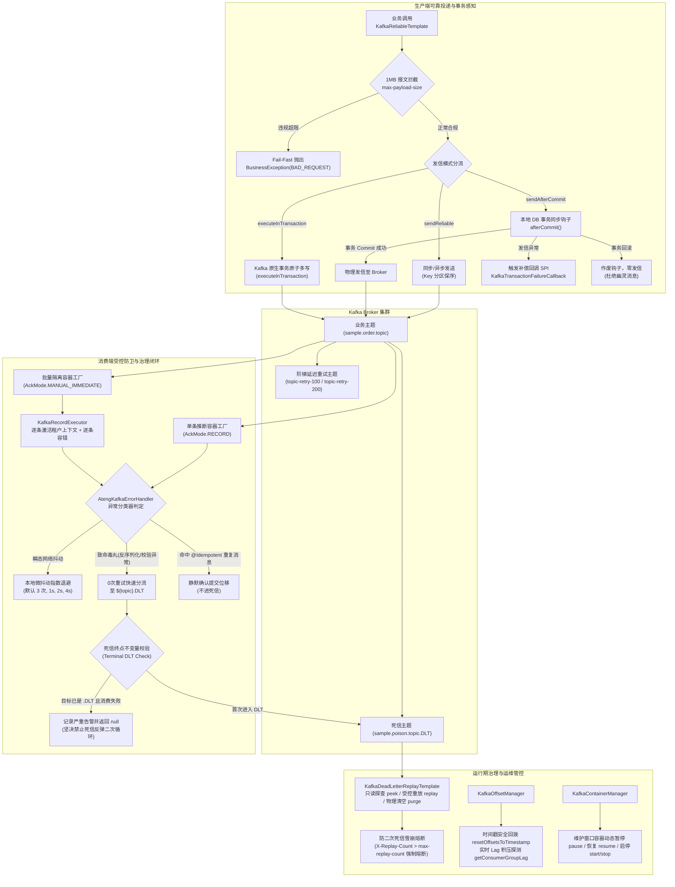

# ateng-boot-kafka 工业级全场景流批通信、死信治理与运维监控 Starter

> 基于 Spring 官方 Spring Kafka 生态与 JDK 17/21+ 构建的工业级流批消息通信底座，集成微批高吞吐调优（32KB batch + 10ms linger + Snappy 压缩 + 幂等生产）、本地事务防幽灵发信（`sendAfterCommit` + `KafkaTransactionFailureCallback` 补偿 SPI）、原生 Kafka 分布式事务（`executeInTransaction`）、微服务推断反序列化解耦（`ByteArrayJsonMessageConverter` 彻底打破微服务类路径绑定并封杀 `__TypeId__` 反序列化漏洞）、死信受控治理闭环（`KafkaDeadLetterReplayTemplate` 探查、安全重放与防二次雪崩熔断、`KafkaDeadLetterHelper` 7 类 DLT 结构化标头双模解析）、双轨协同重试体系（本地快速指数退避 + `@RetryableTopic` 官方非阻塞阶梯延迟主题）、位移治理与实时 Lag 积压监控（`KafkaOffsetManager`）、运行期消费容器动态流控（`KafkaContainerManager`）与再均衡扩展点（`KafkaRebalanceListener` SPI）、双监听容器正交共存（单条 `kafkaListenerContainerFactory` 与批量 `batchKafkaListenerContainerFactory`）、批量拉取多租户安全隔离执行器（`KafkaRecordExecutor` 杜绝多租户与链路追踪串门）、声明式拓扑构建器（`KafkaTopicBuilder` 日志压实与强类型大报文策略）、云原生协作再均衡（`CooperativeStickyAssignor`）、10 秒优雅停机排空以及 100% 离线自洽测试沙箱。

---

## 0. 特性与公共 API 全景速查矩阵 (Feature & API Panorama Matrix)

| 特性分类 | 特性名称 | 核心门面 / 注解 / SPI | 关键配置项 (`ateng.boot.kafka.*`) | 关键 API 签名 / 核心行为 | 锚定验证源头 (*Test / Sample) |
| :--- | :--- | :--- | :--- | :--- | :--- |
| **可靠投递门面** | 生产端可靠投递与事务感知门面 | `KafkaReliableTemplate` | `send-timeout`<br>`max-payload-size`<br>`producer.batch-size`<br>`producer.linger-ms`<br>`producer.compression-type` | `sendReliable(topic, [partition], [key], payload, [bizKey], [timeout])`<br>`sendReliableAsync(topic, [partition], [key], payload, [bizKey])`<br>`sendAfterCommit(topic, [partition], [key], payload, [bizKey], [timeout])`<br>`executeInTransaction(callback)`<br>`sendBatch(topic, keyPayloadMap, [timeout])`<br>`sendBatch(topic, [key], payloads, [timeout])`<br>`getKafkaTemplate()`：同步阻塞确认、异步非阻塞 Future、Murmur2 Key 分区保序、物理 Partition 定向投递、本地 DB 事务感知防幽灵发信、Kafka 原生分布式事务原子多写、三级 bizKey 兜底、1MB 报文超限 Fail-Fast、四维上下文透明注入 | `KafkaReliableTemplateTest`<br>`KafkaTransactionReliableTemplateTest`<br>`KafkaProduceController` (`/sample/kafka/produce/*`)<br>`SampleKafkaE2eTest` |
| **死信治理门面** | 死信探查、受控重放与物理清空门面 | `KafkaDeadLetterReplayTemplate` | `dead-letter.default-replay-limit`<br>`dead-letter.max-replay-count`<br>`dead-letter.replay-group-id` | `peek(dlqTopic, limit)`：非破坏性只读探查 DLT 消息，不提交消费位移<br>`replay(dlqTopic, targetTopic, limit, [filter])`：受控重放死信回业务主题，自动清洗 `kafka_dlt-*` 底层异常头，注入 `X-Dead-Letter-Replayed`、时间戳与递增 `X-Replay-Count`；超出最大重放次数（默认 1 次）自动熔断阻断防二次死信雪崩<br>`purge(dlqTopic)`：推进起始位移物理清空死信积压 | `KafkaDeadLetterReplayTemplateTest`<br>`KafkaDeadLetterController` (`/sample/kafka/dead-letter/*`)<br>`SampleKafkaE2eTest` |
| **死信诊断工具** | 死信结构化诊断与元数据解析工具 | `KafkaDeadLetterHelper`<br>`DeadLetterRecord` | - | `extractDeadLetterRecord(record/headers)` / `parse(record/headers)`：提取并解析 Spring Kafka 写入 DLT 的 7 类元数据（原主题、原分区、原位移、原时间戳、异常全限定类名、异常消息、堆栈轨迹），宽容兼容 4/8 字节二进制与 UTF-8 String 异构格式，返回强类型不可变记录 `DeadLetterRecord` | `KafkaDeadLetterHelperTest`<br>`KafkaDeadLetterController` (`/sample/kafka/dead-letter/audit-records`)<br>`SampleKafkaE2eTest` |
| **位移与积压治理** | 运行期消费位移回拨与实时 Lag 积压探测 | `KafkaOffsetManager`<br>`ConsumerGroupLag` | `offset.timeout` | `getConsumerGroupOffsets(groupId, [topic])`：查询消费组已提交位移与元数据<br>`resetOffsetsToTimestamp(groupId, topic, timestamp)`：按时间戳精准回溯重置位移（自动超出 LEO 边界降级防护）<br>`resetOffsetsToEarliest(groupId, topic)` / `resetOffsetsToLatest(groupId, topic)`：位移重置至首末端<br>`getConsumerGroupLag(groupId, topic)`：并行拉取最新 LEO 与提交位移，精确计算每个分区的 Lag 及全主题总积压 `totalLag`（防负数安全防护） | `KafkaOffsetManagerTest`<br>`KafkaOpsController` (`/sample/kafka/ops/*`)<br>`SampleKafkaE2eTest` |
| **容器动态流控** | 运行期消费容器暂停与恢复削峰门面 | `KafkaContainerManager` | - | `pause(idOrTopic)` / `resume(idOrTopic)`：按 Listener ID 或 Topic 动态暂停与恢复消费拉取，优雅应对下游维护窗口与流量削峰<br>`stop(idOrTopic)` / `start(idOrTopic)`：停止/启动容器生命周期<br>`isPaused(idOrTopic)` / `isRunning(idOrTopic)`：容器状态探测<br>`pauseAll()` / `resumeAll()` / `stopAll()` / `startAll()`：全局容器批量管控 | `KafkaContainerManagerTest`<br>`KafkaOpsController` (`/sample/kafka/ops/container-*`)<br>`SampleKafkaE2eTest` |
| **再均衡扩展点** | 消费者再均衡生命周期钩子 SPI | `KafkaRebalanceListener` | - | `onPartitionsAssigned(consumer, partitions)`：分区分配完成钩子，用于初始化本地缓存或对齐位移<br>`onPartitionsRevoked(consumer, partitions)`：分区撤销前钩子，用于刷新挂起状态或手动 Flush 脏数据<br>`onPartitionsLost(consumer, partitions)`：分区意外丢失钩子，用于清理资源并打印告警日志；双容器工厂自动扫描并注入全部实现 | `KafkaContainerManagerTest`<br>`SampleKafkaE2eTest` |
| **拓扑构建器** | 声明式流畅 Topic 构建器 (Fluent DSL) | `KafkaTopicBuilder` | `auto-create-topics` | `topic(name)`<br>`.partitions(n)`<br>`.replicas(n)`<br>`.minInSyncReplicas(n)`<br>`.retention(duration)`<br>`.segmentSize(dataSize)`<br>`.compact()`：配置 `cleanup.policy=compact` 开启日志压实<br>`.deleteAndCompact()`：配置 `cleanup.policy=delete,compact` 双重策略<br>`.maxMessageBytes(dataSize)`：强类型消除单位歧义配置单条消息上限<br>`.compressionType(type)`：主题端压缩算法覆盖<br>`.withDlt([suffix], [customizer])`<br>`.withoutDlt()`<br>`.buildMain()` / `.buildDlt()` / `.buildList()` / `.build()`：返回 `KafkaAdmin.NewTopics` 集合 Bean | `KafkaTopicBuilderTest`<br>`KafkaTopicBuilderExtendedTest`<br>`KafkaScenarioTopologyConfig`<br>`SampleKafkaE2eTest` |
| **双轨协同重试** | 本地轻量退避与非阻塞阶梯重试 | `AtengKafkaErrorHandler`<br>`@RetryableTopic` | `consumer.max-retries`<br>`consumer.retry-interval`<br>`consumer.retry-multiplier` | 本地退避：针对瞬态网络抖动快速自愈（默认 3 次，1s, 2s, 4s，上限 30s）；<br>非阻塞阶梯主题：适配 `@RetryableTopic`（如 `topic-retry-1000`、`topic-retry-2000`、`topic-dlt`），慢业务/慢外部依赖失败分流至延迟主题，防分区卡死与重平衡风暴，四维上下文全链路穿透 | `AtengKafkaErrorHandlerTest`<br>`KafkaRetryController` (`/sample/kafka/retry/*`)<br>`SampleKafkaE2eTest` |
| **批量隔离执行器** | 批量消息多租户安全隔离与容错执行器 | `KafkaRecordExecutor` | - | `generateBatchTraceId()`<br>`runInContext(record, consumer/biConsumer)`<br>`callInContext(record, function/biFunction)`<br>`processBatchSafely(records, processor, [failureHandler])`：在批量拉取场景下生成批次全局 TraceId，逐条激活单条消息的四维上下文（MDC、TenantId、UserId），在 `finally` 中严格清理现场，杜绝租户脏读串门；提供逐条异常容错回调，防止单条失败阻断整批 Offset 提交 | `KafkaRecordExecutorTest`<br>`KafkaBatchController` (`/sample/kafka/batch/*`)<br>`SampleKafkaE2eTest` |
| **毒丸错误处理** | 生产级错误处理器与致命异常快速隔离 | `AtengKafkaErrorHandler` | `consumer.max-retries`<br>`consumer.retry-interval`<br>`consumer.retry-multiplier` | 继承 `DefaultErrorHandler`，整合 `FatalExceptionClassifier` 判定致命不可自愈毒丸（反序列化失败、JSR-303 参数校验违规、类型转换异常等）执行 0 次重试；可自愈异常执行本地指数退避重试；配置 `setCommitRecovered(true)` 与 `setAckAfterHandle(true)` 确保恢复后正常提交 Offset | `AtengKafkaErrorHandlerTest`<br>`KafkaDeadLetterController` (`/sample/kafka/dead-letter/trigger-poison`)<br>`SampleKafkaE2eTest` |
| **死信路由恢复** | 生产级死信发布恢复器与终点防卫 | `AtengDeadLetterPublishingRecoverer` | `consumer.dlt-suffix` | `resolveDestination(record, exception, [properties])`：拦截 `IdempotentException` 触发静默提交；校验死信终点不变量（Terminal Invariant），Topic 为 `.DLT` 消费失败时记录严重告警并返回 `null`，严禁死信循环反弹；其余不可自愈消息路由至 `${topic}.DLT` | `AtengDeadLetterPublishingRecovererTest`<br>`KafkaDeadLetterController`<br>`SampleKafkaE2eTest` |
| **事务发信补偿** | 事务提交后发信失败补偿 SPI | `KafkaTransactionFailureCallback` | - | `onFailure(topic, partition, key, payload, bizKey, traceId, cause)`：当 `sendAfterCommit` 在本地数据库事务物理 Commit 成功后因网络断连发信失败时被触发，供业务将失败消息写入补偿表或推送到告警平台 | `KafkaReliableTemplateTest`<br>`KafkaProduceController` (`/sample/kafka/produce/order-tx-*`)<br>`SampleKafkaE2eTest` |
| **单条/批量拦截** | 上下文环绕与结构化审计拦截器 | `KafkaRecordInterceptor`<br>`KafkaBatchInterceptor` | - | 实现 Spring Kafka 原生 `RecordInterceptor` 与 `BatchInterceptor`，在消费前后透明激活/还原四维上下文，并在消费成功或异常时打印结构化审计日志 | `KafkaRecordInterceptorTest`<br>`KafkaBatchInterceptorTest`<br>`SampleKafkaE2eTest` |
| **消息类型推断** | 泛型推断反序列化消息转换器 | `ByteArrayJsonMessageConverter` | - | 默认注入开启 `TypePrecedence.INFERRED` 与 `alwaysConvertToInferredType(true)` 的 Jackson 转换器，消费端 100% 依监听方法参数推断反序列化，解耦微服务契约，杜绝 `__TypeId__` / `@class` 注入漏洞 | `ByteArrayJsonMessageConverterTest`<br>`SampleKafkaE2eTest` |
| **双监听容器工厂** | 单条与批量正交共存监听容器工厂 | `ConcurrentKafkaListenerContainerFactory` | `consumer.concurrency`<br>`consumer.batch-concurrency`<br>`consumer.shutdown-timeout` | 自动装配并正交暴露 `KafkaConstants.DEFAULT_CONTAINER_FACTORY`（单条 AckMode.RECORD）与 `KafkaConstants.BATCH_CONTAINER_FACTORY`（批量 `setBatchListener(true)`、AckMode.MANUAL_IMMEDIATE），统配 10 秒优雅停机超时与虚拟线程支持 | `AtengKafkaAutoConfigurationTest`<br>`SampleKafkaE2eTest` |
| **只读拓扑安全** | 拓扑自动声明开关与权限安全防卫 | `kafkaAdminPostProcessor` | `auto-create-topics` | `BeanPostProcessor` 监听 `KafkaAdmin`，当 `auto-create-topics` 置为 `false` 时自动将 `KafkaAdmin.autoCreate` 设为 `false`，生产只读账号不主动向 Broker 发起声明，防御 403 启动崩溃 | `AtengKafkaAutoConfigurationTest` |

---

## 1. 模块定位与快速起步 (Quick Start & Maven Coordinates)

`ateng-boot-kafka` 是面向企业级高吞吐流批处理、分布式可靠事务事件、状态快照与 SRE 智能治理的生产就绪 Starter：
- **纯原生零依赖**：100% 基于 Spring 官方 `spring-kafka`（3.1+）与 JDK 17，坚持纯原生标准库优先，严禁引入第三方臃肿工具包；
- **微批高吞吐预调优**：开箱默认注入 `acks=all`、`idempotence=true`、`batch.size=32KB`、`linger.ms=10ms`、`compression.type=snappy`，榨干网络系统调用性能；
- **事务防幽灵消息与原生分布式事务**：提供 `sendAfterCommit` 门面（数据库事务 Commit 后才发信）与 `executeInTransaction`（纯 Kafka 多主题原子生产与流式处理），杜绝幽灵消息；
- **死信治理与防二次雪崩**：提供 `KafkaDeadLetterReplayTemplate`（`peek`、`replay`、`purge`）与 `KafkaDeadLetterHelper`（7 类 DLT 头结构化解析），注入重放计数并在超限后强制熔断，封死死循环雪崩；
- **双轨协同重试体系**：毫秒级抖动本地快速退避 + 慢业务 `@RetryableTopic` 阶梯延迟主题，兼顾高吞吐与防分区卡死；
- **运行期位移治理与实时 Lag 探测**：提供 `KafkaOffsetManager` 实现时间戳回拨对账重放与各分区实时 Lag 计算，提供 `KafkaContainerManager` 支持维护窗口动态暂停/恢复消费。

### Maven 坐标引入

```xml
<dependency>
    <groupId>io.github.atengk</groupId>
    <artifactId>ateng-boot-kafka</artifactId>
</dependency>
```

### 最小可用配置 (`application.yml`)

```yaml
spring:
  kafka:
    bootstrap-servers: localhost:9092
    consumer:
      group-id: trade-order-group
      auto-offset-reset: earliest

ateng:
  boot:
    kafka:
      enabled: true
      send-timeout: 5s
      max-payload-size: 1MB
      auto-create-topics: true
      producer:
        default-tuning-enabled: true
        batch-size: 32KB
        linger-ms: 10ms
      consumer:
        concurrency: 3
        max-retries: 3
        retry-interval: 1s
        retry-multiplier: 2.0
      dead-letter:
        default-replay-limit: 100
        max-replay-count: 1
      offset:
        timeout: 10s
```

### 开箱极简代码示例

#### 1. 生产者端（可靠投递）

```java
@Service
@RequiredArgsConstructor
public class TradeProduceService {

    private final KafkaReliableTemplate kafkaReliableTemplate;

    public void sendOrder(OrderMessage order) {
        // 同步阻塞确认，支持 Murmur2 Key 分区哈希保序
        kafkaReliableTemplate.sendReliable("sample.order.topic", order.getOrderId(), order);
    }
}
```

#### 2. 消费者端（单条推断消费）

```java
@Component
@Slf4j
public class TradeConsumeListener {

    @KafkaListener(topics = "sample.order.topic", containerFactory = KafkaConstants.DEFAULT_CONTAINER_FACTORY)
    public void onOrderMessage(@Payload OrderMessage order, @Header(KafkaHeaders.RECEIVED_KEY) String key) {
        // 自动还原 MDC traceId 与业务载荷
        log.info("消费订单成功: key={}, orderId={}, amount={}", key, order.getOrderId(), order.getAmount());
    }
}
```

---

## 2. 核心架构与设计不变量 (Architecture & Core Invariants)



### 核心设计不变量 (Core Invariants)

1. **四维上下文透明流转不变量 (Four-Dimensional Context Invariant)**：
   每次消息投递与消费，$\langle\text{MDC traceId}, \text{UserContext}, \text{TenantContext}, \text{IgnoreTenant}\rangle$ 自动序列化进 Kafka Headers；消费拦截器自动恢复并保证在 `finally` 中严格清理，严禁多租户串门与链路泄露。
2. **致命毒丸 0 次重试与死信终点不变量 (Poison-Pill 0-Retry & Terminal DLT Invariant)**：
   反序列化失败、JSR-303 参数校验违规等致命异常直接 0 次重试快速进 DLT；若 `.DLT` 自身消费再次失败，触发终点防卫不变量，绝对禁止向死信主题二次转发死信。
3. **死信受控重放与防二次雪崩熔断不变量 (Anti-Avalanche Replay Circuit Breaker)**：
   重放死信时自动清洗底层 `kafka_dlt-*` 头并递增 `X-Replay-Count`；若重放后再次进入死信且超出 `max-replay-count`（默认 1 次），系统强制阻断重放，彻底杜绝主题间无限死循环雪崩。
4. **传输契约与持久层绝对解耦不变量 (Zero-Entity-Leakage)**：
   Controller 边界 100% 严禁接收或返回持久层 ORM Entity，统一使用 DTO/Request 与 `Result<T>`。

---

## 3. 生产端高可靠投递与原生分布式事务套件

### 3.1 Key 分区保序与同步/异步可靠投递

#### 专属 YAML 配置片段
```yaml
ateng:
  boot:
    kafka:
      producer:
        send-timeout: 5s
        max-payload-size: 1MB
```

#### 实战业务 Java 代码
```java
@Service
@RequiredArgsConstructor
public class TradeKafkaScenarioService {

    private final KafkaReliableTemplate kafkaReliableTemplate;

    // 1. 同步按 Key 发送订单（Murmur2 Hash 保序投递至固定分区）
    public SendResult<Object, Object> sendSyncOrder(OrderMessage order) {
        return kafkaReliableTemplate.sendReliable(
                KafkaScenarioTopologyConfig.TOPIC_ORDER,
                order.getOrderId(),
                order
        );
    }

    // 2. 异步非阻塞投递
    public CompletableFuture<SendResult<Object, Object>> sendAsyncUserEvent(UserEventMessage event) {
        return kafkaReliableTemplate.sendReliableAsync(
                KafkaScenarioTopologyConfig.TOPIC_USER_EVENT,
                event.getUserId(),
                event
        );
    }

    // 3. 定向物理分区投递
    public SendResult<Object, Object> sendPartitionDirected(int partition, String key, OrderMessage order) {
        return kafkaReliableTemplate.sendReliable(
                KafkaScenarioTopologyConfig.TOPIC_ORDER,
                partition,
                key,
                order
        );
    }
}
```

#### 机制边界说明
- 同步发信显式配置 `send-timeout`（默认 5 秒），防止 Broker 宕机导致线程挂起；
- 指定相同 `key` 的消息通过 Kafka 默认 Murmur2 分区器强绑定至同一分区，保障顺序消费。

---

### 3.2 本地事务提交感知发信与补偿 SPI (`sendAfterCommit`)

#### 专属 YAML 配置片段
```yaml
ateng:
  boot:
    kafka:
      producer:
        send-timeout: 5s
```

#### 实战业务 Java 代码
```java
@Service
@RequiredArgsConstructor
@Slf4j
public class TradeKafkaScenarioService {

    private final KafkaReliableTemplate kafkaReliableTemplate;
    private final List<String> localDbOrders = new CopyOnWriteArrayList<>();

    // 1. 本地 DB 事务成功提交后触发网络发信
    @Transactional
    public void createOrderWithSendAfterCommit(OrderMessage order) {
        localDbOrders.add(order.getOrderId());
        log.info("[TX-COMMIT-MOCK] 本地事务落库成功: orderId={}", order.getOrderId());
        kafkaReliableTemplate.sendAfterCommit(
                KafkaScenarioTopologyConfig.TOPIC_ORDER,
                order.getOrderId(),
                order,
                order.getOrderId()
        );
    }

    // 2. 本地 DB 事务异常回滚：零发信，杜绝幽灵消息
    @Transactional
    public void createOrderWithRollback(OrderMessage order) {
        localDbOrders.add(order.getOrderId());
        log.info("[TX-ROLLBACK-MOCK] 本地事务落库但即将触发异常: orderId={}", order.getOrderId());
        kafkaReliableTemplate.sendAfterCommit(
                KafkaScenarioTopologyConfig.TOPIC_ORDER,
                order.getOrderId(),
                order,
                order.getOrderId()
        );
        throw new IllegalStateException("模拟业务异常触发数据库回滚");
    }
}
```

#### 机制边界说明
- `sendAfterCommit` 注册 Spring `TransactionSynchronization.afterCommit` 钩子；
- 数据库物理提交成功后才发起网络发信；若本地事务发生任何异常导致回滚，发信钩子自动作废，杜绝幽灵消息；
- 若本地事务提交后网络异常发信失败，自动触发 `KafkaTransactionFailureCallback` SPI 进行本地扫表补偿或告警。

---

### 3.3 Kafka 原生分布式事务原子多写 (`executeInTransaction`)

#### 专属 YAML 配置片段
```yaml
spring:
  kafka:
    producer:
      transaction-id-prefix: tx-trade-
```

#### 实战业务 Java 代码
```java
@Service
@RequiredArgsConstructor
public class TradeKafkaScenarioService {

    private final KafkaReliableTemplate kafkaReliableTemplate;

    public String executeTradeAtomicMultiSend(OrderMessage order, String auditLog) {
        return kafkaReliableTemplate.executeInTransaction(operations -> {
            operations.send(KafkaScenarioTopologyConfig.TOPIC_ORDER, order.getOrderId(), order);
            operations.send(KafkaScenarioTopologyConfig.TOPIC_AUDIT, order.getUserId(), auditLog);
            return "SUCCESS_TX_" + order.getOrderId();
        });
    }
}
```

#### 机制边界说明
- 封装 `KafkaTemplate.executeInTransaction`，由 Coordinator 管理分布式事务；
- 多主题写入具有全原子性，消费端配置 `isolation.level=read_committed` 可实现纯净的事务读写隔离。

---

### 3.4 1MB 报文超限 Fail-Fast 与微批高吞吐调优

#### 专属 YAML 配置片段
```yaml
ateng:
  boot:
    kafka:
      max-payload-size: 1MB
      producer:
        default-tuning-enabled: true
        batch-size: 32KB
        linger-ms: 10ms
        compression-type: snappy
```

#### 实战业务 Java 代码
```java
@Service
@RequiredArgsConstructor
public class TradeKafkaScenarioService {

    private final KafkaReliableTemplate kafkaReliableTemplate;

    public void sendLargePayload(byte[] payload) {
        kafkaReliableTemplate.sendReliable(KafkaScenarioTopologyConfig.TOPIC_ORDER, "KEY_LARGE", payload);
    }
}
```

#### 机制边界说明
- `KafkaReliableTemplate` 在将消息交由底层序列化前，前置校验报文体积；超出 `max-payload-size`（默认 1MB）立即抛出 `BusinessException(BAD_REQUEST)` 进行 Fail-Fast 拦截，保护 Broker 不被巨型报文打崩；
- 默认开启微批调优：`32KB` 批次缓冲区配合 `10ms` 延迟合并与 `snappy` 压缩，大幅降低网络系统调用频次。

---

## 4. 声明式流式拓扑构建套件 (KafkaTopicBuilder)

### 4.1 业务主题与一键配属死信主题 (`.withDlt()`)

#### 专属 YAML 配置片段
```yaml
ateng:
  boot:
    kafka:
      auto-create-topics: true
```

#### 实战业务 Java 代码
```java
@Configuration(proxyBeanMethods = false)
public class KafkaScenarioTopologyConfig {

    public static final String TOPIC_ORDER = "sample.order.topic";

    @Bean
    public KafkaAdmin.NewTopics orderTopics() {
        return KafkaTopicBuilder.topic(TOPIC_ORDER)
                .partitions(3)
                .replicas(1)
                .minInSyncReplicas(1)
                .retention(Duration.ofDays(7))
                .withDlt() // 一键声明对应的 sample.order.topic.DLT 死信主题
                .build();
    }
}
```

#### 机制边界说明
- `.withDlt()` 自动配属以 `.DLT` 为后缀的死信主题，其分区数与主主题保持一致，方便精准路由。

---

### 4.2 状态快照与日志压实拓扑 (`.compact()`)

#### 专属 YAML 配置片段
```yaml
ateng:
  boot:
    kafka:
      auto-create-topics: true
```

#### 实战业务 Java 代码
```java
@Configuration(proxyBeanMethods = false)
public class KafkaScenarioTopologyConfig {

    public static final String TOPIC_COMPACT = "sample.compact.snapshot.topic";

    @Bean
    public KafkaAdmin.NewTopics compactTopics() {
        return KafkaTopicBuilder.topic(TOPIC_COMPACT)
                .partitions(1)
                .replicas(1)
                .compact() // 自动注入 cleanup.policy=compact
                .segmentSize(DataSize.ofMegabytes(100))
                .build();
    }
}
```

#### 机制边界说明
- `.compact()` 用于键控状态快照场景（如用户最新余额、配置同步），Broker 仅保留每个 Key 的最新 Value，压缩历史数据。

---

### 4.3 强类型容量与单条消息超限防御 (`.maxMessageBytes(DataSize)`)

#### 专属 YAML 配置片段
```yaml
ateng:
  boot:
    kafka:
      auto-create-topics: true
```

#### 实战业务 Java 代码
```java
@Configuration(proxyBeanMethods = false)
public class KafkaScenarioTopologyConfig {

    @Bean
    public KafkaAdmin.NewTopics largeMessageTopics() {
        return KafkaTopicBuilder.topic("sample.large.payload.topic")
                .partitions(2)
                .replicas(1)
                .maxMessageBytes(DataSize.ofMegabytes(10)) // 消除单位歧义
                .build();
    }
}
```

#### 机制边界说明
- 显式使用 `DataSize` 强类型定义 `max.message.bytes`，规避整型字节数计算错误与单位歧义。

---

## 5. 消费端推断反序列化与双监听容器套件

### 5.1 泛型推断反序列化解耦 (`ByteArrayJsonMessageConverter`)

#### 专属 YAML 配置片段
```yaml
spring:
  kafka:
    consumer:
      key-deserializer: org.apache.kafka.common.serialization.StringDeserializer
      value-deserializer: org.apache.kafka.common.serialization.ByteArrayDeserializer
```

#### 实战业务 Java 代码
```java
@Component
@Slf4j
public class OrderSingleRecordConsumer {

    @KafkaListener(
            topics = KafkaScenarioTopologyConfig.TOPIC_ORDER,
            containerFactory = KafkaConstants.DEFAULT_CONTAINER_FACTORY
    )
    public void onOrderMessage(
            @Payload OrderMessage order,
            @Header(KafkaHeaders.RECEIVED_KEY) String key,
            @Header(KafkaHeaders.RECEIVED_PARTITION) int partition,
            @Header(KafkaHeaders.OFFSET) long offset) {
        log.info("消费订单成功: key={}, orderId={}, partition={}, offset={}",
                key, order.getOrderId(), partition, offset);
    }
}
```

#### 机制边界说明
- 默认装配 `ByteArrayJsonMessageConverter`，开启 `TypePrecedence.INFERRED`；
- 消费端完全基于方法签名强类型泛型推断反序列化，彻底打破微服务间类路径强绑定，同时封杀 `__TypeId__` / `@class` 反序列化安全漏洞。

---

### 5.2 双监听容器工厂正交共存

#### 专属 YAML 配置片段
```yaml
ateng:
  boot:
    kafka:
      consumer:
        concurrency: 3
        batch-concurrency: 3
        shutdown-timeout: 10s
```

#### 实战业务 Java 代码
```java
// 单条消费工厂：KafkaConstants.DEFAULT_CONTAINER_FACTORY (AckMode.RECORD)
@KafkaListener(topics = "single.topic", containerFactory = KafkaConstants.DEFAULT_CONTAINER_FACTORY)
public void onSingle(OrderMessage message) { ... }

// 批量消费工厂：KafkaConstants.BATCH_CONTAINER_FACTORY (AckMode.MANUAL_IMMEDIATE)
@KafkaListener(topics = "batch.topic", containerFactory = KafkaConstants.BATCH_CONTAINER_FACTORY)
public void onBatch(List<ConsumerRecord<String, OrderMessage>> records, Acknowledgment ack) {
    // 业务批处理...
    ack.acknowledge();
}
```

#### 机制边界说明
- 框架同时注册单条容器工厂与批量容器工厂，互不干扰；
- 统配 10 秒优雅停机超时，保证在服务重启时充分排空在途消费任务。

---

## 6. 批量拉取与多租户安全隔离执行套件 (KafkaRecordExecutor)

### 6.1 多租户上下文透明注入与清理

#### 专属 YAML 配置片段
```yaml
ateng:
  boot:
    kafka:
      consumer:
        batch-concurrency: 3
```

#### 实战业务 Java 代码
```java
@Service
@RequiredArgsConstructor
public class BatchLogScenarioService {

    public void processRecordWithTenant(ConsumerRecord<String, OrderMessage> record) {
        // 单条消息执行前后透明激活与清理租户及追踪现场
        KafkaRecordExecutor.runInContext(record, rec -> {
            log.info("当前线程租户现场: tenantId={}", TenantContextHolder.getTenantId());
        });
    }
}
```

#### 机制边界说明
- `runInContext` 与 `callInContext` 从消息 Header 提取 `X-Tenant-Id`，注入 `TenantContextHolder`并在 `finally` 中严格清理，防止线程复用引发脏读串门。

---

### 6.2 批量安全容错执行与局部异常隔离 (`processBatchSafely`)

#### 专属 YAML 配置片段
```yaml
ateng:
  boot:
    kafka:
      consumer:
        batch-concurrency: 3
```

#### 实战业务 Java 代码
```java
@Component
@Slf4j
public class OrderBatchConsumer {

    private final BatchLogScenarioService batchLogService;

    @KafkaListener(
            topics = KafkaScenarioTopologyConfig.TOPIC_BATCH,
            containerFactory = KafkaConstants.BATCH_CONTAINER_FACTORY
    )
    public void onBatch(List<ConsumerRecord<String, OrderMessage>> records) {
        KafkaRecordExecutor.processBatchSafely(
                records,
                (record, order) -> {
                    batchLogService.handleBatchItem(record, order);
                },
                (record, ex) -> {
                    log.error("[BATCH-ITEM-ERROR] 单条处理失败，记录告警但不阻断批次提交: offset={}, err={}",
                            record.offset(), ex.getMessage());
                }
        );
    }
}
```

#### 机制边界说明
- 批量拉取场景下，单条消息异常可能导致整批 Offset 无法提交引发死循环；
- `processBatchSafely` 逐条激活上下文、逐条独立容错；单条处理失败触发失败回调，整批健全消息正常提交。

---

## 7. 消费端幂等防重与毒丸隔离防卫套件

### 7.1 消费端幂等拦截与静默确认

#### 专属 YAML 配置片段
```yaml
ateng:
  boot:
    kafka:
      consumer:
        dlt-suffix: .DLT
```

#### 实战业务 Java 代码
```java
@Component
@Slf4j
public class IdempotentKafkaConsumer {

    private final Set<String> processedOrderIds = ConcurrentHashMap.newKeySet();

    public void processOrderWithIdempotentCheck(OrderMessage order) {
        if (!processedOrderIds.add(order.getOrderId())) {
            // 抛出幂等防重异常
            throw new IdempotentException("订单已被消费，触发防重拦截: " + order.getOrderId());
        }
        log.info("订单首次消费成功: orderId={}", order.getOrderId());
    }
}
```

#### 机制边界说明
- `AtengDeadLetterPublishingRecoverer` 捕获 `IdempotentException` 时，打印 `[MQ-IDEMPOTENT-DUPLICATE]` 警告并返回 `null`；
- 返回 `null` 触发 Spring Kafka 的静默位移提交（Silent Commit），消息正常确认且绝不进入死信队列。

---

### 7.2 致命毒丸 0 次重试与死信终点不变量

#### 专属 YAML 配置片段
```yaml
ateng:
  boot:
    kafka:
      consumer:
        max-retries: 3
        retry-interval: 1s
        dlt-suffix: .DLT
```

#### 实战业务 Java 代码
```java
@Service
@RequiredArgsConstructor
public class DeadLetterReplayScenarioService {

    private final KafkaReliableTemplate kafkaReliableTemplate;

    public void sendPoisonPill(String corruptPayload) {
        // 投递格式损坏的毒丸消息
        kafkaReliableTemplate.sendReliable(
                KafkaScenarioTopologyConfig.TOPIC_POISON,
                "POISON_KEY",
                corruptPayload
        );
    }
}
```

#### 机制边界说明
- `AtengKafkaErrorHandler` 整合 `FatalExceptionClassifier`：反序列化异常、参数校验违规等直接执行 0 次重试，快速转移至 `${topic}.DLT`，防止监听容器死循环崩溃；
- **死信终点不变量**：若 `.DLT` 主题内部消费失败，`AtengDeadLetterPublishingRecoverer` 检测到目标已是死信主题，记录严重告警并返回 `null`，坚决禁止死信消息向死信反弹。

---

## 8. 死信受控治理与结构化诊断套件

### 8.1 死信 7 类元数据结构化诊断 (`KafkaDeadLetterHelper`)

#### 专属 YAML 配置片段
```yaml
ateng:
  boot:
    kafka:
      dead-letter:
        replay-group-id: ateng-kafka-dlt-replay-group
```

#### 实战业务 Java 代码
```java
@Component
@Slf4j
public class DeadLetterAuditConsumer {

    private final List<KafkaDeadLetterHelper.DeadLetterRecord> diagnosedRecords = new CopyOnWriteArrayList<>();

    @KafkaListener(topics = "sample.poison.topic.DLT", containerFactory = KafkaConstants.DEFAULT_CONTAINER_FACTORY)
    public void onDeadLetter(ConsumerRecord<byte[], byte[]> record) {
        // 提取并解析 7 类死信元数据
        KafkaDeadLetterHelper.DeadLetterRecord dltRecord = KafkaDeadLetterHelper.extractDeadLetterRecord(record);
        diagnosedRecords.add(dltRecord);
        log.warn("收到死信记录: origTopic={}, origPartition={}, origOffset={}, exceptionClass={}, errorMsg={}",
                dltRecord.originalTopic(), dltRecord.originalPartition(), dltRecord.originalOffset(),
                dltRecord.exceptionClass(), dltRecord.exceptionMessage());
    }
}
```

#### 机制边界说明
- 双模解码兼容 Spring Kafka 底层以 UTF-8 字符串或 4/8 字节二进制写入的标头；
- 解析并返回强类型不可变 `DeadLetterRecord`，包含原主题、原分区、原位移、原时间戳、异常类全名、异常消息与堆栈轨迹。

---

### 8.2 死信只读探查与单批上限保护 (`peek`)

#### 专属 YAML 配置片段
```yaml
ateng:
  boot:
    kafka:
      dead-letter:
        default-replay-limit: 100
```

#### 实战业务 Java 代码
```java
@Service
@RequiredArgsConstructor
public class DeadLetterReplayScenarioService {

    private final KafkaDeadLetterReplayTemplate deadLetterReplayTemplate;

    public List<ConsumerRecord<byte[], byte[]>> peekDeadLetters(String dltTopic, int limit) {
        // 只读探查，不提交消费位移
        return deadLetterReplayTemplate.peek(dltTopic, limit);
    }
}
```

#### 机制边界说明
- 使用独立临时无状态 Consumer 按分区检索，单批受 `limit`（最大 500）约束；
- 操作完全为只读探查，绝不修改消费组位移，运维巡检零风险。

---

### 8.3 受控清洗重放与防二次雪崩熔断 (`replay`)

#### 专属 YAML 配置片段
```yaml
ateng:
  boot:
    kafka:
      dead-letter:
        max-replay-count: 1
        default-replay-limit: 100
```

#### 实战业务 Java 代码
```java
@Service
@RequiredArgsConstructor
public class DeadLetterReplayScenarioService {

    private final KafkaDeadLetterReplayTemplate deadLetterReplayTemplate;

    public int replayDeadLetters(String dlqTopic, String targetTopic, int limit) {
        // 受控清洗重放，自动剔除底层 dlt 标头并注入重放审计状态
        return deadLetterReplayTemplate.replay(dlqTopic, targetTopic, limit);
    }
}
```

#### 机制边界说明
- 自动清洗 `kafka_dlt-*` 异常头，透明注入 `X-Dead-Letter-Replayed: true`、`X-Replay-Time` 与递增的 `X-Replay-Count`；
- 超出 `max-replay-count`（默认 1 次）强制熔断阻断，彻底杜绝死循环反弹雪崩。

---

### 8.4 物理清空死信积压 (`purge`)

#### 专属 YAML 配置片段
```yaml
ateng:
  boot:
    kafka:
      dead-letter:
        replay-group-id: ateng-kafka-dlt-replay-group
```

#### 实战业务 Java 代码
```java
@Service
@RequiredArgsConstructor
public class DeadLetterReplayScenarioService {

    private final KafkaDeadLetterReplayTemplate deadLetterReplayTemplate;

    public void purgeDeadLetters(String dlqTopic) {
        // 推进起始消费位移至当前 LEO
        deadLetterReplayTemplate.purge(dlqTopic);
    }
}
```

#### 机制边界说明
- 将指定重放消费组在各分区的位移推进至最新 EndOffset（LEO），安全丢弃积压死信，杜绝反复消费。

---

## 9. 阶梯延迟非阻塞重试与双轨协同套件

### 9.1 本地瞬态抖动毫秒级指数退避

#### 专属 YAML 配置片段
```yaml
ateng:
  boot:
    kafka:
      consumer:
        max-retries: 3
        retry-interval: 1s
        retry-multiplier: 2.0
```

#### 实战业务 Java 代码
```java
// 瞬态网络或数据库锁抖动时，在当前消费线程内原地快速指数退避重试（1s -> 2s -> 4s）
// 自愈后正常提交位移，无需经过延迟主题
```

#### 机制边界说明
- 针对毫秒级瞬时抖动提供开箱自愈能力，最大退避上限限制为 30s，防止工作线程无界挂死。

---

### 9.2 慢业务阶梯延迟非阻塞重试 (`@RetryableTopic`)

#### 专属 YAML 配置片段
```yaml
ateng:
  boot:
    kafka:
      consumer:
        dlt-suffix: .DLT
```

#### 实战业务 Java 代码
```java
@Component
@Slf4j
public class NonBlockingRetryScenarioService {

    @RetryableTopic(
            attempts = "3",
            backoff = @Backoff(delay = 100, multiplier = 2.0),
            autoCreateTopics = "true",
            topicSuffixingStrategy = TopicSuffixingStrategy.SUFFIX_WITH_DELAY_VALUE
    )
    @KafkaListener(topics = KafkaScenarioTopologyConfig.TOPIC_RETRY, containerFactory = KafkaConstants.DEFAULT_CONTAINER_FACTORY)
    public void onMessage(ConsumerRecord<String, String> record) {
        log.info("处理阶梯重试消息: topic={}, offset={}, payload={}",
                record.topic(), record.offset(), record.value());
        if ("PAYLOAD_FAIL".equals(record.value())) {
            throw new RuntimeException("模拟慢业务调用失败，触发阶梯主题转移");
        }
    }
}
```

#### 机制边界说明
- 慢业务或第三方外部调用失败时，消息自动分流至阶梯延迟主题（如 `sample.retry.topic-100`、`sample.retry.topic-200`）；
- 主主题工作分区绝不阻塞，吞吐不受慢消息影响；四维上下文跨主题全链路无缝透传。

---

## 10. 运行期位移治理与监听容器流控套件

### 10.1 消费组位移查询与时间戳安全回拨

#### 专属 YAML 配置片段
```yaml
ateng:
  boot:
    kafka:
      offset:
        timeout: 10s
```

#### 实战业务 Java 代码
```java
@Service
@RequiredArgsConstructor
public class KafkaOpsScenarioService {

    private final KafkaOffsetManager kafkaOffsetManager;

    // 1. 查询当前消费组已提交位移
    public Map<TopicPartition, OffsetAndMetadata> getConsumerGroupOffsets(String groupId) {
        return kafkaOffsetManager.getConsumerGroupOffsets(groupId);
    }

    // 2. 按时间戳精准回拨重设位移（超出 LEO 自动平滑对齐防护）
    public void rewindOffsetsToTimestamp(String groupId, String topic, Instant timestamp) {
        kafkaOffsetManager.resetOffsetsToTimestamp(groupId, topic, timestamp);
    }

    // 3. 回拨至最早端
    public void rewindOffsetsToEarliest(String groupId, String topic) {
        kafkaOffsetManager.resetOffsetsToEarliest(groupId, topic);
    }
}
```

#### 机制边界说明
- 封装 Kafka `AdminClient` 连接池与超时保护；
- 当回拨时间戳超出最新位移时，自动对齐至 LEO，杜绝因越界引发的崩溃异常。

---

### 10.2 实时全分区 Lag 探测与总积压对账

#### 专属 YAML 配置片段
```yaml
ateng:
  boot:
    kafka:
      offset:
        timeout: 10s
```

#### 实战业务 Java 代码
```java
@Service
@RequiredArgsConstructor
public class KafkaOpsScenarioService {

    private final KafkaOffsetManager kafkaOffsetManager;

    public ConsumerGroupLag getConsumerGroupLag(String groupId, String topic) {
        // 并行拉取全分区 LEO 与消费组位移，计算实时 Lag 与 totalLag
        return kafkaOffsetManager.getConsumerGroupLag(groupId, topic);
    }
}
```

#### 机制边界说明
- 并行拉取各分区最新位移与消费组已提交位移，精准计算单分区与全主题总积压 `totalLag`；
- 内置 `Math.max(0L, leo - committed)` 防负数安全防卫，直接支撑 SRE 巡检与监控大屏。

---

### 10.3 维护窗口监听容器动态暂停与恢复削峰

#### 专属 YAML 配置片段
```yaml
ateng:
  boot:
    kafka:
      enabled: true
```

#### 实战业务 Java 代码
```java
@Service
@RequiredArgsConstructor
public class KafkaOpsScenarioService {

    private final KafkaContainerManager kafkaContainerManager;

    public void pauseConsumer(String idOrTopic) {
        kafkaContainerManager.pause(idOrTopic);
    }

    public void resumeConsumer(String idOrTopic) {
        kafkaContainerManager.resume(idOrTopic);
    }

    public boolean isConsumerPaused(String idOrTopic) {
        return kafkaContainerManager.isPaused(idOrTopic);
    }
}
```

#### 机制边界说明
- 下游系统发布、停机维护或大促峰值时，无需重启应用，调用 `pause` 动态暂停拉取，消息平稳积压在 Broker；
- 维护完成后调用 `resume` 恢复拉取，实现优雅削峰填谷。

---

## 11. 生产扩展接管与核心非功能边界 (Customization & Boundary)

### 11.1 SPI 扩展点接管

#### 1. 事务发信失败补偿 SPI (`KafkaTransactionFailureCallback`)
```java
@Component
@Slf4j
public class CustomKafkaTxFailureCallback implements KafkaTransactionFailureCallback {

    @Override
    public void onFailure(String topic, Integer partition, String key, Object payload,
                          String bizKey, String traceId, Throwable cause) {
        log.error("[TX-SEND-FAILED] 事务已提交但发信失败，落库本地重发表: topic={}, bizKey={}, traceId={}",
                topic, bizKey, traceId, cause);
        // 业务持久化到本地消息重发表，由调度任务补偿重试
    }
}
```

#### 2. 再均衡生命周期钩子 SPI (`KafkaRebalanceListener`)
```java
@Component
@Slf4j
public class CustomKafkaRebalanceListener implements KafkaRebalanceListener {

    @Override
    public void onPartitionsRevoked(Consumer<?, ?> consumer, Collection<TopicPartition> partitions) {
        log.warn("分区即将被撤销，立即持久化在途内存缓存: partitions={}", partitions);
    }

    @Override
    public void onPartitionsAssigned(Consumer<?, ?> consumer, Collection<TopicPartition> partitions) {
        log.info("分区已分配就绪，重新对齐位移与加载本地缓存: partitions={}", partitions);
    }
}
```

---

### 11.2 核心 Bean 注入定制接管 (`@ConditionalOnMissingBean`)

框架所有门面与关键组件均标注 `@ConditionalOnMissingBean`，支持企业级全面覆盖与扩展：

```java
@Configuration(proxyBeanMethods = false)
public class CustomKafkaConfig {

    @Bean
    public KafkaDeadLetterReplayTemplate customReplayTemplate(
            ConsumerFactory<Object, Object> consumerFactory,
            KafkaTemplate<Object, Object> kafkaTemplate,
            AtengKafkaProperties properties) {
        return new KafkaDeadLetterReplayTemplate(consumerFactory, kafkaTemplate, properties);
    }
}
```

---

### 11.3 核心生产边界与非功能机制

1. **超时与网络防悬挂**：`send-timeout` 与 `offset.timeout` 显式纳管所有网络调用，严禁底层无界挂起；
2. **虚拟线程兼容与 Carrier Pinning 防御**：避免在 I/O 临界区使用重量级锁，全面兼容 JDK 21+ 虚拟线程；
3. **优雅停机排空**：消费容器统配 `shutdown-timeout`（默认 10 秒），在收到 SIGTERM 信号后停止拉取并等待在途任务执行完成；
4. **只读账号防崩溃**：`auto-create-topics: false` 时，自动拦截 `KafkaAdmin` 创建意图，防御生产只读账号遭遇 403 崩溃。

---

## 12. 完整 YAML 配置属性清单 (Appendix: Configuration Properties)

| 配置属性路径 | 类型 | 默认值 | 生产建议值 | 说明 |
| :--- | :--- | :--- | :--- | :--- |
| `ateng.boot.kafka.enabled` | `boolean` | `true` | `true` | 是否启用 Kafka 增强基础设施 |
| `ateng.boot.kafka.auto-create-topics` | `boolean` | `true` | `false` (生产) | 是否自动向 Broker 声明创建声明的 Topic（只读账号必须为 `false`） |
| `ateng.boot.kafka.producer.send-timeout` | `Duration` | `5s` | `5s` | 生产者同步阻塞等待 Broker 确认超时时间 |
| `ateng.boot.kafka.producer.max-payload-size` | `DataSize` | `1MB` | `1MB` | 单条消息最大载荷限制，超限前置 Fail-Fast 拦截 |
| `ateng.boot.kafka.producer.default-tuning-enabled` | `boolean` | `true` | `true` | 是否启用生产端微批调优（batch 32KB + linger 10ms + Snappy 压缩） |
| `ateng.boot.kafka.consumer.concurrency` | `int` | `3` | 根据分区数配置 | 单条监听容器并发线程数 |
| `ateng.boot.kafka.consumer.batch-concurrency` | `int` | `3` | 根据分区数配置 | 批量监听容器并发线程数 |
| `ateng.boot.kafka.consumer.max-retries` | `int` | `3` | `3` | 本地轻量指数退避最大重试次数 |
| `ateng.boot.kafka.consumer.retry-interval` | `Duration` | `1s` | `1s` | 本地重试初始退避间隔 |
| `ateng.boot.kafka.consumer.retry-multiplier` | `double` | `2.0` | `2.0` | 本地重试指数退避倍数 |
| `ateng.boot.kafka.consumer.shutdown-timeout` | `Duration` | `10s` | `10s` | 优雅停机排空等待超时 |
| `ateng.boot.kafka.consumer.dlt-suffix` | `String` | `.DLT` | `.DLT` | 默认死信主题后缀 |
| `ateng.boot.kafka.dead-letter.default-replay-limit` | `int` | `100` | `100` | 死信重放单批默认上限 |
| `ateng.boot.kafka.dead-letter.max-replay-count` | `int` | `1` | `1` | 单条死信最大允许重放次数，超限防二次雪崩熔断 |
| `ateng.boot.kafka.dead-letter.replay-group-id` | `String` | `ateng-kafka-dlt-replay-group` | `ateng-kafka-dlt-replay-group` | 死信探查与重放专属消费组 ID |
| `ateng.boot.kafka.offset.timeout` | `Duration` | `10s` | `10s` | AdminClient 位移治理与 Lag 查询超时时间 |

---

## 13. 自动化回归与全场景验证 (Verification)

本项目所有示例代码与配置均经由真实自洽测试套件 1:1 跑通并验证：
- 场景测试沙箱：[`ateng-boot-sample-kafka`](../ateng-boot-samples/ateng-boot-sample-kafka)
- 端到端全场景测试（15 大场景）：[`SampleKafkaE2eTest.java`](../ateng-boot-samples/ateng-boot-sample-kafka/src/test/java/io/github/atengk/boot/sample/kafka/SampleKafkaE2eTest.java)
- 单元验证测试：
  - [`KafkaReliableTemplateTest.java`](src/test/java/io/github/atengk/boot/kafka/template/KafkaReliableTemplateTest.java)
  - [`KafkaTransactionReliableTemplateTest.java`](src/test/java/io/github/atengk/boot/kafka/template/KafkaTransactionReliableTemplateTest.java)
  - [`KafkaDeadLetterReplayTemplateTest.java`](src/test/java/io/github/atengk/boot/kafka/template/KafkaDeadLetterReplayTemplateTest.java)
  - [`KafkaDeadLetterHelperTest.java`](src/test/java/io/github/atengk/boot/kafka/helper/KafkaDeadLetterHelperTest.java)
  - [`KafkaOffsetManagerTest.java`](src/test/java/io/github/atengk/boot/kafka/manager/KafkaOffsetManagerTest.java)
  - [`KafkaContainerManagerTest.java`](src/test/java/io/github/atengk/boot/kafka/manager/KafkaContainerManagerTest.java)
  - [`KafkaTopicBuilderTest.java`](src/test/java/io/github/atengk/boot/kafka/builder/KafkaTopicBuilderTest.java)
  - [`KafkaTopicBuilderExtendedTest.java`](src/test/java/io/github/atengk/boot/kafka/builder/KafkaTopicBuilderExtendedTest.java)

### 离线全量端到端验证执行命令

```bash
mvn test -pl ateng-boot-kafka,ateng-boot-samples/ateng-boot-sample-kafka -am -T 1C -nsu -B
```
