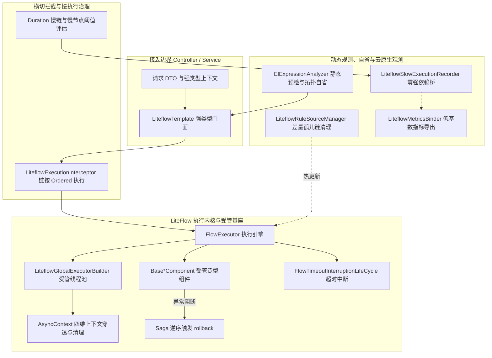

# ateng-boot-liteflow 规则编排与流程管道引擎

> 轻量级、强类型契约、虚拟线程友好且零臃肿依赖的企业级规则编排与流程管道 Starter 底座。深度集成 LiteFlow 2.16.3.1，提供自动校验解包与因果异常转译、全谱系泛型组件基类、受管线程池与四维上下文穿透、深度 EL 引用预检与运行时拓扑自省、多源动态规则与孤儿链下线、三阶段全局执行拦截器 SPI、慢执行 `Duration` 阈值治理、Saga 逆序补偿及 Micrometer 低基数指标导出。

---

## 0. 特性与公共 API 全景速查矩阵

| 特性分类 | 特性名称 | 核心门面 / 组件 / SPI | 关键配置项 (`ateng.boot.liteflow.*`) | 关键 API 签名 / 核心行为 | 锚定验证源头 (`*Test` / Sample) |
| :--- | :--- | :--- | :--- | :--- | :--- |
| **底座装配** | 环境桥接与属性绑定 | `AtengLiteflowProperties`<br>`LiteflowEnvironmentPostProcessor` | `enabled = true`<br>`rule-source`<br>`print-execution-log = true` | 自动将 `ateng.boot.liteflow.*` 桥接为 LiteFlow 原生环境配置，严禁代码直接引入 `cn.hutool.*` | `AtengLiteflowPropertiesTest`<br>`LiteflowEnvironmentPostProcessorTest` |
| **执行门面** | 同步强类型解包 | `LiteflowTemplate` | `enabled = true` | `<T> T execute(String, Class<T>)`<br>`<T> T execute(String, Object, Class<T>)` | `LiteflowTemplateTest`<br>`LiteflowPriceCalculationController` |
| **执行门面** | 预置上下文同步执行 | `LiteflowTemplate` | `enabled = true` | `<T> T executeWithContext(String, T)`<br>`<T> T executeWithContext(String, Object, T)` | `LiteflowTemplateTest` |
| **执行门面** | 多上下文编排与轨迹 | `LiteflowTemplate` | `enabled = true` | `LiteflowResponse execute(String, Class<?>, Class<?>, Class<?>...)`<br>`LiteflowResponse execute(String, Object, Class<?>, Class<?>, Class<?>...)`<br>`LiteflowResponse executeMultiple(String, Class<?>...)`<br>`LiteflowResponse executeMultiple(String, Object, Class<?>...)`<br>`LiteflowTraceResult<LiteflowResponse> executeMultipleWithTrace(...)`<br>`Object[] executeMultipleWithContext(String, Object, Object...)`<br>`LiteflowTraceResult<Object[]> executeMultipleWithContextWithTrace(...)` | `LiteflowTemplateTest` |
| **执行门面** | 链路轨迹提取与 MDC | `LiteflowTemplate`<br>`LiteflowExecutionTrace` | `trace.enable-mdc = false`<br>`trace.mdc-key = "liteflow_trace"` | `<T> LiteflowTraceResult<T> executeWithTrace(...)`<br>`LiteflowExecutionTrace extractTrace(...)`<br>`void clearTraceMdc()` / `static void clearMdcTrace()`<br>`AutoCloseable withTraceMdcScope(LiteflowExecutionTrace)` | `LiteflowObservabilityTest`<br>`LiteflowPriceCalculationController`<br>`LiteflowRiskControlController` |
| **执行门面** | 受管异步流式编排 | `LiteflowTemplate` | `enabled = true` | `<T> CompletableFuture<T> executeAsync(...)`<br>`<T> CompletableFuture<T> executeAsyncWithContext(...)`<br>`<T> CompletableFuture<LiteflowTraceResult<T>> executeAsyncWithTrace(...)`<br>支持 `Duration timeout` 超时中断 | `LiteflowTemplateTest`<br>`LiteflowPriceCalculationController` |
| **执行门面** | 在线即时 EL 执行 | `LiteflowTemplate` | `enabled = true` | `<T> T executeEl(String, ...)`<br>`<T> T executeElWithContext(String, ...)`<br>`<T> LiteflowTraceResult<T> executeElWithTrace(...)` | `LiteflowTemplateTest`<br>`LiteflowObservabilityTest`<br>`LiteflowDynamicRuleController` |
| **决策路由** | 决策路由表编排与重载 | `LiteflowTemplate`<br>`LiteflowRouteResult` | `dynamic-rule.enabled = true` | `<T> T executeRoute(String, ...)`<br>`<T> LiteflowRouteResult<T> executeRouteWithTrace(...)`<br>`void reloadRouteChain(String, String, String)`<br>`void reloadRouteChain(String, String, String, String)` | `LiteflowDynamicRuleSourceTest`<br>`LiteflowPromotionRoutingController` |
| **动态治流** | 规则热重载与历史回退 | `LiteflowTemplate` | `dynamic-rule.max-history-snapshots = 5` | `void reloadRule()` / `void reloadRule(String)`<br>`void reloadChain(String, String)`<br>`boolean rollbackChain(String)` / `List<String> getChainHistorySnapshots(String)`<br>`boolean containChain(String)` / `boolean removeChain(String)` | `LiteflowTemplateTest`<br>`LiteflowDynamicRuleSourceTest`<br>`LiteflowDynamicRuleController` |
| **预检自省** | 深度 EL 引用预检 | `LiteflowTemplate`<br>`LiteflowElValidationResult` | `enabled = true` | `boolean isValidEl(String)`<br>`LiteflowElValidationResult validateEl(String)`（暴露 `componentMissing`、`referencedNodeIds`、`referencedChainIds`、`missingComponentIds`） | `LiteflowTemplateTest`<br>`LiteflowDynamicRuleController` |
| **预检自省** | 运行时拓扑元数据自省 | `LiteflowTemplate`<br>`LiteflowChainMetadata` | `enabled = true` | `Set<String> getLoadedChainIds()` / `Set<String> getLoadedNodeIds()`<br>`LiteflowChainMetadata getChainMetadata(String)`<br>`List<LiteflowChainMetadata> getAllChainMetadata()` | `LiteflowTemplateTest`<br>`LiteflowDynamicRuleController` |
| **逃生通道** | 官方原生执行透传 | `LiteflowTemplate` | `enabled = true` | `LiteflowResponse execute2Resp(String, Object, Class<?>...)`<br>`LiteflowResponse execute2RespWithEL(String, Object, Class<?>...)`<br>`FlowExecutor getFlowExecutor()` | `LiteflowTemplateTest`<br>`LiteflowObservabilityTest` |
| **泛型组件** | 普通处理与 Saga 补偿 | `BaseNodeComponent<T>` | - | `T getContext()` / `void process(T)` / `void rollback(T)`<br>`T onError(Exception, T)` / `boolean isAccess(T)`<br>`void endFlow()` / `void deliverTo(String, Object)` / `<D> D receiveDelivery(Class<D>)`<br>`void invokeSubChain(String)` / `void invokeSubChain(String, Object)` | `LiteflowComponentHierarchyTest`<br>`DeductInventoryCmp`<br>`SettleItemProcessCmp` |
| **泛型组件** | 分支与循环控制谱系 | `BaseIfComponent<T>`<br>`BaseSwitchComponent<T>`<br>`BaseForComponent<T>`<br>`BaseWhileComponent<T>`<br>`BaseBreakComponent<T>`<br>`BaseIteratorComponent<T>` | - | `boolean processIf(T)` / `String processSwitch(T)`<br>`int processFor(T)` / `boolean processWhile(T)`<br>`boolean processBreak(T)` / `Iterator<?> processIterator(T)`<br>均内置强类型 `getContext()`、`isAccess(T)`、`onError(Exception, T)` | `LiteflowComponentHierarchyTest`<br>`CheckBlacklistIfCmp`<br>`RiskDecisionSwitchCmp`<br>`SettleItemIteratorCmp`<br>`SettleTaxCheckIfCmp` |
| **组件辅助** | 参数标签与迭代提取 | `Base*Component<T>`<br>`ComponentSupport` | - | `String getTag()` / `Integer getLoopIndex()`<br>`<D> D getCmpData(Class<D>)` / `<D> List<D> getCmpDataList(Class<D>)`<br>`<P> P getRequestData(Class<P>)` / `<E> E getCurrLoopObject(Class<E>)`<br>`ComponentSupport.resolveContext / deliverTo / receiveDelivery` | `LiteflowComponentHierarchyTest`<br>`SettleItemProcessCmp` |
| **规则源 SPI** | 多源动态加载与调度 | `LiteflowRuleSourceProvider`<br>`JdbcLiteflowRuleSourceProvider`<br>`LiteflowRuleSourceManager` | `dynamic-rule.enabled = true`<br>`dynamic-rule.auto-load-on-startup = true`<br>`dynamic-rule.fail-fast = false`<br>`dynamic-rule.evict-removed-on-refresh = true`<br>`dynamic-rule.database.*` | `LiteflowRuleSourceProvider#loadRules()` / `loadRule(String)` / `getName()` / `getOrder()`<br>`LiteflowRuleSourceManager#refreshAll()` / `refreshChain(String)` / `refreshChain(String, String)` / `refreshRouteChain(...)` / `loadAllRules()` / `loadRule(String)` / `rollbackChain(String)` / `getChainHistorySnapshots(String)` / `getManagedChainIds()` / `getProviders()` | `LiteflowDynamicRuleSourceTest`<br>`SampleDynamicRuleSourceProvider`<br>`LiteflowDynamicRuleController` |
| **规则事件** | 热更新领域事件总线 | `LiteflowRuleRefreshEvent`<br>`LiteflowRuleRefreshListener` | `dynamic-rule.enabled = true` | `static LiteflowRuleRefreshEvent refreshAll(Object)`<br>`static LiteflowRuleRefreshEvent refreshChain(Object, String)`<br>`static LiteflowRuleRefreshEvent refreshChain(Object, String, String)`<br>`static LiteflowRuleRefreshEvent refreshContent(Object, String)` | `LiteflowDynamicRuleSourceTest`<br>`LiteflowDynamicRuleController` |
| **执行切面** | 三阶段全局执行拦截器 | `LiteflowExecutionInterceptor` | `enabled = true` | `boolean supports(String chainId)` / `int getOrder()`<br>`void beforeExecute(String, Object)`<br>`void afterExecute(String, Object, LiteflowExecutionTrace)`<br>`void onError(String, Object, LiteflowExecutionTrace, Throwable)` | `LiteflowTemplateTest`<br>`SampleAuditExecutionInterceptor`<br>`LiteflowSampleE2eTest` |
| **线程治理** | 受管线程池与超时中断 | `LiteflowGlobalExecutorBuilder`<br>`ContextPropagatingExecutorService`<br>`FlowThreadTracker`<br>`FlowTimeoutInterruptionLifeCycle` | `thread-pool.propagate-context = true`<br>`thread-pool.interrupt-on-timeout = true`<br>`thread-pool.use-managed-pool = true`<br>`thread-pool.executor-class`<br>`thread-pool.core-pool-size = 16`<br>`thread-pool.max-pool-size = 64`<br>`thread-pool.queue-capacity = 1000`<br>`thread-pool.keep-alive = 60s`<br>`thread-pool.thread-name-prefix`<br>`when-max-wait-timeout` | 桥接受管线程池透传 `MDC/User/TenantId/IgnoreTenant` 四维上下文；`WHEN` 硬超时毫秒级中断防悬挂；`DisposableBean` 优雅停机；全链路 `ReentrantLock` 消除虚拟线程 Pinning | `LiteflowThreadContextPropagationTest`<br>`ContextPropagatingExecutorServiceTest`<br>`LiteflowResilienceAndRollbackTest`<br>`LiteflowEnvironmentPostProcessorTest`<br>`AtengLiteflowPropertiesTest` |
| **可观测性** | 慢执行阈值与度量导出 | `LiteflowSlowExecutionRecorder`<br>`LiteflowMetricsBinder`<br>`LiteflowExecutionTrace` | `trace.slow-chain-threshold`<br>`trace.slow-node-threshold`<br>`metrics.enabled = true` | 轨迹标记 `isSlow()` 与 `getSlowNodeIds()` 并打 `WARN` 日志；导出 `liteflow.chain.executions`、`liteflow.chain.duration`、`liteflow.node.duration`、`liteflow.chain.slow.executions`、`liteflow.node.slow.executions`（动态 EL 自动归一化为 `DYNAMIC_EL`） | `LiteflowObservabilityTest`<br>`DynamicComplianceAuditCmp`<br>`LiteflowDynamicRuleController` |

---

## 1. 模块定位与快速起步

`ateng-boot-liteflow` 是 `ateng-boot` 面向复杂业务流程编排、策略网关路由、风控决断与可编排管道的核心 Starter 底座：
- **显式强类型契约**：对外统一暴露 `LiteflowTemplate` 与泛型受管组件体系，杜绝裸强转 `Object` 与手动解析 `Slot`；
- **无臃肿与虚拟线程安全**：严禁外部直接依赖 `cn.hutool.*`，跨线程上下文全部收敛于 Core 四维 `AsyncContext`，临界区全量使用 `ReentrantLock` 消除 JDK 21+ 虚拟线程 Carrier Pinning；
- **多模快速起步**：支持 BOM 托管（推荐，免配版本号）或显式版本号独立引入。

### 1.1 Maven 依赖引入（双模写法）

**方式一：通过 `ateng-boot-bom` 统一版本管理引入（推荐）**：

```xml
<dependencyManagement>
    <dependencies>
        <dependency>
            <groupId>io.github.atengk</groupId>
            <artifactId>ateng-boot-bom</artifactId>
            <version>1.2.0</version>
            <type>pom</type>
            <scope>import</scope>
        </dependency>
    </dependencies>
</dependencyManagement>

<dependencies>
    <dependency>
        <groupId>io.github.atengk</groupId>
        <artifactId>ateng-boot-liteflow</artifactId>
    </dependency>
</dependencies>
```

**方式二：独立显式版本号引入**：

```xml
<dependency>
    <groupId>io.github.atengk</groupId>
    <artifactId>ateng-boot-liteflow</artifactId>
    <version>1.2.0</version>
</dependency>
```

### 1.2 最小可用配置与快速运行

```yaml
liteflow:
  enable: true
  rule-source: classpath*:liteflow/*.el.xml

ateng:
  boot:
    liteflow:
      enabled: true
      rule-source: "classpath*:liteflow/*.el.xml,classpath*:liteflow/*.el.yml"
      print-execution-log: true
```

```java
@RestController
@RequestMapping("/sample/liteflow/price")
@RequiredArgsConstructor
public class LiteflowPriceCalculationController {

    private final LiteflowTemplate liteflowTemplate;

    @PostMapping("/calculate")
    public Result<PriceCalculationResponse> calculatePrice(@Valid @RequestBody PriceCalculationRequest request) {
        PriceCalculationContext context = new PriceCalculationContext();
        context.setOrderId(request.getOrderId());
        context.setUserId(request.getUserId());
        context.setOriginalAmount(request.getOriginalAmount());
        context.setCouponId(request.getCouponId());

        LiteflowTraceResult<PriceCalculationContext> traceResult = liteflowTemplate.executeWithTrace(
                "price-calc-flow", request, context);

        PriceCalculationContext finalCtx = traceResult.getContext();
        String traceSummary = traceResult.getTrace() != null
                ? traceResult.getTrace().formatSummary()
                : "N/A";
        return Result.success(PriceCalculationResponse.builder()
                .orderId(finalCtx.getOrderId())
                .finalAmount(finalCtx.getFinalAmount())
                .traceSummary(traceSummary)
                .build());
    }
}
```

---

## 2. 核心架构与设计不变量



### 核心设计不变量
1. **显式响应与实体隔离**：Controller 层禁止接收或返回 ORM Entity，统一使用 Request/DTO 与 VO，显式返回 `Result<T>`；
2. **因果异常零吞咽**：所有组件及规则刷新失败统一保留原始 `cause` 并转译为受管 `LiteflowExecutionException`；
3. **无状态单例与上下文封闭**：Spring 管理的组件单例绝对无状态，单次流转数据收敛在强类型上下文 `T` 或组件私有投递槽；
4. **虚拟线程友好与资源确定性清理**：全链路并发锁统一采用 `ReentrantLock` 替代 `synchronized`；MDC、ThreadLocal 与异步上下文在 `finally` 中确定性清理。

---

## 3. 强类型泛型受管组件与控制流套件

组件基类通过 `ComponentContextResolver` 在执行时自适应提取声明泛型 `T`，屏蔽底层 `this.getContextBean(...)` 的强转与空指针风险。

### 3.1 普通处理组件、循环迭代与提前熔断 (`BaseNodeComponent<T>` / `BaseIteratorComponent<T>`)

#### 专属 YAML 配置

```yaml
ateng:
  boot:
    liteflow:
      enabled: true
liteflow:
  enable: true
  # 示例 EL: THEN(settleInitCmp, FOR(settleItemIteratorCmp).DO(THEN(IF(settleTaxCheckIfCmp, settleApplyTaxCmp), settleItemProcessCmp)), settleSummaryCmp);
```

#### 实战业务代码

```java
// 1. 普通参数校验节点 (来自 Sample: ValidateOrderCmp)
@Slf4j
@Component("validateOrderCmp")
public class ValidateOrderCmp extends BaseNodeComponent<PriceCalculationContext> {

    @Override
    public void process(PriceCalculationContext context) {
        log.info("【算价流程】开始校验订单参数，orderId={}, amount={}", context.getOrderId(), context.getOriginalAmount());
        if (context.getOriginalAmount() == null || context.getOriginalAmount().compareTo(BigDecimal.ZERO) <= 0) {
            throw new BusinessException("订单原始金额必须大于 0");
        }
    }
}

// 2. 强类型集合迭代器组件 (来自 Sample: SettleItemIteratorCmp)
@Slf4j
@Component("settleItemIteratorCmp")
public class SettleItemIteratorCmp extends BaseIteratorComponent<BatchSettleContext> {

    @Override
    public Iterator<?> processIterator(BatchSettleContext context) {
        log.info("【批量结算】开始迭代明细列表：总数={}", context.getItems().size());
        return context.getItems().iterator();
    }
}

// 3. 获取迭代当前元素、轮次并按需提前正常熔断 (来自 Sample: SettleItemProcessCmp)
@Slf4j
@Component("settleItemProcessCmp")
public class SettleItemProcessCmp extends BaseNodeComponent<BatchSettleContext> {

    @Override
    public void process(BatchSettleContext context) {
        SettleItem item = this.getCurrLoopObject(SettleItem.class);
        Integer loopIndex = this.getLoopIndex();
        if (item == null) {
            return;
        }
        if (item.isSuspicious() && context.isTerminateOnSuspicious()) {
            log.warn("【批量结算-风控熔断】第 [{}] 轮迭代发现高危可疑明细 [itemId={}]，触发 endFlow() 提前终止批次流转",
                    loopIndex, item.getItemId());
            context.setTerminatedEarly(true);
            this.endFlow();
            return;
        }
        context.setProcessedCount(context.getProcessedCount() + 1);
        context.setSettledAmount(context.getSettledAmount().add(item.getAmount()));
        context.getSettledItemIds().add(item.getItemId());
    }
}
```

#### 核心机制与边界防御
- **辅助方法全对齐**：全谱系组件统一提供 `getTag()`、`getCmpData(Class<D>)`、`getCmpDataList(Class<D>)`、`getRequestData(Class<P>)`、`getLoopIndex()`、`getCurrLoopObject(Class<E>)`；`BaseNodeComponent` 另提供 `deliverTo(targetNodeId, data)` / `receiveDelivery(Class<D>)` 点对点私有消息投递、`invokeSubChain(...)` 显式子链调度及 `endFlow()` 正常终止流程；
- **前置 Fail-Fast**：若上下文、请求入参或私有投递包类型不匹配或不存在，底层 `ComponentSupport` 按约定返回 `null` 或立即抛出明确状态异常。

---

### 3.2 条件与决策分支组件与就地降级 (`BaseIfComponent<T>` / `BaseSwitchComponent<T>`)

#### 专属 YAML 配置

```yaml
liteflow:
  # 风控决策链示例：
  # IF(checkBlacklistIfCmp, loanRejectCmp, THEN(WHEN(antiFraudCheckCmp, creditScoreCheckCmp), SWITCH(riskDecisionSwitchCmp).to(loanPassCmp, manualReviewCmp, loanRejectCmp)));
```

#### 实战业务代码

```java
// 1. IF 条件分支组件 (来自 Sample: CheckBlacklistIfCmp)
@Slf4j
@Component("checkBlacklistIfCmp")
public class CheckBlacklistIfCmp extends BaseIfComponent<RiskApprovalContext> {

    @Override
    public boolean processIf(RiskApprovalContext context) {
        boolean hitBlacklist = context.getIdCard() != null && context.getIdCard().contains("999");
        if (hitBlacklist) {
            context.setRiskLevel("HIGH");
            context.setDecisionReason("命中行业涉案涉诉与失信惩戒黑名单");
            return true;
        }
        return false;
    }
}

// 2. SWITCH 多路路由组件 (来自 Sample: RiskDecisionSwitchCmp)
@Slf4j
@Component("riskDecisionSwitchCmp")
public class RiskDecisionSwitchCmp extends BaseSwitchComponent<RiskApprovalContext> {

    @Override
    public String processSwitch(RiskApprovalContext context) {
        int fraudScore = context.getAntiFraudScore();
        int creditScore = context.getCreditScore();
        if (fraudScore >= 80 || creditScore < 550) {
            return "loanRejectCmp";
        }
        if (fraudScore >= 50 || creditScore < 680) {
            return "manualReviewCmp";
        }
        return "loanPassCmp";
    }
}

// 3. 异常就地优雅降级 (来自 Sample: SettleTaxCheckIfCmp)
@Slf4j
@Component("settleTaxCheckIfCmp")
public class SettleTaxCheckIfCmp extends BaseIfComponent<BatchSettleContext> {

    @Override
    public boolean processIf(BatchSettleContext context) {
        SettleItem item = this.getCurrLoopObject(SettleItem.class);
        if (item != null && item.isSimulateTaxError()) {
            throw new IllegalStateException("模拟外部税务计算服务超时中断 [itemId=" + item.getItemId() + "]");
        }
        return item != null && item.getAmount().doubleValue() >= 100.0;
    }

    @Override
    public boolean onError(Exception e, BatchSettleContext context) {
        SettleItem item = this.getCurrLoopObject(SettleItem.class);
        String itemId = item != null ? item.getItemId() : "UNKNOWN";
        log.warn("【批量结算-税务降级】明细 [{}] 税务服务调用异常，触发 onError 就地优雅降级: {}", itemId, e.getMessage());
        context.getDegradedItems().add(itemId);
        return false;
    }
}
```

#### 核心机制与边界防御
- **异常就地隔离**：各组件基类均支持覆写 `onError(Exception e, T context)` 钩子；当非关键子步骤发生可降级异常时，由组件就地兜底返回替代结果，避免中断全局批处理流水线。

---

## 4. 统一操作门面、受管并发与 Saga 补偿套件

### 4.1 同步执行、结构化轨迹与 MDC 作用域 (`executeWithTrace` / `withTraceMdcScope`)

#### 专属 YAML 配置

```yaml
ateng:
  boot:
    liteflow:
      trace:
        enable-mdc: false             # 执行完成后是否自动向当前线程 MDC 写入摘要（默认: false）
        mdc-key: "liteflow_trace"     # MDC 轨迹键名（默认: "liteflow_trace"）
```

#### 实战业务代码

```java
// 来自 Sample: LiteflowPriceCalculationController
LiteflowTraceResult<PriceCalculationContext> traceResult = liteflowTemplate.executeWithTrace(
        "price-calc-flow", request, context);

LiteflowExecutionTrace trace = traceResult.getTrace();
log.info("流程轨迹: {}, 总耗时: {}ms", trace.formatSummary(), trace.getTotalTimeSpentMs());

// 若需手动将历史轨迹临时注入日志上下文，使用 try-with-resources 确保 100% 恢复/清理 MDC
try (AutoCloseable scope = liteflowTemplate.withTraceMdcScope(trace)) {
    log.info("审计日志输出");
}
```

#### 核心机制与边界防御
- **异常携轨迹传播**：若规则执行失败，`LiteflowExecutionException` 同时携带 `chainId`、`failedNodeId`、`LiteflowExecutionTrace` 与原始 `cause`；
- **嵌套作用域恢复**：`withTraceMdcScope` 退出时恢复外层原有 MDC 值（若原为空则清理），杜绝线程池复用场景日志串台。

---

### 4.2 受管异步流式编排与并行超时硬中断 (`executeAsyncWithTrace` / `ThreadPoolProperties`)

#### 专属 YAML 配置

```yaml
ateng:
  boot:
    liteflow:
      when-max-wait-timeout: 15s                # WHEN 并行默认全局最大等待超时（Duration 格式，默认 null）
      thread-pool:
        propagate-context: true                 # 自动透传 <MDC, User, TenantId, IgnoreTenant> 四维上下文（默认: true）
        interrupt-on-timeout: true              # 超时协同中断活动子线程（默认: true）
        use-managed-pool: true                  # 接管 Core 模块受管线程池（默认: true）
        executor-class: ""                      # 自定义全局线程池执行器全限定类名（默认走 LiteflowGlobalExecutorBuilder）
        core-pool-size: 16                      # 回退独立线程池核心线程数（默认: 16）
        max-pool-size: 64                       # 回退独立线程池最大线程数（默认: 64）
        queue-capacity: 1000                    # 回退独立线程池队列容量（默认: 1000）
        keep-alive: 60s                         # 空闲保活时长（默认: 60s）
        thread-name-prefix: "ateng-liteflow-"   # 独立线程池线程前缀
```

#### 实战业务代码

```java
// 来自 Sample: LiteflowPriceCalculationController#calculatePriceAsync
@PostMapping("/calculate-async")
public Result<PriceCalculationResponse> calculatePriceAsync(@Valid @RequestBody PriceCalculationRequest request) {
    PriceCalculationContext context = buildContext(request);
    CompletableFuture<LiteflowTraceResult<PriceCalculationContext>> future = liteflowTemplate.executeAsyncWithTrace(
            "price-calc-flow",
            request,
            context,
            Duration.ofSeconds(3)
    );
    try {
        LiteflowTraceResult<PriceCalculationContext> traceResult = future.get(5, TimeUnit.SECONDS);
        return Result.success(buildResponse(traceResult));
    } catch (InterruptedException e) {
        Thread.currentThread().interrupt();
        throw new BusinessException("异步算价任务被中断", e);
    } catch (ExecutionException e) {
        Throwable cause = e.getCause();
        if (cause instanceof RuntimeException runtimeException) {
            throw runtimeException;
        }
        throw new BusinessException("异步算价任务执行异常", cause);
    } catch (TimeoutException e) {
        throw new BusinessException("异步算价任务等待超时", e);
    }
}
```

#### 核心机制与边界防御
- **禁止回落野线程池**：未注入任何受管 `Executor` 时，`executeAsync*` 显式抛出 `IllegalStateException`，绝不静默沦陷至 `ForkJoinPool.commonPool()`；
- **超时中断协作**：`FlowTimeoutInterruptionLifeCycle` 与 `submitAsync` 超时回调协同调用工作线程 `interrupt()`，阻断下游缓慢 IO 长期占满线程。

---

### 4.3 Saga 逆序反向补偿安全网 (`rollback`)

#### 专属 YAML 配置

```yaml
ateng:
  boot:
    liteflow:
      enabled: true
liteflow:
  enable: true
  # 履约编排 EL: THEN(deductInventoryCmp, createWarehouseOrderCmp, sendShippingNoticeCmp);
```

#### 实战业务代码

```java
// 1. 扣减库存与逆向解冻补偿 (来自 Sample: DeductInventoryCmp)
@Slf4j
@Component("deductInventoryCmp")
public class DeductInventoryCmp extends BaseNodeComponent<OrderFulfillmentContext> {

    @Override
    public void process(OrderFulfillmentContext ctx) {
        ctx.setInventoryDeducted(true);
    }

    @Override
    public void rollback(OrderFulfillmentContext ctx) {
        log.warn("【逆向补偿】库存解冻回滚: skuId={}, qty={}", ctx.getSkuId(), ctx.getQuantity());
        ctx.setInventoryDeducted(false);
        ctx.addCompensationLog("【库存服务】解冻已锁定库存: skuId=" + ctx.getSkuId());
    }
}

// 2. 创建运单与逆向作废补偿 (来自 Sample: CreateWarehouseOrderCmp)
@Slf4j
@Component("createWarehouseOrderCmp")
public class CreateWarehouseOrderCmp extends BaseNodeComponent<OrderFulfillmentContext> {

    @Override
    public void process(OrderFulfillmentContext ctx) {
        ctx.setWarehouseOrderCreated(true);
    }

    @Override
    public void rollback(OrderFulfillmentContext ctx) {
        log.warn("【逆向补偿】作废出库运单: orderId={}", ctx.getOrderId());
        ctx.setWarehouseOrderCreated(false);
        ctx.addCompensationLog("【仓储物流】作废出库调度运单: orderId=" + ctx.getOrderId());
    }
}
```

#### 核心机制与边界防御
- **初始化期静态探测**：`BaseNodeComponent` 在构造函数内一次性反射判定子类是否覆写 `rollback(T)` 并启用引擎回滚钩子，零运行期反射损耗；
- **轨迹可观测标记**：回滚成功的步骤在 `LiteflowExecutionTrace` 中精确标记为 `ExecutionStepStatus.ROLLBACK`。

---

## 5. 多源动态规则、EL 深度预检与拓扑自省套件

### 5.1 深度 EL 引用预检、运行时拓扑自省、热重载与快照回滚

#### 专属 YAML 配置

```yaml
ateng:
  boot:
    liteflow:
      dynamic-rule:
        enabled: true                   # 启用多源动态规则管理器（默认: true）
        max-history-snapshots: 5        # 单链保留历史回滚快照上限，防内存膨胀（默认: 5）
```

#### 实战业务代码

```java
// 来自 Sample: LiteflowDynamicRuleController
@Validated
@RestController
@RequestMapping("/sample/liteflow/dynamic")
@RequiredArgsConstructor
public class LiteflowDynamicRuleController {

    private final LiteflowTemplate liteflowTemplate;

    // 1. 深度 EL 静态语法与缺失组件/子链引用预检
    @PostMapping("/validate-el")
    public Result<LiteflowElValidationResult> validateEl(@Valid @RequestBody DynamicElValidateRequest request) {
        // 返回 valid、errorMessage、componentMissing、referencedNodeIds、referencedChainIds、missingComponentIds
        return Result.success(liteflowTemplate.validateEl(request.getEl()));
    }

    // 2. 查询已加载全部组件节点 ID 列表
    @GetMapping("/nodes")
    public Result<Set<String>> getLoadedNodes() {
        return Result.success(liteflowTemplate.getLoadedNodeIds());
    }

    // 3. 单链 / 全量运行时拓扑元数据自省（含 bodyEl、routeEl、namespace、referencedNodeIds、historySnapshots）
    @GetMapping("/chain-metadata")
    public Result<LiteflowChainMetadata> getChainMetadata(@NotBlank @RequestParam("chainId") String chainId) {
        return Result.success(liteflowTemplate.getChainMetadata(chainId));
    }

    @GetMapping("/chains-metadata")
    public Result<List<LiteflowChainMetadata>> getAllChainMetadata() {
        return Result.success(liteflowTemplate.getAllChainMetadata());
    }

    // 4. 在线动态热重载与历史版本一键回退
    @PostMapping("/reload-chain")
    public Result<Boolean> reloadChain(@Valid @RequestBody DynamicChainReloadRequest request) {
        liteflowTemplate.reloadChain(request.getChainId(), request.getEl());
        return Result.success(true);
    }

    @PostMapping("/rollback-chain")
    public Result<Boolean> rollbackChain(@NotBlank @RequestParam("chainId") String chainId) {
        return Result.success(liteflowTemplate.rollbackChain(chainId));
    }
}
```

#### 核心机制与边界防御
- **零误报词法剥离**：`ElExpressionAnalyzer` 先剥离行/块注释、单双引号字面量（如 `.tag("...")` / `.data("...")`）、链式修饰点号及局部赋值变量（如 `sub = THEN(...);`），再与 `FlowBus` 实时比对，官方 `validateWithEx` 通过时不被启发式误杀；
- **快照并发安全与回滚保底**：`ChainSnapshotHistory` 基于 `ReentrantLock` 维护有界双端队列，热更新编译成功后才入栈，回滚失败时自动补偿压栈恢复快照；
- **动态 EL 自动销毁**：`executeEl*` 使用后及时清理临时瞬态链，不污染 `getLoadedChainIds()` 与拓扑元数据快照。

---

### 5.2 多源规则调度、孤儿链差量自动下线与领域事件热更

#### 专属 YAML 配置

```yaml
ateng:
  boot:
    liteflow:
      dynamic-rule:
        enabled: true
        auto-load-on-startup: true      # 容器就绪后自动拉取已注册 SPI 规则（默认: true）
        fail-fast: false                # 单源或单规则失败是否快速抛出异常（默认: false）
        evict-removed-on-refresh: true  # 全量刷新时自动下线外部规则源物理删除的孤儿链（默认: true）
        database:
          enabled: false                # 启用 JDBC 数据库规则源（默认: false）
          table-name: "sys_liteflow_rule"
          rule-id-column: "rule_id"
          rule-name-column: "rule_name"
          el-column: "el_expression"
          status-column: "status"
          route-group-column: "route_group"
          route-group: "DEFAULT"
          description-column: "description"
          route-el-column: ""           # 配置列名（如 route_el）即启用 7 列决策路由模式
```

#### 实战业务代码

```java
// 1. 通过领域事件发布单链或全量热更广播（来自 Sample: LiteflowDynamicRuleController）
@PostMapping("/refresh-event")
public Result<String> publishRefreshEvent(
        @RequestParam(value = "chainId", required = false) String chainId,
        @RequestParam(value = "el", required = false) String el) {
    if (chainId != null && !chainId.isBlank() && el != null && !el.isBlank()) {
        eventPublisher.publishEvent(LiteflowRuleRefreshEvent.refreshChain(this, chainId, el));
        return Result.success("单链热更新事件已发布: chainId=" + chainId);
    } else {
        eventPublisher.publishEvent(LiteflowRuleRefreshEvent.refreshAll(this));
        return Result.success("全量规则源热重载事件已发布");
    }
}

// 2. 从动态规则源物理移除规则并触发全量刷新，自动下线孤儿链（来自 Sample: LiteflowDynamicRuleController）
@PostMapping("/source-rule/evict")
public Result<Set<String>> evictSourceRule(@NotBlank(message = "规则链 chainId 不能为空") @RequestParam("chainId") String chainId) {
    sampleRuleSourceProvider.removeRule(chainId);
    ruleSourceManager.refreshAll();
    Set<String> managed = ruleSourceManager.getManagedChainIds();
    return Result.success(managed);
}
```

#### 核心机制与边界防御
- **孤儿链精准下线不误伤静态链**：`LiteflowRuleSourceManager` 维护并发安全集合 `managedChainIds`。`refreshAll()` 时仅清理曾由外部规则源纳管、现已被物理移除的孤儿链；本地 XML/YML 静态规则链绝不受任何影响；若任一规则源拉取报错（`failFast=false`），自动跳过本次差量驱逐以防瞬时抖动误杀全量规则。

---

### 5.3 决策路由表多规则匹配与聚合 (`executeRouteWithTrace`)

#### 专属 YAML 配置

```yaml
ateng:
  boot:
    liteflow:
      dynamic-rule:
        database:
          enabled: true
          route-group: "PROMOTION"
          route-el-column: "route_el"
```

#### 实战业务代码

```java
// 来自 Sample: LiteflowPromotionRoutingController
LiteflowRouteResult<PromotionContext> routeResult = liteflowTemplate.executeRouteWithTrace(
        "PROMOTION", request, context);

PromotionContext finalContext = routeResult.getContext();
PromotionMatchResponse response = PromotionMatchResponse.builder()
        .userId(finalContext.getUserId())
        .originalAmount(finalContext.getCartAmount())
        .totalDiscount(finalContext.getTotalDiscount())
        .finalAmount(finalContext.getFinalAmount())
        .appliedPromotions(new ArrayList<>(finalContext.getAppliedPromotions()))
        .matchedChainIds(new ArrayList<>(routeResult.getMatchedChainIds()))
        .matchedCount(routeResult.getMatchedCount())
        .totalDurationMs(routeResult.getTotalDurationMs())
        .build();
```

#### 核心机制与边界防御
- **零命中安全保底**：指定命名空间无任何匹配规则或未定义路由链时，`executeRoute*` 捕获 `RouteChainNotFoundException` / `NoMatchedRouteChainException` 并静默返回原样上下文与空 `matchedChainIds`；
- **全生命周期统一拦截**：多路由匹配同样经过 `LiteflowExecutionInterceptor`，并聚合各命中子轨迹的 `slow` 与 `slowNodeIds` 状态。

---

## 6. 全局执行拦截器、慢执行阈值与云原生可观测性套件

### 6.1 三阶段全局执行拦截器 SPI (`LiteflowExecutionInterceptor`)

#### 专属 YAML 配置

```yaml
ateng:
  boot:
    liteflow:
      enabled: true # 开启底座自动收集容器内全部 LiteflowExecutionInterceptor 并按 Ordered 升序注入
```

#### 实战业务代码

```java
// 来自 Sample: SampleAuditExecutionInterceptor 与 /sample/liteflow/dynamic/interceptor-stats
@Slf4j
@Component
public class SampleAuditExecutionInterceptor implements LiteflowExecutionInterceptor {

    private static final int MAX_RECENT_RECORDS = 20;
    private final AtomicLong successCount = new AtomicLong(0L);
    private final AtomicLong errorCount = new AtomicLong(0L);
    private final ReentrantLock lock = new ReentrantLock();
    private final Deque<String> recentRecords = new ArrayDeque<>(MAX_RECENT_RECORDS);

    @Override
    public int getOrder() {
        return 100;
    }

    @Override
    public void afterExecute(String chainId, Object param, LiteflowExecutionTrace trace) {
        successCount.incrementAndGet();
        long timeMs = trace != null ? trace.getTotalTimeSpentMs() : 0L;
        boolean slow = trace != null && trace.isSlow();
        String entry = "SUCCESS:" + chainId + ":" + timeMs + "ms" + (slow ? ":SLOW" : "");
        appendRecord(entry);
    }

    @Override
    public void onError(String chainId, Object param, LiteflowExecutionTrace trace, Throwable error) {
        errorCount.incrementAndGet();
        String errType = error != null ? error.getClass().getSimpleName() : "UnknownError";
        appendRecord("ERROR:" + chainId + ":" + errType);
    }
}
```

#### 核心机制与边界防御
- **全路径一致拦截与 Fail-Open 隔离**：覆盖同步、受管异步底层、即时 EL 与决策路由全入口；`supports`、`beforeExecute`、`afterExecute`、`onError` 任一回调抛出异常均仅打印 `WARN` 日志并放行，绝不阻断业务主流程或破坏原始 `LiteflowExecutionException` 因果链；
- **空响应兜底**：当底层返回 `null` 响应时一律按失败处理，触发 `onError` 并抛出受管异常。

---

### 6.2 慢执行 `Duration` 阈值治理与 Micrometer 低基数度量

#### 专属 YAML 配置

```yaml
ateng:
  boot:
    liteflow:
      trace:
        slow-chain-threshold: 150ms   # 慢规则链告警阈值（默认 null，不开启）
        slow-node-threshold: 60ms     # 慢组件节点告警阈值（默认 null，不开启）
      metrics:
        enabled: true                 # 开启 Micrometer 自动导出（默认 true，需类路径含 MeterRegistry）
```

#### 实战业务代码

```java
// 来自 Sample: DynamicComplianceAuditCmp 与 LiteflowDynamicRuleController#executeEl
// 执行含外部慢合规审计节点的即时 EL："THEN(dynamicValidateCmp, dynamicComplianceAuditCmp.tag(\"SLOW_AUDIT\"), dynamicEchoCmp);"
LiteflowTraceResult<DynamicFlowContext> traceResult = liteflowTemplate.executeElWithTrace(
        request.getEl(), request.getPayload(), DynamicFlowContext.class);

LiteflowExecutionTrace trace = traceResult.getTrace();
boolean slow = trace != null && trace.isSlow(); // true
List<String> slowNodeIds = trace != null && trace.getSlowNodeIds() != null
        ? trace.getSlowNodeIds()                  // ["dynamicComplianceAuditCmp"]
        : Collections.emptyList();
```

#### 核心机制与边界防御
- **暴露指标全景**：
  - `liteflow.chain.executions`（Counter，标签：`chainId`, `status`）
  - `liteflow.chain.duration`（Timer，标签：`chainId`, `status`）
  - `liteflow.node.duration`（Timer，标签：`chainId`, `nodeId`, `status`）
  - `liteflow.chain.slow.executions`（Counter，标签：`chainId`）
  - `liteflow.node.slow.executions`（Counter，标签：`chainId`, `nodeId`）
- **标签基数与无 Micrometer 双重防线**：`LiteflowMetricsBinder.normalizeChainId` 将即时 EL 与 32 位十六进制 UUID 统一映射为 `"DYNAMIC_EL"` 防止 Prometheus 高基数爆内存；核心门面仅通过 `LiteflowSlowExecutionRecorder` 接口桥接指标层，未引入 `micrometer-core` 时零 `NoClassDefFoundError`。

---

## 7. 生产扩展接管与核心非功能边界

### 7.1 生产扩展与 Bean 定制接管（SPI & `@ConditionalOnMissingBean`）

1. **三阶段执行拦截器 SPI 扩展**：实现 `LiteflowExecutionInterceptor` 并声明为 Spring Bean，可通过 `getOrder()` 控制切面顺序、通过 `supports(chainId)` 精细过滤规则链（如只审计风控或支付流水线），框架自动按 `OrderComparator` 排序接入。
2. **自定义外部规则源 SPI**：实现 `LiteflowRuleSourceProvider` 并声明为 Spring Bean，可接管 Nacos、Apollo、Redis 或 Git 仓库 rule 定义；同名 `chainId` 遵循 `Ordered` 最小数值优先覆盖。
3. **默认核心组件无缝替换**：`AtengLiteflowAutoConfiguration` 与 `LiteflowMetricsAutoConfiguration` 全量采用 `@ConditionalOnMissingBean` 守卫：
   - 注册自定义 `Executor`（或自定义 `LiteflowGlobalExecutorBuilder` Bean）接管并行执行池；
   - 注册自定义 `LiteflowSlowExecutionRecorder` Bean 接管慢执行告警投递（如接入企业微信/飞书/钉钉异步通知）；
   - 注册自定义 `LiteflowTemplate`、`LiteflowRuleSourceManager`、`LiteflowMetricsBinder` 实现深度行为重写。

### 7.2 核心生产非功能边界

1. **并发与虚拟线程安全**：
   - 全模块无状态单例组件禁止持有可变请求态实例字段；
   - `LiteflowRuleSourceManager` 全量/增量刷新与 `LiteflowTemplate` 历史快照历史栈均采用 `ReentrantLock` + `if (lock.isHeldByCurrentThread()) lock.unlock()` 范式，彻底兼容 JDK 21+ 虚拟线程零 Pinning。
2. **超时与线程池边界**：
   - 所有时间属性均使用强类型 `java.time.Duration`，配置 `<= 0` 或 `null` 视为禁用对应阈值/超时；
   - 回退独立线程池在容器关闭阶段由 `DisposableBean` 确定性 `shutdown()` 优雅停机。
3. **规则存储 SQL 注入防卫与库表约束**：
   - `JdbcLiteflowRuleSourceProvider` 构造期强正则校验表名与全部列名标识符（仅允许合法字母数字下划线），拒绝一切 SQL 片段注入；
   - `fail-fast=false` 模式下单个坏规则不影响其余正常规则与静态 XML/YML 规则继续服务。
4. **纯内存安全与零依赖膨胀**：
   - 严禁外部业务在 `ateng-boot-liteflow` 引入或调用 `cn.hutool.*`；默认不自带脚本引擎，避免动态表达式注入漏洞。

---

## 8. 完整 YAML 配置属性清单

以下全量配置前缀统一为 `ateng.boot.liteflow.*`，与 `AtengLiteflowProperties` 契约 100% 对齐：

```yaml
ateng:
  boot:
    liteflow:
      # 是否启用 LiteFlow 规则编排底座自动装配（默认: true）
      enabled: true

      # 规则文件扫描路径（支持逗号分隔与 classpath 通配符）
      rule-source: "classpath*:liteflow/*.el.xml,classpath*:liteflow/*.el.yml"

      # 是否在规则执行完毕后打印格式化链路日志（默认: true）
      print-execution-log: true

      # 并行编排 WHEN 默认全局最大等待超时时间（Duration 格式，如 3s、500ms，默认 null 不限制）
      when-max-wait-timeout: 15s

      # 异步并行编排线程池配置
      thread-pool:
        # 是否自动将四维上下文（MDC TraceId、UserId、TenantId、IgnoreTenant）透传至子线程（默认: true）
        propagate-context: true
        # 是否在流程执行超时或异常中断时向活动子线程发送 interrupt 信号（默认: true）
        interrupt-on-timeout: true
        # 是否使用全局受管线程池（true 接管 Core ThreadPoolTaskExecutor；false 使用独立线程池，默认: true）
        use-managed-pool: true
        # 自定义全局线程池执行器全限定类名（留空默认装配 LiteflowGlobalExecutorBuilder）
        executor-class: ""
        # 独立线程池核心线程数（默认: 16）
        core-pool-size: 16
        # 独立线程池最大线程数（默认: 64）
        max-pool-size: 64
        # 独立线程池阻塞队列容量（默认: 1000）
        queue-capacity: 1000
        # 独立线程池空闲线程保活时长（默认: 60s）
        keep-alive: 60s
        # 独立线程池线程名称前缀（默认: "ateng-liteflow-"）
        thread-name-prefix: "ateng-liteflow-"

      # 多源动态规则加载与热重载扩展配置
      dynamic-rule:
        # 是否启用多源动态规则扩展管理器（默认: true）
        enabled: true
        # 容器就绪后是否自动从已注册 SPI 规则源拉取并注册规则（默认: true）
        auto-load-on-startup: true
        # 动态规则历史版本快照最大保留数量（默认: 5）
        max-history-snapshots: 5
        # 启动或刷新规则源遇规则失败时是否快速失败（默认: false）
        fail-fast: false
        # 全量刷新时是否自动差量下线已被外部规则源物理删除的孤儿链，绝不误删静态 XML/YML 链（默认: true）
        evict-removed-on-refresh: true
        # 数据库动态规则加载器配置
        database:
          # 是否启用数据库动态规则加载器（默认: false）
          enabled: false
          # 规则元数据表名（默认: "sys_liteflow_rule"）
          table-name: "sys_liteflow_rule"
          # 流程链 ID 列名（默认: "rule_id"）
          rule-id-column: "rule_id"
          # 规则中文名称列名（默认: "rule_name"）
          rule-name-column: "rule_name"
          # EL 表达式列名（默认: "el_expression"）
          el-column: "el_expression"
          # 状态标识列名 (1-启用, 0-禁用，默认: "status"）
          status-column: "status"
          # 路由/分组列名（默认: "route_group"）
          route-group-column: "route_group"
          # 过滤的路由分组（默认: "DEFAULT"）
          route-group: "DEFAULT"
          # 规则描述备注列名（默认: "description"）
          description-column: "description"
          # 决策路由条件 EL 表达式列名（留空保持 6 列模式，非空时激活 7 列 routeEl 决策路由映射）
          route-el-column: ""

      # 结构化链路轨迹与慢执行阈值配置
      trace:
        # 是否在规则执行完毕后自动将链路轨迹摘要写入 MDC 审计日志（默认: false）
        enable-mdc: false
        # MDC 注入时使用的 Key 名称（默认: "liteflow_trace"）
        mdc-key: "liteflow_trace"
        # 慢规则链耗时告警阈值（Duration 格式，默认 null 不触发）
        slow-chain-threshold: 500ms
        # 慢组件节点耗时告警阈值（Duration 格式，默认 null 不触发）
        slow-node-threshold: 100ms

      # 云原生 Micrometer 性能度量监控配置
      metrics:
        # 是否启用 Micrometer 性能指标导出（默认: true）
        enabled: true
```

---

> 相关文档：[Sample 在线体验工程](../ateng-boot-samples/ateng-boot-sample-liteflow/README.md) · [LiteFlow 领域词汇表](./CONTEXT.md) · [ADR-0086 架构决策记录](../docs/adr/0086-enterprise-liteflow-rule-orchestration-and-context-propagation-architecture.md)

