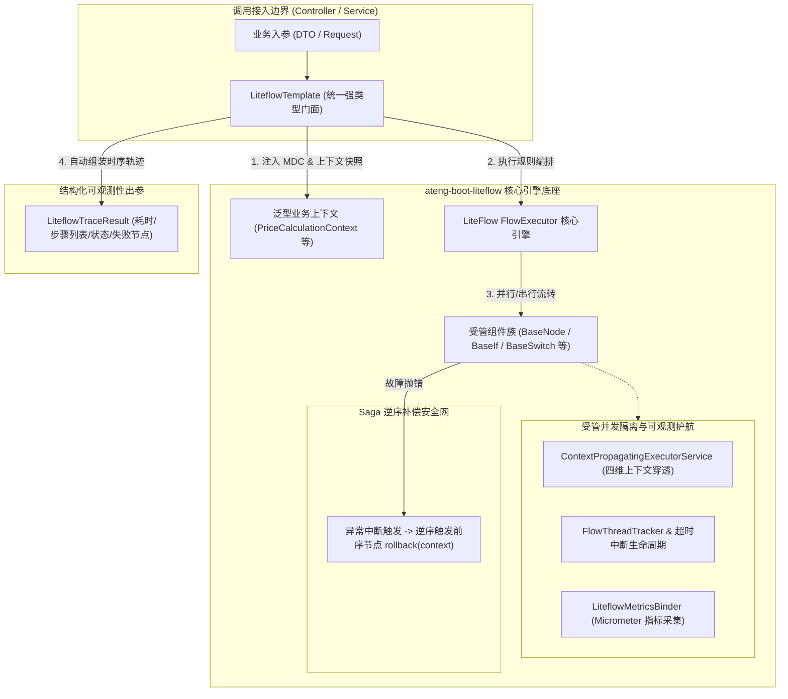

# ateng-boot-liteflow 规则编排与流程管道引擎

> 轻量级、组件化、强类型契约、零臃肿的规则编排与流程管道 Starter 底座。深度集成 LiteFlow 2.12.4.1，提供自动解包与因果异常转译、结构化时序轨迹与全链路 MDC 审计、受管异步流式编排、Saga 逆序反向补偿安全网、外部规则源动态热加载与 Micrometer 生产级全景可观测性。

---

## 0. 特性与公共 API 全景速查矩阵

| 特性分类 | 特性名称 | 核心门面 / 注解 / SPI | 关键配置项 (`ateng.boot.liteflow.*`) | 关键 API 签名 / 核心行为 | 锚定验证源头 (*Test / Sample) |
| :--- | :--- | :--- | :--- | :--- | :--- |
| **执行门面** | 同步强类型解包 | `LiteflowTemplate` | `enabled = true` | `<T> T execute(String, Class<T>)`<br>`<T> T execute(String, Object, Class<T>)` | `LiteflowTemplateTest`<br>`LiteflowPriceCalculationController` |
| **执行门面** | 链路时序轨迹抽取 | `LiteflowTemplate` | `trace.enabled = true`<br>`trace.audit-mdc = true` | `<T> LiteflowTraceResult<T> executeWithTrace(...)`<br>`LiteflowExecutionTrace extractTrace(...)` | `LiteflowObservabilityTest`<br>`LiteflowRiskControlController` |
| **执行门面** | 在线即时 EL 执行 | `LiteflowTemplate` | `enabled = true` | `<T> LiteflowTraceResult<T> executeElWithTrace(String, ...)` | `LiteflowDynamicRuleController` |
| **执行门面** | 多上下文解包编排 | `LiteflowTemplate` | `enabled = true` | `LiteflowResponse execute(String, Object, Class<?>, Class<?>, ...)` | `LiteflowTemplateTest` |
| **执行门面** | 规则链动态热重载 | `LiteflowTemplate` | `enabled = true` | `void reloadChain(String, String)`<br>`boolean containChain(String)` | `LiteflowDynamicRuleController` |
| **决策路由** | 决策路由表（Route Chain）全链路编排 | `LiteflowTemplate` | `enabled = true` | `<T> T executeRoute(String, T)`<br>`<T> T executeRoute(String, Object, T)` | `LiteflowDynamicRuleSourceTest`<br>`LiteflowPromotionRoutingController` |
| **决策路由** | 路由聚合与时序轨迹包装 | `LiteflowTemplate` | `trace.enabled = true` | `<T> LiteflowRouteResult<T> executeRouteWithTrace(...)` | `LiteflowDynamicRuleSourceTest`<br>`LiteflowPromotionRoutingController` |
| **决策路由** | 动态决策路由链热重载 | `LiteflowTemplate` | `enabled = true` | `void reloadRouteChain(String, String, String, String)` | `LiteflowDynamicRuleSourceTest` |
| **执行门面** | 官方原生逃生通道 | `LiteflowTemplate` | `enabled = true` | `LiteflowResponse execute2Resp(...)`<br>`LiteflowResponse execute2RespWithEL(...)` | `LiteflowTemplateTest` |
| **泛型组件** | 普通处理组件基类 | `BaseNodeComponent<T>` | - | `void process(T)`<br>`void rollback(T)`（自动探测并激活 Saga 逆序补偿） | `LiteflowComponentHierarchyTest`<br>`DeductInventoryCmp` |
| **泛型组件** | 逻辑条件分支基类 | `BaseIfComponent<T>` | - | `boolean processIf(T)`<br>强类型条件路由真伪判定 | `LiteflowComponentHierarchyTest`<br>`CheckBlacklistIfCmp` |
| **泛型组件** | 选择分支路由基类 | `BaseSwitchComponent<T>` | - | `String processSwitch(T)`<br>多分支目标组件 ID 强类型决策 | `LiteflowComponentHierarchyTest`<br>`RiskDecisionSwitchCmp` |
| **泛型组件** | 次数循环控制基类 | `BaseForComponent<T>` | - | `int processFor(T)`<br>强类型循环执行次数控制 | `LiteflowComponentHierarchyTest` |
| **泛型组件** | 迭代器循环基类 | `BaseIteratorComponent<T>` | - | `Iterator<?> processIterator(T)`<br>强类型集合迭代循环 | `LiteflowComponentHierarchyTest` |
| **泛型组件** | 条件循环控制基类 | `BaseWhileComponent<T>` | - | `boolean processWhile(T)`<br>强类型循环退出条件判定 | `LiteflowComponentHierarchyTest` |
| **泛型组件** | 循环中断跳出基类 | `BaseBreakComponent<T>` | - | `boolean processBreak(T)`<br>强类型循环中途熔断跳出 | `LiteflowComponentHierarchyTest` |
| **规则源 SPI** | 外部规则源扩展点 | `LiteflowRuleSourceProvider` | `rule-source.type = jdbc/custom` | `List<RuleSourceDefinition> loadRuleSources()` | `LiteflowRuleSourceTest` |
| **规则源 SPI** | 规则源统一调度中心 | `LiteflowRuleSourceManager` | `rule-source.fail-fast = true` | `void refreshAll()`<br>`void refreshChain(String, String)` | `LiteflowRuleSourceTest` |
| **规则热更** | Spring 领域事件总线 | `LiteflowRuleRefreshEvent`<br>`LiteflowRuleRefreshListener` | `enabled = true` | 发布全量或单链规则变更事件，触发即时平滑热生效 | `LiteflowRuleRefreshEventTest`<br>`LiteflowDynamicRuleController` |
| **异步流式** | 四维上下文穿透线程池 | `LiteflowGlobalExecutorBuilder`<br>`ContextPropagatingExecutorService` | `thread-pool.when-max-workers = 32`<br>`thread-pool.when-queue-limit = 1024` | 自动透传 $\langle\text{MDC}, \text{User}, \text{TenantId}, \text{IgnoreTenant}\rangle$ 快照并在任务结束后彻底清理现场 | `LiteflowAsyncContextTest` |
| **异步治理** | 线程跟踪与超时强中断 | `FlowThreadTracker`<br>`FlowTimeoutInterruptionLifeCycle` | `thread-pool.interruption-on-timeout = true` | WHEN 并行超时毫秒级精准中断工作线程，防止野线程悬挂 | `LiteflowAsyncContextTest` |
| **可观测性** | 链路指标全景导出 | `LiteflowMetricsBinder`<br>`LiteflowMetricsAutoConfiguration` | `metrics.enabled = true` | 导出 Prometheus 标准指标：`liteflow.chain.executions`、`liteflow.chain.duration`、`liteflow.node.duration` | `LiteflowObservabilityTest` |

---

## 1. 模块定位与 Maven 坐标

`ateng-boot-liteflow` 是 `ateng-boot` 框架面向复杂业务流程编排、规则决策、状态流转与可编排管道的核心 Starter：
- **拒绝胶水死代码**：以纯原生 Spring Boot 3 自动装配与 JDK 17 泛型自省机制为底座，100% 杜绝侵入式硬编码；
- **传输与持久层解耦**：流程入参/出参与 ORM 实体（Entity）严格解耦，天然契合 DTO/VO 传输模型；
- **高并发与防死锁**：全链路受管线程池支撑，MDC 与业务上下文无损穿透，并行超时中断防悬挂。

```xml
<dependency>
    <groupId>io.github.atengk</groupId>
    <artifactId>ateng-boot-liteflow</artifactId>
</dependency>
```

---

## 2. 核心架构与设计不变量



### 核心设计不变量 (Core Invariants)
1. **显式类型解包不变量**：对外 Public API 一律返回业务声明的强类型上下文 `T`，严禁让调用方强转 `Object` 或手工解析 `slot`；
2. **因果异常链完整传递不变量**：组件抛出的底层异常必须保留完整 `cause`，自动转译为框架受管的 `LiteflowExecutionException`，严禁吞咽异常；
3. **内存真明文与无状态纪律**：组件实例由 Spring 容器单例管理，强制保持严格无状态，业务状态全部收敛在生命周期受限的业务上下文 `T` 中；
4. **确定性资源清理不变量**：MDC 追踪标签与 ThreadLocal 变量在链路结束或线程归还线程池前必须 100% 显式清理，杜绝线程污染。

---

## 3. 强类型泛型受管组件套件

所有流程节点必须继承 `io.github.atengk.boot.liteflow.component` 提供的强类型泛型基类，框架通过 `ComponentContextResolver` 自动在初始化期自省泛型参数 `T`，实现开箱即用的类型安全访问。

### 3.1 泛型组件与类型自适应上下文 (`BaseNodeComponent<T>`)

#### 专属 YAML 配置
```yaml
ateng:
  boot:
    liteflow:
      enabled: true # 开启 LiteFlow 自动装配底座
liteflow:
  enable: true
  rule-source: classpath*:liteflow/*.el.xml # 规则源扫描路径
```

#### 实战业务代码
```java
@Slf4j
@Component("validateOrderCmp")
public class ValidateOrderCmp extends BaseNodeComponent<PriceCalculationContext> {

    @Override
    public void process(PriceCalculationContext context) {
        // 直接获取绑定的业务强类型上下文入参，无需强制类型转换
        log.info("【算价流程】校验订单参数，orderId={}, amount={}", context.getOrderId(), context.getOriginalAmount());
        if (context.getOriginalAmount() == null || context.getOriginalAmount().compareTo(BigDecimal.ZERO) <= 0) {
            throw new BusinessException("订单原始金额必须大于 0");
        }
    }
}
```

#### 核心机制与边界防御
- **泛型智能探测**：`getContext()` 自动自省类定义上声明的业务泛型 `T`，优先从当前执行槽获取对应 Bean，未匹配时平滑降级取首个上下文 Bean；
- **防 NPE 卫语句**：若当前线程或执行槽中未找到任何上下文，直接抛出语义明确的 `IllegalStateException`，阻断空指针蔓延。

---

### 3.2 逻辑控制流组件 (`BaseIfComponent<T>` / `BaseSwitchComponent<T>`)

#### 专属 YAML 配置
```yaml
liteflow:
  # 规则链定义示例：
  # IF(checkBlacklistIfCmp, loanRejectCmp, THEN(WHEN(antiFraudCheckCmp, creditScoreCheckCmp), SWITCH(riskDecisionSwitchCmp).to(loanPassCmp, manualReviewCmp, loanRejectCmp)));
```

#### 实战业务代码
```java
// 1. IF 条件判断组件
@Slf4j
@Component("checkBlacklistIfCmp")
public class CheckBlacklistIfCmp extends BaseIfComponent<RiskApprovalContext> {

    @Override
    public boolean processIf(RiskApprovalContext context) {
        boolean hitBlacklist = context.getIdCard() != null && context.getIdCard().contains("999");
        if (hitBlacklist) {
            log.warn("【风控流程】申请人命中黑名单，直接阻断！applicantId={}", context.getApplicantId());
            context.setRiskLevel("HIGH");
            context.setDecisionReason("命中失信惩戒黑名单");
            return true;
        }
        return false;
    }
}

// 2. SWITCH 决策分流组件
@Slf4j
@Component("riskDecisionSwitchCmp")
public class RiskDecisionSwitchCmp extends BaseSwitchComponent<RiskApprovalContext> {

    @Override
    public String processSwitch(RiskApprovalContext context) {
        int fraudScore = context.getAntiFraudScore();
        int creditScore = context.getCreditScore();

        if (fraudScore >= 80 || creditScore < 550) {
            return "loanRejectCmp"; // 路由至拒贷节点
        }
        if (fraudScore >= 50 || creditScore < 680) {
            return "manualReviewCmp"; // 路由至人工复核节点
        }
        return "loanPassCmp"; // 路由至极速放款节点
    }
}
```

#### 核心机制与边界防御
- `BaseIfComponent` 的 `processIf(context)` 强制返回 `boolean`，无缝对接 LiteFlow `IF(..., ...)` 控制语法；
- `BaseSwitchComponent` 的 `processSwitch(context)` 强制返回目标分支组件 ID 字符串，严格防止魔法值扩散。

---

## 4. 强类型操作门面与受管异步编排

`LiteflowTemplate` 作为统一门面，屏蔽底层 `FlowExecutor` 繁琐细节，内建异常因果转译与 MDC 链路注入。

### 4.1 同步强类型解包与轨迹提取 (`executeWithTrace`)

#### 专属 YAML 配置
```yaml
ateng:
  boot:
    liteflow:
      trace:
        enabled: true       # 启用结构化时序轨迹抽取与构建
        audit-mdc: true     # 将流程 traceId 与执行状态同步注入当前线程 MDC
```

#### 实战业务代码
```java
@Service
@RequiredArgsConstructor
public class PriceService {

    private final LiteflowTemplate liteflowTemplate;

    public PriceCalculationResponse calculate(PriceCalculationRequest request) {
        PriceCalculationContext context = new PriceCalculationContext();
        context.setOrderId(request.getOrderId());
        context.setOriginalAmount(request.getOriginalAmount());

        // 执行规则链并自动提取结构化时序轨迹
        LiteflowTraceResult<PriceCalculationContext> traceResult = liteflowTemplate.executeWithTrace(
                "price-calc-flow", request, context);

        PriceCalculationContext finalCtx = traceResult.getContext();
        LiteflowExecutionTrace trace = traceResult.getTrace();
        
        log.info("流程流转成功，链路步骤: {}, 耗时: {}ms", 
                trace.formatSummary(), trace.getTotalTimeSpentMs());

        return PriceCalculationResponse.builder()
                .finalAmount(finalCtx.getFinalAmount())
                .traceSummary(trace.formatSummary())
                .build();
    }
}
```

#### 核心机制与边界防御
- **结构化轨迹**：`LiteflowExecutionTrace` 精确记录每个节点的执行耗时、成功/失败状态、入参快照与失败原因；
- **全链路 MDC 注入**：自动向当前 MDC 压入 `traceId`，若底层产生异常，异常对象挂载完整时序轨迹，极大简化生产排障。

---

## 5. Saga 逆序反向补偿与故障防御

分布式或复杂本地事务链中，若前序节点已发生不可逆的物理状态变更（如扣减库存、派发运单），在后序节点发生致命故障时，框架自动启动 Saga 逆序反向补偿。

### 5.1 自动探测与逆序回滚机制 (`rollback`)

#### 专属 YAML 配置
```yaml
ateng:
  boot:
    liteflow:
      enabled: true                     # 开启 LiteFlow 自动装配底座
liteflow:
  enable: true
  # 履约编排规则链定义示例：
  # THEN(deductInventoryCmp, createWarehouseOrderCmp, sendShippingNoticeCmp)
  # 当下游 sendShippingNoticeCmp 发生故障，LiteFlow 将自动逆序触发 createWarehouseOrderCmp 与 deductInventoryCmp 的 rollback 补偿
```

#### 实战业务代码
```java
// 节点 1：扣减库存（实现 rollback(T) 自动激活补偿）
@Slf4j
@Component("deductInventoryCmp")
public class DeductInventoryCmp extends BaseNodeComponent<OrderFulfillmentContext> {

    @Override
    public void process(OrderFulfillmentContext ctx) {
        log.info("【正向执行】锁定并扣减库存: skuId={}, qty={}", ctx.getSkuId(), ctx.getQuantity());
        ctx.setInventoryDeducted(true);
    }

    @Override
    public void rollback(OrderFulfillmentContext ctx) {
        log.warn("【逆向补偿】解冻释放已锁定库存: skuId={}, qty={}", ctx.getSkuId(), ctx.getQuantity());
        ctx.setInventoryDeducted(false);
        ctx.addCompensationLog("【库存服务】解冻已锁定库存: skuId=" + ctx.getSkuId());
    }
}

// 节点 2：派发物流运单（实现 rollback(T) 自动激活补偿）
@Slf4j
@Component("createWarehouseOrderCmp")
public class CreateWarehouseOrderCmp extends BaseNodeComponent<OrderFulfillmentContext> {

    @Override
    public void process(OrderFulfillmentContext ctx) {
        log.info("【正向执行】创建仓储运单: orderId={}", ctx.getOrderId());
        ctx.setWarehouseOrderCreated(true);
    }

    @Override
    public void rollback(OrderFulfillmentContext ctx) {
        log.warn("【逆向补偿】作废已生成运单: orderId={}", ctx.getOrderId());
        ctx.setWarehouseOrderCreated(false);
        ctx.addCompensationLog("【仓储物流】作废出库调度运单: orderId=" + ctx.getOrderId());
    }
}
```

#### 核心机制与边界防御
- **反射自动探测**：`BaseNodeComponent` 在构造阶段自省子类是否覆写了 `rollback` 方法；若覆写，自动调用 `this.setRollback(true)` 向 LiteFlow 引擎登记；
- **确定性逆序执行**：当后续节点（如 `sendShippingNoticeCmp`）抛出异常阻断流程时，引擎严格按照已成功执行节点的**绝对逆序**依次触发 `rollback`，实现完整的事务最终一致性补偿。

---

## 6. 多源动态规则与平滑热重载套件

支持在不重启应用的前提下，动态热更新已存在的规则链、即时在线执行 EL 表达式，以及通过 Spring 领域事件进行无锁平滑热更。

### 6.1 规则热重载与在线即时 EL 执行

#### 专属 YAML 配置
```yaml
ateng:
  boot:
    liteflow:
      enabled: true
      rule-source:
        type: custom                   # 外部规则源类型（可选: none, jdbc, custom；默认: none）
        fail-fast: false               # 动态规则加载失败是否阻断启动（默认: true）
```

#### 实战业务代码
```java
@Validated
@RestController
@RequestMapping("/sample/liteflow/dynamic")
@RequiredArgsConstructor
public class LiteflowDynamicRuleController {

    private final LiteflowTemplate liteflowTemplate;
    private final ApplicationEventPublisher eventPublisher;

    // 1. 在线即时编译并执行动态 EL 表达式（无需预先定义 chainId）
    @PostMapping("/execute-el")
    public Result<DynamicElExecuteResponse> executeEl(@Valid @RequestBody DynamicElExecuteRequest req) {
        LiteflowTraceResult<DynamicFlowContext> result = liteflowTemplate.executeElWithTrace(
                req.getEl(), req.getPayload(), DynamicFlowContext.class);
        return Result.success(DynamicElExecuteResponse.builder()
                .success(true)
                .outputData(result.getContext().getAttributes())
                .traceSummary(result.getTrace().formatSummary())
                .build());
    }

    // 2. 在线热更新现有规则链
    @PostMapping("/reload-chain")
    public Result<Boolean> reloadChain(@Valid @RequestBody DynamicChainReloadRequest req) {
        liteflowTemplate.reloadChain(req.getChainId(), req.getEl());
        return Result.success(true);
    }

    // 3. 探测指定 chainId 是否已被加载就绪
    @GetMapping("/contain-chain")
    public Result<Boolean> containChain(@NotBlank @RequestParam String chainId) {
        return Result.success(liteflowTemplate.containChain(chainId));
    }

    // 4. 通过领域事件发布全量/增量热更新广播
    @PostMapping("/refresh-event")
    public Result<String> refreshEvent(@RequestParam(required = false) String chainId, @RequestParam(required = false) String el) {
        if (chainId != null && !chainId.isBlank() && el != null && !el.isBlank()) {
            eventPublisher.publishEvent(LiteflowRuleRefreshEvent.refreshChain(this, chainId, el));
            return Result.success("单链热更事件已发布: chainId=" + chainId);
        } else {
            eventPublisher.publishEvent(LiteflowRuleRefreshEvent.refreshAll(this));
            return Result.success("全量规则源热重载事件已发布");
        }
    }
}
```

#### 核心机制与边界防御
- **无锁平滑热更**：`reloadChain` 通过 LiteFlow 原生 `FlowBus` 原子刷新链定义缓存，新进请求即刻路由至新规则版本，存量正在流转的请求不受版本突变影响；
- **动态 EL 隔离**：`executeElWithTrace` 在执行完毕后自动销毁瞬态链定义，杜绝无界动态 EL 导致元空间或链缓存无界膨胀。

---

## 7. 线程池受管治理与可观测性套件

### 7.1 上下文穿透与超时强中断治理

#### 专属 YAML 配置
```yaml
ateng:
  boot:
    liteflow:
      thread-pool:
        when-max-workers: 32            # LiteFlow WHEN 并行流转最大工作线程数
        when-queue-limit: 1024          # 任务等待队列容量硬阈值
        interruption-on-timeout: true   # 开启超时精准强中断生命周期监听器
liteflow:
  when-max-wait-seconds: 15            # WHEN 并行组件最大等待耗时阈值
```

#### 核心机制与边界防御
- **四维快照全链路穿透**：底层接入受管 `ContextPropagatingExecutorService`，向子线程全真复制 $\langle\text{MDC}, \text{User}, \text{TenantId}, \text{IgnoreTenant}\rangle$ 四维快照，任务执行完毕后在 `finally` 中严格清理；
- **防野线程挂死**：挂载 `FlowThreadTracker` 与 `FlowTimeoutInterruptionLifeCycle`，当并行等待超时触发时，精准向对应的工作线程发送 `interrupt()` 信号，避免不可控的下游 IO 慢调用耗尽系统工作线程。

---

### 7.2 Micrometer 生产级全景指标导出

#### 专属 YAML 配置
```yaml
ateng:
  boot:
    liteflow:
      metrics:
        enabled: true       # 启用 Micrometer 指标自动收集与导出
        metric-prefix: "liteflow" # Prometheus 指标前缀
```

#### 核心监控指标清单
- `liteflow.chain.executions`：Counter 计数器，记录各规则链的调用总量及 `status=success/failure` 分布；
- `liteflow.chain.duration`：Timer 计时器，记录规则链整体流转耗时分布（支持 P50, P90, P99 分位数）；
- `liteflow.node.duration`：Timer 计时器，记录各组件节点的细粒度耗时分布，快速定位下游慢组件瓶颈。

---

## 8. 完整 YAML 配置属性清单 (全量速查附录)

以下为 `ateng-boot-liteflow` 支持的完整配置属性列表，统一配置前缀为 `ateng.boot.liteflow.*`：

```yaml
ateng:
  boot:
    liteflow:
      # 是否开启 ateng-boot-liteflow 自动装配扩展底座（默认: true）
      enabled: true

      # 链路时序轨迹抽取与全链路 MDC 审计配置
      trace:
        # 是否开启结构化时序轨迹抽取与构建（默认: true）
        enabled: true
        # 是否将 LiteFlow traceId 与执行状态同步注入当前线程 MDC（默认: true）
        audit-mdc: true

      # 受管并行线程池与超时治理配置
      thread-pool:
        # WHEN 并行组件执行的最大工作线程数（默认: 32）
        when-max-workers: 32
        # WHEN 并行组件等待队列容量硬阈值（默认: 1024）
        when-queue-limit: 1024
        # 超时时是否对并行工作线程执行强中断 interrupt（默认: true，防止野线程悬挂）
        interruption-on-timeout: true

      # 外部规则源扩展 SPI 配置
      rule-source:
        # 外部规则源类型（可选: none, jdbc, custom；默认: none）
        type: none
        # 启动时规则源加载失败是否快速失败阻断启动（默认: true）
        fail-fast: true

      # Micrometer 生产级可观测性指标监控配置
      metrics:
        # 是否启用 Micrometer 规则链与节点性能指标导出（默认: true）
        enabled: true
        # 指标名称统一前缀（默认: "liteflow"）
        metric-prefix: "liteflow"
```
