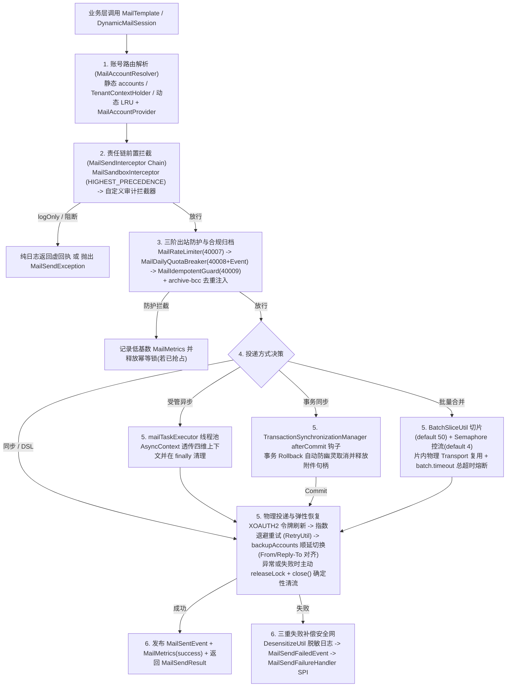

# ateng-boot-mail 邮件通信与模板通知基础设施

> 面向企业级生产就绪的纯原生出站 SMTP 邮件通信与模板通知基础设施 Starter，支持多账号静态/动态双轨路由、多种认证模式（含 `XOAUTH2` 令牌自动刷新）、三阶出站防护（频控/日配额/幂等）、`backupAccounts` 主备顺延容灾、分片受控并发与片内 `Transport` 复用批量合并、`SendAfterCommit` 事务感知与受管异步四维上下文透传、多模测试安全沙箱、国际化多语言模板渲染、协议合规标头、RFC 6266 大附件流式防爆、全生命周期事件及低基数 Micrometer 指标监控。

---

## 0. 特性与公共 API 全景速查矩阵 (Feature & API Panorama Matrix)

| 特性分类 | 特性名称 | 核心门面 / 注解 / SPI | 关键配置项 (`ateng.boot.mail.*`) | 关键 API 签名 / 核心行为 | 锚定验证源头 (`*Test` / Sample) |
| :--- | :--- | :--- | :--- | :--- | :--- |
| **基础收发与 DSL** | 同步文本 / HTML / DSL 极简发信 | `MailTemplate`<br>`MailMessage`<br>`MailSendResult` | `enabled`<br>`default-account`<br>`allow-empty-accounts`<br>`host` / `port` / `accounts.*` | `send(MailMessage)` / `send(Consumer<MailMessage>)`<br>`sendText(...)` / `sendHtml(...)`<br>同步返回含 `messageId`、`recipients`、`duration` 的 `MailSendResult` | `MailTemplateGreenMailTest`<br>`SampleMailIntegrationTest`<br>`MailBasicController`<br>`MailGovernanceController` |
| **多语言模板渲染** | 多引擎模板 SPI 与 `Locale` 级联寻址 | `MailTemplate`<br>`MailTemplateRenderer`<br>`ThymeleafMailTemplateRenderer`<br>`FreemarkerMailTemplateRenderer`<br>`SimpleMailTemplateRenderer`<br>`MailTemplateResourceUtil` | `template.html-escape` | `renderTemplate(templateName, model, [Locale])`<br>`sendTemplate(...)` / `sendTemplateAsync(...)`<br>`MailTemplateResourceUtil.buildLocaleCandidateNames(...)` / `resolveExistingTemplateName(...)` / `validateSafeTemplateName(...)`<br>支持 `_en_US` $\rightarrow$ `_en` $\rightarrow$ 基础模板级联探测与目录穿越防御 | `ThymeleafMailTemplateRendererTest`<br>`FreemarkerMailTemplateRendererTest`<br>`SimpleMailTemplateRendererTest`<br>`MailTemplateRendererI18nTest`<br>`MailTemplateResourceUtilTest`<br>`MailBasicController`<br>`MailGovernanceController` |
| **流式附件与内联** | RFC 6266 流式防爆附件与正交 Inline CID | `MailMessage`<br>`MailAttachment`<br>`MailInlineResource` | `max-attachment-size`（默认 `20MB`）<br>`max-total-size`（默认 `50MB`） | `MailAttachment.of(filename, File\|byte[]\|InputStreamSource\|Resource\|InputStream)`<br>`MailInlineResource.of(contentId, File\|byte[]\|InputStreamSource\|Resource, contentType)`<br>`message.attach(...)` / `message.inline(...)`<br>RFC 2231/5987 文件名防乱码、双重前置容量 Fail-Fast 与 `close()` 确定性清理 | `MailAttachmentTest`<br>`MailInlineResourceTest`<br>`MailMessageTest`<br>`MailTemplateGreenMailTest`<br>`SampleMailIntegrationTest`<br>`MailMediaController` |
| **静态与动态账号** | 多账号隔离注册表与外部懒加载 LRU 池 | `MailAccountRegistry`<br>`MailAccountResolver`<br>`TenantMailAccountResolver`<br>`MailAccountProvider`<br>`DynamicMailSession`<br>`MailAccount` | `max-dynamic-accounts`（默认 `100`）<br>`accounts.<name>.*` | `MailTemplate.forDynamicAccount(MailAccount)`<br>`evictDynamicAccount(accountName)` / `clearDynamicAccounts()`<br>`MailAccountRegistry`: `register` / `unregister` / `getDynamic` / `getOrCreateDynamic` / `evictDynamic` / `clearDynamic`<br>结合 `TenantContextHolder` 透明路由租户账号，LRU 池化与 `ReentrantLock` 并发防 Pinning | `MailAccountRegistryTest`<br>`MailAccountResolverTest`<br>`MailTemplateGreenMailTest`<br>`SampleMailIntegrationTest`<br>`MailAccountController`<br>`MailGovernanceController` |
| **认证扩展与探活** | `AUTO`/`PASSWORD`/`NONE`/`XOAUTH2` 认证与物理探针 | `AuthMode`<br>`MailAccessTokenProvider`<br>`MailTemplate`<br>`DynamicMailSession`<br>`MailAccountRegistry` | `auth-mode` / `accounts.*.auth-mode`<br>`access-token` / `ssl-trust`<br>`connection-timeout` / `read-timeout` / `write-timeout` | `AuthMode`: `AUTO`、`PASSWORD`、`NONE`、`XOAUTH2`<br>`MailAccessTokenProvider`: `getAccessToken` / `refreshAccessToken`（鉴权失败单次刷新重试）<br>`boolean testConnection([String\|MailAccount])` / `void testConnectionOrThrow([String\|MailAccount])`<br>零测试邮件真实握手与 `sslTrust` 自签名网关校验控制 | `MailAccountRegistryTest`<br>`AtengMailAutoConfigurationTest`<br>`MailTemplateGreenMailTest`<br>`SampleMailIntegrationTest`<br>`MailAccountController` |
| **批量合并与事务** | 分片并发、片内 `Transport` 复用与事务同步 | `MailTemplate`<br>`DynamicMailSession`<br>`BatchMailSendResult`<br>`MailSendResultItem` | `batch.concurrency`（默认 `4`）<br>`batch.slice-size`（默认 `50`）<br>`batch.reuse-transport`（默认 `true`）<br>`batch.timeout`（默认 `5m`）<br>`async.*` | `sendBatch(List<MailMessage>)` / `sendBatchWithAccount(...)` / `sendBatchAsync(...)`<br>`sendBatchAfterCommit(...)` / `sendBatchAsyncAfterCommit(...)`<br>`sendAfterCommit(...)` / `sendAsyncAfterCommit(...)`（含文本/HTML/模板重载与 DSL）<br>基于 `BatchSliceUtil` 切片与 `Semaphore` 控流，Fail-Safe 聚合回执与事务回滚防幽灵撤销 | `BatchMailSendResultTest`<br>`MailTemplateGreenMailTest`<br>`SampleMailIntegrationTest`<br>`MailReliableController`<br>`MailGovernanceController` |
| **受管异步执行器** | 平台/虚拟双模线程池与四维上下文透传 | `MailTemplate`<br>`mailTaskExecutor`<br>`AsyncPoolProperties` | `async.enabled` / `async.mode`<br>`async.core-pool-size` / `async.max-pool-size`<br>`async.queue-capacity` / `async.keep-alive`<br>`async.thread-name-prefix` / `async.virtual-thread-name-prefix`<br>`async.concurrency-limit` / `async.rejected-policy` | `sendAsync(MailMessage)` / `sendAsync(Consumer<MailMessage>)`<br>`sendTextAsync(...)` / `sendHtmlAsync(...)`<br>基于 `ContextCopyingTaskDecorator` 透传 `<MDC, User, TenantId, IgnoreTenant>` 四维上下文并在 `finally` 清理 | `AtengMailAutoConfigurationTest`<br>`MailTemplateGreenMailTest`<br>`SampleMailIntegrationTest`<br>`MailReliableController` |
| **重试与顺延容灾** | 指数退避重试与 `backupAccounts` 主备切换 | `MailProperties`<br>`MailRetryProperties`<br>`MailFailoverProperties`<br>`MailAccount` | `retry.enabled` / `retry.max-attempts` / `retry.delay` / `retry.multiplier` / `retry.max-delay` / `retry.jitter`<br>`failover.enabled` / `failover.override-from-on-switch`<br>`backup-accounts` / `accounts.*.backup-accounts` | 主账号重试耗尽后按 `backupAccounts` 顺延切换重试；`override-from-on-switch=true` 时自动对齐备用账号 `From` 域并将原 `From` 写入 `Reply-To` | `MailTemplateGreenMailTest`<br>`SampleMailIntegrationTest`<br>`MailGovernanceController` |
| **三阶出站防护** | 频率限制、日配额硬熔断与业务幂等防重 | `MailRateLimiter`（`InMemory*` / `Redis*`）<br>`MailDailyQuotaBreaker`（`InMemory*` / `Redis*`）<br>`MailIdempotentGuard`（`InMemory*` / `Redis*`）<br>`MailQuotaExceededEvent` | `rate-limit.*`<br>`quota.*`<br>`idempotent.*`<br>`fail-open-on-redis-error`（默认 `true`） | `MailRateLimiter.tryAcquire(...)`（账号令牌桶 + 收件人滑窗，触发 `40007`）<br>`MailDailyQuotaBreaker.tryConsume(...)`（触发 `40008` 并同步发布 `MailQuotaExceededEvent`）<br>`MailIdempotentGuard`: `tryAcquire` / `releaseLock` / `isLocked`（`bizId` 触发 `40009`，失败主动放锁） | `MailOutboundGuardsTest`<br>`MailTemplateGreenMailTest`<br>`SampleMailIntegrationTest`<br>`MailGovernanceController` |
| **合规协议与沙箱** | 优先级、回执、归档、退信/退订与沙箱防漏 | `MailPriority`<br>`MailMessage`<br>`MailSandboxInterceptor`<br>`MailSendInterceptor` | `archive-bcc` / `accounts.*.archive-bcc`<br>`sandbox.enabled` / `sandbox.allowed-recipients` / `sandbox.redirect-to` / `sandbox.log-only` | `message.priority(...)` / `readReceiptTo(...)` / `requestReadReceipt(...)`<br>`message.returnPath(...)` / `listUnsubscribe(...)` / `listUnsubscribePost(...)` / `replyTo(...)`<br>`MailSandboxInterceptor`（最高优先级 `HIGHEST_PRECEDENCE`）：白名单通配放行、非白名单重定向并强制清空 `Cc`/`Bcc`、`logOnly` 纯日志返虚回执 | `MailPriorityAndArchiveBccTest`<br>`MailSandboxInterceptorTest`<br>`MailTemplateGreenMailTest`<br>`SampleMailIntegrationTest`<br>`MailGovernanceController` |
| **事件、补偿与异常** | 生命周期事件总线、失败补偿网与错误码体系 | `MailSendingEvent` / `MailSentEvent` / `MailSendFailedEvent`<br>`MailAccountEvictEvent`<br>`MailQuotaExceededEvent`<br>`MailSendFailureHandler`<br>`MailSendException` / `MailResultCode` | - | `MailSendFailureHandler.onFailure(message, cause)`<br>因果转译全覆盖 `MailResultCode`（`40001~40009`、`50001~50003`），100% 保留原始 `cause` 与脱敏日志 | `MailResultCodeTest`<br>`MailSendExceptionTest`<br>`MailTemplateGreenMailTest`<br>`SampleMailIntegrationTest` |
| **度量与健康探针** | 低基数 Micrometer 指标与静态账号探活 | `MailMetricsRecorder`<br>`MailMetrics`<br>`MailSendOutcome`<br>`MailSafeHealthIndicator`（Observability） | `ateng.boot.observability.health.mail.enabled`<br>`ateng.boot.observability.health.mail.cache-ttl`（默认 `60s`） | 导出 `ateng.mail.send.count`、`ateng.mail.send.duration`、`ateng.mail.retry.count`、`ateng.mail.failover.count` 及静态/动态账号 `Gauge`；静态账号探活带 `60s` 防刷缓存 | `MailMetricsTest`<br>`MailSafeHealthIndicatorTest`<br>`SampleMailIntegrationTest`<br>`MailGovernanceController` |

---

## 1. 模块定位与快速起步 (Quick Start & Happy Path)

### 1.1 模块定位与痛点解决
`ateng-boot-mail` 面向生产高并发微服务场景构建，彻底消除原生 `JavaMailSender` 裸用的五大隐患：
1. **单通道瓶颈与租户串号**：支持声明式静态多账号池化隔离、`MailAccountProvider` 外部懒加载、`TenantContextHolder` 多租户路由及双轨校验；
2. **主通道不可用与认证僵化**：支持 `backupAccounts` 顺延容灾与 `From`/`Reply-To` 自动对齐，原生支持 `AUTO`/`PASSWORD`/`NONE`/`XOAUTH2` 动态刷新；
3. **网关封禁与业务重复骚扰**：提供批量切片受控并发（`BatchSliceUtil` + 片内 `Transport` 复用）与账号限流、单日配额熔断、`bizId` 幂等防重三阶出站防护；
4. **幽灵邮件与大附件 OOM**：通过 `sendAfterCommit`/`sendBatchAfterCommit` 绑定事务提交钩子，挂载流式附件前双重容量校验并 `close()` 确定性清理；
5. **非生产误发风险**：通过前置 `MailSandboxInterceptor` 实现白名单放行、重定向清空真实抄/密送及纯日志模拟发信。

### 1.2 Maven 引入坐标

**方式一：通过 `ateng-boot-bom` 统一纳管版本号（推荐）**
```xml
<dependencyManagement>
    <dependencies>
        <dependency>
            <groupId>io.github.atengk</groupId>
            <artifactId>ateng-boot-bom</artifactId>
            <version>1.2.0</version>
            <type>pom</type>
            <scope>import</scope>
        </dependency>
    </dependencies>
</dependencyManagement>

<dependencies>
    <dependency>
        <groupId>io.github.atengk</groupId>
        <artifactId>ateng-boot-mail</artifactId>
    </dependency>
</dependencies>
```

**方式二：独立微服务显式指定版本号引入**
```xml
<dependency>
    <groupId>io.github.atengk</groupId>
    <artifactId>ateng-boot-mail</artifactId>
    <version>1.2.0</version>
</dependency>
```

**按需选配增强组件（均由 BOM 锁定版本，按实际业务按需引入）**：
```xml
<!-- Thymeleaf 富文本模板引擎（按需选配） -->
<dependency>
    <groupId>org.thymeleaf</groupId>
    <artifactId>thymeleaf-spring6</artifactId>
</dependency>

<!-- Freemarker 模板引擎（按需选配，与 compliance-notice.ftl 等场景搭配） -->
<dependency>
    <groupId>org.freemarker</groupId>
    <artifactId>freemarker</artifactId>
</dependency>

<!-- 分布式限流 / 日配额 / 幂等防重（按需接入，无 Redis 时自动降级单机内存 LRU） -->
<dependency>
    <groupId>io.github.atengk</groupId>
    <artifactId>ateng-boot-redis</artifactId>
</dependency>

<!-- 云原生 Actuator 健康探针（MailSafeHealthIndicator）与 Prometheus 指标导出 -->
<dependency>
    <groupId>io.github.atengk</groupId>
    <artifactId>ateng-boot-observability</artifactId>
</dependency>
```

### 1.3 最小可用配置与极简实战调用

#### 最小可用配置 (`application.yml`)
既支持 **多账号字典配置**（`accounts.<name>.*`），也支持面向单账号微服务的 **顶级扁平快捷配置**（`ateng.boot.mail.host/port/...`）；纯动态账号场景可设置 `allow-empty-accounts: true`。

```yaml
ateng:
  boot:
    mail:
      enabled: true
      default-account: default
      accounts:
        default:
          host: smtp.example.com
          port: 465
          ssl: true
          username: notification@example.com
          password: YOUR_SMTP_AUTH_CODE
          from: notification@example.com
          from-name: Ateng官方通知
```

#### 极简实战代码（命令式 + 函数式 DSL）
```java
@Service
@RequiredArgsConstructor
public class NotificationMailService {

    private final MailTemplate mailTemplate;

    public MailSendResult sendWelcome(String to, String username) {
        return mailTemplate.sendText(
                to,
                "欢迎加入 Ateng Boot",
                "尊敬的 " + username + "，恭喜您成功开通企业服务账户！"
        );
    }

    public MailSendResult sendByDsl(String to, String subject, String content) {
        return mailTemplate.send(message -> message
                .to(to)
                .subject(subject)
                .text(content));
    }
}
```

---

## 2. 核心架构与设计不变量 (Architecture & Design Invariants)

### 2.1 出站编排流水线与容灾拓扑



### 2.2 五大核心设计不变量
1. **内存真明文与日志全脱敏不变量（ADR-0012）**：实体与内存模型中始终保持真明文凭据；日志输出全量使用 `DesensitizeUtil.email(...)` 脱敏，严禁直出明文邮箱、密码或 Access Token；
2. **传输契约绝对隔离（Zero-Entity-Leakage）**：Web Controller 统一采用 Request DTO 入参 + JSR-303 Fail-Fast 校验，显式返回强类型 `Result<T>`，严禁暴露 ORM 实体；
3. **确定性资源释放**：`MailMessage` 实现 `AutoCloseable`，任何发信完成、批量超时或异常中止（包括事务回滚）均在 `finally` / `afterCompletion` 中关闭附件与内联流句柄、归还或关闭片内 `Transport`；
4. **虚拟线程与四维上下文兼容（ADR-0029）**：所有并发容器/LRU 缓存/OAuth 令牌更新临界区统一采用 `ReentrantLock` 替代 `synchronized`，杜绝 JDK 21+ 虚拟线程 Carrier Pinning；异步与批量任务自动透传 $\langle\text{MDC traceId}, \text{User}, \text{TenantId}, \text{IgnoreTenant}\rangle$ 并在结束时清理；
5. **因果异常链完整性**：底层 JavaMail / IO / 模板异常统一转译为 `MailSendException(MailResultCode, message, cause)`，100% 保留原始 `Throwable cause`。

---

## 3. 基础通信、多语言模板渲染与合规多媒体套件

### 3.1 纯文本与 HTML 发信（含 Freemarker 合规协议头实战）

#### 本节专属 YAML 配置
```yaml
ateng:
  boot:
    mail:
      accounts:
        default:
          host: 127.0.0.1
          port: 3025
          ssl: false
          username: default@example.com
          password: YOUR_EMAIL_AUTH_CODE
          from: default@example.com
          from-name: Ateng官方通知
```

#### 1:1 逆向提取 Sample 代码（来源：`MailBasicController` & `MailGovernanceService`）
```java
// 1. MailBasicController: 显式返回 Result<MailSendResult>，入参经过 @Valid JSR-303 校验
@PostMapping("/simple-text")
public Result<MailSendResult> sendSimpleText(@Valid @RequestBody SimpleTextMailRequest request) {
    MailSendResult result = mailScenarioService.sendSimpleText(
            request.getTo(),
            request.getSubject(),
            request.getContent()
    );
    return Result.success(result);
}

// 2. MailGovernanceService: Freemarker 渲染 + 单封隔离 Return-Path + RFC 2369/8058 一键退订标头
public MailSendResult sendFreemarkerCompliance(ComplianceFreemarkerRequest request) {
    log.info("Running Freemarker compliance mail demo to [{}], returnPath=[{}]",
            DesensitizeUtil.email(request.getTo()), DesensitizeUtil.email(request.getReturnPath()));

    String renderedHtml = FREEMARKER_RENDERER.render("mail/compliance-notice.ftl", Map.of(
            "username", request.getUsername(),
            "noticeTitle", request.getNoticeTitle()
    ));

    return mailTemplate.send(message -> message
            .to(request.getTo())
            .subject(request.getNoticeTitle())
            .html(renderedHtml)
            .returnPath(request.getReturnPath())
            .listUnsubscribe(request.getListUnsubscribe())
            .listUnsubscribePost(request.getListUnsubscribePost()));
}
```

#### 机制与边界说明
- **防标头 CRLF 注入**：`MailMessage` 对 `subject`、`fromName`、`headers`、`listUnsubscribe`、`listUnsubscribePost` 自动剔除 `\r`、`\n`、`\0`；
- **单封独立 `Return-Path`**：底层使用 `SMTPMessage.setEnvelopeFrom(...)` 写入单封 SMTP Envelope `MAIL FROM`，**绝不修改或污染共享 `JavaMailSenderImpl` 的 `Session` 属性**；
- **双模板引擎共存方案**：若工程同时引入 Thymeleaf 与 Freemarker，可在 `application.yml` 配置 `spring.autoconfigure.exclude: org.springframework.boot.autoconfigure.freemarker.FreeMarkerAutoConfiguration` 保留 Thymeleaf 为默认 `mailTemplate` 引擎，并按需独立构建带 `HTMLOutputFormat.INSTANCE` 防注入的 `FreemarkerMailTemplateRenderer`。

---

### 3.2 模板渲染引擎与多语言国际化级联寻址

#### 本节专属 YAML 配置
```yaml
ateng:
  boot:
    mail:
      template:
        html-escape: false   # 内置 SimpleMailTemplateRenderer 是否开启 HTML 转义防 XSS（默认 false 保持兼容）

spring:
  thymeleaf:
    prefix: classpath:/templates/
    suffix: .html
    mode: HTML
    encoding: UTF-8
```

#### 1:1 逆向提取 Sample 代码（来源：`MailBasicController` & `MailScenarioService`）
```java
@PostMapping("/i18n-template")
public Result<MailSendResult> sendI18nTemplate(@Valid @RequestBody UserVerificationMailRequest request,
                                              @RequestParam(defaultValue = "zh_CN") String language) {
    Locale locale = Locale.forLanguageTag(language.replace('_', '-'));
    MailSendResult result = mailScenarioService.sendLocalizedVerifyCode(
            request.getTo(),
            request.getUsername(),
            request.getVerifyCode(),
            locale
    );
    return Result.success(result);
}
```

#### 机制与边界说明
- **类路径安全级联寻址**：`MailTemplateResourceUtil` 依次探测 `""`、`templates/`、`templates/mail/`、`mail/` 前缀，生成 `<base>_en_US.html` $\rightarrow$ `<base>_en.html` $\rightarrow$ `<base>.html` 有序候选列表，并校验拒绝任何含 `..` 目录穿越或 `\0` 空字符的模板名称（触发 `MAIL_TEMPLATE_RENDER_ERROR` `40004`）；
- **Locale 自动兜底**：未显式传入 `Locale` 时自动探测 Spring `LocaleContextHolder.getLocale()`。

---

### 3.3 RFC 6266 流式防爆附件与正交内联资源 (Inline CID)

#### 本节专属 YAML 配置
```yaml
ateng:
  boot:
    mail:
      max-attachment-size: 20MB   # 单个附件容量硬上限（DataSize）
      max-total-size: 50MB        # 全部附件与内联资源合计容量硬上限（DataSize）
```

#### 1:1 逆向提取 Sample 代码（来源：`MailMediaController` & `MailScenarioService`）
```java
// 1. 挂载流式附件（来源：MailScenarioService#sendAttachmentStatement & #sendWithAttachment）
public MailSendResult sendAttachmentStatement(AttachmentMailRequest request) {
    if (request == null) {
        throw new IllegalArgumentException("AttachmentMailRequest must not be null");
    }
    String fileName = request.getFileName() != null && !request.getFileName().isBlank()
            ? request.getFileName() : "月度电子账单.pdf";
    byte[] demoContent = generateSimulatedPdfStatement(request.getContent());
    return sendWithAttachment(request.getTo(), request.getSubject(), request.getContent(), fileName, demoContent);
}

public MailSendResult sendWithAttachment(String to, String subject, String text, String fileName, byte[] content) {
    log.info("Sending email with attachment [{}] to [{}]", fileName, DesensitizeUtil.email(to));
    MailMessage message = new MailMessage()
            .to(to)
            .subject(subject)
            .text(text)
            .attachment(MailAttachment.of(fileName, content));
    return mailTemplate.send(message);
}

// 2. 挂载正交内联图片 (Inline CID) 图文混排（来源：MailScenarioService#sendWithInline）
public MailSendResult sendWithInline(String to, String subject, String title) {
    log.info("Sending inline media email to [{}]", DesensitizeUtil.email(to));
    String safeTitle = title != null && !title.isBlank() ? title : "企业通知";
    String html = "<html><body><h2>" + safeTitle + "</h2><p>品牌标识混排：</p></body></html>";
    byte[] logoBytes = new byte[]{
            (byte) 0x89, 0x50, 0x4E, 0x47, 0x0D, 0x0A, 0x1A, 0x0A,
            0x00, 0x00, 0x00, 0x0D, 0x49, 0x48, 0x44, 0x52,
            0x00, 0x00, 0x00, 0x01, 0x00, 0x00, 0x00, 0x01,
            0x08, 0x06, 0x00, 0x00, 0x00, 0x1F, 0x15, (byte) 0xC4, (byte) 0x89
    };
    MailMessage message = new MailMessage()
            .to(to)
            .subject(subject)
            .html(html)
            .inline(MailInlineResource.of("companyLogo", logoBytes, "image/png"));
    return mailTemplate.send(message);
}
```

#### 机制与边界说明
- **双重容量熔断与 OOM 防御**：构造与物理装填前校验 `max-attachment-size` 与 `max-total-size`，流式读取时通过有界流（`BoundedInputStream`）强制截断超限输入，触发 `MAIL_ATTACHMENT_SIZE_EXCEEDED`（`40003`）或 `MAIL_TOTAL_SIZE_EXCEEDED`（`40005`）；
- **正交通道与文件名防乱码**：`attach(...)` 与 `inline(...)` 在底层 MIME 多部结构中严格隔离；文件名按 RFC 2231/5987 规范编码并过滤非法路径符号。

---

## 4. 多账号路由、认证扩展与高可用容灾套件

### 4.1 静态多账号、多租户上下文路由与动态 LRU 缓存清理

#### 本节专属 YAML 配置
```yaml
ateng:
  boot:
    mail:
      default-account: default
      max-dynamic-accounts: 100    # 动态账号配置及 JavaMailSenderImpl LRU 池上限
      accounts:
        default:
          host: 127.0.0.1
          port: 3025
          ssl: false
        ops:
          host: 127.0.0.1
          port: 3025
          ssl: false
```

#### 1:1 逆向提取 Sample 代码（来源：`MailGovernanceService` & `MailAccountController`）
```java
// 1. 依托 TenantContextHolder 自动路由租户账号并在 finally 确定性清理上下文
public MailSendResult sendWithTenantContext(TenantRouteMailRequest request) {
    log.info("Running tenant context routing demo, tenantId=[{}], to=[{}]",
            request.getTenantId(), DesensitizeUtil.email(request.getTo()));
    TenantContextHolder.setTenantId(request.getTenantId());
    try {
        return mailTemplate.sendText(request.getTo(), request.getSubject(), request.getContent());
    } finally {
        TenantContextHolder.clear();
    }
}

// 2. 动态账号精细驱逐、事件集群广播驱逐与全量缓存清理
mailTemplate.evictDynamicAccount(accountName);                        // 单机移除指定账号
eventPublisher.publishEvent(new MailAccountEvictEvent(this, name));   // 广播集群事件（空则全清）
mailTemplate.clearDynamicAccounts();                                  // 清空全部动态账号 LRU 缓存
```

#### 机制与边界说明
- **双轨张冠李戴防线**：显式调用 `sendText(accountName, ...)` 或 `message.account(name)` 且未命中静态注册表与 `MailAccountProvider` 时，立即 Fail-Fast 抛出 `MAIL_ACCOUNT_NOT_FOUND`（`40002`），绝不静默降级；未显式指定账号时，经 `TenantMailAccountResolver` 按 `TenantContextHolder` 寻址，未配置租户账号时平滑回退 `default-account`；
- **并发与 LRU 容量守卫**：`MailAccountRegistry` 内部使用 `ReentrantLock` 保护双层 LRU 缓存（按逻辑名与连接指纹），超出 `max-dynamic-accounts` 时自动淘汰最久未使用条目。

---

### 4.2 SMTP 认证模式扩展 (`XOAUTH2` / `NONE` / `sslTrust`) 与物理连通探针

#### 本节专属 YAML 配置
```yaml
ateng:
  boot:
    mail:
      connection-timeout: 5s
      read-timeout: 10s
      write-timeout: 10s
      accounts:
        relay-internal:
          host: smtp-relay.internal.corp
          port: 25
          ssl: false
          auth-mode: NONE             # 内网免认证 SMTP 中继
        m365-oauth:
          host: smtp.office365.com
          port: 587
          ssl: false
          starttls: true
          auth-mode: XOAUTH2          # OAuth2 XOAUTH2 访问令牌认证
          username: bot@corp.example.com
          ssl-trust: smtp.office365.com
```

#### 1:1 逆向提取 Sample 代码（来源：`MailAccountController` & `MailAccessTokenProvider`）
```java
// 1. 运维后台一键 SMTP 物理握手探针（仅执行 TCP/TLS/AUTH 握手并在 finally 断开，零测试邮件投递）
@PostMapping("/test-connection")
public Result<Boolean> testConnection(@RequestParam @NotBlank(message = "账号标识不能为空") String accountName) {
    mailScenarioService.testConnectionOrThrow(accountName);
    return Result.success(true);
}

// 2. 实现 MailAccessTokenProvider SPI 动态注入并刷新 XOAUTH2 短期令牌
@Component
public class CorpOAuth2TokenProvider implements MailAccessTokenProvider {

    @Override
    public String getAccessToken(MailAccount account) {
        return fetchTokenFromIdentityCenter(account.getName());
    }

    @Override
    public String refreshAccessToken(MailAccount account) {
        // 首次使用令牌返回 535 AuthenticationFailed 时由框架自动触发单次刷新重连
        return forceRefreshToken(account.getName());
    }
}
```

#### 机制与边界说明
- **`AuthMode.AUTO` 自适应规则**：账号显式配置了非空 `username` 与 `password` 时启用 `PASSWORD` 认证；凭据均为空时自动降级免认证中继；
- **自签名网关信任与凭据安全**：配置 `ssl-trust: "*"` 时关闭主机名一致性校验（仅推荐受控内网网关使用）；`testConnection` 严格受 `connection-timeout` / `read-timeout` / `write-timeout` 约束。

---

### 4.3 `backupAccounts` 主备顺延容灾与 `From` 域对齐

#### 本节专属 YAML 配置
```yaml
ateng:
  boot:
    mail:
      failover:
        enabled: true                    # 开启主备账号顺延容灾
        override-from-on-switch: true    # 切换至备用账号时对齐物理 From 域并保留原 From 于 Reply-To
      accounts:
        default:
          host: smtp-primary.corp.com
          port: 465
          from: primary-support@corp.example.com
          backup-accounts:
            - ops
        ops:
          host: smtp-backup.corp.com
          port: 465
          from: ops@example.com
```

#### 1:1 逆向提取 Sample 代码（来源：`MailGovernanceService#runFailoverDemo`）
```java
public MailSendResult runFailoverDemo(FailoverDemoRequest request) {
    String primaryFrom = (request.getPrimaryFrom() != null && !request.getPrimaryFrom().isBlank())
            ? request.getPrimaryFrom().trim()
            : "primary-gw@primary-corp.example.com";
    log.info("Running cascade failover demo to [{}], primaryFrom=[{}]",
            DesensitizeUtil.email(request.getTo()), DesensitizeUtil.email(primaryFrom));

    MailAccount primaryAccount = buildUnreachablePrimaryAccount(List.of("ops"), primaryFrom);
    return mailTemplate.forDynamicAccount(primaryAccount).send(message -> message
            .to(request.getTo())
            .subject(request.getSubject())
            .text(request.getContent()));
}
```

#### 机制与边界说明
- **可转移故障精确甄别**：仅当主账号重试耗尽并遭遇瞬态网络超时、连接拒绝、SMTP 服务器认证/投递异常等可转移故障时，才按 `backupAccounts` 队列顺序切换尝试备用账号；对于收件人为空、格式非法、拦截器阻断、出站限流/配额/幂等拦截等非通道问题绝不盲目切换；
- **SPF/DMARC 域对齐保驾**：开启 `override-from-on-switch: true` 后，切换至 `ops` 账号投递时自动将信封发件人与 `From` 标头对齐为 `ops@example.com`（防止被接收方按发件域 SPF/DMARC 拒信），同时把原主账号发件人 `primaryFrom` 写入 `Reply-To` 保留业务回邮链路。

---

## 5. 分片批量合并、受管异步与事务感知套件

### 5.1 受控并发分片、片内 `Transport` 复用与 `sendBatchAfterCommit`

#### 本节专属 YAML 配置
```yaml
ateng:
  boot:
    mail:
      batch:
        concurrency: 4        # 最大并发分片数（1~32）
        slice-size: 50        # 单片切分邮件规模（BatchSliceUtil，1~1000）
        reuse-transport: true # 片内按路由账号复用物理 SMTP Transport 连接
        timeout: 5m           # 整批合并总超时熔断阈值（Duration）
```

#### 1:1 逆向提取 Sample 代码（来源：`MailGovernanceService#sendBatchAfterCommit` & `MailReliableController#sendSalaryBatch`）
```java
// 1. 同步批量合并工资条（Fail-Safe 单信独立容错聚合）
@PostMapping("/batch-salary")
public Result<BatchMailSendResult> sendSalaryBatch(@Valid @RequestBody SalarySlipBatchRequest request) {
    BatchMailSendResult result = mailScenarioService.sendSalaryBatch(request);
    return Result.success(result);
}

// 2. 本地事务提交后触发批量邮件合并（事务回滚安全撤销，绝不发送幽灵批次）
@Transactional(rollbackFor = Exception.class)
public void sendBatchAfterCommit(BatchAfterCommitRequest request) {
    List<MailMessage> messages = new ArrayList<>(request.getItems().size());
    for (SimpleTextMailRequest item : request.getItems()) {
        messages.add(new MailMessage()
                .to(item.getTo())
                .subject(item.getSubject())
                .text(item.getContent()));
    }
    mailTemplate.sendBatchAfterCommit(messages);

    if (request.isShouldRollback()) {
        throw new IllegalStateException("Simulated business exception triggering batch rollback");
    }
}
```

#### 机制与边界说明
- **片内长连接复用 vs 池化区分**：单次批处理按 `slice-size` 分片后，若 `reuse-transport: true`，同一分片内连续发往同一逻辑账号的邮件复用同一个打开并完成认证的物理 `Transport` 连接连续外发（连接异常自动重连降级，分片结束在 `finally` 确定性关闭），避免高频握手风暴；
- **整批超时兜底与句柄清理**：当整批执行总时长超出 `batch.timeout`，未完成项统一按 Fail-Safe 记录为超时失败 `MailSendResultItem`，**全部 `MailMessage` 流句柄确定性关闭**。

---

### 5.2 受管异步四维上下文透传与 `sendAsyncAfterCommit`

#### 本节专属 YAML 配置
```yaml
ateng:
  boot:
    mail:
      async:
        enabled: true
        mode: AUTO                          # AUTO / PLATFORM / VIRTUAL
        core-pool-size: 4
        max-pool-size: 8
        queue-capacity: 1000
        keep-alive: 60s
        thread-name-prefix: mail-async-
        virtual-thread-name-prefix: mail-vt-async-
        wait-for-tasks-to-complete-on-shutdown: true
        await-termination: 60s
```

#### 1:1 逆向提取 Sample 代码（来源：`MailReliableController` & `MailGovernanceService`）
```java
// 1. 受管异步发信（返回 CompletableFuture<Result<MailSendResult>>）
@PostMapping("/async-send")
public CompletableFuture<Result<MailSendResult>> sendAsync(@Valid @RequestBody SimpleTextMailRequest request) {
    return mailScenarioService.sendAsync(
            request.getTo(),
            request.getSubject(),
            request.getContent()
    ).thenApply(Result::success);
}

// 2. 事务提交后才向受管线程池派发异步任务（未提交前绝不异步偷跑）
@Transactional(rollbackFor = Exception.class)
public void sendAsyncAfterCommit(SimpleTextMailRequest request, boolean shouldRollback) {
    mailTemplate.sendAsyncAfterCommit(new MailMessage()
            .to(request.getTo())
            .subject(request.getSubject())
            .text(request.getContent()));
    if (shouldRollback) {
        throw new IllegalStateException("Simulated business exception triggering async-after-commit rollback");
    }
}
```

#### 机制与边界说明
- **零野线程原则**：严禁在业务侧自建 `Executors` 或 `new Thread()` 发信；专职 `@Bean("mailTaskExecutor")` 通过 `ContextCopyingTaskDecorator` 透传 $\langle\text{MDC traceId}, \text{User}, \text{TenantId}, \text{IgnoreTenant}\rangle$ 并在工作线程 `finally` 清理。

---

## 6. 三阶出站防护与多模测试沙箱治理套件

### 6.1 三阶出站防护：频率限制、自然日总配额与 `bizId` 幂等防重

#### 本节专属 YAML 配置
```yaml
ateng:
  boot:
    mail:
      rate-limit:
        enabled: true                    # 默认 false，开启账号令牌桶 + 单收件人滑窗防护
        account-enabled: true
        account-capacity: 100
        account-permits-per-second: 20.0
        recipient-enabled: true
        recipient-max-count: 10
        recipient-window: 1m
        recipient-window-slices: 10
        fail-open-on-redis-error: true   # Redis 异常时高可用降级放行（false 严格阻断）
      quota:
        enabled: true                    # 默认 false，开启自然日去重收件人次硬熔断
        daily-max-count: 10000
        redis-key-ttl: 48h
        fail-open-on-redis-error: true
      idempotent:
        enabled: true                    # 默认 false，开启出站业务流水幂等防重
        require-biz-id: true             # 仅当消息携带非空 bizId 时加锁校验
        ttl: 10m
        fail-open-on-redis-error: true
```

#### 1:1 逆向提取 Sample 代码（来源：`MailGovernanceService` & `SampleMailEventListener`）
```java
// 1. 业务携带 bizId 防重复外发；若物理 SMTP 发送失败自动调用 releaseLock 允许补偿重试
MailSendResult res = mailTemplate.send(new MailMessage()
        .bizId("ORDER-PAY-20261116001")
        .to(request.getTo())
        .subject(request.getSubject())
        .text(request.getContent()));

// 2. 订阅自然日总配额耗尽硬熔断事件，按需联动告警机器人
@EventListener
public void onMailQuotaExceeded(MailQuotaExceededEvent event) {
    log.warn("[Event] Mail daily quota exceeded, account: [{}], date: {}, limit: {}, current: {}, requested: {}",
            event.getAccountName(), event.getQuotaDate(), event.getDailyLimit(),
            event.getCurrentCount(), event.getRequestedCount());
}
```

#### 机制与边界说明
- **去重计费口径**：`MailRateLimiter` 与 `MailDailyQuotaBreaker` 均对每封邮件的 `To + Cc + Bcc` 收件地址执行小写清洗去重后按物理人次扣减；超限分别抛出 `MAIL_RATE_LIMITED`（`40007`）与 `MAIL_QUOTA_EXCEEDED`（`40008`）；
- **双模自动切换**：当容器装配有 `ateng-boot-redis`（`StringRedisTemplate`）时自动启用原子 Lua 脚本驱动的 `RedisMailRateLimiter`、`RedisMailDailyQuotaBreaker` 与 `RedisMailIdempotentGuard`；未引入 Redis 时自动平滑降级为基于 `ReentrantLock` 的单机内存 LRU 实现（`InMemory*`）；
- **失败放锁对称语义**：使用 `bizId` 抢占幂等锁后若在配额校验或物理 SMTP 发送阶段抛出异常，框架在 `finally` 路径主动调用 `idempotentGuard.releaseLock(...)`，保障后续业务补偿重发正常放行。

---

### 6.2 多模测试安全沙箱 (`MailSandboxInterceptor`)

#### 本节专属 YAML 配置
```yaml
ateng:
  boot:
    mail:
      sandbox:
        enabled: true                         # 非生产环境防真实用户误发开关
        allowed-recipients:                   # 白名单精确/通配规则（全员命中才直接外发）
          - "qa-lead@example.com"
          - "*@internal.example.com"
        redirect-to: "qa-inbox@internal.example.com"   # 非白名单收件人重定向安全邮箱
        log-only: false                       # true 时不建立任何物理连接，仅输出脱敏模拟日志
```

#### 1:1 逆向提取 Sample 代码（来源：`MailGovernanceService#runSandboxDemo`）
```java
MailSandboxProperties sandboxProps = new MailSandboxProperties();
sandboxProps.setEnabled(true);
sandboxProps.setLogOnly(request.isLogOnly());
sandboxProps.setRedirectTo(request.getRedirectTo());
sandboxProps.setAllowedRecipients(request.getAllowedRecipients() != null
        ? new ArrayList<>(request.getAllowedRecipients())
        : new ArrayList<>());

MailMessage message = new MailMessage()
        .to(request.getTo())
        .cc(request.getCc())
        .subject(request.getSubject())
        .text(request.getContent());
// 若收件人非白名单且 logOnly=false：To 自动改为 redirectTo，Cc/Bcc 彻底清空，主题追加 [SANDBOX-REDIRECT to: ...]
return sandboxTemplate.send(message);
```

#### 机制与边界说明
- **拦截顺序铁律**：`MailSandboxInterceptor` 绑定 `Ordered.HIGHEST_PRECEDENCE`，确保先于用户自定义审计拦截器执行；
- **非白名单清场机制**：重定向时除替换 `to` 并附加 `X-Sandbox-Redirected-From` 标头外，**强制清空原 `cc` 与 `bcc` 列表**（并记录原始收件人脱敏信息），防止合规或内部抄送人泄露给无关人员；`logOnly: true` 时返回含 `<sandbox-log-...>` 标识的虚拟 `MailSendResult` 且 `MailMetrics` 记录为 `outcome="sandbox"`。

---

## 7. 生产扩展接管、可观测监控与非功能边界

### 7.1 SPI 与事件接管实战（1:1 逆向提取自 Sample）

```java
// 1. 前置拦截器 SPI：黑名单阻断与合规标头注入 (SampleAuditMailInterceptor)
@Component
public class SampleAuditMailInterceptor implements MailSendInterceptor, Ordered {
    @Override
    public boolean preSend(MailMessage message) {
        if (message.getTo() != null && message.getTo().contains("blocked@example.com")) {
            log.warn("Blocked sending email to blacklisted address: [{}]",
                    DesensitizeUtil.email("blocked@example.com"));
            return false;
        }
        message.header("X-Audit-Trace", "audited-by-sample-interceptor");
        return true;
    }

    @Override
    public int getOrder() {
        return Ordered.HIGHEST_PRECEDENCE + 100;
    }
}

// 2. 终态失败补偿 SPI：落库重试补偿入口 (SampleMailFailureHandler)
@Component
@Getter
public class SampleMailFailureHandler implements MailSendFailureHandler {
    @Override
    public void onFailure(MailMessage message, Throwable cause) {
        failureCount.incrementAndGet();
        lastCause.set(cause);
        lastFailedMessage.set(message);
        log.warn("[SampleSafetyNet] Mail sending failed for subject [{}], recipients: [{}], cause: {}",
                message != null ? message.getSubject() : null,
                maskRecipients(message != null ? message.getTo() : Collections.emptyList()),
                cause != null ? cause.getMessage() : null);
    }
}

// 3. 生命周期事件监听：审计与指标统计 (SampleMailEventListener)
@EventListener
public void onMailSent(MailSentEvent event) {
    log.info("[Event] Mail sent successfully, messageId: [{}], duration: {} ms",
            event.getResult().getMessageId(), event.getResult().getDuration().toMillis());
}
```

### 7.2 低基数 Micrometer 指标与防假死健康探针
引入 `ateng-boot-observability` 后自动协同激活两大可观测组件（已在 `MailGovernanceController` 的 `GET /sample/mail/governance/observability-status` 与 `SampleMailIntegrationTest` 验证）：
- **`MailMetrics` 低基数 Prometheus 指标**：
  - `ateng_mail_send_count_total{account,outcome}` 与 `ateng_mail_send_duration_seconds{account,outcome}`（`outcome` 严格收敛于 `MailSendOutcome` 7 个常量：`success`、`sandbox`、`intercepted`、`rate_limited`、`quota_exceeded`、`idempotent_rejected`、`failure`）；
  - `ateng_mail_retry_count_total{account}`、`ateng_mail_failover_count_total{account,outcome}`；
  - `ateng_mail_accounts_static_size`、`ateng_mail_accounts_dynamic_size`、`ateng_mail_accounts_dynamic_capacity`（动态租户账号一律归一至 `account="dynamic"`，独立使用时最多跟踪 64 个后收敛至 `other`）。
- **`MailSafeHealthIndicator` 静态账号探活（默认 `60s` 防刷缓存）**：
  - 仅探测 `MailAccountRegistry` 中的静态预热账号（忽略动态租户账号防止单租户异常拉垮微服务健康度，无静态账号返回 `UNKNOWN`），`/actuator/health` 暴露在 `components.mail` 下；异常细节中的密码、授权码、Access Token 与邮箱均自动脱敏掩码。

### 7.3 统一业务错误码字典 (`MailResultCode`)

| 错误码 | 枚举常量 | 语义说明与典型触发时机 |
| :--- | :--- | :--- |
| `40001` | `MAIL_RECIPIENT_EMPTY` | `to`/`cc`/`bcc` 收件人列表整体为空 |
| `40002` | `MAIL_ACCOUNT_NOT_FOUND` | 显式指定的发信账号未在静态表与动态供给器中命中 |
| `40003` | `MAIL_ATTACHMENT_SIZE_EXCEEDED` | 单个附件容量超过 `max-attachment-size`（默认 `20MB`） |
| `40004` | `MAIL_TEMPLATE_RENDER_ERROR` | 模板不存在、语法渲染异常或含 `..` / `\0` 非法路径 |
| `40005` | `MAIL_TOTAL_SIZE_EXCEEDED` | 全部附件与内联资源合计超出 `max-total-size`（默认 `50MB`） |
| `40006` | `MAIL_INVALID_ADDRESS` | 发件人或收件人邮箱地址格式不符合 RFC 规范 |
| `40007` | `MAIL_RATE_LIMITED` | 命中账号令牌桶或单收件人滑动窗口出站限流 |
| `40008` | `MAIL_QUOTA_EXCEEDED` | 自然日总发信人次触达 `quota.daily-max-count` 硬上限 |
| `40009` | `MAIL_IDEMPOTENT_REJECTED` | 同 `bizId`（或开启全量校验的指纹）正在发送或处于锁期内 |
| `50001` | `MAIL_SEND_ERROR` | 底层 SMTP 通信失败、拦截器阻断或未归类的传输异常 |
| `50002` | `MAIL_CONNECT_TIMEOUT` | 连接超时、读/写超时或主备全链路无法建立连接 |
| `50003` | `MAIL_AUTHENTICATION_ERROR` | 账号密码、授权码错误或 `XOAUTH2` 访问令牌失效拒信 |

---

## 8. 完整 YAML 配置属性清单 (Exhaustive Configuration Dictionary Appendix)

| 配置属性键名 (`ateng.boot.mail.*`) | 类型 | 默认值 | 详细含义与行为说明 |
| :--- | :--- | :--- | :--- |
| **`enabled`** | `boolean` | `true` | 是否启用邮件通信基础设施自动装配 |
| **`allow-empty-accounts`** | `boolean` | `false` | 是否允许未配置静态账号时以空注册表启动（纯动态账号或测试场景适用） |
| **`default-account`** | `String` | `"default"` | 默认发信账号逻辑标识 |
| **`connection-timeout`** | `Duration` | `5s` | SMTP 服务器物理 TCP 连接超时时长 |
| **`read-timeout`** | `Duration` | `10s` | SMTP 服务器网络读取超时时长 |
| **`write-timeout`** | `Duration` | `10s` | SMTP 服务器网络写入超时时长 |
| **`max-attachment-size`** | `DataSize` | `20MB` | 单个邮件附件容量上限 |
| **`max-total-size`** | `DataSize` | `50MB` | 全部附件与正文内联资源合计容量上限 |
| **`max-dynamic-accounts`** | `int` | `100` | 动态账号与 `JavaMailSenderImpl` LRU 缓存最大容量（`>= 1`） |
| **`archive-bcc`** | `String` | `null` | 全局合规审计归档密送邮箱（支持逗号或分号分隔多个邮箱） |
| **`host`** / **`port`** / **`username`** / **`password`** / **`auth-mode`** / **`access-token`** / **`ssl-trust`** / **`protocol`** / **`ssl`** / **`starttls`** / **`from`** (`default-from`) / **`from-name`** (`default-from-name`) / **`properties.*`** / **`backup-accounts`** | 与 `accounts.<name>.*` 一致 | 见下方对应字段 | 顶级单账号快捷扁平配置（未配置 `accounts` 时直接作为默认账号注册） |
| **`accounts.<name>.host`** | `String` | `null` | SMTP 服务器主机地址 |
| **`accounts.<name>.port`** | `Integer` | `465` | SMTP 服务端口（`1~65535`） |
| **`accounts.<name>.username`** | `String` | `null` | SMTP 认证用户名 |
| **`accounts.<name>.password`** | `String` | `null` | SMTP 认证密码或厂商授权码 |
| **`accounts.<name>.auth-mode`** | `AuthMode` | `AUTO` | 认证模式：`AUTO` / `PASSWORD` / `NONE` / `XOAUTH2` |
| **`accounts.<name>.access-token`** | `String` | `null` | `XOAUTH2` 静态兜底访问令牌（动态刷新请实现 `MailAccessTokenProvider`） |
| **`accounts.<name>.ssl-trust`** | `String` | `null` | SSL/TLS 信任主机名（内网自签名证书网关可配主机名或 `"*"`） |
| **`accounts.<name>.protocol`** | `String` | `"smtp"` | 底层传输协议 |
| **`accounts.<name>.ssl`** | `boolean` | `true` | 是否开启 SSL/TLS 安全连接 |
| **`accounts.<name>.starttls`** | `boolean` | `false` | 是否开启 STARTTLS 加密升级 |
| **`accounts.<name>.from`** (`default-from`) | `String` | `null` | 发件人邮箱（未配置回退 `username`） |
| **`accounts.<name>.from-name`** (`default-from-name`) | `String` | `null` | 发件人友好中文昵称（自动 RFC 2047 编码） |
| **`accounts.<name>.archive-bcc`** | `String` | `null` | 当前账号专属归档密送邮箱（为空回退全局 `archive-bcc`） |
| **`accounts.<name>.properties.*`** | `Map<String, String>` | `{}` | 额外底层 JavaMail 专有属性键值对 |
| **`accounts.<name>.backup-accounts`** | `List<String>` | `[]` | 主账号遇可转移故障且重试耗尽时的有序备用账号名列表 |
| **`template.html-escape`** | `boolean` | `false` | 内置 `SimpleMailTemplateRenderer` 是否对变量执行 HTML 转义防 XSS |
| **`batch.concurrency`** | `int` | `4` | 批量个性化发信受控并发度（`1~32`） |
| **`batch.slice-size`** | `int` | `50` | 基于 `BatchSliceUtil` 的单批处理分片规模（`1~1000`） |
| **`batch.reuse-transport`** | `boolean` | `true` | 单个分片内部是否按路由账号复用物理 `Transport` 连接连续发送 |
| **`batch.timeout`** | `Duration` | `5m` | 整批合并发信总超时熔断阈值（`> 0`） |
| **`retry.enabled`** | `boolean` | `false` | 是否开启物理发送瞬态网络抖动指数退避重试 |
| **`retry.max-attempts`** | `int` | `3` | 最大总尝试次数（含首次，`>= 1`） |
| **`retry.delay`** | `Duration` | `500ms` | 初始重试退避等待时长（`>= 0`） |
| **`retry.multiplier`** | `double` | `2.0` | 指数退避倍数因子（`>= 1.0`） |
| **`retry.max-delay`** | `Duration` | `5s` | 单次最大退避等待时长上限（`>= 0`） |
| **`retry.jitter`** | `boolean` | `true` | 是否启用 Equal Jitter 随机抖动以打散重试洪峰 |
| **`failover.enabled`** | `boolean` | `true` | 是否开启主备账号 `backup-accounts` 顺延容灾开关 |
| **`failover.override-from-on-switch`** | `boolean` | `true` | 切换备用账号时是否对齐物理 `From` 并将原发件人写入 `Reply-To` |
| **`rate-limit.enabled`** | `boolean` | `false` | 是否开启邮件出站频率限制（总开关） |
| **`rate-limit.account-enabled`** | `boolean` | `true` | 是否开启账号维度令牌桶限流 |
| **`rate-limit.account-capacity`** | `long` | `100` | 账号令牌桶最大突发容量（`>= 1`） |
| **`rate-limit.account-permits-per-second`** | `double` | `20.0` | 账号令牌桶每秒补充速率（`>= 0.0001`） |
| **`rate-limit.recipient-enabled`** | `boolean` | `true` | 是否开启单收件人维度滑动窗口限流 |
| **`rate-limit.recipient-max-count`** | `long` | `10` | 单收件人统计窗口内最大允许接收次数（`>= 1`） |
| **`rate-limit.recipient-window`** | `Duration` | `1m` | 单收件人滑动窗口统计时长（`> 0`） |
| **`rate-limit.recipient-window-slices`** | `int` | `10` | 单机内存滑动窗口时间切片数量（`1~120`） |
| **`rate-limit.max-tracked-keys`** | `int` | `10000` | 单机内存 LRU 限流器最大追踪键数（`>= 100`） |
| **`rate-limit.redis-key-prefix`** | `String` | `"ateng:mail:rate:"` | Redis 分布式限流键前缀 |
| **`rate-limit.fail-open-on-redis-error`** | `boolean` | `true` | Redis 限流异常时是否高可用放行（`false` 严格阻断） |
| **`quota.enabled`** | `boolean` | `false` | 是否开启自然日总配额硬熔断 |
| **`quota.daily-max-count`** | `long` | `10000` | 自然日去重收件人次总量上限（`>= 1`） |
| **`quota.redis-key-prefix`** | `String` | `"ateng:mail:quota:"` | Redis 日配额统计键前缀 |
| **`quota.redis-key-ttl`** | `Duration` | `48h` | Redis 日配额统计键保留时长（`> 0`） |
| **`quota.fail-open-on-redis-error`** | `boolean` | `true` | Redis 配额校验异常时是否高可用放行 |
| **`idempotent.enabled`** | `boolean` | `false` | 是否开启出站幂等防重守卫 |
| **`idempotent.require-biz-id`** | `boolean` | `true` | 是否仅在消息显式携带非空 `bizId` 时启用幂等防重 |
| **`idempotent.ttl`** | `Duration` | `10m` | 幂等防重锁有效时长（`> 0`） |
| **`idempotent.max-local-cache-size`** | `int` | `10000` | 单机内存 LRU 幂等缓存容量上限（`>= 100`） |
| **`idempotent.redis-key-prefix`** | `String` | `"ateng:mail:idempotent:"` | Redis 分布式幂等锁键前缀 |
| **`idempotent.fail-open-on-redis-error`** | `boolean` | `true` | Redis 幂等锁异常时是否高可用放行 |
| **`sandbox.enabled`** | `boolean` | `false` | 是否开启测试安全沙箱前置拦截 |
| **`sandbox.allowed-recipients`** | `List<String>` | `[]` | 白名单收件人规则列表（支持精确地址与 `*@domain` 通配） |
| **`sandbox.redirect-to`** | `String` | `null` | 非白名单邮件安全重定向测试接收邮箱（同时清空 `Cc`/`Bcc`） |
| **`sandbox.log-only`** | `boolean` | `false` | 纯日志模拟开关（`true` 时不连接 SMTP，仅脱敏打印报文返虚回执） |
| **`async.enabled`** | `boolean` | `true` | 是否启用专职受管异步发信执行器 `mailTaskExecutor` |
| **`async.mode`** | `AsyncExecutionMode` | `AUTO` | 执行模式：`AUTO` / `PLATFORM` / `VIRTUAL` |
| **`async.core-pool-size`** | `int` | CPU 核心数 | 核心线程数（最小 1） |
| **`async.max-pool-size`** | `int` | CPU 核心数 * 2 | 最大线程数 |
| **`async.queue-capacity`** | `int` | `1000` | 异步任务等待队列容量 |
| **`async.keep-alive`** | `Duration` | `60s` | 空闲线程保活时长 |
| **`async.thread-name-prefix`** | `String` | `"mail-async-"` | 平台工作线程名前缀 |
| **`async.virtual-thread-name-prefix`** | `String` | `"mail-vt-async-"` | 虚拟线程名称前缀 |
| **`async.concurrency-limit`** | `int` | `-1` | 虚拟线程并发任务上限（`-1` 无界） |
| **`async.wait-for-tasks-to-complete-on-shutdown`** | `boolean` | `true` | 停机时是否等待已提交异步邮件任务执行完成 |
| **`async.await-termination`** | `Duration` | `60s` | 停机等待异步邮件任务排空最大超时 |
| **`async.rejected-policy`** | `AsyncRejectedPolicy` | `CALLER_RUNS` | 平台线程池队列满时的饱和拒绝策略 |

---

> - **场景样例交互体验卡**：[`ateng-boot-sample-mail README`](../ateng-boot-samples/ateng-boot-sample-mail/README.md)
> - **领域标准化词汇表**：[`ateng-boot-mail CONTEXT.md`](./CONTEXT.md)
> - **可观测探针与指标规范**：[`ateng-boot-observability README`](../ateng-boot-observability/README.md)
> - **架构决策演进记录**：[ADR-0042](../docs/adr/0042-industrial-grade-asynchronous-mail-and-template-architecture.md) · [ADR-0069](../docs/adr/0069-mail-full-scenario-hardening-batch-merge-and-sandbox-governance-architecture.md) · [ADR-0095](../docs/adr/0095-mail-sample-multi-controller-and-production-hardening-architecture.md)
