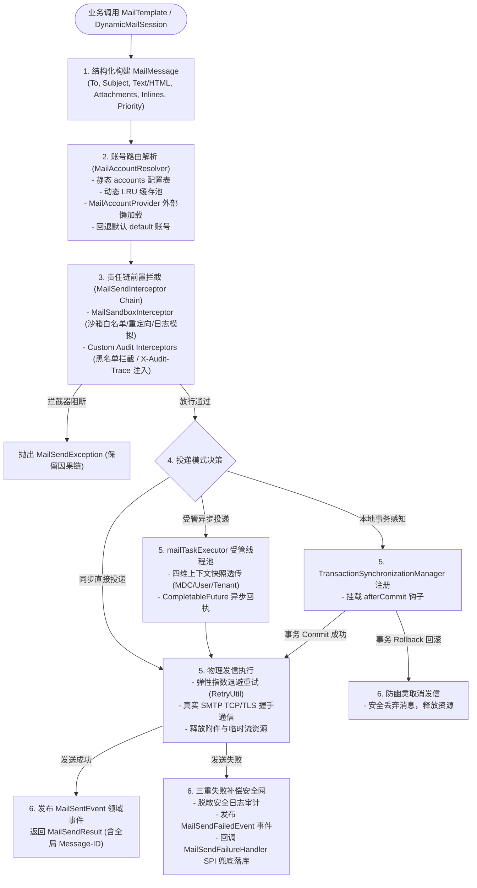

# ateng-boot-mail 邮件通信与模板通知基础设施

> 面向企业级生产就绪的纯原生出站 SMTP 邮件通信与模板通知基础设施 Starter，支持多账号动态路由、批量邮件合并与受控并发、多模测试安全沙箱、国际化多语言级联渲染、SMTP 物理连通性健康探针、强类型优先级标头、合规归档密送、受管异步线程池四维上下文透传、大附件流式防爆装配、正交内联资源 (Inline CID)、本地事务感知发信（`sendAfterCommit` 防幽灵邮件）、全生命周期领域事件广播、发信拦截器 SPI 与三重失败补偿安全网。

---

## 0. 特性与公共 API 全景速查矩阵 (Feature & API Panorama Matrix)

| 特性分类 | 特性名称 | 核心门面 / 注解 / SPI | 关键配置项 (`ateng.boot.mail.*`) | 关键 API 签名 / 核心行为 | 锚定验证源头 (*Test / Sample) |
| :--- | :--- | :--- | :--- | :--- | :--- |
| **基础纯文本** | 简单文本邮件同步发送 | `MailTemplate` | `default-account`<br>`accounts.*.host`<br>`accounts.*.port` | `sendText(to, subject, text)`<br>`sendText(account, to, subject, text)`<br>`sendText(Collection<String>, subject, text)`<br>`sendText(account, Collection<String>, subject, text)` | `MailTemplateGreenMailTest`<br>`SampleMailIntegrationTest`<br>`MailBasicController` |
| **基础富文本** | HTML 富文本邮件同步发送 | `MailTemplate` | `accounts.*.from`<br>`accounts.*.from-name` | `sendHtml(to, subject, html)`<br>`sendHtml(account, to, subject, html)`<br>`sendHtml(Collection<String>, subject, html)`<br>`sendHtml(account, Collection<String>, subject, html)` | `MailTemplateGreenMailTest`<br>`SampleMailIntegrationTest`<br>`MailBasicController` |
| **国际化模板** | 模板引擎渲染与多语言级联寻址 | `MailTemplate`<br>`MailTemplateRenderer`<br>`MailTemplateResourceUtil` | `accounts.*.from` | `sendTemplate(to, subject, template, model)`<br>`sendTemplate(to, subject, template, model, Locale)`<br>支持 Thymeleaf / Freemarker / 纯原生 Simple 正则插值与 `_en_US` $\rightarrow$ `_en` $\rightarrow$ 基础模板级联变体寻址 | `MailTemplateRendererI18nTest`<br>`MailTemplateResourceUtilTest`<br>`SampleMailIntegrationTest`<br>`MailBasicController` |
| **流式大附件** | RFC 6266 标准流式附件防爆装配 | `MailMessage`<br>`MailAttachment` | `max-attachment-size`<br>`max-total-size` | `MailAttachment.of(String, File)`<br>`of(String, byte[])`<br>`of(String, InputStreamSource)`<br>`message.attach(MailAttachment)`<br>RFC 6266 文件名转码清洗、双重前置容量 Fail-Fast 与流确定性关闭 | `MailAttachmentTest`<br>`MailTemplateGreenMailTest`<br>`SampleMailIntegrationTest`<br>`MailMediaController` |
| **正交内联资源** | 正交内联资源 (Inline CID) 图文混排 | `MailMessage`<br>`MailInlineResource` | - | `MailInlineResource.of(contentId, File)`<br>`of(contentId, byte[], contentType)`<br>`message.inline(MailInlineResource)`<br>正文以 `cid:<contentId>` 引用，与普通附件隔离 | `MailInlineResourceTest`<br>`MailTemplateGreenMailTest`<br>`SampleMailIntegrationTest`<br>`MailMediaController` |
| **静态多账号** | 声明式命名账号与业务通道隔离路由 | `MailTemplate`<br>`MailAccountRegistry`<br>`MailAccountResolver` | `default-account`<br>`accounts.*` | `sendText(accountName, ...)`<br>`send(message.account(accountName))`<br>物理 `JavaMailSenderImpl` 隔离池化，未命中平滑回退默认账号或租户寻址 | `MailAccountRegistryTest`<br>`MailTemplateGreenMailTest`<br>`SampleMailIntegrationTest`<br>`MailAccountController` |
| **动态账号供给** | 外部介质按需懒加载发信账号 SPI | `MailAccountProvider`<br>`MailTemplate`<br>`DynamicMailSession` | `max-dynamic-accounts` | `MailAccountProvider.loadAccount(accountName)`<br>`MailTemplate.forDynamicAccount(account)`<br>`sendByDynamicAccount(request)`<br>LRU 池化、内存真明文（ADR-0012）与动态发信别名覆盖 | `MailTemplateGreenMailTest`<br>`SampleMailIntegrationTest`<br>`MailAccountController` |
| **缓存热驱逐** | 动态账号缓存注销与领域事件广播 | `MailTemplate`<br>`MailAccountRegistry`<br>`MailAccountEvictEvent` | - | `evictDynamicAccount(accountName)`<br>`clearDynamicAccounts()`<br>Spring 原生事件 `MailAccountEvictEvent` 驱动单机或分布式集群消息总线联动热注销 | `MailAccountRegistryTest`<br>`MailTemplateGreenMailTest`<br>`SampleMailIntegrationTest`<br>`MailAccountController` |
| **物理连通探针** | 零发信 SMTP 物理握手与连通性健康探测 | `MailTemplate`<br>`DynamicMailSession` | `connection-timeout`<br>`read-timeout` | `boolean testConnection(accountName)`<br>`void testConnectionOrThrow(accountName)`<br>真实 TCP 握手 + TLS 协商 + AUTH 凭据校验，零测试邮件投递，`finally` 确定性释放 | `MailTemplateGreenMailTest`<br>`SampleMailIntegrationTest`<br>`MailAccountController` |
| **批量合并发信** | 批量个性化合并发信与信号量受控并发 | `MailTemplate`<br>`DynamicMailSession`<br>`BatchMailSendResult`<br>`MailSendResultItem` | `batch.concurrency` | `sendBatch(List<MailMessage>)`<br>`sendBatchAsync(List<MailMessage>)`<br>`Semaphore` 受控并发切片防 SMTP 网关拉黑，Fail-Safe 单信独立容错聚合 | `MailBatchSendTest`<br>`MailTemplateGreenMailTest`<br>`SampleMailIntegrationTest`<br>`MailReliableController` |
| **受管异步发信** | Core 线程池驱动与四维上下文透传 | `MailTemplate`<br>`mailTaskExecutor` | `async.enabled`<br>`async.core-pool-size`<br>`async.max-pool-size`<br>`async.queue-capacity` | `sendAsync(MailMessage)`<br>`sendTextAsync(...)`<br>`sendHtmlAsync(...)`<br>`sendTemplateAsync(...)`<br>自动透传 $\langle\text{MDC traceId}, \text{User}, \text{TenantId}, \text{IgnoreTenant}\rangle$ | `AtengMailAutoConfigurationTest`<br>`MailTemplateGreenMailTest`<br>`SampleMailIntegrationTest`<br>`MailReliableController` |
| **本地事务感知** | 本地事务提交后发信（防幽灵邮件） | `MailTemplate` | - | `sendAfterCommit(MailMessage)`<br>`sendAfterCommit(Consumer<MailMessage>)`<br>`sendAfterCommitWithAccount(...)`<br>`sendAsyncAfterCommit(...)`<br>绑定 Spring 物理事务 Commit 成功后触发，Rollback 自动安全撤销 | `MailTemplateGreenMailTest`<br>`SampleMailIntegrationTest`<br>`MailReliableController` |
| **合规与优先级** | 强类型优先级、阅读回执与归档密送 | `MailPriority`<br>`MailMessage`<br>`MailProperties` | `archive-bcc`<br>`accounts.*.archive-bcc` | `message.priority(MailPriority.HIGH)`<br>`message.requestReadReceipt(true)`<br>自动映射 `X-Priority` / `Importance` / RFC 3798 回执标头；大小写不敏感去重追加 `archiveBcc` | `MailPriorityAndArchiveBccTest`<br>`MailTemplateGreenMailTest`<br>`SampleMailIntegrationTest`<br>`MailReliableController` |
| **发信拦截治理** | 发信前置拦截与合规标头注入 SPI | `MailSendInterceptor`<br>`MailSandboxInterceptor` | `sandbox.*` | `boolean preSend(MailMessage message)`<br>支持 `Ordered` 排序，实现黑名单前置阻断防卫、全局合规标头（如 `X-Audit-Trace`）注入或沙箱拦截 | `MailSandboxInterceptorTest`<br>`MailTemplateGreenMailTest`<br>`SampleMailIntegrationTest` |
| **失败补偿安全网** | 终态失败持久化兜底与补偿回调 SPI | `MailSendFailureHandler` | - | `void onFailure(MailMessage message, Throwable cause)`<br>三级失败补偿体系：1. 敏感脱敏日志；2. 发布 `MailSendFailedEvent`；3. 回调兜底 SPI 持久化 | `MailTemplateGreenMailTest`<br>`SampleMailIntegrationTest` |
| **生命周期事件** | 原生 Spring 发信领域事件总线 | `MailSendingEvent`<br>`MailSentEvent`<br>`MailSendFailedEvent` | - | 依托 `ApplicationEventPublisher` 在发信前置、成功送达与终态失败时发布原生领域事件，与审计大盘及告警组件解耦协同 | `MailTemplateGreenMailTest`<br>`SampleMailIntegrationTest` |
| **测试安全沙箱** | 非生产环境邮件防误发测试安全沙箱 | `MailSandboxInterceptor`<br>`MailSandboxProperties` | `sandbox.enabled`<br>`sandbox.mode`<br>`sandbox.allowed-recipients`<br>`sandbox.redirect-to`<br>`sandbox.log-only` | 支持 `ALLOWLIST` 白名单通配放行、`REDIRECT` 强制定向清场（清空真实 Cc/Bcc）与 `LOG_ONLY` 纯日志模拟零网络开销 | `MailSandboxInterceptorTest`<br>`SampleMailIntegrationTest` |
| **因果异常体系** | 语义化异常与统一业务错误码 | `MailSendException`<br>`MailResultCode` | - | 拦截底层 JavaMail 异常转译为语义化 `MailSendException` 并 100% 保持原始因果链；错误码覆盖超时、认证、账号未找到、容量超限等 | `MailTemplateGreenMailTest`<br>`SampleMailIntegrationTest` |

---

## 1. 模块定位与快速起步

### 1.1 模块定位与核心设计
`ateng-boot-mail` 是面向企业级生产环境的工业级出站邮件基础设施 Starter：
- **纯原生零依赖**：依托 JDK 17、Spring 6 与官方 `spring-boot-starter-mail` 构建，100% 排除重型臃肿第三方依赖；
- **显式契约与 Zero-Entity-Leakage**：传输边界严禁暴露 ORM 实体，Controller 统一返回强类型 `Result<MailSendResult>`；
- **全链路追踪与无状态单例**：自动贯通 MDC `traceId` 至邮件 Message-ID 与自定义标头，单例服务保持严格无状态。

### 1.2 Maven 坐标
在应用 `pom.xml` 中引入 Starter 依赖（版本由根工程 BOM 统一纳管，无需填写 `<version>`）：

```xml
<dependency>
    <groupId>io.github.atengk</groupId>
    <artifactId>ateng-boot-mail</artifactId>
</dependency>
```

若需使用 Thymeleaf 模板引擎渲染 HTML 邮件，按需追加可选依赖：
```xml
<dependency>
    <groupId>org.thymeleaf</groupId>
    <artifactId>thymeleaf-spring6</artifactId>
</dependency>
```

### 1.3 极简 Happy Path 配置与起步调用

#### 最小可用配置 (`application.yml`)
```yaml
ateng:
  boot:
    mail:
      enabled: true
      default-account: default
      accounts:
        default:
          host: smtp.example.com
          port: 465
          ssl: true
          username: notification@example.com
          password: YOUR_SMTP_AUTH_CODE
          from: notification@example.com
          from-name: Ateng官方通知
```

#### 极简发信实战代码
```java
@Service
@RequiredArgsConstructor
public class UserNotificationService {

    private final MailTemplate mailTemplate;

    public MailSendResult sendWelcomeNotice(String to, String username) {
        return mailTemplate.sendText(
                to,
                "欢迎加入 Ateng Boot",
                "尊敬的 " + username + "，恭喜您成功开通企业服务账户！"
        );
    }
}
```

---

## 2. 核心架构与设计不变量

### 2.1 邮件构建、路由、拦截与投递全链路编排流水线



### 2.2 核心设计不变量
1. **内存真明文契约（ADR-0012）**：业务层与实体在内存中始终保持 100% 原始明文；外部提供商读取密文后自行解密并向框架传递真明文凭据，严禁在业务逻辑中打星号。
2. **确定性资源清理**：流、附件句柄与临时文件在 `finally` 块中确定性释放，异常中止时触发补偿清理，杜绝句柄泄露与磁盘膨胀。
3. **受管并发与防 Carrier Pinning（ADR-0029）**：异步发信全域收敛至 Core 受管 `mailTaskExecutor`，临界区使用 `ReentrantLock` 替代 `synchronized`。
4. **因果异常完整性**：底层 SDK 与网络异常 100% 封装为语义化 `MailSendException` 并保留完整 `cause` 链。

---

## 3. 基础通信与多媒体渲染套件 (Basic & Rich Media Suite)

### 3.1 纯文本与富文本 HTML 发信

#### 专属 YAML 配置片段
```yaml
ateng:
  boot:
    mail:
      accounts:
        default:
          host: smtp.example.com
          port: 465
          ssl: true
          username: notice@example.com
          password: YOUR_SMTP_AUTH_CODE
          from: notice@example.com
          from-name: 系统通知中心
```

#### 1:1 Sample 实战业务代码 (逆向提取自 `MailBasicController`)
```java
@RestController
@RequestMapping("/sample/mail/basic")
@RequiredArgsConstructor
@Validated
public class MailBasicController {

    private final MailScenarioService mailScenarioService;

    /**
     * 发送简单纯文本邮件（默认通道）
     */
    @PostMapping("/simple-text")
    public Result<MailSendResult> sendSimpleText(@Valid @RequestBody SimpleTextMailRequest request) {
        MailSendResult result = mailScenarioService.sendSimpleText(
                request.getTo(),
                request.getSubject(),
                request.getContent()
        );
        return Result.success(result);
    }

    /**
     * 发送富文本 HTML 内容邮件
     */
    @PostMapping("/html-content")
    public Result<MailSendResult> sendHtmlContent(@Valid @RequestBody HtmlContentMailRequest request) {
        MailSendResult result = mailScenarioService.sendHtmlContent(
                request.getTo(),
                request.getSubject(),
                request.getHtmlContent()
        );
        return Result.success(result);
    }
}
```

#### 核心机制与生产边界
- **字符集与编码**：全链路统一采用 UTF-8 编码，主题与发件人昵称自动执行 RFC 2047 Base64/Q 编码，彻底消除各类邮件客户端乱码；
- **安全防注入**：HTML 富文本邮件由调用方提供合规正文，框架底层对标头字段（Header）执行换行符清洗，严格防范 CRLF 注入攻击（Email Header Injection）。

---

### 3.2 动态 Thymeleaf 与多语言国际化级联模板渲染

#### 专属 YAML 配置片段
```yaml
spring:
  thymeleaf:
    prefix: classpath:/templates/
    suffix: .html
    mode: HTML
    encoding: UTF-8
    cache: true
```

#### 1:1 Sample 实战业务代码 (逆向提取自 `MailBasicController`)
```java
    /**
     * 发送动态 Thymeleaf 模板邮件
     */
    @PostMapping("/template")
    public Result<MailSendResult> sendTemplate(@Valid @RequestBody UserVerificationMailRequest request) {
        String subject = request.getSubject() != null && !request.getSubject().isBlank()
                ? request.getSubject() : "账号安全验证码";
        MailSendResult result = mailScenarioService.sendHtmlTemplate(
                request.getTo(),
                subject,
                request.getUsername(),
                request.getVerifyCode()
        );
        return Result.success(result);
    }

    /**
     * 发送多语言国际化验证码模板邮件（级联 Locale 变体寻址）
     */
    @PostMapping("/i18n-template")
    public Result<MailSendResult> sendI18nTemplate(@Valid @RequestBody UserVerificationMailRequest request,
                                                  @RequestParam(defaultValue = "zh_CN") String language) {
        Locale locale = Locale.forLanguageTag(language.replace('_', '-'));
        MailSendResult result = mailScenarioService.sendLocalizedVerifyCode(
                request.getTo(),
                request.getUsername(),
                request.getVerifyCode(),
                locale
        );
        return Result.success(result);
    }
```

#### 核心机制与生产边界
- **国际化级联寻址（Fallback Cascade）**：当指定 `Locale.US` 时，`MailTemplateRenderer` 依次自动探测类路径模板：
  $$\text{mail/i18n-verify-code\_en\_US.html} \longrightarrow \text{mail/i18n-verify-code\_en.html} \longrightarrow \text{mail/i18n-verify-code.html}$$
- **上下文自动兜底**：若发信方法未显式传参 `Locale`，框架自动从 Spring `LocaleContextHolder` 提取当前请求上下文语言区域，无上下文时优雅回退系统默认值。

---

### 3.3 RFC 6266 流式防爆附件与正交内联资源 (Inline CID)

#### 专属 YAML 配置片段
```yaml
ateng:
  boot:
    mail:
      max-attachment-size: 20MB   # 单个附件容量上限
      max-total-size: 50MB        # 附件与正文总容量上限
```

#### 1:1 Sample 实战业务代码 (逆向提取自 `MailMediaController`)
```java
@RestController
@RequestMapping("/sample/mail/media")
@RequiredArgsConstructor
@Validated
public class MailMediaController {

    private final MailScenarioService mailScenarioService;

    /**
     * 发送挂载流式大附件的邮件（RFC 6266 文件防爆与中文文件名防乱码）
     */
    @PostMapping("/attachment")
    public Result<MailSendResult> sendWithAttachment(@Valid @RequestBody AttachmentMailRequest request) {
        MailSendResult result = mailScenarioService.sendAttachmentStatement(request);
        return Result.success(result);
    }

    /**
     * 发送正交内联资源 (Inline CID) 图文混排邮件
     */
    @PostMapping("/inline")
    public Result<MailSendResult> sendWithInline(@Valid @RequestBody InlineMediaMailRequest request) {
        MailSendResult result = mailScenarioService.sendWithInline(
                request.getTo(),
                request.getSubject(),
                request.getTitle()
        );
        return Result.success(result);
    }
}
```

#### 核心机制与生产边界
- **RFC 6266 文件名防乱码**：附件名称严格遵循 RFC 2231 / RFC 5987 标准参数化编码清洗，在主流客户端（Outlook、Foxmail、Apple Mail、Web 邮箱）中均无下划线截断与问号乱码；
- **双重前置容量防爆**：挂载前与物理装配前双重校验 `max-attachment-size` 与 `max-total-size`，超限立即抛出 `MAIL_ATTACHMENT_SIZE_EXCEEDED` 或 `MAIL_TOTAL_SIZE_EXCEEDED`，绝不因超大附件打爆 JVM 堆内存；
- **资源正交隔离**：`MailAttachment` 用于独立文件下载，`MailInlineResource` 专职绑定 `cid:<contentId>` 图文内联，两者内部通道严格隔离。

---

## 4. 多账号路由与通道治理套件 (Multi-Account Routing & Channel Governance Suite)

### 4.1 声明式命名账号与业务通道隔离路由

#### 专属 YAML 配置片段
```yaml
ateng:
  boot:
    mail:
      default-account: default
      accounts:
        default:
          host: smtp.corp.com
          port: 465
          ssl: true
          username: user-service@corp.com
          password: YOUR_AUTH_CODE
          from-name: 用户中心通知
        ops:
          host: smtp-ops.corp.com
          port: 465
          ssl: true
          username: ops-monitor@corp.com
          password: YOUR_AUTH_CODE
          from-name: 基础设施监控中心
```

#### 1:1 Sample 实战业务代码 (逆向提取自 `MailAccountController`)
```java
    /**
     * 发送指定运维通道邮件（通道隔离验证）
     */
    @PostMapping("/ops-channel")
    public Result<MailSendResult> sendOpsChannel(@Valid @RequestBody SimpleTextMailRequest request) {
        MailSendResult result = mailScenarioService.sendMultiAccountOps(
                request.getTo(),
                request.getSubject(),
                request.getContent()
        );
        return Result.success(result);
    }
```

#### 核心机制与生产边界
- **物理通道隔离**：每个账号独享独立的 `JavaMailSenderImpl` 实例，连接池与网络会话物理隔离，即使运维通道遭遇网络抖动，用户中心通道仍能正常对外服务；
- **路由寻址策略**：支持在消息模型中显式指定 `message.account("ops")`，或通过 `MailAccountResolver` SPI 结合当前租户上下文自适应推导账号名称。

---

### 4.2 外部介质动态账号供给与 LRU 缓存池化

#### 专属 YAML 配置片段
```yaml
ateng:
  boot:
    mail:
      max-dynamic-accounts: 100    # 动态账号物理池化上限
```

#### 1:1 Sample 实战业务代码 (逆向提取自 `SampleDatabaseMailAccountProvider` 与 `MailAccountController`)
```java
@Component
public class SampleDatabaseMailAccountProvider implements MailAccountProvider {

    @Override
    public MailAccount loadAccount(String accountName) {
        if (!"dynamic-db-provider".equals(accountName)) {
            return null;
        }
        // 模拟从外部持久层解密加载真明文配置（守卫 ADR-0012）
        return MailAccount.builder()
                .name("dynamic-db-provider")
                .host("127.0.0.1")
                .port(3025)
                .username("dynamic-provider@example.com")
                .password("secret-password-placeholder")
                .ssl(false)
                .defaultFrom("dynamic-provider@example.com")
                .defaultFromName("动态外部发件人")
                .build();
    }
}
```

```java
    /**
     * 指定外部介质动态账号发信（演示懒加载、LRU 池化复用与发件人别名覆盖）
     */
    @PostMapping("/dynamic-send")
    public Result<MailSendResult> sendDynamicAccount(@Valid @RequestBody DynamicAccountMailRequest request) {
        MailSendResult result = mailScenarioService.sendByDynamicAccount(request);
        return Result.success(result);
    }
```

#### 核心机制与生产边界
- **双轨防张冠李戴防线**：显式指定账号时未命中抛出 `MAIL_ACCOUNT_NOT_FOUND` Fail-Fast 阻断；未指定账号时隐式推断未命中则平滑回退至默认 `default` 账号；
- **LRU 物理连接池化**：动态加载的账号构建为底层 Sender 并纳入受管 LRU 缓存（默认容量 100），淘汰旧实例时安全销毁物理网络连接，防止资源泄漏。

---

### 4.3 动态账号缓存注销与领域事件广播联动

#### 1:1 Sample 实战业务代码 (逆向提取自 `MailAccountController`)
```java
    /**
     * 精准驱逐指定动态账号缓存（本地单机热刷新）
     */
    @PostMapping("/evict-cache")
    public Result<Boolean> evictCache(@RequestParam @NotBlank(message = "账号标识不能为空") String accountName) {
        mailScenarioService.evictDynamicAccount(accountName);
        return Result.success(true);
    }

    /**
     * 广播发布动态账号驱逐领域事件（集群热刷新）
     */
    @PostMapping("/broadcast-evict")
    public Result<Boolean> broadcastEvict(@RequestParam(required = false) String accountName) {
        mailScenarioService.publishEvictEvent(accountName);
        return Result.success(true);
    }
```

#### 核心机制与生产边界
- **单机门面精准清除**：`mailTemplate.evictDynamicAccount(name)` 精准移除指定账号并释放物理句柄；
- **集群总线联动驱逐**：发布 `MailAccountEvictEvent` 领域事件，可直接接入 Redis Pub/Sub 或微服务消息总线，实现多节点集群近实时一致性热注销。

---

### 4.4 SMTP 物理链路握手与连通性健康探测

#### 专属 YAML 配置片段
```yaml
ateng:
  boot:
    mail:
      connection-timeout: 5s
      read-timeout: 10s
```

#### 1:1 Sample 实战业务代码 (逆向提取自 `MailAccountController`)
```java
    /**
     * 管理端 SMTP 物理连通性一键测试探针
     */
    @PostMapping("/test-connection")
    public Result<Boolean> testConnection(@RequestParam @NotBlank(message = "账号标识不能为空") String accountName) {
        mailScenarioService.testConnectionOrThrow(accountName);
        return Result.success(true);
    }
```

#### 核心机制与生产边界
- **零投递安全探测**：调用底层 `JavaMailSenderImpl.testConnection()`，执行真实 TCP 建立、TLS 协商与 AUTH 凭据验证，**不发送任何测试邮件**；
- **超时强约束**：受 `connection-timeout` 与 `read-timeout` 刚性约束，在 `finally` 块中确定性断开握手连接，避免挂起应用线程。

---

## 5. 批量合并与高可靠生产套件 (Controlled Batch Merge & High-Reliability Production Suite)

### 5.1 批量个性化合并发信与信号量受控并发

#### 专属 YAML 配置片段
```yaml
ateng:
  boot:
    mail:
      batch:
        concurrency: 4    # 批量受控并发度 (默认 4，上限 32)
```

#### 1:1 Sample 实战业务代码 (逆向提取自 `MailReliableController`)
```java
    /**
     * 批量个性化合并发送员工工资条通知（依托 ValidList 严格传输防卫与 Semaphore 受控并发）
     */
    @PostMapping("/batch-salary")
    public Result<BatchMailSendResult> sendSalaryBatch(@Valid @RequestBody SalarySlipBatchRequest request) {
        BatchMailSendResult result = mailScenarioService.sendSalaryBatch(request);
        return Result.success(result);
    }
```

#### 核心机制与生产边界
- **网关防封禁控流**：`sendBatch` 内部依托 `Semaphore(concurrency)` 控流，防止大批量并发请求瞬间打爆企业网关或被外部公共邮箱识别为垃圾邮件攻击；
- **Fail-Safe 独立容错聚合**：单封邮件网络超时或邮箱不存在仅标记该邮件的 `MailSendResultItem.failure(...)`，绝不阻断批次内其余合法邮件的正常投递。

---

### 5.2 Core 受管线程池异步发信与四维上下文透传

#### 专属 YAML 配置片段
```yaml
ateng:
  boot:
    mail:
      async:
        enabled: true
        core-pool-size: 2
        max-pool-size: 8
        queue-capacity: 100
        keep-alive: 60s
        thread-name-prefix: mail-async-
```

#### 1:1 Sample 实战业务代码 (逆向提取自 `MailReliableController`)
```java
    /**
     * 受管异步发送邮件（Core 线程池驱动与 MDC 四维上下文透传）
     */
    @PostMapping("/async-send")
    public CompletableFuture<Result<MailSendResult>> sendAsync(@Valid @RequestBody SimpleTextMailRequest request) {
        return mailScenarioService.sendAsync(
                request.getTo(),
                request.getSubject(),
                request.getContent()
        ).thenApply(Result::success);
    }
```

#### 核心机制与生产边界
- **专职受管执行器**：使用专职 `@Bean("mailTaskExecutor")`，解除虚拟线程类型窄化；
- **四维上下文无损透传**：通过 `ContextCopyingTaskDecorator` 自动透传 $\langle\text{MDC traceId}, \text{User}, \text{TenantId}, \text{IgnoreTenant}\rangle$ 快照，并在 `finally` 块中强制清理，彻底杜绝跨线程池污染。

---

### 5.3 本地事务感知发信与防幽灵机制

#### 1:1 Sample 实战业务代码 (逆向提取自 `MailReliableController` 与 `MailScenarioService`)
```java
@Service
@RequiredArgsConstructor
public class MailScenarioService {

    private final MailTemplate mailTemplate;

    @Transactional(rollbackFor = Exception.class)
    public void sendTransactional(String to, String subject, String text, boolean shouldRollback) {
        MailMessage message = new MailMessage().to(to).subject(subject).text(text);
        
        // 注册到 Spring 事务同步器，仅在物理 Commit 成功后触发投递
        mailTemplate.sendAfterCommit(message);

        if (shouldRollback) {
            throw new IllegalStateException("Simulated business transaction rollback");
        }
    }
}
```

```java
    /**
     * 本地事务感知发信（事务正常提交：物理发信正常触发）
     */
    @PostMapping("/transaction-commit")
    public Result<String> sendTransactionCommit(@Valid @RequestBody SimpleTextMailRequest request) {
        mailScenarioService.sendTransactional(request.getTo(), request.getSubject(), request.getContent(), false);
        return Result.success("事务已物理提交，sendAfterCommit 成功触发邮件外发");
    }

    /**
     * 本地事务感知发信（事务发生异常回滚：自动防幽灵邮件取消发信）
     */
    @PostMapping("/transaction-rollback")
    public Result<String> sendTransactionRollback(@Valid @RequestBody SimpleTextMailRequest request) {
        try {
            mailScenarioService.sendTransactional(request.getTo(), request.getSubject(), request.getContent(), true);
        } catch (IllegalStateException e) {
            return Result.success("业务事务已回滚，sendAfterCommit 自动安全取消，成功阻止幽灵邮件外发");
        }
        return Result.fail("未预期：事务未按预期触发回滚");
    }
```

#### 核心机制与生产边界
- **幽灵邮件根除**：传统开发在事务内直接发信，当事务回滚时邮件已无法撤回；`sendAfterCommit` 依托 `TransactionSynchronizationManager.registerSynchronization`，只有当事务状态为 `STATUS_COMMITTED` 时才正式调用底层发信，事务回滚自动安全取消。

---

### 5.4 紧急线上告警发信、优先级标头与阅读回执

#### 专属 YAML 配置片段
```yaml
ateng:
  boot:
    mail:
      archive-bcc: compliance-archive@corp.com    # 全局合规审计归档密送
```

#### 1:1 Sample 实战业务代码 (逆向提取自 `MailReliableController`)
```java
    /**
     * 发送高优先级紧急线上故障告警邮件（强类型优先级标头、阅读回执与合规归档密送）
     */
    @PostMapping("/urgent-alert")
    public Result<MailSendResult> sendUrgentAlert(@Valid @RequestBody SystemAlertMailRequest request) {
        MailSendResult result = mailScenarioService.sendUrgentAlert(request);
        return Result.success(result);
    }
```

#### 核心机制与生产边界
- **标头标准映射**：`MailPriority.HIGH` 自动映射 `X-Priority: 1`、`Importance: High` 与 `X-MSMail-Priority: High`；`requestReadReceipt(true)` 自动映射 RFC 3798 `Disposition-Notification-To` 标头；
- **归档密送去重**：`archive-bcc` 地址与消息体显式 `bcc` 执行大小写不敏感（`CASE_INSENSITIVE_ORDER`）合并去重，防止重复投递。

---

## 6. 生产扩展接管与安全沙箱 (Production Customization & Safety Sandbox)

### 6.1 发信拦截器 SPI 与合规标头防卫 (`MailSendInterceptor`)
实现 `MailSendInterceptor` 并注入为 Spring Bean，可对出站邮件执行黑名单过滤与合规审计标头注入：

```java
@Component
public class SampleAuditMailInterceptor implements MailSendInterceptor, Ordered {

    public static final String BLOCKED_EMAIL = "blocked@example.com";
    public static final String AUDIT_HEADER_KEY = "X-Audit-Trace";

    @Override
    public boolean preSend(MailMessage message) {
        // 1. 黑名单安全阻断
        if (message.getTo() != null && message.getTo().contains(BLOCKED_EMAIL)) {
            return false;
        }
        // 2. 注入全链路审计追踪标头
        message.header(AUDIT_HEADER_KEY, "audited-" + System.currentTimeMillis());
        return true;
    }

    @Override
    public int getOrder() {
        return Ordered.HIGHEST_PRECEDENCE + 100;
    }
}
```

---

### 6.2 三重失败补偿安全网与落库兜底 (`MailSendFailureHandler`)
实现 `MailSendFailureHandler` 接入企业级落库兜底或报警通知：

```java
@Component
public class SampleMailFailureHandler implements MailSendFailureHandler {

    private final AtomicInteger failureCount = new AtomicInteger();

    @Override
    public void onFailure(MailMessage message, Throwable cause) {
        failureCount.incrementAndGet();
        // 将发信失败的邮件持久化至补偿表，由定时任务对账重试
    }
}
```

---

### 6.3 全生命周期领域事件监听与审计大盘
订阅 Spring 原生事件，对接运维大盘与监控告警：

```java
@Component
public class SampleMailEventListener {

    private static final Logger log = LoggerFactory.getLogger(SampleMailEventListener.class);

    @EventListener
    public void onMailSending(MailSendingEvent event) {
        log.info("[Event] Mail is sending, subject: [{}], recipients: {}",
                event.getMessage().getSubject(), event.getMessage().getAllRecipients());
    }

    @EventListener
    public void onMailSent(MailSentEvent event) {
        log.info("[Event] Mail sent successfully, messageId: [{}], duration: {} ms",
                event.getResult().getMessageId(), event.getResult().getCostMs());
    }

    @EventListener
    public void onMailSendFailed(MailSendFailedEvent event) {
        log.error("[Event] Mail delivery failed, to: {}, cause: {}",
                event.getMessage().getTo(), event.getCause().getMessage());
    }
}
```

---

### 6.4 多模测试安全沙箱防泄漏 (`MailSandboxInterceptor`)
在测试与预发环境启用安全沙箱，彻底杜绝测试邮件泄露至真实用户：

```yaml
ateng:
  boot:
    mail:
      sandbox:
        enabled: true
        allowed-recipients:
          - "admin@example.com"
          - "*@internal.corp"
        redirect-to: trap@example.com
        log-only: false
```

- **白名单放行（`allowed-recipients`）**：全量收件人均符合白名单时正常外发；
- **安全重定向（`redirect-to`）**：存在非白名单收件人时，将 `To` 重定向至指定测试邮箱，并**强制清空 `Cc` 与 `Bcc`**；
- **纯日志模拟（`log-only=true`）**：零物理网络开销，仅在控制台输出脱敏报文并返回虚拟成功回执。

---

## 7. 完整 YAML 配置属性清单 (Exhaustive Configuration Dictionary Appendix)

| 配置属性键名 (`ateng.boot.mail.*`) | 类型 | 默认值 | 详细含义与行为说明 |
| :--- | :--- | :--- | :--- |
| **`enabled`** | `boolean` | `true` | 是否启用邮件通信基础设施自动装配 |
| **`default-account`** | `String` | `"default"` | 默认发信账号逻辑标识 |
| **`max-dynamic-accounts`** | `int` | `100` | 动态编程式发信账号 LRU 物理池化容量上限 |
| **`archive-bcc`** | `String` | `null` | 全局合规审计归档密送邮箱（支持逗号分隔多个地址） |
| **`connection-timeout`** | `Duration` | `5s` | SMTP 服务器建立物理 TCP 连接超时时间 |
| **`read-timeout`** | `Duration` | `10s` | SMTP 服务器网络数据读取超时时间 |
| **`write-timeout`** | `Duration` | `10s` | SMTP 服务器网络数据写入超时时间 |
| **`max-attachment-size`** | `DataSize` | `20MB` | 单个邮件附件容量上限 |
| **`max-total-size`** | `DataSize` | `50MB` | 邮件附件与正文总容量上限 |
| **`accounts.<name>.host`** | `String` | - | SMTP 服务器主机地址（如 `smtp.qq.com`） |
| **`accounts.<name>.port`** | `Integer` | `465` | SMTP 服务端口（SSL 推荐 465，非 SSL 推荐 25/587） |
| **`accounts.<name>.username`** | `String` | - | SMTP 认证用户名（发信邮箱地址） |
| **`accounts.<name>.password`** | `String` | - | SMTP 认证授权码或密码 |
| **`accounts.<name>.protocol`** | `String` | `"smtp"` | 底层传输协议 |
| **`accounts.<name>.ssl`** | `boolean` | `true` | 是否开启 SSL/TLS 安全加密传输 |
| **`accounts.<name>.starttls`** | `boolean` | `false` | 是否开启 STARTTLS 加密传输 |
| **`accounts.<name>.from`** | `String` | - | 默认发件人邮箱（未配置时回退至 `username`） |
| **`accounts.<name>.from-name`** | `String` | - | 默认发件人中文显示昵称 |
| **`accounts.<name>.archive-bcc`** | `String` | - | 当前账号专属归档密送邮箱（未配置回退全局 `archive-bcc`） |
| **`accounts.<name>.properties.*`** | `Map` | `{}` | 底层 JavaMail 专有属性键值对 |
| **`batch.concurrency`** | `int` | `4` | 批量合并发信受控并发度，配置范围 1~32 |
| **`retry.enabled`** | `boolean` | `false` | 是否启用物理发信瞬态网络抖动指数退避重试 |
| **`retry.max-attempts`** | `int` | `3` | 最大重试总尝试次数（含首次） |
| **`retry.delay`** | `Duration` | `500ms` | 初始重试等待时长 |
| **`retry.multiplier`** | `double` | `2.0` | 退避倍数因子 |
| **`retry.max-delay`** | `Duration` | `5s` | 单次重试等待时长上限 |
| **`retry.jitter`** | `boolean` | `true` | 是否启用平滑随机抖动以打散重试洪峰 |
| **`async.enabled`** | `boolean` | `true` | 是否启用专职受管异步发信线程池 |
| **`async.mode`** | `AsyncMode` | `PLATFORM` | 执行器运行模式（`PLATFORM` 平台线程 / `VIRTUAL` 虚拟线程） |
| **`async.core-pool-size`** | `int` | `2` | 异步线程池核心线程数 |
| **`async.max-pool-size`** | `int` | `8` | 异步线程池最大线程数 |
| **`async.queue-capacity`** | `int` | `100` | 异步任务等待队列容量 |
| **`async.keep-alive`** | `Duration` | `60s` | 空闲线程保活时长 |
| **`async.thread-name-prefix`** | `String` | `"mail-async-"` | 异步线程名称前缀 |
| **`sandbox.enabled`** | `boolean` | `false` | 是否开启测试安全沙箱拦截 |
| **`sandbox.allowed-recipients`** | `List` | `[]` | 白名单放行收件人列表（支持通配符如 `*@internal.corp`） |
| **`sandbox.redirect-to`** | `String` | - | 非白名单收件人安全重定向邮箱地址 |
| **`sandbox.log-only`** | `boolean` | `false` | 是否开启纯日志模拟发信模式（零物理网络连接） |

---

## 8. 场景自验工程

本项目配套提供 1:1 独立端到端自验工程：[`ateng-boot-sample-mail`](../ateng-boot-samples/ateng-boot-sample-mail)：
- 包含 4 大领域控制器、9 个强类型业务 DTO、4 个真实场景组件、GreenMail 内嵌全自洽单测与真实 SMTP 双模联调；
- 执行定向构建与端到端回归命令：
  ```bash
  mvn test -pl ateng-boot-mail,ateng-boot-samples/ateng-boot-sample-mail -am -T 1C -nsu -B
  ```
