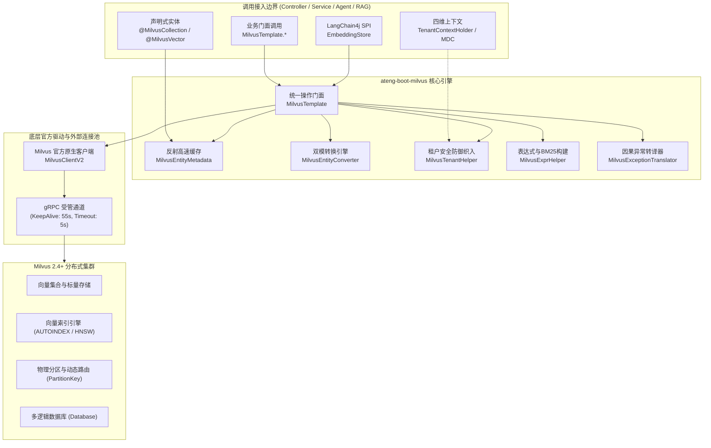

# ateng-boot-milvus 企业级向量检索与混合查询底座

> 面向生产就绪的 Spring Boot 3 企业级 Milvus 向量数据库与多向量混合检索基础设施 Starter，依托官方原生现代化驱动 `MilvusClientV2` (2.4.4) 构建高内聚三层立体门面 `MilvusTemplate`，支持一键建表预加载、单向量 ANN 相似度检索、稠密/稀疏多向量混合召回与 RRF/加权融合重排、SaaS 多租户物理分区与逻辑安全隔离、突破 16384 offset 的游标流式遍历，以及 LangChain4j `EmbeddingStore` SPI 无缝适配。

---

## 0. 特性与公共 API 全景速查矩阵 (Feature & API Panorama Matrix)

| 特性分类 | 特性名称 | 核心门面 / 注解 / SPI | 关键配置项 (`ateng.boot.*`) | 关键 API 签名 / 核心行为 | 锚定验证源头 (*Test / Sample) |
| :--- | :--- | :--- | :--- | :--- | :--- |
| **基础配置** | 客户端初始化与双核穿透 | `AtengMilvusAutoConfiguration`<br>`MilvusTemplate` | `ateng.boot.milvus.enabled`<br>`ateng.boot.milvus.uri`<br>`ateng.boot.milvus.database` | `getClient()` / `getProperties()` / `testConnection()` / `getServerVersion()`，提供原生客户端双核穿透逃逸舱 | `AtengMilvusAutoConfigurationTest`<br>`MilvusTemplateBasicTest` |
| **基础配置** | 云原生健康探针 | `MilvusHealthIndicator` | `management.health.milvus.enabled` | 响应 `Health.up()` / `Health.down()`，集成 Spring Boot Actuator 端点 | `MilvusHealthIndicatorTest`<br>`SampleMilvusIntegrationTest` |
| **集合运维** | 实体声明式元数据映射 | `@MilvusCollection`<br>`@MilvusId`<br>`@MilvusVector`<br>`@MilvusPartitionKey`<br>`@MilvusField` | - | 声明集合名称、主键、分区键、标量列与 4~1536 维特征向量，自动推导 Schema 与索引配置 | `MilvusEntityMetadataTest`<br>`MilvusEntityConverterTest` |
| **集合运维** | 集合生命周期与结构查看 | `MilvusTemplate` | - | `hasCollection(name)` / `createCollection(name, dim)` / `dropCollection(name)` / `listCollections()` / `describeCollection(name)` | `MilvusTemplateLifecycleTest`<br>`MilvusLifecycleController` |
| **集合运维** | 内存加载与释放控制 | `MilvusTemplate` | - | `loadCollection(name)` / `releaseCollection(name)` / `isCollectionLoaded(name)`，管理集合常驻内存检索态 | `MilvusTemplateLifecycleTest`<br>`MilvusLifecycleController` |
| **集合运维** | 一键建表预加载 | `MilvusTemplate` | - | `createCollectionAndIndex(Class<?>)`，原子完成创建集合、自动建立向量索引并加载至内存 | `MilvusTemplateLifecycleTest`<br>`MilvusLifecycleController` |
| **索引运维** | 向量索引生命周期与结构 | `MilvusTemplate` | - | `createIndex(...)` / `dropIndex(...)` / `describeIndex(...)` / `listIndexes(...)`，支持 AUTOINDEX/HNSW/IVF 等算法 | `MilvusTemplateLifecycleTest` |
| **数据操作** | 实体与字典数据极简写入 | `MilvusTemplate` | `ateng.boot.milvus.auto-create-partition` | `insert(collection, data)` / `insertEntities(entities)`，自动绑定多租户字段与时序分区探测 | `MilvusTemplateDataOperationsTest`<br>`MilvusVectorController` |
| **数据操作** | 幂等覆盖写入 (Upsert) | `MilvusTemplate` | - | `upsert(collection, data)` / `upsertEntities(entities)`，主键存在则更新，不存在则新增插入 | `MilvusTemplateDataOperationsTest`<br>`MilvusVectorController` |
| **数据操作** | 批量分批切片摄取 | `MilvusTemplate` | - | `insertBatchEntities(list, size)` / `upsertBatchEntities(list, size)`，结合 `BatchSliceUtil` 与指数退避重试防 OOM 与帧超限 | `MilvusTemplateDataOperationsTest`<br>`MilvusVectorController` |
| **数据操作** | 主键点查与轻量探测 | `MilvusTemplate` | - | `getById(Class, id)` / `getByIds(Class, ids)` / `existsById(Class, id)`，毫秒级主键直接点查 | `MilvusTemplateDataOperationsTest`<br>`MilvusVectorController` |
| **数据操作** | 数据安全删除 | `MilvusTemplate` | - | `deleteByIds(Class, ids)` / `deleteByExpr(collection, expr)`，多租户环境下自动织入租户边界过滤 | `MilvusTemplateDataOperationsTest`<br>`MilvusVectorController` |
| **向量检索** | 单向量 ANN 相似度检索 | `MilvusTemplate`<br>`MilvusHit<T>` | `ateng.boot.milvus.consistency-level` | `search(Class, vector, topK, expr)`，支持强类型实体反序列化、标量过滤表达式与余弦/内积/L2 度量 | `MilvusTemplateDataOperationsTest`<br>`MilvusVectorController` |
| **标量查询** | 标量过滤与实体统计 | `MilvusTemplate` | - | `query(Class, expr)` / `count(Class, expr)`，支持标准布尔过滤表达式与聚合统计 | `MilvusTemplateDataOperationsTest`<br>`MilvusVectorController` |
| **混合检索** | 多向量多路召回与融合重排 | `MilvusTemplate`<br>`MilvusHybridSearchRequest`<br>`AnnSearch`<br>`ReRanker` | - | `hybridSearch(request)`，Fluent 请求构建，支持 RRF 互逆排名与 WEIGHTED 加权打分重排 | `MilvusTemplateAdvancedOperationsTest`<br>`MilvusHybridController` |
| **全文匹配** | BM25 分词匹配辅助构建 | `MilvusExprHelper` | - | `textMatch(field, query)` / `expr().eq().like().textMatch().build()`，标准化 `TEXT_MATCH` 表达式生成 | `MilvusExprHelperTest` |
| **游标流式** | 深度遍历突破 16384 限制 | `MilvusTemplate`<br>`QueryIterator` | - | `streamingQuery(collection, expr, batchSize, consumer)` / `streamingQueryEntities(...)`，受管关流与分批拉取 | `MilvusTemplateAdvancedOperationsTest` |
| **多库运维** | 动态切库与数据库管理 | `MilvusTemplate`<br>`MilvusContextHolder` | - | `useDatabase(db, action)` / `createDatabase(db)` / `dropDatabase(db)` / `listDatabases()`，支持线程级隔离切库 | `MilvusTemplateAdvancedOperationsTest`<br>`MilvusContextHolderTest` |
| **多租户** | SaaS 租户自动织入与物理隔离 | `MilvusTenantHelper`<br>`@MilvusPartitionKey` | - | `weaveTenantFilter(expr, field, ignore)` / `fillEntityTenantField(entity, metadata)`，防越权防御性括号隔离 | `MilvusTenantHelperTest`<br>`MilvusTenantController` |
| **生态集成** | LangChain4j EmbeddingStore SPI | `MilvusEmbeddingStore`<br>`MilvusLangChain4jAutoConfiguration` | `ateng.boot.milvus.langchain4j.*` | 适配 `EmbeddingStore<TextSegment>` 标准接口，支持元数据过滤到 Milvus 表达式递归映射 | `MilvusEmbeddingStoreTest`<br>`MilvusFilterMapperTest` |

---

## 1. 模块定位与 Maven 坐标

`ateng-boot-milvus` 是面向 Spring Boot 3 的现代化企业级向量数据库 Starter，专注于高维特征向量存储、ANN 相似度计算、多路召回重排与 RAG 基础设施底座支撑：
- **现代化原生基线**: 采用 Milvus 官方推荐的第二代客户端 `MilvusClientV2` (2.4.4)，彻底抛弃上一代复杂的 ConnectParam / R 包装体系；
- **三层立体门面**: `MilvusTemplate` 提供实体驱动强类型层、字典结构通用层以及原生驱动穿透层，兼顾业务敏捷与极限性能；
- **零臃肿与底座优先**: 100% 依托 JDK 17 与 Spring 6，通用重试退避、分批切片与上下文透传收敛复用 `ateng-boot-core`；
- **BOM 集中纳管**: 依赖及其版本由 `ateng-boot-bom` 统一管理，业务模块声明免配版本号。

```xml
<dependency>
    <groupId>io.github.atengk</groupId>
    <artifactId>ateng-boot-milvus</artifactId>
</dependency>
```

---

## 2. 核心架构与设计不变量



### 核心设计不变量 (Invariants)
1. **显式强类型契约与双核穿透**: 优先提供实体强类型方法，同时暴露 `getClient()` 逃逸舱，杜绝开发者在遇到非标特定需求时受困于框架限制。
2. **多租户物理与逻辑双防不变量**: 支持 `@MilvusPartitionKey` 物理分区键硬件路由，结合 `MilvusTenantHelper` 自动给过滤表达式追加严格防御性括号 `(expr) and (tenant_id == '...')`，彻底杜绝越权扫描。
3. **数据安全与因果链保全**: 底层驱动抛出的 gRPC / Milvus 异常 100% 经由 `MilvusExceptionTranslator` 转译为 `MilvusException` 并严格保留原始 `cause`，严禁吞咽异常。
4. **确定性生命周期与资源释放**: 游标遍历（`QueryIterator`）与切库上下文（`MilvusContextHolder`）必须且只能在 `try-finally` 或 `try-with-resources` 中安全回收，杜绝句柄悬挂与线程脏读。

---

## 3. 快速起步与最小配置 (Happy Path)

### 3.1 极简 YAML 配置
```yaml
ateng:
  boot:
    milvus:
      enabled: true
      uri: http://localhost:19530
      database: default
      consistency-level: BOUNDED
      auto-create-partition: true
```

### 3.2 声明实体模型
```java
package com.example.demo.entity;

import io.github.atengk.boot.milvus.annotation.*;
import io.milvus.v2.common.IndexParam;
import lombok.AllArgsConstructor;
import lombok.Builder;
import lombok.Data;
import lombok.NoArgsConstructor;

import java.util.List;

@Data
@Builder
@NoArgsConstructor
@AllArgsConstructor
@MilvusCollection(name = "knowledge_document", description = "知识库文档向量集合")
public class KnowledgeDocument {

    @MilvusId(description = "主键ID")
    private Long id;

    @MilvusPartitionKey(description = "分类分区路由键")
    private String category;

    @MilvusField(name = "tenant_id", maxLength = 64, description = "租户ID")
    private String tenantId;

    @MilvusField(name = "title", maxLength = 256, description = "文档标题")
    private String title;

    @MilvusField(name = "content", maxLength = 4096, description = "文档正文")
    private String content;

    @MilvusVector(name = "vector", dimension = 4, metricType = IndexParam.MetricType.COSINE)
    private List<Float> vector;
}
```

### 3.3 开箱即用实战
```java
@Service
@RequiredArgsConstructor
public class KnowledgeService {

    private final MilvusTemplate milvusTemplate;

    public void demo() {
        // 1. 一键初始化集合、索引并预加载
        milvusTemplate.createCollectionAndIndex(KnowledgeDocument.class);

        // 2. 写入实体
        KnowledgeDocument doc = KnowledgeDocument.builder()
                .id(1L)
                .category("TECH")
                .title("Spring Boot 3 Milvus 实战")
                .content("高性能向量检索最佳实践")
                .vector(List.of(0.1f, 0.2f, 0.3f, 0.4f))
                .build();
        milvusTemplate.insertEntities(List.of(doc));

        // 3. 向量相似度检索 (Top 3)
        List<MilvusHit<KnowledgeDocument>> hits = milvusTemplate.search(
                KnowledgeDocument.class,
                List.of(0.1f, 0.2f, 0.3f, 0.4f),
                3,
                "category == 'TECH'"
        );
        hits.forEach(hit -> System.out.println("命中ID: " + hit.getId() + ", 得分: " + hit.getScore()));
    }
}
```

---

## 4. 核心特性与生产实战范式

### 4.1 集合生命周期运维与一键建表预加载

#### YAML 配置
```yaml
ateng:
  boot:
    milvus:
      uri: http://192.168.1.100:19530
      database: default
      connect-timeout: 5s
```

#### 实战 Java 代码
```java
// 检查集合是否存在
if (!milvusTemplate.hasCollection("knowledge_document")) {
    // 实体驱动一键建表：自动提取 Schema、创建集合、建立向量 AUTOINDEX 索引并原子加载至内存
    milvusTemplate.createCollectionAndIndex(KnowledgeDocument.class);
}

// 查看集合元数据与加载状态
DescribeCollectionResp desc = milvusTemplate.describeCollection("knowledge_document");
boolean isLoaded = milvusTemplate.isCollectionLoaded("knowledge_document");

// 运维管理：显式释放或加载集合
milvusTemplate.releaseCollection("knowledge_document");
milvusTemplate.loadCollection("knowledge_document");
```

#### 底层原理与边界说明
- Milvus 只有被执行 `load` 加载至内存后方可承接向量相似度检索，否则将抛出集合未加载异常；
- `createCollectionAndIndex` 封装了 Schema 推导、建表、建索引与内存加载全套流程，具备幂等安全性。

---

### 4.2 单向量 CRUD、主键点查与标量过滤检索

#### YAML 配置
```yaml
ateng:
  boot:
    milvus:
      consistency-level: BOUNDED # 默认 BOUNDED，保证百万级高并发读吞吐与微秒级最终一致
```

#### 实战 Java 代码
```java
// 1. 覆盖写入 (Upsert)
milvusTemplate.upsertEntities(List.of(doc));

// 2. 主键毫秒级点查
KnowledgeDocument found = milvusTemplate.getById(KnowledgeDocument.class, 1L);

// 3. 标量表达式组合查询
List<KnowledgeDocument> list = milvusTemplate.query(
        KnowledgeDocument.class,
        "category == 'TECH' and id >= 1"
);

// 4. 向量相似度检索 (附带标量过滤)
List<MilvusHit<KnowledgeDocument>> hits = milvusTemplate.search(
        KnowledgeDocument.class,
        queryVector,
        10,
        "title like 'Spring%'"
);

// 5. 按主键删除
milvusTemplate.deleteEntities(KnowledgeDocument.class, List.of(1L));
```

#### 底层原理与边界说明
- Milvus 内部所有更新操作本质为“先软标记删除再插入”，因此高频 Upsert 会占用存储历史分片；
- 查询出参默认映射强类型实体字段，未定义的额外标量保存在 `hit.getRawData()` 字典中。

---

### 4.3 多向量多路混合检索 (ANN Search) 与融合重排

#### 实战 Java 代码
```java
// 构建多路召回 Fluent 请求
MilvusHybridSearchRequest<KnowledgeDocument> request = MilvusHybridSearchRequest.of(KnowledgeDocument.class)
        .topK(10)
        // 第一路：标题语义稠密向量通道 (Top 20)
        .addSearch(AnnSearch.of("vector", titleQueryVec, 20, "category == 'TECH'"))
        // 第二路：正文语义辅助向量通道 (Top 20)
        .addSearch(AnnSearch.of("content_vector", contentQueryVec, 20))
        // 融合算法：互逆排名融合 (RRF k=60) 或 加权融合 ReRanker.weighted(List.of(0.7f, 0.3f))
        .rrf(60);

// 执行混合检索
List<MilvusHit<KnowledgeDocument>> results = milvusTemplate.hybridSearch(request);
```

#### 底层原理与边界说明
- **RRF (Reciprocal Rank Fusion)**: 依据各路排序位置计算 $\text{Score} = \sum \frac{1}{k + \text{rank}_i}$，对各向量通道度量类型差异具备极高鲁棒性；
- **WEIGHTED**: 适用于各路打分度量归一化一致的场景，支持自定义通道权重。

---

### 4.4 SaaS 多租户隔离防护与租户安全自动织入

#### 实战 Java 代码
```java
// 设置当前线程租户上下文
TenantContextHolder.setTenantId("tenant_corp_alpha");
try {
    // 写入时：MilvusTenantHelper 自动提取上下文注入实体的 tenant_id 字段
    milvusTemplate.insertEntities(List.of(doc));

    // 检索时：无论用户传入何种复杂表达式，系统自动防御性织入括号并绑定租户
    // 最终执行: (title like 'AI%') and (tenant_id == 'tenant_corp_alpha')
    List<MilvusHit<KnowledgeDocument>> hits = milvusTemplate.search(
            KnowledgeDocument.class,
            queryVec,
            5,
            "title like 'AI%'"
    );
} finally {
    // 确定性清理线程上下文，杜绝跨请求脏读污染
    TenantContextHolder.clear();
}
```

#### 底层原理与边界说明
- 实体若标注 `@MilvusPartitionKey`，Milvus 服务端底层会直接根据租户标识哈希至对应物理分区，避免全表扫描；
- 逻辑层面，`MilvusTenantHelper` 采用严格防御性括号包裹用户表达式，杜绝 `or` 逻辑运算符破坏租户过滤导致的越权漏洞。

---

### 4.5 游标流式遍历 (QueryIterator) 突破 16384 深度翻页限制

#### 实战 Java 代码
```java
// 游标遍历全量知识库文档，每次流式拉取 500 条
milvusTemplate.streamingQueryEntities(
        KnowledgeDocument.class,
        "id > 0",
        500,
        batch -> {
            log.info("流式消费分批数据: {} 条", batch.size());
            // 执行业务批处理逻辑...
        }
);
```

#### 底层原理与边界说明
- Milvus 对普通 `offset + limit` 查询设有最大 16,384 条的安全上限，超出直接抛错；
- `streamingQueryEntities` 底层基于 `QueryIteratorReq` 受管游标机制拉取，并在 `finally` 块中强制调用 `iterator.close()`，彻底杜绝连接与句柄泄漏。

---

### 4.6 动态切库与多数据库管理

#### 实战 Java 代码
```java
// 1. 作用域式动态切库 (AutoCloseable 确保退出代码块后自动恢复默认库)
try (var ignored = MilvusContextHolder.useDatabase("finance_db")) {
    milvusTemplate.insertEntities(financeDocs);
}

// 2. 编程式切库执行
milvusTemplate.useDatabase("audit_db", () -> {
    milvusTemplate.insertEntities(auditDocs);
});

// 3. 数据库生命周期管理
milvusTemplate.createDatabase("tenant_db_new");
List<String> dbs = milvusTemplate.listDatabases();
milvusTemplate.dropDatabase("tenant_db_old");
```

---

### 4.7 多模态以图搜图与商品特征检索实战

#### 业务模型定义
```java
package com.example.demo.entity;

import io.github.atengk.boot.milvus.annotation.*;
import io.milvus.v2.common.IndexParam;
import lombok.AllArgsConstructor;
import lombok.Builder;
import lombok.Data;
import lombok.NoArgsConstructor;

import java.util.List;

@Data
@Builder
@NoArgsConstructor
@AllArgsConstructor
@MilvusCollection(name = "item_image_features", description = "电商商品视觉特征库")
public class ItemImageEntity {

    @MilvusId(description = "图片特征唯一ID")
    private Long id;

    @MilvusField(name = "item_id", description = "关联商品ID")
    private Long itemId;

    @MilvusPartitionKey(description = "商品一级类目分区键")
    private String category;

    @MilvusField(name = "image_url", maxLength = 512, description = "图片原始访问URL")
    private String imageUrl;

    @MilvusVector(dimension = 512, metricType = IndexParam.MetricType.COSINE, indexType = IndexParam.IndexType.HNSW)
    private List<Float> featureVector;
}
```

#### YAML 配置
```yaml
ateng:
  boot:
    milvus:
      enabled: true
      uri: http://localhost:19530
      database: default
      consistency-level: BOUNDED
```

#### 实战 Java 代码
```java
@Autowired
private MilvusTemplate milvusTemplate;

/**
 * 根据上传图片抽取的视觉特征向量检索最相似的 TopK 商品
 *
 * @param queryVector 视觉模型抽取的 512 维特征向量
 * @param category    商品所属分类 (利用 PartitionKey 物理分区加速)
 * @return 相似商品列表 (附带余弦相似度分数)
 */
public List<MilvusHit<ItemImageEntity>> searchSimilarItems(List<Float> queryVector, String category) {
    // 1. 初始化集合与 HNSW 向量索引
    milvusTemplate.createCollectionAndIndex(ItemImageEntity.class);

    // 2. 带物理分区与分类过滤的近邻特征召回
    String filter = String.format("category == '%s'", category);
    return milvusTemplate.search(
            ItemImageEntity.class,
            queryVector,
            10, // 召回前 10 个最相似商品
            filter
    );
}
```

---

## 5. 生产级扩展与自定义接管 (SPI & Bean 覆盖)

### 5.1 覆盖默认 `MilvusClientV2`
框架所有 Bean 均标配 `@ConditionalOnMissingBean`。当需要对接复杂 TLS 证书或特殊 gRPC 拦截器时，可直接声明覆盖：

```java
@Configuration
public class CustomMilvusConfig {

    @Bean
    public MilvusClientV2 milvusClientV2(AtengMilvusProperties properties) {
        ConnectConfig config = ConnectConfig.builder()
                .uri(properties.resolveEffectiveUri())
                .token(properties.getToken())
                .secure(true)
                // 自定义 gRPC 通道设置
                .build();
        return new MilvusClientV2(config);
    }
}
```

### 5.2 LangChain4j 标准 SPI 适配与 RAG 上层解耦（可选弱依赖）

> [!NOTE]
> **领域边界澄清**：
> `ateng-boot-milvus` 定位为面向全场景的纯正**通用向量基础设施底座**（涵盖以图搜图、商品推荐、人脸比对、风控聚类等场景），本身不包含任何文档切块（Splitter）、OCR 或大模型 Prompt 逻辑。
> 本小节提供的 `MilvusEmbeddingStore` 是基于 `MilvusTemplate` 实现的**标准存储 SPI 弱适配器**（`<optional>true</optional>`），其核心价值在于让上层应用（如 `ateng-boot-ai` 或原生 LangChain4j 业务）在构建 RAG 知识库时，**100% 共享本底座的受管连接池、强类型配置、全链路 Trace 追踪与 SaaS 多租户防越权过滤**，彻底避免引入官方 `langchain4j-milvus` 时产生双重连接池与租户数据穿透漏洞。未引入 `langchain4j` 的纯向量微服务保持 100% 零依赖、零装配。

#### YAML 开启配置
```yaml
ateng:
  boot:
    milvus:
      langchain4j:
        enabled: true
        collection-name: rag_knowledge_base
        dimension: 1536
        metric-type: COSINE
        auto-create-collection: true
```

#### 实战 Java 代码
```java
@Autowired
private EmbeddingStore<TextSegment> embeddingStore;

public void ragDemo() {
    TextSegment segment = TextSegment.from("Spring Boot 3 结合 Milvus 构建智能 RAG 检索链路");
    Embedding embedding = new Embedding(new float[]{0.1f, 0.2f, /* ...1536维... */});

    // 1. 存储向量与文本片段
    String id = embeddingStore.add(embedding, segment);

    // 2. 语义检索
    EmbeddingSearchRequest request = EmbeddingSearchRequest.builder()
            .queryEmbedding(embedding)
            .maxResults(3)
            .minScore(0.7)
            .build();
    EmbeddingSearchResult<TextSegment> result = embeddingStore.search(request);
}
```

---

## 6. 核心生产边界与非功能语义

1. **一致性级别与写后即查**:
   - `STRONG` (强一致): 写入后立即保证所有检索节点可见，但会引起数百毫秒同步等待，仅限极高金融级一致性场景；
   - `BOUNDED` (有界一致，**框架默认**): 允许微秒级同步延迟，吞吐量提升 3~5 倍，推荐绝大多数生产场景；
   - `EVENTUALLY` (最终一致): 极限离线批处理与离线向量召回场景首选。
2. **连接池与 KeepAlive 治理**:
   - gRPC 长连接默认配置 `keepAliveTime = 55s`，有效穿透云原生负载均衡（如 AWS ALB / NGINX 默认 60s 静默空闲熔断）；
   - 连接超时默认 `5s`，避免因外部网络抖动导致线程池雪崩。
3. **分批切片与防 OOM**:
   - 批量写入推荐使用 `insertBatchEntities`，单批切片默认上限为 1000 条，结合指数退避重试（3 次），严格防止超出 gRPC 默认 4MB 帧大小限制。

---

## 7. 完整 YAML 配置属性速查附录

```yaml
ateng:
  boot:
    milvus:
      # 是否启用 Milvus 基础设施自动装配 (默认 true)
      enabled: true
      # 服务端统一连接端点 (优先于 host/port)
      uri: http://localhost:19530
      # 目标逻辑数据库名称 (默认 default)
      database: default
      # API 访问令牌 (Zilliz Cloud 鉴权或 root:Milvus 认证)
      token: ""
      # 认证用户名
      username: ""
      # 认证密码
      password: ""
      # 是否启用 TLS/SSL 加密传输 (默认 false)
      secure: false
      # 检索一致性级别：STRONG, BOUNDED, EVENTUALLY (默认 BOUNDED)
      consistency-level: BOUNDED
      # 写入时遇未初始化的物理分区是否自动补建 (默认 true)
      auto-create-partition: true
      # gRPC 通道建立超时时间 (默认 5s)
      connect-timeout: 5s
      # gRPC KeepAlive 空闲心跳包间隔 (默认 55s，主动防止网络中间件断流)
      keep-alive-time: 55s
      # gRPC KeepAlive 应答超时时间 (默认 20s)
      keep-alive-timeout: 20s
      # 通道空闲回收超时时间 (默认 30s)
      idle-timeout: 30s
      # LangChain4j 向量检索 SPI 适配配置
      langchain4j:
        # 是否启用 LangChain4j EmbeddingStore 自动装配 (默认 true)
        enabled: true
        # 绑定的集合名称 (默认 langchain4j_embeddings)
        collection-name: langchain4j_embeddings
        # 向量维度 (默认 1536)
        dimension: 1536
        # 距离度量方式：COSINE, IP, L2 (默认 COSINE)
        metric-type: COSINE
        # 索引算法类型 (默认 AUTOINDEX)
        index-type: AUTOINDEX
        # 集合不存在时是否自动初始化 (默认 true)
        auto-create-collection: true
```
