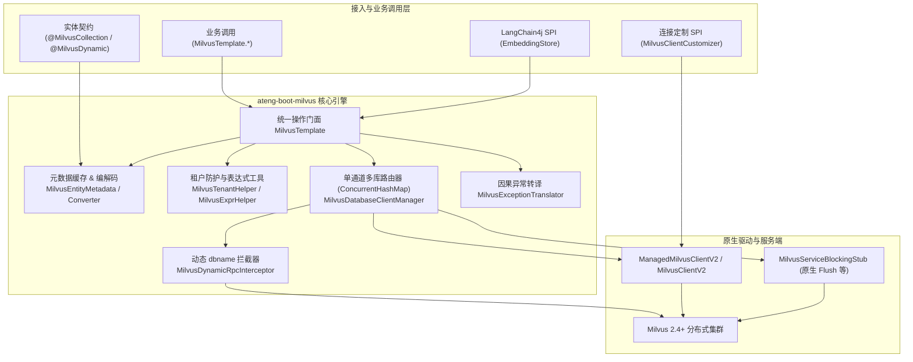

# ateng-boot-milvus 企业级向量检索与混合查询底座

> 面向生产就绪的 Spring Boot 3 企业级 Milvus 向量数据库与多向量混合检索基础设施 Starter，依托官方原生驱动 `milvus-sdk-java` (`MilvusClientV2` 2.4.4) 与单共享 gRPC 通道动态 `dbname` 路由器构建，提供三层立体操作门面 `MilvusTemplate`、POJO/动态字段双模映射、稠密与稀疏向量强类型检索、多路混合召回重排、物理分区生命周期探测与原生 gRPC 显式落盘、SaaS 多租户正交隔离及 LangChain4j `EmbeddingStore` 条件装配适配（设计权衡详见 [ADR-0089](../docs/adr/0089-enterprise-milvus-vector-database-and-hybrid-search-architecture.md)，领域词汇表详见 [CONTEXT.md](./CONTEXT.md)）。

---

## 0. 特性与公共 API 全景速查矩阵 (Feature & API Panorama Matrix)

| 特性分类 | 特性名称 | 核心门面 / 注解 / SPI | 关键配置项 (`ateng.boot.*`) | 关键 API 签名 / 核心行为 | 锚定验证源头 (*Test / Sample) |
| :--- | :--- | :--- | :--- | :--- | :--- |
| **基础装配** | 客户端连接与多库动态路由 | `AtengMilvusAutoConfiguration`<br>`ManagedMilvusClientV2`<br>`MilvusDatabaseClientManager`<br>`MilvusDynamicRpcInterceptor` | `ateng.boot.milvus.enabled`<br>`ateng.boot.milvus.uri`<br>`ateng.boot.milvus.host`<br>`ateng.boot.milvus.port`<br>`ateng.boot.milvus.token`<br>`ateng.boot.milvus.username`<br>`ateng.boot.milvus.password`<br>`ateng.boot.milvus.database`<br>`ateng.boot.milvus.secure` | 单共享 `ManagedChannel` 按每次 RPC 动态注入单一 `dbname` 头；`MilvusTemplate#getClient()` / `getProperties()` / `resolveCurrentDatabase()` | `AtengMilvusAutoConfigurationTest`<br>`AtengMilvusResilientChannelTest`<br>`MilvusTemplateBasicTest` |
| **通道与超时** | gRPC 通道治理与连接定制 SPI | `MilvusClientCustomizer`<br>`AtengMilvusProperties` | `ateng.boot.milvus.connect-timeout`<br>`ateng.boot.milvus.keep-alive-time`<br>`ateng.boot.milvus.keep-alive-timeout`<br>`ateng.boot.milvus.idle-timeout`<br>`ateng.boot.milvus.rpc-deadline` | `MilvusClientCustomizer#customize(ConnectConfig)` 无损调整连接配置；默认建连 `10s`、保活 `55s/20s`、空闲 `24h`、单次 RPC 超时 `30s` | `AtengMilvusAutoConfigurationTest`<br>`AtengMilvusPropertiesTest` |
| **可观测探针** | 云原生健康探针与版本探测 | `MilvusHealthIndicator`<br>`MilvusTemplate` | `management.health.milvus.enabled` | `testConnection()` / `getServerVersion()`，向 Actuator `/actuator/health` 上报 `UP/DOWN`、数据库与一致级别 | `MilvusHealthIndicatorTest`<br>`MilvusLifecycleController` |
| **异常与枚举** | 因果异常转译与三级一致性 | `MilvusException`<br>`MilvusResultCode`<br>`MilvusExceptionTranslator`<br>`MilvusConsistencyLevel` | `ateng.boot.milvus.consistency-level` | `MilvusConsistencyLevel` 实现 `IBaseEnum<String>`（`STRONG`/`BOUNDED`/`EVENTUALLY`，`fromValue`）；`translate(...)` 100% 保留原始 `cause` 链 | `MilvusResultCodeAndExceptionTest`<br>`AtengMilvusPropertiesTest` |
| **声明式映射** | 实体元数据与动态字段映射 | `@MilvusCollection`<br>`@MilvusId`<br>`@MilvusVector`<br>`@MilvusField`<br>`@MilvusPartitionKey`<br>`@MilvusDynamic` | - | `@MilvusCollection`（`name`/`description`/`enableDynamicField`/`numShards`/`ttlSeconds`/`mmap`/`replicaNumber`）；`@MilvusId`（`autoId`/`maxLength`）；`@MilvusVector`（`dimension`/`metricType`/`indexType`）；`@MilvusField`（`dataType`/`indexType`/`indexName`/`tenantField`）；`@MilvusPartitionKey`（`tenantField`）；`@MilvusDynamic`（`$meta` 扩展列双向编解码，配合 `MilvusEntityMetadata`/`MilvusEntityConverter`） | `MilvusEntityMetadataTest`<br>`MilvusEntityConverterTest`<br>`MilvusLifecycleAndRoutingTest` |
| **集合运维** | 集合生命周期与原生落盘 | `MilvusTemplate` | - | `hasCollection` / `createCollection` / `alterCollection` / `dropCollection` / `listCollections` / `describeCollection` / `getCollectionStats` / `loadCollection` / `releaseCollection` / `isCollectionLoaded` / `createCollectionAndIndex` / `flush(String)` / `flush(Class<?>)` / `flush(List<String>)`（原生 gRPC `FlushRequest`） | `MilvusTemplateLifecycleTest`<br>`MilvusLifecycleController` |
| **物理分区** | 分区管理、探测与弹性补建 | `MilvusTemplate` | `ateng.boot.milvus.auto-create-partition` | `hasPartition` / `createPartition` / `dropPartition` / `listPartitions` / `loadPartitions` / `releasePartitions` / `isPartitionsLoaded(String, List<String>)`；写入缺失分区时受控自动建分区 | `MilvusTemplateLifecycleTest`<br>`MilvusPartitionController` |
| **索引运维** | 向量与标量倒排索引生命周期 | `MilvusTemplate` | - | `createIndex`（Request / 字段参数 / 4 参标量索引）/ `dropIndex` / `describeIndex` / `listIndexes` / `hasIndex`，支持 `AUTOINDEX`/`HNSW`/`SPARSE_INVERTED_INDEX`/`INVERTED`/`TRIE`/`STL_SORT` | `MilvusMultiVectorAndInvertedIndexTest`<br>`MilvusTemplateLifecycleTest` |
| **集合别名** | 别名生命周期与蓝绿切流 | `MilvusTemplate` | - | `createAlias` / `alterAlias(..., checkLoaded)` / `dropAlias` / `listAliases` / `describeAlias` / `hasAlias`，切流前置内存加载守卫 | `MilvusAliasLifecycleTest`<br>`MilvusAliasController` |
| **多逻辑库** | 逻辑数据库运维与线程切库 | `MilvusTemplate`<br>`MilvusContextHolder` | `ateng.boot.milvus.tenant-database-routing` | `hasDatabase` / `listDatabases` / `createDatabase` / `dropDatabase` / `useDatabase(db, Supplier/Runnable)`；`MilvusContextHolder.useDatabase(db)`（`AutoCloseable` `DatabaseScope`） | `MilvusContextHolderTest`<br>`MilvusDatabaseController` |
| **数据写入删** | 单条、覆盖与分批切片重试 | `MilvusTemplate` | `ateng.boot.milvus.batch-size`<br>`ateng.boot.milvus.max-retries`<br>`ateng.boot.milvus.retry-delay` | `insert` / `insertEntities` / `upsert` / `upsertEntities` / `insertBatch` / `insertBatchEntities` / `upsertBatch` / `upsertBatchEntities` / `deleteById` / `deleteEntities` / `deleteByIds` / `deleteByExpr` / `deleteEntitiesByExpr` | `MilvusTemplateDataOperationsTest`<br>`MilvusVectorController` |
| **点查与统计** | 主键点查、批量读取与计数 | `MilvusTemplate` | - | `getById` / `getByIds` / `existsById` / `query` / `count`，自动兼容整数与字符主键并织入多租户条件 | `MilvusTemplateDataOperationsTest`<br>`MilvusVectorController` |
| **向量检索** | 单向量、指定向量列与稀疏检索 | `MilvusTemplate`<br>`MilvusSearchRequest`<br>`MilvusHit<T>` | `ateng.boot.milvus.consistency-level` | `search(SearchReq)` / `search(MilvusSearchRequest<T>)`（浅分页 `offset`、`groupBy`、`range`/`radius`、`roundDecimal`、`consistencyLevel`）/ `search(Class, vector, topK, ...)` / `search(Class, annsField, vector, ...)` / `search(collectionName, ...)` / `searchSparse(Class, annsField, Map<Long, Float>, ...)`；命中支持 `MilvusHit#getField(key)` | `MilvusSearchRequestTest`<br>`MilvusMultiVectorAndInvertedIndexTest`<br>`MilvusAdvancedSearchController`<br>`MilvusMultimodalController` |
| **混合召回** | 多向量多路召回与重排融合 | `MilvusTemplate`<br>`MilvusHybridSearchRequest`<br>`AnnSearch`<br>`ReRanker` | - | `hybridSearch(HybridSearchReq)` / `hybridSearch(MilvusHybridSearchRequest<T>)`，支持 `AnnSearch` 稠密/稀疏子通道与 `ReRanker.rrf` / `weighted` 融合重排 | `MilvusTemplateAdvancedOperationsTest`<br>`MilvusHybridController`<br>`MilvusMultimodalController` |
| **表达式构造** | 布尔过滤与 `TEXT_MATCH` 构造 | `MilvusExprHelper` | - | `textMatch` / `eq` / `ne` / `gt` / `gte` / `lt` / `lte` / `in` / `notIn` / `like` / `and` / `or` / `not` / `escape` / `formatValue` / `builder()` | `MilvusExprHelperTest`<br>`MilvusAdvancedSearchController` |
| **游标遍历** | 受管游标流式拉取防 OOM | `MilvusTemplate` | `ateng.boot.milvus.batch-size` | `streamingQuery` / `streamingQueryEntities`，基于 `QueryIterator` 突破 `16384` 分页上限并在 `finally` 确定性关流 | `MilvusTemplateAdvancedOperationsTest`<br>`MilvusAdvancedSearchController` |
| **SaaS 多租户** | 租户隔离列与物理分区正交协同 | `MilvusTenantHelper`<br>`TenantContextHolder` | `ateng.boot.milvus.tenant-field-name`<br>`ateng.boot.milvus.tenant-database-routing` | `weaveTenantFilter` / `weaveEntityTenantFilter` / `resolveEffectiveTenantField` / `fillRecordTenantField` / `fillEntityTenantField`；区分 `tenantField` 隔离列与 `@MilvusPartitionKey` 物理分区键 | `MilvusTenantHelperTest`<br>`MilvusTenantController` |
| **原生穿透** | 原生驱动逃逸回调 | `MilvusTemplate` | - | `execute(String operation, Function<MilvusClientV2, T>)`，统一异常转译且保留原始 `cause` | `MilvusTemplateBasicTest` |
| **LangChain4j** | `EmbeddingStore` 条件装配桥接 | `MilvusEmbeddingStore`<br>`MilvusLangChain4jAutoConfiguration`<br>`MilvusFilterMapper` | `ateng.boot.milvus.langchain4j.enabled`<br>`ateng.boot.milvus.langchain4j.collection-name`<br>`ateng.boot.milvus.langchain4j.vector-field-name`<br>`ateng.boot.milvus.langchain4j.id-field-name`<br>`ateng.boot.milvus.langchain4j.text-field-name`<br>`ateng.boot.milvus.langchain4j.tenant-field-name`<br>`ateng.boot.milvus.langchain4j.partition-name`<br>`ateng.boot.milvus.langchain4j.dimension`<br>`ateng.boot.milvus.langchain4j.metric-type`<br>`ateng.boot.milvus.langchain4j.index-type`<br>`ateng.boot.milvus.langchain4j.auto-create-collection`<br>`ateng.boot.milvus.langchain4j.consistency-level` | 实现 `EmbeddingStore<TextSegment>`；支持 `MilvusFilterMapper#map(Filter)` 表达式递归映射、`ReentrantLock` 并发防卫初始化 | `MilvusEmbeddingStoreTest`<br>`MilvusFilterMapperTest`<br>`MilvusLangChain4jAutoConfigurationTest` |

---

## 1. 模块定位、Maven 坐标与快速起步

### 1.1 模块核心能力
`ateng-boot-milvus` 专注企业级高维向量与混合检索存储底座，不捆绑 PDF 解析、分块或大模型调用逻辑（保持轻量零臃肿，详见 [ADR-0089](../docs/adr/0089-enterprise-milvus-vector-database-and-hybrid-search-architecture.md)）：
- **官方现代主核**：基于 `io.milvus:milvus-sdk-java` (2.4.4) `MilvusClientV2`，单共享通道动态路由逻辑库并提供 `execute` / `getClient()` 原生逃逸通道；
- **底座原语复用**：重试退避（`RetryUtil`）、分批切片（`BatchSliceUtil`）、JSON 与异常断言统一收敛至 `ateng-boot-core`；
- **双模驱动映射**：支持注解驱动的强类型 POJO 实体，以及无预定义 Schema 的 `Map<String, Object>` 动态字典写入/查询。

### 1.2 Maven 引入坐标

推荐通过 BOM 统一纳管版本号（业务模块免写 `<version>`）：

```xml
<dependencyManagement>
    <dependencies>
        <dependency>
            <groupId>io.github.atengk</groupId>
            <artifactId>ateng-boot-bom</artifactId>
            <version>1.2.0</version>
            <type>pom</type>
            <scope>import</scope>
        </dependency>
    </dependencies>
</dependencyManagement>

<dependencies>
    <!-- 引入 BOM 后免配版本号 -->
    <dependency>
        <groupId>io.github.atengk</groupId>
        <artifactId>ateng-boot-milvus</artifactId>
    </dependency>
</dependencies>
```

若微服务未导入 `ateng-boot-bom`，可直接显式声明独立版本坐标：

```xml
<dependency>
    <groupId>io.github.atengk</groupId>
    <artifactId>ateng-boot-milvus</artifactId>
    <version>1.2.0</version>
</dependency>
```

### 1.3 最小可用起步（1:1 提取自 Sample 实测工程）

#### 最小 YAML 配置
```yaml
ateng:
  boot:
    milvus:
      enabled: true
      uri: http://localhost:19530
      database: default
      consistency-level: BOUNDED
```

#### 强类型集合实体（1:1 提取自 `SampleDocumentEntity`）
```java
@Data
@Builder
@NoArgsConstructor
@AllArgsConstructor
@MilvusCollection(name = "sample_document", description = "知识库文档向量集合", numShards = 1)
public class SampleDocumentEntity implements Serializable {

    private static final long serialVersionUID = 1L;

    @MilvusId(description = "文档主键ID")
    private Long id;

    @MilvusPartitionKey(maxLength = 64, description = "分类分区路由键")
    private String category;

    @MilvusField(name = "tenant_id", maxLength = 64, description = "SaaS多租户标识")
    @JsonProperty("tenant_id")
    private String tenantId;

    @MilvusField(name = "title", maxLength = 256, description = "文档标题")
    private String title;

    @MilvusField(name = "content", maxLength = 4096, description = "正文内容")
    private String content;

    @MilvusVector(name = "vector", dimension = 4, metricType = IndexParam.MetricType.COSINE, indexType = IndexParam.IndexType.AUTOINDEX, description = "4维稠密向量")
    private List<Float> vector;

    private Map<String, Object> extra;
}
```

#### 极简控制器/服务实战（1:1 提取自 `MilvusLifecycleController` & `MilvusVectorController`）
```java
// 1. 一键建表、构建向量索引并预加载至内存（摘自 MilvusLifecycleController#initCollection）
milvusTemplate.createCollectionAndIndex(SampleDocumentEntity.class);

// 2. 写入强类型实体（摘自 MilvusVectorController#insert）
SampleDocumentEntity entity = DocumentConverter.toEntity(request);
milvusTemplate.insertEntities(Collections.singletonList(entity));

// 3. 附带标量过滤的单向量 ANN 检索（摘自 MilvusVectorController#search）
List<MilvusHit<SampleDocumentEntity>> hits = milvusTemplate.search(
        SampleDocumentEntity.class,
        request.getVector(),
        request.getTopK(),
        request.getFilterExpr()
);
```

---

## 2. 核心架构与设计不变量



### 核心设计不变量 (Invariants)
1. **对称门面完备性**：集合、分区、索引、别名、逻辑库、读写删均提供对称操作；批处理默认分片为 `batch-size: 1000` 并结合指数退避重试（`max-retries: 3`、`retry-delay: 200ms`）。
2. **单通道动态多库路由**：全局维护单一共享 `ManagedChannel`，`MilvusDatabaseClientManager` 通过无锁 `ConcurrentHashMap` 缓存多库视图，由 `MilvusDynamicRpcInterceptor` 在每次 RPC 前剔除旧头并注入当前有效 `dbname`（`MilvusContextHolder` > `tenant-database-routing` > 默认 `database`）。
3. **虚拟线程零 Carrier Pinning**：全模块零 `synchronized` 块；多库视图与元数据缓存依托 `ConcurrentHashMap`，`MilvusEmbeddingStore` 集合懒初始化锁采用 `ReentrantLock`（遵循 [ADR-0029](../docs/adr/0029-virtual-threads-and-adaptive-async-runtime.md)）。
4. **物理分区键与租户列正交分离**：通过 `@MilvusField(tenantField = true)` / `@MilvusPartitionKey(tenantField = true)` 与全局 `tenant-field-name: tenant_id` 显式声明租户列，避免业务类目 `@MilvusPartitionKey` 被误识别为租户列。
5. **100% 因果链保留**：所有底层 gRPC 与 SDK 异常均由 `MilvusExceptionTranslator` 转译为 `MilvusException(MilvusResultCode, message, cause)`。

---

## 3. 集合、物理分区与多逻辑数据库运维

### 3.1 集合生命周期、一键建表与原生 gRPC 显式落盘

#### 专属 YAML 配置
```yaml
ateng:
  boot:
    milvus:
      uri: http://localhost:19530
      database: default
      rpc-deadline: 30s # 单次 gRPC 调用截止超时，包含原生 FlushRequest
```

#### 实战 Java 代码（提取自 `MilvusLifecycleController` & `SampleDocumentEntity`）
```java
// 1. 根据实体注解一键建表、构建全量索引并按 replicaNumber 加载至内存
milvusTemplate.createCollectionAndIndex(SampleDocumentEntity.class);

// 2. 元数据巡检与内存加载状态探测
List<String> collections = milvusTemplate.listCollections();
DescribeCollectionResp desc = milvusTemplate.describeCollection("sample_document");
boolean loaded = milvusTemplate.isCollectionLoaded("sample_document");

// 3. 显式调整集合属性或按副本数重载
milvusTemplate.alterCollection("sample_document", Map.of("mmap.enabled", "false"));
milvusTemplate.releaseCollection("sample_document");
milvusTemplate.loadCollection("sample_document");

// 4. 显式触发原生 gRPC FlushRequest，将增量缓冲数据封存落盘为不可变 Segment
milvusTemplate.flush("sample_document");
// 或基于实体类 / 多集合批量落盘：
// milvusTemplate.flush(SampleDocumentEntity.class);
// milvusTemplate.flush(List.of("sample_document", "sample_multimodal"));
```

#### 核心机制与边界说明
- `MilvusTemplate#flush` 通过 `MilvusDatabaseClientManager.extractBlockingStub` 获取挂载的 `MilvusServiceBlockingStub` 发送原生 `FlushRequest` 并透传激活的逻辑数据库 `dbName`；若使用未绑定底层存根的外部 `MilvusClientV2`，将 Fail-Fast 抛出 `MilvusResultCode.CLIENT_INIT_FAILED`；
- Milvus 服务端对 `FlushRequest` 通常内置全局限流策略（例如 `rate=0.1`，即单集合每 10 秒 1 次），生产代码切勿在高频写入循环内逐条调用 `flush`，应仅用于批量导入收口或冷归档封存节点。

---

### 3.2 物理分区运维、全加载探测与按月归档自动建分区

#### 专属 YAML 配置
```yaml
ateng:
  boot:
    milvus:
      # 默认 false 严格校验；时序按月归档等场景可显式开启，缺分区时自动补建并重试写入
      auto-create-partition: true
```

#### 实战 Java 代码（提取自 `MilvusPartitionController` & `SampleArchiveLogEntity`）
```java
// 注意：SampleArchiveLogEntity 未标注 @MilvusPartitionKey，适用于手动物理分区运维
milvusTemplate.createCollectionAndIndex(SampleArchiveLogEntity.class);

// 1. 分区创建与枚举
milvusTemplate.createPartition("sample_archive_log", "part_202611");
List<String> partitions = milvusTemplate.listPartitions("sample_archive_log");

// 2. 分区级加载、全加载探测与释放
milvusTemplate.loadPartitions("sample_archive_log", List.of("part_202611"));
boolean allLoaded = milvusTemplate.isPartitionsLoaded("sample_archive_log", List.of("part_202611"));
milvusTemplate.releasePartitions("sample_archive_log", List.of("part_202611"));

// 3. 开启 auto-create-partition=true 时，向未创建的新分区写入将自动建分区并重试
SampleArchiveLogEntity archive = SampleArchiveLogEntity.builder()
        .id(2001L)
        .archiveMonth("2026-12")
        .title("年度审计向量归档")
        .vector(List.of(0.11f, 0.22f, 0.33f, 0.44f))
        .build();
milvusTemplate.insertEntities(List.of(archive), "part_202612");
```

#### 核心机制与边界说明
- **Milvus 2.4 互斥硬约束**：服务端明确禁止对已启用 `PartitionKey`（即字段标有 `@MilvusPartitionKey`）的集合执行手动 `createPartition` / `loadPartitions` / `dropPartition`；需手动分区的时序归档集合请勿使用 `@MilvusPartitionKey`；
- **`isPartitionsLoaded` 严格合取语义**：对传入的集合与非空分区列表执行 Fail-Fast 校验并逐个发起 `GetLoadStateReq`，仅当列表内**全部**物理分区均已到达 `Loaded` 状态时才返回 `true`；且 `loadPartitions` 在服务端属异步任务，紧随其后的探测建议留出状态收敛窗口。

---

### 3.3 集合别名生命周期与零停机蓝绿切流

#### 专属 YAML 配置
```yaml
ateng:
  boot:
    milvus:
      uri: http://localhost:19530
      database: default
```

#### 实战 Java 代码（提取自 `MilvusAliasController`）
```java
// 1. 创建指向初始集合的逻辑别名
milvusTemplate.createAlias("sample_document", "doc_alias_prod");

// 2. 蓝绿重建新集合并预加载完成后，原子切流（checkLoaded=true 校验目标集合已加载防检索报错）
milvusTemplate.alterAlias("sample_document_v2", "doc_alias_prod", true);

// 3. 元数据反查与删除
List<String> aliases = milvusTemplate.listAliases("sample_document_v2");
DescribeAliasResp detail = milvusTemplate.describeAlias("doc_alias_prod");
boolean exists = milvusTemplate.hasAlias("sample_document_v2", "doc_alias_prod");
milvusTemplate.dropAlias("doc_alias_prod");
```

#### 核心机制与边界说明
- `alterAlias(collectionName, alias, true)` 会在切流前主动调用 `isCollectionLoaded(collectionName)`，若新集合尚未加载至内存直接阻断切换，防止线上查询瞬断。

---

### 3.4 多逻辑数据库运维与 `MilvusContextHolder` 动态切库

#### 专属 YAML 配置
```yaml
ateng:
  boot:
    milvus:
      database: default
      tenant-database-routing: false # 如需按 TenantContextHolder 自动路由同名独立库可改为 true
```

#### 实战 Java 代码（提取自 `MilvusDatabaseController`）
```java
// 1. 数据库生命周期探测与增删查
if (!milvusTemplate.hasDatabase("sample_route_db")) {
    milvusTemplate.createDatabase("sample_route_db");
}
List<String> allDbs = milvusTemplate.listDatabases();

// 2. Try-With-Resources 作用域动态切库（嵌套或异常退出后确定性恢复上一层数据库）
try (MilvusContextHolder.DatabaseScope ignored = MilvusContextHolder.useDatabase("sample_route_db")) {
    List<MilvusHit<SampleDocumentEntity>> hits = milvusTemplate.search(
            SampleDocumentEntity.class, queryVector, 5, "id > 0");
}

// 3. 闭包式临时切库
milvusTemplate.useDatabase("sample_route_db", () -> milvusTemplate.listCollections());

// 4. 清理临时库
milvusTemplate.dropDatabase("sample_route_db");
```

#### 核心机制与边界说明
- **动态路由优先级**：`MilvusContextHolder.getDatabase()`（显式作用域切库） > `TenantContextHolder.getTenantId()`（仅当 `tenant-database-routing=true` 且非忽略租户） > 全局默认 `ateng.boot.milvus.database`；
- **单通道元数据注入**：`MilvusDynamicRpcInterceptor` 在发起 RPC 前剔除底层可能缓存的旧 `dbname` 头，写入单一目标 `dbname`，支持任意动态新建库毫秒级无锁切换。

---

## 4. 双模数据操作、高级检索与混合召回

### 4.1 批量切片写删、点查与 `@MilvusDynamic` 动态扩展列

#### 专属 YAML 配置
```yaml
ateng:
  boot:
    milvus:
      batch-size: 1000  # 单批写入与流式拉取切片大小
      max-retries: 3    # 单批失败最大重试次数（0 表示不重试）
      retry-delay: 200ms # 指数退避重试初始等待时长
```

#### 实战 Java 代码（提取自 `MilvusVectorController` & `SampleMultimodalEntity`）
```java
// 1. 批量插入与幂等覆盖（依托 BatchSliceUtil + RetryUtil 自动切片重试）
milvusTemplate.insertBatchEntities(entities);
milvusTemplate.upsertBatchEntities(entities);

// 2. 主键单查、批量点查与轻量存在探测
SampleDocumentEntity one = milvusTemplate.getById(SampleDocumentEntity.class, 1L);
List<SampleDocumentEntity> list = milvusTemplate.getByIds(SampleDocumentEntity.class, List.of(1L, 2L));
boolean exists = milvusTemplate.existsById(SampleDocumentEntity.class, 1L);

// 3. 纯标量查询、统计与按主键/表达式删除
List<SampleDocumentEntity> queried = milvusTemplate.query(SampleDocumentEntity.class, "category == 'TECH'");
long count = milvusTemplate.count(SampleDocumentEntity.class, "category == 'TECH'");
milvusTemplate.deleteById(SampleDocumentEntity.class, 1L);
milvusTemplate.deleteEntitiesByExpr(SampleDocumentEntity.class, "id == 2");
```

动态扩展字段只需在实体中标注 `@MilvusDynamic`（或缺省命名为 `extra` 且 `enableDynamicField = true`）：

```java
@MilvusDynamic
private Map<String, Object> extra;
```

#### 核心机制与边界说明
- `MilvusEntityConverter` 写入时自动将 `@MilvusDynamic` Map 扁平化写入 `$meta`，反序列化时自动把未映射到静态字段的未知扩展列统一回填至该 Map；
- `upsertBatchEntities` / `insertBatchEntities` 严格按 `batch-size` 切片，防止单帧载荷突破 Milvus gRPC 默认上限；批量或点查无匹配记录保底返回空集合（单对象 `getById` 返回 `null`）。

---

### 4.2 高级 Fluent 检索（GroupBy / Range）与 `MilvusExprHelper`

#### 专属 YAML 配置
```yaml
ateng:
  boot:
    milvus:
      consistency-level: BOUNDED # 全局默认有界一致；高敏强读可在请求级别覆盖为 STRONG
```

#### 实战 Java 代码（提取自 `MilvusAdvancedSearchController`）
```java
// 1. GroupBy 去重聚合检索（按 category 分组，每组保留最相似 Top 1）
MilvusSearchRequest<SampleDocumentEntity> groupByReq = MilvusSearchRequest.<SampleDocumentEntity>builder()
        .collectionName("sample_document")
        .entityClass(SampleDocumentEntity.class)
        .vector(queryVector)
        .topK(5)
        .groupByFieldName("category")
        .consistencyLevel(MilvusConsistencyLevel.STRONG)
        .build();
List<MilvusHit<SampleDocumentEntity>> groupHits = milvusTemplate.search(groupByReq);

// 2. Range 置信度区间检索（支持 offset 浅分页与 outputFields 裁剪）
MilvusSearchRequest<SampleDocumentEntity> rangeReq = MilvusSearchRequest.of(SampleDocumentEntity.class)
        .vector(queryVector)
        .topK(10)
        .offset(0)
        .radius(0.50)
        .rangeFilter(0.85)
        .outputFields(List.of("id", "title", "category"));
List<MilvusHit<SampleDocumentEntity>> rangeHits = milvusTemplate.search(rangeReq);

// 3. MilvusExprHelper 安全表达式与 BM25 TEXT_MATCH 全文匹配
String compiledExpr = MilvusExprHelper.builder()
        .eq("category", "TECH")
        .like("title", "Milvus%")
        .gte("id", 1L)
        .textMatch("content", "Milvus 向量检索")
        .build();
MilvusSearchRequest<SampleDocumentEntity> exprReq = MilvusSearchRequest.of(SampleDocumentEntity.class)
        .vector(queryVector)
        .topK(5)
        .expr(compiledExpr);
List<MilvusHit<SampleDocumentEntity>> exprHits = milvusTemplate.search(exprReq);
```

#### 核心机制与边界说明
- `MilvusExprHelper` 自动处理字符串单引号转义并跳过空条件，防止手写字符串拼接注入或语法错位；
- `MilvusConsistencyLevel` 实现 `IBaseEnum<String>`，可在单次 `MilvusSearchRequest` 上覆盖为 `MilvusConsistencyLevel.STRONG` 保障刚写入即刻召回。

---

### 4.3 多向量、稀疏向量强类型检索与多路混合重排

#### 专属 YAML 配置
```yaml
ateng:
  boot:
    milvus:
      uri: http://localhost:19530
      consistency-level: BOUNDED
```

#### 实战 Java 代码（提取自 `SampleMultimodalEntity`、`MilvusMultimodalController` & `MilvusHybridController`）
```java
// 1. 多模态实体的稠密向量列与稀疏向量列定义（1:1 提取自 SampleMultimodalEntity）
@Data
@Builder
@NoArgsConstructor
@AllArgsConstructor
@MilvusCollection(name = "sample_multimodal", description = "多模态多特征向量集合", ttlSeconds = 604800, mmap = true, replicaNumber = 1)
public class SampleMultimodalEntity implements Serializable {

    private static final long serialVersionUID = 1L;

    @MilvusId(description = "多模态文档ID")
    private Long id;

    @MilvusField(name = "title", maxLength = 256, description = "文档标题")
    private String title;

    @MilvusField(name = "summary", maxLength = 2048, indexType = IndexParam.IndexType.INVERTED, indexName = "idx_summary_inverted", description = "概要摘要倒排索引")
    private String summary;

    @MilvusVector(name = "dense_vector", dimension = 4, metricType = IndexParam.MetricType.COSINE, indexType = IndexParam.IndexType.AUTOINDEX, description = "4维语义稠密特征向量")
    private List<Float> denseVector;

    @MilvusVector(name = "sparse_vector", metricType = IndexParam.MetricType.IP, indexType = IndexParam.IndexType.SPARSE_INVERTED_INDEX, description = "BM25关键词稀疏特征向量")
    private Map<Long, Float> sparseVector;

    @MilvusDynamic
    private Map<String, Object> extra;
}

// 2. 指定向量列名执行强类型稠密 / 稀疏单路检索
List<MilvusHit<SampleMultimodalEntity>> denseHits = milvusTemplate.search(
        SampleMultimodalEntity.class, "dense_vector", denseVec, 3, null);

List<MilvusHit<SampleMultimodalEntity>> sparseHits = milvusTemplate.searchSparse(
        SampleMultimodalEntity.class, "sparse_vector", Map.of(101L, 0.85f, 202L, 0.45f), 3, null);

// 3. 稠密 + 稀疏多路混合检索与 RRF / Weighted 重排融合
MilvusHybridSearchRequest<SampleMultimodalEntity> hybridReq = MilvusHybridSearchRequest.of(SampleMultimodalEntity.class)
        .topK(5)
        .addSearch(AnnSearch.of("dense_vector", denseVec, 5))
        .addSearch(AnnSearch.ofSparse("sparse_vector", sparseVec, 5))
        .rrf(60); // 或 .weighted(0.7f, 0.3f)
List<MilvusHit<SampleMultimodalEntity>> hybridHits = milvusTemplate.hybridSearch(hybridReq);
```

#### 核心机制与边界说明
- 当实体存在多个向量列时，调用 `search(Class, annsField, vector, ...)` 或 `searchSparse(Class, annsField, sparseVector, ...)` 显式绑定目标 `annsField`；
- 稀疏向量 `Map<Long, Float>` 对应 `SPARSE_FLOAT_VECTOR`，必须使用 `IP`（内积）度量与 `SPARSE_INVERTED_INDEX`；`WEIGHTED` 重排权重长度必须与 `AnnSearch` 子通道个数严格一致。

---

### 4.4 受管游标流式深度遍历（突破 `16384` 上限）

#### 专属 YAML 配置
```yaml
ateng:
  boot:
    milvus:
      batch-size: 1000
      rpc-deadline: 30s
```

#### 实战 Java 代码（提取自 `MilvusAdvancedSearchController#streamingQuery`）
```java
milvusTemplate.streamingQueryEntities(
        SampleDocumentEntity.class,
        "id > 0",
        200,
        batch -> batch.forEach(doc -> log.info("游标读取文档: id={}, title={}", doc.getId(), doc.getTitle()))
);
```

#### 核心机制与边界说明
- Milvus 默认拒绝 `offset + limit > 16384` 的普通分页查询；`streamingQuery` / `streamingQueryEntities` 底层基于 `QueryIterator` 分批游标拉取并在 `finally` 确定性关闭游标，防止全量扫描引发服务端或 JVM OOM。

---

### 4.5 SaaS 多租户正交隔离（`tenantField` vs `@MilvusPartitionKey`）

#### 专属 YAML 配置
```yaml
ateng:
  boot:
    milvus:
      tenant-field-name: tenant_id       # 无实体注解时回退的全局租户隔离列名
      tenant-database-routing: false     # 同库行级隔离模式；置为 true 则同时按租户切库
```

#### 实战 Java 代码（提取自 `MilvusTenantController`）
```java
TenantContextHolder.setTenantId("tenant_corp_alpha");
try {
    // 1. 写入自动提取租户上下文填充实体 tenantField（优先读取 @MilvusField(tenantField = true)）
    milvusTemplate.insertEntities(List.of(doc));

    // 2. 查询/点查/统计/删除自动织入防御性括号条件: (expr) and (tenant_id == 'tenant_corp_alpha')
    List<MilvusHit<SampleDocumentEntity>> hits = milvusTemplate.search(
            SampleDocumentEntity.class, queryVector, 5, "category == 'POLICY'");
    SampleDocumentEntity found = milvusTemplate.getById(SampleDocumentEntity.class, 100L);
} finally {
    TenantContextHolder.clear();
}
```

#### 核心机制与边界说明
- **正交设计**：`SampleDocumentEntity` 同时使用 `@MilvusPartitionKey` 标记业务分类 `category` 进行哈希分区路由，并用 `@MilvusField(name = "tenant_id", tenantField = true)` 声明独立租户隔离列；仅当需要按租户直接物理分区且不按类目分区时，才标记 `@MilvusPartitionKey(tenantField = true)`；
- **防运算符逃逸**：`MilvusTenantHelper.weaveTenantFilter` 将原始表达式整体括号化后再 `and` 拼接租户等值条件，杜绝外部传入 `or` 条件绕过租户隔离；配合 `TenantContextHolder.setIgnoreTenant(true)` 可执行受控超管跨租户查询。

---

## 5. 生产扩展接管与核心非功能边界

### 5.1 扩展接管 (SPI 与 `@ConditionalOnMissingBean`)

#### 方式一：注册 `MilvusClientCustomizer` 无损定制连接参数（推荐）
无需重造 `MilvusClientV2` 装配链即可安全叠加自定义 SSL、RPC 截止超时或 KeepAlive 参数：

```java
@Bean
public MilvusClientCustomizer customMilvusClientCustomizer() {
    return connectConfig -> {
        connectConfig.setRpcDeadlineMs(TimeUnit.SECONDS.toMillis(45));
        connectConfig.setKeepAliveWithoutCalls(true);
    };
}
```

#### 方式二：完全覆盖默认 Bean
`MilvusClientV2`、`MilvusDatabaseClientManager`、`MilvusTemplate` 与 `MilvusHealthIndicator` 均标注 `@ConditionalOnMissingBean`，业务侧可通过注册自定义 Bean 整体接管。

#### 方式三：LangChain4j `EmbeddingStore` 弱依赖适配器
仅当类路径存在 `dev.langchain4j.store.embedding.EmbeddingStore` 且 `ateng.boot.milvus.langchain4j.enabled=true` 时自动装配 `MilvusEmbeddingStore`（复用同一共享通道、多租户过滤与 `MilvusFilterMapper` 表达式递归转换）：

```yaml
ateng:
  boot:
    milvus:
      langchain4j:
        enabled: true
        collection-name: langchain4j_embeddings
        dimension: 1536
        metric-type: COSINE
        index-type: AUTOINDEX
        auto-create-collection: true
```

### 5.2 核心生产边界与非功能语义

| 维度 | 核心边界与防御策略 |
| :--- | :--- |
| **读写一致性语义** | `STRONG` 保证写后立即可见但增加同步等待延迟；默认 `BOUNDED` 在吞吐与微秒级近实时间取得平衡；离线召回可选 `EVENTUALLY`。局部点查若受限于 `BOUNDED` 短暂窗口，可在请求级覆盖为 `MilvusConsistencyLevel.STRONG` |
| **RPC 超时与保活** | `connect-timeout: 10s`、`keep-alive-time: 55s`、`keep-alive-timeout: 20s`、`idle-timeout: 24h`、`rpc-deadline: 30s`，穿透云厂商负载均衡 60 秒空闲断连并防止 gRPC 请求无限挂起 |
| **虚拟线程安全** | 全模块零 `synchronized` 块；`MilvusDatabaseClientManager` 采用无锁 `ConcurrentHashMap` 缓存多库视图，`MilvusEmbeddingStore` 建表锁采用 `ReentrantLock`，兼容 JDK 21+ 虚拟线程无 Carrier Pinning 风险 |
| **分批与限流边界** | 批量写删严格按 `batch-size: 1000` 切片并发重试，防单次 gRPC 帧超限；`flush` 受 Milvus 服务端 `RateLimiter` 限制，避免高频调用触发限流 |
| **空安全与异常处理** | 集合查询与检索无结果保底返回空集合；单对象查询未命中返回 `null`；所有 SDK/gRPC 异常转译为 `MilvusException` 并完整保留 `cause` 链 |

---

## 6. 完整 YAML 配置属性清单

```yaml
ateng:
  boot:
    milvus:
      # 是否启用 Milvus 基础设施自动装配 (默认 true)
      enabled: true
      # 统一连接端点 URI (若配置则优先于 host/port，如 http://localhost:19530)
      uri:
      # 服务端主机地址 (uri 为空时生效，默认 127.0.0.1)
      host: 127.0.0.1
      # 服务端端口号 (uri 为空时生效，默认 19530)
      port: 19530
      # 认证 Token (支持 API Key 或 "username:password")
      token:
      # 认证用户名 (未提供 token 时与 password 组合生效)
      username:
      # 认证密码
      password:
      # 默认逻辑数据库名称 (默认 default)
      database: default
      # 是否启用 TLS 链路加密传输 (默认 false)
      secure: false
      # gRPC 连接建立超时时间 (默认 10s)
      connect-timeout: 10s
      # gRPC KeepAlive 保活心跳间隔时间 (默认 55s)
      keep-alive-time: 55s
      # gRPC KeepAlive 保活响应超时阈值 (默认 20s)
      keep-alive-timeout: 20s
      # gRPC 通道空闲超时阈值 (默认 24h)
      idle-timeout: 24h
      # 单次 RPC 执行截止超时阈值 (默认 30s，防止 gRPC 请求无界挂起)
      rpc-deadline: 30s
      # 默认读写一致性级别：STRONG / BOUNDED / EVENTUALLY (默认 BOUNDED)
      consistency-level: BOUNDED
      # 写入时物理分区不存在是否自动补建 (默认 false；注意与 @MilvusPartitionKey 集合互斥)
      auto-create-partition: false
      # 是否开启基于 TenantContextHolder 的逻辑数据库动态路由 (默认 false)
      tenant-database-routing: false
      # 全局默认 SaaS 多租户隔离列名称 (无实体元数据 tenantField 声明时生效，默认 tenant_id)
      tenant-field-name: tenant_id
      # 批量写删与游标流式遍历默认切片大小 (默认 1000)
      batch-size: 1000
      # 批量写入单批失败最大重试次数 (不含首次，0 表示不重试，默认 3)
      max-retries: 3
      # 批量写入指数退避重试初始等待时长 (默认 200ms)
      retry-delay: 200ms
      # LangChain4j EmbeddingStore 可选桥接配置
      langchain4j:
        # 是否启用 LangChain4j 自动装配 (默认 true)
        enabled: true
        # 知识库向量集合名称 (默认 langchain4j_embeddings)
        collection-name: langchain4j_embeddings
        # 向量列名称 (默认 vector)
        vector-field-name: vector
        # 主键 ID 列名称 (默认 id)
        id-field-name: id
        # 文本切片列名称 (默认 text)
        text-field-name: text
        # 多租户隔离列名称 (默认 tenant_id)
        tenant-field-name: tenant_id
        # 指定物理分区名称 (可选)
        partition-name:
        # 向量维度 (默认 1536)
        dimension: 1536
        # 距离度量类型 (默认 COSINE)
        metric-type: COSINE
        # 向量索引类型 (默认 AUTOINDEX)
        index-type: AUTOINDEX
        # 集合不存在时是否自动创建 Schema、索引并加载 (默认 true)
        auto-create-collection: true
        # 专属读写一致性级别 (可选，默认继承全局配置)
        consistency-level:

management:
  health:
    milvus:
      # 是否启用 Actuator Milvus 健康探针 (默认 true)
      enabled: true
```

> 完整交互式体验工程、启动命令与全控制器 cURL 清单，请参阅：[ateng-boot-sample-milvus README](../ateng-boot-samples/ateng-boot-sample-milvus/README.md)。
