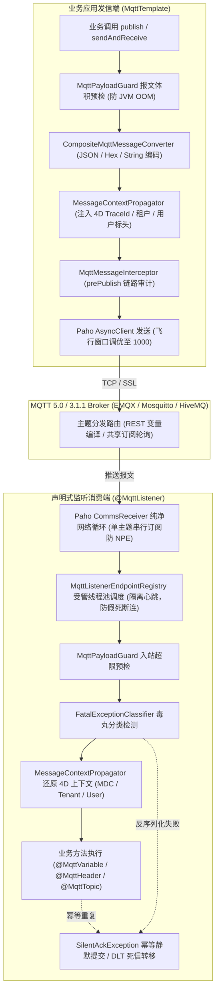

# ateng-boot-mqtt 基础设施 Starter

> 工业级轻量 IoT 物联网 MQTT 5.0 / 3.1.1 客户端基础设施 Starter，基于 Eclipse Paho MQTT v5 官方原生 Java 客户端深度封装，提供强类型对称发信与声明式消费模型，内置多客户端动态路由、REST 风格通配路径变量提取、标头与四维上下文（MDC TraceId / 租户 / 用户）全链路透传、集群共享订阅、MQTT 5.0 同步与异步 RPC 请求-响应、本地事务发信严格对齐、工业国标/车联网强类型十六进制（HexPayload）双向转译、防互踢/防幽灵会话、Silent ACK 静默确认、DLT 毒丸死信隔离、入站大报文熔断、KeepAlive 线程隔离、双向 mTLS 安全认证、Spring Boot Actuator 生产健康感知与 Micrometer 黄金度量体系。

---

## 0. 特性与公共 API 全景速查矩阵 (Feature & API Panorama Matrix)

| 特性分类 | 特性名称 | 核心门面 / 注解 / SPI | 关键配置项 (`ateng.boot.mqtt.*`) | 关键 API 签名 / 核心行为 | 锚定验证源头 (*Test / Sample) |
| :--- | :--- | :--- | :--- | :--- | :--- |
| **基础发信** | 同步可靠消息发布 | `MqttTemplate` | `enabled`<br>`clients.<name>.publish-timeout` | `publish(String, Object)` / `publish(String, Object, int)` / `publish(String, Object, int, boolean)` / `publish(String, Object, int, boolean, Duration)` / `publish(String, Object, int, boolean, Map<String, String>, Duration)`，自动适配 POJO / String / byte[] / HexPayload，透明透传 MDC TraceId 与租户标头 | `MqttTemplateTest`<br>`MqttTelemetryController` |
| **定向发信** | 指定客户端同步发布 | `MqttTemplate` | `clients.<name>.publish-timeout` | `publishToClient(String, String, Object)` / `publishToClient(String, String, Object, int, boolean, Map<String, String>, Duration)`，精确投递至指定命名客户端底层连接 | `MqttTemplateTest`<br>`SampleMqttE2eTest` |
| **异步发信** | 异步非阻塞消息发布 | `MqttTemplate` | `clients.<name>.publish-timeout` | `publishAsync(String, Object, int, boolean)` / `publishAsync(String, Object, int, boolean, Duration)` / `publishAsyncToClient(...)`，返回 `CompletableFuture<Void>`，微秒级返还调用线程 | `MqttTemplateTest`<br>`SampleMqttE2eTest` |
| **保留消息** | 保留消息发布与对称清空 | `MqttTemplate` | `clients.<name>.publish-timeout` | `publishRetained(String, Object, int)` / `clearRetained(String)` / `clearRetainedToClient(String, String)`，发送空载荷且 retained=true 报文，彻底抹除 Broker 保留状态 | `MqttTemplateTest`<br>`MqttBatchAndRetainedController` |
| **批量发布** | 批量并发消息原子下发 | `MqttTemplate`<br>`MqttPublishRecord` | `clients.<name>.publish-timeout`<br>`clients.<name>.max-inflight` | `publishBatch(List<MqttPublishRecord>)` / `publishBatchAsync(...)` / `publishBatchToClient(...)`，聚合并发下发多设备指令，支持混合 QoS 与 Retained 配置 | `MqttTemplateTest`<br>`MqttBatchAndRetainedController` |
| **事务发信** | 本地事务提交后发信 | `MqttTemplate` | `clients.<name>.publish-timeout` | `sendAfterCommit(String, Object)` / `sendAfterCommit(String, Object, int, boolean)` / `sendAfterCommitToClient(...)`，严格绑定 Spring 本地事务提交阶段触发投递，事务回滚自动取消发信防脏读 | `MqttTemplateTest`<br>`MqttTransactionController` |
| **同步 RPC** | 请求-响应阻塞交互 | `MqttTemplate`<br>`MqttRequestReplyManager` | `clients.<name>.response-topic-prefix` | `sendAndReceive(String, Object, Class<T>, Duration)` / `sendAndReceive(String, Object, Duration)`，基于 MQTT 5.0 `ResponseTopic` 与 `CorrelationData` 实现响应路由与超时扫描 | `MqttRequestReplyTest`<br>`MqttRpcController` |
| **异步 RPC** | 请求-响应非阻塞流水线 | `MqttTemplate`<br>`MqttRequestReplyManager` | `clients.<name>.response-topic-prefix` | `sendAndReceiveAsync(String, Object, Class<T>, Duration)`，返回 `CompletableFuture<T>`，微秒级异步响应匹配与防堆积熔断 | `MqttRequestReplyTest`<br>`MqttRpcController` |
| **死信治理** | 毒丸死信窥探与重放 | `MqttDeadLetterReplayTemplate`<br>`MqttDeadLetterRecord` | `max-replay-count`<br>`clients.<name>.max-payload-size` | `peek(String, int, Duration)` 离线只读窥探、`replay(String, String, int, Duration)` 受控重放至目标恢复主题、`purge(String)` 物理清空死信队列 | `MqttDeadLetterReplayTemplateTest`<br>`MqttDeadLetterController` |
| **容器治理** | 监听端点动态生命周期 | `MqttContainerManager`<br>`MqttEndpointStatus` | - | `pause(String)` / `resume(String)` / `pauseAll()` / `resumeAll()` / `isPaused(String)` / `getEndpointStatuses()` / `getSubscribedTopics(String)`，动态启停监听端点与探查状态 | `MqttContainerManagerTest`<br>`MqttContainerController` |
| **动态路由** | 多客户端路由门面 | `MqttTemplate`<br>`NamedMqttClientRegistry` | `default-client`<br>`clients.*` | `use(String clientName)`，返回绑定目标 Broker 连接的独立不可变操作门面；`getClientRegistry()` 获取受管客户端注册表 | `NamedMqttClientRegistryTest`<br>`SampleMqttE2eTest` |
| **线程上下文** | 线程级客户端动态绑定 | `MqttContextHolder` | `default-client` | `setClientName(String)` / `getClientName()` / `clear()` / `runWith(String, Supplier<T>)`，在当前线程范围隐式切换默认发信客户端 | `NamedMqttClientRegistryTest` |
| **编程式订阅** | 编程式主题回调订阅 | `MqttTemplate` | `clients.<name>.connection-timeout` | `subscribe(String, int, Consumer<MqttMessage>)` / `subscribe(String, int, BiConsumer<String, byte[]>)` / `unsubscribe(String)`，轻量编程式即时订阅与解绑 | `MqttTemplateTest` |
| **声明式监听** | 声明式消息监听器 | `@MqttListener` | `clients.<name>.max-payload-size` | 声明于 Spring Bean 方法上，支持 `topics`、`client`、`qos`、`sharedGroup`、`concurrency`、`autoStartup`，容器全自动纳管生命周期 | `MqttListenerContainerTest`<br>`SampleMqttE2eTest` |
| **通配提取** | REST 风格路径变量提取 | `@MqttVariable`<br>`MqttTopicPattern` | - | 形如 `iot/devices/{deviceId}/telemetry` 声明式通配，自动编译为标准 MQTT `+` 过滤器，并将占位值强类型绑定至形参 | `MqttListenerContainerTest`<br>`MqttTelemetryController` |
| **物理主题** | 实际推送主题注入 | `@MqttTopic` | - | 方法形参标注 `@MqttTopic String topic`，直接注入 Broker 实际推送的物理主题 | `MqttListenerContainerTest`<br>`MqttTelemetryController` |
| **标头透传** | 标头提取与四维还原 | `@MqttHeader`<br>`MessageContextPropagator` | - | 提取 MQTT 5.0 User Properties（大小写不敏感匹配，支持单值或 `Map<String, Object>`），自动还原 MDC `traceId` 与租户/用户上下文并在 `finally` 清理 | `MqttListenerContainerTest`<br>`MqttTelemetryController` |
| **共享订阅** | 集群分组均衡消费 | `@MqttListener(sharedGroup = "...")` | - | 声明 `sharedGroup` 自动编译为 `$share/<group>/<topic>` 共享订阅过滤器，实现分布式集群节点间无锁均衡轮询消费 | `MqttListenerContainerTest`<br>`MqttTelemetryController` |
| **十六进制** | 工业国标/车联网 Hex 载荷 | `HexPayload`<br>`HexMqttMessageConverter` | - | 强类型承载十六进制报文字符串与裸字节数组双向无损互转，内置自动补零与大写格式化规范 | `MqttCodecAndObservabilityTest`<br>`MqttIndustrialHexController` |
| **转换器 SPI** | 复合可插拔消息转换器 | `MqttMessageConverter`<br>`CompositeMqttMessageConverter` | - | 编解码 SPI 接口，内置 String、ByteArray、HexPayload 与 Jackson POJO 转换器，支持自定义 `@Bean` 自动接管 | `MqttCodecAndObservabilityTest` |
| **拦截器 SPI** | 消息出入站拦截审计 | `MqttMessageInterceptor` | - | 出入站全生命周期拦截 SPI（`prePublish` / `postPublish` / `preConsume` / `postConsume`），支持对报文实施安全审计、加解密或自定义标头改写 | `MqttInterceptorTest` |
| **事件 SPI** | 连接事件分发与拓扑感知 | `MqttConnectionEventListener`<br>`MqttConnectionEventDispatcher` | `clients.<name>.automatic-reconnect` | 统一监听 `MqttConnectedEvent`、`MqttDisconnectedEvent`、`MqttConnectionLostEvent`，感知物理连接全生命周期震荡与拓扑变化 | `MqttConnectionEventTest` |
| **遗嘱 SPI** | 动态遗嘱消息生成器 | `MqttWillProvider` | `clients.<name>.lwt.*` | 客户端连接建立阶段动态提供遗嘱主题、载荷、QoS 与保留标志，支持自定义 `@Bean` 覆写默认配置 | `MqttClientConnectionTest` |
| **降级 SPI** | 发布失败降级补偿处理器 | `MqttSendFailureHandler` | - | 发布超时或网络中断时的降级补偿回调接口，支持写入本地 Outbox 表或告警，默认记录因果异常日志 | `MqttTemplateTest` |
| **幂等静默** | 重复报文静默确认 | `SilentAckException` | - | 监听方法遇到幂等重复报文时抛出 `SilentAckException`，框架自动执行静默提交（Silent ACK），平滑终结 QoS 1/2 重投死循环 | `MqttListenerContainerTest` |
| **超时异常** | RPC 请求-响应超时异常 | `MqttTimeoutException` | `clients.<name>.publish-timeout` | 同步或异步 RPC 阻塞超时未收到回执时抛出强类型因果异常，便于上层映射优雅网关状态码 | `MqttRequestReplyTest`<br>`MqttRpcController` |
| **毒丸死信** | 毒丸异常分类与死信转移 | `FatalExceptionClassifier` | `clients.<name>.max-payload-size` | 反序列化错误等不可恢复的毒丸异常自动隔离并转发至死信主题 `${topic}/DLT`，防止 Poison Pill 阻断队列 | `MqttListenerContainerTest`<br>`MqttDeadLetterController` |
| **大报文守卫** | 入站大报文超限熔断 | `MqttPayloadGuard` | `clients.<name>.max-payload-size` | 毫秒级探测报文字节大小，超过阈值立即 Fail-Fast 熔断，记录度量指标并触发 DLT 隔离，捍卫 JVM 堆内存安全 | `MqttPayloadGuardTest` |
| **双向 mTLS** | TLS 加密与双向证书认证 | `MqttSslSocketFactoryBuilder` | `clients.<name>.ssl.*` | 支持 CA 根证书、客户端双向 PEM 证书与私钥解析，无缝构建标准 `SSLSocketFactory`，严守 TLSv1.2 / TLSv1.3 安全基线 | `MqttSslSocketFactoryBuilderTest` |
| **健康探针** | Actuator 生产健康感知 | `MqttHealthIndicator` | `management.health.mqtt.enabled` | 深度集成 Spring Boot Actuator `/actuator/health`，实时上报所有受管客户端连接状态、Broker 地址与协议版本 | `MqttHealthIndicatorTest`<br>`SampleMqttE2eTest` |
| **黄金度量** | Micrometer 核心度量采集 | `MqttMetrics` | `management.metrics.enable.mqtt` | 实时输出客户端状态 Gauge（`mqtt.client.status`）、发信与消费计数器/耗时 Timer、Request-Reply 超时统计与 DLT 死信计数 | `MqttCodecAndObservabilityTest`<br>`SampleMqttE2eTest` |
| **防互踢策略** | 客户端 ID 动态生成策略 | `ClientIdStrategy` | `clients.<name>.client-id-strategy` | 支持 `STATIC`、`RANDOM_SUFFIX`（下划线随机后缀）与 `IP_PID`（宿主 IP 与进程号），彻底防御微服务多实例部署互踢雪崩 | `MqttClientConnectionTest` |
| **高吞吐抗压** | 生产飞行报文窗口调优 | `MqttClientProperties` | `clients.<name>.max-inflight` | 默认将 Paho 极其保守的 10 飞行窗口调优至 1000，彻底消除高并发吞吐下的 Paho `32202` (Too many publishes in progress) 异常 | `MqttClientConnectionTest` |
| **配置元数据** | 强类型配置属性与元数据 | `AtengMqttProperties`<br>`MqttClientProperties` | `ateng.boot.mqtt.*` | 时间统一声明为 `Duration`，容量统一声明为 `DataSize`，消除无量纲配置歧义，提供生产合理默认值与 IDE 智能补全 | - |

---

## 1. 模块定位与快速起步

### 1.1 核心价值宣言

`ateng-boot-mqtt` 是面向高并发、工业级物联网生产场景的高内聚 MQTT 基础设施 Starter：
- **纯净依赖与底座优先**：100% 基于 JDK 17 与 Spring 6，核心网络层直接对接官方原生的 `org.eclipse.paho:org.eclipse.paho.mqttv5.client`；Spring Web、Spring TX、Actuator 与 Micrometer 均为可选依赖（`optional`），零引入任何第三方冗余工具包；
- **全链路追踪与四维上下文透传**：全流程打通 `ateng-boot-core` 的 `MessageContextPropagator`，在发信端自动写入 MQTT 5.0 User Properties（`X-Trace-Id`、`X-Tenant-Id`、`X-User-Id`），在消费端自动还原 MDC 并清理现场；
- **安全防卫与韧性保障**：内置 KeepAlive 线程池隔离，规避阻塞心跳导致假死断连；规避 Paho 数组订阅底层并发竞争 NPE Bug；提供入站大报文熔断与毒丸死信（DLT）保护；
- **双模协议兼容**：默认采用先进的 MQTT 5.0 协议标准（支持 User Properties、Response Topic、Correlation Data、Session Expiry 等），同时向后兼容 MQTT 3.1.1 协议。

### 1.2 Maven 依赖引入

```xml
<dependency>
    <groupId>io.github.atengk</groupId>
    <artifactId>ateng-boot-mqtt</artifactId>
</dependency>
```

### 1.3 极简可用配置 (application.yml)

```yaml
ateng:
  boot:
    mqtt:
      enabled: true
      default-client: primary
      clients:
        primary:
          server-uri: tcp://127.0.0.1:1883
          client-id: ateng-iot-service
          client-id-strategy: RANDOM_SUFFIX   # 防互踢策略：自动拼接随机短后缀
          protocol-version: "5.0"             # 默认 5.0，支持 3.1.1
          automatic-reconnect: true           # 开启断线自动重连
          publish-timeout: 10s                # 同步发信超时
          max-inflight: 1000                  # 生产级飞行窗口（消除 32202 吞吐异常）
```

### 1.4 极简收发实战三板斧

#### 发信端：注入 `MqttTemplate` 发送强类型业务对象

```java
@Service
@RequiredArgsConstructor
public class DeviceReportService {

    private final MqttTemplate mqttTemplate;

    public void reportTelemetry(String deviceId, double temp, double humidity) {
        DeviceTelemetry telemetry = new DeviceTelemetry(deviceId, temp, humidity, System.currentTimeMillis());
        // 同步可靠发布至目标主题，默认 QoS 1，自动附带 MDC TraceId 与租户标头
        mqttTemplate.publish("iot/devices/" + deviceId + "/telemetry", telemetry);
    }
}
```

#### 消费端：声明 `@MqttListener` 自动监听与反序列化

```java
@Component
@Slf4j
public class DeviceTelemetryConsumer {

    @MqttListener(topics = "iot/devices/{deviceId}/telemetry", qos = 1)
    public void onTelemetry(DeviceTelemetry telemetry,
                            @MqttTopic String topic,
                            @MqttVariable("deviceId") String deviceId,
                            @MqttHeader("x-trace-id") String traceId) {
        log.info("收到设备 [{}] 遥测数据，物理主题: {}, 追踪号: {}, 载荷: {}", deviceId, topic, traceId, telemetry);
    }
}
```

---

## 2. 核心架构与设计不变量



- **心跳保活线程隔离不变量 (KeepAlive Isolation)**：Eclipse Paho 底层依靠单一事件循环维护 PingReq 心跳。框架在 `MqttListenerEndpointRegistry` 中将业务监听调度强制隔离至独立异步工作线程池，网络回调线程毫秒级返还句柄，彻底终结因耗时业务导致客户端假死断连的恶性循环。
- **Paho 数组订阅缺陷规避不变量 (Array Subscription Bug Workaround)**：Paho 客户端批量 `subscribe(String[], int[])` 内部对确认包处理存在并发竞争 NPE 缺陷。框架强制将其转译为单主题串行迭代订阅，保障订阅状态绝对幂等可靠。
- **内存真明文与四维全链路透传不变量 (Zero-Leakage & 4D Context)**：发信端通过 `MessageContextPropagator` 将当前线程的 `MDC.traceId`、`TenantContextHolder`、`UserContextHolder` 自动编码为 MQTT 5.0 User Properties；消费端在执行前安全还原四维沙箱并在 `finally` 彻底清理，多线程并发互不污染。

---

## 3. 设备遥测与声明式消费套件

### 3.1 设备遥测可靠上报与四维上下文透传

#### 专属 YAML 配置
```yaml
ateng:
  boot:
    mqtt:
      clients:
        primary:
          publish-timeout: 10s       # 同步发信超时时间
          keep-alive-interval: 60s   # 心跳保活周期
```

#### 真实实战 Java 代码 (逆向提取自 Sample)
```java
@RestController
@RequestMapping("/sample/mqtt/telemetry")
@RequiredArgsConstructor
public class MqttTelemetryController {

    private final DeviceTelemetryScenarioService scenarioService;
    private final TelemetryInspectionHolder inspectionHolder;

    @PostMapping("/publish")
    public Result<TelemetryInspectionRecord> publishTelemetry(@Valid @RequestBody TelemetryPublishRequest request) {
        // 注册对该设备消费事件的短时等待
        CompletableFuture<TelemetryInspectionRecord> waitFuture = inspectionHolder.registerWait(request.getDeviceId());

        if (request.getHeaders() != null && !request.getHeaders().isEmpty()) {
            scenarioService.publishTelemetryWithHeaders(
                    request.getDeviceId(),
                    request.getTemp(),
                    request.getHumidity(),
                    request.getHeaders()
            );
        } else {
            scenarioService.publishTelemetry(
                    request.getDeviceId(),
                    request.getTemp(),
                    request.getHumidity()
            );
        }

        try {
            TelemetryInspectionRecord record = waitFuture.get(5, TimeUnit.SECONDS);
            return Result.success(record);
        } catch (TimeoutException e) {
            return Result.failure(CommonResultCode.INTERNAL_SERVER_ERROR, "等待监听消费回显超时");
        }
    }
}
```

#### 核心机制与防御说明
- 发信端自动读取当前线程 MDC（若无则自动生成 `traceId`）以及租户、用户上下文，注入 MQTT 5.0 `UserProperty`；
- 支持自定义扩展 Header 字典，随遥测报文一同投递，下游消费端透明感知；
- 发信过程受 `publishTimeout`（默认 10s）强超时保护，网络挂起时快速抛出 `MqttException`，杜绝调用方线程悬挂。

---

### 3.2 声明式监听与 REST 风格路径变量提取

#### 专属 YAML 配置
```yaml
ateng:
  boot:
    mqtt:
      clients:
        primary:
          max-payload-size: 1MB      # 入站最大报文限制，超限触发 DLT 隔离
```

#### 真实实战 Java 代码 (逆向提取自 Sample)
```java
@Service
@Slf4j
public class DeviceTelemetryScenarioService {

    private final TelemetryInspectionHolder inspectionHolder;

    @MqttListener(topics = "iot/devices/{deviceId}/telemetry", qos = 1)
    public void onDeviceTelemetry(DeviceTelemetry telemetry,
                                  @MqttTopic String topic,
                                  @MqttVariable("deviceId") String deviceId,
                                  @MqttHeader(value = "x-trace-id", required = false) String traceId,
                                  @MqttHeader Map<String, Object> allHeaders) {
        log.info("[SCENARIO-TELEMETRY] 接收遥测: deviceId={}, temp={}, humidity={}, traceId={}",
                deviceId, telemetry.getTemperature(), telemetry.getHumidity(), traceId);

        // 提取透传还原的 4D 租户与用户上下文
        String tenantId = TenantContextHolder.getTenantId();
        String userId = UserContextHolder.getUserId();

        TelemetryInspectionRecord record = TelemetryInspectionRecord.builder()
                .deviceId(deviceId)
                .physicalTopic(topic)
                .temperature(telemetry.getTemperature())
                .humidity(telemetry.getHumidity())
                .traceId(traceId)
                .tenantId(tenantId)
                .userId(userId)
                .headers(allHeaders)
                .build();

        inspectionHolder.recordInspection(deviceId, record);
    }
}
```

#### 核心机制与防御说明
- **主题通配编译**：`topics = "iot/devices/{deviceId}/telemetry"` 会在连接建立时自动编译为 MQTT 标准单层通配符 `iot/devices/+/telemetry` 进行物理订阅；
- **强类型变量提取**：当 Broker 推送 `iot/devices/DEV-1001/telemetry` 时，`@MqttVariable("deviceId")` 精确解析为 `"DEV-1001"` 并注入形参；
- **全标头无损还原**：通过 `@MqttHeader Map<String, Object> allHeaders` 可完整获取 MQTT 5.0 全部用户属性字典；同时沙箱线程已就绪 `TenantContextHolder` 与 `UserContextHolder`。

---

### 3.3 `$share` 集群分组共享订阅均衡消费

#### 专属 YAML 配置
```yaml
ateng:
  boot:
    mqtt:
      clients:
        primary:
          automatic-reconnect: true  # 保证集群节点震荡时自动重连与恢复共享订阅
```

#### 真实实战 Java 代码 (逆向提取自 Sample)
```java
@Service
@Slf4j
public class DeviceTelemetryScenarioService {

    private final AtomicInteger clusterMetricCounter = new AtomicInteger(0);

    @MqttListener(topics = "iot/cluster/metrics", sharedGroup = "telemetry-worker", qos = 1)
    public void onClusterMetric(String metricJson) {
        int count = clusterMetricCounter.incrementAndGet();
        log.info("[SCENARIO-CLUSTER] 共享消费集群指标 [{}]: {}", count, metricJson);
    }
}
```

#### 核心机制与防御说明
- 声明 `sharedGroup = "telemetry-worker"` 时，框架在底层自动组装为 `$share/telemetry-worker/iot/cluster/metrics` 共享订阅模式；
- 在多节点集群部署时，Broker 将按轮询（Round-Robin）机制向同组节点分发报文，彻底避免单机瓶颈与重复消费，保障消费吞吐线性横向扩展。

---

## 4. 双向 RPC 指令下发与应答套件

### 4.1 同步阻塞 RPC 指令下发与应答匹配

#### 专属 YAML 配置
```yaml
ateng:
  boot:
    mqtt:
      clients:
        primary:
          response-topic-prefix: "sys/response/" # 聚合应答主题前缀，实际订阅 prefix + actualClientId
          publish-timeout: 10s
```

#### 真实实战 Java 代码 (逆向提取自 Sample)
```java
@RestController
@RequestMapping("/sample/mqtt/rpc")
@RequiredArgsConstructor
public class MqttRpcController {

    private final DeviceControlRpcScenarioService scenarioService;

    @PostMapping("/control-sync")
    public Result<CommandResponse> sendControlSync(@Valid @RequestBody DeviceCommandRequest request) {
        Duration timeout = Duration.ofSeconds(request.getTimeoutSeconds());
        try {
            CommandResponse response = scenarioService.sendControlSync(
                    request.getAction(),
                    request.getSpeed(),
                    timeout
            );
            return Result.success(response);
        } catch (MqttTimeoutException e) {
            return Result.failure(CommonResultCode.SERVICE_UNAVAILABLE, "设备指令响应超时: " + e.getMessage());
        }
    }
}
```

#### 核心机制与防御说明
- **MQTT 5.0 原生关联**：发信时在 MQTT Properties 中写入 `ResponseTopic`（如 `sys/response/ateng-service_1a2b3c`）与随机唯一的 `CorrelationData`；
- **聚合前缀订阅**：框架在客户端启动阶段自动订阅专用的 `responseTopicPrefix + clientId` 主题，零需每次发信临时订阅/解绑；
- **微秒级超时管理**：内部维护带时间戳的 `CompletableFuture` 映射表，超时未收到设备响应时自动淘汰并抛出 `MqttTimeoutException`，坚决杜绝内存泄漏。

---

### 4.2 异步非阻塞 RPC 指令下发与响应流水线

#### 专属 YAML 配置
```yaml
ateng:
  boot:
    mqtt:
      clients:
        primary:
          response-topic-prefix: "sys/response/"
```

#### 真实实战 Java 代码 (逆向提取自 Sample)
```java
@RestController
@RequestMapping("/sample/mqtt/rpc")
@RequiredArgsConstructor
public class MqttRpcController {

    private final DeviceControlRpcScenarioService scenarioService;

    @PostMapping("/control-async")
    public CompletableFuture<Result<CommandResponse>> sendControlAsync(@Valid @RequestBody DeviceCommandRequest request) {
        Duration timeout = Duration.ofSeconds(request.getTimeoutSeconds());
        return scenarioService.sendControlAsync(request.getAction(), request.getSpeed(), timeout)
                .thenApply(Result::success)
                .exceptionally(ex -> {
                    Throwable cause = ex.getCause() != null ? ex.getCause() : ex;
                    if (cause instanceof MqttTimeoutException) {
                        return Result.failure(CommonResultCode.SERVICE_UNAVAILABLE, "设备指令异步响应超时: " + cause.getMessage());
                    }
                    return Result.failure(CommonResultCode.INTERNAL_SERVER_ERROR, "指令异步执行失败: " + cause.getMessage());
                });
    }
}
```

#### 核心机制与防御说明
- 返回标准 `CompletableFuture<T>`，底层基于无锁并发哈希表匹配回执，完全释放 Servlet / 业务线程；
- 结合 Spring Web 异步 Controller 特性，实现高并发物联网指令下发微秒级挂起与唤醒，从容应对数万并发下发场景。

---

## 5. 工业物联网与多协议转译套件

### 5.1 工业国标十六进制报文双向编解码

#### 专属 YAML 配置
```yaml
ateng:
  boot:
    mqtt:
      clients:
        primary:
          max-payload-size: 2MB      # 工业报文超限保护
```

#### 真实实战 Java 代码 (逆向提取自 Sample)
```java
@RestController
@RequestMapping("/sample/mqtt/hex")
@RequiredArgsConstructor
public class MqttIndustrialHexController {

    private final IndustrialHexScenarioService scenarioService;

    @PostMapping("/publish")
    public Result<HexPublishResponse> publishHex(@Valid @RequestBody HexPublishRequest request) {
        scenarioService.publishHex(request.getDeviceId(), request.getHexString());

        HexPayload latest = scenarioService.getLatestReceivedHex(request.getDeviceId());
        HexPublishResponse response = HexPublishResponse.builder()
                .deviceId(request.getDeviceId())
                .hexString(request.getHexString())
                .receivedHexString(latest != null ? latest.getHexString() : null)
                .byteLength(latest != null ? latest.getBytes().length : 0)
                .build();
        return Result.success(response);
    }
}
```

#### 核心机制与防御说明
- 封装专用的 `HexPayload` 模型，支持电力 DL/T 645、车联网 GB/T 32960 等协议定长十六进制串与裸字节数组无损互转；
- 内置大小写格式化与偶数位自动校验；消费端方法声明 `HexPayload payload` 形参即可直接获得强类型对象，杜绝手写位运算与字符切分。

---

### 5.2 自定义消息转换器 SPI 插拔接管

#### 专属 YAML 配置
```yaml
ateng:
  boot:
    mqtt:
      enabled: true
```

#### 生产接管 Java 实操
```java
@Configuration(proxyBeanMethods = false)
public class CustomProtocolMqttConfig {

    @Bean
    public MqttMessageConverter customProtoConverter() {
        return new MqttMessageConverter() {
            @Override
            public boolean supports(Class<?> targetType) {
                return MyProtoMessage.class.isAssignableFrom(targetType);
            }

            @Override
            public MqttMessage toMessage(Object payload, int defaultQos) {
                MyProtoMessage proto = (MyProtoMessage) payload;
                return new MqttMessage(proto.toByteArray());
            }

            @Override
            public Object fromMessage(MqttMessage message, Class<?> targetType) {
                return MyProtoMessage.parseFrom(message.getPayload());
            }
        };
    }
}
```

#### 核心机制与防御说明
- 框架采用责任链模式 `CompositeMqttMessageConverter`，自定义转换器 `@Bean` 将自动注册并优先于默认的 Jackson JSON 转换器执行；
- 当遇到未支持的私有二进制协议时，可灵活拓展，实现零侵入编解码。

---

## 6. 批量并发下发与保留消息协同套件

### 6.1 批量消息并发原子下发

#### 专属 YAML 配置
```yaml
ateng:
  boot:
    mqtt:
      clients:
        primary:
          max-inflight: 1000         # 生产调优飞行窗口，支持大规模群控瞬时并发
          publish-timeout: 10s
```

#### 真实实战 Java 代码 (逆向提取自 Sample)
```java
@RestController
@RequestMapping("/sample/mqtt/batch")
@RequiredArgsConstructor
public class MqttBatchAndRetainedController {

    private final BatchPublishScenarioService scenarioService;

    @PostMapping("/publish")
    public Result<String> publishBatch(@Valid @RequestBody BatchPublishRequest request) {
        List<MqttPublishRecord> records = request.getItems().stream()
                .map(item -> MqttPublishRecord.of(
                        item.getTopic(),
                        item.getPayload(),
                        item.getQos() != null ? item.getQos() : 1,
                        item.isRetained()
                ))
                .toList();

        scenarioService.publishBatch(records);
        return Result.success("成功批量并发下发 " + records.size() + " 条设备指令");
    }
}
```

#### 核心机制与防御说明
- `MqttTemplate.publishBatch` 借助并发调度池将批量记录并发推入 Paho 底层队列，各记录支持独立的 QoS (0/1/2) 与 Retained 标志；
- 受受管飞行窗口（`maxInflight = 1000`）保护，彻底消除瞬时群发导致的 Paho `32202` 异常。

---

### 6.2 设备影子保留消息（Retained）发布与对称清空

#### 专属 YAML 配置
```yaml
ateng:
  boot:
    mqtt:
      clients:
        primary:
          clean-start: true          # 清理会话，配合 Retained 消息管理设备影子
```

#### 真实实战 Java 代码 (逆向提取自 Sample)
```java
@RestController
@RequestMapping("/sample/mqtt/batch")
@RequiredArgsConstructor
public class MqttBatchAndRetainedController {

    private final BatchPublishScenarioService scenarioService;

    @PostMapping("/retained-status")
    public Result<String> publishRetainedStatus(@Valid @RequestBody RetainedStatusRequest request) {
        scenarioService.publishRetainedStatus(request.getDeviceId(), request.getStatus());
        return Result.success("成功发布设备保留状态: deviceId=" + request.getDeviceId());
    }

    @DeleteMapping("/clear-retained")
    public Result<String> clearRetainedStatus(@RequestParam String deviceId) {
        scenarioService.clearRetainedStatus(deviceId);
        return Result.success("成功对称清空设备保留状态消息: deviceId=" + deviceId);
    }
}
```

#### 核心机制与防御说明
- **发布保留状态**：`publishRetainedStatus` 向 `iot/devices/{deviceId}/status` 发送带 `retained=true` 报文，新订阅者上线可即刻获取设备最新影子状态；
- **对称彻底清空**：`clearRetained` 向目标主题发送 0 字节有效载荷且附带 `retained=true` 的清除帧，Broker 接收后自动从持久化存储中抹除该保留报文，坚决杜绝设备下线后的“幽灵旧状态”污染。

---

## 7. 毒丸隔离与死信重放治理套件

### 7.1 毒丸报文判定与 DLT 自动隔离

#### 专属 YAML 配置
```yaml
ateng:
  boot:
    mqtt:
      max-replay-count: 1            # 死信重放最大允许重试上限（默认 1 次，防死循环雪崩）
      clients:
        primary:
          max-payload-size: 1MB
```

#### 真实实战 Java 代码 (逆向提取自 Sample)
```java
@Service
@Slf4j
public class DeadLetterReplayScenarioService {

    @MqttListener(topics = "iot/devices/poison-test", qos = 1)
    public void onPoisonPillMessage(String payload) {
        if ("POISON_PAYLOAD".equals(payload)) {
            log.warn("[SCENARIO-DLT] 识别到致命毒丸报文，抛出不可恢复异常触发死信转移");
            throw new IllegalArgumentException("Fatal poison pill payload rejected");
        }
    }
}
```

#### 核心机制与防御说明
- **不可恢复异常判定**：反序列化失败、校验硬阻断或 `FatalExceptionClassifier` 识别的致命异常，被归类为毒丸报文；
- **自动死信转移**：框架自动将原始报文转发至 `${originalTopic}/DLT` 主题，附带异常原因、发生时间戳与主机信息；
- **静默提交防雪崩**：死信转移成功后，框架向 Broker 自动提交 ACK 确认（Silent ACK），平滑终结 QoS 1 报文因不断重试导致的消费阻塞与 CPU 风暴。

---

### 7.2 死信只读窥探、受控重放与对称清空

#### 专属 YAML 配置
```yaml
ateng:
  boot:
    mqtt:
      max-replay-count: 1
```

#### 真实实战 Java 代码 (逆向提取自 Sample)
```java
@RestController
@RequestMapping("/sample/mqtt/dead-letter")
@RequiredArgsConstructor
public class MqttDeadLetterController {

    private final DeadLetterReplayScenarioService scenarioService;

    @GetMapping("/peek")
    public Result<List<MqttDeadLetterRecord>> peekDeadLetters(
            @RequestParam(defaultValue = "iot/devices/poison-test/DLT") String topic,
            @RequestParam(defaultValue = "10") int count,
            @RequestParam(defaultValue = "3") int timeoutSeconds) {
        List<MqttDeadLetterRecord> records = scenarioService.peekDeadLetters(topic, count, Duration.ofSeconds(timeoutSeconds));
        return Result.success(records);
    }

    @PostMapping("/replay")
    public Result<String> replayDeadLetters(@Valid @RequestBody DeadLetterReplayRequest request) {
        int replayedCount = scenarioService.replayDeadLetters(
                request.getSourceTopic(),
                request.getTargetTopic(),
                request.getCount(),
                Duration.ofSeconds(request.getTimeoutSeconds())
        );
        return Result.success("成功受控重放 " + replayedCount + " 条死信报文至目标主题: " + request.getTargetTopic());
    }

    @DeleteMapping("/purge")
    public Result<String> purgeDeadLetters(
            @RequestParam(defaultValue = "iot/devices/poison-test/DLT") String topic) {
        scenarioService.purgeDeadLetters(topic);
        return Result.success("已成功彻底清空死信主题保留报文: " + topic);
    }
}
```

#### 核心机制与防御说明
- **只读安全窥探**：`peek` 采用独立临时订阅拉取死信报文，拉取完毕即刻关闭，不破坏死信队列现场；
- **受控安全重放**：`replay` 在重放报文中自动注入 `x-dlt-replay-count` 标头，当达到 `maxReplayCount` 时强行熔断，坚决杜绝死信在业务队列与死信队列之间往复震荡引发二次雪崩；
- **物理清空**：`purge` 对死信主题发送 0 字节 Retained 清理报文，彻底抹除堆积死信。

---

## 8. 监听容器与连接运维治理套件

### 8.1 监听端点运行状态探查与动态启停

#### 专属 YAML 配置
```yaml
ateng:
  boot:
    mqtt:
      clients:
        primary:
          automatic-reconnect: true
```

#### 真实实战 Java 代码 (逆向提取自 Sample)
```java
@RestController
@RequestMapping("/sample/mqtt/container")
@RequiredArgsConstructor
public class MqttContainerController {

    private final MqttContainerGovernanceScenarioService scenarioService;

    @GetMapping("/endpoints")
    public Result<List<MqttEndpointStatus>> getEndpointStatuses() {
        return Result.success(scenarioService.getEndpointStatuses());
    }

    @PostMapping("/pause")
    public Result<String> pauseEndpoint(@RequestParam String endpointId) {
        boolean paused = scenarioService.pauseEndpoint(endpointId);
        return paused ? Result.success("端点已成功暂停: " + endpointId)
                      : Result.failure(CommonResultCode.NOT_FOUND, "未找到目标监听端点: " + endpointId);
    }

    @PostMapping("/resume")
    public Result<String> resumeEndpoint(@RequestParam String endpointId) {
        boolean resumed = scenarioService.resumeEndpoint(endpointId);
        return resumed ? Result.success("端点已成功恢复: " + endpointId)
                       : Result.failure(CommonResultCode.NOT_FOUND, "未找到目标监听端点: " + endpointId);
    }
}
```

#### 核心机制与防御说明
- `MqttContainerManager` 维护所有注册监听端点的生命周期管理器；
- 调用 `pause` 会将端点置为挂起态，底层临时取消 Broker 订阅或停止接收调度，用于突发流量下的削峰填谷或下游系统维护降级；
- 调用 `resume` 自动重新恢复订阅，秒级平滑恢复业务消费。

---

### 8.2 多客户端动态路由与命名隔离

#### 专属 YAML 配置
```yaml
ateng:
  boot:
    mqtt:
      default-client: primary
      clients:
        primary:
          server-uri: tcp://broker-internal.corp:1883
        edge:
          server-uri: tcp://broker-edge.corp:1883
```

#### 真实实战 Java 代码 (逆向提取自 Sample)
```java
@Service
@RequiredArgsConstructor
public class MultiBrokerDispatchService {

    private final MqttTemplate mqttTemplate;

    public void dispatch(DeviceTelemetry telemetry) {
        // 1. 默认向 primary 客户端对应的 Broker 投递
        mqttTemplate.publish("internal/telemetry", telemetry);

        // 2. 动态切换向 edge 客户端对应的 Broker 投递（无状态且线程安全）
        mqttTemplate.use("edge").publish("edge/telemetry", telemetry);

        // 3. 在当前线程范围内隐式绑定 edge 客户端
        MqttContextHolder.runWith("edge", () -> {
            mqttTemplate.publish("edge/telemetry/context", telemetry);
            return null;
        });
    }
}
```

#### 核心机制与防御说明
- `MqttTemplate.use("edge")` 返回针对指定连接的轻量门面视图，对象完全无状态、不可变且线程安全；
- `MqttContextHolder.runWith` 在当前线程上下文绑定目标客户端，离开作用域后自动还原，无缝兼容多租户与多园区网络隔离诉求。

---

## 9. 生产扩展接管与核心非功能边界

### 9.1 本地事务发信严格对齐 (`sendAfterCommit`)

为防御“本地持久层数据未写入成功，下游 MQTT 消费者已收到消息”引发的反向竞态脏读，`MqttTemplate` 提供了严格事务对齐发信机制：

#### 专属 YAML 配置
```yaml
ateng:
  boot:
    mqtt:
      clients:
        primary:
          publish-timeout: 10s
```

#### 真实实战 Java 代码 (逆向提取自 Sample)
```java
@RestController
@RequestMapping("/sample/mqtt/transaction")
@RequiredArgsConstructor
public class MqttTransactionController {

    private final TransactionalTelemetryScenarioService transactionalScenarioService;

    @PostMapping("/record-telemetry")
    public Result<String> recordTelemetry(@Valid @RequestBody TxTelemetryRequest request) {
        if (request.isShouldRollback()) {
            // 模拟事务回滚：已挂载的发信钩子被安全取消，Broker 零收到
            transactionalScenarioService.recordTelemetryWithRollback(
                    request.getDeviceId(),
                    request.getTemp(),
                    request.getHumidity()
            );
            return Result.success("模拟事务回滚，发信钩子已安全取消，下游零脏读");
        } else {
            // 事务提交：在 TransactionSynchronization.afterCommit 阶段安全投递
            transactionalScenarioService.recordTelemetryWithCommit(
                    request.getDeviceId(),
                    request.getTemp(),
                    request.getHumidity()
            );
            return Result.success("事务已成功提交并触发 sendAfterCommit 投递");
        }
    }
}
```

#### 核心机制与防御说明
- 内部感知 Spring 本地事务状态；当无活跃事务时，自动降级为立即安全发布；
- 当处于活跃事务时，注册 `TransactionSynchronization.afterCommit` 钩子；事务回滚时投递钩子直接丢弃，绝对杜绝下游脏读。

---

### 9.2 双向 mTLS 工业证书安全握手

#### 专属 YAML 配置
```yaml
ateng:
  boot:
    mqtt:
      clients:
        secure-gateway:
          server-uri: ssl://iot-gateway.corp:8883
          ssl:
            enabled: true
            protocol: TLSv1.3
            ca-cert: "classpath:certs/ca.crt"
            client-cert: "classpath:certs/client.crt"
            client-key: "classpath:certs/client.key"
```

#### 核心机制与防御说明
- `MqttSslSocketFactoryBuilder` 原生支持解析 PEM 格式的 CA 根证书、客户端证书与未加密私钥，自动构建标准 `SSLSocketFactory`；
- 默认遵循 `TLSv1.3` 高强度加密传输，完全免疫明文窃听与中间人重放攻击。

---

### 9.3 链路出入站审计拦截器 SPI (`MqttMessageInterceptor`)

```java
@Component
public class SecurityAuditMqttInterceptor implements MqttMessageInterceptor {

    @Override
    public MqttMessage prePublish(String clientName, String topic, MqttMessage message) {
        // 发信前置拦截：可用于动态注入自定义安全签名或加密报文
        return message;
    }

    @Override
    public void postPublish(String clientName, String topic, MqttMessage message, Throwable failure) {
        if (failure != null) {
            // 发信失败告警审计
        }
    }

    @Override
    public boolean preConsume(String endpointId, String topic, MqttMessage message) {
        // 消费前置拦截：返回 false 可直接中断消费调度
        return true;
    }

    @Override
    public void postConsume(String endpointId, String topic, MqttMessage message, Throwable failure) {
        // 消费完毕后置统计
    }
}
```

---

### 9.4 连接生命周期震荡与拓扑感知事件 SPI (`MqttConnectionEventListener`)

```java
@Component
@Slf4j
public class NetworkTopologyMqttEventListener implements MqttConnectionEventListener {

    @Override
    public void onEvent(MqttConnectionEvent event) {
        if (event instanceof MqttConnectedEvent connected) {
            log.info("[MQTT-EVENT] 连接建立成功: client={}, reconnect={}", connected.getClientName(), connected.isReconnect());
        } else if (event instanceof MqttConnectionLostEvent lost) {
            log.warn("[MQTT-EVENT] 连接异常断开: client={}, cause={}", lost.getClientName(), lost.getCause().getMessage());
        } else if (event instanceof MqttDisconnectedEvent disconnected) {
            log.info("[MQTT-EVENT] 连接主动注销: client={}", disconnected.getClientName());
        }
    }
}
```

---

### 9.5 动态遗嘱消息生成器 SPI (`MqttWillProvider`)

```java
@Component
public class DynamicMqttWillProvider implements MqttWillProvider {

    @Override
    public MqttMessage createWillMessage(String clientName, MqttClientProperties properties) {
        String willJson = "{\"status\":\"OFFLINE\",\"reason\":\"UNEXPECTED_DISCONNECT\"}";
        MqttMessage message = new MqttMessage(willJson.getBytes(StandardCharsets.UTF_8));
        message.setQos(1);
        message.setRetained(true);
        return message;
    }

    @Override
    public String getWillTopic(String clientName, MqttClientProperties properties) {
        return "sys/clients/" + clientName + "/offline";
    }
}
```

---

### 9.6 发信异常兜底补偿 SPI (`MqttSendFailureHandler`)

```java
@Component
@Slf4j
public class OutboxFallbackMqttSendFailureHandler implements MqttSendFailureHandler {

    @Override
    public void handle(String clientName, String topic, Object payload, Throwable cause) {
        log.error("[MQTT-FALLBACK] 发信失败触发本地落库兜底: client={}, topic={}, error={}", clientName, topic, cause.getMessage());
        // 兜底动作：写入本地数据库 Outbox 离线待重试表，由受管定时任务后续重试补偿
    }
}
```

---

### 9.7 生产非功能防御底线与避坑说明

1. **KeepAlive 线程池绝对隔离**：Paho 底层心跳循环决不能被耗时业务堵死。框架将消费分发调度至异步线程池，防止心跳假死引发断连雪崩。
2. **Paho 数组订阅缺陷免疫**：底层自动将批量订阅转为单主题串行订阅，根除官方客户端并发 NPE 缺陷。
3. **消费端幂等静默确认 (`SilentAckException`)**：分布式重复消息无需抛错，抛出 `SilentAckException` 即可触发静默提交，平滑破除死循环。
4. **大报文入站熔断 (`MqttPayloadGuard`)**：毫秒级探测报文体积，超限立即熔断阻断并记录指标，保卫 JVM 堆内存安全。
5. **飞行窗口默认调优 (`maxInflight = 1000`)**：彻底消除官方默认 10 飞行窗口在高并发下引发的 `32202 (Too many publishes in progress)` 异常。

---

### 9.8 生产可观测性（Actuator 探针与 Micrometer 黄金度量）

#### Spring Boot Actuator 健康检查 (`/actuator/health`)
框架自动注册 `MqttHealthIndicator`，实时感知所有客户端连接状态：
```json
{
  "status": "UP",
  "components": {
    "mqtt": {
      "status": "UP",
      "details": {
        "clients": {
          "primary": {
            "status": "CONNECTED",
            "connected": true,
            "clientId": "ateng-sample-primary_4cb4f0",
            "serverUri": "tcp://127.0.0.1:1883",
            "protocolVersion": "5.0",
            "automaticReconnect": true,
            "bufferedMessages": 0
          }
        }
      }
    }
  }
}
```

#### Micrometer 黄金度量指标 (`/actuator/prometheus`)
框架原生采集以下核心指标，全面接入 Prometheus 告警监控：

| 指标名称 | 类型 | 维度标签 (Tags) | 业务语义说明 |
| :--- | :--- | :--- | :--- |
| `mqtt.client.status` | Gauge | `client` | 客户端实时连接状态（1: 已连接, 0: 未连接/断开） |
| `mqtt.message.published` | Counter | `client`, `topic`, `qos` | 消息发布累计次数 |
| `mqtt.publish.latency` | Timer | `client`, `topic`, `qos` | 消息发布耗时分布统计 |
| `mqtt.message.received` | Counter | `client`, `topic` | 入站接收消息累计次数 |
| `mqtt.consumer.latency` | Timer | `endpoint`, `topic`, `status` | 监听端点消息消费业务耗时分布统计 |
| `mqtt.consumer.dlt` | Counter | `endpoint`, `topic` | 业务异常转入毒丸死信队列 (DLT) 累计次数 |
| `mqtt.requestreply.timeout` | Counter | `client`, `topic` | 请求-响应 (Request-Reply) 同步等待超时累计次数 |

---

## 10. 完整 YAML 配置属性清单 (Configuration Properties Catalog)

以下为 `ateng-boot-mqtt` 全量配置属性清单（配置前缀：`ateng.boot.mqtt`）：

| 配置属性键名 | 类型 | 默认值 | 描述说明与生产建议 |
| :--- | :--- | :--- | :--- |
| `enabled` | `boolean` | `true` | 全局 MQTT Starter 总开关 |
| `default-client` | `String` | `primary` | 默认生效的主客户端逻辑名称 |
| `max-replay-count` | `int` | `1` | 死信受控重放最大重试上限（防死循环雪崩，最小为 1） |
| `clients.<name>.server-uri` | `String` | `tcp://127.0.0.1:1883` | Broker 连接地址（支持 `tcp://`, `ssl://`, `ws://`, `wss://`） |
| `clients.<name>.client-id` | `String` | `ateng-mqtt-client` | 客户端逻辑标识前缀 |
| `clients.<name>.client-id-strategy` | `ClientIdStrategy` | `RANDOM_SUFFIX` | 客户端防互踢标识生成策略：`STATIC`、`RANDOM_SUFFIX`、`IP_PID` |
| `clients.<name>.username` | `String` | `null` | 认证用户名（可选） |
| `clients.<name>.password` | `String` | `null` | 认证密码（可选） |
| `clients.<name>.protocol-version` | `String` | `5.0` | 协议版本：默认 `5.0`，支持 `3.1.1` |
| `clients.<name>.clean-start` | `boolean` | `true` | 是否清除会话（Clean Start / Clean Session） |
| `clients.<name>.session-expiry-interval` | `Duration` | `0s` | MQTT 5.0 会话过期时间（`0s` 表示连接断开即销毁） |
| `clients.<name>.connection-timeout` | `Duration` | `10s` | TCP 连接建立超时阈值 |
| `clients.<name>.publish-timeout` | `Duration` | `10s` | 同步消息发布超时阈值 |
| `clients.<name>.keep-alive-interval` | `Duration` | `60s` | 心跳保活周期，避免 Broker 判定掉线 |
| `clients.<name>.max-reconnect-delay` | `Duration` | `128s` | 断线指数退避最大重连等待间隔 |
| `clients.<name>.automatic-reconnect` | `boolean` | `true` | 是否开启物理连接断线自动重连 |
| `clients.<name>.max-inflight` | `int` | `1000` | 生产级最大未完成在途报文数窗口（彻底消除 Paho 默认 10 引起的 32202 吞吐雪崩） |
| `clients.<name>.max-buffered-messages` | `int` | `5000` | 断线重连期间内存最大离线缓冲条数 |
| `clients.<name>.max-payload-size` | `DataSize` | `1MB` | 上下行最大报文尺寸（防 JVM 堆内存 OOM 守卫） |
| `clients.<name>.persistence-type` | `PersistenceType` | `MEMORY` | 持久化类型：`MEMORY` 或 `FILE` |
| `clients.<name>.persistence-dir` | `String` | `null` | 文件持久化目录（当 `persistence-type` 为 `FILE` 时生效） |
| `clients.<name>.shutdown-timeout` | `Duration` | `10s` | 优雅停机排空最大超时阈值 |
| `clients.<name>.response-topic-prefix` | `String` | `sys/response/` | RPC 请求-响应专用的聚合响应主题前缀 |
| `clients.<name>.topic-alias-maximum` | `int` | `0` | MQTT 5.0 主题别名最大数量上限（0 为禁用，建议蜂窝物联按需启用） |
| `clients.<name>.lwt.enabled` | `boolean` | `false` | 是否启用遗嘱消息 (Last Will and Testament) |
| `clients.<name>.lwt.topic` | `String` | `null` | 遗嘱消息目标主题 |
| `clients.<name>.lwt.payload` | `String` | `null` | 遗嘱消息有效载荷字符串 |
| `clients.<name>.lwt.qos` | `int` | `1` | 遗嘱消息 QoS 等级 (0, 1, 2) |
| `clients.<name>.lwt.retain` | `boolean` | `false` | 遗嘱消息是否作为保留消息发布 |
| `clients.<name>.ssl.enabled` | `boolean` | `false` | 是否启用 TLS/SSL 链路加密 |
| `clients.<name>.ssl.protocol` | `String` | `TLSv1.3` | TLS 协议版本（默认 `TLSv1.3`） |
| `clients.<name>.ssl.ca-cert` | `String` | `null` | CA 根证书路径（PEM 格式，支持 `classpath:`） |
| `clients.<name>.ssl.client-cert` | `String` | `null` | 客户端证书路径（PEM 格式，双向 mTLS 必需） |
| `clients.<name>.ssl.client-key` | `String` | `null` | 客户端私钥路径（PEM 格式，双向 mTLS 必需） |
| `clients.<name>.ssl.trust-store` | `String` | `null` | 信任库文件路径（JKS / PKCS12） |
| `clients.<name>.ssl.trust-store-password` | `String` | `null` | 信任库密码 |
| `clients.<name>.ssl.key-store` | `String` | `null` | 密钥库文件路径（JKS / PKCS12） |
| `clients.<name>.ssl.key-store-password` | `String` | `null` | 密钥库密码 |

---

## 11. 真实场景样例工程 (ateng-boot-sample-mqtt)

完整、自洽、具备 Web HTTP 一键交互体验的演示工程收录于 [ateng-boot-sample-mqtt](../ateng-boot-samples/ateng-boot-sample-mqtt)：

- **设备遥测体验端**：[MqttTelemetryController.java](../ateng-boot-samples/ateng-boot-sample-mqtt/src/main/java/io/github/atengk/boot/sample/mqtt/controller/MqttTelemetryController.java)（`/sample/mqtt/telemetry/*`）
- **同步/异步 RPC 控制端**：[MqttRpcController.java](../ateng-boot-samples/ateng-boot-sample-mqtt/src/main/java/io/github/atengk/boot/sample/mqtt/controller/MqttRpcController.java)（`/sample/mqtt/rpc/*`）
- **工业十六进制报文体验端**：[MqttIndustrialHexController.java](../ateng-boot-samples/ateng-boot-sample-mqtt/src/main/java/io/github/atengk/boot/sample/mqtt/controller/MqttIndustrialHexController.java)（`/sample/mqtt/hex/*`）
- **批量下发与保留消息控制端**：[MqttBatchAndRetainedController.java](../ateng-boot-samples/ateng-boot-sample-mqtt/src/main/java/io/github/atengk/boot/sample/mqtt/controller/MqttBatchAndRetainedController.java)（`/sample/mqtt/batch/*`）
- **毒丸死信治理运维端**：[MqttDeadLetterController.java](../ateng-boot-samples/ateng-boot-sample-mqtt/src/main/java/io/github/atengk/boot/sample/mqtt/controller/MqttDeadLetterController.java)（`/sample/mqtt/dead-letter/*`）
- **监听容器动态启停运维端**：[MqttContainerController.java](../ateng-boot-samples/ateng-boot-sample-mqtt/src/main/java/io/github/atengk/boot/sample/mqtt/controller/MqttContainerController.java)（`/sample/mqtt/container/*`）
- **事务协同发信体验端**：[MqttTransactionController.java](../ateng-boot-samples/ateng-boot-sample-mqtt/src/main/java/io/github/atengk/boot/sample/mqtt/controller/MqttTransactionController.java)（`/sample/mqtt/transaction/*`）
- **Web Controller MockMvc 全场景测试**：[SampleMqttWebControllerTest.java](../ateng-boot-samples/ateng-boot-sample-mqtt/src/test/java/io/github/atengk/boot/sample/mqtt/SampleMqttWebControllerTest.java)
- **双模离线自洽端到端测试**：[SampleMqttE2eTest.java](../ateng-boot-samples/ateng-boot-sample-mqtt/src/test/java/io/github/atengk/boot/sample/mqtt/SampleMqttE2eTest.java)

> 快速上手与 cURL 体验卡请直接参阅：[ateng-boot-sample-mqtt README](../ateng-boot-samples/ateng-boot-sample-mqtt/README.md)。
