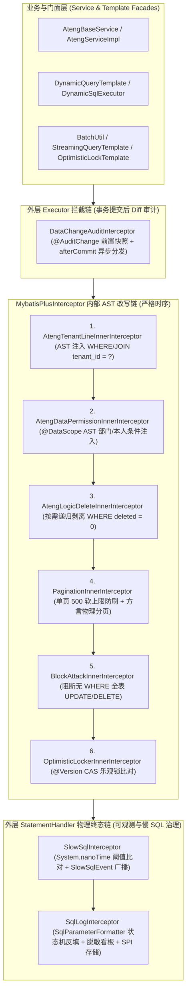
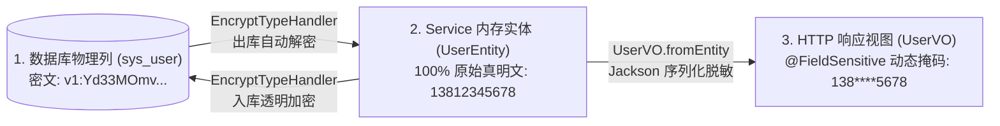

# ateng-boot-mybatis-plus 持久层增强底座

> 提供实体五级阶梯体系、审计自动填充、行级多租户隔离、AST 声明式细粒度数据权限、原生高效批量插入、存储透明加密与视图动态脱敏。

---

## 0. 特性与公共 API 全景速查矩阵 (Feature & API Panorama Matrix)

| 特性分类 | 特性名称 | 核心门面 / 注解 / SPI | 关键配置项 (`ateng.boot.*`) | 关键 API 签名 / 核心行为 | 锚定验证源头 (*Test / Sample) |
| :--- | :--- | :--- | :--- | :--- | :--- |
| **实体体系** | 泛型主键实体基类 | `BaseGenericEntity<ID>` | - | 规范实体主键类型定义与强类型 `getId()` / `setId(ID)` | `BaseEntityTest` / `UserDomainIntegrationTest` |
| **实体体系** | 雪花 ID 主键基类 | `BaseIdEntity` | `ateng.boot.mybatis-plus.snowflake.*` | 标配 64 位 Long 主键与 `@TableId(type = IdType.ASSIGN_ID)` | `BaseEntityTest` / `UserDomainIntegrationTest` |
| **实体体系** | 时间流转基类 | `BaseTimeEntity` | `ateng.boot.mybatis-plus.audit.*` | 提供 `createTime` (`FieldFill.INSERT`) 与 `updateTime` (`FieldFill.INSERT_UPDATE`) | `BaseEntityTest` / `UserDomainIntegrationTest` |
| **实体体系** | 四要素全审计业务基类 | `BaseEntity` | `ateng.boot.mybatis-plus.audit.*` | 提供 `createBy`、`updateBy`、`createTime`、`updateTime` 四要素全审计 | `BaseEntityTest` / `TenantOrderDomainIntegrationTest` |
| **实体体系** | 全要素状态业务基类 | `BaseFullEntity` | `ateng.boot.mybatis-plus.optimistic-locker.*` | 在审计基类上追加 `@Version private Integer version` (乐观锁) 与 `@TableLogic @JsonIgnore private Integer deleted` (逻辑删除) | `BaseEntityTest` / `UserDomainIntegrationTest` |
| **实体体系** | 唯一索引防冲突占位基类 | `BaseDeleteIdEntity` | - | 继承 `BaseEntity`，`deleted` 为 `BIGINT`（`@TableLogic(value = "0", delval = "id")`）并在软删除时动态以自身雪花主键 ID 占位，彻底杜绝业务组合唯一索引逻辑删除冲突 | `BaseDeleteIdEntityTest` / `SoftDeleteUniqueKeyScenarioTest` / `MpLifecycleAndSecurityControllerTest` |
| **实体体系** | 多租户实体标记接口 | `TenantEntity` | `ateng.boot.mybatis-plus.tenant.*` | 声明 `getTenantId()` / `setTenantId(String)` 租户标识契约 | `TenantOrderDomainIntegrationTest` / `MpGovernanceAndQueryControllerTest` |
| **自动填充** | 防御性审计元数据填充 | `DefaultMetaObjectHandler` | `ateng.boot.mybatis-plus.audit.enabled`<br>`ateng.boot.mybatis-plus.audit.default-operator` | 插入/更新自动提取操作人并填充审计字段，若已显式赋值则绝不覆盖 | `DefaultMetaObjectHandlerTest` / `UserDomainIntegrationTest` / `MpLifecycleAndSecurityControllerTest` |
| **审计贯通** | 当前操作人上下文提供者 | `CurrentUserProvider` | - | Core 统一操作人 SPI，驱动 `DefaultMetaObjectHandler` 解析操作人字符串/ID | `DefaultMetaObjectHandlerTest` / `UserDomainIntegrationTest` |
| **多租户隔离** | AST 动态行级多租户拦截器 | `AtengTenantLineInnerInterceptor` | `ateng.boot.mybatis-plus.tenant.enabled`<br>`ateng.boot.mybatis-plus.tenant.column`<br>`ateng.boot.mybatis-plus.tenant.ignore-tables` | 基于 JSqlParser 在 AST 语法树层级改写 SQL，自动拼接 `tenant_id = ?` 条件，支持多表 JOIN 与子查询精准注入 | `AtengTenantLineInnerInterceptorTest` / `TenantOrderDomainIntegrationTest` / `MpGovernanceAndQueryControllerTest` |
| **多租户解析** | 默认租户上下文处理器 | `DefaultTenantLineHandler` | `ateng.boot.mybatis-plus.tenant.column` | 桥接 `TenantContextHolder` 获取租户 ID，支持动态与静态表忽略过滤 | `DefaultTenantLineHandlerTest` / `TenantOrderDomainIntegrationTest` / `MpGovernanceAndQueryControllerTest` |
| **多租户绕过** | 声明式租户忽略注解 | `@IgnoreTenant` | - | 声明于 Mapper 方法或类上，自动绕过多租户行级过滤；支持与 `TenantContextHolder.runWithoutTenant(...)` 协同 | `AtengTenantLineInnerInterceptorTest` / `TenantOrderDomainIntegrationTest` / `MpGovernanceAndQueryControllerTest` |
| **数据权限** | AST 细粒度数据权限拦截器 | `AtengDataPermissionInnerInterceptor` | `ateng.boot.mybatis-plus.data-permission.enabled` | 基于 JSqlParser 在 AST 层级拦截改写 SQL，无缝拼接数据权限过滤表达式 | `AtengDataPermissionInnerInterceptorTest` / `UserDomainIntegrationTest` / `MpGovernanceAndQueryControllerTest` |
| **数据权限** | 动态数据权限处理器 | `DataPermissionHandler` / `DefaultDataPermissionHandler` | - | 数据权限 SPI 与默认处理器，结合上下文提取注入数据过滤 SQL 片段 | `AtengDataPermissionInnerInterceptorTest` / `UserDomainIntegrationTest` / `MpGovernanceAndQueryControllerTest` |
| **数据权限** | 声明式数据权限范围注解 | `@DataScope` | - | 细粒度声明式数据权限注解，支持按用户、部门或自定义表达式进行数据范围收敛 | `AtengDataPermissionInnerInterceptorTest` / `UserDomainIntegrationTest` / `MpGovernanceAndQueryControllerTest` |
| **数据权限** | 数据权限上下文保持器 | `DataPermissionContextHolder` | - | 线程安全透传数据权限上下文与过滤表达式，支持链式构建与自动现场清理 | `DataPermissionContextHolderTest` / `UserDomainIntegrationTest` / `MpGovernanceAndQueryControllerTest` |
| **原生批量操作** | 原生分批操作通用门面 | `BatchUtil` | `ateng.boot.mybatis-plus.batch.default-size` | `insertBatch` / `upsertBatch` / `updateBatch`（含 `*SomeColumn` 别名），内置切片分批（默认 1000）、内存防死锁升序排序与六要素轻量自愈补偿 | `BatchUtilTest` / `BatchUpsertTest` / `BatchUpdateTest` / `TenantOrderDomainIntegrationTest` |
| **原生批量操作** | 双方言批量 Upsert 注入器 | `UpsertBatchSomeColumn` / `@ConflictKeys` | - | 原生单条多值 Upsert SQL 注入器（MySQL `ON DUPLICATE KEY UPDATE` / PostgreSQL `ON CONFLICT DO UPDATE`），支持 `@ConflictKeys` 复合唯一键 | `BatchUpsertTest` / `TenantOrderDomainIntegrationTest` |
| **原生批量操作** | 原生单条批量更新注入器 | `UpdateBatchSomeColumn` | - | 原生 ANSI CASE WHEN 多值更新 SQL 注入器，内置 `AntiDeadlockSqlSource` 强制按主键 ID 升序防死锁，动态回退保护未提供字段 | `BatchUpdateTest` / `TenantOrderDomainIntegrationTest` |
| **原生批量操作** | 全局增强 SQL 注入器 | `AtengSqlInjector` | - | 自动向 MyBatis-Plus 注入 `InsertBatchSomeColumn`、`UpsertBatchSomeColumn` 与 `UpdateBatchSomeColumn` 原生批量操作方法 | `AtengSqlInjectorTest` / `TenantOrderDomainIntegrationTest` |
| **存储加解密** | 字段级透明存储加密注解 | `@FieldEncrypt` | `ateng.boot.mybatis-plus.crypto.secret-key` | 标注于实体属性上，声明该字段由 `EncryptTypeHandler` 执行持久化透明加解密并自动免疫未授权动态排序探测 | `EncryptTypeHandlerTest` / `UserDomainIntegrationTest` / `MpLifecycleAndSecurityControllerTest` |
| **存储加解密** | 存储透明加解密类型转换器 | `EncryptTypeHandler` | `ateng.boot.mybatis-plus.crypto.secret-key` | 持久化时入库 `v1:` 版本化 AES-GCM 密文，查询出库解密为真实明文，严格坚守“内存真明文”铁律 | `EncryptTypeHandlerTest` / `UserDomainIntegrationTest` / `MpLifecycleAndSecurityControllerTest` |
| **乐观锁重试** | 乐观锁防冲突重试模板 | `OptimisticLockTemplate` | `ateng.boot.mybatis-plus.optimistic-locker.enabled` | `executeWithRetry(Supplier<Boolean>)` / `executeWithRetry(Supplier<Boolean>, int, Duration)`，高并发更新冲突自动退避重试 | `OptimisticLockTemplateTest` / `TenantOrderDomainIntegrationTest` |
| **分页契约** | 分页对象流式解耦与安全转译 | `PageUtil` | `ateng.boot.mybatis-plus.pagination.max-limit` | `toPage(PageQuery)` / `toPage(PageQuery, Class<T>)`（安全转译 sorts 并依托实体白名单过滤） / `toPageResult(IPage<T>)` / `toPageResult(IPage<S>, Function<S, T>)`，彻底解耦传输契约与持久实体（Zero-Entity-Leakage） | `PageUtilTest` / `MpGovernanceAndQueryControllerTest` |
| **分页拦截** | 原生分页拦截与防刷守护 | `PaginationInnerInterceptor` | `ateng.boot.mybatis-plus.pagination.enabled`<br>`ateng.boot.mybatis-plus.pagination.max-limit`<br>`ateng.boot.mybatis-plus.pagination.overflow`<br>`ateng.boot.mybatis-plus.pagination.db-type` | 原生分页拦截，注入单页最大条数限制（默认 500）与防刷超限防御，自动识别数据库方言 | `AtengMybatisPlusAutoConfigurationTest` / `MpGovernanceAndQueryControllerTest` |
| **安全阻断** | 防全表更新/删除拦截器 | `BlockAttackInnerInterceptor` | `ateng.boot.mybatis-plus.block-attack.enabled` | 拦截无 `WHERE` 条件的全表更新与删除操作，防止误操作摧毁生产库数据 | `AtengMybatisPlusAutoConfigurationTest` |
| **性能审计** | 慢 SQL 性能审计拦截器 | `SlowSqlInterceptor` | `ateng.boot.mybatis-plus.slow-sql.enabled`<br>`ateng.boot.mybatis-plus.slow-sql.threshold`<br>`ateng.boot.mybatis-plus.slow-sql.format-sql`<br>`ateng.boot.mybatis-plus.slow-sql.mask-sensitive` | 拦截 `StatementHandler` 执行，基于 `System.nanoTime()` 高精度快速比对放行；超时输出美化 SQL、真实脱敏参数及调用位置；严禁自动 EXPLAIN | `SlowSqlInterceptorTest` / `AtengMybatisPlusAutoConfigurationTest` |
| **告警通知** | 慢 SQL 告警通知 SPI | `SlowSqlAlertProvider` | - | 函数式 SPI 扩展契约，支持下游无缝对接飞书/钉钉群机器人或外部 APM 平台 | `SlowSqlInterceptorTest` / `SlowSqlAlertScenarioTest` |
| **审计事件** | 慢 SQL 审计事件模型 | `SlowSqlEvent` | - | 继承 Spring 原生 `ApplicationEvent`，发布执行耗时、格式化 SQL、脱敏参数、线程名与代码调用栈位置 | `SlowSqlInterceptorTest` / `SlowSqlAlertScenarioTest` |
| **发号器** | 分布式雪花算法发号器 | `DefaultIdentifierGenerator` | `ateng.boot.mybatis-plus.snowflake.enabled`<br>`ateng.boot.mybatis-plus.snowflake.worker-id`<br>`ateng.boot.mybatis-plus.snowflake.datacenter-id` | 提供趋势递增的 64 位全局唯一分布式 ID 发号支持 | `AtengMybatisPlusAutoConfigurationTest` / `UserDomainIntegrationTest` |
| **动态 SQL** | 外部动态 SQL 增强注册中心 | `DynamicSqlRegistry` | `ateng.boot.mybatis-plus.dynamic-sql.enabled`<br>`ateng.boot.mybatis-plus.dynamic-sql.locations` | 外部 SQL 注册、AST 投影字典解析提取与热加载中心，支持运行时动态注册/移除外部 XML 脚本，联动缓存失效通知 | `DynamicSqlRegistryTest` / `DynamicSqlScenarioTest` / `MpGovernanceAndQueryControllerTest` |
| **动态 SQL** | 外部动态 SQL 统一执行门面 | `DynamicSqlExecutor` | `ateng.boot.mybatis-plus.dynamic-sql.auto-script-wrap` | `selectPage` / `selectList` / `selectOne` / `count` / `insert` / `update` / `delete`，原生支持接收 `DynamicQueryRequest` 及业务 DTO，多表 AST 投影自愈与 ADR-0010 强类型 VO 映射 | `DynamicSqlExecutorTest` / `DynamicSqlScenarioTest` / `MpGovernanceAndQueryControllerTest` |
| **动态 SQL** | 外部 SQL 资源自动加载器 | `ExternalSqlLoader` / `ResourceExternalSqlLoader` | `ateng.boot.mybatis-plus.dynamic-sql.locations` | 外部 SQL 资源加载 SPI 与默认实现，启动时自动扫描指定路径并注册至 `DynamicSqlRegistry` | `ResourceExternalSqlLoaderTest` / `DynamicSqlScenarioTest` / `MpGovernanceAndQueryControllerTest` |
| **流式游标** | 原生游标 SQL 注入器 | `SelectCursor` | - | 自动向 Mapper 注入 `selectCursor` MappedStatement，底层强制设置 `fetchSize = 1000`，杜绝内存溢出 | `AtengSqlInjectorTest` / `TenantOrderDomainIntegrationTest` |
| **流式游标** | 受管流式游标查询模板 | `StreamingQueryTemplate` | - | `forEach` / `forEachBatch` / `forEachWhile` / `execute`，强制只读事务守护，`try-with-resources` 确定性闭合游标与连接归还，支持 Predicate 提前短路退出与不可变切片防卫 | `StreamingQueryTemplateTest` / `TenantOrderDomainIntegrationTest` |
| **SQL 日志诊断** | SQL 日志打印与可执行带参诊断拦截器 | `SqlLogInterceptor` | `ateng.boot.mybatis-plus.sql-log.enabled`<br>`ateng.boot.mybatis-plus.sql-log.console-enabled`<br>`ateng.boot.mybatis-plus.sql-log.level`<br>`ateng.boot.mybatis-plus.sql-log.format-sql`<br>`ateng.boot.mybatis-plus.sql-log.mask-sensitive`<br>`ateng.boot.mybatis-plus.sql-log.show-call-location`<br>`ateng.boot.mybatis-plus.sql-log.max-sql-length`<br>`ateng.boot.mybatis-plus.sql-log.exclude-statements`<br>`ateng.boot.mybatis-plus.sql-log.storage.*` | 拦截 `StatementHandler` 物理终态，输出带参完整可执行 SQL、毫秒耗时、行数影响与代码行号看板；驱动结构化 `SqlLogModel` 异步派发至存储 SPI 与 Spring 事件广播，内建批量防刷屏、游标只读防卫与失败现场捕获 | `SqlLogInterceptorTest` / `SqlLogIntegrationTest` |
| **SQL 日志诊断** | 字符流参数安全反填与敏感脱敏引擎 | `SqlParameterFormatter` | - | `formatSql` / `formatValue` / `prettify` / `compress` / `extractParameters`，零依赖字符流 Token 状态机智能跳过常量与注释内问号，安全映射 ANSI JDBC 字面量，杜绝正则异常，自动探测 `@FieldEncrypt` 与敏感凭据脱敏 | `SqlParameterFormatterTest` |
| **SQL 审计存储** | SQL 操作审计存储解耦 SPI 契约 | `SqlLogStorageProvider` | `ateng.boot.mybatis-plus.sql-log.storage.enabled` | 结构化物理 SQL 操作审计日志存储解耦 SPI 契约，支持下游无缝对接数据库、Elasticsearch、Kafka、ClickHouse 或 APM 统一持久化 | `SqlLogInterceptorTest` |
| **SQL 审计存储** | 默认 SQL 审计存储保底提供者 | `DefaultSqlLogStorageProvider` | `ateng.boot.mybatis-plus.sql-log.storage.enabled` | 当未配置外部自定义提供者时，基于 SLF4J 打印标准紧凑 JSON 审计日志，作为开箱即用保底实现 | `SqlLogInterceptorTest` |
| **SQL 审计事件** | Spring 应用层 SQL 审计广播事件 | `SqlLogEvent` | `ateng.boot.mybatis-plus.sql-log.storage.enabled` | Spring 原生 `ApplicationEvent` 事件，在 SQL 执行完成或失败现场捕获后广播，支持进程内 `@EventListener` 异步非侵入监听 | `SqlLogInterceptorTest` |
| **SQL 审计防卫** | 声明式 SQL 诊断与审计忽略注解 | `@IgnoreSqlLog` | - | 声明于 Mapper 接口类或特定方法上，指示拦截器对心跳探测或高频内部轮询等特定操作同时跳过控制台诊断与 SPI 存储 | `SqlLogInterceptorTest` |
| **SQL 日志诊断** | SQL 日志与审计强类型配置模型 | `SqlLogProperties` | `ateng.boot.mybatis-plus.sql-log.*` | 强类型配置模型，提供 `consoleEnabled`、`excludeStatements` 及嵌套 `storage`（`enabled`、`includeSelect`、`async`、`maxSqlLength`）等全套双轨配置 | `SqlLogPropertiesTest` / `AtengMybatisPlusAutoConfigurationTest` |
| **持久层底座** | 拦截器解包与调用栈穿透工具 | `MybatisInterceptorUtil` | - | `realTarget`（JDK 17 原生递归拆解 MyBatis Plugin 物理代理）/ `resolveCallLocation`（穿透持久层框架与切面，定位首个业务代码位置）/ `isFrameworkClass` | `MybatisInterceptorUtilTest` |
| **多数据源协同** | 多数据源诊断探针与上下文守卫 | `DynamicDatasourceGuard` | `ateng.boot.mybatis-plus.guard.dynamic-datasource` | 启动期轻量感知 Spring 容器多数据源或动态路由特征，输出多租户与事务协同建议；提供 `validateContextIsolated()` 静态断言防卫活跃事务假切源与上下文污染 | `DynamicDatasourceGuardTest` / `DynamicDatasourceGuardScenarioTest` / `MpGovernanceAndQueryControllerTest` |
| **基础扩展** | 通用 BaseMapper 增强门面 | `AtengBaseMapper<T>` | - | 继承 MyBatis-Plus `BaseMapper`，标配挂载批量方法与 `Cursor<T> selectCursor(@Param(Constants.WRAPPER) Wrapper<T> queryWrapper)` 原生流式游标查询 | `AtengSqlInjectorTest` / `TenantOrderDomainIntegrationTest` |
| **基础扩展** | 通用 Service 增强实现基类 | `AtengBaseService<T>` / `AtengServiceImpl<M, T>` | - | 继承 MyBatis-Plus `IService`，提供零实体泄露基础 VO 投影（`getById` / `listByIds` / `list` / `getOne`）、批量写入、受管流式查询体系、单表/多表动态查询及存在性判断（`existsDynamic`），以及乐观锁高并发自旋重试（`updateWithOptimisticRetry`），支持严格 `throwEx` 快速失败、分批切片与短路退出 | `AtengBaseServiceBatchTest` / `AtengBaseServiceStreamTest` / `AtengBaseServiceDynamicTest` / `AtengBaseServiceOptimisticLockTest` / `TenantOrderDomainIntegrationTest` / `MpGovernanceAndQueryControllerTest` |
| **动态查询** | 通用受管执行模板门面 | `DynamicQueryTemplate` | `ateng.boot.mybatis-plus.dynamic-query.enabled` | `selectPage` / `selectList` / `selectOne` / `count` / `exists`，跨单表实体、Mapper XML 语句或外部动态 SQL 提供对称完备的强类型动态查询与单页物理短路直出，内建 AST 别名自愈与自适应条件追加 | `DynamicQueryTemplateTest` / `MultiTableDynamicQueryScenarioTest` / `MpGovernanceAndQueryControllerTest` |
| **动态查询** | Service 联表方法引用与短方法名直出 | `AtengBaseService` / `AtengServiceImpl` | `ateng.boot.mybatis-plus.dynamic-query.enabled` | `pageDynamic` / `listDynamic` / `getOneDynamic` / `countDynamic` / `existsDynamic`，支持基于方法引用（`mapper::method`）或短方法名执行多表联表极速直出与单页 `Page(1, 1, false)` 物理短路判定 | `AtengBaseServiceMultiTableDynamicTest` / `MultiTableDynamicQueryScenarioTest` / `MpGovernanceAndQueryControllerTest` |
| **动态查询** | AST 多表别名与物理列投影自愈解析器 | `DynamicSqlProjectionResolver` | - | 基于 JSqlParser 解析 Mapper XML / 外部 SQL 投影字典，纳秒级缓存，运行时无感知将 VO 属性名与多表别名透明映射为底层物理列表达式（如 `deptName` -> `d.name`） | `DynamicSqlProjectionResolverTest` / `MultiTableDynamicQueryScenarioTest` / `MpGovernanceAndQueryControllerTest` |
| **动态查询** | 联表方法引用契约与解析辅助 | `DynamicMapperPageMethod`, `DynamicMapperListMethod`, `DynamicLambdaHelper` | - | 原生 `SerializedLambda` 纳秒级提取 Mapper 联表方法名与所属类，函数式强类型接口规范 | `DynamicLambdaHelperTest` / `AtengBaseServiceMultiTableDynamicTest` / `MpGovernanceAndQueryControllerTest` |
| **动态查询** | 动态查询安全转译引擎门面 | `DynamicQueryHelper` | `ateng.boot.mybatis-plus.dynamic-query.enabled` | `buildWrapper(DynamicQueryRequest, Class<T>)` / `buildWrapper(String, Class<T>)` / `buildWrapper(Map, Class<T>)` / `buildWrapper(Object, Class<T>)`，纳秒级元数据白名单缓存与六重安全防卫编译 | `DynamicQueryHelperTest` / `UserDomainIntegrationTest` / `MpGovernanceAndQueryControllerTest` |
| **动态查询** | URL Query 与 Map 高阶语法解析器 | `DynamicQueryParser` | - | `parse(String)` / `parse(Map)` / `parseToWrapper(String, Class<T>)`，支持冒号操作符、波浪线 between 切分与 `or_组号` 作用域分组解析 | `DynamicQueryParserTest` / `MpGovernanceAndQueryControllerTest` |
| **动态查询** | 动态查询请求与条件契约 | `DynamicQueryRequest`, `QueryCondition`, `QueryOperator` | - | 13 种受控操作符与流式链式构建，支持 `or(orGroup, condition)` 独立嵌套 OR 逻辑块 | `DynamicQueryHelperTest` / `DynamicQueryParserTest` / `MpGovernanceAndQueryControllerTest` |
| **动态查询** | 字段映射与敏感防卫注解 | `@QueryField`, `@DynamicQueryIgnore` | - | `@QueryField(property, operator, ignoreNull)` 声明式 DTO 驱动转译；`@DynamicQueryIgnore` 实体敏感列防越权探测 | `DynamicQueryHelperTest` / `MpGovernanceAndQueryControllerTest` |
| **动态查询** | 动态查询模板自动装配组件 | `AtengMybatisPlusDynamicQueryAutoConfiguration` | `ateng.boot.mybatis-plus.dynamic-query.enabled` | 声明 `@AutoConfigureAfter(MybatisPlusAutoConfiguration.class)` 与 `@ConditionalOnBean(SqlSessionFactory.class)`，保障晚期动态查询模板在 SqlSessionFactory 初始化完成后平滑装配 | `AtengMybatisPlusAutoConfigurationTest` / `MultiTableDynamicQueryScenarioTest` |
| **变更审计** | 声明式数据变更审计注解 | `@AuditChange` | - | 声明于实体类或 Mapper 接口/方法上，声明开启字段级 Diff 变更追踪与前后快照捕获，支持属性包含与排除 | `DataChangeAuditInterceptorTest` / `TenantOrderDomainIntegrationTest` |
| **变更审计** | 数据变更 Diff 审计拦截器 | `DataChangeAuditInterceptor` | `ateng.boot.mybatis-plus.audit-change.enabled`<br>`ateng.boot.mybatis-plus.audit-change.max-diff-rows`<br>`ateng.boot.mybatis-plus.audit-change.async`<br>`ateng.boot.mybatis-plus.audit-change.publish-event` | 拦截 MyBatis `Executor.update`，事务提交后（`afterCommit`）异步分发，集成超限熔断降级与缺 Provider 自动休眠 | `DataChangeAuditInterceptorTest` / `AtengMybatisPlusAutoConfigurationTest` / `TenantOrderDomainIntegrationTest` |
| **变更审计** | 数据变更审计消费 SPI | `DataChangeAuditProvider` | - | 函数式消费 SPI，供业务自由对接审计日志落盘、Elasticsearch 或消息队列 | `DataChangeAuditInterceptorTest` / `TenantOrderDomainIntegrationTest` |
| **变更审计** | 数据变更审计 Spring 事件 | `DataChangeEvent` | `ateng.boot.mybatis-plus.audit-change.publish-event` | 变更提交后发布 Spring 原生应用事件，供下游声明式 `@EventListener` 解耦监听 | `DataChangeAuditInterceptorTest` |
| **变更审计** | 数据变更审计上下文持有者 | `DataChangeAuditContextHolder` | - | 提供 `runWithoutAudit` 与 `callWithoutAudit` 编程式闭包，安全短路跳过当前线程的变更审计 | `DataChangeAuditInterceptorTest` |
| **JSON 类型转换** | Spring 受管 JSON 字段类型转换器 | `AtengJacksonTypeHandler<T>` | - | 继承 `JacksonTypeHandler`，自动接入 Spring Boot 受管 `ObjectMapper`，对 `List`、`Set`、`Map` 字段读取到 NULL 或空字符串时保底返回不可变空容器，彻底终结 NPE | `AtengJacksonTypeHandlerTest` / `JsonFieldScenarioTest` / `MpLifecycleAndSecurityControllerTest` |
| **JSON 类型转换** | 复杂深层泛型 JSON 类型转换基类 | `GenericJsonTypeHandler<T>` | - | 基于泛型超类签名自动提取深层嵌套 `JavaType`（如 `List<ShippingAddress>`），兼具集合与 Map 空安全保底 | `GenericJsonTypeHandlerTest` / `JsonFieldScenarioTest` / `MpLifecycleAndSecurityControllerTest` |
| **悲观并发控制** | 强类型悲观加锁模式枚举 | `LockMode` | - | 包含 `FOR_UPDATE`、`NOWAIT`、`SKIP_LOCKED` 与 `FOR_SHARE` 4 大强类型加锁模式，消除裸魔法字符串 | `PessimisticLockUtilTest` / `PessimisticLockScenarioTest` |
| **悲观并发控制** | 悲观锁方言自适应与快速失败工具 | `PessimisticLockUtil` | - | `apply(wrapper, lockMode)` / `forUpdate(wrapper, lockMode)`，前置探测底层数据库方言，在 MySQL 5.7 或 SQLite 等不支持跳锁引擎上调用立即抛出异常快速失败 | `PessimisticLockUtilTest` / `PessimisticLockScenarioTest` |
| **悲观并发控制** | 悲观排队锁与跳锁 Service 门面 | `AtengBaseService` / `AtengServiceImpl` | - | `getByIdForUpdate(id)` / `getByIdForUpdate(id, lockMode)` / `listForUpdate(wrapper, lockMode)`，开箱即用的悲观行锁与并发任务抢单拉取门面 | `AtengBaseServicePessimisticLockTest` / `PessimisticLockScenarioTest` |
| **逻辑删除闭环** | 逻辑删除穿透审计上下文持有者 | `LogicDeleteContextHolder` | `ateng.boot.mybatis-plus.logic-delete.enabled` | 提供 `runWithDeleted` 与 `callWithDeleted` 编程式闭包（带重入深度计数器），在审计与回收站场景下安全穿透逻辑删除 | `LogicDeleteContextHolderTest` / `SoftDeleteUniqueKeyScenarioTest` |
| **逻辑删除闭环** | JSqlParser AST 逻辑删除动态穿透拦截器 | `AtengLogicDeleteInnerInterceptor` | `ateng.boot.mybatis-plus.logic-delete.enabled`<br>`ateng.boot.mybatis-plus.logic-delete.columns` | 拦截器层动态递归剥离 WHERE 子句中的 `deleted = 0` 等值表达式，保留业务显式条件 | `AtengLogicDeleteInnerInterceptorTest` / `SoftDeleteUniqueKeyScenarioTest` |
| **逻辑删除闭环** | 逻辑删除数据恢复与回收站 Service 门面 | `AtengBaseService` / `AtengServiceImpl` | `ateng.boot.mybatis-plus.logic-delete.enabled` | `restoreById(id)` / `restore(wrapper)`（重置 `deleted = 0` 并自动刷新 `updateTime`/`updateBy`）及 `getByIdWithDeleted` / `listWithDeleted` / `pageWithDeleted` / `getOneWithDeleted` | `AtengBaseServiceRestoreTest` / `SoftDeleteUniqueKeyScenarioTest` / `MpLifecycleAndSecurityControllerTest` |

---

## 1. 模块定位与 Maven 坐标

`ateng-boot-mybatis-plus` 深度融合 MyBatis-Plus `3.5.17` 官方生态与 `ateng-boot-core` 原生底座，面向企业级 SaaS、高并发分布式系统与金融合规持久层提供零反射侵入、零实体泄露、全链路可观测的工业级 ORM 基础设施。

```xml
<dependency>
    <groupId>io.github.atengk</groupId>
    <artifactId>ateng-boot-mybatis-plus</artifactId>
</dependency>
```

---

## 2. 核心架构与设计不变量 (Architecture & Design Invariants)

### 2.1 内外双层拦截器链与执行时序架构

模块严格区分 **`MybatisPlusInterceptor` 内部 AST 改写链** 与 **MyBatis 原生外层 `Executor` / `StatementHandler` 审计诊断链**，确保逻辑删除穿透、多租户行级隔离、细粒度数据权限、分页 count 优化及终态物理 SQL 诊断严格按确定性时序正交协同：



### 2.2 四大核心架构不变量

1. **传输契约与持久层绝对解耦 (Zero-Entity-Leakage, ADR-0010)**：
   Controller 传输边界 **100% 严禁接收或直接返回 ORM 实体（Entity）**。入参统一使用专用 DTO / `PageQuery` / `DynamicQueryRequest`，出参依托 `AtengBaseService` 投影门面或 `PageUtil.toPageResult(page, VO::fromEntity)` 统一返回 `Result<VO>` 或 `Result<PageResult<VO>>`。
2. **数据安全三态分离与“内存真明文”不变量 (In-Memory Plaintext Invariant, ADR-0012)**：
   - **持久层密文落盘**：由 `@FieldEncrypt` + `EncryptTypeHandler` 在 JDBC 边界透明完成 `v1:` 版本化 AES-GCM 加解密；
   - **Service 内存 100% 原始真明文**：业务计算、长度校验、外部 RPC 调用读取实体属性时始终为未打码的真实明文，彻底根除“星号掩码脏数据写回数据库”的生产事故；
   - **视图序列化动态脱敏**：仅在 VO 序列化为 HTTP JSON 响应的最后一公里，由 `@FieldSensitive` 动态打码。
3. **对称语义完备性不变量 (Symmetric Facades Invariant)**：
   既有 `@TableLogic` 软删除（`removeById`），就必须成对提供穿透检索（`getByIdWithDeleted` / `listWithDeleted` / `pageWithDeleted`）与误删恢复（`restoreById` / `restore`）；既有上下文压栈（`TenantContextHolder` / `LogicDeleteContextHolder` / `DataPermissionContextHolder`），就必须在 `try-finally` 或函数式闭包（`runWith*` / `callWith*`）中确定性恢复与清理现场。
4. **原生多值批处理与主键升序防死锁不变量 (Anti-Deadlock Batch Invariant)**：
   摒弃循环单发伪批处理，通过 `AtengSqlInjector` 注入原生多值 `INSERT`、双方言 `UPSERT` 与 ANSI `CASE WHEN` 批量更新；批量更新前由 `BatchUtil` 与 `AntiDeadlockSqlSource` 双重强制按主键 ID 升序重排，从数学机理上消除并发交叉行锁死锁。

---

## 3. 实体五级继承阶梯、生命周期自动填充与逻辑删除闭环

> **对应样例控制器**：`MpEntityLifecycleController`（路由前缀 `/sample/mybatis-plus/lifecycle`）  
> **锚定集成测试**：`MpLifecycleAndSecurityControllerTest`、`SoftDeleteUniqueKeyScenarioTest`、`UserDomainIntegrationTest`

### 3.1 实体五级阶梯体系与雪花发号桥接 (`BaseGenericEntity` -> `BaseFullEntity`)

#### 场景痛点
在大型工程中，若每个实体类各自手写 `id`、`createTime`、`version`、`deleted` 字段，极易出现字段命名不一、漏配 `@JsonIgnore` 导致逻辑删除位泄露给前端、或多套雪花发号器混用引发时钟回拨冲突。

#### 本特性配置片段 (`application.yml`)
```yaml
ateng:
  boot:
    mybatis-plus:
      snowflake:
        enabled: true             # 启用持久层雪花发号桥接，自动委托至 Core IdUtil（默认 true）
        worker-id: 1              # 工作机器 ID（0~31，未配置时基于网卡 MAC/IP 四级自适应推导）
        datacenter-id: 1          # 数据中心 ID（0~31，未配置时自适应推导）
```

#### 五级实体继承阶梯与选型指南
```text
BaseGenericEntity<ID>          (第 1 阶：泛型主键契约 getId/setId)
  └── BaseIdEntity             (第 2 阶：64 位 Long 雪花主键 @TableId(type = IdType.ASSIGN_ID))
        └── BaseTimeEntity     (第 3 阶：时间流转基类 createTime, updateTime)
              └── BaseEntity   (第 4 阶：四要素全审计业务基类 createBy, updateBy, createTime, updateTime)
                    ├── BaseFullEntity     (第 5A 阶：标准状态基类，追加 @Version version 与 Integer deleted)
                    └── BaseDeleteIdEntity (第 5B 阶：唯一键防冲突基类，追加 @Version version 与 Long deleted=id)
```

| 业务表类型 | 推荐继承基类 | 內置受管字段与核心行为 |
| :--- | :--- | :--- |
| 自定义主键类型表（如 String 编码主键） | `BaseGenericEntity<ID>` | 泛型 `id` |
| 中间关联映射表、静态字典表 | `BaseIdEntity` | `Long id`（自动桥接 `DefaultIdentifierGenerator` 2026 纪元雪花算法） |
| 不可变流水表、系统监控日志表 | `BaseTimeEntity` | `id`, `createTime` (`INSERT`), `updateTime` (`INSERT_UPDATE`) |
| 常规业务主表（默认首选） | `BaseEntity` | `id`, `createBy`, `updateBy`, `createTime`, `updateTime` |
| 核心状态流转表（无业务唯一索引软删重建诉求） | `BaseFullEntity` | 追加 `@Version Integer version` 与 `@TableLogic @JsonIgnore Integer deleted` |
| 含业务唯一索引且需支持多次软删重建的档案表 | `BaseDeleteIdEntity` | 追加 `@Version Integer version` 与 `@TableLogic(value = "0", delval = "id") @JsonIgnore Long deleted` |
| SaaS 多租户隔离表 | 继承上述任一基类并实现 `TenantEntity` | 强制契约 `getTenantId()` / `setTenantId(String)` |

#### 实战代码示例（提取自 Sample `UserEntity`）
```java
@Getter
@Setter
@NoArgsConstructor
@ToString(callSuper = true)
@TableName(value = "sys_user", autoResultMap = true)
public class UserEntity extends BaseFullEntity {

    private String name;
    private Integer age;

    @FieldEncrypt
    @TableField(typeHandler = EncryptTypeHandler.class)
    private String email;

    @FieldEncrypt
    @TableField(typeHandler = EncryptTypeHandler.class)
    private String phone;

    private Long deptId;
}
```

---

### 3.2 防御性审计元数据自动填充 (`DefaultMetaObjectHandler` & `CurrentUserProvider`)

#### 场景痛点
手工在每个 Service 方法中调用 `setCreateTime(LocalDateTime.now())` 与 `setCreateBy(currentUser)` 既繁琐又容易遗漏；而粗暴的 `MetaObjectHandler` 直接覆盖赋值又会抹杀数据迁移或管理员代创建时显式指定的 `createBy`。

#### 本特性配置片段 (`application.yml`)
```yaml
ateng:
  boot:
    mybatis-plus:
      audit:
        enabled: true               # 是否启用审计字段自动填充（默认 true）
        default-operator: "SYSTEM"  # 当上下文无登录用户时的兜底操作人标识（默认 SYSTEM）
```

#### 实战代码示例（提取自 Sample `MpEntityLifecycleController`）
```java
@PostMapping("/user")
public Result<UserVO> createUser(@Valid @RequestBody UserCreateDTO dto) {
    boolean boundContext = StringUtils.hasText(dto.getOperator());
    if (boundContext) {
        // 模拟当前线程登录操作人（生产环境由认证过滤器自动注入 UserContextHolder）
        UserContextHolder.set(dto.getOperator());
    }
    try {
        UserEntity entity = new UserEntity(
                dto.getName(), dto.getAge(), dto.getEmail(), dto.getPhone(), dto.getDeptId()
        );
        // 防御性不覆盖：若业务显式指定了 createBy，DefaultMetaObjectHandler 绝不覆盖该值
        if (StringUtils.hasText(dto.getExplicitCreateBy())) {
            entity.setCreateBy(dto.getExplicitCreateBy());
        }
        userService.save(entity);
        return Result.success(UserVO.fromEntity(userService.getById(entity.getId())));
    } finally {
        if (boundContext) {
            UserContextHolder.clear();
        }
    }
}
```

#### 生产扩展接管：自定义 `CurrentUserProvider` SPI
默认情况下，模块从 `ateng-boot-core` 的 `UserContextHolder.get()` 提取当前操作人，无值时回退至 `default-operator`（`SYSTEM`）。若需直接对接自定义安全框架，只需声明 `CurrentUserProvider` Bean：
```java
@Component
public class CustomSecurityUserProvider implements CurrentUserProvider {
    @Override
    public String getCurrentUser() {
        return Optional.ofNullable(UserContextHolder.get()).orElse("SYSTEM");
    }
}
```

---

### 3.3 联合唯一索引防冲突基类与逻辑删除 AST 穿透恢复闭环 (`BaseDeleteIdEntity` & `AtengLogicDeleteInnerInterceptor`)

#### 场景痛点
1. **软删除唯一索引冲突死局**：若表上建有 `UNIQUE KEY (sku_code, deleted)` 且 `deleted` 仅取 `0/1`，当同一个商品编码 `SKU-999` 被第二次软删除时，数据库中将出现两条 `('SKU-999', 1)`，直接触发 `Duplicate entry 'SKU-999-1'` 物理唯一键崩溃；
2. **MyBatis-Plus 逻辑删除不可逆**：官方 `@TableLogic` 在启动预编译期将 `WHERE deleted = 0` 硬编码进 `selectById` 与 `updateById`，导致业务无法通过常规 Service 门面查询回收站数据或将误删数据恢复为 `deleted = 0`。

#### 本特性配置片段 (`application.yml`)
```yaml
ateng:
  boot:
    mybatis-plus:
      logic-delete:
        enabled: true             # 启用 JSqlParser AST 逻辑删除动态穿透拦截器（默认 true）
        columns:                  # 识别并支持穿透剥离的逻辑删除列名集合
          - deleted
          - is_deleted
          - del_flag
```

#### 实战代码示例（提取自 Sample `ProductSkuEntity` 与 `MpEntityLifecycleController`）
```java
// 1. 实体继承 BaseDeleteIdEntity：软删除时自动执行 SET deleted = id（以自身 64 位雪花主键占位）
@TableName("product_sku")
public class ProductSkuEntity extends BaseDeleteIdEntity {
    private String skuCode;
    private String skuName;
    private String category;
    private BigDecimal price;
}

// 2. 循环“上架 -> 软删除 -> 同编码再上架”零冲突 + 穿透查询 + 误删恢复闭环
@PostMapping("/sku/cycle-soft-delete")
public Result<List<ProductSkuVO>> cycleSoftDelete(@RequestParam(defaultValue = "SKU-999") String skuCode) {
    // 首次创建并软删除：底层执行 UPDATE product_sku SET deleted = id WHERE id = ? AND deleted = 0
    ProductSkuEntity firstGen = new ProductSkuEntity(skuCode, "无线降噪耳机初代版", "数码影音", new BigDecimal("1299.00"));
    softDeleteService.save(firstGen);
    softDeleteService.removeById(firstGen.getId());

    // 同编码再次上架：新记录为 ('SKU-999', 0)，旧记录为 ('SKU-999', 18461829...)，联合唯一键零冲突
    ProductSkuEntity secondGen = new ProductSkuEntity(skuCode, "无线降噪耳机二代旗舰版", "数码影音", new BigDecimal("1599.00"));
    softDeleteService.save(secondGen);

    // 穿透逻辑删除过滤：同时查出已下架历史版本与当前在售版本
    List<ProductSkuEntity> all = softDeleteService.listWithDeleted(
            new LambdaQueryWrapper<ProductSkuEntity>().eq(ProductSkuEntity::getSkuCode, skuCode)
    );
    return Result.success(all.stream().map(ProductSkuVO::fromEntity).toList());
}

// 3. 误删一键恢复（自动剥离 WHERE deleted = 0 锁死，将 deleted 重置为 0 并刷新 updateTime / updateBy）
@PostMapping("/sku/{id}/restore")
public Result<ProductSkuVO> restoreSkuById(@PathVariable Long id) {
    boolean restored = softDeleteService.restoreById(id);
    BusinessAssert.isTrue(restored, "未找到可恢复的商品 SKU 记录: id=" + id);
    return Result.success(ProductSkuVO.fromEntity(softDeleteService.getById(id)));
}
```

#### 核心生产边界与非功能语义
- **嵌套重入安全的穿透上下文 (`LogicDeleteContextHolder`)**：底层采用 `ThreadLocal<Integer>` 引用计数深度管理，支持 `LogicDeleteContextHolder.callWithDeleted(() -> ...)` 任意层级嵌套调用，最外层退出时在 `finally` 中确定性归零清理；
- **AST 精准剥离不伤业务条件**：`AtengLogicDeleteInnerInterceptor` 仅在当前线程激活穿透标记时介入，通过 JSqlParser 递归剥离 `WHERE` 与 `JOIN ON` 中的 `deleted = 0` 条件，100% 保留业务自身的查询与排序条件；
- **防全表误恢复强卫语句**：调用 `softDeleteService.restore(wrapper)` 时，若传入 `null` 或不包含任何有效 `WHERE` 条件的空 `Wrapper`，底层立即抛出 `IllegalArgumentException` 快速失败，严防将全表历史软删数据一次性全部复活。

---

## 4. 字段级透明加解密、视图动态脱敏与受管 JSON 映射

> **对应样例控制器**：`MpSecurityAndJsonController`（路由前缀 `/sample/mybatis-plus/security-json`）  
> **锚定集成测试**：`MpLifecycleAndSecurityControllerTest`、`JsonFieldScenarioTest`、`UserDomainIntegrationTest`

### 4.1 存储透明加解密与“内存真明文”生命周期分离 (`@FieldEncrypt` & `EncryptTypeHandler`)

#### 场景痛点
许多项目在 Service 层查出用户实体后直接执行 `user.setPhone("138****5678")` 再返回前端；一旦后续业务在同一事务或对象上调用 `updateById(user)`，星号掩码就会直接覆盖数据库真实手机号，造成不可逆的生产数据损毁。

#### 本特性配置片段 (`application.yml`)
```yaml
ateng:
  boot:
    mybatis-plus:
      crypto:
        # AES-GCM 存储透明加密主密钥（生产环境强烈建议通过环境变量 ${MP_CRYPTO_SECRET_KEY} 注入）
        secret-key: "${MP_CRYPTO_SECRET_KEY:AtengBootDefaultSecretKey2026!}"
```

#### 三态数据安全流转架构與实战代码（提取自 Sample `MpSecurityAndJsonController`）


```java
// 1. 持久层实体：声明 @FieldEncrypt 与 EncryptTypeHandler（必须开启 autoResultMap = true）
@TableName(value = "sys_user", autoResultMap = true)
public class UserEntity extends BaseFullEntity {
    @FieldEncrypt
    @TableField(typeHandler = EncryptTypeHandler.class)
    private String phone;
}

// 2. 传输层视图 VO：声明 @FieldSensitive，仅在 JSON 序列化出站时动态打星号
@Data
public class UserVO implements Serializable {
    @FieldSensitive(SensitiveType.MOBILE_PHONE)
    private String phone;

    @FieldSensitive(SensitiveType.EMAIL)
    private String email;
}

// 3. 三态对比验证：JDBC 底层密文 vs Service 内存真明文 vs UserVO 序列化动态脱敏
Map<String, Object> rawRow = jdbcTemplate.queryForMap("SELECT phone FROM sys_user WHERE id = ?", userId);
String dbCipherPhone = (String) rawRow.get("phone");              // "v1:..." (AES 密文)

UserEntity loaded = userService.getById(userId);
boolean isPlain = "13812345678".equals(loaded.getPhone());        // true (内存 100% 原始真明文)
UserVO responseVo = UserVO.fromEntity(loaded);                    // JSON 序列化输出 "138****5678"
```

#### 核心生产边界与非功能语义
- **必须显式开启 `autoResultMap = true`**：MyBatis-Plus 仅在 `@TableName(value = "...", autoResultMap = true)` 开启时才会在查询结果集映射阶段自动触发字段上的 `typeHandler`；若漏配会导致写入加密但查询原样返回密文；
- **密文列查询与排序约束**：由于 AES-GCM 每次加密携带随机 IV（保障语义安全，相同明文每次生成不同 `v1:` 密文），加密字段不支持数据库层面的 `LIKE '%...%'` 模糊匹配与 `ORDER BY` 排序；`PageUtil` 与 `DynamicQueryHelper` 已内置白名单防卫，自动拦截并忽略针对 `@FieldEncrypt` 字段的排序探测。

---

### 4.2 Spring 受管 JSON 字段类型转换器与复杂泛型空安全保底 (`AtengJacksonTypeHandler` & `GenericJsonTypeHandler`)

#### 场景痛点
1. **原生 `JacksonTypeHandler` 与 Spring 容器割裂**：MyBatis-Plus 官方 `JacksonTypeHandler` 默认通过私有 `new ObjectMapper()` 初始化，丢失了 Spring Boot 容器中的 `JavaTimeModule`，导致包含 `LocalDateTime` 的 JSON 字段在序列化时直接报错崩溃；
2. **深层泛型擦除与空指针（NPE）陷阱**：当实体字段为 `List<ShippingAddress>` 时，普通 `TypeHandler` 因 Java 泛型擦除会将元素反序列化为 `LinkedHashMap`，强转时触发 `ClassCastException`；且当数据库列为 `NULL` 时直接返回 `null`，极易引发业务遍历 `NullPointerException`。

#### 实战代码示例（提取自 Sample `MemberProfileEntity`）
```java
@Getter
@Setter
@TableName(value = "member_profile", autoResultMap = true)
public class MemberProfileEntity extends BaseEntity {

    private String memberName;

    // 1. 标准集合与 Map：绑定 AtengJacksonTypeHandler，数据库为 NULL 时自动保底返回 Collections.emptyList/Set/Map()
    @TableField(typeHandler = AtengJacksonTypeHandler.class)
    private List<String> tags;

    @TableField(typeHandler = AtengJacksonTypeHandler.class)
    private Set<String> roles;

    @TableField(typeHandler = AtengJacksonTypeHandler.class)
    private Map<String, Object> extraInfo;

    // 2. 含 LocalDateTime 的复杂 POJO：自动复用 Spring Boot 受管 ObjectMapper，原生支持 JSR-310 时间格式
    @TableField(typeHandler = AtengJacksonTypeHandler.class)
    private UserProfile profile;

    // 3. 深层嵌套泛型集合 List<ShippingAddress>：继承 GenericJsonTypeHandler 保留完整泛型签名
    @TableField(typeHandler = ShippingAddressListTypeHandler.class)
    private List<ShippingAddress> shippingAddresses;

    /**
     * 继承 GenericJsonTypeHandler<List<ShippingAddress>> 并透传构造器，即可完整保留深层泛型并享空集合保底
     */
    public static class ShippingAddressListTypeHandler extends GenericJsonTypeHandler<List<ShippingAddress>> {
        public ShippingAddressListTypeHandler() {
            super();
        }
        public ShippingAddressListTypeHandler(Class<?> type) {
            super(type);
        }
        public ShippingAddressListTypeHandler(Class<?> type, Field field) {
            super(type, field);
        }
    }
}
```

#### 核心生产边界与非功能语义
- **Spring 受管 `ObjectMapper` 自动桥接**：`AtengMybatisPlusAutoConfiguration` 通过 `SmartInitializingSingleton` 在容器单例就绪后自动将全局 `ObjectMapper` 注入 `AtengJacksonTypeHandler`、`GenericJsonTypeHandler` 及官方 `JacksonTypeHandler`，100% 遵循 ADR-0005 序列化规范；
- **空安全保底契约 (Null Safety Invariant)**：当数据库 JSON 列值为 `NULL`、空字符串 `""` 或 `"null"` 时，`List` 属性保底返回 `Collections.emptyList()`，`Set` 属性保底返回 `Collections.emptySet()`，`Map` 属性保底返回 `Collections.emptyMap()`，单对象 POJO（如 `UserProfile`）返回 `null`，彻底消灭业务层集合遍历 NPE。

---

## 5. SaaS 行级多租户隔离、AST 细粒度数据权限与多源守卫

### 5.1 基于 JSqlParser AST 的行级多租户安全隔离 (`AtengTenantLineInnerInterceptor` & `@IgnoreTenant`)

#### 场景痛点
SaaS 多租户平台最核心的安全红线是租户间数据越权串读与串写。若依赖开发者在每个查询、更新或关联 SQL 中手工拼接 `AND tenant_id = ?`，一旦在复杂业务分支中漏写即构成严重生产安全事故。

`ateng-boot-mybatis-plus` 基于 JSqlParser 在 AST 语法树层级透明改写 SQL，自动桥接 `ateng-boot-core` 的 `TenantContextHolder`，兼顾默认强制行级隔离、全局白名单表放行与受控跨租户汇总豁免。

#### 本特性配置片段 (`application.yml`)
```yaml
ateng:
  boot:
    mybatis-plus:
      tenant:
        enabled: true             # 是否启用多租户行级隔离拦截器（需显式开启，默认 false）
        column: tenant_id         # 数据库租户标识物理列名（默认 tenant_id）
        ignore-tables:            # 全局免租户隔离的公共表白名单（支持精确表名与 * 通配符）
          - sys_user
          - sys_dept
          - sys_product_sku
          - sys_member_profile
```

#### 实战代码示例
```java
// 1. 实体实现 TenantEntity 接口并继承 BaseEntity
@Data
@EqualsAndHashCode(callSuper = true)
@TableName("sys_tenant_order")
public class TenantOrderEntity extends BaseEntity implements TenantEntity {
    private String tenantId;
    private String orderNo;
    private String title;
    private String skuCode;
    private BigDecimal totalAmount;
    private String status;
}

// 2. Mapper 接口支持声明式 @IgnoreTenant 跨租户放行
@Mapper
public interface TenantOrderMapper extends AtengBaseMapper<TenantOrderEntity> {

    @IgnoreTenant
    @Select("SELECT * FROM sys_tenant_order ORDER BY id ASC")
    List<TenantOrderEntity> selectAllOrdersIgnoreTenant();
}

// 3. Service 层行级隔离与双轨豁免对比（锚定 Sample: TenantOrderServiceImpl）
@Service
public class TenantOrderServiceImpl extends AtengServiceImpl<TenantOrderMapper, TenantOrderEntity>
        implements TenantOrderService {

    @Override
    public TenantIsolationCompareVO compareTenantIsolationAndBypass(String currentTenantId) {
        TenantContextHolder.setTenantId(currentTenantId);
        try {
            // 1. 常规查询：AST 自动改写追加 WHERE tenant_id = 'tenant_A'
            List<TenantOrderEntity> scopedOrders = list();

            // 2. 声明式豁免：通过 Mapper 方法 @IgnoreTenant 查询全平台订单
            List<TenantOrderEntity> byAnnotation = baseMapper.selectAllOrdersIgnoreTenant();

            // 3. 编程式闭包豁免：通过 TenantContextHolder.runWithoutTenant 临时跳过租户过滤
            List<TenantOrderEntity> byClosure = TenantContextHolder.runWithoutTenant(() -> list());

            TenantIsolationCompareVO compareVO = new TenantIsolationCompareVO();
            compareVO.setCurrentTenantId(currentTenantId);
            compareVO.setTenantScopedCount(scopedOrders.size());
            compareVO.setIgnoreTenantAnnotationCount(byAnnotation.size());
            compareVO.setRunWithoutTenantClosureCount(byClosure.size());
            compareVO.setTenantScopedOrders(scopedOrders.stream().map(TenantOrderVO::fromEntity).toList());
            compareVO.setGlobalOrders(byAnnotation.stream().map(TenantOrderVO::fromEntity).toList());
            return compareVO;
        } finally {
            // 严守确定性生命周期铁律：必须在 finally 中清理线程上下文
            TenantContextHolder.clear();
        }
    }
}
```

#### 核心机制与生产边界
- **AST 全语句覆盖与类型自适应**：`AtengTenantLineInnerInterceptor` 自动对 `SELECT`（含 `JOIN` 关联表与子查询）、`INSERT`、`UPDATE`、`DELETE` 注入租户条件；`DefaultTenantLineHandler` 自动识别纯数字租户 ID（转为 `LongValue`）与字符串租户 ID（转为 `StringValue`）；
- **三级放行体系**：
  1. **静态表级放行**：通过 `ateng.boot.mybatis-plus.tenant.ignore-tables` 配置公共字典表、系统配置表（支持 `*` 前后缀通配）；
  2. **声明式方法/类级放行**：在 Mapper 接口或方法上标注 `@IgnoreTenant`，拦截器自动识别并跳过当前语句的租户拼接；
  3. **编程式可重入闭包放行**：调用 `TenantContextHolder.runWithoutTenant(() -> ...)`，底层维护线程级重入深度计数器（`IGNORE_DEPTH`），支持多层嵌套调用并在 `finally` 中精准恢复原状态；
- **自定义接管扩展**：若需定制复杂租户值提取或动态表放行规则，只需声明自定义 `TenantLineHandler` Bean（装配类标配 `@ConditionalOnMissingBean(TenantLineHandler.class)`）。

---

### 5.2 基于 JSqlParser AST 的声明式细粒度数据权限 (`AtengDataPermissionInnerInterceptor` & `@DataScope`)

#### 场景痛点
企业级后台管理普遍需要根据当前登录人的组织架构（本部门及子部门 `dept_id IN (...)`）与个人归属（本人创建 `create_by = ?`）动态收敛可见数据范围。传统方案将 SQL 字符串直接拼接到 XML 中，不仅污染业务 SQL，且极易引发 SQL 注入与分页 `COUNT` 语句漏检。

`ateng-boot-mybatis-plus` 提供声明式 `@DataScope` 注解与基于 JSqlParser AST 的 `AtengDataPermissionInnerInterceptor`，将权限表达式以强类型语法树节点安全挂载至 `WHERE` 子句。

#### 本特性配置片段 (`application.yml`)
```yaml
ateng:
  boot:
    mybatis-plus:
      data-permission:
        enabled: true             # 是否启用基于 AST 的声明式细粒度数据权限拦截器（默认 false）
```

#### 实战代码示例
```java
// 1. Mapper 方法声明 @DataScope 约束范围（锚定 Sample: UserMapper）
@Mapper
public interface UserMapper extends AtengBaseMapper<UserEntity> {

    @DataScope(deptColumn = "dept_id", userColumn = "create_by")
    @Select("SELECT * FROM sys_user ${ew.customSqlSegment}")
    List<UserEntity> selectAccessibleUsers(@Param(Constants.WRAPPER) Wrapper<UserEntity> queryWrapper);
}

// 2. 实现 DataPermissionHandler SPI 定制部门与本人组合 AST 表达式（锚定 Sample: SampleDataPermissionHandler）
@Component
public class SampleDataPermissionHandler implements DataPermissionHandler {

    @Override
    public Expression getSqlSegment(Table table, Expression where, String mappedStatementId, DataScope dataScope) {
        List<Long> deptIds = SampleSecurityContext.getAccessibleDeptIds();
        String selfOperator = SampleSecurityContext.getSelfOperator();
        boolean hasDepts = deptIds != null && !deptIds.isEmpty();
        boolean hasSelf = selfOperator != null && !selfOperator.isBlank()
                && dataScope.userColumn() != null && !dataScope.userColumn().isBlank();
        if (!hasDepts && !hasSelf) {
            return null;
        }
        String prefix = (dataScope.alias() != null && !dataScope.alias().isBlank())
                ? dataScope.alias() + "." : "";

        Expression deptExpression = null;
        if (hasDepts) {
            ParenthesedExpressionList<LongValue> list = new ParenthesedExpressionList<>();
            deptIds.forEach(id -> list.add(new LongValue(id)));
            InExpression inExpression = new InExpression();
            inExpression.setLeftExpression(new Column(prefix + dataScope.deptColumn()));
            inExpression.setRightExpression(list);
            deptExpression = inExpression;
        }

        Expression selfExpression = null;
        if (hasSelf) {
            EqualsTo equalsTo = new EqualsTo();
            equalsTo.setLeftExpression(new Column(prefix + dataScope.userColumn()));
            equalsTo.setRightExpression(new StringValue(selfOperator));
            selfExpression = equalsTo;
        }

        if (deptExpression != null && selfExpression != null) {
            // 组合生成 (dept_id IN (...) OR create_by = '...') 强类型括号表达式
            return new ParenthesedExpressionList<>(new OrExpression(deptExpression, selfExpression));
        }
        return deptExpression != null ? deptExpression : selfExpression;
    }
}

// 3. Service 层常规权限过滤、超管短路与编程式豁免对比（锚定 Sample: UserServiceImpl）
public DataPermissionCompareVO compareDataPermissionAndBypass(List<Long> deptIds, String selfOperator) {
    SampleSecurityContext.setAccessibleDeptIds(deptIds);
    SampleSecurityContext.setSelfOperator(selfOperator);
    try {
        // 1. 常规 @DataScope AST 权限过滤：自动追加 WHERE (dept_id IN (10) OR create_by = 'creator-bob')
        List<UserEntity> scoped = baseMapper.selectAccessibleUsers(new QueryWrapper<>());

        // 2. 超级管理员秒级短路放行：直接跳过 AST 语法树解析，返回全量数据
        List<UserEntity> superAdmin = DataPermissionContextHolder.runAsSuperAdmin(
                () -> baseMapper.selectAccessibleUsers(new QueryWrapper<>())
        );

        // 3. 编程式闭包豁免：临时忽略数据权限过滤，退出闭包后自动恢复深度
        List<UserEntity> withoutPermission = DataPermissionContextHolder.runWithoutPermission(
                () -> baseMapper.selectAccessibleUsers(new QueryWrapper<>())
        );
        // ... 封装返回 DataPermissionCompareVO
    } finally {
        SampleSecurityContext.clear();
    }
}
```

#### 核心机制与生产边界
- **超管与忽略状态秒级短路**：`AtengDataPermissionInnerInterceptor` 在进入 AST 解析前优先检查 `DataPermissionContextHolder.isSuperAdmin()` 与 `isIgnore()`；一旦命中立即短路放行，零语法树解析开销；
- **分页 Count 与动态自适应后缀穿透**：当 MyBatis-Plus 分页插件生成 `_mpCount` 派生语句或动态查询生成 `$dynamicAdaptive` 派生语句时，拦截器自动剥离派生后缀还原原始 Mapper 方法名，确保 `COUNT(*)` 统计与数据列表 100% 遵循完全一致的 `@DataScope` 权限边界；
- **多表 JOIN 别名精确定位**：在联表查询场景下，通过 `@DataScope(alias = "u", deptColumn = "dept_id")` 指定主表别名，防止多表同名字段引发 `Column 'dept_id' in where clause is ambiguous` 语法错误。

---

### 5.3 多数据源协同诊断探针与上下文守卫 (`DynamicDatasourceGuard`)

#### 场景痛点
在引入多数据源或读写分离路由的系统中，开发者常遭遇三大隐蔽陷阱：
1. **活跃事务内假切源串库**：Spring `@Transactional` 开启后已将物理连接绑定至当前线程，此时在事务内部切换数据源会被底层连接无声忽略，导致写操作落入错误数据库；
2. **上下文残留跨库越权**：跨数据源调用前若未清理 `DataPermissionContextHolder`（如残留 `isSuperAdmin=true`），会导致目标库权限防线被穿透；
3. **租户上下文错位**：分库租户路由与当前线程 `TenantContextHolder` 租户标识不一致，引发跨租户串库。

`DynamicDatasourceGuard` 提供启动期多源健康诊断探针与运行时 `validateContextIsolated()` 静态守卫断言。

#### 本特性配置片段 (`application.yml`)
```yaml
ateng:
  boot:
    mybatis-plus:
      guard:
        dynamic-datasource: true  # 是否启用多数据源协同诊断探针（默认 true）
```

#### 实战代码示例
```java
// 切源边界或跨库服务前执行静态隔离守卫校验（锚定 Sample: DynamicDatasourceGuardScenarioServiceImpl）
@Service
@RequiredArgsConstructor
public class DynamicDatasourceGuardScenarioServiceImpl implements DynamicDatasourceGuardScenarioService {

    private final TransactionTemplate transactionTemplate;

    public String verifyGuardByMode(String mode, String currentTenantId, String expectedTenantId) {
        try {
            return switch (mode) {
                case "clean" -> {
                    // 1. 纯净上下文：无活跃事务、无权限残留，守卫校验顺利通过
                    DynamicDatasourceGuard.validateContextIsolated();
                    yield "CLEAN_CONTEXT_PASSED";
                }
                case "active-tx" -> {
                    // 2. 活跃事务内切源：检测到 TransactionSynchronizationManager.isActualTransactionActive() 为 true，立即阻断
                    transactionTemplate.execute(status -> {
                        DynamicDatasourceGuard.validateContextIsolated();
                        return null;
                    });
                    yield "UNEXPECTED";
                }
                case "tenant-check" -> {
                    // 3. 租户上下文一致性强校验：当前租户与目标库期望租户不匹配时立即阻断
                    TenantContextHolder.setTenantId(currentTenantId);
                    try {
                        DynamicDatasourceGuard.validateContextIsolated(expectedTenantId);
                        yield "TENANT_CHECK_PASSED";
                    } finally {
                        TenantContextHolder.clear();
                    }
                }
                default -> throw new BusinessException(CommonResultCode.BAD_REQUEST, "不支持的守卫验证模式: " + mode);
            };
        } catch (IllegalStateException e) {
            // 模块边界捕获底层守卫状态异常并转译为带因果链的受管业务异常
            throw new BusinessException(CommonResultCode.BAD_REQUEST, e.getMessage(), e);
        }
    }
}
```

#### 核心机制与生产边界
- **零臃肿无侵入探针**：依托 Spring 原生 `SmartInitializingSingleton` 与 `TransactionSynchronizationManager`，不强制绑定任何第三方多数据源 SDK；当探测到容器存在多个 `DataSource` 或动态路由数据源时，自动输出多租户白名单、事务切源禁忌与上下文隔离自检指南；
- **四重状态断言防线**：`DynamicDatasourceGuard.validateContextIsolated(expectedTenantId)` 依次校验：
  1. 是否被 `markContextTainted(reason)` 显式标记为污染状态；
  2. 是否处于活跃 Spring 事务（`isActualTransactionActive() == true`）；
  3. 是否残留未清理的 `DataPermissionContextHolder` 超管或忽略状态；
  4. 当前线程 `TenantContextHolder.getTenantId()` 是否与期望租户严格匹配。

---

## 6. 动态查询安全转译、外部动态 SQL 引擎与零实体泄露分页

### 6.1 零实体泄露分页契约与基础 VO 投影 (`PageUtil` & `AtengBaseService`)

#### 场景痛点
直接向前端暴露 ORM 持久层实体（Entity）或直接透传未受控的前端排序字段，极易导致未授权内部字段泄露、全表百万行拉取 OOM 以及利用敏感列排序进行盲注探测。

严格遵循 [ADR-0010](../docs/adr/0010-transport-pagination-contract-decoupling.md) 传输契约解耦规范，`PageUtil` 与 `AtengBaseService` 提供从入参 `PageQuery` 实体白名单安全转译到出参 `PageResult<VO>` 流式映射的全套零实体泄露门面。

#### 本特性配置片段 (`application.yml`)
```yaml
ateng:
  boot:
    mybatis-plus:
      pagination:
        enabled: true             # 是否启用原生物理分页插件（默认 true）
        max-limit: 500            # 单页最大允许查询条数软上限，防超大 size 打爆内存（默认 500）
        overflow: false           # 超出总页数时是否回到第一页（默认 false，返回空列表）
```

#### 实战代码示例
```java
// 1. PageUtil 实体白名单安全排序与流式 VO 转换（锚定 Sample: UserServiceImpl#pageUsersSafely）
@Override
public PageResult<UserVO> pageUsersSafely(PageQuery pageQuery) {
    // 依托 UserEntity 元数据白名单安全转译排序项，自动过滤 @DynamicQueryIgnore、@FieldEncrypt 与不存在字段
    Page<UserEntity> page = PageUtil.toPage(pageQuery, UserEntity.class);
    // 执行物理分页并流式映射为纯传输对象 PageResult<UserVO>
    return PageUtil.toPageResult(page(page), UserVO::fromEntity);
}

// 2. AtengBaseService 零实体泄露基础查询一步直出 VO
UserVO userVo = userService.getById(1001L, UserVO.class);
List<UserVO> userVoList = userService.listByIds(List.of(1001L, 1002L), UserVO.class);
List<UserVO> deptUsers = userService.list(
        Wrappers.<UserEntity>lambdaQuery().eq(UserEntity::getDeptId, 10L),
        UserVO.class
);
```

#### 核心机制与生产边界
- **排序白名单与敏感列免疫**：调用 `PageUtil.toPage(pageQuery, Entity.class)` 时，底层联动 `DynamicQueryHelper` 元数据缓存，仅放行实体真实持久化属性且自动剔除 `@DynamicQueryIgnore`、`@FieldEncrypt` 密文列（密文随机 IV 排序无业务意义且暴露侧信道风险）与逻辑删除列；
- **空安全保底不变量**：`toPageResult` 与 `AtengBaseService.list*` 在查无数据时始终保底返回 `Collections.emptyList()`，绝不返回 `null`。

---

### 6.2 动态查询安全转译引擎、URL 冒号高阶语法与 `@QueryField` 检索 (`DynamicQueryHelper` & `DynamicQueryParser`)

#### 场景痛点
管理后台检索往往包含多字段模糊匹配、数值/时间区间筛选、跨字段 `OR` 组合搜索与多列排序。手写冗长的 `if (dto.getXxx() != null) wrapper.eq(...)` 极易遗漏，而直接暴露反射查询又面临越权探测受限内部字段（如内部风控备注、加密手机号）的安全风险。

`DynamicQueryParser` 与 `DynamicQueryHelper` 提供 **URL 冒号高阶语法解析** 与 **`@QueryField` 声明式 DTO 检索**，内置六重安全防卫编译。

#### 本特性配置片段 (`application.yml`)
```yaml
ateng:
  boot:
    mybatis-plus:
      dynamic-query:
        enabled: true             # 是否启用动态查询安全转译引擎与 DynamicQueryTemplate（默认 true）
```

#### 实战代码示例
```java
// 1. 实体受限字段标注 @DynamicQueryIgnore 防越权探测（锚定 Sample: UserEntity）
@TableName("sys_user")
public class UserEntity extends BaseFullEntity {
    private String name;
    private Integer age;
    @FieldEncrypt
    private String phone;

    /** 内部风控备注：禁止前端通过动态条件过滤或动态排序越权探测 */
    @DynamicQueryIgnore
    private String internalRemark;
}

// 2. 声明式业务检索载荷 UserSearchDTO（锚定 Sample: UserSearchDTO）
@Data
@EqualsAndHashCode(callSuper = true)
public class UserSearchDTO extends PageQuery {

    @QueryField(operator = QueryOperator.LIKE)
    private String name;

    @QueryField(property = "age", operator = QueryOperator.GE)
    private Integer minAge;

    @QueryField(property = "age", operator = QueryOperator.LE)
    private Integer maxAge;

    @QueryField(property = "deptId", operator = QueryOperator.IN)
    private List<Long> deptIds;

    /** 即便 DTO 暴露了同名字段，因 UserEntity 标注了 @DynamicQueryIgnore，编译时仍被强制拦截忽略 */
    @QueryField(property = "internalRemark", operator = QueryOperator.EQ)
    private String internalRemark;
}

// 3. Controller 与 Service 极简调用（锚定 Sample: MpDynamicQueryAndSqlController & UserServiceImpl）
@GetMapping("/dynamic/url")
public Result<PageResult<UserVO>> queryUsersByDynamicUrl(HttpServletRequest request) {
    // 支持 URL 如：current=1&size=10&age:between=20~32&or_1:name:like=张&or_1:deptId:eq=20&sort=age:asc
    DynamicQueryRequest queryRequest = DynamicQueryParser.parse(request.getQueryString());
    return Result.success(userService.pageDynamic(queryRequest, UserVO.class));
}

@PostMapping("/dynamic/dto")
public Result<PageResult<UserVO>> queryUsersBySearchDto(@RequestBody UserSearchDTO searchDTO) {
    return Result.success(userService.pageDynamic(searchDTO, UserVO.class));
}
```

#### 核心机制与生产边界
- **六重安全防卫 (The 6-Layer Security Guard)**：
  1. **实体元数据白名单**：仅允许目标实体声明的持久化字段，未知属性直接安全忽略并记录告警；
  2. **敏感黑名单硬阻断**：强制拦截 `@DynamicQueryIgnore` 字段、`@FieldEncrypt` 加密列、内置敏感词（`password`、`secret`、`salt`）及逻辑删除列；
  3. **受控操作符枚举**：仅开放 `EQ`、`NE`、`GT`、`GE`、`LT`、`LE`、`LIKE`、`LIKE_LEFT`、`LIKE_RIGHT`、`IN`、`NOT_IN`、`BETWEEN`、`IS_NULL`、`IS_NOT_NULL`；
  4. **标识符正则校验**：属性名必须匹配 `^[a-zA-Z0-9_]+$`，彻底阻断 SQL 注入字符；
  5. **波浪线 `~` 范围防错切分**：`BETWEEN` 优先按 `~` 切分双边界（如 `2026-01-01 00:00:00~2026-12-31 23:59:59`），消除日期时间内部的空格与冒号歧义；
  6. **零次生异常保底**：任何非法操作符或畸形参数均由前置卫语句平滑忽略，绝不引发未捕获异常导致 HTTP 500；
- **作用域 OR 嵌套分组 (`or_组号:`)**：URL 参数携带 `or_1:name:like=张&or_1:deptId:eq=20` 时，同组条件自动聚合为独立嵌套括号块 `AND (name LIKE ? OR dept_id = ?)`，多组之间自然以 `AND` 连接。

---

### 6.3 多表 JOIN 方法引用极速直出、AST 别名自愈与单页物理短路 (`DynamicQueryTemplate` & `existsDynamic`)

#### 场景痛点
在多表 `LEFT JOIN` 关联查询中，前端传输层往往使用 VO 属性名（如 `deptName`、`userId`）发起筛选或排序，而底层 SQL 分布在 `u.id` 与 `d.dept_name` 等不同表别名下。传统做法要么在业务代码中手写硬编码表别名映射，要么执行全量 `COUNT(*)` 判断存在性导致慢查询。

`DynamicQueryTemplate` 与 `AtengBaseService` 原生支持 **Mapper 方法引用（`mapper::method`）联表直出**、**`DynamicSqlProjectionResolver` AST 投影别名自愈** 以及 **`existsDynamic` 单页 `Page(1, 1, false)` 物理短路判定**。

#### 本特性配置片段 (`application.yml`)
```yaml
ateng:
  boot:
    mybatis-plus:
      dynamic-query:
        enabled: true             # 自动装配 DynamicQueryTemplate 并注入 AtengServiceImpl
```

#### 实战代码示例
```xml
<!-- 1. UserMapper.xml 编写标准多表 JOIN 查询 -->
<select id="selectUserDeptPage" resultType="io.github.atengk.boot.sample.mybatisplus.model.UserDeptDetailVO">
    SELECT
        u.id AS user_id,
        u.name AS user_name,
        u.age,
        u.dept_id,
        d.dept_name,
        d.status AS dept_status,
        u.create_time
    FROM sys_user u
    LEFT JOIN sys_dept d ON u.dept_id = d.id
    ${ew.customSqlSegment}
</select>
```

```java
// 2. Service 层通过 Mapper 方法引用一行直出（锚定 Sample: MultiTableDynamicQueryScenarioServiceImpl）
@Service
public class MultiTableDynamicQueryScenarioServiceImpl extends AtengServiceImpl<UserMapper, UserEntity>
        implements MultiTableDynamicQueryScenarioService {

    @Override
    public PageResult<UserDeptDetailVO> pageUserDeptByUrl(String queryString) {
        // 前端传入：current=1&size=10&deptName:like=研发&age:gte=26&sort=userId:asc
        // 自动自愈为：WHERE (d.dept_name LIKE '%研发%' AND u.age >= 26) ORDER BY u.id ASC
        DynamicQueryRequest request = DynamicQueryParser.parse(queryString);
        return pageDynamic(baseMapper::selectUserDeptPage, request, UserDeptDetailVO.class);
    }

    @Override
    public List<UserDeptDetailVO> listUserDeptByUrl(String queryString) {
        DynamicQueryRequest request = DynamicQueryParser.parse(queryString);
        return listDynamic(baseMapper::selectUserDeptList, request, UserDeptDetailVO.class);
    }

    @Override
    public boolean existsUserDeptByUrl(String queryString) {
        // 底层自动构造 Page(1, 1, false) 关闭 COUNT 查询并追加物理 LIMIT 1 短路探测
        DynamicQueryRequest request = DynamicQueryParser.parse(queryString);
        return existsDynamic(baseMapper::selectUserDeptPage, request);
    }
}
```

#### 核心机制与生产边界
- **AST 投影字典纳秒级缓存 (`DynamicSqlProjectionResolver`)**：首次执行时通过 JSqlParser 解析 SELECT 投影项（如 `d.dept_name`、`u.id AS user_id`），自动注册驼峰、下划线与小写变体映射并按 `statementId` 永久缓存于 `ConcurrentHashMap`，后续调用零语法解析开销；
- **纯 POJO 零注解 VO**：`UserDeptDetailVO` 保持 100% 纯净 POJO，无需污染任何 ORM 注解；
- **单页物理短路 (`existsDynamic`)**：单表调用 `baseMapper.exists` 生成 `SELECT 1 ... LIMIT 1`；多表联查调用 `Page(1, 1, false)` 关闭 `searchCount` 并仅拉取 1 条记录即刻短路返回，彻底杜绝大表联查 `COUNT(*)` 性能雪崩。

---

### 6.4 外部动态 SQL 引擎与运行时零停机热更新 (`DynamicSqlExecutor` & `DynamicSqlRegistry`)

#### 场景痛点
复杂报表统计、临时运营取数或线上紧急 SQL 调优往往受制于传统 MyBatis XML 编译期静态打包，任何微小的 SQL 调整都迫使应用重新打包发版。

`ateng-boot-mybatis-plus` 原生交付 `DynamicSqlRegistry` 与 `DynamicSqlExecutor`：支持外部 XML 脚本启动扫描、免 Mapper 接口编程式分页/列表/增删改查、运行时零停机原子热替换，以及语法错误内存沙箱预检回滚。

#### 本特性配置片段 (`application.yml`)
```yaml
ateng:
  boot:
    mybatis-plus:
      dynamic-sql:
        enabled: true                                   # 是否启用外部动态 SQL 引擎（默认 true）
        locations: classpath*:dynamic-sql/**/*.xml      # 外部动态 SQL 脚本扫描路径（支持多路径逗号分隔）
        auto-script-wrap: true                          # 是否自动为含动态标签的 SQL 包裹 <script>（默认 true）
```

#### 实战代码示例
```xml
<!-- 1. 外部动态 SQL 脚本：src/main/resources/dynamic-sql/user-dynamic.xml -->
<?xml version="1.0" encoding="UTF-8"?>
<dynamic-sql namespace="user">
    <select id="findUsersDynamic" resultType="java.util.Map" description="动态条件查询系统用户列表">
        SELECT id, name, age, email, phone, dept_id, create_time, update_time
        FROM sys_user
        <where>
            deleted = 0
            <if test="name != null and name != ''">
                AND name LIKE CONCAT('%', #{name}, '%')
            </if>
            <if test="minAge != null">
                AND age &gt;= #{minAge}
            </if>
        </where>
        ORDER BY id ASC
    </select>
</dynamic-sql>
```

```java
// 2. 免 Mapper 分页查询与运行时零停机热替换（锚定 Sample: DynamicSqlScenarioServiceImpl）
@Service
@RequiredArgsConstructor
public class DynamicSqlScenarioServiceImpl implements DynamicSqlScenarioService {

    private final DynamicSqlExecutor dynamicSqlExecutor;
    private final DynamicSqlRegistry dynamicSqlRegistry;

    @Override
    public PageResult<UserDynamicVO> findUsersDynamicPage(String name, Integer minAge, PageQuery pageQuery) {
        Map<String, Object> params = new HashMap<>(4);
        params.put("name", name);
        params.put("minAge", minAge);
        // 免建 Mapper 接口，直接驱动物理分页并归一化转换至强类型 UserDynamicVO
        return dynamicSqlExecutor.selectPage("user.findUsersDynamic", params, pageQuery, UserDynamicVO.class);
    }

    @Override
    public List<Map<String, Object>> hotSwapAndExecute(DynamicSqlHotSwapDTO dto) {
        DynamicSqlDefinition definition = DynamicSqlDefinition.builder()
                .id(dto.getStatementId())
                .sqlScript(dto.getSqlScript())
                .commandType(SqlCommandType.SELECT)
                .description(dto.getDescription())
                .autoScriptWrap(true)
                .build();
        // 沙箱预编译校验：若存在未闭合标签等语法错误则返回 false 并保留旧版本稳定运行
        boolean success = dynamicSqlRegistry.register(definition);
        BusinessAssert.isTrue(success, "动态 SQL 语法预编译校验未通过，已被内存沙箱安全拦截并回滚");
        return dynamicSqlExecutor.selectList(dto.getStatementId(), dto.getSampleParams());
    }
}
```

#### 生产扩展接管：自定义外部 SQL 加载器 (`ExternalSqlLoader`)
若需在启动或配置刷新时从数据库表、Nacos 或 Apollo 拉取动态 SQL，只需注册自定义 `ExternalSqlLoader` Bean（装配类标配 `@ConditionalOnMissingBean(ExternalSqlLoader.class)`）：
```java
@Component
@RequiredArgsConstructor
public class DatabaseExternalSqlLoader implements ExternalSqlLoader {

    private final JdbcTemplate jdbcTemplate;

    @Override
    public List<DynamicSqlDefinition> loadAll() {
        String sql = "SELECT sql_id, sql_content, command_type FROM sys_dynamic_sql WHERE enabled = 1";
        return jdbcTemplate.query(sql, (rs, rowNum) -> DynamicSqlDefinition.builder()
                .id(rs.getString("sql_id"))
                .sqlScript(rs.getString("sql_content"))
                .commandType(SqlCommandType.valueOf(rs.getString("command_type")))
                .autoScriptWrap(true)
                .build());
    }
}
```

#### 核心机制与生产边界
- **零缝隙原子热替换 (Zero-Gap Safe Put)**：`DynamicSqlRegistry` 直接操作底层 `Configuration` 的 `mappedStatements` 容器执行原子覆盖，绝不采用“先 `remove` 后 `add`”导致高并发下瞬间报 `Mapped Statements collection does not contain value`；同时自动触发 `DynamicSqlProjectionResolver` 与 `DynamicQueryTemplate` 投影缓存联动失效；
- **内存沙箱预检与防灾回滚**：每次注册或热更新前，先在隔离构建器中完成 OGNL 与 XML 语法树预编译；若脚本存在未闭合标签或非法语法，立即拦截并返回 `false`，线上已有旧版语句毫发无损；
- **事务与拦截器链 100% 贯通**：`DynamicSqlExecutor` 底层复用 Spring 受管 `SqlSessionTemplate`，与 `BaseMapper` / `ServiceImpl` 共享同一物理事务连接，且 100% 穿透多租户、数据权限、分页与 SQL 审计拦截器链。

---

## 7. 原生高性能批量操作引擎 (批量 Insert / Upsert / Update)

### 场景痛点
MyBatis-Plus 原生 `saveBatch` 或 `updateBatchById` 底层使用 `SqlSession` 循环遍历逐条单发预编译语句，网络通信 RTT 极高且在并发更新时容易因行锁顺序不一致引发数据库死锁。

`ateng-boot-mybatis-plus` 提供纯原生单条 SQL 批量操作三剑客（`insertBatch`、`upsertBatch`、`updateBatch`），配合 `BatchUtil` 智能切片分批与防死锁排序守护。

---

### 7.1 原生多值批量插入 (`insertBatch`)

- **底层 SQL**：原生单条多值 `INSERT INTO t (col1, col2) VALUES (1, 2), (3, 4)...`；
- **智能过滤**：自动过滤逻辑删除列，支持全字段批量写入；
- **智能分批**：`BatchUtil` 自动切片分批（默认 1000 批次），避免数据库网络包溢出与占位符数量超限；
- **自愈补偿**：插入前自动补齐雪花主键 ID、创建时间、创建人、多租户 ID 等。

```java
// 1. Mapper 继承 AtengBaseMapper
@Mapper
public interface UserMapper extends AtengBaseMapper<UserEntity> {
}

// 2. Service 继承 AtengBaseService 与 AtengServiceImpl
public interface UserService extends AtengBaseService<UserEntity> {
}

@Service
public class UserServiceImpl extends AtengServiceImpl<UserMapper, UserEntity> implements UserService {
}

// 3. 业务层极速批量插入（万级数据秒级入库）
List<UserEntity> users = generateBatchUsers(20000);
// 方式一：通过 BatchUtil 门面分批插入（推荐）
BatchUtil.insertBatch(userMapper, users); // 自动按 1000 条切片

// 方式二：通过 AtengBaseService 注入执行（带事务保障）
userService.insertBatch(users);
```

---

### 7.2 双方言原生批量 Upsert 增强 (`upsertBatch` & `@ConflictKeys`)

- **双方言适配**：MySQL 生成 `ON DUPLICATE KEY UPDATE`，PostgreSQL 生成 `ON CONFLICT (...) DO UPDATE SET`；
- **复合唯一键声明**：支持实体上标注 `@ConflictKeys({"user_id", "role_code"})` 指定 PostgreSQL 冲突目标列；
- **审计安全**：自动排除主键列与创建审计列（`create_time` / `create_by`），更新时不冲刷创建信息。

```java
// 批量 Upsert：冲突时原地更新非主键字段，保持 create_time 与 create_by 不变
// 方式一：通过 BatchUtil 门面分批执行
BatchUtil.upsertBatch(userMapper, users);

// 方式二：通过 AtengBaseService 注入执行（受声明式事务守护）
userService.upsertBatch(users);

// 方式三：单实体极简 Upsert
userService.upsert(singleUser); // 或 userMapper.upsertSomeColumn(singleUser);
```

---

### 7.3 原生批量更新与主键排序防死锁引擎 (`updateBatch` & Anti-Deadlock)

- **ANSI SQL 标准**：生成单条 `UPDATE table SET col = CASE id WHEN ? THEN ? ELSE col END WHERE id IN (?)`，100% 兼容 MySQL、PostgreSQL 与 H2；
- **并发防死锁铁律（Anti-Deadlock Invariant）**：
  在执行批量更新 SQL 前，强制在内存中对实体集合按照主键 ID 升序（Ascending）排序，确保不同并发事务获取行锁的顺序绝对一致，从物理源头彻底杜绝行级锁交叉死锁；双轨制保障：即使用户绕过 `BatchUtil` 直接调用 `mapper.updateBatchSomeColumn`，底层挂载的 `AntiDeadlockSqlSource` 也会在预编译阶段强制重排；
- **选择性更新与空值保护**：
  每列内嵌动态 `<trim prefix="col = CASE id " suffix="ELSE col END,">`，仅针对非 null 属性生成 `WHEN` 判定；若某行未设置该列则命中 `ELSE col` 保护已有值不被覆盖；若整个批次全为 null 则整列从 `SET` 剔除；
- **更新审计自愈**：
  前置自动执行 `autoHealForUpdate`，为缺失的 `updateTime` 填充当前系统时间、为缺失的 `updateBy` 填充当前上下文操作人，且绝对不覆盖 `createTime` 与 `createBy`。

```java
// 1. 构造待批量更新的实体数据（支持乱序传入）
UserUpdateEntity u1 = new UserUpdateEntity();
u1.setId(1L);
u1.setUsername("Alice_Updated");
u1.setAge(21);
u1.setEmail(null); // 留空为 null，自动命中 ELSE email 保护数据库原值

UserUpdateEntity u2 = new UserUpdateEntity();
u2.setId(2L);
u2.setEmail("bob_new@test.com"); // 仅更新 email，其余字段自动保留

UserUpdateEntity u3 = new UserUpdateEntity();
u3.setId(3L);
u3.setUsername("Charlie_Updated");
u3.setEmail("charlie_new@test.com");
u3.setAge(35);

// 2. 乱序传入执行批量更新：自动按 ID 升序重排 [1, 2, 3] 并执行 ANSI CASE WHEN 单条 SQL
// 方式一：通过 BatchUtil 门面执行
int affectedRows = BatchUtil.updateBatch(userMapper, List.of(u3, u1, u2));

// 方式二：通过 AtengBaseService 注入执行（受声明式事务守护）
userService.updateBatch(List.of(u3, u1, u2));
```

---

## 9. 方言插件链与防全表误操作

模块随启动自动装配以下必备防护插件：
- **多方言分页插件**：自动识别 MySQL、PostgreSQL、Oracle 等，内置单页最大 `500` 条软上限防 OOM；
- **防全表更新删除插件 (`BlockAttackInnerInterceptor`)**：对没有任何 WHERE 条件的 `UPDATE` 或 `DELETE` 语句强制拦截抛错；
- **CAS 乐观锁插件 (`OptimisticLockerInnerInterceptor`)**：自动感知实体的 `@Version` 字段执行版本比对更新。

---

## 10. 乐观锁并发自旋重试模板 (`OptimisticLockTemplate`)

### 场景痛点
在高并发库存扣减、账户余额更新或状态机流转场景下，MyBatis-Plus 的 `@Version` 乐观锁常因并发冲突导致更新影响行数为 0。业务层如果不做自旋重试就会频繁报错，而手工编写 `while` 循环容易产生死锁或缺少指数退避。

### 核心代码范式
依托 `ateng-boot-core` 纯原生 `RetryUtil` 引擎，提供开箱即用的乐观锁并发重试闭包：
```java
import io.github.atengk.boot.mybatisplus.util.OptimisticLockTemplate;

// 1. 默认自旋重试（最多 3 次，初始等待 50ms，1.5 倍指数退避）
Account account = OptimisticLockTemplate.execute(
        () -> accountMapper.selectById(accountId), // 每次自旋重试重新加载最新版本实体
        acc -> {
            if (acc.getBalance() < deductionAmount) {
                throw new BusinessException(400, "账户余额不足");
            }
            acc.setBalance(acc.getBalance() - deductionAmount);
            // 执行带 @Version 的乐观锁更新，影响行数 > 0 返回 true，版本冲突返回 false 自动触发自旋重试
            return accountMapper.updateById(acc) > 0;
        }
);

// 2. 自定义重试次数与初始退避时长
Account updated = OptimisticLockTemplate.execute(
        () -> accountMapper.selectById(accountId),
        acc -> {
            acc.setStatus("PROCESSED");
            return accountMapper.updateById(acc) > 0;
        },
        5,                          // 最多重试 5 次
        Duration.ofMillis(100)      // 初始退避 100ms
);
```

### 服务层开箱即用门面 (`AtengBaseService.updateWithOptimisticRetry`)
业务 Service 继承 `AtengServiceImpl` 即可直接调用 `updateWithOptimisticRetry`，由实体主键与修改函数驱动，无需手动拼装 `selectById` 与 `updateById`：
```java
@Service
public class AccountServiceImpl extends AtengServiceImpl<AccountMapper, Account> implements AccountService {

    public void deductBalance(Long accountId, int amount) {
        // 1. 默认自旋重试（最多 3 次，初始退避 50ms）
        Account updated = updateWithOptimisticRetry(accountId, account -> {
            if (account.getBalance() < amount) {
                throw new BusinessException(400, "账户余额不足");
            }
            account.setBalance(account.getBalance() - amount);
        });

        // 2. 自定义重试策略（支持自定义最大尝试次数与退避时长）
        Account custom = updateWithOptimisticRetry(accountId, account -> {
            account.setStatus("ACTIVE");
        }, 5, Duration.ofMillis(100));
    }
}
```

> [!IMPORTANT]
> **关键架构约束 (非全局事务编排 + 独立单条更新事务)**：
> `updateWithOptimisticRetry` 方法本身**严禁标注全局 `@Transactional`**。在 MySQL `REPEATABLE READ` 默认隔离级别下，若由外层开启全局事务，事务内多次查询默认使用首个快照视图（MVCC Snapshot Read），导致循环重试中 `getById(id)` 永远读不到其他已提交事务修改的新版本号，陷入死循环冲突；本门面采用无全局事务编排，每次自旋重试独立调用 `getById(id)` 读取最新已提交快照，由单次 `updateById(entity)` 承载独立原子更新，彻底消除旧读陷阱。

---

## 13. 慢 SQL 性能审计与告警通知 (`SlowSqlInterceptor`)

### 1. 痛点场景与最小起步 (Happy Path & Out-of-the-Box)

在高并发生产环境中，由于缺少索引、数据倾斜或全表扫描引发的慢 SQL 是导致数据库连接池打满甚至服务雪崩的核心诱因。传统做法往往依赖运维晚间巡检或盲目开启 `EXPLAIN` 导致数据库负担雪上加霜。

`ateng-boot-mybatis-plus` 原生交付 `SlowSqlInterceptor` 慢 SQL 性能审计拦截器：
- 零侵入开箱即用：基于 MyBatis 原生 `StatementHandler` 精准捕获包含底层 JDBC 交互与网络 IO 的真实执行耗时；
- 零损耗纳秒比对：依托 `System.nanoTime()` 高精度时钟，未超时 SQL 差值比对直接快速放行，零额外对象分配；
- 真实脱敏与美化：超时慢 SQL 触发时自动进行 SQL 多行缩进美化、参数列表脱敏掩码以及首个业务调用栈行号精准定位；
- 生产防雪崩铁律：**严禁在生产线上自动执行 `EXPLAIN`**，仅在告警中输出测试库排查指引与防雪崩提示。

#### 核心配置 (`application.yml`)
```yaml
ateng:
  boot:
    mybatis-plus:
      slow-sql:
        enabled: true           # 是否启用慢 SQL 拦截器，默认 true
        threshold: 1s           # 慢 SQL 判定耗时阈值（支持 500ms、1s 等强类型 Duration），默认 1s
        format-sql: true        # 是否对 SQL 文本进行多行缩进美化，默认 true
        mask-sensitive: true    # 是否对敏感字段与密码凭据进行掩码脱敏，默认 true
```

#### 真实告警日志输出示例
当 SQL 执行耗时超过设定阈值时，自动在控制台打印标准审计告警日志（截取自 `SlowSqlInterceptorTest` 真实运行结果）：

```text
22:42:30.127 [main] WARN  i.g.a.b.m.s.SlowSqlInterceptor - ====== [MyBatis-Plus 慢 SQL 性能审计告警] ======
MappedStatement : io.github.atengk.boot.mybatisplus.slowsql.SlowSqlInterceptorTest$TestUserMapper.insert
实际执行耗时   : 1250 ms (判定阈值: 1000 ms)
代码调用位置   : com.example.service.UserService.createUser(UserService.java:42)
执行线程       : http-nio-8080-exec-1
执行 SQL 语句  :
INSERT INTO t_user ( id, username, password, phone, email ) 
  VALUES ( ?, ?, ?, ?, ? )
绑定参数列表   : [2001, developer, ******, ******, dev@company.com]
排查建议       : 严禁在线上直接执行 EXPLAIN；建议在测试库分析索引命中与扫描行数
===============================================
```

---

### 2. 生产扩展与接管 (Customization & Extensibility)

#### 方案一：实现 `SlowSqlAlertProvider` SPI（推荐用于对接企业群机器人/APM）
下游只需实现 `SlowSqlAlertProvider` 函数式接口并注入为 Spring Bean，即可将慢 SQL 告警事件投递到飞书群机器人、钉钉、企业微信或外部 APM 系统。框架支持注册多个告警提供者并链式遍历通知：

```java
@Component
public class FeishuSlowSqlAlertProvider implements SlowSqlAlertProvider {

    private static final Logger log = LoggerFactory.getLogger(FeishuSlowSqlAlertProvider.class);

    @Override
    public void onSlowSql(SlowSqlEvent event) {
        log.warn("发送飞书慢 SQL 告警通知: StatementId={}, 耗时={}ms, 线程={}",
                event.getStatementId(),
                event.getExecutionTime().toMillis(),
                event.getThreadName());
        // 调用企业飞书机器人 Webhook 投递卡片消息...
    }
}
```

#### 方案二：监听 `SlowSqlEvent` Spring 原生事件（解耦异步分析）
`SlowSqlEvent` 继承 Spring 原生 `ApplicationEvent`，可直接利用 Spring 事件机制进行异步消费与指标统计：

```java
@Component
public class SlowSqlMetricsListener {

    @Async
    @EventListener(SlowSqlEvent.class)
    public void onSlowSqlEvent(SlowSqlEvent event) {
        // 记录 PromQL / Micrometer 慢查询指标计数器或上报数据仓库
        String sql = event.getSql();
        Duration elapsed = event.getExecutionTime();
        String callLocation = event.getCallLocation();
    }
}
```

#### 方案三：完全接管 `SlowSqlInterceptor` Bean
装配类标配 `@ConditionalOnMissingBean(SlowSqlInterceptor.class)`，下游若有特殊代理或深度包装需求，可自由声明自定义 `SlowSqlInterceptor` 实例实现 100% 接管覆盖。

---

### 3. 核心生产边界与非功能语义 (Production Boundary & Invariants)

1. **高精度纳秒时钟与零额外对象损耗**：
   拦截器在 `intercept` 方法内部采用 `System.nanoTime()` 计算纳秒级耗时。正常执行未超时的 SQL 仅在 `finally` 块执行纳秒差值与阈值的原子长整型比较（`elapsedNanos >= thresholdNanos`），**未超时请求绝不触发任何参数提取、正则美化、反射解析与对象分配**，保障高并发交易链路毫秒级放行零开销。
2. **敏感数据自动掩码防线**：
   - 凡实体属性标注持久层加密注解 `@FieldEncrypt`；
   - 参数 TypeHandler 声明为 `EncryptTypeHandler`；
   - 或参数名包含敏感关键字（`password`、`pwd`、`secret`、`token`、`credential`、`privatekey` 等）；
   参数列表一律自动脱敏为 `******`，从源头彻底杜绝明文凭据外泄至日志或告警卡片。
3. **恪守防雪崩铁律严禁自动 `EXPLAIN`**：
   拦截器绝不在慢 SQL 发生时向数据库盲目自动发起 `EXPLAIN ...`。当数据库已处于高负载或死锁排队时，自动 `EXPLAIN` 会加剧连接池衰竭；框架仅以结构化日志给出清晰的测试库分析建议。
4. **业务调用栈精准穿透**：
   内置智能框架类过滤逻辑，主动穿透过滤 JDK 内部、MyBatis 驱动、Tomcat 容器、Spring 代理及测试执行器，精准定位到首个业务 Service 或 Controller 代码行号。
5. **异常容错与弹性降级**：
   告警提供者 SPI 与 Spring 事件发布均处于独立的防卫 `try-catch` 沙箱中。若第三方 Webhook 超时或网络异常，绝不向上抛出异常或阻断业务事务的正常提交。

---

## 14. 原生游标注入与受管流式查询体系 (`SelectCursor` & `StreamingQueryTemplate`)

### 1. 痛点场景与最小起步 (Happy Path & Out-of-the-Box)

在百万级大表导出（如对接 `ateng-boot-excel`）或大规模批处理拉取全量集合时，传统 `selectList` 会一次性将全量数据读入 JVM 堆内存，极易诱发致命的 `OutOfMemoryError` (OOM)；而传统的物理分页（`LIMIT offset, size`）在进入深分页后会导致底层扫描行数爆炸，引发严重的数据库 IO 与慢查询瓶颈。

MyBatis 原生提供了 `Cursor<T>` 游标流式查询能力，但其致命痛点在于：**必须由外层事务维持底层 JDBC 连接在整个迭代期间持续开启**；若开发者忘记显式开启事务、或在业务异常时未闭合游标，极易造成数据库连接池句柄悬挂泄漏与死锁雪崩。

`ateng-boot-mybatis-plus` 原生交付贯穿 **Mapper 注入器 -> BaseMapper -> StreamingQueryTemplate -> BaseService** 的完整受管流式查询体系：
- **原生游标 SQL 注入 (`SelectCursor`)**：无需开发者手写 XML 或 `@Select` 注解，`AtengBaseMapper` 自动获得 `selectCursor(Wrapper<T>)` 方法，底层由框架强制注入 `fetchSize = 1000`，避免 JDBC 客户端缓冲区内存溢出；
- **声明式只读事务守护**：内部由 `TransactionTemplate` 自动开启 `readOnly = true` 事务（`PROPAGATION_REQUIRED`），自适应加入外层事务，确保遍历期间连接有效；
- **确定性生命周期清理**：借助 `try-with-resources` 机制，无论是正常消费完毕、条件提前退出还是下游业务消费器抛出异常，游标 100% 确定性关闭并安全释放物理连接；
- **全方位消费契约**：提供逐条流式（`stream`）、分批切片（`streamBatch`）与提前短路退出（`streamWhile`）；
- **传输层实体隔离 (Zero-Entity-Leakage)**：支持一步直出投影为强类型 VO，彻底杜绝持久层实体泄露至传输层；
- **动态查询游标直出**：原生支持传入 `DynamicQueryRequest` 或业务 DTO 动态条件进行游标流式遍历（`streamDynamic*`）。

#### 方式一：直接使用 `AtengBaseService` 原生受管流式门面（推荐）
继承 `AtengServiceImpl` 的业务 Service 自动获得受管流式查询能力：

```java
@Service
public class UserServiceImpl extends AtengServiceImpl<UserMapper, UserEntity> implements UserService {

    // 1. 逐条流式消费（内存占用仅单对象级别）
    public void exportUsers() {
        stream(
                Wrappers.<UserEntity>lambdaQuery().eq(UserEntity::getStatus, 1),
                user -> {
                    // 业务逻辑处理当前用户实体
                }
        );
    }

    // 2. 分批切片消费（默认或指定批次大小，传出 Collections.unmodifiableList 防卫脏写）
    public void pushUsersInBatches() {
        streamBatch(
                Wrappers.<UserEntity>lambdaQuery().gt(UserEntity::getAge, 18),
                1000,
                batchList -> {
                    // 分批次批量推送或远程 RPC 调用，单批消费完毕立即 GC
                }
        );
    }

    // 3. 提前短路退出（当满足特定业务条件时提前中断遍历，返回 false 立即停止迭代）
    public void scanUntilFound() {
        streamWhile(
                Wrappers.<UserEntity>lambdaQuery().orderByAsc(UserEntity::getId),
                user -> {
                    if ("TARGET_CODE".equals(user.getCode())) {
                        log.info("已命中目标用户: {}", user.getId());
                        return false; // 提前退出游标遍历，立即触发资源清理
                    }
                    return true; // 继续下一条遍历
                }
        );
    }
}
```

#### 方式二：零实体泄露的强类型 VO 投影流式查询
严格遵循 [ADR-0010](./docs/adr/0010-transport-pagination-contract-decoupling.md) 契约，直接流式直出强类型 VO：

```java
// 1. 强类型 VO 逐条流式
userService.stream(
        Wrappers.<UserEntity>lambdaQuery().eq(UserEntity::getStatus, 1),
        UserExportVO.class,
        vo -> excelStreamWriter.write(vo)
);

// 2. 强类型 VO 分批流式
userService.streamBatch(
        Wrappers.<UserEntity>lambdaQuery().eq(UserEntity::getStatus, 1),
        500,
        UserExportVO.class,
        voBatchList -> thirdPartyClient.batchSync(voBatchList)
);
```

#### 方式三：动态请求直出流式遍历 (`streamDynamic*`)
配合 `DynamicQueryRequest` 或挂载 `@QueryField` 的业务查询 DTO，一步直出：

```java
DynamicQueryRequest request = new DynamicQueryRequest();
request.addCondition("status", QueryOperator.EQ, 1);
request.addAsc("id");

// 动态条件流式直出 VO
userService.streamDynamic(
        request,
        UserExportVO.class,
        vo -> processExport(vo)
);
```

#### 方式四：直接使用 Mapper 与底层 `StreamingQueryTemplate`
若在非 Service 上下文或自定义复杂 Mapper XML 查询中，可直接调用 `StreamingQueryTemplate`：

```java
@Autowired
private StreamingQueryTemplate streamingQueryTemplate;
@Autowired
private UserMapper userMapper;

public void process() {
    streamingQueryTemplate.forEach(
            () -> userMapper.selectCursor(Wrappers.<UserEntity>lambdaQuery().eq(UserEntity::getStatus, 1)),
            entity -> handle(entity)
    );
}
```

---

### 2. 生产扩展与接管 (Customization & Extensibility)

#### 方案一：执行自定义聚合计算 (`execute`)
当需要对游标数据执行自定义聚合、求和或带返回值的复杂流式计算时，可使用通用 `execute` 契约：

```java
Long maxId = streamingQueryTemplate.execute(
        () -> userMapper.selectCursor(Wrappers.emptyWrapper()),
        cursor -> {
            long max = -1L;
            for (UserEntity item : cursor) {
                if (item.getId() > max) {
                    max = item.getId();
                }
            }
            return max;
        }
);
```

#### 方案二：基于独立只读数据源或自定义 `TransactionTemplate` 接管
自动装配标配 `@ConditionalOnMissingBean(StreamingQueryTemplate.class)`，下游若需指定专用的只读从库事务管理器或自定义事务传播配置，可直接声明 Bean 覆盖：

```java
@Configuration
public class CustomStreamingConfig {

    @Bean
    public StreamingQueryTemplate customStreamingQueryTemplate(
            @Qualifier("readOnlyTransactionManager") PlatformTransactionManager readOnlyTm) {
        return new StreamingQueryTemplate(readOnlyTm);
    }
}
```

---

### 3. 核心生产边界与非功能语义 (Production Boundary & Invariants)

1. **确定性生命周期与零连接悬挂**：
   无论下游业务 `Consumer` 正常执行结束、`Predicate` 提前返回 `false` 中断，还是中途抛出受控/非受控异常，`StreamingQueryTemplate` 的 `try-with-resources` 守卫均保证在第一时间内调用 `Cursor.close()`，紧接着由事务管理器归还底层物理连接至连接池，彻底消灭连接泄露隐患。
2. **提前短路退出安全性 (`streamWhile` / `forEachWhile`)**：
   业务判断满足终止条件时返回 `false`，迭代器立即 break 中断循环并触发 `finally` 中的游标关闭与连接归还，绝不残留未读完的 JDBC 游标会话。
3. **因果异常传递与原子回滚**：
   当下游消费逻辑抛出业务异常（如 `BusinessException` 或其他 `RuntimeException`）时，模板内部在 `catch` 中显式调用 `status.setRollbackOnly()` 触发只读事务安全回滚，并**原样向外透传原始异常**，绝不吞咽异常或二次包装污染因果链。
4. **JDBC FetchSize 强制注入防内存溢出**：
   `SelectCursor` 注入器生成 `MappedStatement` 时强制注入 `fetchSize = 1000`。底层 JDBC 驱动按批次从网络流中拉取数据，避免千万级记录一次性加载到网络 Socket 缓冲区造成物理机器内存打满。
5. **切片数据不可变性防卫**：
   `streamBatch` / `forEachBatch` 传出的每批 `List<T>` 均经由 `Collections.unmodifiableList` 封装，防止下游误操作对其执行 `add` / `remove` 导致数据脏读，并在每批消费完毕后立即解除引用协助 JVM 极速 GC。
6. **未装配快速失败防卫**：
   若业务环境中未注入 `StreamingQueryTemplate`（例如未启用 Spring 事务管理器或配置排除了装配），调用 `AtengBaseService` 流式方法时立即抛出语义清晰的 `IllegalStateException`，Fail-Fast 阻断潜在运行期风险。

---

## 17. 数据变更 Diff 审计拦截器与三级开关治理 (`AuditChange` & `DataChangeAuditProvider`)

### 场景痛点
在金融、电商交易及核心业务系统中，追踪“谁在什么时间把什么数据的哪个字段从什么值改成了什么值”是合规审计的核心诉求。传统方案要么依赖应用层手写比对侵入业务，要么依赖数据库 CDC（Canal/Debezium）无法捕获当前登录操作人、租户 ID 与全链路 TraceId。

`ateng-boot-mybatis-plus` 提供纯原生 MyBatis 拦截器 `DataChangeAuditInterceptor` 与声明式 `@AuditChange` 注解，捕获 UPDATE/DELETE 前置快照并自动生成字段级 Diff 增量记录。

---

### 1. 最小起步体验 (Happy Path & Out-of-the-Box)

#### 步骤一：实体声明 `@AuditChange`
```java
@Getter
@Setter
@TableName("t_user")
@AuditChange(description = "用户资料变更")
public class UserEntity extends BaseEntity {
    private String name;
    private String email;
    private Integer age;
}
```

#### 步骤二：启用变更审计配置
```yaml
ateng:
  boot:
    mybatis-plus:
      audit-change:
        enabled: true             # 启用变更审计拦截器
        max-diff-rows: 100        # 单次更新最大 Diff 计算行数阈值（默认 100 行）
```

#### 步骤三：注册审计消费 SPI（或监听 Spring 事件）
```java
@Component
public class ConsoleDataChangeAuditProvider implements DataChangeAuditProvider {

    private static final Logger log = LoggerFactory.getLogger(ConsoleDataChangeAuditProvider.class);

    @Override
    public void onDataChanged(List<DataChangeRecord> records) {
        for (DataChangeRecord record : records) {
            log.info("捕获数据变更: 表名={}, ID={}, 操作人={}, 变动字段数={}",
                    record.getTableName(), record.getEntityId(), record.getOperator(), record.getDiffs().size());
            for (FieldDiff diff : record.getDiffs()) {
                log.info("  字段 [{}] 由 [{}] 变更为 [{}]", diff.getPropertyName(), diff.getOldValue(), diff.getNewValue());
            }
        }
    }
}
```

---

### 2. 生产扩展与接管 (Customization & Extensibility)

#### 方案一：字段级包含与排除微调
对于频繁更新的高频时间戳、操作人或敏感密码凭据，可通过 `includeFields` 与 `excludeFields` 显式控制：
```java
@AuditChange(
    includeFields = {"email", "phone"},  // 仅关心核心联系方式变动
    excludeFields = {"updateTime", "updateBy"} // 排除审计字段干扰
)
public class UserSecurityEntity {
    private String email;
    private String phone;
    private LocalDateTime updateTime;
    private String updateBy;
}
```

#### 方案二：基于 Spring ApplicationEvent 解耦广播
除了 SPI 接口外，拦截器在变更提交后默认发布 `DataChangeEvent`，下游可在任意 Spring Bean 中通过 `@EventListener` 异步消费：
```java
@Component
public class AuditEventListener {

    @EventListener
    public void handleDataChange(DataChangeEvent event) {
        List<DataChangeRecord> records = event.getRecords();
        // 投递至 Elasticsearch、消息队列或日志审计中心
    }
}
```

---

### 3. 核心生产边界与非功能语义 (Production Boundary & Invariants)

1. **三级立体开关治理与零开销放行**：
   - **第一级（全局配置）**：`audit-change.enabled=false` 时拦截器完全不生效；若容器中缺 `DataChangeAuditProvider` 且未开启 `publishEvent` 时自动休眠，绝不发起任何前置快照查询；
   - **第二级（类与方法注解）**：仅对标注了 `@AuditChange` 的实体或 Mapper 方法生效，普通未标注实体零快照开销直接 `proceed()` 放行；
   - **第三级（编程式闭包）**：业务批量洗数据、系统数据初始化或系统内部补偿时，可通过 `DataChangeAuditContextHolder.runWithoutAudit(() -> { ... })` 线程安全跳过审计抓取。
2. **防爆熔断守卫 (Max Diff Rows Circuit Breaker)**：
   若批量更新或条件更新受影响行数超过配置阈值 `max-diff-rows`（默认 100 行），拦截器立即停止逐行抓取快照与逐行 Diff 比对，自动熔断降级为摘要记录（`degraded = true`，记录表名、影响行数与操作人），从根源杜绝深层复杂 SQL 批量更新导致内存爆表 OOM。
3. **事务提交后投递不变量 (Commit-Only Dispatch)**：
   通过 Spring 原生 `TransactionSynchronizationManager` 注册 `afterCommit` 回调，确保变更记录仅在当前数据库事务**真正提交成功后**才投递至 SPI 或发布事件；若业务事务发生异常回滚（Rollback），审计记录自动作废丢弃，绝不向消费端投递“幻影变更数据”。
4. **旁路容错不扰业务 (Non-Intrusive Isolation)**：
   变更审计属于系统旁路保障功能，拦截器内部包含严密的前置卫语句与全局异常兜底拦截。即使前置快照因特殊表结构失败，拦截器仅打印告警日志并安全降级，绝不影响主业务事务的正常执行与持久化。

---

## 18. SQL 日志打印与可执行带参诊断引擎 (`SqlLogInterceptor` & `SqlParameterFormatter`)

### 1. 痛点场景与最小起步 (Happy Path & Out-of-the-Box)

在日常研发联调与问题排查中，原生 MyBatis 日志将 SQL 与参数分离输出（`Preparing: ...` 与 `Parameters: 1(Long), "张三"(String)`），遇到多参数复杂 SQL 时，开发者必须手动数问号下标在数据库客户端拼装，耗时极长且极易拼错。引入 P6Spy 等外部驱动代理包不仅笨重臃肿，还容易与连接池或多数据源代理产生冲突。

`ateng-boot-mybatis-plus` 原生提供 **`SqlLogInterceptor` + `SqlParameterFormatter`** 纯原生诊断引擎：
- **终态物理执行切入**：拦截 MyBatis `StatementHandler` 物理执行终态，捕获包含多租户、数据权限作用域与分页改写后的 100% 最终真实物理 SQL；
- **字符流状态机反填**：自研零依赖 Token 状态机流式逐字符扫描，智能跳过静态字符串常量与注释内部的 `?` 占位符，安全按 ANSI JDBC 规范反填字面量；杜绝 `String.replaceFirst`，彻底消除入参包含 `$` 或反斜杠时的正则解析异常；
- **自适应数据安全脱敏**：自动感知 `@FieldEncrypt` 实体属性、`EncryptTypeHandler` 以及密码凭据敏感词（`password`、`secret`、`token` 等），默认反填 `'******'`，绝不让敏感明文外泄至控制台；
- **批量防刷屏与超长截断**：抑制传统循环 `addBatch()` 逐条刷屏，配合 `BatchUtil.insertBatch` 原生多值 SQL 单条执行仅输出 1 条完整大 SQL，超长时优雅截断防爆缓冲区；
- **游标流式只读防卫**：遇到 `Cursor<?>` 流式游标时严格禁止提前遍历消费，安全标注 `[Cursor 延迟游标流]`。

#### 最小开箱配置 (`application.yml`)

```yaml
ateng:
  boot:
    mybatis-plus:
      sql-log:
        enabled: true           # 开启 SQL 日志打印与可执行带参诊断（默认 false）
        level: INFO             # 日志级别，支持 INFO 与 DEBUG（默认 INFO）
        format-sql: true        # 是否进行多行缩进美化（默认 true，false 为单行压缩）
        mask-sensitive: true    # 是否对加密属性与密码凭据进行脱敏（默认 true）
        show-call-location: true # 是否输出业务代码调用位置与行号（默认 true）
        max-sql-length: 4096    # 单条 SQL 最大字符截断长度（默认 4096，<= 0 不限制）
```

#### 真实控制台输出示例（1:1 截取自 `SqlLogIntegrationTest` 真实运行结果）

##### 示例一：单表 INSERT 操作（自动脱敏与美化）

```text
2026-10-22 13:42:07.857 INFO  [           main] [NO-TRACE] i.g.a.b.m.sqllog.SqlLogInterceptor       : 
====== [MyBatis-Plus SQL 执行诊断] ======
MappedStatement : io.github.atengk.boot.sample.mybatisplus.mapper.UserMapper.insert
实际执行耗时   : 1 ms
执行结果影响   : 1 行
代码调用位置   : io.github.atengk.boot.sample.mybatisplus.SqlLogIntegrationTest.testInsertAndMaskSensitive(SqlLogIntegrationTest.java:55)
执行 SQL 语句  :
INSERT INTO sys_user (id, name, age, email, phone, dept_id, create_by, update_by, create_time, update_time) 
  VALUES (106628132531200000, '张三', 25, '******', '******', 100, 'admin-operator', 'admin-operator', '2026-10-22 13:42:07', '2026-10-22 13:42:07')
=========================================
```

##### 示例二：单表 SELECT 查询（自动带参反填与租户/逻辑删除改写）

```text
2026-10-22 13:42:07.867 INFO  [           main] [NO-TRACE] i.g.a.b.m.sqllog.SqlLogInterceptor       : 
====== [MyBatis-Plus SQL 执行诊断] ======
MappedStatement : io.github.atengk.boot.sample.mybatisplus.mapper.UserMapper.selectById
实际执行耗时   : 1 ms
执行结果影响   : 1 行
代码调用位置   : io.github.atengk.boot.sample.mybatisplus.SqlLogIntegrationTest.testSelectUserById(SqlLogIntegrationTest.java:68)
执行 SQL 语句  :
SELECT id, name, age, email, phone, dept_id, version, deleted, create_by, update_by, create_time, update_time 
  FROM sys_user 
  WHERE id = 106628132531200000 
    AND deleted = 0
=========================================
```

---

### 2. 生产扩展与定制接管 (Customization & Extensibility)

#### 方案一：编程式调用参数安全反填引擎 (`SqlParameterFormatter`)

`SqlParameterFormatter` 是纯原生、无状态的静态工具引擎，对外暴露了完备的公共方法，支持在任何自定义切面或运维监控逻辑中直接复用：

```java
// 1. 将包含 ? 占位符的原始 SQL 与参数列表安全拼装为可执行 SQL（智能跳过字符串常量内部的问号）
String executableSql = SqlParameterFormatter.formatSql("SELECT * FROM t_faq WHERE title = 'what?' AND user_id = ?", List.of(99L));
// 输出: SELECT * FROM t_faq WHERE title = 'what?' AND user_id = 99

// 2. 将单个 Java 对象格式化为 ANSI SQL 字面量（自动转义内部单引号，时间日期格式化）
String strVal = SqlParameterFormatter.formatValue("it's a test"); // 'it''s a test'
String dateVal = SqlParameterFormatter.formatValue(LocalDateTime.now()); // '2026-10-22 13:11:09'
String nullVal = SqlParameterFormatter.formatValue(null); // NULL

// 3. 从 MyBatis BoundSql 提取参数并安全反填（支持敏感脱敏与美化切换）
String sql = SqlParameterFormatter.formatSql(boundSql, configuration, true, true);
```

#### 方案二：自定义接管 `SqlLogInterceptor` Bean

自动装配标配 `@ConditionalOnMissingBean(SqlLogInterceptor.class)`，业务可自由声明自定义 Bean 接管或装饰：

```java
@Configuration
public class CustomSqlLogConfiguration {

    @Bean
    public SqlLogInterceptor customSqlLogInterceptor(MybatisPlusProperties properties) {
        SqlLogProperties config = properties.getSqlLog();
        // 支持传入自定义 Consumer<String> 接收格式化看板日志（如投递至专职日志队列或 APM）
        return new SqlLogInterceptor(config, formattedMessage -> {
            // 自定义消费逻辑
        });
    }
}
```

#### 方案三：实现 `SqlLogStorageProvider` SPI 接入企业日志库或消息队列

开启 `ateng.boot.mybatis-plus.sql-log.storage.enabled=true` 后，下游只需注册实现 `SqlLogStorageProvider` 的 Spring Bean，即可自动无缝接收结构化 `SqlLogModel`：

```java
@Component
public class ElasticsearchSqlLogStorageProvider implements SqlLogStorageProvider {

    private static final Logger log = LoggerFactory.getLogger(ElasticsearchSqlLogStorageProvider.class);

    @Override
    public void store(SqlLogModel logModel) {
        // 自定义持久化：写入 Elasticsearch、ClickHouse、Kafka 或数据库专职审计表
        log.info("接收到物理 SQL 审计记录: traceId={}, sqlType={}, statementId={}, costTime={}ms",
                logModel.getTraceId(), logModel.getSqlType(), logModel.getStatementId(), logModel.getCostTime());
    }
}
```

未注册自定义 Provider 时，框架默认装配 `DefaultSqlLogStorageProvider`，基于 SLF4J 打印标准紧凑 JSON 格式（`[SQL_LOG] {...}`）作为保底。

#### 方案四：基于 Spring 原生事件 `@EventListener` 异步消费 `SqlLogEvent`

```java
@Component
public class SqlLogEventListener {

    @Async("taskExecutor")
    @EventListener
    public void onSqlLogEvent(SqlLogEvent event) {
        SqlLogModel logModel = event.getLogModel();
        // 进程内解耦监听与告警
    }
}
```

#### 方案五：细粒度排除 `@IgnoreSqlLog` 与全局配置

```java
public interface UserMapper extends AtengBaseMapper<UserEntity> {

    // 声明式跳过特定心跳或高频探测
    @IgnoreSqlLog("心跳探测跳过审计")
    @Select("SELECT 1")
    Integer selectHeartbeat();
}
```

---

### 3. 核心生产边界与非功能语义 (Production Boundary & Invariants)

1. **生产防灾默认关闭 (`enabled: false`)**：
   全量 SQL 日志涉及参数反射提取、类型映射与控制台 IO 输出。生产环境严禁默认开启，配置属性类严格设定 `enabled = false`。仅需在 `application-dev.yml` 或测试环境中开启即可开箱即用。
2. **默认 DML 专属采集防存储暴涨**：
   SPI 存储管道默认仅采集 `INSERT`、`UPDATE`、`DELETE` 写操作；只读 `SELECT` 默认忽略。仅当显式配置 `storage.include-select: true` 时才全量放行。
3. **四维上下文快照跨线程透传**：
   异步调度由 Core 受管异步线程池设施统一驱动，自动挂载 `ContextCopyingTaskDecorator` 透传 $\langle\text{MDC}, \text{User}, \text{TenantId}, \text{IgnoreTenant}\rangle$ 四维上下文快照，且 SPI 异常全量隔离，绝不反噬业务核心事务。
4. **字符流 Token 状态机防误伤不变量**：
   SQL 中如果包含静态字符串常量（如 `WHERE question = 'How are you?'`）、转义单引号（`'It''s fine?'`）、双引号标识符（`"col?"`）或 SQL 注释（`/* why? */` / `-- line ?\n`），状态机将精准识别并跳过其中的问号，绝不会被误判定为参数占位符。
5. **消除正则替换隐患**：
   参数值若包含 `$`（如价格 `$100`）或反斜杠 `\`（如 Windows 路径 `C:\Windows\System32`），使用 Java 原生 `String.replaceFirst` 会将其作为正则表达式的分组引用与转义符而崩溃报错。`SqlParameterFormatter` 坚持纯 `StringBuilder` 字符流拼装，彻底消除此类隐患。
6. **受管流式游标只读防卫不变量**：
   对 `selectCursor` 返回的 `Cursor<?>` 流式游标，拦截器严格禁止提前执行 `iterator()` 或 `forEach`，仅在看板输出 `执行结果影响 : [Cursor 延迟游标流]`，绝对不提前消费游标，确保下游流式大表导出业务正常。
7. **异常失败现场完整捕获与因果链保全**：
   当 SQL 执行遇到语法错误、主键冲突或外键死锁抛出 `SQLException` 异常时，拦截器在 `catch` 块中捕获执行失败现场，记录 `status = 1` 与错误信息并派发 SPI，随后**原样向外抛出原始异常**，完整保留异常因果链，恪守“严禁吞咽异常”铁律。

---

## 19. 模块配置属性参考 (`application.yml`)

```yaml
ateng:
  boot:
    mybatis-plus:
      enabled: true               # 是否启用持久层增强装配（默认 true）
      sql-log:
        enabled: false            # 是否启用 SQL 日志打印与可执行带参诊断拦截器（默认 false，按需在 dev 开启）
        console-enabled: true     # 是否在控制台输出 ASCII 诊断看板（默认 true）
        level: "INFO"             # 日志级别，支持 INFO 与 DEBUG（默认 INFO）
        format-sql: true          # 是否对 SQL 文本进行多行缩进美化（默认 true）
        mask-sensitive: true      # 是否对加密属性与密码凭据进行脱敏（默认 true）
        show-call-location: true  # 是否在控制台看板输出业务代码调用位置与行号（默认 true）
        max-sql-length: 4096      # 单条 SQL 打印最大字符长度（默认 4096，防超长 SQL 爆终端，<= 0 不限制）
        exclude-statements:       # 全局排除的 MappedStatementId 通配规则清单
          - "*.selectHeartbeat"
          - "io.github.atengk.boot.job.*"
        storage:
          enabled: false          # 是否开启结构化 SPI 存储派发（默认 false，按需开启）
          include-select: false   # 是否包含只读 SELECT 查询（默认 false，防存储暴涨）
          async: true             # 是否通过受管异步线程池派发（默认 true）
          max-sql-length: 8192    # 存储持久化时的 SQL 截断上限（默认 8192 字符）
      batch:
        default-size: 1000        # 原生批量插入默认单批次切片容量（默认 1000）
      audit:
        default-operator: "SYSTEM"# 无法获取操作人时的审计兜底操作人标识
      pagination:
        max-limit: 500            # 单页允许查询的最大记录上限（默认 500）
        overflow: false           # 溢出总页数后是否进行处理（默认 false，继续请求）
        db-type: ""               # 数据库方言类型（默认留空，框架自动推导）
      block-attack:
        enabled: true             # 是否装配防全表更新删除插件（默认 true）
      optimistic-locker:
        enabled: true             # 是否装配乐观锁插件（默认 true）
      tenant:
        enabled: false            # 是否启用行级多租户插件（默认 false，按需开启）
        column: "tenant_id"       # 数据库租户列字段名（默认 tenant_id）
        ignore-tables:            # 全局免多租户过滤的静态数据表名列表
          - "sys_dict"
          - "sys_config"
      data-permission:
        enabled: false            # 是否启用细粒度数据权限拦截器（默认 false，按需开启）
      crypto:
        secret-key: "YourSecretKey" # AES 存储透明加密密钥（可选，未配时自适应默认内置密钥）
      snowflake:
        enabled: true             # 是否启用雪花发号桥接（默认 true）
        worker-id: 1              # 工作节点编号（0~31，未配置时四级自适应推导）
        datacenter-id: 1          # 数据中心编号（0~31，未配置时四级自适应推导）
      dynamic-sql:
        enabled: true             # 是否启用外部动态 SQL 增强引擎（默认 false，按需开启）
        auto-script-wrap: true    # 是否自动为未包裹 <script> 根标签的动态 SQL 容错包裹（默认 true）
        locations:                # 默认外部 XML 资源扫描路径
          - "classpath*:dynamic-sql/**/*.xml"
      slow-sql:
        enabled: true             # 是否启用慢 SQL 审计拦截器（默认 true）
        threshold: 1s             # 慢 SQL 判定耗时阈值（默认 1s）
        format-sql: true          # 是否对 SQL 文本进行多行美化缩进（默认 true）
        mask-sensitive: true      # 是否对敏感字段与密码凭据进行掩码脱敏（默认 true）
      guard:
        dynamic-datasource: true   # 是否启用多数据源协同诊断探针（默认 true）
      dynamic-query:
        enabled: true             # 是否启用动态查询转译引擎（默认 true）
      audit-change:
        enabled: false            # 是否启用数据变更 Diff 审计拦截器（默认 false，按需开启）
        max-diff-rows: 100        # 单次更新最大 Diff 计算行数阈值（默认 100 行），超限时自动熔断降级
        async: true               # 是否在事务提交后异步调度投递审计记录（默认 true）
        publish-event: true       # 是否发布 Spring DataChangeEvent 事件（默认 true）
      logic-delete:
        enabled: true             # 是否启用逻辑删除穿透拦截器（默认 true）
        columns:                  # 逻辑删除标识列名集合（默认 deleted, is_deleted, del_flag）
          - deleted
          - is_deleted
          - del_flag
```

---

## 20. 强类型悲观排队锁与并发跳锁方言自适应原语 (`LockMode` & `PessimisticLockUtil`)

### 痛点背景与防雪崩守卫 (ADR-0056)
在利用数据库实现轻量任务队列、抢单分配或分布式批处理时，`SELECT ... FOR UPDATE SKIP LOCKED` / `NOWAIT` 是避免 Worker 线程锁等待堵塞的工业解法。过去开发人员拼接脆弱的 `.last("FOR UPDATE SKIP LOCKED")` 魔法字符串，且在低版本方言（如 MySQL 5.7 或 SQLite）上缺乏防御性快速失败校验，极易在生产环境造成连接池耗尽雪崩。

### 解决方案与核心机制
1. **`LockMode` 强类型枚举**：
   - `FOR_UPDATE`: `FOR UPDATE`（阻塞排他锁，等待持有者释放）
   - `NOWAIT`: `FOR UPDATE NOWAIT`（非阻塞，冲突立即报错）
   - `SKIP_LOCKED`: `FOR UPDATE SKIP LOCKED`（并发跳锁，跳过已被其他事务锁定的行，轻量队列抢单首选）
   - `FOR_SHARE`: `FOR SHARE`（共享读锁）
2. **`PessimisticLockUtil` 方言探测与 Fail-Fast**：
   前置识别数据库方言，若在已知不支持 `SKIP LOCKED` 的引擎（如 MySQL 5.7、SQLite）上调用立即抛出 `UnsupportedOperationException` 快速失败；
3. **`AtengBaseService` 锁门面**：
   - `getByIdForUpdate(id)` / `getByIdForUpdate(id, lockMode)`
   - `listForUpdate(wrapper, lockMode)`

### 核心代码范式 (逆向提取自 Sample `PessimisticLockScenario`)
```java
// 任务队列 Worker 抢单消费：跳过已被其他 Worker 锁定的任务，零阻塞并发处理
LambdaQueryWrapper<TaskQueueEntity> wrapper = new LambdaQueryWrapper<TaskQueueEntity>()
        .eq(TaskQueueEntity::getStatus, "PENDING")
        .last("LIMIT 1");

List<TaskQueueEntity> tasks = taskQueueService.listForUpdate(wrapper, LockMode.SKIP_LOCKED);
if (!tasks.isEmpty()) {
    TaskQueueEntity task = tasks.get(0);
    task.setStatus("PROCESSING");
    taskQueueService.updateById(task);
}
```


