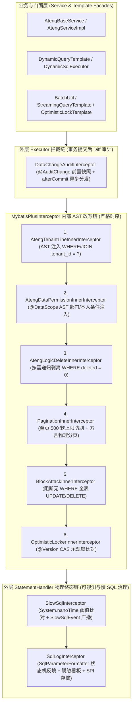
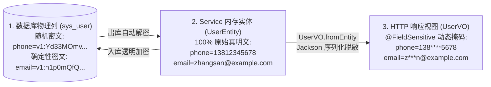

# ateng-boot-mybatis-plus 持久层增强底座

> 提供实体五级阶梯体系、审计自动填充、行级多租户隔离、AST 声明式细粒度数据权限、原生高效批量插入、存储透明加密与视图动态脱敏。

---

## 0. 特性与公共 API 全景速查矩阵 (Feature & API Panorama Matrix)

| 特性分类 | 特性名称 | 核心门面 / 注解 / SPI | 关键配置项 (`ateng.boot.*`) | 关键 API 签名 / 核心行为 | 锚定验证源头 (*Test / Sample) |
| :--- | :--- | :--- | :--- | :--- | :--- |
| **实体体系** | 泛型主键实体基类 | `BaseGenericEntity<ID>` | - | 规范实体主键类型定义与强类型 `getId()` / `setId(ID)` | `BaseEntityTest` / `UserDomainIntegrationTest` |
| **实体体系** | 雪花 ID 主键基类 | `BaseIdEntity` | `ateng.boot.mybatis-plus.snowflake.*` | 标配 64 位 Long 主键与 `@TableId(type = IdType.ASSIGN_ID)` | `BaseEntityTest` / `UserDomainIntegrationTest` |
| **实体体系** | 时间流转基类 | `BaseTimeEntity` | `ateng.boot.mybatis-plus.audit.*` | 提供 `createTime` (`FieldFill.INSERT`) 与 `updateTime` (`FieldFill.INSERT_UPDATE`) | `BaseEntityTest` / `UserDomainIntegrationTest` |
| **实体体系** | 四要素全审计业务基类 | `BaseEntity` | `ateng.boot.mybatis-plus.audit.*` | 提供 `createBy`、`updateBy`、`createTime`、`updateTime` 四要素全审计 | `BaseEntityTest` / `TenantOrderDomainIntegrationTest` |
| **实体体系** | 全要素状态业务基类 | `BaseFullEntity` | `ateng.boot.mybatis-plus.optimistic-locker.*` | 在审计基类上追加 `@Version private Integer version` (乐观锁) 与 `@TableLogic @JsonIgnore private Integer deleted` (逻辑删除) | `BaseEntityTest` / `UserDomainIntegrationTest` |
| **实体体系** | 唯一索引防冲突占位基类 | `BaseDeleteIdEntity` | - | 继承 `BaseEntity`，`deleted` 为 `BIGINT`（`@TableLogic(value = "0", delval = "id")`）并在软删除时动态以自身雪花主键 ID 占位，彻底杜绝业务组合唯一索引逻辑删除冲突 | `BaseDeleteIdEntityTest` / `SoftDeleteUniqueKeyScenarioTest` / `MpLifecycleAndSecurityControllerTest` |
| **实体体系** | 多租户实体标记接口 | `TenantEntity` | `ateng.boot.mybatis-plus.tenant.*` | 声明 `getTenantId()` / `setTenantId(String)` 租户标识契约 | `TenantOrderDomainIntegrationTest` / `MpGovernanceAndQueryControllerTest` |
| **自动填充** | 防御性审计元数据填充 | `DefaultMetaObjectHandler` | `ateng.boot.mybatis-plus.audit.enabled`<br>`ateng.boot.mybatis-plus.audit.default-operator` | 插入/更新自动提取操作人并填充审计字段，若已显式赋值则绝不覆盖 | `DefaultMetaObjectHandlerTest` / `UserDomainIntegrationTest` / `MpLifecycleAndSecurityControllerTest` |
| **审计贯通** | 当前操作人上下文提供者 | `CurrentUserProvider` | - | Core 统一操作人 SPI，驱动 `DefaultMetaObjectHandler` 解析操作人字符串/ID | `DefaultMetaObjectHandlerTest` / `UserDomainIntegrationTest` |
| **多租户隔离** | AST 动态行级多租户拦截器 | `AtengTenantLineInnerInterceptor` | `ateng.boot.mybatis-plus.tenant.enabled`<br>`ateng.boot.mybatis-plus.tenant.column`<br>`ateng.boot.mybatis-plus.tenant.ignore-tables` | 基于 JSqlParser 在 AST 语法树层级改写 SQL，自动拼接 `tenant_id = ?` 条件，支持多表 JOIN 与子查询精准注入 | `AtengTenantLineInnerInterceptorTest` / `TenantOrderDomainIntegrationTest` / `MpGovernanceAndQueryControllerTest` |
| **多租户解析** | 默认租户上下文处理器 | `DefaultTenantLineHandler` | `ateng.boot.mybatis-plus.tenant.column` | 桥接 `TenantContextHolder` 获取租户 ID，支持动态与静态表忽略过滤 | `DefaultTenantLineHandlerTest` / `TenantOrderDomainIntegrationTest` / `MpGovernanceAndQueryControllerTest` |
| **多租户绕过** | 声明式租户忽略注解 | `@IgnoreTenant` | - | 声明于 Mapper 方法或类上，自动绕过多租户行级过滤；支持与 `TenantContextHolder.runWithoutTenant(...)` 协同 | `AtengTenantLineInnerInterceptorTest` / `TenantOrderDomainIntegrationTest` / `MpGovernanceAndQueryControllerTest` |
| **数据权限** | AST 细粒度数据权限拦截器 | `AtengDataPermissionInnerInterceptor` | `ateng.boot.mybatis-plus.data-permission.enabled` | 基于 JSqlParser 在 AST 层级拦截改写 SQL，无缝拼接数据权限过滤表达式 | `AtengDataPermissionInnerInterceptorTest` / `UserDomainIntegrationTest` / `MpGovernanceAndQueryControllerTest` |
| **数据权限** | 动态数据权限处理器 | `DataPermissionHandler` / `DefaultDataPermissionHandler` | - | 数据权限 SPI 与默认处理器，结合上下文提取注入数据过滤 SQL 片段 | `AtengDataPermissionInnerInterceptorTest` / `UserDomainIntegrationTest` / `MpGovernanceAndQueryControllerTest` |
| **数据权限** | 声明式数据权限范围注解 | `@DataScope` | - | 细粒度声明式数据权限注解，支持按用户、部门或自定义表达式进行数据范围收敛 | `AtengDataPermissionInnerInterceptorTest` / `UserDomainIntegrationTest` / `MpGovernanceAndQueryControllerTest` |
| **数据权限** | 数据权限上下文保持器 | `DataPermissionContextHolder` | - | 线程安全透传数据权限上下文与过滤表达式，支持链式构建与自动现场清理 | `DataPermissionContextHolderTest` / `UserDomainIntegrationTest` / `MpGovernanceAndQueryControllerTest` |
| **原生批量操作** | 原生分批操作通用门面 | `BatchUtil` | `ateng.boot.mybatis-plus.batch.default-size` | `insertBatch` / `upsertBatch` / `updateBatch`（含 `*SomeColumn` 别名），内置切片分批（默认 1000）、内存防死锁升序排序与六要素轻量自愈补偿 | `BatchUtilTest` / `BatchUpsertTest` / `BatchUpdateTest` / `TenantOrderDomainIntegrationTest` / `MpBatchLockAndObservabilityControllerTest` |
| **原生批量操作** | 双方言批量 Upsert 注入器 | `UpsertBatchSomeColumn` / `@ConflictKeys` | - | 原生单条多值 Upsert SQL 注入器（MySQL `ON DUPLICATE KEY UPDATE` / PostgreSQL `ON CONFLICT DO UPDATE`），支持 `@ConflictKeys` 复合唯一键 | `BatchUpsertTest` / `TenantOrderDomainIntegrationTest` / `MpBatchLockAndObservabilityControllerTest` |
| **原生批量操作** | 原生单条批量更新注入器 | `UpdateBatchSomeColumn` | - | 原生 ANSI CASE WHEN 多值更新 SQL 注入器，内置 `AntiDeadlockSqlSource` 强制按主键 ID 升序防死锁，动态回退保护未提供字段 | `BatchUpdateTest` / `TenantOrderDomainIntegrationTest` / `MpBatchLockAndObservabilityControllerTest` |
| **原生批量操作** | 全局增强 SQL 注入器 | `AtengSqlInjector` | - | 自动向 MyBatis-Plus 注入 `InsertBatchSomeColumn`、`UpsertBatchSomeColumn` 与 `UpdateBatchSomeColumn` 原生批量操作方法 | `AtengSqlInjectorTest` / `TenantOrderDomainIntegrationTest` |
| **存储加解密** | 字段级透明存储加密注解 | `@FieldEncrypt` | `ateng.boot.mybatis-plus.crypto.secret-key` | 标注于实体属性上，声明该字段由 `EncryptTypeHandler` 或 `DeterministicEncryptTypeHandler` 执行持久化透明加解密；支持声明 `deterministic = true` 开启确定性等值加密检索 | `EncryptTypeHandlerTest` / `UserDomainIntegrationTest` / `MpLifecycleAndSecurityControllerTest` / `DynamicQueryHelperDeterministicEncryptTest` |
| **存储加解密** | 存储透明加解密类型转换器 (随机 IV) | `EncryptTypeHandler` | `ateng.boot.mybatis-plus.crypto.secret-key` | 持久化时入库 `v1:` 版本化 AES-CBC 随机 IV 密文，查询出库解密为真实明文，具备语义安全性，严格坚守“内存真明文”铁律 | `EncryptTypeHandlerTest` / `UserDomainIntegrationTest` / `MpLifecycleAndSecurityControllerTest` |
| **存储加解密** | 确定性透明加密类型转换器 (固定 IV) | `DeterministicEncryptTypeHandler` | `ateng.boot.mybatis-plus.crypto.secret-key` | 继承 `EncryptTypeHandler`，采用 HMAC-SHA256 SIV 合成固定 IV + AES-CBC，同明文生成同一密文，支持数据库精确等值（`=` / `IN`）密文检索，解密完全双向兼容 | `DeterministicEncryptTypeHandlerTest` / `DynamicQueryHelperDeterministicEncryptTest` / `MpGovernanceAndQueryControllerTest` |
| **乐观锁重试** | 乐观锁防冲突重试模板 | `OptimisticLockTemplate` | `ateng.boot.mybatis-plus.optimistic-locker.enabled` | `executeWithRetry(Supplier<Boolean>)` / `executeWithRetry(Supplier<Boolean>, int, Duration)`，高并发更新冲突自动退避重试 | `OptimisticLockTemplateTest` / `TenantOrderDomainIntegrationTest` / `MpBatchLockAndObservabilityControllerTest` |
| **分页契约** | 分页对象流式解耦与安全转译 | `PageUtil` | `ateng.boot.mybatis-plus.pagination.max-limit` | `toPage(PageQuery)` / `toPage(PageQuery, Class<T>)`（安全转译 sorts 并依托实体白名单过滤） / `toPageResult(IPage<T>)` / `toPageResult(IPage<S>, Function<S, T>)`，彻底解耦传输契约与持久实体（Zero-Entity-Leakage） | `PageUtilTest` / `MpGovernanceAndQueryControllerTest` |
| **分页拦截** | 原生分页拦截与防刷守护 | `PaginationInnerInterceptor` | `ateng.boot.mybatis-plus.pagination.enabled`<br>`ateng.boot.mybatis-plus.pagination.max-limit`<br>`ateng.boot.mybatis-plus.pagination.overflow`<br>`ateng.boot.mybatis-plus.pagination.db-type` | 原生分页拦截，注入单页最大条数限制（默认 500）与防刷超限防御，自动识别数据库方言 | `AtengMybatisPlusAutoConfigurationTest` / `MpGovernanceAndQueryControllerTest` |
| **安全阻断** | 防全表更新/删除拦截器 | `BlockAttackInnerInterceptor` | `ateng.boot.mybatis-plus.block-attack.enabled` | 拦截无 `WHERE` 条件的全表更新与删除操作，防止误操作摧毁生产库数据 | `AtengMybatisPlusAutoConfigurationTest` / `MpBatchLockAndObservabilityControllerTest` |
| **性能审计** | 慢 SQL 性能审计拦截器 | `SlowSqlInterceptor` | `ateng.boot.mybatis-plus.slow-sql.enabled`<br>`ateng.boot.mybatis-plus.slow-sql.threshold`<br>`ateng.boot.mybatis-plus.slow-sql.format-sql`<br>`ateng.boot.mybatis-plus.slow-sql.mask-sensitive` | 拦截 `StatementHandler` 执行，基于 `System.nanoTime()` 高精度快速比对放行；超时输出美化 SQL、真实脱敏参数及调用位置；严禁自动 EXPLAIN | `SlowSqlInterceptorTest` / `AtengMybatisPlusAutoConfigurationTest` / `MpBatchLockAndObservabilityControllerTest` |
| **告警通知** | 慢 SQL 告警通知 SPI | `SlowSqlAlertProvider` | - | 函数式 SPI 扩展契约，支持下游无缝对接飞书/钉钉群机器人或外部 APM 平台 | `SlowSqlInterceptorTest` / `SlowSqlAlertScenarioTest` / `MpBatchLockAndObservabilityControllerTest` |
| **审计事件** | 慢 SQL 审计事件模型 | `SlowSqlEvent` | - | 继承 Spring 原生 `ApplicationEvent`，发布执行耗时、格式化 SQL、脱敏参数、线程名与代码调用栈位置 | `SlowSqlInterceptorTest` / `SlowSqlAlertScenarioTest` |
| **发号器** | 分布式雪花算法发号器 | `DefaultIdentifierGenerator` | `ateng.boot.mybatis-plus.snowflake.enabled`<br>`ateng.boot.mybatis-plus.snowflake.worker-id`<br>`ateng.boot.mybatis-plus.snowflake.datacenter-id` | 提供趋势递增的 64 位全局唯一分布式 ID 发号支持 | `AtengMybatisPlusAutoConfigurationTest` / `UserDomainIntegrationTest` |
| **动态 SQL** | 外部动态 SQL 增强注册中心 | `DynamicSqlRegistry` | `ateng.boot.mybatis-plus.dynamic-sql.enabled`<br>`ateng.boot.mybatis-plus.dynamic-sql.locations` | 外部 SQL 注册、AST 投影字典解析提取与热加载中心，支持运行时动态注册/移除外部 XML 脚本，联动缓存失效通知 | `DynamicSqlRegistryTest` / `DynamicSqlScenarioTest` / `MpGovernanceAndQueryControllerTest` |
| **动态 SQL** | 外部动态 SQL 统一执行门面 | `DynamicSqlExecutor` | `ateng.boot.mybatis-plus.dynamic-sql.auto-script-wrap` | `selectPage` / `selectList` / `selectOne` / `count` / `insert` / `update` / `delete`，原生支持接收 `DynamicQueryRequest` 及业务 DTO，多表 AST 投影自愈与 ADR-0010 强类型 VO 映射 | `DynamicSqlExecutorTest` / `DynamicSqlScenarioTest` / `MpGovernanceAndQueryControllerTest` |
| **动态 SQL** | 外部 SQL 资源自动加载器 | `ExternalSqlLoader` / `ResourceExternalSqlLoader` | `ateng.boot.mybatis-plus.dynamic-sql.locations` | 外部 SQL 资源加载 SPI 与默认实现，启动时自动扫描指定路径并注册至 `DynamicSqlRegistry` | `ResourceExternalSqlLoaderTest` / `DynamicSqlScenarioTest` / `MpGovernanceAndQueryControllerTest` |
| **流式游标** | 原生游标 SQL 注入器 | `SelectCursor` | - | 自动向 Mapper 注入 `selectCursor` MappedStatement，底层强制设置 `fetchSize = 1000`，杜绝内存溢出 | `AtengSqlInjectorTest` / `TenantOrderDomainIntegrationTest` / `MpBatchLockAndObservabilityControllerTest` |
| **流式游标** | 受管流式游标查询模板 | `StreamingQueryTemplate` | - | `forEach` / `forEachBatch` / `forEachWhile` / `execute`，强制只读事务守护，`try-with-resources` 确定性闭合游标与连接归还，支持 Predicate 提前短路退出与不可变切片防卫 | `StreamingQueryTemplateTest` / `TenantOrderDomainIntegrationTest` / `MpBatchLockAndObservabilityControllerTest` |
| **SQL 日志诊断** | SQL 日志打印与可执行带参诊断拦截器 | `SqlLogInterceptor` | `ateng.boot.mybatis-plus.sql-log.enabled`<br>`ateng.boot.mybatis-plus.sql-log.console-enabled`<br>`ateng.boot.mybatis-plus.sql-log.level`<br>`ateng.boot.mybatis-plus.sql-log.format-sql`<br>`ateng.boot.mybatis-plus.sql-log.mask-sensitive`<br>`ateng.boot.mybatis-plus.sql-log.show-call-location`<br>`ateng.boot.mybatis-plus.sql-log.max-sql-length`<br>`ateng.boot.mybatis-plus.sql-log.exclude-statements`<br>`ateng.boot.mybatis-plus.sql-log.storage.*` | 拦截 `StatementHandler` 物理终态，输出带参完整可执行 SQL、毫秒耗时、行数影响与代码行号看板；驱动结构化 `SqlLogModel` 异步派发至存储 SPI 与 Spring 事件广播，内建批量防刷屏、游标只读防卫与失败现场捕获 | `SqlLogInterceptorTest` / `SqlLogIntegrationTest` / `MpBatchLockAndObservabilityControllerTest` |
| **SQL 日志诊断** | 字符流参数安全反填与敏感脱敏引擎 | `SqlParameterFormatter` | - | `formatSql` / `formatValue` / `prettify` / `compress` / `extractParameters`，零依赖字符流 Token 状态机智能跳过常量与注释内问号，安全映射 ANSI JDBC 字面量，杜绝正则异常，自动探测 `@FieldEncrypt` 与敏感凭据脱敏 | `SqlParameterFormatterTest` |
| **SQL 审计存储** | SQL 操作审计存储解耦 SPI 契约 | `SqlLogStorageProvider` | `ateng.boot.mybatis-plus.sql-log.storage.enabled` | 结构化物理 SQL 操作审计日志存储解耦 SPI 契约，支持下游无缝对接数据库、Elasticsearch、Kafka、ClickHouse 或 APM 统一持久化 | `SqlLogInterceptorTest` / `MpBatchLockAndObservabilityControllerTest` |
| **SQL 审计存储** | 默认 SQL 审计存储保底提供者 | `DefaultSqlLogStorageProvider` | `ateng.boot.mybatis-plus.sql-log.storage.enabled` | 当未配置外部自定义提供者时，基于 SLF4J 打印标准紧凑 JSON 审计日志，作为开箱即用保底实现 | `SqlLogInterceptorTest` |
| **SQL 审计事件** | Spring 应用层 SQL 审计广播事件 | `SqlLogEvent` | `ateng.boot.mybatis-plus.sql-log.storage.enabled` | Spring 原生 `ApplicationEvent` 事件，在 SQL 执行完成或失败现场捕获后广播，支持进程内 `@EventListener` 异步非侵入监听 | `SqlLogInterceptorTest` |
| **SQL 审计防卫** | 声明式 SQL 诊断与审计忽略注解 | `@IgnoreSqlLog` | - | 声明于 Mapper 接口类或特定方法上，指示拦截器对心跳探测或高频内部轮询等特定操作同时跳过控制台诊断与 SPI 存储 | `SqlLogInterceptorTest` / `MpBatchLockAndObservabilityControllerTest` |
| **SQL 日志诊断** | SQL 日志与审计强类型配置模型 | `SqlLogProperties` | `ateng.boot.mybatis-plus.sql-log.*` | 强类型配置模型，提供 `consoleEnabled`、`excludeStatements` 及嵌套 `storage`（`enabled`、`includeSelect`、`async`、`maxSqlLength`）等全套双轨配置 | `SqlLogPropertiesTest` / `AtengMybatisPlusAutoConfigurationTest` |
| **持久层底座** | 拦截器解包与调用栈穿透工具 | `MybatisInterceptorUtil` | - | `realTarget`（JDK 17 原生递归拆解 MyBatis Plugin 物理代理）/ `resolveCallLocation`（穿透持久层框架与切面，定位首个业务代码位置）/ `isFrameworkClass` | `MybatisInterceptorUtilTest` |
| **多数据源协同** | 多数据源诊断探针与上下文守卫 | `DynamicDatasourceGuard` | `ateng.boot.mybatis-plus.guard.dynamic-datasource` | 启动期轻量感知 Spring 容器多数据源或动态路由特征，输出多租户与事务协同建议；提供 `validateContextIsolated()` 静态断言防卫活跃事务假切源与上下文污染 | `DynamicDatasourceGuardTest` / `DynamicDatasourceGuardScenarioTest` / `MpGovernanceAndQueryControllerTest` |
| **基础扩展** | 通用 BaseMapper 增强门面 | `AtengBaseMapper<T>` | - | 继承 MyBatis-Plus `BaseMapper`，标配挂载批量方法与 `Cursor<T> selectCursor(@Param(Constants.WRAPPER) Wrapper<T> queryWrapper)` 原生流式游标查询 | `AtengSqlInjectorTest` / `TenantOrderDomainIntegrationTest` |
| **基础扩展** | 通用 Service 增强实现基类 | `AtengBaseService<T>` / `AtengServiceImpl<M, T>` | - | 继承 MyBatis-Plus `IService`，提供零实体泄露基础 VO 投影（`getById` / `listByIds` / `list` / `getOne`）、批量写入、受管流式查询体系、单表/多表动态查询及存在性判断（`existsDynamic`），以及乐观锁高并发自旋重试（`updateWithOptimisticRetry`），支持严格 `throwEx` 快速失败、分批切片与短路退出 | `AtengBaseServiceBatchTest` / `AtengBaseServiceStreamTest` / `AtengBaseServiceDynamicTest` / `AtengBaseServiceOptimisticLockTest` / `TenantOrderDomainIntegrationTest` / `MpGovernanceAndQueryControllerTest` |
| **动态查询** | 通用受管执行模板门面 | `DynamicQueryTemplate` | `ateng.boot.mybatis-plus.dynamic-query.enabled` | `selectPage` / `selectList` / `selectOne` / `count` / `exists`，跨单表实体、Mapper XML 语句或外部动态 SQL 提供对称完备的强类型动态查询与单页物理短路直出，内建 AST 别名自愈与自适应条件追加 | `DynamicQueryTemplateTest` / `MultiTableDynamicQueryScenarioTest` / `MpGovernanceAndQueryControllerTest` |
| **动态查询** | Service 联表方法引用与短方法名直出 | `AtengBaseService` / `AtengServiceImpl` | `ateng.boot.mybatis-plus.dynamic-query.enabled` | `pageDynamic` / `listDynamic` / `getOneDynamic` / `countDynamic` / `existsDynamic`，支持基于方法引用（`mapper::method`）或短方法名执行多表联表极速直出与单页 `Page(1, 1, false)` 物理短路判定 | `AtengBaseServiceMultiTableDynamicTest` / `MultiTableDynamicQueryScenarioTest` / `MpGovernanceAndQueryControllerTest` |
| **动态查询** | AST 多表别名与物理列投影自愈解析器 | `DynamicSqlProjectionResolver` | - | 基于 JSqlParser 解析 Mapper XML / 外部 SQL 投影字典，纳秒级缓存，运行时无感知将 VO 属性名与多表别名透明映射为底层物理列表达式（如 `deptName` -> `d.name`） | `DynamicSqlProjectionResolverTest` / `MultiTableDynamicQueryScenarioTest` / `MpGovernanceAndQueryControllerTest` |
| **动态查询** | 联表方法引用契约与解析辅助 | `DynamicMapperPageMethod`, `DynamicMapperListMethod`, `DynamicLambdaHelper` | - | 原生 `SerializedLambda` 纳秒级提取 Mapper 联表方法名与所属类，函数式强类型接口规范 | `DynamicLambdaHelperTest` / `AtengBaseServiceMultiTableDynamicTest` / `MpGovernanceAndQueryControllerTest` |
| **动态查询** | 动态查询安全转译引擎门面 | `DynamicQueryHelper` | `ateng.boot.mybatis-plus.dynamic-query.enabled` | `buildWrapper(DynamicQueryRequest, Class<T>)` / `buildWrapper(String, Class<T>)` / `buildWrapper(Map, Class<T>)` / `buildWrapper(Object, Class<T>)`，纳秒级元数据白名单缓存与六重安全防卫编译 | `DynamicQueryHelperTest` / `UserDomainIntegrationTest` / `MpGovernanceAndQueryControllerTest` |
| **动态查询** | URL Query 与 Map 高阶语法解析器 | `DynamicQueryParser` | - | `parse(String)` / `parse(Map)` / `parseToWrapper(String, Class<T>)`，支持冒号操作符、波浪线 between 切分与 `or_组号` 作用域分组解析 | `DynamicQueryParserTest` / `MpGovernanceAndQueryControllerTest` |
| **动态查询** | 动态查询请求与条件契约 | `DynamicQueryRequest`, `QueryCondition`, `QueryOperator` | - | 13 种受控操作符与流式链式构建，支持 `or(orGroup, condition)` 独立嵌套 OR 逻辑块 | `DynamicQueryHelperTest` / `DynamicQueryParserTest` / `MpGovernanceAndQueryControllerTest` |
| **动态查询** | 字段映射与敏感防卫注解 | `@QueryField`, `@DynamicQueryIgnore` | - | `@QueryField(property, operator, ignoreNull)` 声明式 DTO 驱动转译；`@DynamicQueryIgnore` 实体敏感列防越权探测 | `DynamicQueryHelperTest` / `MpGovernanceAndQueryControllerTest` |
| **动态查询** | 动态查询模板自动装配组件 | `AtengMybatisPlusDynamicQueryAutoConfiguration` | `ateng.boot.mybatis-plus.dynamic-query.enabled` | 声明 `@AutoConfigureAfter(MybatisPlusAutoConfiguration.class)` 与 `@ConditionalOnBean(SqlSessionFactory.class)`，保障晚期动态查询模板在 SqlSessionFactory 初始化完成后平滑装配 | `AtengMybatisPlusAutoConfigurationTest` / `MultiTableDynamicQueryScenarioTest` |
| **变更审计** | 声明式数据变更审计注解 | `@AuditChange` | - | 声明于实体类或 Mapper 接口/方法上，声明开启字段级 Diff 变更追踪与前后快照捕获，支持属性包含与排除 | `DataChangeAuditInterceptorTest` / `TenantOrderDomainIntegrationTest` / `MpBatchLockAndObservabilityControllerTest` |
| **变更审计** | 数据变更 Diff 审计拦截器 | `DataChangeAuditInterceptor` | `ateng.boot.mybatis-plus.audit-change.enabled`<br>`ateng.boot.mybatis-plus.audit-change.max-diff-rows`<br>`ateng.boot.mybatis-plus.audit-change.async`<br>`ateng.boot.mybatis-plus.audit-change.publish-event` | 拦截 MyBatis `Executor.update`，事务提交后（`afterCommit`）异步分发，自动识别 `@TableLogic` 逻辑删除（归类为 `ChangeType.DELETE`），依托 `LogicDeleteContextHolder` 穿透回收站捕获恢复与物理销毁前置快照，经由 `AsyncContext` 透传四维上下文，集成超限熔断降级与缺 Provider 自动休眠 | `DataChangeAuditInterceptorTest` / `AtengMybatisPlusAutoConfigurationTest` / `SoftDeleteUniqueKeyScenarioTest` / `TenantOrderDomainIntegrationTest` / `MpBatchLockAndObservabilityControllerTest` |
| **变更审计** | 数据变更审计消费 SPI | `DataChangeAuditProvider` | - | 函数式消费 SPI，供业务自由对接审计日志落盘、Elasticsearch 或消息队列 | `DataChangeAuditInterceptorTest` / `TenantOrderDomainIntegrationTest` |
| **变更审计** | 数据变更审计 Spring 事件 | `DataChangeEvent` | `ateng.boot.mybatis-plus.audit-change.publish-event` | 变更提交后发布 Spring 原生应用事件，供下游声明式 `@EventListener` 解耦监听 | `DataChangeAuditInterceptorTest` |
| **变更审计** | 数据变更审计上下文持有者 | `DataChangeAuditContextHolder` | - | 提供 `runWithoutAudit` 与 `callWithoutAudit` 编程式闭包，安全短路跳过当前线程的变更审计 | `DataChangeAuditInterceptorTest` / `MpBatchLockAndObservabilityControllerTest` |
| **JSON 类型转换** | Spring 受管 JSON 字段类型转换器 | `AtengJacksonTypeHandler<T>` | - | 继承 `JacksonTypeHandler`，自动接入 Spring Boot 受管 `ObjectMapper`，对 `List`、`Set`、`Map` 字段读取到 NULL 或空字符串时保底返回不可变空容器，彻底终结 NPE | `AtengJacksonTypeHandlerTest` / `JsonFieldScenarioTest` / `MpLifecycleAndSecurityControllerTest` |
| **JSON 类型转换** | 复杂深层泛型 JSON 类型转换基类 | `GenericJsonTypeHandler<T>` | - | 基于泛型超类签名自动提取深层嵌套 `JavaType`（如 `List<ShippingAddress>`），兼具集合与 Map 空安全保底 | `GenericJsonTypeHandlerTest` / `JsonFieldScenarioTest` / `MpLifecycleAndSecurityControllerTest` |
| **悲观并发控制** | 强类型悲观加锁模式枚举 | `LockMode` | - | 包含 `FOR_UPDATE`、`NOWAIT`、`SKIP_LOCKED` 与 `FOR_SHARE` 4 大强类型加锁模式，消除裸魔法字符串 | `PessimisticLockUtilTest` / `PessimisticLockScenarioTest` / `MpBatchLockAndObservabilityControllerTest` |
| **悲观并发控制** | 悲观锁方言自适应与快速失败工具 | `PessimisticLockUtil` | - | `apply(wrapper, lockMode)` / `forUpdate(wrapper, lockMode)`，前置探测底层数据库方言，在 MySQL 5.7 或 SQLite 等不支持跳锁引擎上调用立即抛出异常快速失败 | `PessimisticLockUtilTest` / `PessimisticLockScenarioTest` / `MpBatchLockAndObservabilityControllerTest` |
| **悲观并发控制** | 悲观排队锁与跳锁 Service 门面 | `AtengBaseService` / `AtengServiceImpl` | - | `getByIdForUpdate(id)` / `getByIdForUpdate(id, lockMode)` / `listForUpdate(wrapper, lockMode)`，开箱即用的悲观行锁与并发任务抢单拉取门面 | `AtengBaseServicePessimisticLockTest` / `PessimisticLockScenarioTest` / `MpBatchLockAndObservabilityControllerTest` |
| **逻辑删除闭环** | 逻辑删除穿透审计上下文持有者 | `LogicDeleteContextHolder` | `ateng.boot.mybatis-plus.logic-delete.enabled` | 提供 `runWithDeleted` 与 `callWithDeleted` 编程式闭包（带重入深度计数器），在审计与回收站场景下安全穿透逻辑删除 | `LogicDeleteContextHolderTest` / `SoftDeleteUniqueKeyScenarioTest` |
| **逻辑删除闭环** | JSqlParser AST 逻辑删除动态穿透拦截器 | `AtengLogicDeleteInnerInterceptor` | `ateng.boot.mybatis-plus.logic-delete.enabled`<br>`ateng.boot.mybatis-plus.logic-delete.columns` | 拦截器层动态递归剥离 WHERE 子句中的 `deleted = 0` 等值表达式，保留业务显式条件 | `AtengLogicDeleteInnerInterceptorTest` / `SoftDeleteUniqueKeyScenarioTest` |
| **逻辑删除闭环** | 逻辑删除数据恢复与回收站 Service 门面 | `AtengBaseService` / `AtengServiceImpl` | `ateng.boot.mybatis-plus.logic-delete.enabled` | `restoreById(id)` / `restore(wrapper)`（重置 `deleted = 0`，优先接入 `CurrentUserProvider` SPI 刷新 `updateBy`/`updateTime`），`countWithDeleted` / `existsWithDeleted`，以及强类型 VO 投影 `pageWithDeleted(PageQuery/IPage, wrapper, voClass)` / `listWithDeleted` / `getByIdWithDeleted` | `AtengBaseServiceRestoreTest` / `SoftDeleteUniqueKeyScenarioTest` / `MpLifecycleAndSecurityControllerTest` |
| **逻辑删除闭环** | 物理硬删除与回收站粉碎注入节点与门面 | `AtengSqlInjector` / `AtengBaseMapper` / `AtengBaseService` | - | 注入 `deletePhysicallyById` / `deletePhysicallyBatchByIds` / `deletePhysically` 真实 `DELETE FROM` 节点，配齐 `removePhysicallyById` / `removePhysicallyBatchByIds` / `removePhysically` 门面与 Fail-Fast 前置防卫 | `AtengSqlInjectorTest` / `AtengBaseServiceLogicDeleteAndPhysicalPurgeTest` / `SoftDeleteUniqueKeyScenarioTest` |

---

## 1. 模块定位与 Maven 坐标

`ateng-boot-mybatis-plus` 深度融合 MyBatis-Plus `3.5.17` 官方生态与 `ateng-boot-core` 原生底座，面向企业级 SaaS、高并发分布式系统与金融合规持久层提供零反射侵入、零实体泄露、全链路可观测的工业级 ORM 基础设施。

```xml
<dependency>
    <groupId>io.github.atengk</groupId>
    <artifactId>ateng-boot-mybatis-plus</artifactId>
</dependency>
```

---

## 2. 核心架构与设计不变量 (Architecture & Design Invariants)

### 2.1 内外双层拦截器链与执行时序架构

模块严格区分 **`MybatisPlusInterceptor` 内部 AST 改写链** 与 **MyBatis 原生外层 `Executor` / `StatementHandler` 审计诊断链**，确保逻辑删除穿透、多租户行级隔离、细粒度数据权限、分页 count 优化及终态物理 SQL 诊断严格按确定性时序正交协同：



### 2.2 四大核心架构不变量

1. **传输契约与持久层绝对解耦 (Zero-Entity-Leakage, ADR-0010)**：
   Controller 传输边界 **100% 严禁接收或直接返回 ORM 实体（Entity）**。入参统一使用专用 DTO / `PageQuery` / `DynamicQueryRequest`，出参依托 `AtengBaseService` 投影门面或 `PageUtil.toPageResult(page, VO::fromEntity)` 统一返回 `Result<VO>` 或 `Result<PageResult<VO>>`。
2. **数据安全三态分离与“内存真明文”不变量 (In-Memory Plaintext Invariant, ADR-0012)**：
   - **持久层密文落盘**：由 `@FieldEncrypt` + `EncryptTypeHandler` 在 JDBC 边界透明完成 `v1:` 版本化 AES-CBC 加解密；
   - **Service 内存 100% 原始真明文**：业务计算、长度校验、外部 RPC 调用读取实体属性时始终为未打码的真实明文，彻底根除“星号掩码脏数据写回数据库”的生产事故；
   - **视图序列化动态脱敏**：仅在 VO 序列化为 HTTP JSON 响应的最后一公里，由 `@FieldSensitive` 动态打码。
3. **对称语义完备性不变量 (Symmetric Facades Invariant)**：
   既有 `@TableLogic` 软删除（`removeById`），就必须成对提供穿透检索（`getByIdWithDeleted` / `listWithDeleted` / `pageWithDeleted`）与误删恢复（`restoreById` / `restore`）；既有上下文压栈（`TenantContextHolder` / `LogicDeleteContextHolder` / `DataPermissionContextHolder`），就必须在 `try-finally` 或函数式闭包（`runWith*` / `callWith*`）中确定性恢复与清理现场。
4. **原生多值批处理与主键升序防死锁不变量 (Anti-Deadlock Batch Invariant)**：
   摒弃循环单发伪批处理，通过 `AtengSqlInjector` 注入原生多值 `INSERT`、双方言 `UPSERT` 与 ANSI `CASE WHEN` 批量更新；批量更新前由 `BatchUtil` 与 `AntiDeadlockSqlSource` 双重强制按主键 ID 升序重排，从数学机理上消除并发交叉行锁死锁。

---

## 3. 实体五级继承阶梯、生命周期自动填充与逻辑删除闭环

> **对应样例控制器**：`MpEntityLifecycleController`（路由前缀 `/sample/mybatis-plus/lifecycle`）  
> **锚定集成测试**：`MpLifecycleAndSecurityControllerTest`、`SoftDeleteUniqueKeyScenarioTest`、`UserDomainIntegrationTest`

### 3.1 实体五级阶梯体系与雪花发号桥接 (`BaseGenericEntity` -> `BaseFullEntity`)

#### 场景痛点
在大型工程中，若每个实体类各自手写 `id`、`createTime`、`version`、`deleted` 字段，极易出现字段命名不一、漏配 `@JsonIgnore` 导致逻辑删除位泄露给前端、或多套雪花发号器混用引发时钟回拨冲突。

#### 本特性配置片段 (`application.yml`)
```yaml
ateng:
  boot:
    mybatis-plus:
      snowflake:
        enabled: true             # 启用持久层雪花发号桥接，自动委托至 Core IdUtil（默认 true）
        worker-id: 1              # 工作机器 ID（0~31，未配置时基于网卡 MAC/IP 四级自适应推导）
        datacenter-id: 1          # 数据中心 ID（0~31，未配置时自适应推导）
```

#### 五级实体继承阶梯与选型指南
```text
BaseGenericEntity<ID>          (第 1 阶：泛型主键契约 getId/setId)
  └── BaseIdEntity             (第 2 阶：64 位 Long 雪花主键 @TableId(type = IdType.ASSIGN_ID))
        └── BaseTimeEntity     (第 3 阶：时间流转基类 createTime, updateTime)
              └── BaseEntity   (第 4 阶：四要素全审计业务基类 createBy, updateBy, createTime, updateTime)
                    ├── BaseFullEntity     (第 5A 阶：标准状态基类，追加 @Version version 与 Integer deleted)
                    └── BaseDeleteIdEntity (第 5B 阶：唯一键防冲突基类，追加 @Version version 与 Long deleted=id)
```

| 业务表类型 | 推荐继承基类 | 內置受管字段与核心行为 |
| :--- | :--- | :--- |
| 自定义主键类型表（如 String 编码主键） | `BaseGenericEntity<ID>` | 泛型 `id` |
| 中间关联映射表、静态字典表 | `BaseIdEntity` | `Long id`（自动桥接 `DefaultIdentifierGenerator` 2026 纪元雪花算法） |
| 不可变流水表、系统监控日志表 | `BaseTimeEntity` | `id`, `createTime` (`INSERT`), `updateTime` (`INSERT_UPDATE`) |
| 常规业务主表（默认首选） | `BaseEntity` | `id`, `createBy`, `updateBy`, `createTime`, `updateTime` |
| 核心状态流转表（无业务唯一索引软删重建诉求） | `BaseFullEntity` | 追加 `@Version Integer version` 与 `@TableLogic @JsonIgnore Integer deleted` |
| 含业务唯一索引且需支持多次软删重建的档案表 | `BaseDeleteIdEntity` | 追加 `@Version Integer version` 与 `@TableLogic(value = "0", delval = "id") @JsonIgnore Long deleted` |
| SaaS 多租户隔离表 | 继承上述任一基类并实现 `TenantEntity` | 强制契约 `getTenantId()` / `setTenantId(String)` |

#### 实战代码示例（提取自 Sample `UserEntity`）
```java
@Getter
@Setter
@NoArgsConstructor
@ToString(callSuper = true)
@TableName(value = "sys_user", autoResultMap = true)
public class UserEntity extends BaseFullEntity {

    private String name;
    private Integer age;

    @FieldEncrypt
    @TableField(typeHandler = EncryptTypeHandler.class)
    private String email;

    @FieldEncrypt
    @TableField(typeHandler = EncryptTypeHandler.class)
    private String phone;

    private Long deptId;
}
```

---

### 3.2 防御性审计元数据自动填充 (`DefaultMetaObjectHandler` & `CurrentUserProvider`)

#### 场景痛点
手工在每个 Service 方法中调用 `setCreateTime(LocalDateTime.now())` 与 `setCreateBy(currentUser)` 既繁琐又容易遗漏；而粗暴的 `MetaObjectHandler` 直接覆盖赋值又会抹杀数据迁移或管理员代创建时显式指定的 `createBy`。

#### 本特性配置片段 (`application.yml`)
```yaml
ateng:
  boot:
    mybatis-plus:
      audit:
        enabled: true               # 是否启用审计字段自动填充（默认 true）
        default-operator: "SYSTEM"  # 当上下文无登录用户时的兜底操作人标识（默认 SYSTEM）
```

#### 实战代码示例（提取自 Sample `MpEntityLifecycleController`）
```java
@PostMapping("/user")
public Result<UserVO> createUser(@Valid @RequestBody UserCreateDTO dto) {
    boolean boundContext = StringUtils.hasText(dto.getOperator());
    if (boundContext) {
        // 模拟当前线程登录操作人（生产环境由认证过滤器自动注入 UserContextHolder）
        UserContextHolder.set(dto.getOperator());
    }
    try {
        UserEntity entity = new UserEntity(
                dto.getName(), dto.getAge(), dto.getEmail(), dto.getPhone(), dto.getDeptId()
        );
        // 防御性不覆盖：若业务显式指定了 createBy，DefaultMetaObjectHandler 绝不覆盖该值
        if (StringUtils.hasText(dto.getExplicitCreateBy())) {
            entity.setCreateBy(dto.getExplicitCreateBy());
        }
        userService.save(entity);
        return Result.success(UserVO.fromEntity(userService.getById(entity.getId())));
    } finally {
        if (boundContext) {
            UserContextHolder.clear();
        }
    }
}
```

#### 生产扩展接管：自定义 `CurrentUserProvider` SPI
默认情况下，模块从 `ateng-boot-core` 的 `UserContextHolder.get()` 提取当前操作人，无值时回退至 `default-operator`（`SYSTEM`）。若需直接对接自定义安全框架，只需声明 `CurrentUserProvider` Bean：
```java
@Component
public class CustomSecurityUserProvider implements CurrentUserProvider {
    @Override
    public String getCurrentUser() {
        return Optional.ofNullable(UserContextHolder.get()).orElse("SYSTEM");
    }
}
```

---

### 3.3 联合唯一索引防冲突基类与逻辑删除 AST 穿透恢复闭环 (`BaseDeleteIdEntity` & `AtengLogicDeleteInnerInterceptor`)

#### 场景痛点
1. **软删除唯一索引冲突死局**：若表上建有 `UNIQUE KEY (sku_code, deleted)` 且 `deleted` 仅取 `0/1`，当同一个商品编码 `SKU-999` 被第二次软删除时，数据库中将出现两条 `('SKU-999', 1)`，直接触发 `Duplicate entry 'SKU-999-1'` 物理唯一键崩溃；
2. **MyBatis-Plus 逻辑删除不可逆**：官方 `@TableLogic` 在启动预编译期将 `WHERE deleted = 0` 硬编码进 `selectById` 与 `updateById`，导致业务无法通过常规 Service 门面查询回收站数据或将误删数据恢复为 `deleted = 0`。

#### 本特性配置片段 (`application.yml`)
```yaml
ateng:
  boot:
    mybatis-plus:
      logic-delete:
        enabled: true             # 启用 JSqlParser AST 逻辑删除动态穿透拦截器（默认 true）
        columns:                  # 识别并支持穿透剥离的逻辑删除列名集合
          - deleted
          - is_deleted
          - del_flag
```

#### 实战代码示例（提取自 Sample `ProductSkuEntity` 与 `MpEntityLifecycleController`）
```java
// 1. 实体继承 BaseDeleteIdEntity：软删除时自动执行 SET deleted = id（以自身 64 位雪花主键占位）
@TableName("product_sku")
public class ProductSkuEntity extends BaseDeleteIdEntity {
    private String skuCode;
    private String skuName;
    private String category;
    private BigDecimal price;
}

// 2. 循环“上架 -> 软删除 -> 同编码再上架”零冲突 + 穿透查询 + 误删恢复闭环
@PostMapping("/sku/cycle-soft-delete")
public Result<List<ProductSkuVO>> cycleSoftDelete(@RequestParam(defaultValue = "SKU-999") String skuCode) {
    // 首次创建并软删除：底层执行 UPDATE product_sku SET deleted = id WHERE id = ? AND deleted = 0
    ProductSkuEntity firstGen = new ProductSkuEntity(skuCode, "无线降噪耳机初代版", "数码影音", new BigDecimal("1299.00"));
    softDeleteService.save(firstGen);
    softDeleteService.removeById(firstGen.getId());

    // 同编码再次上架：新记录为 ('SKU-999', 0)，旧记录为 ('SKU-999', 18461829...)，联合唯一键零冲突
    ProductSkuEntity secondGen = new ProductSkuEntity(skuCode, "无线降噪耳机二代旗舰版", "数码影音", new BigDecimal("1599.00"));
    softDeleteService.save(secondGen);

    // 穿透逻辑删除过滤：同时查出已下架历史版本与当前在售版本
    List<ProductSkuEntity> all = softDeleteService.listWithDeleted(
            new LambdaQueryWrapper<ProductSkuEntity>().eq(ProductSkuEntity::getSkuCode, skuCode)
    );
    return Result.success(all.stream().map(ProductSkuVO::fromEntity).toList());
}

// 3. 误删一键恢复（自动剥离 WHERE deleted = 0 锁死，将 deleted 重置为 0 并刷新 updateTime / updateBy）
@PostMapping("/sku/{id}/restore")
public Result<ProductSkuVO> restoreSkuById(@PathVariable Long id) {
    boolean restored = softDeleteService.restoreById(id);
    BusinessAssert.isTrue(restored, "未找到可恢复的商品 SKU 记录: id=" + id);
    return Result.success(ProductSkuVO.fromEntity(softDeleteService.getById(id)));
}

// 4. 回收站穿透统计与强类型 VO 分页投影（零实体泄露）
@GetMapping("/sku/recycle-bin/vo-page")
public Result<PageResult<ProductSkuVO>> pageSkuRecycleBinVO(PageQuery pageQuery) {
    return Result.success(softDeleteService.pageWithDeleted(pageQuery, null, ProductSkuVO.class));
}

// 5. 彻底物理硬删除粉碎（无视 @TableLogic，真实执行 DELETE FROM product_sku WHERE id = ?）
@PostMapping("/sku/{id}/purge")
public Result<Boolean> purgeSkuPhysically(@PathVariable Long id) {
    return Result.success(softDeleteService.removePhysicallyById(id));
}
```

#### 核心生产边界与非功能语义
- **嵌套重入安全的穿透上下文 (`LogicDeleteContextHolder`)**：底层采用 `ThreadLocal<Integer>` 引用计数深度管理，支持 `LogicDeleteContextHolder.callWithDeleted(() -> ...)` 任意层级嵌套调用，最外层退出时在 `finally` 中确定性归零清理；
- **AST 精准剥离不伤业务条件**：`AtengLogicDeleteInnerInterceptor` 仅在当前线程激活穿透标记时介入，通过 JSqlParser 递归剥离 `WHERE` 与 `JOIN ON` 中的 `deleted = 0` 条件，100% 保留业务自身的查询与排序条件；
- **防全表误恢复强卫语句**：调用 `softDeleteService.restore(wrapper)` 时，若传入 `null` 或不包含任何有效 `WHERE` 条件的空 `Wrapper`，底层立即抛出 `IllegalArgumentException` 快速失败，严防将全表历史软删数据一次性全部复活；
- **物理硬删除注入节点与全生命周期对称闭环 (`AtengSqlInjector`)**：自动为实体注册 `DeletePhysicallyById`、`DeletePhysicallyBatchByIds` 与 `DeletePhysically` 真实 SQL `DELETE FROM` 节点，并在 `AtengBaseService` 提供对等门面；所有物理删除前置校验入参与非空 `WHERE` 条件，违背立即抛出 `IllegalArgumentException` 快速失败；
- **操作人审计多级 SPI 回退**：`restoreById` / `restore` 自动识别 Spring 容器中注册的 `CurrentUserProvider` SPI 提取当前操作人，未配置时无缝降级回退至 `UserContextHolder.get()`；
- **全生命周期对称穿透与零实体泄露**：对称提供 `countWithDeleted`、`existsWithDeleted`、`pageWithDeleted`（支持强类型 VO 类字节码入参自动投影为 `PageResult<V>`）与 `listWithDeleted`。

---

## 4. 字段级透明加解密、视图动态脱敏与受管 JSON 映射

> **对应样例控制器**：`MpSecurityAndJsonController`（路由前缀 `/sample/mybatis-plus/security-json`）  
> **锚定集成测试**：`MpLifecycleAndSecurityControllerTest`、`JsonFieldScenarioTest`、`UserDomainIntegrationTest`

### 4.1 存储透明加解密与“内存真明文”生命周期分离 (`@FieldEncrypt` & `EncryptTypeHandler` & `DeterministicEncryptTypeHandler`)

#### 场景痛点
1. **脱敏覆盖数据库真实数据**：许多项目在 Service 层查出用户实体后直接执行 `user.setPhone("138****5678")` 再返回前端；一旦后续业务在同一事务或对象上调用 `updateById(user)`，星号掩码就会直接覆盖数据库真实手机号，造成不可逆的生产数据损毁。
2. **随机 IV 密文无法精确检索**：高安全性对称加密（如携带随机 IV 的 AES-CBC/GCM）每次加密相同明文会生成截然不同的密文，无法在数据库物理列上建立索引或执行 `WHERE email = ?` 等值匹配与集合匹配（`IN`）。

#### 本特性配置片段 (`application.yml`)
```yaml
ateng:
  boot:
    mybatis-plus:
      crypto:
        # AES 存储透明加密主密钥（生产环境强烈建议通过环境变量 ${MP_CRYPTO_SECRET_KEY} 注入）
        secret-key: "${MP_CRYPTO_SECRET_KEY:AtengBootDefaultSecretKey2026!}"
```

#### 双模加密架构对比：随机 IV vs 确定性加密 (SIV)
| 维度 | 默认随机 IV 加密 (`EncryptTypeHandler`) | 确定性加密 (`DeterministicEncryptTypeHandler`) |
| :--- | :--- | :--- |
| **实体注解声明** | `@FieldEncrypt` (默认 `deterministic = false`) | `@FieldEncrypt(deterministic = true)` |
| **TypeHandler** | `@TableField(typeHandler = EncryptTypeHandler.class)` | `@TableField(typeHandler = DeterministicEncryptTypeHandler.class)` |
| **算法机制** | AES-CBC + 16 字节安全随机 IV，版本头 `v1:` | AES-CBC + HMAC-SHA256(key, plain) 前 16 字节合成 IV (SIV)，版本头 `v1:` |
| **密文特性** | 相同明文每次生成完全不同的密文（语义安全，防侧信道） | 相同明文永远生成恒定唯一密文（支持数据库等值索引） |
| **等值检索支持** | 不支持数据库检索（动态查询引擎强制安全过滤屏蔽） | **支持 `EQ`, `NE`, `IN`, `NOT_IN`, `IS_NULL`, `IS_NOT_NULL` 密文精确检索** |
| **解密兼容性** | 100% 互相双向兼容解密，且均防御性兼容未加密历史明文 | 100% 互相双向兼容解密，且均防御性兼容未加密历史明文 |
| **模糊与排序** | 严禁 `LIKE` 模糊匹配与 `ORDER BY` 排序（白名单安全忽略） | **严禁 `LIKE` 模糊匹配与 `ORDER BY` 排序（立即抛出快速失败异常）** |

#### 三态数据安全流转架构與实战代码（提取自 Sample `MpSecurityAndJsonController` & `MpDynamicQueryAndSqlController`）


```java
// 1. 持久层实体：手机号使用随机 IV 加密，邮箱使用确定性加密（必须开启 autoResultMap = true）
@TableName(value = "sys_user", autoResultMap = true)
public class UserEntity extends BaseFullEntity {

    /** 手机号：使用随机 IV 高安全加密，防频率分析与侧信道推演，不支持数据库等值检索 */
    @FieldEncrypt
    @TableField(typeHandler = EncryptTypeHandler.class)
    private String phone;

    /** 电子邮箱：使用确定性加密，相同邮箱生成恒定密文，支持数据库唯一索引与等值检索 */
    @FieldEncrypt(deterministic = true)
    @TableField(typeHandler = DeterministicEncryptTypeHandler.class)
    private String email;
}

// 2. 传输层视图 VO：声明 @FieldSensitive，仅在 JSON 序列化出站时动态打星号
@Data
public class UserVO implements Serializable {
    @FieldSensitive(SensitiveType.MOBILE_PHONE)
    private String phone;

    @FieldSensitive(SensitiveType.EMAIL)
    private String email;
}

// 3. 动态查询密文自动转译与等值匹配（URL 语法与 DTO 检索全支持）
// GET /sample/mybatis-plus/query/dynamic/url?email:eq=zhangsan@example.com
// 底层 DynamicQueryHelper 自动调用 EncryptTypeHandler.encryptDeterministic 转为确定性密文精确匹配
PageResult<UserVO> page = userService.pageDynamic(queryRequest, UserVO.class);
```

#### 核心生产边界与非功能语义
- **必须显式开启 `autoResultMap = true`**：MyBatis-Plus 仅在 `@TableName(value = "...", autoResultMap = true)` 开启时才会在查询结果集映射阶段自动触发字段上的 `typeHandler`；若漏配会导致写入加密但查询原样返回密文；
- **密文列排序与模糊查询硬阻断**：
  - 默认随机 IV 字段（`EncryptTypeHandler`）：动态查询与 `PageUtil` 会在白名单过滤阶段静默忽略针对该字段的排序与过滤探测；
  - 确定性加密字段（`DeterministicEncryptTypeHandler`）：`DynamicQueryHelper` 仅放行 `EQ`, `NE`, `IN`, `NOT_IN`, `IS_NULL`, `IS_NOT_NULL` 等值条件；一旦尝试使用 `LIKE`, `LIKE_LEFT`, `LIKE_RIGHT`, `BETWEEN`, `GT`, `GE`, `LT`, `LE` 或 `ORDER BY` 排序，**立即抛出 `IllegalArgumentException` 快速失败阻断**，杜绝密文被作为字典序排序或无效模糊匹配引发逻辑错误。

---

### 4.2 Spring 受管 JSON 字段类型转换器与复杂泛型空安全保底 (`AtengJacksonTypeHandler` & `GenericJsonTypeHandler`)

#### 场景痛点
1. **原生 `JacksonTypeHandler` 与 Spring 容器割裂**：MyBatis-Plus 官方 `JacksonTypeHandler` 默认通过私有 `new ObjectMapper()` 初始化，丢失了 Spring Boot 容器中的 `JavaTimeModule`，导致包含 `LocalDateTime` 的 JSON 字段在序列化时直接报错崩溃；
2. **深层泛型擦除与空指针（NPE）陷阱**：当实体字段为 `List<ShippingAddress>` 时，普通 `TypeHandler` 因 Java 泛型擦除会将元素反序列化为 `LinkedHashMap`，强转时触发 `ClassCastException`；且当数据库列为 `NULL` 时直接返回 `null`，极易引发业务遍历 `NullPointerException`。

#### 实战代码示例（提取自 Sample `MemberProfileEntity`）
```java
@Getter
@Setter
@TableName(value = "member_profile", autoResultMap = true)
public class MemberProfileEntity extends BaseEntity {

    private String memberName;

    // 1. 标准集合与 Map：绑定 AtengJacksonTypeHandler，数据库为 NULL 时自动保底返回 Collections.emptyList/Set/Map()
    @TableField(typeHandler = AtengJacksonTypeHandler.class)
    private List<String> tags;

    @TableField(typeHandler = AtengJacksonTypeHandler.class)
    private Set<String> roles;

    @TableField(typeHandler = AtengJacksonTypeHandler.class)
    private Map<String, Object> extraInfo;

    // 2. 含 LocalDateTime 的复杂 POJO：自动复用 Spring Boot 受管 ObjectMapper，原生支持 JSR-310 时间格式
    @TableField(typeHandler = AtengJacksonTypeHandler.class)
    private UserProfile profile;

    // 3. 深层嵌套泛型集合 List<ShippingAddress>：继承 GenericJsonTypeHandler 保留完整泛型签名
    @TableField(typeHandler = ShippingAddressListTypeHandler.class)
    private List<ShippingAddress> shippingAddresses;

    /**
     * 继承 GenericJsonTypeHandler<List<ShippingAddress>> 并透传构造器，即可完整保留深层泛型并享空集合保底
     */
    public static class ShippingAddressListTypeHandler extends GenericJsonTypeHandler<List<ShippingAddress>> {
        public ShippingAddressListTypeHandler() {
            super();
        }
        public ShippingAddressListTypeHandler(Class<?> type) {
            super(type);
        }
        public ShippingAddressListTypeHandler(Class<?> type, Field field) {
            super(type, field);
        }
    }
}
```

#### 核心生产边界与非功能语义
- **Spring 受管 `ObjectMapper` 自动桥接**：`AtengMybatisPlusAutoConfiguration` 通过 `SmartInitializingSingleton` 在容器单例就绪后自动将全局 `ObjectMapper` 注入 `AtengJacksonTypeHandler`、`GenericJsonTypeHandler` 及官方 `JacksonTypeHandler`，100% 遵循 ADR-0005 序列化规范；
- **空安全保底契约 (Null Safety Invariant)**：当数据库 JSON 列值为 `NULL`、空字符串 `""` 或 `"null"` 时，`List` 属性保底返回 `Collections.emptyList()`，`Set` 属性保底返回 `Collections.emptySet()`，`Map` 属性保底返回 `Collections.emptyMap()`，单对象 POJO（如 `UserProfile`）返回 `null`，彻底消灭业务层集合遍历 NPE。

---

## 5. SaaS 行级多租户隔离、AST 细粒度数据权限与多源守卫

### 5.1 基于 JSqlParser AST 的行级多租户安全隔离 (`AtengTenantLineInnerInterceptor` & `@IgnoreTenant`)

#### 场景痛点
SaaS 多租户平台最核心的安全红线是租户间数据越权串读与串写。若依赖开发者在每个查询、更新或关联 SQL 中手工拼接 `AND tenant_id = ?`，一旦在复杂业务分支中漏写即构成严重生产安全事故。

`ateng-boot-mybatis-plus` 基于 JSqlParser 在 AST 语法树层级透明改写 SQL，自动桥接 `ateng-boot-core` 的 `TenantContextHolder`，兼顾默认强制行级隔离、全局白名单表放行与受控跨租户汇总豁免。

#### 本特性配置片段 (`application.yml`)
```yaml
ateng:
  boot:
    mybatis-plus:
      tenant:
        enabled: true             # 是否启用多租户行级隔离拦截器（需显式开启，默认 false）
        column: tenant_id         # 数据库租户标识物理列名（默认 tenant_id）
        ignore-tables:            # 全局免租户隔离的公共表白名单（支持精确表名与 * 通配符）
          - sys_user
          - sys_dept
          - sys_product_sku
          - sys_member_profile
```

#### 实战代码示例
```java
// 1. 实体实现 TenantEntity 接口并继承 BaseEntity
@Data
@EqualsAndHashCode(callSuper = true)
@TableName("sys_tenant_order")
public class TenantOrderEntity extends BaseEntity implements TenantEntity {
    private String tenantId;
    private String orderNo;
    private String title;
    private String skuCode;
    private BigDecimal totalAmount;
    private String status;
}

// 2. Mapper 接口支持声明式 @IgnoreTenant 跨租户放行
@Mapper
public interface TenantOrderMapper extends AtengBaseMapper<TenantOrderEntity> {

    @IgnoreTenant
    @Select("SELECT * FROM sys_tenant_order ORDER BY id ASC")
    List<TenantOrderEntity> selectAllOrdersIgnoreTenant();
}

// 3. Service 层行级隔离与双轨豁免对比（锚定 Sample: TenantOrderServiceImpl）
@Service
public class TenantOrderServiceImpl extends AtengServiceImpl<TenantOrderMapper, TenantOrderEntity>
        implements TenantOrderService {

    @Override
    public TenantIsolationCompareVO compareTenantIsolationAndBypass(String currentTenantId) {
        TenantContextHolder.setTenantId(currentTenantId);
        try {
            // 1. 常规查询：AST 自动改写追加 WHERE tenant_id = 'tenant_A'
            List<TenantOrderEntity> scopedOrders = list();

            // 2. 声明式豁免：通过 Mapper 方法 @IgnoreTenant 查询全平台订单
            List<TenantOrderEntity> byAnnotation = baseMapper.selectAllOrdersIgnoreTenant();

            // 3. 编程式闭包豁免：通过 TenantContextHolder.runWithoutTenant 临时跳过租户过滤
            List<TenantOrderEntity> byClosure = TenantContextHolder.runWithoutTenant(() -> list());

            TenantIsolationCompareVO compareVO = new TenantIsolationCompareVO();
            compareVO.setCurrentTenantId(currentTenantId);
            compareVO.setTenantScopedCount(scopedOrders.size());
            compareVO.setIgnoreTenantAnnotationCount(byAnnotation.size());
            compareVO.setRunWithoutTenantClosureCount(byClosure.size());
            compareVO.setTenantScopedOrders(scopedOrders.stream().map(TenantOrderVO::fromEntity).toList());
            compareVO.setGlobalOrders(byAnnotation.stream().map(TenantOrderVO::fromEntity).toList());
            return compareVO;
        } finally {
            // 严守确定性生命周期铁律：必须在 finally 中清理线程上下文
            TenantContextHolder.clear();
        }
    }
}
```

#### 核心机制与生产边界
- **AST 全语句覆盖与类型自适应**：`AtengTenantLineInnerInterceptor` 自动对 `SELECT`（含 `JOIN` 关联表与子查询）、`INSERT`、`UPDATE`、`DELETE` 注入租户条件；`DefaultTenantLineHandler` 自动识别纯数字租户 ID（转为 `LongValue`）与字符串租户 ID（转为 `StringValue`）；
- **三级放行体系**：
  1. **静态表级放行**：通过 `ateng.boot.mybatis-plus.tenant.ignore-tables` 配置公共字典表、系统配置表（支持 `*` 前后缀通配）；
  2. **声明式方法/类级放行**：在 Mapper 接口或方法上标注 `@IgnoreTenant`，拦截器自动识别并跳过当前语句的租户拼接；
  3. **编程式可重入闭包放行**：调用 `TenantContextHolder.runWithoutTenant(() -> ...)`，底层维护线程级重入深度计数器（`IGNORE_DEPTH`），支持多层嵌套调用并在 `finally` 中精准恢复原状态；
- **自定义接管扩展**：若需定制复杂租户值提取或动态表放行规则，只需声明自定义 `TenantLineHandler` Bean（装配类标配 `@ConditionalOnMissingBean(TenantLineHandler.class)`）。

---

### 5.2 基于 JSqlParser AST 的声明式细粒度数据权限 (`AtengDataPermissionInnerInterceptor` & `@DataScope`)

#### 场景痛点
企业级后台管理普遍需要根据当前登录人的组织架构（本部门及子部门 `dept_id IN (...)`）与个人归属（本人创建 `create_by = ?`）动态收敛可见数据范围。传统方案将 SQL 字符串直接拼接到 XML 中，不仅污染业务 SQL，且极易引发 SQL 注入与分页 `COUNT` 语句漏检。

`ateng-boot-mybatis-plus` 提供声明式 `@DataScope` 注解与基于 JSqlParser AST 的 `AtengDataPermissionInnerInterceptor`，将权限表达式以强类型语法树节点安全挂载至 `WHERE` 子句。

#### 本特性配置片段 (`application.yml`)
```yaml
ateng:
  boot:
    mybatis-plus:
      data-permission:
        enabled: true             # 是否启用基于 AST 的声明式细粒度数据权限拦截器（默认 false）
```

#### 实战代码示例
```java
// 1. Mapper 方法声明 @DataScope 约束范围（锚定 Sample: UserMapper）
@Mapper
public interface UserMapper extends AtengBaseMapper<UserEntity> {

    @DataScope(deptColumn = "dept_id", userColumn = "create_by")
    @Select("SELECT * FROM sys_user ${ew.customSqlSegment}")
    List<UserEntity> selectAccessibleUsers(@Param(Constants.WRAPPER) Wrapper<UserEntity> queryWrapper);
}

// 2. 实现 DataPermissionHandler SPI 定制部门与本人组合 AST 表达式（锚定 Sample: SampleDataPermissionHandler）
@Component
public class SampleDataPermissionHandler implements DataPermissionHandler {

    @Override
    public Expression getSqlSegment(Table table, Expression where, String mappedStatementId, DataScope dataScope) {
        List<Long> deptIds = SampleSecurityContext.getAccessibleDeptIds();
        String selfOperator = SampleSecurityContext.getSelfOperator();
        boolean hasDepts = deptIds != null && !deptIds.isEmpty();
        boolean hasSelf = selfOperator != null && !selfOperator.isBlank()
                && dataScope.userColumn() != null && !dataScope.userColumn().isBlank();
        if (!hasDepts && !hasSelf) {
            return null;
        }
        String prefix = (dataScope.alias() != null && !dataScope.alias().isBlank())
                ? dataScope.alias() + "." : "";

        Expression deptExpression = null;
        if (hasDepts) {
            ParenthesedExpressionList<LongValue> list = new ParenthesedExpressionList<>();
            deptIds.forEach(id -> list.add(new LongValue(id)));
            InExpression inExpression = new InExpression();
            inExpression.setLeftExpression(new Column(prefix + dataScope.deptColumn()));
            inExpression.setRightExpression(list);
            deptExpression = inExpression;
        }

        Expression selfExpression = null;
        if (hasSelf) {
            EqualsTo equalsTo = new EqualsTo();
            equalsTo.setLeftExpression(new Column(prefix + dataScope.userColumn()));
            equalsTo.setRightExpression(new StringValue(selfOperator));
            selfExpression = equalsTo;
        }

        if (deptExpression != null && selfExpression != null) {
            // 组合生成 (dept_id IN (...) OR create_by = '...') 强类型括号表达式
            return new ParenthesedExpressionList<>(new OrExpression(deptExpression, selfExpression));
        }
        return deptExpression != null ? deptExpression : selfExpression;
    }
}

// 3. Service 层常规权限过滤、超管短路与编程式豁免对比（锚定 Sample: UserServiceImpl）
public DataPermissionCompareVO compareDataPermissionAndBypass(List<Long> deptIds, String selfOperator) {
    SampleSecurityContext.setAccessibleDeptIds(deptIds);
    SampleSecurityContext.setSelfOperator(selfOperator);
    try {
        // 1. 常规 @DataScope AST 权限过滤：自动追加 WHERE (dept_id IN (10) OR create_by = 'creator-bob')
        List<UserEntity> scoped = baseMapper.selectAccessibleUsers(new QueryWrapper<>());

        // 2. 超级管理员秒级短路放行：直接跳过 AST 语法树解析，返回全量数据
        List<UserEntity> superAdmin = DataPermissionContextHolder.runAsSuperAdmin(
                () -> baseMapper.selectAccessibleUsers(new QueryWrapper<>())
        );

        // 3. 编程式闭包豁免：临时忽略数据权限过滤，退出闭包后自动恢复深度
        List<UserEntity> withoutPermission = DataPermissionContextHolder.runWithoutPermission(
                () -> baseMapper.selectAccessibleUsers(new QueryWrapper<>())
        );
        // ... 封装返回 DataPermissionCompareVO
    } finally {
        SampleSecurityContext.clear();
    }
}
```

#### 核心机制与生产边界
- **超管与忽略状态秒级短路**：`AtengDataPermissionInnerInterceptor` 在进入 AST 解析前优先检查 `DataPermissionContextHolder.isSuperAdmin()` 与 `isIgnore()`；一旦命中立即短路放行，零语法树解析开销；
- **分页 Count 与动态自适应后缀穿透**：当 MyBatis-Plus 分页插件生成 `_mpCount` 派生语句或动态查询生成 `$dynamicAdaptive` 派生语句时，拦截器自动剥离派生后缀还原原始 Mapper 方法名，确保 `COUNT(*)` 统计与数据列表 100% 遵循完全一致的 `@DataScope` 权限边界；
- **多表 JOIN 别名精确定位**：在联表查询场景下，通过 `@DataScope(alias = "u", deptColumn = "dept_id")` 指定主表别名，防止多表同名字段引发 `Column 'dept_id' in where clause is ambiguous` 语法错误。

---

### 5.3 多数据源协同诊断探针与上下文守卫 (`DynamicDatasourceGuard`)

#### 场景痛点
在引入多数据源或读写分离路由的系统中，开发者常遭遇三大隐蔽陷阱：
1. **活跃事务内假切源串库**：Spring `@Transactional` 开启后已将物理连接绑定至当前线程，此时在事务内部切换数据源会被底层连接无声忽略，导致写操作落入错误数据库；
2. **上下文残留跨库越权**：跨数据源调用前若未清理 `DataPermissionContextHolder`（如残留 `isSuperAdmin=true`），会导致目标库权限防线被穿透；
3. **租户上下文错位**：分库租户路由与当前线程 `TenantContextHolder` 租户标识不一致，引发跨租户串库。

`DynamicDatasourceGuard` 提供启动期多源健康诊断探针与运行时 `validateContextIsolated()` 静态守卫断言。

#### 本特性配置片段 (`application.yml`)
```yaml
ateng:
  boot:
    mybatis-plus:
      guard:
        dynamic-datasource: true  # 是否启用多数据源协同诊断探针（默认 true）
```

#### 实战代码示例
```java
// 切源边界或跨库服务前执行静态隔离守卫校验（锚定 Sample: DynamicDatasourceGuardScenarioServiceImpl）
@Service
@RequiredArgsConstructor
public class DynamicDatasourceGuardScenarioServiceImpl implements DynamicDatasourceGuardScenarioService {

    private final TransactionTemplate transactionTemplate;

    public String verifyGuardByMode(String mode, String currentTenantId, String expectedTenantId) {
        try {
            return switch (mode) {
                case "clean" -> {
                    // 1. 纯净上下文：无活跃事务、无权限残留，守卫校验顺利通过
                    DynamicDatasourceGuard.validateContextIsolated();
                    yield "CLEAN_CONTEXT_PASSED";
                }
                case "active-tx" -> {
                    // 2. 活跃事务内切源：检测到 TransactionSynchronizationManager.isActualTransactionActive() 为 true，立即阻断
                    transactionTemplate.execute(status -> {
                        DynamicDatasourceGuard.validateContextIsolated();
                        return null;
                    });
                    yield "UNEXPECTED";
                }
                case "tenant-check" -> {
                    // 3. 租户上下文一致性强校验：当前租户与目标库期望租户不匹配时立即阻断
                    TenantContextHolder.setTenantId(currentTenantId);
                    try {
                        DynamicDatasourceGuard.validateContextIsolated(expectedTenantId);
                        yield "TENANT_CHECK_PASSED";
                    } finally {
                        TenantContextHolder.clear();
                    }
                }
                default -> throw new BusinessException(CommonResultCode.BAD_REQUEST, "不支持的守卫验证模式: " + mode);
            };
        } catch (IllegalStateException e) {
            // 模块边界捕获底层守卫状态异常并转译为带因果链的受管业务异常
            throw new BusinessException(CommonResultCode.BAD_REQUEST, e.getMessage(), e);
        }
    }
}
```

#### 核心机制与生产边界
- **零臃肿无侵入探针**：依托 Spring 原生 `SmartInitializingSingleton` 与 `TransactionSynchronizationManager`，不强制绑定任何第三方多数据源 SDK；当探测到容器存在多个 `DataSource` 或动态路由数据源时，自动输出多租户白名单、事务切源禁忌与上下文隔离自检指南；
- **四重状态断言防线**：`DynamicDatasourceGuard.validateContextIsolated(expectedTenantId)` 依次校验：
  1. 是否被 `markContextTainted(reason)` 显式标记为污染状态；
  2. 是否处于活跃 Spring 事务（`isActualTransactionActive() == true`）；
  3. 是否残留未清理的 `DataPermissionContextHolder` 超管或忽略状态；
  4. 当前线程 `TenantContextHolder.getTenantId()` 是否与期望租户严格匹配。

---

## 6. 动态查询安全转译、外部动态 SQL 引擎与零实体泄露分页

### 6.1 零实体泄露分页契约与基础 VO 投影 (`PageUtil` & `AtengBaseService`)

#### 场景痛点
直接向前端暴露 ORM 持久层实体（Entity）或直接透传未受控的前端排序字段，极易导致未授权内部字段泄露、全表百万行拉取 OOM 以及利用敏感列排序进行盲注探测。

严格遵循 [ADR-0010](../docs/adr/0010-transport-pagination-contract-decoupling.md) 传输契约解耦规范，`PageUtil` 与 `AtengBaseService` 提供从入参 `PageQuery` 实体白名单安全转译到出参 `PageResult<VO>` 流式映射的全套零实体泄露门面。

#### 本特性配置片段 (`application.yml`)
```yaml
ateng:
  boot:
    mybatis-plus:
      pagination:
        enabled: true             # 是否启用原生物理分页插件（默认 true）
        max-limit: 500            # 单页最大允许查询条数软上限，防超大 size 打爆内存（默认 500）
        overflow: false           # 超出总页数时是否回到第一页（默认 false，返回空列表）
```

#### 实战代码示例
```java
// 1. PageUtil 实体白名单安全排序与流式 VO 转换（锚定 Sample: UserServiceImpl#pageUsersSafely）
@Override
public PageResult<UserVO> pageUsersSafely(PageQuery pageQuery) {
    // 依托 UserEntity 元数据白名单安全转译排序项，自动过滤 @DynamicQueryIgnore、@FieldEncrypt 与不存在字段
    Page<UserEntity> page = PageUtil.toPage(pageQuery, UserEntity.class);
    // 执行物理分页并流式映射为纯传输对象 PageResult<UserVO>
    return PageUtil.toPageResult(page(page), UserVO::fromEntity);
}

// 2. AtengBaseService 零实体泄露基础查询一步直出 VO
UserVO userVo = userService.getById(1001L, UserVO.class);
List<UserVO> userVoList = userService.listByIds(List.of(1001L, 1002L), UserVO.class);
List<UserVO> deptUsers = userService.list(
        Wrappers.<UserEntity>lambdaQuery().eq(UserEntity::getDeptId, 10L),
        UserVO.class
);
```

#### 核心机制与生产边界
- **排序白名单与敏感列免疫**：调用 `PageUtil.toPage(pageQuery, Entity.class)` 时，底层联动 `DynamicQueryHelper` 元数据缓存，仅放行实体真实持久化属性且自动剔除 `@DynamicQueryIgnore`、`@FieldEncrypt` 密文列（密文随机 IV 排序无业务意义且暴露侧信道风险）与逻辑删除列；
- **空安全保底不变量**：`toPageResult` 与 `AtengBaseService.list*` 在查无数据时始终保底返回 `Collections.emptyList()`，绝不返回 `null`。

---

### 6.2 动态查询安全转译引擎、URL 冒号高阶语法与 `@QueryField` 检索 (`DynamicQueryHelper` & `DynamicQueryParser`)

#### 场景痛点
管理后台检索往往包含多字段模糊匹配、数值/时间区间筛选、跨字段 `OR` 组合搜索与多列排序。手写冗长的 `if (dto.getXxx() != null) wrapper.eq(...)` 极易遗漏，而直接暴露反射查询又面临越权探测受限内部字段（如内部风控备注、加密手机号）的安全风险。

`DynamicQueryParser` 与 `DynamicQueryHelper` 提供 **URL 冒号高阶语法解析** 与 **`@QueryField` 声明式 DTO 检索**，内置六重安全防卫编译。

#### 本特性配置片段 (`application.yml`)
```yaml
ateng:
  boot:
    mybatis-plus:
      dynamic-query:
        enabled: true             # 是否启用动态查询安全转译引擎与 DynamicQueryTemplate（默认 true）
```

#### 实战代码示例
```java
// 1. 实体受限字段标注 @DynamicQueryIgnore 防越权探测（锚定 Sample: UserEntity）
@TableName("sys_user")
public class UserEntity extends BaseFullEntity {
    private String name;
    private Integer age;
    @FieldEncrypt
    private String phone;

    /** 内部风控备注：禁止前端通过动态条件过滤或动态排序越权探测 */
    @DynamicQueryIgnore
    private String internalRemark;
}

// 2. 声明式业务检索载荷 UserSearchDTO（锚定 Sample: UserSearchDTO）
@Data
@EqualsAndHashCode(callSuper = true)
public class UserSearchDTO extends PageQuery {

    @QueryField(operator = QueryOperator.LIKE)
    private String name;

    @QueryField(property = "age", operator = QueryOperator.GE)
    private Integer minAge;

    @QueryField(property = "age", operator = QueryOperator.LE)
    private Integer maxAge;

    @QueryField(property = "deptId", operator = QueryOperator.IN)
    private List<Long> deptIds;

    /** 即便 DTO 暴露了同名字段，因 UserEntity 标注了 @DynamicQueryIgnore，编译时仍被强制拦截忽略 */
    @QueryField(property = "internalRemark", operator = QueryOperator.EQ)
    private String internalRemark;
}

// 3. Controller 与 Service 极简调用（锚定 Sample: MpDynamicQueryAndSqlController & UserServiceImpl）
@GetMapping("/dynamic/url")
public Result<PageResult<UserVO>> queryUsersByDynamicUrl(HttpServletRequest request) {
    // 支持 URL 如：current=1&size=10&age:between=20~32&or_1:name:like=张&or_1:deptId:eq=20&sort=age:asc
    DynamicQueryRequest queryRequest = DynamicQueryParser.parse(request.getQueryString());
    return Result.success(userService.pageDynamic(queryRequest, UserVO.class));
}

@PostMapping("/dynamic/dto")
public Result<PageResult<UserVO>> queryUsersBySearchDto(@RequestBody UserSearchDTO searchDTO) {
    return Result.success(userService.pageDynamic(searchDTO, UserVO.class));
}
```

#### 核心机制与生产边界
- **六重安全防卫 (The 6-Layer Security Guard)**：
  1. **实体元数据白名单**：仅允许目标实体声明的持久化字段，未知属性直接安全忽略并记录告警；
  2. **敏感黑名单与确定性加解密分流**：强制拦截 `@DynamicQueryIgnore` 字段、内置敏感词（`password`、`secret`、`salt`）及逻辑删除列；对于 `@FieldEncrypt` 字段，默认随机 IV 加密列严禁参与任何动态过滤与排序（静默过滤）；若标注 `deterministic = true` 或挂载 `DeterministicEncryptTypeHandler`，则精准放行 `EQ`, `NE`, `IN`, `NOT_IN`, `IS_NULL`, `IS_NOT_NULL` 并在条件组装前自动确定性加密明文入参，若使用 `LIKE` 模糊匹配或 `sort` 排序则立即抛出快速失败异常；
  3. **受控操作符枚举**：仅开放 `EQ`、`NE`、`GT`、`GE`、`LT`、`LE`、`LIKE`、`LIKE_LEFT`、`LIKE_RIGHT`、`IN`、`NOT_IN`、`BETWEEN`、`IS_NULL`、`IS_NOT_NULL`；
  4. **标识符正则校验**：属性名必须匹配 `^[a-zA-Z0-9_]+$`，彻底阻断 SQL 注入字符；
  5. **波浪线 `~` 范围防错切分**：`BETWEEN` 优先按 `~` 切分双边界（如 `2026-01-01 00:00:00~2026-12-31 23:59:59`），消除日期时间内部的空格与冒号歧义；
  6. **零次生异常保底**：任何非法操作符或畸形参数均由前置卫语句平滑忽略，绝不引发未捕获异常导致 HTTP 500；
- **作用域 OR 嵌套分组 (`or_组号:`)**：URL 参数携带 `or_1:name:like=张&or_1:deptId:eq=20` 时，同组条件自动聚合为独立嵌套括号块 `AND (name LIKE ? OR dept_id = ?)`，多组之间自然以 `AND` 连接。

---

### 6.3 多表 JOIN 方法引用极速直出、AST 别名自愈与单页物理短路 (`DynamicQueryTemplate` & `existsDynamic`)

#### 场景痛点
在多表 `LEFT JOIN` 关联查询中，前端传输层往往使用 VO 属性名（如 `deptName`、`userId`）发起筛选或排序，而底层 SQL 分布在 `u.id` 与 `d.dept_name` 等不同表别名下。传统做法要么在业务代码中手写硬编码表别名映射，要么执行全量 `COUNT(*)` 判断存在性导致慢查询。

`DynamicQueryTemplate` 与 `AtengBaseService` 原生支持 **Mapper 方法引用（`mapper::method`）联表直出**、**`DynamicSqlProjectionResolver` AST 投影别名自愈** 以及 **`existsDynamic` 单页 `Page(1, 1, false)` 物理短路判定**。

#### 本特性配置片段 (`application.yml`)
```yaml
ateng:
  boot:
    mybatis-plus:
      dynamic-query:
        enabled: true             # 自动装配 DynamicQueryTemplate 并注入 AtengServiceImpl
```

#### 实战代码示例
```xml
<!-- 1. UserMapper.xml 编写标准多表 JOIN 查询 -->
<select id="selectUserDeptPage" resultType="io.github.atengk.boot.sample.mybatisplus.model.UserDeptDetailVO">
    SELECT
        u.id AS user_id,
        u.name AS user_name,
        u.age,
        u.dept_id,
        d.dept_name,
        d.status AS dept_status,
        u.create_time
    FROM sys_user u
    LEFT JOIN sys_dept d ON u.dept_id = d.id
    ${ew.customSqlSegment}
</select>
```

```java
// 2. Service 层通过 Mapper 方法引用一行直出（锚定 Sample: MultiTableDynamicQueryScenarioServiceImpl）
@Service
public class MultiTableDynamicQueryScenarioServiceImpl extends AtengServiceImpl<UserMapper, UserEntity>
        implements MultiTableDynamicQueryScenarioService {

    @Override
    public PageResult<UserDeptDetailVO> pageUserDeptByUrl(String queryString) {
        // 前端传入：current=1&size=10&deptName:like=研发&age:gte=26&sort=userId:asc
        // 自动自愈为：WHERE (d.dept_name LIKE '%研发%' AND u.age >= 26) ORDER BY u.id ASC
        DynamicQueryRequest request = DynamicQueryParser.parse(queryString);
        return pageDynamic(baseMapper::selectUserDeptPage, request, UserDeptDetailVO.class);
    }

    @Override
    public List<UserDeptDetailVO> listUserDeptByUrl(String queryString) {
        DynamicQueryRequest request = DynamicQueryParser.parse(queryString);
        return listDynamic(baseMapper::selectUserDeptList, request, UserDeptDetailVO.class);
    }

    @Override
    public boolean existsUserDeptByUrl(String queryString) {
        // 底层自动构造 Page(1, 1, false) 关闭 COUNT 查询并追加物理 LIMIT 1 短路探测
        DynamicQueryRequest request = DynamicQueryParser.parse(queryString);
        return existsDynamic(baseMapper::selectUserDeptPage, request);
    }
}
```

#### 核心机制与生产边界
- **AST 投影字典纳秒级缓存 (`DynamicSqlProjectionResolver`)**：首次执行时通过 JSqlParser 解析 SELECT 投影项（如 `d.dept_name`、`u.id AS user_id`），自动注册驼峰、下划线与小写变体映射并按 `statementId` 永久缓存于 `ConcurrentHashMap`，后续调用零语法解析开销；
- **纯 POJO 零注解 VO**：`UserDeptDetailVO` 保持 100% 纯净 POJO，无需污染任何 ORM 注解；
- **单页物理短路 (`existsDynamic`)**：单表调用 `baseMapper.exists` 生成 `SELECT 1 ... LIMIT 1`；多表联查调用 `Page(1, 1, false)` 关闭 `searchCount` 并仅拉取 1 条记录即刻短路返回，彻底杜绝大表联查 `COUNT(*)` 性能雪崩。

---

### 6.4 外部动态 SQL 引擎与运行时零停机热更新 (`DynamicSqlExecutor` & `DynamicSqlRegistry`)

#### 场景痛点
复杂报表统计、临时运营取数或线上紧急 SQL 调优往往受制于传统 MyBatis XML 编译期静态打包，任何微小的 SQL 调整都迫使应用重新打包发版。

`ateng-boot-mybatis-plus` 原生交付 `DynamicSqlRegistry` 与 `DynamicSqlExecutor`：支持外部 XML 脚本启动扫描、免 Mapper 接口编程式分页/列表/增删改查、运行时零停机原子热替换，以及语法错误内存沙箱预检回滚。

#### 本特性配置片段 (`application.yml`)
```yaml
ateng:
  boot:
    mybatis-plus:
      dynamic-sql:
        enabled: true                                   # 是否启用外部动态 SQL 引擎（默认 true）
        locations: classpath*:dynamic-sql/**/*.xml      # 外部动态 SQL 脚本扫描路径（支持多路径逗号分隔）
        auto-script-wrap: true                          # 是否自动为含动态标签的 SQL 包裹 <script>（默认 true）
```

#### 实战代码示例
```xml
<!-- 1. 外部动态 SQL 脚本：src/main/resources/dynamic-sql/user-dynamic.xml -->
<?xml version="1.0" encoding="UTF-8"?>
<dynamic-sql namespace="user">
    <select id="findUsersDynamic" resultType="java.util.Map" description="动态条件查询系统用户列表">
        SELECT id, name, age, email, phone, dept_id, create_time, update_time
        FROM sys_user
        <where>
            deleted = 0
            <if test="name != null and name != ''">
                AND name LIKE CONCAT('%', #{name}, '%')
            </if>
            <if test="minAge != null">
                AND age &gt;= #{minAge}
            </if>
        </where>
        ORDER BY id ASC
    </select>
</dynamic-sql>
```

```java
// 2. 免 Mapper 分页查询与运行时零停机热替换（锚定 Sample: DynamicSqlScenarioServiceImpl）
@Service
@RequiredArgsConstructor
public class DynamicSqlScenarioServiceImpl implements DynamicSqlScenarioService {

    private final DynamicSqlExecutor dynamicSqlExecutor;
    private final DynamicSqlRegistry dynamicSqlRegistry;

    @Override
    public PageResult<UserDynamicVO> findUsersDynamicPage(String name, Integer minAge, PageQuery pageQuery) {
        Map<String, Object> params = new HashMap<>(4);
        params.put("name", name);
        params.put("minAge", minAge);
        // 免建 Mapper 接口，直接驱动物理分页并归一化转换至强类型 UserDynamicVO
        return dynamicSqlExecutor.selectPage("user.findUsersDynamic", params, pageQuery, UserDynamicVO.class);
    }

    @Override
    public List<Map<String, Object>> hotSwapAndExecute(DynamicSqlHotSwapDTO dto) {
        DynamicSqlDefinition definition = DynamicSqlDefinition.builder()
                .id(dto.getStatementId())
                .sqlScript(dto.getSqlScript())
                .commandType(SqlCommandType.SELECT)
                .description(dto.getDescription())
                .autoScriptWrap(true)
                .build();
        // 沙箱预编译校验：若存在未闭合标签等语法错误则返回 false 并保留旧版本稳定运行
        boolean success = dynamicSqlRegistry.register(definition);
        BusinessAssert.isTrue(success, "动态 SQL 语法预编译校验未通过，已被内存沙箱安全拦截并回滚");
        return dynamicSqlExecutor.selectList(dto.getStatementId(), dto.getSampleParams());
    }
}
```

#### 生产扩展接管：自定义外部 SQL 加载器 (`ExternalSqlLoader`)
若需在启动或配置刷新时从数据库表、Nacos 或 Apollo 拉取动态 SQL，只需注册自定义 `ExternalSqlLoader` Bean（装配类标配 `@ConditionalOnMissingBean(ExternalSqlLoader.class)`）：
```java
@Component
@RequiredArgsConstructor
public class DatabaseExternalSqlLoader implements ExternalSqlLoader {

    private final JdbcTemplate jdbcTemplate;

    @Override
    public List<DynamicSqlDefinition> loadAll() {
        String sql = "SELECT sql_id, sql_content, command_type FROM sys_dynamic_sql WHERE enabled = 1";
        return jdbcTemplate.query(sql, (rs, rowNum) -> DynamicSqlDefinition.builder()
                .id(rs.getString("sql_id"))
                .sqlScript(rs.getString("sql_content"))
                .commandType(SqlCommandType.valueOf(rs.getString("command_type")))
                .autoScriptWrap(true)
                .build());
    }
}
```

#### 核心机制与生产边界
- **零缝隙原子热替换 (Zero-Gap Safe Put)**：`DynamicSqlRegistry` 直接操作底层 `Configuration` 的 `mappedStatements` 容器执行原子覆盖，绝不采用“先 `remove` 后 `add`”导致高并发下瞬间报 `Mapped Statements collection does not contain value`；同时自动触发 `DynamicSqlProjectionResolver` 与 `DynamicQueryTemplate` 投影缓存联动失效；
- **内存沙箱预检与防灾回滚**：每次注册或热更新前，先在隔离构建器中完成 OGNL 与 XML 语法树预编译；若脚本存在未闭合标签或非法语法，立即拦截并返回 `false`，线上已有旧版语句毫发无损；
- **事务与拦截器链 100% 贯通**：`DynamicSqlExecutor` 底层复用 Spring 受管 `SqlSessionTemplate`，与 `BaseMapper` / `ServiceImpl` 共享同一物理事务连接，且 100% 穿透多租户、数据权限、分页与 SQL 审计拦截器链。

---

## 7. 原生高性能批处理、流式游标防 OOM 与并发锁控制

### 7.1 原生多值批量插入 (`BatchUtil.insertBatch` & `AtengBaseService.insertBatch`)

#### 场景痛点
MyBatis-Plus 原生 `saveBatch` 底层使用 `SqlSession` 循环逐条单发预编译语句，在万级数据导入时产生海量网络往返（RTT）与数据库事务开销。

`ateng-boot-mybatis-plus` 原生交付单条多值批量插入引擎：
- **单条多值 SQL 注入**：生成 `INSERT INTO table (col1, col2) VALUES (?, ?), (?, ?)...`，将万级数据单次交互极速落盘；
- **智能分批切片**：`BatchUtil` 默认按 1000 条自动物理切片，规避 JDBC 单次网络包上限与数据库参数占位符上限（如 65535）；
- **元数据自愈补偿**：插入前自动补齐雪花主键 ID、创建时间、创建人，并自动排除逻辑删除列。

#### 本特性配置片段 (`application.yml`)
```yaml
ateng:
  boot:
    mybatis-plus:
      batch:
        default-size: 1000        # 原生批量插入默认单批次切片容量（默认 1000）
```

#### 实战代码示例
```java
// 业务层原生批量插入（锚定 Sample: HighPerfBatchScenarioServiceImpl.createBatchSkus）
@Service
@RequiredArgsConstructor
public class HighPerfBatchScenarioServiceImpl implements HighPerfBatchScenarioService {

    private final ProductSkuMapper productSkuMapper;
    private final ProductSkuService productSkuService;

    @Override
    public List<Long> createBatchSkus(List<BatchSkuDTO> dtoList) {
        List<ProductSkuEntity> entityList = dtoList.stream().map(dto -> {
            ProductSkuEntity entity = new ProductSkuEntity();
            entity.setSkuCode(dto.getSkuCode());
            entity.setSkuName(dto.getSkuName());
            entity.setPrice(dto.getPrice());
            entity.setStock(dto.getStock());
            entity.setStatus(1);
            return entity;
        }).toList();

        // 方式一：通过 BatchUtil 静态门面执行分批插入（默认 1000 条切片）
        BatchUtil.insertBatch(productSkuMapper, entityList);

        // 方式二：通过 AtengBaseService 注入执行（带事务保障）
        // productSkuService.insertBatch(entityList);

        return entityList.stream().map(ProductSkuEntity::getId).toList();
    }
}
```

#### 核心机制与生产边界
- **逻辑删除列自动过滤**：生成批量多值 SQL 模板时，AST 注入器自动识别 `@TableLogic` 字段，严格禁止将其暴露在 VALUES 参数列表中；
- **雪花主键预填充**：在构建 VALUES 参数占位符前，框架自动通过 `IdWorker` 或受管发号器为缺少主键的实体分配全局唯一 ID，确保插入后无需重新回表查询即可读取 `entity.getId()`；
- **内存不可变与只读切片**：`BatchUtil` 切片时通过 `List.subList` 视图切片，单批次完成后即刻解除引用，避免超大规模数据集导入引起 JVM 堆内存剧烈震荡。

---

### 7.2 双方言原生批量 Upsert 增强 (`upsertBatch` & `@ConflictKeys`)

#### 场景痛点
在商品库存初始化、配置同步或外部系统数据增量对接时，数据存在则原地更新、不存在则新增（Upsert）是极高频的需求。传统方案“先查后改”在并发场景下极易产生唯一键冲突异常，且逐条执行效率低下。

`ateng-boot-mybatis-plus` 提供双方言原生单条批量 Upsert 注入器：
- **双方言原生方言自适应**：MySQL 生成 `INSERT ... ON DUPLICATE KEY UPDATE`；PostgreSQL 生成 `INSERT ... ON CONFLICT (...) DO UPDATE SET`；
- **复合唯一键精确声明**：通过实体注解 `@ConflictKeys({"sku_code", "deleted"})` 声明 PostgreSQL 冲突约束目标列；
- **审计安全保护铁律**：更新分支自动排除主键列与创建审计列（`create_time`、`create_by`），确保旧记录的原生创建信息毫发无损。

#### 实体声明与实战代码
```java
// 1. 实体声明冲突约束键（锚定 Sample: ProductSkuEntity）
@Getter
@Setter
@TableName("product_sku")
@ConflictKeys({"sku_code", "deleted"})
public class ProductSkuEntity extends BaseFullEntity {
    private String skuCode;
    private String skuName;
    private BigDecimal price;
    private Integer stock;
    private Integer status;
}
```

```java
// 2. 批量 Upsert 业务执行（锚定 Sample: HighPerfBatchScenarioServiceImpl.upsertBatchSkus）
@Override
public int upsertBatchSkus(List<BatchSkuDTO> dtoList) {
    List<ProductSkuEntity> entityList = dtoList.stream().map(dto -> {
        ProductSkuEntity entity = new ProductSkuEntity();
        entity.setSkuCode(dto.getSkuCode());
        entity.setSkuName(dto.getSkuName());
        entity.setPrice(dto.getPrice());
        entity.setStock(dto.getStock());
        entity.setStatus(1);
        return entity;
    }).toList();

    // 冲突时原地覆盖非主键与非创建审计列，保持 create_time 与 create_by 恒定不变
    return BatchUtil.upsertBatch(productSkuMapper, entityList);
}
```

#### 核心机制与生产边界
- **自适应方言决策**：注入器启动时自动读取数据源配置中的 `DbType`。若检测为 PostgreSQL，校验 `@ConflictKeys` 是否已声明；未声明时回退至主键列，杜绝由于缺少冲突目标导致 PG 抛出 `ON CONFLICT DO UPDATE requires inference specification` 错误；
- **版本号与更新审计联动**：在更新分支中，自动将 `update_time = NOW()`、`update_by = ?` 及 `version = version + 1` 注入 SET 子句，兼具版本控制与更新审计追踪。

---

### 7.3 原生批量更新与主键排序防死锁引擎 (`updateBatch` & Anti-Deadlock)

#### 场景痛点
在高并发库存更新、订单状态批量确认场景下，两个并发事务如果以相反的顺序更新同一批数据行（如事务 A 依次锁定 ID `[101, 102]`，事务 B 依次锁定 ID `[102, 101]`），将必然触发数据库行级排他锁交叉死锁（Deadlock: `Deadlock found when trying to get lock; try restarting transaction`）。

`ateng-boot-mybatis-plus` 原生交付 ANSI CASE WHEN 批量更新引擎与主键排序防死锁机制：
- **单条 ANSI SQL 批量更新**：生成 `UPDATE table SET col = CASE id WHEN ? THEN ? ELSE col END WHERE id IN (?)`，100% 兼容 MySQL、PostgreSQL 与 H2；
- **并发防死锁铁律（Anti-Deadlock Invariant）**：执行批量更新前，强制在内存中对实体集合按照主键 ID 升序（Ascending）排序，确保所有并发事务获取行锁的时序完全同向，从源头彻底杜绝死锁；双轨制保障：即使开发者绕过 `BatchUtil` 直接调用底层 Mapper，挂载的 `AntiDeadlockSqlSource` 也会在预编译阶段强制重排；
- **选择性更新与空值保护**：每列内嵌动态 `<trim prefix="col = CASE id " suffix="ELSE col END,">`，仅针对非 null 属性生成 `WHEN` 判定；若某行未设置该列则命中 `ELSE col` 保护已有值不被覆盖；若整个批次全为 null 则整列从 `SET` 剔除；
- **更新审计自愈**：自动为缺失的 `updateTime` 填充当前时间、为缺失的 `updateBy` 填充操作人，且绝对不覆盖 `createTime` 与 `createBy`。

#### 实战代码示例
```java
// 批量更新与主键排序防死锁（锚定 Sample: HighPerfBatchScenarioServiceImpl.updateBatchSkus）
@Override
public int updateBatchSkus(List<BatchSkuDTO> dtoList) {
    // 即使传入乱序集合（如 ID [3, 1, 2]），底层自动重排为 [1, 2, 3] 并执行 ANSI CASE WHEN 单条 SQL
    List<ProductSkuEntity> entityList = dtoList.stream().map(dto -> {
        ProductSkuEntity entity = new ProductSkuEntity();
        entity.setId(dto.getId());
        entity.setPrice(dto.getPrice());
        entity.setStock(dto.getStock());
        // 其余字段留空为 null，自动命中 ELSE col 保护原有数据库记录值不被冲掉
        return entity;
    }).toList();

    return BatchUtil.updateBatch(productSkuMapper, entityList);
}
```

#### 核心机制与生产边界
- **物理切片防包溢出**：默认按 1000 条进行批量切片。避免在大批量（如 10,000 条）时生成过长 SQL 导致 MySQL 抛出 `max_allowed_packet` 溢出；
- **ID 必须严格非空**：实体主键 ID 若为 null，防死锁排序器将立即抛出 `IllegalArgumentException` 快速失败，杜绝非法状态渗透至 SQL 生成层。

---

### 7.4 受管流式游标查询体系与防 OOM (`StreamingQueryTemplate` & `SelectCursor`)

#### 场景痛点
在千万级大表导出（如对接 `ateng-boot-excel`）或大规模批处理同步时，传统 `selectList` 会一次性将百万行数据反序列化至 JVM 堆内存，极易引发致命的 `OutOfMemoryError` (OOM)；而传统的物理分页（`LIMIT offset, size`）在进入深分页后会导致底层扫描行数爆炸，引发严重的数据库 IO 瓶颈。

MyBatis 原生提供了 `Cursor<T>` 游标流式查询能力，但必须由外层事务维持底层 JDBC 连接在整个迭代期间持续开启；若开发者忘记显式开启事务、或在业务异常时未闭合游标，极易造成数据库连接池句柄悬挂泄漏与死锁雪崩。

`ateng-boot-mybatis-plus` 原生交付贯穿 **Mapper 注入器 -> BaseMapper -> StreamingQueryTemplate -> BaseService** 的完整受管流式查询体系：
- **原生游标 SQL 注入 (`SelectCursor`)**：`AtengBaseMapper` 自动挂载 `selectCursor(Wrapper<T>)` 方法，底层强制注入 `fetchSize = 1000`，避免 JDBC 客户端 Socket 缓冲区内存溢出；
- **声明式只读事务守护**：内部由 `TransactionTemplate` 自动开启 `readOnly = true` 事务（`PROPAGATION_REQUIRED`），自适应加入外层事务，确保遍历期间物理连接有效；
- **确定性生命周期清理**：借助 `try-with-resources` 机制，无论是正常消费完毕、条件提前退出还是下游业务消费器抛出异常，游标 100% 确定性关闭并安全释放物理连接；
- **全方位消费契约**：提供逐条流式（`stream`）、分批切片（`streamBatch`）与提前短路退出（`streamWhile`）；
- **传输层实体隔离 (Zero-Entity-Leakage)**：支持一步直出投影为强类型 VO，彻底杜绝持久层实体泄露至传输层。

#### 实战代码示例
```java
// 受管流式游标大表导出与短路探测（锚定 Sample: HighPerfBatchScenarioServiceImpl）
@Service
@RequiredArgsConstructor
public class HighPerfBatchScenarioServiceImpl implements HighPerfBatchScenarioService {

    private final ProductSkuService productSkuService;

    @Override
    public List<BatchSkuDTO> exportSkusStreaming(Integer minStock) {
        List<BatchSkuDTO> resultList = new ArrayList<>();

        // 1. 分批受管流式消费：单批 500 条切片，每批消费完毕后立即 GC 释放，内存占用恒定
        productSkuService.streamBatch(
                Wrappers.<ProductSkuEntity>lambdaQuery()
                        .ge(minStock != null, ProductSkuEntity::getStock, minStock)
                        .orderByAsc(ProductSkuEntity::getId),
                500,
                skuBatch -> {
                    for (ProductSkuEntity sku : skuBatch) {
                        resultList.add(new BatchSkuDTO(sku.getId(), sku.getSkuCode(), sku.getSkuName(), sku.getPrice(), sku.getStock()));
                    }
                }
        );
        return resultList;
    }

    @Override
    public BatchSkuDTO scanSkusUntilFound(String targetSkuCode) {
        AtomicReference<BatchSkuDTO> foundRef = new AtomicReference<>();

        // 2. 提前短路退出流式遍历：命中目标返回 false 立即 break 循环，自动闭合游标并归还连接
        productSkuService.streamWhile(
                Wrappers.<ProductSkuEntity>lambdaQuery().orderByAsc(ProductSkuEntity::getId),
                sku -> {
                    if (targetSkuCode.equals(sku.getSkuCode())) {
                        foundRef.set(new BatchSkuDTO(sku.getId(), sku.getSkuCode(), sku.getSkuName(), sku.getPrice(), sku.getStock()));
                        return false; // 提前短路退出遍历
                    }
                    return true; // 继续迭代下一条
                }
        );
        return foundRef.get();
    }
}
```

#### 核心机制与生产边界
- **确定性生命周期与零连接悬挂**：无论下游业务 `Consumer` 正常执行结束、`Predicate` 提前返回 `false` 中断，还是中途抛出受控/非受控异常，`StreamingQueryTemplate` 的 `try-with-resources` 守卫均保证在第一时间内调用 `Cursor.close()`，紧接着由事务管理器归还底层物理连接至连接池，彻底消灭连接泄露隐患；
- **不可变切片防卫**：`streamBatch` / `forEachBatch` 传出的每批 `List<T>` 均经由 `Collections.unmodifiableList` 封装，防止下游误操作对其执行 `add` / `remove` 导致数据脏读；
- **因果异常传递与原子回滚**：当下游消费逻辑抛出业务异常时，模板内部在 `catch` 中显式调用 `status.setRollbackOnly()` 触发只读事务安全回滚，并**原样向外透传原始异常**，绝不吞咽异常或二次包装污染因果链。

---

### 7.5 乐观锁并发自旋重试模板 (`OptimisticLockTemplate` & `updateWithOptimisticRetry`)

#### 场景痛点
在高并发库存扣减、账户余额扣款或状态机流转场景下，MyBatis-Plus 的 `@Version` 乐观锁常因并发竞争导致更新影响行数为 0。若业务层直接向外抛出失败，用户体验极差；若手工编写 `while` 循环重试，容易由于缺少退避策略引发 CPU 空转自旋死锁，且难以处理事务快照旧读问题。

`ateng-boot-mybatis-plus` 原生提供依托 `ateng-boot-core` `RetryUtil` 引擎的乐观锁并发自旋重试闭包：
- **指数退避自旋重试**：默认最多重试 3 次，初始等待 50ms，1.5 倍指数退避，有效打散热点更新冲突；
- **非全局事务编排 (消除 MVCC 旧读陷阱)**：单次自旋重试内独立查询最新已提交快照（Read Committed Snapshot），单条原子更新独立提交，彻底消除 MySQL RR 隔离级别下的快照旧读死锁陷阱。

#### 本特性配置片段 (`application.yml`)
```yaml
ateng:
  boot:
    mybatis-plus:
      optimistic-locker:
        enabled: true             # 是否装配 CAS 乐观锁插件（默认 true）
```

#### 实战代码示例
```java
// 乐观锁高并发自旋重试扣减（锚定 Sample: HighPerfBatchScenarioServiceImpl.deductSkuStockWithOptimisticLock）
@Override
public SkuDeductDTO deductSkuStockWithOptimisticLock(Long skuId, BigDecimal deductAmount) {
    // 调用 AtengBaseService 乐观锁自旋重试门面（最多自旋重试 3 次，初始退避 50ms）
    ProductSkuEntity updated = productSkuService.updateWithOptimisticRetry(
            skuId,
            sku -> {
                BusinessAssert.isTrue(sku.getPrice().compareTo(deductAmount) >= 0, "商品价格不足以扣减");
                sku.setPrice(sku.getPrice().subtract(deductAmount));
                // 底层 updateById(sku) 自动携带 WHERE version = ? 并完成 version + 1
                // 若版本冲突返回 false，模板自动重新拉取最新版本重试
            },
            3,
            Duration.ofMillis(50)
    );
    return new SkuDeductDTO(updated.getId(), updated.getPrice(), updated.getVersion());
}
```

#### 核心机制与生产边界
> [!IMPORTANT]
> **关键架构约束 (非全局事务编排 + 独立单条更新事务)**：
> `updateWithOptimisticRetry` 方法本身**严禁标注全局 `@Transactional`**。在 MySQL `REPEATABLE READ` 默认隔离级别下，若由外层开启全局事务，事务内多次查询默认使用首个快照视图（MVCC Snapshot Read），导致循环重试中 `getById(id)` 永远读不到其他已提交事务修改的新版本号，陷入死循环冲突；本门面采用无全局事务编排，每次自旋重试独立调用 `getById(id)` 读取最新已提交快照，由单次 `updateById(entity)` 承载独立原子更新，彻底消除旧读陷阱。

---

### 7.6 强类型悲观排队锁与并发跳锁 (`LockMode.SKIP_LOCKED` & `PessimisticLockUtil`)

#### 场景痛点
在利用数据库实现轻量任务队列、抢单分配或分布式批处理调度时，`SELECT ... FOR UPDATE` 会阻塞所有并发 Worker 线程；若采用无锁轮询则并发冲突严重。过去开发人员拼接脆弱的 `.last("FOR UPDATE SKIP LOCKED")` 魔法字符串，且在低版本方言（如 MySQL 5.7 或 SQLite）上缺乏防御性快速失败校验，极易在生产环境造成连接池耗尽雪崩。

`ateng-boot-mybatis-plus` 原生提供强类型悲观锁体系：
- **`LockMode` 强类型枚举**：
  - `FOR_UPDATE`: `FOR UPDATE`（阻塞排他锁，等待持有者释放）；
  - `NOWAIT`: `FOR UPDATE NOWAIT`（非阻塞，冲突立即报错）；
  - `SKIP_LOCKED`: `FOR UPDATE SKIP LOCKED`（并发跳锁，跳过已被其他事务锁定的行，轻量队列抢单首选）；
  - `FOR_SHARE`: `FOR SHARE`（共享读锁）；
- **`PessimisticLockUtil` 方言探测与 Fail-Fast**：前置识别数据库方言，若在已知不支持 `SKIP LOCKED` 的引擎（如 MySQL 5.7、SQLite）上调用立即抛出 `UnsupportedOperationException` 快速失败；
- **Service 悲观锁门面**：`getByIdForUpdate` 与 `listForUpdate` 开箱即用。

#### 实战代码示例
```java
// 任务队列 Worker 并发抢单消费：跳过被其他 Worker 锁定的任务，零阻塞并发处理（锚定 Sample: HighPerfBatchScenarioServiceImpl）
@Override
@Transactional(rollbackFor = Exception.class)
public TaskQueueVO grabPendingTask(String workerId) {
    // 1. 构建排队任务检索条件
    LambdaQueryWrapper<ProductSkuEntity> wrapper = Wrappers.<ProductSkuEntity>lambdaQuery()
            .eq(ProductSkuEntity::getStatus, 1)
            .orderByAsc(ProductSkuEntity::getId)
            .last("LIMIT 1");

    // 2. 强类型 SKIP_LOCKED 加锁拉取：跳过已被其他并发事务锁定的行，立即返回可用任务
    List<ProductSkuEntity> availableTasks = productSkuService.listForUpdate(wrapper, LockMode.SKIP_LOCKED);
    if (availableTasks.isEmpty()) {
        return null;
    }

    // 3. 锁定当前行并就地原子认领
    ProductSkuEntity task = availableTasks.get(0);
    task.setStatus(2); // 标记为处理中
    productSkuService.updateById(task);

    return new TaskQueueVO(task.getId(), task.getSkuCode(), "PROCESSING", workerId);
}
```

#### 核心机制与生产边界
- **事务绑定铁律**：悲观锁（无论是 `FOR UPDATE` 还是 `SKIP LOCKED`）必须且只能在声明式事务（`@Transactional`）内部执行，行级锁随事务提交或回滚自动释放；若在无事务上下文中调用，数据库驱动将自动提交单条语句导致行锁瞬间释放失效；
- **方言探测防雪崩**：底层自适应探测当前数据源的 JDBC 驱动与方言版本，杜绝因语法不兼容导致整个应用启动或运行时崩溃。

---

### 7.7 防全表误更新与误删除拦截器 (`BlockAttackInnerInterceptor`)

#### 场景痛点
研发人员编写 SQL 或动态条件拼接时，若由于逻辑分支疏漏导致传入空的 `UpdateWrapper` 或 `QueryWrapper`，在缺少拦截防护的情况下将直接执行 `UPDATE t SET status = 0` 或 `DELETE FROM t`，导致整个生产表数据被全量覆盖或清空，造成不可挽回的灾难级事故。

#### 本特性配置片段 (`application.yml`)
```yaml
ateng:
  boot:
    mybatis-plus:
      block-attack:
        enabled: true             # 是否装配防全表更新删除插件（默认 true）
```

#### 实战代码示例
```java
// 触发全表更新，验证底层拦截器防御性抛出异常（锚定 Sample: HighPerfBatchScenarioServiceImpl.testBlockAttackDefense）
@Override
public void testBlockAttackDefense() {
    ProductSkuEntity updateEntity = new ProductSkuEntity();
    updateEntity.setStatus(0);
    // 传入完全空的 QueryWrapper，没有任何 WHERE 条件
    // 底层 BlockAttackInnerInterceptor 拦截 AST 语法树，抛出异常阻断物理执行
    productSkuMapper.update(updateEntity, Wrappers.emptyWrapper());
}
```

#### 核心机制与生产边界
- **AST 语法树层级校验**：基于 JSqlParser 深度分析 SQL 语法树结构，精准校验 `Update` 与 `Delete` 顶层节点是否包含合法的 `WHERE` 条件表达式；
- **全表扫描彻底阻断**：只要判定 WHERE 条件缺失或恒为 TRUE（如 `1 = 1`），直接抛错阻断，绝不向数据库底层网络连接发送该物理请求，100% 守护生产数据安全底线。

---

## 8. 持久层全链路可观测：SQL 诊断看板、慢 SQL 告警与数据变更 Diff 审计

### 8.1 终态带参 SQL 诊断看板与解耦存储 (`SqlLogInterceptor` & `SqlParameterFormatter` & `SqlLogStorageProvider`)

#### 场景痛点
在日常研发联调与线上故障排查中，原生 MyBatis 日志将 SQL 与参数分离输出（`Preparing: ...` 与 `Parameters: 1(Long), "iPhone"(String)`），面对多参数复杂 SQL 时，开发者必须手动数问号下标在数据库客户端拼装，耗时极长且极易拼错。引入 P6Spy 等外部驱动代理包不仅笨重臃肿，还容易与连接池或多数据源动态路由产生严重冲突；且若参数包含手机号、密码凭据，控制台原样输出极易导致严重泄密。

`ateng-boot-mybatis-plus` 原生提供 **`SqlLogInterceptor` + `SqlParameterFormatter`** 纯原生诊断引擎：
- **终态物理执行切入**：拦截 MyBatis `StatementHandler` 物理执行终态，捕获包含多租户改写、数据权限作用域、逻辑删除过滤与分页改写后的 100% 最终真实物理 SQL；
- **字符流状态机反填**：自研零依赖 Token 状态机流式逐字符扫描，智能跳过静态字符串常量与注释内部的 `?` 占位符，安全按 ANSI JDBC 规范反填字面量；杜绝 `String.replaceFirst`，彻底消除入参包含 `$` 或反斜杠时的正则解析异常；
- **自适应数据安全脱敏**：自动感知 `@FieldEncrypt` 实体属性、`EncryptTypeHandler` 以及密码凭据敏感词（`password`、`secret`、`token` 等），默认反填 `'******'`，绝不让敏感明文外泄至控制台；
- **结构化存储解耦 SPI (`SqlLogStorageProvider`)**：通过开箱即用的 SPI 契约将结构化 `SqlLogModel` 投递至 Elasticsearch、ClickHouse 或企业审计数据库，支持只读 SELECT 过滤与异步线程池派发；
- **批量防刷屏与超长截断**：配合原生多值 SQL 单条执行仅输出 1 条完整大 SQL，超长时优雅截断防爆缓冲区；
- **游标流式只读防卫**：遇到 `Cursor<?>` 流式游标时严格禁止提前遍历消费，安全标注 `[Cursor 延迟游标流]`。

#### 本特性配置片段 (`application.yml`)
```yaml
ateng:
  boot:
    mybatis-plus:
      sql-log:
        enabled: true             # 是否启用 SQL 日志与诊断拦截器总开关（默认 false，按需在 dev 开启）
        console-enabled: true     # 是否在控制台输出 ASCII 诊断看板（默认 true）
        level: INFO               # 控制台输出级别（支持 INFO 与 DEBUG，默认 INFO）
        format-sql: true          # 是否对 SQL 进行多行美化缩进（默认 true，false 为单行压缩紧凑）
        mask-sensitive: true      # 是否对敏感字段与密码凭据进行掩码脱敏（默认 true）
        show-call-location: true  # 是否在控制台看板输出业务代码调用位置与行号（默认 true）
        max-sql-length: 4096      # 单条 SQL 打印最大字符长度（默认 4096 字符，防超大 SQL 爆控制台，<= 0 不限制）
        exclude-statements:       # 全局排除拦截的 MappedStatementId 通配规则清单
          - "*.pingHeartbeat"
          - "io.github.atengk.boot.job.*"
        storage:
          enabled: true           # 是否开启物理 SQL 操作审计 SPI 结构化存储派发（默认 false）
          include-select: true    # 是否包含只读 SELECT 查询（默认 false，防存储暴涨）
          async: false            # 是否通过受管异步线程池派发（默认 true，Sample 中设为 false 便于即时查询）
          max-sql-length: 8192    # 结构化存储派发时的 SQL 最大字符截断上限（默认 8192 字符）
```

#### 实战代码示例
```java
// 1. 实现 SqlLogStorageProvider SPI 接入受管审计存储（锚定 Sample: MemorySqlLogStorageProvider）
@Component
public class MemorySqlLogStorageProvider implements SqlLogStorageProvider {

    private final ConcurrentLinkedDeque<SqlLogModel> logQueue = new ConcurrentLinkedDeque<>();

    @Override
    public void store(SqlLogModel logModel) {
        logQueue.addFirst(logModel);
        if (logQueue.size() > 50) {
            logQueue.removeLast();
        }
    }

    public List<SqlLogModel> getRecentLogs(int limit) {
        return logQueue.stream().limit(limit).toList();
    }
}
```

```java
// 2. 审计查询与诊断接口暴露（锚定 Sample: MpObservabilityAndAuditController）
@RestController
@RequestMapping("/sample/mybatis-plus/observability")
@RequiredArgsConstructor
public class MpObservabilityAndAuditController {

    private final MemorySqlLogStorageProvider memorySqlLogStorageProvider;

    @GetMapping("/sql-log/recent")
    public Result<List<SqlLogVO>> getRecentSqlLogs(@RequestParam(defaultValue = "10") int limit) {
        List<SqlLogVO> voList = memorySqlLogStorageProvider.getRecentLogs(limit).stream()
                .map(m -> new SqlLogVO(
                        m.getTraceId(),
                        m.getStatementId(),
                        m.getSqlType(),
                        m.getSql(),
                        m.getCostTime(),
                        m.getAffectedRows(),
                        m.getCallLocation(),
                        m.getStatus()
                )).toList();
        return Result.success(voList);
    }
}
```

#### 真实控制台诊断看板输出示例
```text
2026-11-08 10:15:20.123 INFO  [           main] [trace-001] i.g.a.b.m.sqllog.SqlLogInterceptor : 
====== [MyBatis-Plus SQL 执行诊断] ======
MappedStatement : io.github.atengk.boot.sample.mybatisplus.mapper.ProductSkuMapper.insert
实际执行耗时   : 2 ms
执行结果影响   : 1 行
代码调用位置   : io.github.atengk.boot.sample.mybatisplus.service.impl.HighPerfBatchScenarioServiceImpl.createBatchSkus(HighPerfBatchScenarioServiceImpl.java:42)
执行 SQL 语句  :
INSERT INTO product_sku (id, sku_code, sku_name, price, stock, status, version, deleted, create_time, update_time) 
  VALUES (106628132531200001, 'SKU-APPLE-001', 'iPhone 16 Pro', 8999.00, 100, 1, 0, 0, '2026-11-08 10:15:20', '2026-11-08 10:15:20')
=========================================
```

#### 核心机制与生产边界
- **字符流 Token 状态机防误伤不变量**：SQL 中如果包含静态字符串常量（如 `WHERE title = 'What?'`）、转义单引号（`'It''s fine?'`）、双引号标识符（`"col?"`）或 SQL 注释（`/* why? */` / `-- line ?\n`），状态机将精准识别并跳过其中的问号，绝不会被误判定为参数占位符；
- **消除正则替换隐患**：参数值若包含 `$`（如价格 `$100`）或反斜杠 `\`（如 Windows 路径），使用 Java 原生 `String.replaceFirst` 会将其作为正则表达式的分组引用与转义符而崩溃报错。`SqlParameterFormatter` 坚持纯 `StringBuilder` 字符流拼装，彻底消除此类隐患；
- **受管流式游标只读防卫不变量**：对 `selectCursor` 返回的 `Cursor<?>` 流式游标，拦截器严格禁止提前执行 `iterator()`，仅在看板输出 `执行结果影响 : [Cursor 延迟游标流]`，绝对不提前消费游标；
- **四维上下文透传与异步隔离**：异步存储由 Core 受管线程池调度，自动挂载 `ContextCopyingTaskDecorator` 透传 $\langle\text{MDC}, \text{User}, \text{TenantId}, \text{IgnoreTenant}\rangle$ 四维快照，且 SPI 抛出任何异常均由沙箱兜底拦截，绝不反噬业务核心事务。

---

### 8.2 声明式心跳与高频探测忽略 (`@IgnoreSqlLog`)

#### 场景痛点
微服务接入 Kubernetes 存活探针（Liveness Probe）、阿里云 SLB 负载均衡健康检查、或定时任务高频内部轮询时，每秒数十次的心跳 `SELECT 1` 会疯狂刷屏控制台诊断看板，并迅速将审计存储表占满，极大地干扰了正常业务问题的排查。

#### 实战代码示例
```java
// 1. Mapper 方法声明跳过 SQL 日志与审计存储（锚定 Sample: UserMapper）
@Mapper
public interface UserMapper extends AtengBaseMapper<UserEntity> {

    @IgnoreSqlLog("心跳健康检查探针，跳过控制台日志与 SPI 审计存储")
    @Select("SELECT 1")
    Integer pingHeartbeat();
}
```

```java
// 2. 业务端调用与零审计日志验证（锚定 Sample: MpObservabilityAndAuditController）
@GetMapping("/sql-log/ignore-probe")
public Result<Integer> probeHeartbeatWithoutLog() {
    // 执行心跳探针，控制台无输出，且 SPI 存储队列长度不增长
    Integer status = userMapper.pingHeartbeat();
    return Result.success(status);
}
```

#### 核心机制与生产边界
- **双轨全面忽略**：标注 `@IgnoreSqlLog` 的 Mapper 方法或接口类，在进入拦截器第一时间由前置卫语句精准识别，**同时跳过控制台 ASCII 看板输出与 SPI 结构化持久化**；
- **零反射纳秒比对**：注解元数据在首次访问时与 `MappedStatementId` 绑定缓存，后续高频探测纳秒级放行，零性能损耗。

---

### 8.3 慢 SQL 性能审计与企业告警 (`SlowSqlInterceptor` & `SlowSqlAlertProvider` & `SlowSqlEvent`)

#### 场景痛点
由于数据倾斜、索引失效或深度分页引发的慢 SQL 是生产数据库连接池枯竭与服务雪崩的核心诱因。传统做法依赖运维晚间离线慢日志，存在滞后性；部分框架盲目在线上执行 `EXPLAIN`，在数据库高负载时反而导致雪崩加剧。

`ateng-boot-mybatis-plus` 原生交付 `SlowSqlInterceptor` 慢 SQL 性能审计拦截器：
- **纳秒级零损耗比对**：基于 `System.nanoTime()` 高精度时钟，正常未超时 SQL 直接原子比对快速放行，未超时请求绝不触发任何参数提取、正则美化、反射解析与对象分配；
- **企业级告警扩展 SPI (`SlowSqlAlertProvider`)**：超时慢 SQL 触发时自动进行 SQL 美化缩进、参数掩码脱敏与首个业务调用栈定位，并通过 SPI 与 Spring 原生 `SlowSqlEvent` 异步广播至飞书/钉钉机器人或外部 APM；
- **恪守生产防雪崩铁律**：**严禁在生产环境线上自动执行 `EXPLAIN`**，仅在结构化告警中输出测试库排查指引与防雪崩提示。

#### 本特性配置片段 (`application.yml`)
```yaml
ateng:
  boot:
    mybatis-plus:
      slow-sql:
        enabled: true             # 是否启用慢 SQL 拦截器，默认 true
        threshold: 500ms          # 慢 SQL 判定执行耗时阈值（支持 500ms、1s 等强类型 Duration），默认 1s
        format-sql: true          # 是否对 SQL 文本进行多行美化缩进，默认 true
        mask-sensitive: true      # 是否对敏感字段与密码凭据进行掩码脱敏，默认 true
```

#### 实战代码示例
```java
// 1. 实现 SlowSqlAlertProvider SPI 接收慢 SQL 告警通知（锚定 Sample: SampleSlowSqlAlertProvider）
@Component
public class SampleSlowSqlAlertProvider implements SlowSqlAlertProvider {

    private final ConcurrentLinkedDeque<SlowSqlEventVO> alertQueue = new ConcurrentLinkedDeque<>();

    @Override
    public void onSlowSql(SlowSqlEvent event) {
        // 投递至企业群机器人 Webhook 或内部指标系统
        alertQueue.addFirst(new SlowSqlEventVO(
                event.getStatementId(),
                event.getExecutionTime().toMillis(),
                event.getThreadName(),
                event.getSql(),
                event.getCallLocation()
        ));
        if (alertQueue.size() > 50) {
            alertQueue.removeLast();
        }
    }

    public List<SlowSqlEventVO> getRecentAlerts() {
        return alertQueue.stream().toList();
    }
}
```

```java
// 2. 慢 SQL 触发与告警事件拉取接口（锚定 Sample: MpObservabilityAndAuditController）
@PostMapping("/slow-sql/trigger")
public Result<String> triggerSlowSql(@RequestParam(defaultValue = "600") long sleepMs) {
    // 触发耗时超过 500ms 阈值的慢查询，触发告警 SPI
    highPerfBatchScenarioService.simulateSlowQuery(sleepMs);
    return Result.success("慢 SQL 模拟完成");
}

@GetMapping("/slow-sql/events")
public Result<List<SlowSqlEventVO>> getSlowSqlEvents() {
    return Result.success(sampleSlowSqlAlertProvider.getRecentAlerts());
}
```

#### 真实告警日志输出示例
```text
2026-11-08 10:20:15.890 WARN  [http-nio-8080-exec-2] i.g.a.b.m.s.SlowSqlInterceptor : 
====== [MyBatis-Plus 慢 SQL 性能审计告警] ======
MappedStatement : io.github.atengk.boot.sample.mybatisplus.mapper.ProductSkuMapper.selectList
实际执行耗时   : 615 ms (判定阈值: 500 ms)
代码调用位置   : io.github.atengk.boot.sample.mybatisplus.service.impl.HighPerfBatchScenarioServiceImpl.simulateSlowQuery(HighPerfBatchScenarioServiceImpl.java:88)
执行线程       : http-nio-8080-exec-2
执行 SQL 语句  :
SELECT id, sku_code, sku_name, price, stock, status 
  FROM product_sku 
  WHERE stock >= 10 
  ORDER BY id ASC
绑定参数列表   : [10]
排查建议       : 严禁在线上直接执行 EXPLAIN；建议在测试库分析索引命中与扫描行数
===============================================
```

#### 核心机制与生产边界
- **业务调用栈精准穿透**：内置智能框架类过滤逻辑，主动穿透过滤 JDK 内部、MyBatis 驱动、Tomcat 容器、Spring 代理及测试执行器，精准定位到首个业务 Service 或 Controller 代码行号；
- **异常容错与弹性降级**：告警提供者 SPI 与 Spring 事件发布均处于独立的防卫沙箱中。若第三方 Webhook 超时或网络异常，绝不向上抛出异常或阻断业务事务的正常提交。

---

### 8.4 声明式数据变更 Diff 审计与三级开关治理 (`@AuditChange` & `DataChangeAuditProvider` & `DataChangeAuditContextHolder`)

#### 场景痛点
在金融支付、电商交易与权限变更等合规系统中，追踪“谁在什么时间把什么数据的哪个字段从什么值改成了什么值”是法定审计要求。传统方案要么在业务 Service 中手写漫长的属性对比侵入核心逻辑，要么依赖数据库 CDC（Canal/Debezium）却无法获取业务层当前的登录人、租户 ID 与 TraceId。

`ateng-boot-mybatis-plus` 原生交付 `DataChangeAuditInterceptor` 与声明式 `@AuditChange`：
- **前置快照与字段级 Diff 比较**：在 `UPDATE` 执行前捕获实体快照，执行后与变更值比对，生成结构化 `FieldDiff`（包含属性名、旧值与新值）；
- **逻辑删除语义精准识别 (ChangeType.DELETE Identification)**：针对配置 `@TableLogic` 的实体，MyBatis-Plus 底层将 `deleteById` / `deleteBatchIds`（`deleteByIds`）/ `delete` 等方法映射为 `SqlCommandType.UPDATE`。拦截器通过方法语义与状态机将其自动精准归类为 `ChangeType.DELETE`（而非 `UPDATE`），精确提取单条或批量主键 ID 并捕获删除前物理快照；
- **回收站穿透快照与误删恢复闭环 (Recycle Bin Penetration)**：针对回收站内已逻辑删除的记录，执行 `restoreById` 恢复或 `deletePhysicallyById`（`removePhysicallyById`）彻底物理销毁时，拦截器内部自动通过 `LogicDeleteContextHolder.callWithDeleted(...)` 穿透剥离 `WHERE deleted = 0` 约束，精准捕获软删除前置状态；恢复时产出 `ChangeType.UPDATE` 记录并计算 `deleted: <delval> -> 0` 的字段级 Diff；物理销毁时产出 `ChangeType.DELETE` 记录并捕获软删除行的完整物理前置快照；
- **事务提交后投递不变量 (Commit-Only Dispatch)**：通过 Spring 原生 `TransactionSynchronizationManager.afterCommit` 注册回调，确保变更记录仅在当前数据库事务**真正提交成功后**才投递至 SPI 或发布事件；若业务事务发生异常回滚，审计记录自动作废丢弃，绝不向消费端投递“幻影变更数据”；
- **异步受管线程池四维上下文透传 (4D Context Propagation via AsyncContext)**：当配置 `audit-change.async: true` 异步分发时，调度任务自动通过 `AsyncContext.wrap(task)` 透传当前线程的 $\langle\text{MDC traceId}, \text{UserContextHolder}, \text{TenantContextHolder}, \text{IgnoreTenant}\rangle$ 四维快照并在异步线程执行完毕的 `finally` 中确定性清理现场，彻底消除异步线程池上下文丢失与脏数据污染隐患；
- **三级立体开关治理**：全局配置 -> 类/方法注解 -> `DataChangeAuditContextHolder.runWithoutAudit` 编程式闭包；
- **防爆熔断守卫**：单次受影响行数超过 `max-diff-rows`（默认 100 行）时自动熔断降级为摘要记录，彻底杜绝大批量更新引发内存爆表 OOM。

#### 本特性配置片段 (`application.yml`)
```yaml
ateng:
  boot:
    mybatis-plus:
      audit-change:
        enabled: true             # 是否启用数据变更 Diff 审计拦截器（默认 false）
        max-diff-rows: 100        # 单次更新最大 Diff 计算行数阈值（默认 100 行），超限时自动熔断降级
        async: false              # 是否在事务提交后异步调度投递审计记录（默认 true，Sample 中设为 false 便于即时查询）
        publish-event: true       # 是否发布 Spring DataChangeEvent 事件（默认 true）
```

#### 实战代码示例
```java
// 1. 实体声明变更审计注解（锚定 Sample: TenantOrderEntity）
@Getter
@Setter
@TableName("tenant_order")
@AuditChange(
        description = "租户订单交易变更审计",
        includeFields = {"orderStatus", "paymentAmount", "remark"}
)
public class TenantOrderEntity extends BaseEntity implements TenantEntity {
    private String tenantId;
    private String orderNo;
    private String orderStatus;
    private BigDecimal paymentAmount;
    private String remark;
}
```

```java
// 2. 业务更新与 runWithoutAudit 闭包旁路绕过（锚定 Sample: MpObservabilityAndAuditController）
@RestController
@RequestMapping("/sample/mybatis-plus/observability")
@RequiredArgsConstructor
public class MpObservabilityAndAuditController {

    private final TenantOrderService tenantOrderService;
    private final SampleDataChangeAuditProvider sampleDataChangeAuditProvider;

    @PostMapping("/audit-change/update-order")
    @Transactional(rollbackFor = Exception.class)
    public Result<String> updateOrderWithAudit(@RequestBody OrderAuditUpdateDTO dto) {
        TenantOrderEntity order = tenantOrderService.getById(dto.getId());
        BusinessAssert.notNull(order, "订单不存在");
        order.setOrderStatus(dto.getOrderStatus());
        order.setPaymentAmount(dto.getPaymentAmount());
        order.setRemark(dto.getRemark());
        tenantOrderService.updateById(order);
        // 事务提交后自动触发 DataChangeAuditProvider 捕获字段级 Diff
        return Result.success("订单更新成功，已捕获变更审计");
    }

    @PostMapping("/audit-change/without-audit")
    @Transactional(rollbackFor = Exception.class)
    public Result<String> updateOrderWithoutAudit(@RequestBody OrderAuditUpdateDTO dto) {
        // 使用闭包安全绕过变更审计（用于数据迁移、系统内部状态同步等非用户操作）
        DataChangeAuditContextHolder.runWithoutAudit(() -> {
            TenantOrderEntity order = tenantOrderService.getById(dto.getId());
            if (order != null) {
                order.setOrderStatus(dto.getOrderStatus());
                tenantOrderService.updateById(order);
            }
        });
        return Result.success("订单更新成功，已安全跳过审计抓取");
    }

    @GetMapping("/audit-change/records")
    public Result<List<DataChangeAuditVO>> getAuditRecords() {
        return Result.success(sampleDataChangeAuditProvider.getRecentRecords());
    }
}
```

#### 核心机制与生产边界
- **三级立体开关治理与零开销放行**：
  1. **第一级（全局配置）**：`audit-change.enabled=false` 时拦截器完全不生效；若容器中缺 `DataChangeAuditProvider` 且未开启 `publishEvent` 时自动休眠，绝不发起任何前置快照查询；
  2. **第二级（类与方法注解）**：仅对标注了 `@AuditChange` 的实体或 Mapper 生效，普通未标注实体零快照开销直接放行；
  3. **第三级（编程式闭包）**：系统内部数据清洗或自动化补偿时，通过 `DataChangeAuditContextHolder.runWithoutAudit` 线程安全跳过；
- **防爆熔断守卫 (Max Diff Rows Circuit Breaker)**：若更新受影响行数超过配置阈值 `max-diff-rows`，拦截器立即停止逐行抓取快照与逐行 Diff 比对，自动熔断降级为摘要记录（`degraded = true`，记录表名、影响行数与操作人），从根源杜绝复杂 SQL 批量更新导致内存爆表 OOM；
- **旁路容错不扰业务**：变更审计属于系统旁路保障功能，拦截器内部包含严密的前置卫语句与全局异常兜底拦截。即使前置快照因特殊表结构失败，拦截器仅打印告警日志并安全降级，绝不影响主业务事务的正常执行与持久化。

---

## 9. 模块全量配置属性清单 (Configuration Properties Reference)

以下配置属性 100% 逆向提取对齐自 `MybatisPlusProperties` 及其嵌套强类型配置模型，提供生产标准默认值与详细说明：

```yaml
ateng:
  boot:
    mybatis-plus:
      enabled: true                     # 是否启用 MyBatis-Plus 模块自动装配（默认 true）
      
      # 1. 批量操作配置 (BatchProperties)
      batch:
        default-size: 1000              # 原生分批批量插入与更新默认单批次切片容量（默认 1000）
        
      # 2. 审计自动填充配置 (AuditProperties)
      audit:
        enabled: true                   # 是否启用自动审计元数据填充（默认 true）
        default-operator: "SYSTEM"      # 匿名或无上下文操作人时的兜底操作人标识（默认 SYSTEM）
        
      # 3. 分页插件配置 (PaginationProperties)
      pagination:
        enabled: true                   # 是否启用多方言分页拦截器（默认 true）
        max-limit: 500                  # 单页允许查询的最大记录上限防刷（默认 500）
        overflow: false                 # 溢出总页数后是否进行处理（默认 false，继续请求）
        db-type: ""                     # 数据库方言类型（默认留空，框架自动自适应探测）
        
      # 4. 安全防护拦截器配置 (BlockAttackProperties)
      block-attack:
        enabled: true                   # 是否装配防全表更新/删除拦截器（默认 true）
        
      # 5. CAS 乐观锁插件配置 (OptimisticLockerProperties)
      optimistic-locker:
        enabled: true                   # 是否装配 CAS 乐观锁拦截器（默认 true）
        
      # 6. 分布式雪花发号器配置 (SnowflakeProperties)
      snowflake:
        enabled: true                   # 是否启用分布式雪花算法发号器注册（默认 true）
        worker-id: null                 # 工作机器节点 ID (0~31，未配置时四级自适应推导)
        datacenter-id: null             # 数据中心节点 ID (0~31，未配置时四级自适应推导)
        
      # 7. 存储透明加解密配置 (CryptoProperties)
      crypto:
        secret-key: null                # AES 存储透明加密密钥（支持 16/24/32 字节，未配置时自适应默认内置密钥）
        
      # 8. 行级多租户隔离配置 (TenantProperties)
      tenant:
        enabled: false                  # 是否启用行级多租户拦截器（默认 false，按需在多租户环境开启）
        column: "tenant_id"             # 数据库租户列字段名（默认 tenant_id）
        ignore-tables:                  # 全局免多租户过滤的静态数据表名清单
          - "sys_dict"
          - "sys_config"
          
      # 9. 细粒度数据权限配置 (DataPermissionProperties)
      data-permission:
        enabled: false                  # 是否启用细粒度数据权限拦截器（默认 false，按需开启）
        
      # 10. 持久层守卫与诊断探针配置 (GuardProperties)
      guard:
        dynamic-datasource: true         # 是否启用多数据源协同诊断探针（默认 true）
        
      # 11. 动态查询转译引擎配置 (DynamicQueryProperties)
      dynamic-query:
        enabled: true                   # 是否启用动态查询转译引擎（默认 true）
        
      # 12. 外部动态 SQL 增强配置 (DynamicSqlProperties)
      dynamic-sql:
        enabled: false                  # 是否启用外部动态 SQL 增强引擎（默认 false，按需开启）
        auto-script-wrap: true          # 是否自动为未包裹 <script> 根标签的动态 SQL 进行容错包裹（默认 true）
        locations:                      # 默认外部 XML 资源扫描路径清单
          - "classpath*:dynamic-sql/**/*.xml"
          
      # 13. 逻辑删除穿透与恢复配置 (LogicDeleteProperties)
      logic-delete:
        enabled: true                   # 是否启用逻辑删除动态穿透与恢复拦截器插件（默认 true）
        columns:                        # 逻辑删除标识列名集合（默认 deleted, is_deleted, del_flag）
          - "deleted"
          - "is_deleted"
          - "del_flag"
          
      # 14. 慢 SQL 性能审计配置 (SlowSqlProperties)
      slow-sql:
        enabled: true                   # 是否启用慢 SQL 审计拦截器（默认 true）
        threshold: 1s                   # 慢 SQL 判定执行耗时阈值（支持 500ms、1s 等强类型 Duration，默认 1s）
        format-sql: true                # 是否对 SQL 文本进行多行美化缩进（默认 true）
        mask-sensitive: true            # 是否对敏感字段与密码凭据进行掩码脱敏（默认 true）
        
      # 15. SQL 日志打印与诊断拦截器配置 (SqlLogProperties)
      sql-log:
        enabled: false                  # 是否启用 SQL 日志与诊断拦截器总开关（默认 false，防灾保护）
        console-enabled: true           # 是否在控制台输出 ASCII 诊断看板（默认 true）
        level: "INFO"                   # 控制台日志输出级别（支持 INFO 与 DEBUG，默认 INFO）
        format-sql: true                # 是否对 SQL 文本进行多行缩进美化（默认 true，false 为单行紧凑）
        mask-sensitive: true            # 是否对加密属性与密码凭据进行掩码脱敏（默认 true）
        show-call-location: true        # 是否在控制台看板输出业务代码调用位置与行号（默认 true）
        max-sql-length: 4096            # 控制台单条 SQL 打印最大字符长度（默认 4096 字符，<= 0 不限制）
        exclude-statements:             # 全局排除拦截的 MappedStatementId 通配规则清单
          - "*.selectHeartbeat"
          - "*.pingHeartbeat"
        storage:
          enabled: false                # 是否开启结构化 SPI 存储持久化派发（默认 false）
          include-select: false         # 是否包含只读 SELECT 查询（默认 false，防存储暴涨）
          async: true                   # 是否通过受管异步线程池调度派发（默认 true）
          max-sql-length: 8192          # 结构化存储派发时的 SQL 最大字符截断上限（默认 8192 字符）
          
      # 16. 数据变更 Diff 审计配置 (AuditChangeProperties)
      audit-change:
        enabled: false                  # 是否启用数据变更 Diff 审计拦截器（默认 false，按需开启）
        max-diff-rows: 100              # 单次更新最大 Diff 计算行数阈值（默认 100 行），超限时自动熔断降级
        async: true                     # 是否在事务提交后异步调度投递审计记录（默认 true）
        publish-event: true             # 是否发布 Spring DataChangeEvent 事件（默认 true）
```

