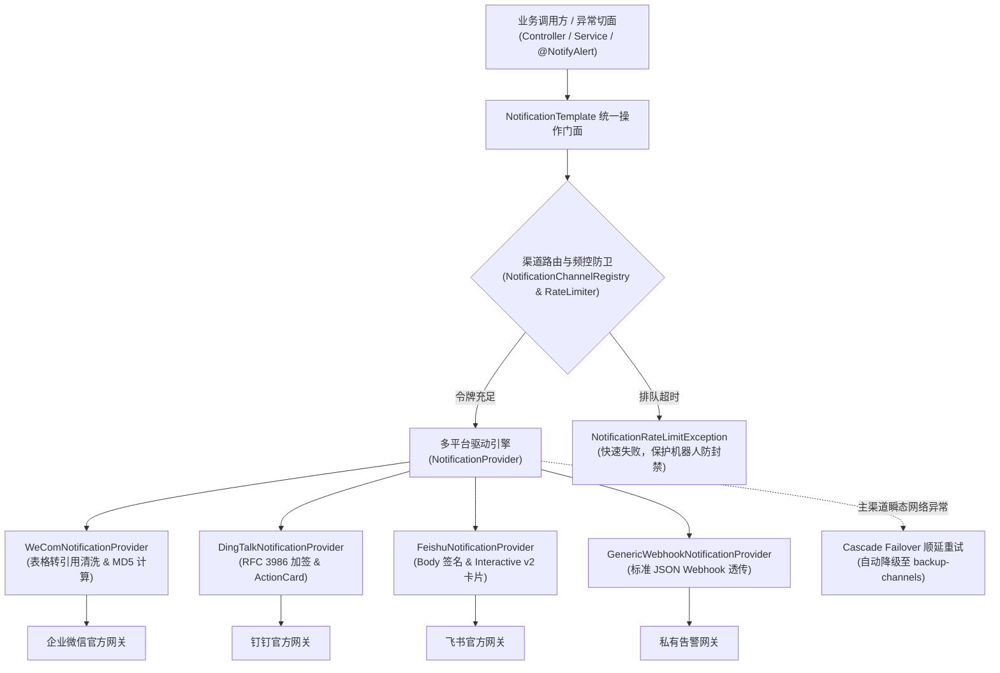

# ateng-boot-notification 协同机器人通知底座 Starter

> 面向生产就绪的 Spring Boot 3 企业协同与多端 Webhook 机器人通知基础设施 Starter。坚持纯原生零臃肿依赖与显式强类型契约设计，提供钉钉、企业微信、飞书与通用 Webhook 统一推送、统一跨平台交互卡片智能自适应转译、一等公民图文链接模型、客户端主动滑动窗口频控与飞书突发令牌治理、主备渠道顺延故障转移（Cascade Failover）、受管异步线程池四维上下文透传、本地事务感知安全发信（`sendAfterCommit` 防幽灵通知）、多命名渠道动态切源以及声明式 `@NotifyAlert` 异常告警切面与三阶防风暴聚合抑制引擎。

---

## 0. 特性与公共 API 全景速查矩阵 (Feature & API Panorama Matrix)

| 特性分类 | 特性名称 | 核心门面 / 注解 / SPI | 关键配置项 (`ateng.boot.*`) | 关键 API 签名 / 核心行为 | 锚定验证源头 (*Test / Sample) |
| :--- | :--- | :--- | :--- | :--- | :--- |
| **核心发信门面** | 统一通知协作操作门面 | `NotificationTemplate` | `ateng.boot.notification.default-channel`<br>`ateng.boot.notification.connect-timeout`<br>`ateng.boot.notification.read-timeout` | `send(message)` / `send(channel, message)`；`sendAsync(message)` / `sendAsync(channel, message)`；`sendAfterCommit(message)` / `sendAfterCommit(channel, message)`；`sendTemplate(template, vars)` / `sendTemplate(channel, template, vars)`；`getChannelRegistry()` / `getRateLimiter()` / `getProperties()` | `NotificationTemplateTest`<br>`SampleNotificationIntegrationTest` |
| **五阶消息模型** | 跨端统一消息领域抽象 | `NotificationMessage`<br>`TextMessage`<br>`MarkdownMessage`<br>`CardMessage`<br>`ImageMessage`<br>`LinkMessage`<br>`RawMessage` | - | 继承自 `NotificationMessage`，链式绑定 `channel(name)` 与 `mention(target)`；`TextMessage.of(content)`；`MarkdownMessage.of(title, content)`；`CardMessage`: `title(t)` / `content(c)` / `headerColor(color)` / `btnOrientation(o)` / `button(btn)` / `mainImageUrl(url)`；`ImageMessage`: `ofBase64(b64, md5)` / `fromFile(file)` / `fromPath(path)` / `fromInputStream(stream)` / `fromStream(stream)`（标配零字节卫语句防卫）；`LinkMessage.of(title, text, messageUrl, picUrl)`；`RawMessage.of(json)` | `NotificationMessageTest`<br>`LinkMessageTest`<br>`ImageMessageTest`<br>`SampleNotificationIntegrationTest` |
| **统一@人抽象** | 跨平台 @人 与提醒领域模型 | `MentionTarget` | - | `MentionTarget.all()` 触发群 `@所有人`；`MentionTarget.ofMobiles(String...)` 按手机号 `@成员`；`MentionTarget.ofUserIds(String...)` 按工号/OpenID `@成员`；内部维护无序去重 `LinkedHashSet` 并由平台适配器智能映射 | `NotificationMessageTest`<br>`SampleNotificationIntegrationTest` |
| **跨端卡片转译** | 交互卡片多平台自适应转译 | `CardButton`<br>`CardColor`<br>`CardButtonOrientation`<br>`NotificationPayloadBuilders` | - | `CardButton.of(text, url)` / `primary(text, url)` / `danger(text, url)`；`CardColor` 提供 10 色工业主题枚举（含飞书官方 `WATHET` 浅蓝与警示 `RED`）；`CardButtonOrientation`（`VERTICAL("0")`、`HORIZONTAL("1")`）映射钉钉/飞书按钮排版；各平台 PayloadBuilder 自适应转译为 ActionCard、TemplateCard、Interactive Card v2 或通用 Webhook | `DingTalkPayloadBuilderTest`<br>`WeComPayloadBuilderTest`<br>`FeishuPayloadBuilderTest`<br>`GenericPayloadBuilderTest`<br>`SampleNotificationIntegrationTest` |
| **图文链接模型** | 跨平台图文链接自适应转译 | `LinkMessage`<br>`DingTalkPayloadBuilder`<br>`WeComPayloadBuilder`<br>`FeishuPayloadBuilder` | - | 跨端自适应映射：钉钉原生 `link` 消息（`title`/`text`/`messageUrl`/`picUrl`）、企业微信原生 `news` 单图文（`articles`）以及飞书官方交互式图文卡片（`interactive` + 顶层图片 + 跳转操作按钮）与通用 Webhook JSON 载荷 | `LinkMessageTest`<br>`SampleNotificationIntegrationTest` |
| **企微格式清洗** | 企微 Markdown 表格降级清洗 | `WeComMarkdownSanitizer` | - | `sanitize(String markdown)`：识别企微官方 Markdown 不支持原生表格的缺陷，自动将 GFM 表格正则解构重排为结构化优雅引用块（`> **列名**: 值`），清洗不兼容标签，防御格式破坏 | `WeComMarkdownSanitizerTest`<br>`SampleNotificationIntegrationTest` |
| **渠道管理中心** | 线程安全多命名渠道注册中心 | `NotificationChannel`<br>`NotificationChannelRegistry` | `ateng.boot.notification.channels.*.platform`<br>`ateng.boot.notification.channels.*.webhook`<br>`ateng.boot.notification.channels.*.secret`<br>`ateng.boot.notification.channels.*.backup-channels`<br>`ateng.boot.notification.channels.*.burst-permits-per-second` | `NotificationChannel`: 强类型配置模型，封装 webhook、secret、connectTimeout、readTimeout、permitsPerMinute、burstPermitsPerSecond、backupChannels；`NotificationChannelRegistry`: `register(channel)` / `unregister(name)` / `get(name)` / `size()` / `getAll()`，静态预热加动态 SPI 混合驱动 | `NotificationChannelRegistryTest`<br>`SampleNotificationIntegrationTest` |
| **主备故障转移** | 多级主备渠道顺延降级容灾 | `NotificationTemplate`<br>`isTransientException` | `ateng.boot.notification.channels.*.backup-channels` | 智能分类瞬态异常（网络超时、连接拒绝、HTTP 5xx）与致命异常（配置缺失、凭据非法、HTTP 4xx）；主渠道瞬态故障时自动按 `backup-channels` 顺延降级重试；全链路耗尽保留完整因果链抛出受控业务异常 | `NotificationTemplateTest`<br>`SampleNotificationIntegrationTest` |
| **动态切源上下文**| 线程级通知渠道动态路由上下文 | `NotificationContextHolder` | - | `getChannel()` / `setChannel(name)` / `clear()`；`runWithChannel(name, runnable)` 与 `callWithChannel(name, callable)` 支持上下文多层深度嵌套并在 `finally` 块中严格恢复前驱现场，防线程污染 | `NotificationContextHolderTest`<br>`SampleNotificationIntegrationTest` |
| **动态渠道供给** | 外部介质渠道懒加载扩展 SPI | `NotificationChannelProvider` | - | `loadChannel(String channelName)`：支持业务按需从数据库、配置中心等介质懒加载渠道并自动写入注册表缓存 | `NotificationChannelRegistryTest`<br>`SampleNotificationIntegrationTest` |
| **动态渠道解析** | 运行时环境与租户推导 SPI | `NotificationChannelResolver` | - | `resolveChannelName()`：支持根据当前多租户、灰度标签或组织架构上下文动态解析路由渠道名称，无侵入重定向发信目标 | `NotificationChannelRegistryTest` |
| **客户端滑窗限流**| 滑动窗口频控与微退避治理 | `NotificationRateLimiter`<br>`InMemoryNotificationRateLimiter` | `ateng.boot.notification.rate-limit.enabled`<br>`ateng.boot.notification.rate-limit.max-wait-duration`<br>`ateng.boot.notification.default-feishu-burst-permits`<br>`ateng.boot.notification.channels.*.permits-per-minute`<br>`ateng.boot.notification.channels.*.burst-permits-per-second` | 契约 `tryAcquire(channel, maxWaitDuration)`；基线默认值：钉钉 20条/分、企微 20条/分、飞书 100条/分、通用 60条/分；飞书突发令牌桶弹性调优（`defaultFeishuBurstPermits` 默认 5）或渠道级 `burst-permits-per-second`；令牌耗尽时执行微退避排队等待，超时 Fail-Fast 阻断网络外呼，坚决杜绝触发官方 10 分钟拉黑封禁 | `InMemoryNotificationRateLimiterTest`<br>`NotificationPropertiesTest` |
| **声明式告警切面**| AOP 异常告警拦截与全链路采集 | `@NotifyAlert`<br>`NotifyAlertAspect` | `ateng.boot.notification.alert.enabled`<br>`ateng.boot.notification.alert.default-channel`<br>`ateng.boot.notification.alert.suppress-window`<br>`ateng.boot.notification.alert.include-args`<br>`ateng.boot.notification.alert.desensitize-keys` | 标注于类或方法；自动采集 MDC `traceId`、用户 ID、Top 10 精简堆栈；基于敏感关键字对方法入参 JSON 实施掩码脱敏；支持 `ignoreExceptions` 白名单跳过与 `includeExceptions` 定向捕获 | `NotifyAlertAspectTest`<br>`SampleNotificationIntegrationTest` |
| **防风暴聚合抑制**| 三阶防告警风暴聚合抑制引擎 | `AlertStormSuppressor`<br>`AlertContext` | `ateng.boot.notification.alert.suppress-window` | 算法 $\text{MD5}(\text{Exception} + ":" + \text{RootCause} + ":" + \text{Method} + ":" + \text{Line})$ 无碰撞指纹归因；三阶抗洪：阶段一首发即时推送红色卡片，阶段二窗口期原子计数拦截，阶段三到期补发橙色聚合汇总卡片；在高并发 500+ 瞬时异常下平稳抗洪 | `AlertStormSuppressorTest`<br>`SampleNotificationIntegrationTest` |
| **受管异步发信** | 四维上下文无损透传异步发信 | `NotificationTemplate`<br>`notificationTaskExecutor` | `ateng.boot.notification.async.enabled`<br>`ateng.boot.notification.async.core-pool-size`<br>`ateng.boot.notification.async.max-pool-size`<br>`ateng.boot.notification.async.queue-capacity`<br>`ateng.boot.notification.async.keep-alive` | 接入 Core 受管线程池 `notificationTaskExecutor`；`sendAsync` 返回 `CompletableFuture<NotificationSendResult>`；依托任务装饰器全链路无损透传 $\langle\text{MDC}, \text{User}, \text{TenantId}, \text{IgnoreTenant}\rangle$ | `AtengNotificationAutoConfigurationTest`<br>`SampleNotificationIntegrationTest` |
| **事务感知发信** | 事务提交后发信（防幽灵通知）| `NotificationTemplate`<br>`TransactionSynchronization` | - | `sendAfterCommit(message)` / `sendAfterCommit(channel, message)`：挂载 Spring 物理事务同步器，仅在数据库事务成功 commit 后外呼发信；事务回滚自动取消，彻底根除幽灵通知 | `NotificationTemplateTest`<br>`SampleNotificationIntegrationTest` |
| **加签安全认证** | 出站请求自动加签与权威转译 | `NotificationSignUtil`<br>`DingTalkPayloadBuilder` | - | `signDingTalk(secret, timestamp)` 遵循 RFC 3986 规范（`%20`、`%2A`、`~` 转译）；`signFeishu(secret, timestamp)`（Body HMAC-SHA256 Base64）；`signHmacSha256Hex(secret, content)` 支持通用 Webhook 加签头 | `NotificationSignUtilTest`<br>`DingTalkPayloadBuilderTest` |
| **机密审计脱敏** | 凭据与敏感字段 100% 审计脱敏 | `NotificationDesensitizeUtil`<br>`WeComPayloadBuilder` | - | 企微误配 `secret` 自动净化剔除（防 40058 异常）；`maskWebhook(url)` 自动掩码 Token/Key；`maskSecret(secret)` 打星号；日志与 `toString()` 中 100% 安全掩码，杜绝机密泄露至运维日志或外发报文 | `NotificationDesensitizeUtilTest`<br>`WeComPayloadBuilderTest` |
| **失败降级补偿** | 发信失败补偿处理器 SPI | `NotificationSendFailureHandler` | - | `onFailure(channel, message, throwable)`：在受管异步或事务后发信失败时触发，支持接入死信落库、报警调度或多通道降级 | `SampleNotificationSendFailureHandler`<br>`SampleNotificationIntegrationTest` |
| **动态模板渲染** | 模板解耦动态发信 SPI | `NotificationTemplateRenderer`<br>`SimpleNotificationTemplateRenderer` | - | `render(templateName, variables)`：默认内联占位符解析，支持无缝扩展替换为 Thymeleaf 或 FreeMarker 引擎 | `NotificationTemplateTest`<br>`SampleNotificationIntegrationTest` |
| **驱动通信门面** | 平台通信驱动底层 SPI | `NotificationProvider`<br>`AbstractNotificationProvider` | - | 内置 `DingTalkNotificationProvider`、`WeComNotificationProvider`、`FeishuNotificationProvider`、`GenericWebhookNotificationProvider`，统一耗时度量与异常因果链传递 | `DingTalkNotificationProviderIntegrationTest`<br>`WeComNotificationProviderIntegrationTest` |
| **因果异常体系** | 语义化异常与统一业务错误码 | `NotificationException`<br>`NotificationResultCode` | - | 转译网络超时、签名失败、频控拦截为语义化业务异常并保留完整原始 `cause`；统一状态码 `NOTIFICATION_SEND_ERROR(5701)` 至 `NOTIFICATION_RATE_LIMIT_EXCEEDED(5704)`、`NOTIFICATION_CHANNEL_NOT_FOUND(5705)` 等 | `NotificationExceptionTest` |

---

## 1. 模块定位与快速起步 (Quick Start)

### 1.1 模块定位与核心设计哲学
`ateng-boot-notification` 是面向企业级生产环境的工业级群机器人协同与告警通知 Starter：
- **纯原生零臃肿**：基于 JDK 17 原生能力与 Spring 6 `RestClient` 构建，严禁引入第三方臃肿 SDK；
- **显式强类型契约**：发信出参统一采用强类型 `NotificationSendResult`，Controller 边界 100% 严禁暴露 ORM 实体，统一使用专用 DTO/Request 与 `Result<T>`；
- **全链路追踪与无状态设计**：MDC `traceId` 深度透传至每次发信与告警卡片；受管线程池驱动，所有公共服务与单例保持严格无状态。

### 1.2 Maven 依赖引入
在业务模块的 `pom.xml` 中引入（版本由 `ateng-boot-bom` 统一纳管，免配 `<version>`）：

```xml
<dependency>
    <groupId>io.github.atengk</groupId>
    <artifactId>ateng-boot-notification</artifactId>
</dependency>
```

若需使用声明式 `@NotifyAlert` 异常告警切面拦截，需确保类路径包含 Spring AOP（Web 场景或 `spring-boot-starter-aop` 默认包含）：
```xml
<dependency>
    <groupId>org.springframework.boot</groupId>
    <artifactId>spring-boot-starter-aop</artifactId>
</dependency>
```

### 1.3 极简可用配置 (application.yml)
```yaml
ateng:
  boot:
    notification:
      enabled: true
      default-channel: ops-alert
      channels:
        ops-alert:
          platform: wecom
          webhook: https://qyapi.weixin.qq.com/cgi-bin/webhook/send?key=YOUR_WECOM_KEY
```

### 1.4 极简实战代码
```java
@Service
@RequiredArgsConstructor
public class QuickStartNotificationService {

    private final NotificationTemplate notificationTemplate;

    public void sendQuickNotice() {
        TextMessage message = new TextMessage("【系统通报】服务已平稳启动，所有健康检查通过！");
        NotificationSendResult result = notificationTemplate.send(message);
        log.info("发信完成: channel={}, success={}", result.getChannel(), result.isSuccess());
    }
}
```

---

## 2. 核心架构与设计不变量 (Architecture Invariants)



### 核心设计不变量
1. **Zero-Entity-Leakage 传输实体零泄漏**：Controller 层严格禁止直接接收或返回持久层实体，统一使用入参 DTO 与强类型 `Result<T>`；
2. **内存真明文与凭证脱敏**：出站 Webhook URL 中的 Token、Secret 在日志输出与 `toString()` 中自动打星号脱敏；企微误配 `secret` 自动净化剔除（防 40058 异常）；
3. **因果保留与驱动解耦**：底层 HTTP 与签名异常统一转译为 `NotificationException` 并 100% 携带原始底层 `cause`，严禁吞咽异常。

---

## 3. 多模态消息与富文本卡片套件 (Multi-Modal & Card Suite)

### 3.1 纯文本与 @提及 (TextMessage & MentionTarget)

#### 专属 YAML 配置片段
```yaml
ateng:
  boot:
    notification:
      default-channel: ops-alert
      channels:
        ops-alert:
          platform: wecom
          webhook: https://qyapi.weixin.qq.com/cgi-bin/webhook/send?key=YOUR_WECOM_KEY
```

#### 实战 Java 代码 (1:1 逆向提取自 Sample 源码)
```java
public NotificationSendResult sendText(TextMessageRequest request) {
    TextMessage message = new TextMessage(request.getContent());
    MentionTarget mentionTarget = buildMentionTarget(request.getAtAll(), request.getAtMobiles(), request.getAtUserIds());
    if (mentionTarget != null) {
        message.setMention(mentionTarget);
    }
    return notificationTemplate.send(request.getChannel(), message);
}
```

#### 核心机制与边界说明
- `MentionTarget` 内部使用无序去重 `LinkedHashSet` 维护成员手机号或工号，底层驱动自适应转译为厂商专有字段（企微 `mentioned_mobile_list`、钉钉 `atMobiles`、飞书 `<at user_id="...">`）；
- 支持 `atAll=true` 触发群全员提醒，空提及目标安全忽略。

---

### 3.2 富文本 Markdown 与微信标题清洗转译 (MarkdownMessage & WeComMarkdownSanitizer)

#### 专属 YAML 配置片段
```yaml
ateng:
  boot:
    notification:
      channels:
        ops-alert:
          platform: wecom
          webhook: https://qyapi.weixin.qq.com/cgi-bin/webhook/send?key=YOUR_WECOM_KEY
```

#### 实战 Java 代码 (1:1 逆向提取自 Sample 源码)
```java
public NotificationSendResult sendMarkdown(MarkdownMessageRequest request) {
    MarkdownMessage message = new MarkdownMessage(request.getTitle(), request.getContent());
    MentionTarget mentionTarget = buildMentionTarget(request.getAtAll(), request.getAtMobiles(), request.getAtUserIds());
    if (mentionTarget != null) {
        message.setMention(mentionTarget);
    }
    return notificationTemplate.send(request.getChannel(), message);
}
```

#### 核心机制与边界说明
- 企业微信官方群机器人 Markdown 解析引擎不支持 GFM 管道表格语法（`| a | b |`），直接推送会导致表格符号严重错位与排版破损；
- `WeComMarkdownSanitizer` 在发送前自动拦截并提取表格头与行数据，平滑转译为优雅的 Markdown 引用块（`> **列名**: 值`），确保企业微信与钉钉、飞书跨端排版一致。

---

### 3.3 多色互动卡片与横纵排版 (CardMessage, CardColor, CardButtonOrientation)

#### 专属 YAML 配置片段
```yaml
ateng:
  boot:
    notification:
      channels:
        ops-alert:
          platform: wecom
          webhook: https://qyapi.weixin.qq.com/cgi-bin/webhook/send?key=YOUR_WECOM_KEY
```

#### 实战 Java 代码 (1:1 逆向提取自 Sample 源码)
```java
public NotificationSendResult sendCard(CardMessageRequest request) {
    CardColor color = request.getHeaderColor() != null ? request.getHeaderColor() : CardColor.BLUE;
    CardMessage message = new CardMessage();
    message.setTitle(request.getTitle());
    message.setContent(request.getContent());
    message.setHeaderColor(color);

    if (request.getBtnOrientation() != null) {
        message.btnOrientation(request.getBtnOrientation());
    }

    if (request.getButtons() != null && !request.getButtons().isEmpty()) {
        for (CardMessageRequest.CardButtonItemRequest btn : request.getButtons()) {
            if (btn != null && StringUtils.hasText(btn.getTitle()) && StringUtils.hasText(btn.getUrl())) {
                CardButton cardButton = (btn.getType() != null)
                        ? CardButton.of(btn.getTitle(), btn.getUrl(), btn.getType())
                        : CardButton.of(btn.getTitle(), btn.getUrl());
                message.button(cardButton);
            }
        }
    }
    return notificationTemplate.send(request.getChannel(), message);
}
```

#### 核心机制与边界说明
- `CardColor` 预置 10 色工业主题，全面支持警示 `RED` 与飞书官方 `WATHET` 浅蓝；
- `CardButtonOrientation`（`VERTICAL` 纵向、`HORIZONTAL` 横向）自适应映射钉钉 `btnOrientation` 与飞书按钮排列布局，自动转译为企业微信 TemplateCard 与飞书 Interactive Card v2。

---

### 3.4 图文链接消息跨端自适应 (LinkMessage)

#### 专属 YAML 配置片段
```yaml
ateng:
  boot:
    notification:
      channels:
        dingtalk-dev:
          platform: dingtalk
          webhook: https://oapi.dingtalk.com/robot/send?access_token=YOUR_DINGTALK_TOKEN
          secret: SEC_YOUR_DINGTALK_SECRET
```

#### 实战 Java 代码 (1:1 逆向提取自 Sample 源码)
```java
public NotificationSendResult sendLink(LinkMessageRequest request) {
    LinkMessage message = LinkMessage.of(
            request.getTitle(),
            request.getText(),
            request.getMessageUrl(),
            request.getPicUrl()
    );
    return notificationTemplate.send(request.getChannel(), message);
}
```

#### 核心机制与边界说明
- 图文链接是一等公民模型，跨平台自动映射为：钉钉原生 `link` 消息、企业微信原生 `news` 单图文卡片（`articles`）以及飞书官方交互式图文卡片，杜绝平台割裂。

---

### 3.5 本地/Base64 图片消息安全防卫 (ImageMessage)

#### 专属 YAML 配置片段
```yaml
ateng:
  boot:
    notification:
      channels:
        ops-alert:
          platform: wecom
          webhook: https://qyapi.weixin.qq.com/cgi-bin/webhook/send?key=YOUR_WECOM_KEY
```

#### 实战 Java 代码 (1:1 逆向提取自 Sample 源码)
```java
public NotificationSendResult sendImage(ImageMessageRequest request) {
    ImageMessage message;
    if (StringUtils.hasText(request.getImagePath())) {
        Path path = Path.of(request.getImagePath());
        message = ImageMessage.fromPath(path);
    } else {
        message = ImageMessage.ofBase64(request.getBase64(), request.getMd5());
    }
    return notificationTemplate.send(request.getChannel(), message);
}
```

#### 核心机制与边界说明
- 内置零字节防卫与文件路径安全校验；支持自动读取二进制流并计算 MD5 摘要；针对企微 `image` 消息严格自动组装 Base64 与 MD5 字段。

---

### 3.6 原生特化 Raw 报文透传逃生舱 (RawMessage)

#### 专属 YAML 配置片段
```yaml
ateng:
  boot:
    notification:
      channels:
        dingtalk-dev:
          platform: dingtalk
          webhook: https://oapi.dingtalk.com/robot/send?access_token=YOUR_DINGTALK_TOKEN
```

#### 实战 Java 代码 (1:1 逆向提取自 Sample 源码)
```java
public NotificationSendResult sendRaw(RawMessageRequest request) {
    RawMessage message = RawMessage.of(request.getRawJson());
    return notificationTemplate.send(request.getChannel(), message);
}
```

#### 核心机制与边界说明
- 当厂商推出特化或试验性报文结构时，`RawMessage` 充当官方逃生舱，直接绕过领域模型将原生 JSON 载荷透传至群机器人。

---

## 4. 命名渠道拓扑与高可用容灾套件 (Channel Topology & Failover)

### 4.1 多命名渠道注册与上下文动态切源 (NotificationChannel & NotificationContextHolder)

#### 专属 YAML 配置片段
```yaml
ateng:
  boot:
    notification:
      default-channel: ops-alert
      channels:
        ops-alert:
          platform: wecom
          webhook: https://qyapi.weixin.qq.com/cgi-bin/webhook/send?key=YOUR_WECOM_KEY
        dingtalk-dev:
          platform: dingtalk
          webhook: https://oapi.dingtalk.com/robot/send?access_token=YOUR_DINGTALK_TOKEN
```

#### 实战 Java 代码 (1:1 逆向提取自 Sample 源码)
```java
public NotificationSendResult sendWithTemporaryChannel(ChannelSwitchRequest request) {
    TextMessage message = new TextMessage(request.getContent());
    return NotificationContextHolder.callWithChannel(request.getTemporaryChannel(), () ->
            notificationTemplate.send(message)
    );
}
```

#### 核心机制与边界说明
- `NotificationContextHolder` 维护线程局部变量，支持多层深度嵌套调用，并在 `finally` 块中严格还原前驱现场，杜绝多线程环境下的渠道污染。

---

### 4.2 级联顺延故障转移容灾 (Cascade Failover & isTransientException)

#### 专属 YAML 配置片段
```yaml
ateng:
  boot:
    notification:
      channels:
        sample-failover-primary:
          platform: generic
          webhook: http://127.0.0.1:9/invalid-failover-endpoint
          backup-channels:
            - feishu-ops
            - dingtalk-dev
```

#### 实战 Java 代码 (1:1 逆向提取自 Sample 源码)
```java
public NotificationSendResult sendWithFailover(FailoverDemoRequest request) {
    CardMessage card = CardMessage.of(request.getTitle(), request.getContent())
            .headerColor(CardColor.YELLOW);
    return notificationTemplate.send(request.getPrimaryChannel(), card);
}
```

#### 核心机制与边界说明
- `isTransientException` 精准识别网络超时、连接拒绝、DNS 解析失败与 HTTP 5xx 状态码；
- 发生瞬态故障时自动按 `backup-channels` 有序链表顺延重试；遇到 4xx 业务鉴权失败立即阻断熔断，避免污染备用通道。

---

### 4.3 动态插值模板消息渲染 (NotificationTemplateRenderer)

#### 专属 YAML 配置片段
```yaml
ateng:
  boot:
    notification:
      channels:
        dingtalk-dev:
          platform: dingtalk
          webhook: https://oapi.dingtalk.com/robot/send?access_token=YOUR_DINGTALK_TOKEN
```

#### 实战 Java 代码 (1:1 逆向提取自 Sample 源码)
```java
public NotificationSendResult sendTemplateMessage(TemplateMessageRequest request) {
    return notificationTemplate.sendTemplate(
            request.getChannel(),
            request.getTemplateName(),
            request.getVariables()
    );
}
```

#### 核心机制与边界说明
- 内置 `SimpleNotificationTemplateRenderer`，支持 `${variable}` 格式极简占位符替换，解耦业务代码与通知模版文案。

---

## 5. 客户端通道频控与安全加签套件 (Rate Limiting & Security Signing)

### 5.1 平台差异化滑动窗口频控与飞书突发令牌 (InMemoryNotificationRateLimiter)

#### 专属 YAML 配置片段
```yaml
ateng:
  boot:
    notification:
      default-feishu-burst-permits: 5
      rate-limit:
        enabled: true
        max-wait-duration: 2s
      channels:
        ops-alert:
          permits-per-minute: 20
        feishu-ops:
          permits-per-minute: 100
          burst-permits-per-second: 10
```

#### 实战 Java 代码
```java
// 门面发信前自动执行客户端通道频控拦截
NotificationSendResult result = notificationTemplate.send("ops-alert", message);
```

#### 核心机制与边界说明
- 钉钉与企微限制每分钟最多 20 条，超额将触发官方 **10 分钟封禁**；
- 单机内存滑动窗口限流器在 `max-wait-duration` 内执行纳秒级微退避排队；排队超时抛出 `NotificationRateLimitException` 快速失败；通过 `defaultFeishuBurstPermits` 弹性支持突发流量。

---

### 5.2 钉钉与飞书 HMAC-SHA256 安全加签 (RFC 3986 权威编码)

#### 专属 YAML 配置片段
```yaml
ateng:
  boot:
    notification:
      channels:
        dingtalk-dev:
          platform: dingtalk
          webhook: https://oapi.dingtalk.com/robot/send?access_token=YOUR_DINGTALK_TOKEN
          secret: SEC_YOUR_DINGTALK_SECRET
        feishu-ops:
          platform: feishu
          webhook: https://open.feishu.cn/open-apis/bot/v2/hook/YOUR_FEISHU_TOKEN
          secret: SEC_YOUR_FEISHU_SECRET
```

#### 实战 Java 代码
```java
// 平台驱动引擎在发起 HTTP 外呼时全自动完成密钥计算与加签
NotificationSendResult result = notificationTemplate.send("dingtalk-dev", message);
```

#### 核心机制与边界说明
- 钉钉签名计算遵循 RFC 3986 规范（`%20`、`%2A`、`~` 转译），彻底解决时间戳与签名不匹配问题；
- 飞书自动计算 Body HMAC-SHA256 签名注入报文；企微无签名机制，误配 `secret` 自动净化剔除。

---

## 6. 生产可靠性与异常告警套件 (Reliability & Alert Storm Suite)

### 6.1 事务感知防幽灵通知 (sendAfterCommit)

#### 专属 YAML 配置片段
```yaml
ateng:
  boot:
    notification:
      default-channel: ops-alert
```

#### 实战 Java 代码 (1:1 逆向提取自 Sample 源码)
```java
@Transactional
public NotificationSendResult sendAfterCommit(TextMessageRequest request) {
    log.info("执行订单入库等持久化本地事务...");
    TextMessage message = new TextMessage(request.getContent());
    return notificationTemplate.sendAfterCommit(request.getChannel(), message);
}
```

#### 核心机制与边界说明
- 挂载 Spring `TransactionSynchronization` 物理事务同步器；仅在数据库事务物理提交后触发网络调用；事务回滚自动取消，100% 杜绝“数据未入库但通知已发出”的幽灵通知。

---

### 6.2 受管线程池非阻塞异步发信 (sendAsync)

#### 专属 YAML 配置片段
```yaml
ateng:
  boot:
    notification:
      async:
        enabled: true
        core-pool-size: 2
        max-pool-size: 8
        queue-capacity: 200
        keep-alive: 60s
```

#### 实战 Java 代码 (1:1 逆向提取自 Sample 源码)
```java
public CompletableFuture<NotificationSendResult> sendAsync(TextMessageRequest request) {
    TextMessage message = new TextMessage(request.getContent());
    return notificationTemplate.sendAsync(request.getChannel(), message);
}
```

#### 核心机制与边界说明
- 接入 `ateng-boot-core` 受管线程池 `notificationTaskExecutor`，返回 `CompletableFuture`，无锁透传 MDC `traceId` 快照并在异步线程执行完毕后自动清理。

---

### 6.3 声明式 `@NotifyAlert` 异常告警拦截与敏感脱敏 (NotifyAlertAspect)

#### 专属 YAML 配置片段
```yaml
ateng:
  boot:
    notification:
      alert:
        enabled: true
        default-channel: ops-alert
        suppress-window: 10s
        include-args: true
        desensitize-keys:
          - password
          - secret
          - token
          - credential
```

#### 实战 Java 代码 (1:1 逆向提取自 Sample 源码)
```java
@NotifyAlert(
        channel = "ops-alert",
        title = "订单履约业务未捕获异常",
        suppressWindow = 10,
        includeArgs = true,
        ignoreExceptions = {IllegalArgumentException.class}
)
public String processOrder(AlertTriggerRequest request) {
    log.info("Processing order: orderId={}", request.getOrderId());

    if ("npe".equalsIgnoreCase(request.getErrorType())) {
        throw new NullPointerException("订单数据不存在，支付渠道回调发生空指针异常！");
    }
    return "订单 " + request.getOrderId() + " 履约成功";
}
```

#### 核心机制与边界说明
- AOP 拦截未受控异常，提取 MDC `traceId` 与 Top 10 精简堆栈；
- 基于 `desensitize-keys` 正则，将入参中的 `password`、`token` 等机密字段自动打星号脱敏（`"******"`），彻底消除凭据外泄风险。

---

### 6.4 AlertStormSuppressor 三阶防风暴聚合抗洪引擎

#### 专属 YAML 配置片段
```yaml
ateng:
  boot:
    notification:
      alert:
        enabled: true
        suppress-window: 2s
```

#### 实战 Java 代码 (1:1 逆向提取自 Sample 源码)
```java
public AlertStormSummaryVO simulateStorm(AlertStormSuppressRequest request) {
    int count = (request.getCount() != null && request.getCount() > 0) ? request.getCount() : 10;
    OrderAlertScenarioService self = selfProvider.getIfAvailable(() -> this);

    List<CompletableFuture<Void>> futures = new ArrayList<>(count);
    for (int i = 0; i < count; i++) {
        final int index = i;
        futures.add(CompletableFuture.runAsync(() -> {
            AlertStormSuppressRequest itemReq = new AlertStormSuppressRequest();
            itemReq.setOrderId(request.getOrderId() + "-" + index);
            itemReq.setPassword(request.getPassword());
            self.triggerStormOrder(itemReq);
        }));
    }
    CompletableFuture.allOf(futures.toArray(new CompletableFuture[0])).join();
    // 聚合统计并返回摘要视图
    ...
}
```

#### 核心机制与边界说明
- 确定性指纹归因算法：
  $$\text{Fingerprint} = \text{MD5}(\text{Exception} + ":" + \text{RootCause} + ":" + \text{Method} + ":" + \text{Line})$$
- **三阶抗洪机制**：
  1. **首发即时推送**：立即推送红色紧急告警卡片；
  2. **窗口期原子计数拦截**：窗口期内重复异常执行静默拦截，原子计数累加，0 网络外呼；
  3. **期末异步补发汇总**：窗口到期由调度器异步补发橙色聚合汇总卡片，并在 500+ 高并发异常下平稳抗洪。

---

## 7. 生产扩展接管与核心非功能边界 (Customization & Extensibility)

### 7.1 扩展点一：实现 `NotificationChannelProvider` 外部介质渠道供给 SPI
支持在后台动态添加或修改机器人配置，无需重启应用：

```java
@Component
public class DatabaseNotificationChannelProvider implements NotificationChannelProvider {

    @Override
    public NotificationChannel loadChannel(String channelName) {
        // 从数据库或外部配置中心懒加载渠道配置
        return NotificationChannel.builder()
                .name(channelName)
                .platform(Platform.WECOM)
                .webhook("https://qyapi.weixin.qq.com/cgi-bin/webhook/send?key=DYNAMIC_KEY")
                .build();
    }
}
```

### 7.2 扩展点二：实现 `NotificationChannelResolver` 动态渠道路由推导 SPI
根据当前租户或灰度上下文动态推导发信目标渠道：

```java
@Component
public class TenantAwareNotificationChannelResolver implements NotificationChannelResolver {

    @Override
    public String resolveChannelName() {
        String tenantId = TenantContextHolder.getTenantId();
        if (tenantId != null && !tenantId.isBlank()) {
            return "tenant-" + tenantId + "-robot";
        }
        return null;
    }
}
```

### 7.3 扩展点三：实现 `NotificationSendFailureHandler` 发信失败降级补偿 SPI
在异步或事务后发信失败时触发业务补偿：

```java
@Component
@Slf4j
public class SampleNotificationSendFailureHandler implements NotificationSendFailureHandler {

    @Override
    public void onFailure(NotificationChannel channel, NotificationMessage message, Throwable throwable) {
        log.warn("SampleNotificationSendFailureHandler: 捕获通知发信失败补偿事件 [channel={}, msgType={}, error={}]",
                channel != null ? channel.getName() : "unknown",
                message != null ? message.getMsgType() : "unknown",
                throwable.getMessage());
        // 生产实践：落库重试死信表、触发 SMS 报警或备用告警调度
    }
}
```

### 7.4 核心非功能边界与防 Pinning 规范
- **虚拟线程友好与防 Carrier Pinning**：内部全部锁机制与状态管理均基于无锁并发容器（`ConcurrentHashMap`、`AtomicInteger`），杜绝 `synchronized` 代码块，完全兼容 JDK 21+ 虚拟线程运行时；
- **全链路保真与异常审计**：网络通信与序列化故障保留完整因果链，严禁吞咽异常。

---

## 8. 完整 YAML 配置属性清单 (Configuration Properties Appendix)

```yaml
ateng:
  boot:
    notification:
      # 是否启用协同机器人通知功能 (默认: true)
      enabled: true
      # 默认通知发信渠道名称 (未指定 channel 时生效)
      default-channel: ops-alert
      # HTTP 物理连接超时时间 (默认: 3s)
      connect-timeout: 3s
      # HTTP 物理读取超时时间 (默认: 5s)
      read-timeout: 5s
      # 飞书平台默认突发令牌桶弹性配额 (默认: 5)
      default-feishu-burst-permits: 5
      # 多命名渠道注册表
      channels:
        ops-alert:
          # 平台驱动类型: wecom, dingtalk, feishu, generic
          platform: wecom
          # 机器人 Webhook 完整 URL
          webhook: https://qyapi.weixin.qq.com/cgi-bin/webhook/send?key=YOUR_WECOM_KEY
          # 加签签名密钥 (钉钉以 SEC 开头, 飞书签名密钥; 企微无需配置)
          secret: ""
          # 渠道独立连接超时
          connect-timeout: 3s
          # 渠道独立读取超时
          read-timeout: 5s
          # 客户端限流: 每分钟允许最大发信次数
          permits-per-minute: 20
          # 渠道独立突发令牌桶每秒补充配额
          burst-permits-per-second: 0
          # 主备顺延故障转移有序备用渠道链表
          backup-channels:
            - dingtalk-dev
            - feishu-ops
      # 客户端滑动窗口频控治理配置
      rate-limit:
        # 是否启用频控拦截 (默认: true)
        enabled: true
        # 令牌耗尽时的最大微退避等待时间 (超时抛出 NotificationRateLimitException 快速失败)
        max-wait-duration: 2s
      # 声明式异常告警切面与三阶防风暴配置
      alert:
        # 是否启用 @NotifyAlert 异常告警拦截 (默认: true)
        enabled: true
        # 异常告警默认推送渠道
        default-channel: ops-alert
        # 防告警风暴抑制聚合窗口时间 (默认: 60s)
        suppress-window: 60s
        # 告警卡片是否包含方法入参快照 (默认: true)
        include-args: true
        # 入参脱敏关键字列表 (命中关键字的 JSON 键值将被自动掩码为 ******)
        desensitize-keys:
          - password
          - secret
          - token
          - credential
          - idcard
          - mobile
          - auth
      # 受管异步发信线程池配置
      async:
        # 是否启用异步发信执行器 (默认: true)
        enabled: true
        # 核心线程数 (默认: 2)
        core-pool-size: 2
        # 最大线程数 (默认: 8)
        max-pool-size: 8
        # 等待队列容量 (默认: 200)
        queue-capacity: 200
        # 空闲线程保活时间 (默认: 60s)
        keep-alive: 60s
        # 线程名称前缀
        thread-name-prefix: notif-async-
```
