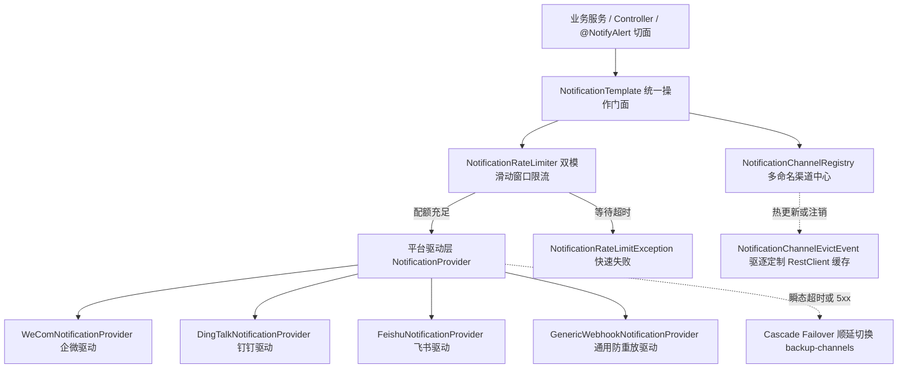

# ateng-boot-notification 协同机器人通知底座 Starter

> 面向生产就绪的 Spring Boot 3 企业协同与多端 Webhook 机器人通知基础设施 Starter。坚持纯原生零臃肿依赖与显式强类型契约设计，提供企业微信、钉钉、飞书与通用自定义 Webhook 统一推送、跨平台交互卡片与图文链接自适应转译、多渠道并发广播与单点故障隔离、单机及 Redis Lua 双滑动窗口分布式频控、主备渠道顺延故障转移（Cascade Failover）、Core 受管线程池四维上下文透传、本地事务感知发信（`sendAfterCommit`）、多命名渠道热更新缓存驱逐以及声明式 `@NotifyAlert` 异常告警切面与三阶防风暴聚合抑制引擎。

---

## 0. 特性与公共 API 全景速查矩阵 (Feature & API Panorama Matrix)

| 特性分类 | 特性名称 | 核心门面 / 注解 / SPI | 关键配置项 (`ateng.boot.*`) | 关键 API 签名 / 核心行为 | 锚定验证源头 (`*Test` / `Sample`) |
| :--- | :--- | :--- | :--- | :--- | :--- |
| **核心发信门面** | 统一通知协作操作门面 | `NotificationOperations`<br>`NotificationTemplate` | `ateng.boot.notification.enabled`<br>`ateng.boot.notification.default-channel`<br>`ateng.boot.notification.connect-timeout`<br>`ateng.boot.notification.read-timeout` | `send(NotificationMessage)` / `send(String, NotificationMessage)`；`sendAsync(NotificationMessage)` / `sendAsync(String, NotificationMessage)`；`sendAfterCommit(NotificationMessage)` / `sendAfterCommit(String, NotificationMessage)`；`sendTemplate(...)`（3 个重载）；`sendBroadcast(Collection<String>, NotificationMessage)` / `sendBroadcastAsync(Collection<String>, NotificationMessage)`；`resolveChannelName(String)`；`getProvider(Platform)`；`getProperties()` / `getChannelRegistry()` / `getRateLimiter()` / `getRestClient()` / `getTemplateRenderer()` / `getFailureHandler()` | `NotificationMessageController`<br>`NotificationChannelController`<br>`NotificationTemplateTest`<br>`SampleNotificationIntegrationTest` |
| **并发广播隔离** | 多渠道并发广播与单点故障隔离 | `NotificationTemplate` | `ateng.boot.notification.connect-timeout`<br>`ateng.boot.notification.read-timeout` | 同步 `sendBroadcast` 与异步 `sendBroadcastAsync`：Fail-Fast 校验消息与渠道集合，清理空白并按首次出现顺序去重返回 `LinkedHashMap<String, NotificationSendResult>`；通过 Core 受管线程池与 `AsyncContext.wrapSupplier` 透传四维快照并在 `finally` 清理；单渠道异常/频控/缺失/超时均隔离为 `NotificationSendResult.failure(...)` | `NotificationChannelController`<br>`NotificationTemplateTest`<br>`SampleNotificationIntegrationTest` |
| **五阶消息模型** | 跨端统一消息领域抽象（含 `RawMessage` 逃生舱） | `NotificationMessage`<br>`TextMessage`<br>`MarkdownMessage`<br>`CardMessage`<br>`ImageMessage`<br>`LinkMessage`<br>`RawMessage`<br>`NotificationSendResult` | `ateng.boot.notification.max-image-size` | 统一基类绑定 `channel(name)` / `mention(target)` / `validate()`；`TextMessage.of(content)`；`MarkdownMessage.of(title, content)`；`CardMessage.of(title, content)`（支持 `headerColor` / `btnOrientation` / `button` / `buttons` / `singleAction` / `isSingleAction` / `mainImageUrl`）；`ImageMessage` 支持 `of` / `ofBase64` / `ofFeishuKey` / `ofUrl` / `fromBytes` / `fromFile` / `fromPath` / `fromInputStream` / `fromStream` / `computeMd5Hex`（默认上限 `DEFAULT_MAX_IMAGE_SIZE` 2MB 与 Base64 解码前预检防 OOM）；`LinkMessage.of(title, text, messageUrl, picUrl)`；`RawMessage.of(json)`；`NotificationSendResult.success(...)` / `failure(...)` | `NotificationMessageController`<br>`NotificationMessageTest`<br>`NotificationSendResultTest`<br>`SampleNotificationIntegrationTest` |
| **统一@人抽象** | 跨平台 `@人` 与提醒领域模型 | `MentionTarget` | - | `MentionTarget.all()` 触发群 `@所有人`；`MentionTarget.ofMobiles(String...)`；`MentionTarget.ofUserIds(String...)`；内部维护有序去重 `LinkedHashSet` 并由各平台适配器自动映射 | `NotificationMessageController`<br>`NotificationMessageTest`<br>`SampleNotificationIntegrationTest` |
| **跨端卡片转译** | 交互卡片与图文链接多端自适应 | `CardButton`<br>`CardColor`<br>`CardButtonOrientation`<br>`CardButtonType`<br>`NotificationPayloadBuilders`<br>`WeComMarkdownSanitizer` | - | `CardButton.of` / `primary` / `danger`；`CardColor` 提供 10 种官方主题色（含飞书官方 `WATHET` 浅天蓝，兼容过时别名 `WATSON`）；`CardButtonOrientation`（`VERTICAL` / `HORIZONTAL`）；`WeComMarkdownSanitizer.sanitize(markdown)` 将 GFM 表格转译为企微安全引用块；企微卡片强制输出必填 `card_action`，钉钉无按钮时补齐 `singleTitle` 与非空 `singleURL` | `NotificationMessageController`<br>`DingTalkPayloadBuilderTest`<br>`WeComPayloadBuilderTest`<br>`FeishuPayloadBuilderTest`<br>`WeComMarkdownSanitizerTest`<br>`SampleNotificationIntegrationTest` |
| **渠道管理中心** | 多命名渠道注册与热更新驱逐 | `NotificationChannel`<br>`NotificationChannelRegistry`<br>`NotificationChannelEvictEvent` | `ateng.boot.notification.channels.*.platform`<br>`ateng.boot.notification.channels.*.webhook`<br>`ateng.boot.notification.channels.*.secret`<br>`ateng.boot.notification.channels.*.connect-timeout`<br>`ateng.boot.notification.channels.*.read-timeout`<br>`ateng.boot.notification.channels.*.permits-per-minute`<br>`ateng.boot.notification.channels.*.burst-permits-per-second`<br>`ateng.boot.notification.channels.*.backup-channels` | `NotificationChannel.fromProperties(name, props)`；`NotificationChannelRegistry` 提供 `register` / `unregister` / `get` / `has` / `getAll` / `clear` / `size` / `addProvider` / `removeProvider` / `addResolver` / `removeResolver` / `resolveDynamicChannel`；同名覆盖或注销发布 `NotificationChannelEvictEvent`，联动驱逐驱动内 `LinkedHashMap` 定制超时 `RestClient` LRU 缓存（容量 256） | `NotificationChannelRegistryTest`<br>`AtengNotificationAutoConfigurationTest` |
| **主备故障转移** | 多级主备渠道顺延降级容灾 | `NotificationTemplate` | `ateng.boot.notification.channels.*.backup-channels` | 识别瞬态异常（网络超时、`SocketException`、HTTP 429 / 5xx、频控异常）按 `backup-channels` 有序链表顺延降级；遇 4xx 业务鉴权失败、参数错误立即熔断；耗尽后聚合完整渠道链路抛出 `NotificationSendException` | `NotificationChannelController`<br>`NotificationTemplateTest`<br>`SampleNotificationIntegrationTest` |
| **动态切源上下文** | 线程级通知渠道动态路由上下文 | `NotificationContextHolder` | - | `setChannel(name)` / `getChannel()` / `clear()`；`runWithChannel(name, runnable)` 与 `callWithChannel(name, callable)` 支持多层嵌套并在 `finally` 恢复前驱上下文 | `NotificationChannelController`<br>`NotificationContextHolderTest`<br>`SampleNotificationIntegrationTest` |
| **双模滑动频控** | 单机与 Redis Lua 分布式双窗口限流 | `NotificationRateLimiter`<br>`AbstractNotificationRateLimiter`<br>`InMemoryNotificationRateLimiter`<br>`RedisNotificationRateLimiter` | `ateng.boot.notification.rate-limit.enabled`<br>`ateng.boot.notification.rate-limit.distributed`<br>`ateng.boot.notification.rate-limit.redis-key-prefix`<br>`ateng.boot.notification.rate-limit.fail-open-on-redis-error`<br>`ateng.boot.notification.rate-limit.max-wait-duration`<br>`ateng.boot.notification.rate-limit.default-ding-talk-permits`<br>`ateng.boot.notification.rate-limit.default-we-com-permits`<br>`ateng.boot.notification.rate-limit.default-feishu-permits`<br>`ateng.boot.notification.rate-limit.default-feishu-burst-permits`<br>`ateng.boot.notification.rate-limit.default-generic-permits` | 契约：`tryAcquire` / `acquire` / `resolvePermitsPerMinute` / `resolveBurstPermitsPerSecond` / `getDefaultMaxWaitDuration` / `reset` / `resetAll`；`RedisNotificationRateLimiter` 通过单次原子 Lua 脚本同时校验分钟窗与秒级突发窗，`NoneNestedConditions` 保证缺 Redis 依赖或未启用时平滑回退 `InMemoryNotificationRateLimiter`；支持 `failOpenOnRedisError` 降级开关与虚拟线程友好微退避 | `InMemoryNotificationRateLimiterTest`<br>`RedisNotificationRateLimiterTest`<br>`AtengNotificationAutoConfigurationTest` |
| **声明式告警** | `@NotifyAlert` 切面与三阶防风暴 | `@NotifyAlert`<br>`NotifyAlertAspect`<br>`AlertStormSuppressor`<br>`AlertContext` | `ateng.boot.notification.alert.enabled`<br>`ateng.boot.notification.alert.default-channel`<br>`ateng.boot.notification.alert.suppress-window`<br>`ateng.boot.notification.alert.include-args`<br>`ateng.boot.notification.alert.detail-url`<br>`ateng.boot.notification.alert.desensitize-keys` | 注解属性：`channel`、`title`、`suppressWindow`、`ignoreExceptions`、`includeExceptions`、`includeArgs`、`detailUrl`；`AlertStormSuppressor` 公开 `computeFingerprint` / `findRootCause` / `findFirstBusinessLineNumber` / `resolveDetailUrl` / `getActiveWindowsCount` / `getRecord` / `reset`；基于 `MD5` 指纹实现“首发红色卡片 + 窗口期原子计数拦截 + 期末橙色汇总”，`detailUrl` 支持 `${traceId}` 插值（注解优先于全局配置），由受管调度器 `notificationAlertTaskScheduler` 驱动并在期满后还原四维 `AsyncContext` 快照 | `NotificationAlertController`<br>`NotifyAlertAspectTest`<br>`AlertStormSuppressorTest`<br>`SampleNotificationIntegrationTest` |
| **受管异步事务** | Core 受管线程池与事务提交后发信 | `NotificationTemplate`<br>`AtengNotificationAutoConfiguration` | `ateng.boot.async.*`（复用 Core 受管 `taskExecutor`） | `sendAsync` 接入 Core 受管 `@Qualifier("taskExecutor")` 执行器（缺省回退 `AsyncUtil.getExecutor()`），经 `AsyncContext` 透传四维快照并在 `finally` 清理；`sendAfterCommit` 挂载 `TransactionUtil.executeAfterCommit`，回滚自动取消，失败回调 `NotificationSendFailureHandler` | `NotificationTransactionController`<br>`NotificationTemplateTest`<br>`SampleNotificationIntegrationTest` |
| **加签与防重放** | 全平台出站加签、验签与日志脱敏 | `NotificationSignUtil`<br>`NotificationDesensitizeUtil` | - | `signDingTalk`（RFC 3986 编码且通过 `URI.create` 严防二次编码）；`signFeishu`；`signHmacSha256Hex` / `verifyHmacSha256Hex`；`signGenericWebhook` / `verifyGenericWebhook`（常量时间比对防侧信道，配合 `X-Webhook-Timestamp` 与 `X-Signature-SHA256` 淘汰明文头）；`signHmacSha256Base64`；`maskWebhook` / `maskSecret` | `NotificationSignUtilTest`<br>`NotificationDesensitizeUtilTest`<br>`DingTalkNotificationProviderIntegrationTest`<br>`GenericWebhookNotificationProviderIntegrationTest` |
| **扩展 SPI 与事件** | 渠道供给、路由解析、模板、驱动与事件 | `NotificationChannelProvider`<br>`NotificationChannelResolver`<br>`NotificationSendFailureHandler`<br>`NotificationTemplateRenderer`<br>`NotificationProvider`<br>`NotificationSendEvent` | - | `NotificationChannelProvider.loadChannel(name)`；`NotificationChannelResolver.resolveChannel()`；`NotificationSendFailureHandler.onFailure(channel, msg, ex)`；`NotificationTemplateRenderer.render(content, vars)`；`NotificationProvider.supports` / `send`；事件：`NotificationSendingEvent`、`NotificationSentEvent`、`NotificationSendFailedEvent`、`NotificationChannelEvictEvent` | `SampleCustomNotificationChannelProvider`<br>`SampleNotificationSendFailureHandler`<br>`NotificationTemplateTest` |
| **因果异常体系** | 语义化异常与统一状态码 | `NotificationException`<br>`NotificationSendException`<br>`NotificationRateLimitException`<br>`NotificationResultCode` | - | `NOTIFICATION_SEND_ERROR(5701)` ~ `NOTIFICATION_CIRCUIT_BROKEN(5710)`，转译底层 HTTP / 网络 / 官方错误码并 100% 保留原始 `cause` 链 | `NotificationExceptionTest`<br>`DingTalkNotificationProviderIntegrationTest`<br>`FeishuNotificationProviderIntegrationTest` |

---

## 1. 模块定位与快速起步 (Quick Start)

### 1.1 模块定位与核心设计哲学
`ateng-boot-notification` 是面向生产环境的协同机器人与告警通知底座：
- **纯原生零臃肿**：100% 依托 JDK 17 与 Spring 6 原生 `RestClient` 构建，无第三方臃肿机器人 SDK 污染；
- **显式强类型契约**：核心门面返回强类型 `NotificationSendResult`，体验工程 Controller 严格遵守 DTO 入参与 `Result<T>` 显式输出，杜绝 ORM 实体泄露；
- **虚拟线程友好与受管异步**：全链路使用 `ReentrantLock` 与无锁并发容器防 Carrier Pinning，异步调度复用 `ateng-boot-core` 受管 `taskExecutor` 与 `AsyncContext` 四维快照透传。

### 1.2 Maven 依赖引入

**方式一：导入 `ateng-boot-bom` 统一纳管版本（推荐，免配 `<version>`）**

```xml
<dependency>
    <groupId>io.github.atengk</groupId>
    <artifactId>ateng-boot-notification</artifactId>
</dependency>
```

**方式二：独立显式声明版本号引入**

```xml
<dependency>
    <groupId>io.github.atengk</groupId>
    <artifactId>ateng-boot-notification</artifactId>
    <version>1.2.0</version>
</dependency>
```

**按需可选扩展依赖（均为 `<optional>true</optional>`，按需开启）**：
- 声明式 `@NotifyAlert` 切面拦截：引入 `org.springframework.boot:spring-boot-starter-aop`；
- 本地事务感知发信 `sendAfterCommit`：引入 `org.springframework:spring-tx`；
- 分布式多节点滑动窗口限流 `RedisNotificationRateLimiter`：引入 `org.springframework.boot:spring-boot-starter-data-redis` 并配置 `ateng.boot.notification.rate-limit.distributed=true`。

### 1.3 极简可用配置 (`application.yml`)

```yaml
ateng:
  boot:
    notification:
      enabled: true
      default-channel: ops-alert
      channels:
        ops-alert:
          platform: wecom
          webhook: https://qyapi.weixin.qq.com/cgi-bin/webhook/send?key=YOUR_WECOM_KEY
```

### 1.4 极简实战代码

```java
@Service
@RequiredArgsConstructor
public class OrderNoticeService {

    private final NotificationTemplate notificationTemplate;

    public NotificationSendResult notifyReleaseSuccess(String version) {
        TextMessage message = TextMessage.of("【系统通报】服务版本 " + version + " 已部署并完成健康检查");
        return notificationTemplate.send(message);
    }
}
```

---

## 2. 核心架构与设计不变量 (Architecture Invariants)



### 核心设计不变量
1. **Zero-Entity-Leakage 传输契约隔离**：Controller 层严禁直接接收或返回持久层实体，统一使用入参 DTO 与强类型 `Result<T>`；
2. **内存真明文与凭证脱敏**：Webhook 中的 Token/Key 与加签 Secret 在日志与 `toString()` 中通过 `NotificationDesensitizeUtil` 自动打码；企微官方仅支持 URL `key` 鉴权，误配 `secret` 自动忽略防 `40058` 异常；
3. **非二次编码与防重放安全**：钉钉与各端出站均通过 `URI.create(targetUrl)` 传入不可变 URI 严防 RestClient 对 Query 签名二次编码；通用 Webhook 全面淘汰明文 `X-Webhook-Secret` 头，改为 `X-Webhook-Timestamp` + `X-Signature-SHA256` 常量时间比对防重放；
4. **虚拟线程防 Pinning 与因果链保留**：互斥临界区统一采用 `ReentrantLock` 替代 `synchronized`；底层异常统一转译为 `NotificationException` / `NotificationSendException` 并 100% 保留原始 `cause`。

---

## 3. 多模态消息与跨端自适应渲染套件 (Multi-Modal & Card Suite)

### 3.1 纯文本与 `@` 提醒 (`TextMessage` & `MentionTarget`)

#### 专属 YAML 配置片段
```yaml
ateng:
  boot:
    notification:
      default-channel: ops-alert
      channels:
        ops-alert:
          platform: wecom
          webhook: https://qyapi.weixin.qq.com/cgi-bin/webhook/send?key=YOUR_WECOM_KEY
```

#### 实战 Java 代码（1:1 逆向提取自 Sample 源码 `NotificationScenarioService`）
```java
public NotificationSendResult sendText(TextMessageRequest request) {
    TextMessage message = buildTextMessage(request.getContent(), request.getAtAll(), request.getAtMobiles(), request.getAtUserIds());
    return notificationTemplate.send(request.getChannel(), message);
}

private TextMessage buildTextMessage(String content, Boolean atAll, List<String> mobiles, List<String> userIds) {
    TextMessage message = new TextMessage(content);
    MentionTarget mentionTarget = buildMentionTarget(atAll, mobiles, userIds);
    if (mentionTarget != null) {
        message.setMention(mentionTarget);
    }
    return message;
}
```

#### 核心机制与边界说明
- `MentionTarget` 内部维护有序去重 `LinkedHashSet`，由各平台驱动自适应映射为企微 `mentioned_list` / `mentioned_mobile_list`、钉钉 `at` 对象及飞书正文 `<at>` 标签；
- 未指定 `channel` 时自动按优先级解析：显式入参 -> `NotificationContextHolder` -> `NotificationChannelResolver` SPI -> `default-channel`。

---

### 3.2 富文本 Markdown 与企微表格清洗 (`MarkdownMessage` & `WeComMarkdownSanitizer`)

#### 专属 YAML 配置片段
```yaml
ateng:
  boot:
    notification:
      channels:
        ops-alert:
          platform: wecom
          webhook: https://qyapi.weixin.qq.com/cgi-bin/webhook/send?key=YOUR_WECOM_KEY
```

#### 实战 Java 代码（1:1 逆向提取自 Sample 源码 `NotificationScenarioService`）
```java
public NotificationSendResult sendMarkdown(MarkdownMessageRequest request) {
    MarkdownMessage message = new MarkdownMessage(request.getTitle(), request.getContent());
    MentionTarget mentionTarget = buildMentionTarget(request.getAtAll(), request.getAtMobiles(), request.getAtUserIds());
    if (mentionTarget != null) {
        message.setMention(mentionTarget);
    }
    return notificationTemplate.send(request.getChannel(), message);
}
```

#### 核心机制与边界说明
- 企业微信群机器人原生 `markdown` 不支持 GFM 管道表格语法与外链图片语法；`WeComMarkdownSanitizer` 在构建载荷前自动将 `` 转换为 `[图片: alt](url)` 文本链接、剥离除 `<font>`/`</font>` 之外的不安全 HTML 标签，并将 GFM 表格拆解重构为 `> **列名**: 值` 引用块；
- 钉钉与飞书平台保持原生 Markdown 渲染，抹平多端格式差异。

---

### 3.3 跨端互动卡片与横纵排版 (`CardMessage`, `CardColor`, `CardButtonOrientation`)

#### 专属 YAML 配置片段
```yaml
ateng:
  boot:
    notification:
      channels:
        dingtalk-dev:
          platform: dingtalk
          webhook: https://oapi.dingtalk.com/robot/send?access_token=YOUR_DINGTALK_TOKEN
          secret: YOUR_DINGTALK_SECRET
```

#### 实战 Java 代码（1:1 逆向提取自 Sample 源码 `NotificationScenarioService`）
```java
public NotificationSendResult sendCard(CardMessageRequest request) {
    CardColor color = request.getHeaderColor() != null ? request.getHeaderColor() : CardColor.BLUE;
    CardMessage message = new CardMessage();
    message.setTitle(request.getTitle());
    message.setContent(request.getContent());
    message.setHeaderColor(color);

    if (request.getBtnOrientation() != null) {
        message.btnOrientation(request.getBtnOrientation());
    }

    if (request.getButtons() != null && !request.getButtons().isEmpty()) {
        for (CardMessageRequest.CardButtonItemRequest btn : request.getButtons()) {
            if (btn != null && StringUtils.hasText(btn.getTitle()) && StringUtils.hasText(btn.getUrl())) {
                CardButton cardButton = (btn.getType() != null)
                        ? CardButton.of(btn.getTitle(), btn.getUrl(), btn.getType())
                        : CardButton.of(btn.getTitle(), btn.getUrl());
                message.button(cardButton);
            }
        }
    } else if (StringUtils.hasText(request.getButtonTitle()) && StringUtils.hasText(request.getButtonUrl())) {
        message.button(CardButton.of(request.getButtonTitle(), request.getButtonUrl()));
    }

    return notificationTemplate.send(request.getChannel(), message);
}
```

#### 核心机制与边界说明
- **官方协议强制字段对齐**：企业微信 `template_card` 在无按钮时自动按“单跳 URL -> 首按钮 URL -> 官方兜底地址”生成必填 `card_action`（`jump_list` 超出 3 项自动安全截断）；钉钉 `actionCard` 在无按钮时自动填充 `singleTitle` 与非空 `singleURL`；
- `CardColor` 提供 10 种官方对齐主题色（含飞书官方 `WATHET` 浅天蓝），`CardButtonOrientation` 控制钉钉 `btnOrientation` 纵向（`0`）与横向（`1`）排布。

---

### 3.4 图文链接跨端自适应 (`LinkMessage`)

#### 专属 YAML 配置片段
```yaml
ateng:
  boot:
    notification:
      channels:
        dingtalk-dev:
          platform: dingtalk
          webhook: https://oapi.dingtalk.com/robot/send?access_token=YOUR_DINGTALK_TOKEN
          secret: YOUR_DINGTALK_SECRET
```

#### 实战 Java 代码（1:1 逆向提取自 Sample 源码 `NotificationScenarioService`）
```java
public NotificationSendResult sendLink(LinkMessageRequest request) {
    LinkMessage message = LinkMessage.of(request.getTitle(), request.getText(), request.getMessageUrl(), request.getPicUrl());
    MentionTarget mentionTarget = buildMentionTarget(request.getAtAll(), request.getAtMobiles(), request.getAtUserIds());
    if (mentionTarget != null) {
        message.setMention(mentionTarget);
    }
    return notificationTemplate.send(request.getChannel(), message);
}
```

#### 核心机制与边界说明
- `LinkMessage.validate()` 强制校验 `title` 与 `messageUrl` 非空；出站时自动按目标平台转译为钉钉 `link` 消息、企业微信 `news` 单图文（`articles`）以及飞书 `interactive` 图文卡片（含封面图与跳转按钮）。

---

### 3.5 全模态图片与防 OOM 守卫 (`ImageMessage`)

#### 专属 YAML 配置片段
```yaml
ateng:
  boot:
    notification:
      # 单张图片最大允许体积上限（默认 2MB，对齐企业微信官方限制并防止解码 OOM）
      max-image-size: 2MB
      channels:
        ops-alert:
          platform: wecom
          webhook: https://qyapi.weixin.qq.com/cgi-bin/webhook/send?key=YOUR_WECOM_KEY
```

#### 实战 Java 代码（1:1 逆向提取自 Sample 源码 `NotificationScenarioService`）
```java
public NotificationSendResult sendImage(ImageMessageRequest request) {
    ImageMessage message;
    if (StringUtils.hasText(request.getImagePath())) {
        message = ImageMessage.fromPath(java.nio.file.Path.of(request.getImagePath()));
    } else if (StringUtils.hasText(request.getBase64())) {
        if (StringUtils.hasText(request.getMd5())) {
            message = ImageMessage.ofBase64(request.getBase64(), request.getMd5());
        } else {
            byte[] bytes = java.util.Base64.getDecoder().decode(request.getBase64());
            message = ImageMessage.fromBytes(bytes);
        }
    } else {
        message = new ImageMessage();
    }
    if (StringUtils.hasText(request.getImageUrl())) {
        message.setImageUrl(request.getImageUrl().trim());
    }
    return notificationTemplate.send(request.getChannel(), message);
}
```

#### 核心机制与边界说明
- **全模态自适应能力**：支持企微 Base64 + MD5 原生图片（`ofBase64`/`fromBytes`/`fromFile`/`fromPath`/`fromInputStream`/`fromStream`）、飞书原生 `ImageMessage.ofFeishuKey(imageKey)` 以及公网图床 `ImageMessage.ofUrl(imageUrl)`（在钉钉降级为 Markdown ``、在企微降级为 `news` 单图文、在飞书降级为内含 `lark_md` 图片文本的 `interactive` 卡片）；
- **全链路防 OOM**：`fromPath` / `fromInputStream` 严格执行文件存在性、零字节及分块限流读取；`validate()` 对 `imageUrl` 强制执行 HTTP(S) 合法性校验；发送前对 Base64 编码串按 `ateng.boot.notification.max-image-size` 执行解码前长度上界预检，严防恶意超大载荷导致堆内存溢出。

---

### 3.6 原生特化报文逃生舱 (`RawMessage`)

#### 专属 YAML 配置片段
```yaml
ateng:
  boot:
    notification:
      channels:
        generic-monitor:
          platform: generic
          webhook: https://monitor.example.com/webhook/notify
          secret: YOUR_GENERIC_SECRET
```

#### 实战 Java 代码（1:1 逆向提取自 Sample 源码 `NotificationScenarioService`）
```java
public NotificationSendResult sendRaw(RawMessageRequest request) {
    return notificationTemplate.send(request.getChannel(), RawMessage.of(request.getPayload()));
}
```

#### 核心机制与边界说明
- 允许业务直接传入平台原生 JSON Map 或 JSON 字符串，绕过领域模型直接透传，满足厂商高阶或试验性报文结构需求。

---

## 4. 渠道拓扑治理、并发广播与高可用容灾套件 (Topology, Broadcast & Failover)

### 4.1 动态切源与渠道热更新驱逐 (`NotificationContextHolder` & `NotificationChannelRegistry`)

#### 专属 YAML 配置片段
```yaml
ateng:
  boot:
    notification:
      default-channel: ops-alert
      channels:
        ops-alert:
          platform: wecom
          webhook: https://qyapi.weixin.qq.com/cgi-bin/webhook/send?key=YOUR_WECOM_KEY
        dingtalk-dev:
          platform: dingtalk
          webhook: https://oapi.dingtalk.com/robot/send?access_token=YOUR_DINGTALK_TOKEN
          secret: YOUR_DINGTALK_SECRET
```

#### 实战 Java 代码（1:1 逆向提取自 Sample 源码 `NotificationScenarioService`）
```java
public NotificationSendResult sendWithSwitchedChannel(ChannelSwitchRequest request) {
    TextMessage message = buildTextMessage(request.getContent(), request.getAtAll(), request.getAtMobiles(), request.getAtUserIds());
    try {
        return NotificationContextHolder.callWithChannel(request.getTargetChannel(), () -> notificationTemplate.send(message));
    } catch (Exception e) {
        if (e instanceof RuntimeException re) {
            throw re;
        }
        throw new NotificationException(NotificationResultCode.NOTIFICATION_SEND_ERROR,
                "切换通知渠道发信失败: " + e.getMessage(), e);
    }
}
```

#### 核心机制与边界说明
- `NotificationContextHolder` 支持多层嵌套切源并在 `finally` 块严格恢复前驱状态；
- 当运行期通过 `NotificationChannelRegistry.register(channel)` 覆盖同名渠道或 `unregister(name)` 注销渠道时，自动发布 `NotificationChannelEvictEvent` 事件，触发各驱动按渠道名实时驱逐其定制超时 `RestClient` LRU 缓存，消除热更新配置残留。

---

### 4.2 多渠道并发广播与单点故障隔离 (`sendBroadcast` / `sendBroadcastAsync`)

#### 专属 YAML 配置片段
```yaml
ateng:
  boot:
    notification:
      connect-timeout: 3s
      read-timeout: 5s
      channels:
        ops-alert:
          platform: wecom
          webhook: https://qyapi.weixin.qq.com/cgi-bin/webhook/send?key=YOUR_WECOM_KEY
        feishu-ops:
          platform: feishu
          webhook: https://open.feishu.cn/open-apis/bot/v2/hook/YOUR_FEISHU_TOKEN
        generic-monitor:
          platform: generic
          webhook: https://monitor.example.com/webhook/notify
```

#### 实战 Java 代码（1:1 逆向提取自 Sample 源码 `NotificationScenarioService`）
```java
public Map<String, NotificationSendResult> sendBroadcast(BroadcastRequest request) {
    TextMessage message = buildTextMessage(request.getContent(), request.getAtAll(), request.getAtMobiles(), request.getAtUserIds());
    if (request.isAsync()) {
        try {
            return notificationTemplate.sendBroadcastAsync(request.getChannels(), message)
                    .get(BROADCAST_ASYNC_TIMEOUT.toMillis(), TimeUnit.MILLISECONDS);
        } catch (InterruptedException ex) {
            Thread.currentThread().interrupt();
            throw new NotificationException(NotificationResultCode.NOTIFICATION_SEND_ERROR,
                    "异步广播等待执行结果被中断", ex);
        } catch (Exception ex) {
            throw new NotificationException(NotificationResultCode.NOTIFICATION_SEND_ERROR,
                    "异步广播执行异常: " + ex.getMessage(), ex);
        }
    }
    return notificationTemplate.sendBroadcast(request.getChannels(), message);
}
```

#### 核心机制与边界说明
- **Fail-Fast 与去重保序**：前置校验消息完整性与目标渠道集合非空，自动过滤空白项并按首次出现顺序去重，返回确定性 `LinkedHashMap<String, NotificationSendResult>`；
- **受管并发与四维透传**：使用注入的 Core 受管 `taskExecutor`（缺省回退 `AsyncUtil.getExecutor()`）结合 `AsyncContext.wrapSupplier` 并发派发，确保工作线程完整继承 MDC/User/Tenant 快照并在 `finally` 还原；`sendBroadcast` 采用有界等待超时，绝不无界挂起；
- **单点故障隔离（Best-Effort Isolation）**：任一渠道遭遇 HTTP 5xx、频控超限、渠道缺失或等待超时，均被隔离为 `NotificationSendResult.failure(...)` 写入结果映射，确保其余健康群组 100% 正常收到通知。

---

### 4.3 主备渠道级联顺延故障转移 (`Cascade Failover`)

#### 专属 YAML 配置片段
```yaml
ateng:
  boot:
    notification:
      channels:
        dingtalk-dev:
          platform: dingtalk
          webhook: https://oapi.dingtalk.com/robot/send?access_token=YOUR_DINGTALK_TOKEN
          secret: YOUR_DINGTALK_SECRET
          backup-channels:
            - feishu-ops
            - ops-alert
```

#### 实战 Java 代码（1:1 逆向提取自 Sample 源码 `NotificationScenarioService`）
```java
public NotificationSendResult sendWithFailover(FailoverDemoRequest request) {
    TextMessage message = new TextMessage(request.getContent());
    return notificationTemplate.send(request.getPrimaryChannel(), message);
}
```

#### 核心机制与边界说明
- 仅对瞬态异常（网络超时、连接中断、HTTP 429 / 5xx、官方限流错误码与本地频控拦截）触发按 `backup-channels` 有序链表顺延切换；
- 对参数缺失、签名认证错误（如钉钉 `310000`、飞书 `19021`、企微 `93000`）等确定性致命异常立即熔断，严禁无效轮询备用通道。

---

### 4.4 动态占位符模板渲染 (`NotificationTemplateRenderer`)

#### 专属 YAML 配置片段
```yaml
ateng:
  boot:
    notification:
      channels:
        dingtalk-dev:
          platform: dingtalk
          webhook: https://oapi.dingtalk.com/robot/send?access_token=YOUR_DINGTALK_TOKEN
          secret: YOUR_DINGTALK_SECRET
```

#### 实战 Java 代码（1:1 逆向提取自 Sample 源码 `NotificationScenarioService`）
```java
public NotificationSendResult sendTemplate(TemplateMessageRequest request) {
    return notificationTemplate.sendTemplate(request.getChannel(), request.getTemplateContent(), request.getVariables());
}
```

#### 核心机制与边界说明
- 内置 `SimpleNotificationTemplateRenderer` 原生 `${variable}` 占位符安全替换，支持字符串模板与领域消息对象（`TextMessage`/`MarkdownMessage`/`CardMessage`/`LinkMessage`）递归渲染。

---

## 5. 客户端双模滑动窗口频控与安全验签套件 (Rate Limiting & Signing)

### 5.1 单机与分布式 Redis Lua 双滑动窗口频控 (`InMemoryNotificationRateLimiter` & `RedisNotificationRateLimiter`)

#### 专属 YAML 配置片段
```yaml
ateng:
  boot:
    notification:
      rate-limit:
        enabled: true
        # 多 Pod 部署且引入 spring-boot-starter-data-redis 时可开启分布式原子限流
        distributed: false
        redis-key-prefix: "ateng:notification:ratelimit:"
        fail-open-on-redis-error: true
        max-wait-duration: 2s
        default-ding-talk-permits: 20
        default-we-com-permits: 20
        default-feishu-permits: 100
        default-feishu-burst-permits: 5
        default-generic-permits: 60
      channels:
        feishu-ops:
          platform: feishu
          webhook: https://open.feishu.cn/open-apis/bot/v2/hook/YOUR_FEISHU_TOKEN
          permits-per-minute: 100
          burst-permits-per-second: 5
```

#### 实战 Java 代码（1:1 逆向提取自自动装配与测试验证场景）
```java
// 门面发信前由 NotificationRateLimiter 自动按分钟窗 + 秒级突发窗执行限流防卫
NotificationSendResult result = notificationTemplate.send("feishu-ops", TextMessage.of("秒级突发流量平滑放行"));
```

#### 核心机制与边界说明
- **互斥条件装配与平滑回退**：`AtengNotificationAutoConfiguration` 基于 `NoneNestedConditions` 保证仅当同时满足类路径存在 `StringRedisTemplate`、容器已注册该 Bean 且 `rate-limit.distributed=true` 时才装配 `RedisNotificationRateLimiter`，否则 100% 确定性回退至 `InMemoryNotificationRateLimiter`；
- **单次原子 Lua 双窗口**：`RedisNotificationRateLimiter` 在单次 Lua 脚本内以哈希大括号 `{channelName}` 兼容 Redis Cluster 路由，同时原子校验分钟级 `ZSET` 滑动窗口与秒级突发窗口，失败支持 `fail-open-on-redis-error` 容灾降级；
- **虚拟线程友好微退避**：排队退避采用 `LockSupport.parkNanos` 替代粗粒度休眠，超限后抛出 `NotificationRateLimitException` 保护机器人免遭平台官方拉黑封禁。

---

### 5.2 三端加签与通用防重放对称验签 (`NotificationSignUtil`)

#### 专属 YAML 配置片段
```yaml
ateng:
  boot:
    notification:
      channels:
        dingtalk-dev:
          platform: dingtalk
          webhook: https://oapi.dingtalk.com/robot/send?access_token=YOUR_DINGTALK_TOKEN
          secret: YOUR_DINGTALK_SECRET
        generic-monitor:
          platform: generic
          webhook: https://monitor.example.com/webhook/notify
          secret: YOUR_GENERIC_SECRET
```

#### 实战 Java 代码（1:1 逆向提取自 Sample 网关 `NotificationMockGatewayController`）
```java
// 通用防重放服务端对称验签（提取 X-Webhook-Timestamp 与 X-Signature-SHA256 请求头）
boolean verified = NotificationSignUtil.verifyGenericWebhook(secret, tsMillis, rawBody, sigHeader);
```

#### 核心机制与边界说明
- **钉钉与飞书签名**：`signDingTalk` 采用 RFC 3986 百分号规范编码（`%20`/`%2A`/`~`），出站经 `URI.create` 直发彻底根除 `%25` 二次编码；`signFeishu` 自动计算 10 位时间戳 Body 签名；
- **通用防重放签名**：`GenericWebhookNotificationProvider` 已停止发送明文头 `X-Webhook-Secret`，统一自动注入 `X-Webhook-Timestamp`（13 位毫秒时间戳）与 `X-Signature-SHA256`（对 `timestamp + "\n" + payload` 的 HMAC-SHA256 十六进制摘要），接收端可调用 `NotificationSignUtil.verifyGenericWebhook` 基于 `MessageDigest.isEqual` 常量时间比对验签防时序攻击。

---

## 6. 生产可靠性、事务感知与异常防风暴告警套件 (Reliability & Alert Storm)

### 6.1 本地事务感知防幽灵通知 (`sendAfterCommit`)

#### 专属 YAML 配置片段
```yaml
ateng:
  boot:
    notification:
      default-channel: ops-alert
```

#### 实战 Java 代码（1:1 逆向提取自 Sample 源码 `NotificationScenarioService`）
```java
@Transactional(rollbackFor = Exception.class)
public String sendTransactional(TextMessageRequest request, boolean triggerRollback) {
    TextMessage message = new TextMessage(request.getContent());
    notificationTemplate.sendAfterCommit(request.getChannel(), message);

    if (triggerRollback) {
        throw new IllegalStateException("模拟事务发生致命异常触发回滚，防范幽灵通知发送！");
    }
    return "事务提交成功，发信将在物理 commit 后触发";
}
```

#### 核心机制与边界说明
- 依托 Core `TransactionUtil` 注册物理事务 `afterCommit` 钩子并包装 `AsyncContext` 四维快照；事务回滚自动取消，杜绝“数据未入库但群消息已发出”的幽灵通知；非事务环境下平滑退让为就地同步执行；失败时回调 `NotificationSendFailureHandler` SPI。

---

### 6.2 Core 受管线程池非阻塞异步发信 (`sendAsync`)

#### 专属 YAML 配置片段
```yaml
ateng:
  boot:
    # 异步发信执行器统一复用 Core 模块受管线程池配置 (ateng.boot.async.*)
    async:
      enabled: true
      core-pool-size: 4
      max-pool-size: 16
      queue-capacity: 500
    notification:
      default-channel: ops-alert
```

#### 实战 Java 代码（1:1 逆向提取自 Sample 源码 `NotificationScenarioService`）
```java
public CompletableFuture<NotificationSendResult> sendAsync(TextMessageRequest request) {
    TextMessage message = new TextMessage(request.getContent());
    return notificationTemplate.sendAsync(request.getChannel(), message);
}
```

#### 核心机制与边界说明
- 自动注入 Core 装配的 `@Qualifier("taskExecutor")` 受管执行器（无该 Bean 时回退 `AsyncUtil.getExecutor()`，全面禁止使用野线程与 `ForkJoinPool.commonPool()`）；
- 借助 `AsyncContext.wrapSupplier` 无损透传 `<MDC, User, TenantId, IgnoreTenant>` 四维快照并在 `finally` 恢复工作线程现场，失败时自动回调 `NotificationSendFailureHandler`。

---

### 6.3 声明式 `@NotifyAlert` 异常告警与 `detailUrl` 链路跳转 (`NotifyAlertAspect`)

#### 专属 YAML 配置片段
```yaml
ateng:
  boot:
    notification:
      alert:
        enabled: true
        default-channel: ops-alert
        suppress-window: 60s
        include-args: true
        # 全局默认链路详情跳转模板（优先级低于 @NotifyAlert.detailUrl）
        detail-url: https://apm.example.com/traces/${traceId}
        desensitize-keys:
          - password
          - secret
          - token
          - credential
```

#### 实战 Java 代码（1:1 逆向提取自 Sample 源码 `OrderAlertScenarioService`）
```java
@NotifyAlert(
        channel = "ops-alert",
        title = "订单履约业务未捕获异常",
        suppressWindow = 10,
        includeArgs = true,
        detailUrl = "https://apm.example.com/traces/${traceId}",
        ignoreExceptions = {IllegalArgumentException.class}
)
public String processOrder(AlertTriggerRequest request) {
    log.info("Processing order: orderId={}", request.getOrderId());

    if ("npe".equalsIgnoreCase(request.getErrorType())) {
        throw new NullPointerException("订单数据不存在，支付渠道回调发生空指针异常！");
    }
    return "订单 " + request.getOrderId() + " 履约成功";
}
```

#### 核心机制与边界说明
- **全链路采集与敏感脱敏**：自动提取 MDC `traceId`、操作人 `UserContextHolder` 与 Top 10 精简堆栈，对入参 JSON 中命中 `desensitize-keys` 的敏感键自动打码为 `******`；
- **`detailUrl` 动态插值**：优先使用注解属性 `detailUrl`，缺省回退 `ateng.boot.notification.alert.detail-url`，自动替换 `${traceId}` 并挂载为卡片点击跳转按钮（企微 `card_action` / 钉钉 `singleURL` / 飞书卡片按钮）。

---

### 6.4 三阶防风暴聚合抗洪引擎 (`AlertStormSuppressor`)

#### 专属 YAML 配置片段
```yaml
ateng:
  boot:
    notification:
      alert:
        enabled: true
        suppress-window: 2s
```

#### 实战 Java 代码（1:1 逆向提取自 Sample 源码 `OrderAlertScenarioService`）
```java
public AlertStormSummaryVO simulateStorm(AlertStormSuppressRequest request) {
    int count = (request.getCount() != null && request.getCount() > 0) ? request.getCount() : 10;
    OrderAlertScenarioService self = selfProvider.getIfAvailable(() -> this);

    AtomicInteger totalAttempts = new AtomicInteger(0);
    AtomicReference<Throwable> capturedThrowable = new AtomicReference<>();

    // 接入 Core 受管线程池并发模拟瞬时故障风暴
    Executor executor = taskExecutorProvider.getIfAvailable();
    List<CompletableFuture<Void>> futures = new ArrayList<>(count);
    for (int i = 0; i < count; i++) {
        final int index = i;
        Runnable stormTask = () -> {
            totalAttempts.incrementAndGet();
            try {
                AlertStormSuppressRequest itemReq = new AlertStormSuppressRequest();
                itemReq.setOrderId(request.getOrderId() + "-" + index);
                itemReq.setPassword(request.getPassword());
                itemReq.setCount(request.getCount());
                self.triggerStormOrder(itemReq);
            } catch (Throwable ex) {
                capturedThrowable.compareAndSet(null, ex);
            }
        };
        futures.add(executor != null
                ? CompletableFuture.runAsync(stormTask, executor)
                : CompletableFuture.runAsync(stormTask));
    }

    CompletableFuture.allOf(futures.toArray(new CompletableFuture[0])).join();

    Method stormMethod;
    try {
        stormMethod = OrderAlertScenarioService.class.getMethod("triggerStormOrder", AlertStormSuppressRequest.class);
    } catch (NoSuchMethodException e) {
        stormMethod = null;
    }

    Throwable ex = capturedThrowable.get();
    String fingerprint = (stormMethod != null && ex != null)
            ? AlertStormSuppressor.computeFingerprint(stormMethod, ex)
            : "unknown";

    AlertStormSuppressor.SuppressRecord record = alertStormSuppressor.getRecord(fingerprint);
    int suppressed = (record != null) ? record.getSuppressedCount() : Math.max(0, count - 1);

    return AlertStormSummaryVO.builder()
            .totalAttempts(totalAttempts.get())
            .initialDispatched(1)
            .suppressedCount(suppressed)
            .fingerprint(fingerprint)
            .suppressWindowSeconds(2L)
            .message("已成功模拟 " + count + " 次瞬时高并发异常：首发即时推送 1 次紧急红色卡片，窗口期内原子计数静默拦截 " + suppressed + " 次，2 秒窗口期满后将自动补发 1 次橙色聚合卡片")
            .build();
}
```

#### 核心机制与边界说明
- **指纹归因**：以 $\text{MD5}(\text{Exception} + ":" + \text{RootCause} + ":" + \text{Method} + ":" + \text{Line})$ 实现无碰撞异常归因；
- **受管调度器与快照延续**：由 `AtengNotificationAutoConfiguration` 统一注册 Spring 受管 `ThreadPoolTaskScheduler`（Bean 名 `notificationAlertTaskScheduler`，前缀 `ateng-notif-alert-`），支持容器优雅停机排空任务；周期末异步补发橙色汇总卡片前严格恢复首发异常的四维 `AsyncContext` 快照并在 `finally` 清理。

---

## 7. 生产扩展接管与核心非功能边界 (Customization & Boundaries)

### 7.1 扩展点一：外部介质渠道供给 (`NotificationChannelProvider`)
（1:1 逆向提取自 Sample 源码 `SampleCustomNotificationChannelProvider`）

```java
@Slf4j
@Component
public class SampleCustomNotificationChannelProvider implements NotificationChannelProvider {

    public static final String DYNAMIC_CHANNEL_NAME = "dynamic-security-bot";
    public static volatile String dynamicWebhookUrl = "http://localhost:18080/webhook/dynamic-security";

    @Override
    public NotificationChannel loadChannel(String channelName) {
        if (DYNAMIC_CHANNEL_NAME.equals(channelName)) {
            log.info("SampleCustomNotificationChannelProvider: 动态按需懒加载渠道 [{}]", DYNAMIC_CHANNEL_NAME);
            return NotificationChannel.builder()
                    .name(DYNAMIC_CHANNEL_NAME)
                    .platform(Platform.GENERIC)
                    .webhook(dynamicWebhookUrl)
                    .secret("DYNAMIC_SEC_KEY_8888")
                    .connectTimeout(Duration.ofSeconds(2))
                    .readTimeout(Duration.ofSeconds(3))
                    .permitsPerMinute(30)
                    .build();
        }
        return null;
    }
}
```

### 7.2 扩展点二：多租户动态路由解析 (`NotificationChannelResolver`)
（参考 SPI 定制示例，按当前多租户上下文动态推导渠道名称）

```java
@Component
public class TenantNotificationChannelResolver implements NotificationChannelResolver {

    @Override
    public String resolveChannel() {
        String tenantId = TenantContextHolder.getTenantId();
        return (tenantId != null && !tenantId.isBlank()) ? "tenant-" + tenantId + "-alert" : null;
    }
}
```

### 7.3 扩展点三：失败降级补偿 (`NotificationSendFailureHandler`)
（1:1 逆向提取自 Sample 源码 `SampleNotificationSendFailureHandler`）

```java
@Slf4j
@Component
public class SampleNotificationSendFailureHandler implements NotificationSendFailureHandler {

    public static final java.util.concurrent.atomic.AtomicInteger FAILURE_COUNT = new java.util.concurrent.atomic.AtomicInteger(0);

    @Override
    public void onFailure(NotificationChannel channel, NotificationMessage message, Throwable throwable) {
        FAILURE_COUNT.incrementAndGet();
        String channelName = channel != null ? channel.getName() : "unknown";
        String msgType = message != null ? message.getMessageType().name() : "unknown";
        log.warn("SampleNotificationSendFailureHandler: 捕获通知发信失败补偿事件 [channel={}, msgType={}, error={}]",
                channelName, msgType, throwable != null ? throwable.getMessage() : "none");
        // 生产实践中可写入死信表、发起重试调度或调用备用通道
    }
}
```

### 7.4 生命周期事件订阅与非功能边界
- **Spring 领域事件**：可监听 `NotificationSendingEvent`、`NotificationSentEvent`、`NotificationSendFailedEvent` 进行审计统计，或发布/监听 `NotificationChannelEvictEvent` 联动刷新驱动物理客户端缓存；
- **自定义 Bean 覆盖**：所有公共组件（`notificationClientHttpRequestFactory`、`notificationRestClient`、`NotificationRateLimiter`、`NotificationTemplateRenderer`、`NotificationSendFailureHandler`、`NotificationTemplate`、`notificationAlertTaskScheduler`）均标注 `@ConditionalOnMissingBean`，支持业务按需替换接管；
- **非功能底线**：全模块零 `Executors` / `new Thread` / `ForkJoinPool.commonPool()`，临界区全面采用 `ReentrantLock`，所有网络请求强制绑定 `Duration` 超时上限，严防虚拟线程 Pinning 与资源悬挂。

---

## 8. 完整 YAML 配置属性清单 (Configuration Properties Appendix)

> 注：异步执行器复用 Core 底座受管 `taskExecutor`，线程池参数请在 `ateng.boot.async.*` 下配置；`ateng-boot-notification` 自身不定义 `async` 配置节。

```yaml
ateng:
  boot:
    notification:
      # 是否启用协同通知基础设施 (默认: true)
      enabled: true
      # 默认通知渠道名称，未显式指定渠道时投递至此通道 (默认: ops-alert)
      default-channel: ops-alert
      # 全局默认 HTTP 建立连接超时 (默认: 3s)
      connect-timeout: 3s
      # 全局默认 HTTP 读取超时 (默认: 5s)
      read-timeout: 5s
      # 单张图片消息最大允许体积上限，防 Base64 解码 OOM (默认: 2MB)
      max-image-size: 2MB
      # 客户端滑动窗口频控配置
      rate-limit:
        # 是否开启客户端主动频控拦截 (默认: true)
        enabled: true
        # 是否启用基于 Redis Lua 脚本的分布式双窗口限流 (需引入 spring-boot-starter-data-redis 且存在 StringRedisTemplate Bean，默认: false)
        distributed: false
        # 分布式 Redis 限流 Key 统一前缀 (默认: ateng:notification:ratelimit:)
        redis-key-prefix: "ateng:notification:ratelimit:"
        # Redis 异常时的容灾策略：true=记录警告放行 (fail-open)，false=保留异常链快速失败 (默认: true)
        fail-open-on-redis-error: true
        # 突发超频时的最大微退避排队等待时长 (默认: 2s)
        max-wait-duration: 2s
        # 钉钉默认基准配额 条/分钟 (默认: 20)
        default-ding-talk-permits: 20
        # 企业微信默认基准配额 条/分钟 (默认: 20)
        default-we-com-permits: 20
        # 飞书默认基准配额 条/分钟 (默认: 100)
        default-feishu-permits: 100
        # 飞书默认单秒突发防卫配额 条/秒 (默认: 5)
        default-feishu-burst-permits: 5
        # 通用 Webhook 默认基准配额 条/分钟 (默认: 60)
        default-generic-permits: 60
      # 声明式 @NotifyAlert 与防风暴抑制配置
      alert:
        # 是否开启声明式 @NotifyAlert 异常告警拦截 (默认: true)
        enabled: true
        # 告警推送缺省渠道 (未配置时回退全局 default-channel)
        default-channel: ops-alert
        # 防告警风暴抑制聚合时间窗口 (默认: 60s)
        suppress-window: 60s
        # 是否在告警卡片中包含脱敏后的调用入参 (默认: true)
        include-args: true
        # 全局默认告警链路详情跳转地址模板，支持 ${traceId} 插值 (可选)
        detail-url: https://apm.example.com/traces/${traceId}
        # 入参敏感字段脱敏关键字列表
        desensitize-keys:
          - password
          - secret
          - token
          - credential
          - pwd
          - passwd
          - idcard
          - mobile
          - auth
      # 多命名渠道配置映射表
      channels:
        ops-alert:
          # 协同平台类型: wecom | dingtalk | feishu | generic
          platform: wecom
          # Webhook 完整推送地址
          webhook: https://qyapi.weixin.qq.com/cgi-bin/webhook/send?key=YOUR_WECOM_KEY
          # 加签签名密钥 (钉钉/飞书/通用 Webhook 使用；企微无加签机制)
          secret: ""
          # 渠道专属连接超时 (缺省回退全局 connect-timeout)
          connect-timeout: 3s
          # 渠道专属读取超时 (缺省回退全局 read-timeout)
          read-timeout: 5s
          # 渠道专属每分钟频控配额 (未设置时采用平台默认配额)
          permits-per-minute: 20
          # 渠道专属每秒突发配额 (可选)
          burst-permits-per-second: 0
          # 顺延故障转移备用渠道名称列表
          backup-channels:
            - dingtalk-dev
            - feishu-ops
```

> **延伸阅读与离线体验**：
> - 领域词汇表：[CONTEXT.md](./CONTEXT.md)
> - 架构决策记录：[ADR-0045](../docs/adr/0045-enterprise-collaboration-and-webhook-notification-architecture.md) · [ADR-0072](../docs/adr/0072-notification-full-scenario-hardening-and-official-alignment-architecture.md)
> - 1:1 离线可运行体验工程（含 `@Profile("!local")` 仿真网关与广播体验）：[ateng-boot-sample-notification README](../ateng-boot-samples/ateng-boot-sample-notification/README.md)
