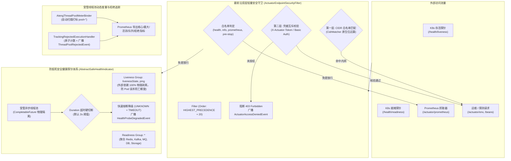

# ateng-boot-observability 云原生可观测性与端点安全治理 Starter

> 基于 Spring Boot 3 Actuator、Micrometer Prometheus 与 JDK 17 原生并发能力构建的工业级云原生可观测性、健康探针防假死与端点安全治理底座。提供受管线程池动态度量与任务拒绝追踪绑定器（`AtengThreadPoolMeterBinder`、`TrackingRejectedExecutionHandler`）、防假死异步受管健康探针基类（`AbstractSafeHealthIndicator`）与全中间件安全探针体系、业务度量双驱门面（`MetricsTemplate` 与声明式 `@ObservedMetric`）、零依赖 CIDR IP 白名单免密穿透与 Basic Auth / Token 凭据互斥核验双层过滤器（`ActuatorEndpointSecurityFilter`）、Kubernetes 存活与就绪探针黄金硬解耦治理（`ObservabilityEnvironmentPostProcessor`）以及全生命周期运维领域事件总线。

---

## 0. 特性与公共 API 全景速查矩阵 (Feature & API Panorama Matrix)

| 特性分类 | 特性名称 | 核心门面 / 注解 / SPI | 关键配置项 (`ateng.boot.observability.*`) | 关键 API 签名 / 核心行为 | 锚定验证源头 (*Test / Sample) |
| :--- | :--- | :--- | :--- | :--- | :--- |
| **线程池度量** | 受管线程池全量自动发现与动态打标绑定器 | `AtengThreadPoolMeterBinder` | `metrics.prometheus.enabled`<br>`metrics.thread-pool.enabled` | `bindTo(MeterRegistry registry)`：容器启动时自动扫描全量 `ThreadPoolTaskExecutor` 与 `ThreadPoolExecutor`，打标 `pool="<beanName>"` 并向 Prometheus 导出核心、最大、活跃、队列深度及拒绝任务指标 | `AtengThreadPoolMeterBinderTest`<br>`ObservabilityScenarioTest` |
| **任务拒绝追踪** | 线程池任务拒绝原子累加追踪与异常安全装饰器 | `TrackingRejectedExecutionHandler` | - | `rejectedExecution(Runnable r, ThreadPoolExecutor executor)`<br>`getCumulativeRejectedCount()`<br>`getDelegate()`：装饰器透明包装原生策略，防 NPE 校验，原子累加导出 `ateng_threadpool_rejected_tasks_total`，并向总线广播 `ThreadPoolRejectedEvent` | `TrackingRejectedExecutionHandlerTest`<br>`ObservabilityScenarioTest` |
| **业务度量门面** | 编程式业务指标度量统一门面 | `MetricsTemplate` | `metrics.prometheus.enabled` | `increment(String name, double amount, String... tags)`<br>`summary(String name, double amount, String... tags)`<br>`record(String name, Duration duration, String... tags)`<br>`gauge(String name, T stateObject, ToDoubleFunction<T> valueFunction, String... tags)`：Micrometer 强类型统一封装，自动执行标签键值对防空与奇数截断防卫 | `MetricsTemplateTest`<br>`ObservabilityScenarioTest` |
| **声明式度量** | 声明式方法耗时与状态性能观测切面 | `@ObservedMetric`<br>`ObservedMetricAspect` | `metrics.observed.enabled` | `@ObservedMetric(value = "sample.demo.observed", tags = {"tier", "api"}, percentiles = {0.95, 0.99})`：AOP 环绕切面透明测量执行耗时、分位数分布、成功/失败分别递增计数器及异常类名打标，异常时静默降级不阻断业务 | `ObservedMetricAspectTest`<br>`ObservabilityScenarioTest` |
| **探针防假死基类** | 生产级受管健康探针超时硬切断抽象基类 | `AbstractSafeHealthIndicator` | `health.timeout`（默认 `2s`） | `health()`<br>`doCheck(Health.Builder builder)`<br>`getTimeout()`<br>`getExecutor()`：将子探针隔离在独立受管线程池中异步探测，超时立即硬切断降级返回 `Status.UNKNOWN`（带 `status=TIMEOUT`），异常返回 `Status.DOWN`，并广播 `HealthProbeDegradedEvent` | `AbstractSafeHealthIndicatorTest`<br>`ObservabilityScenarioTest` |
| **Redis 探针** | Redis / Redisson 弱依赖防假死健康探针 | `RedisSafeHealthIndicator` | `health.redis.enabled` | 优先通过 `RedisConnection.ping()` 执行轻量弱探测，未配置时自动回退为 `UNKNOWN`，兼顾离线自洽与真实探测，超时降级与事件广播 | `RedisSafeHealthIndicatorTest` |
| **Kafka 探针** | Kafka 生产与管理客户端防假死健康探针 | `KafkaSafeHealthIndicator` | `health.kafka.enabled` | 优先通过 `AdminClient.describeCluster(...)` 弱探测集群节点可用性与节点数，离线自适应与超时硬切断 | `KafkaSafeHealthIndicatorTest` |
| **RabbitMQ 探针** | RabbitMQ Broker 连通性防假死健康探针 | `RabbitmqSafeHealthIndicator` | `health.rabbitmq.enabled` | 探测 `ConnectionFactory.createConnection()` 与 Channel 可用性，超时切断防阻塞 | `RabbitmqSafeHealthIndicatorTest` |
| **Search 探针** | Elasticsearch / OpenSearch 双驱防假死健康探针 | `SearchSafeHealthIndicator` | `health.search.enabled` | 调用 `ElasticsearchClient.cluster().health(...)` 探测底层集群健康状态，超时降级与事件广播 | `SearchSafeHealthIndicatorTest` |
| **存储探针** | 对象存储本地目录与 S3 连通性探针 | `StorageHealthIndicator` | `health.storage.enabled` | 弱探测 `StorageDriverFactory` 与 `StorageDriver`，校验本地目录存在与写入权限或 S3 连通性，敏感凭据正则脱敏 | `StorageHealthIndicatorTest`<br>`ObservabilityScenarioTest` |
| **通信探针** | 实时通信 WebSocket/SSE 双通道会话探针 | `RealtimeHealthIndicator` | `health.realtime.enabled` | 弱探测 `RealtimeSessionManager` 活跃会话数、在线用户数及 `RealtimeClusterBroadcaster` 节点状态 | `RealtimeHealthIndicatorTest` |
| **数据源探针** | 动态多数据源与连接池连通性探针 | `DynamicDatasourceHealthIndicator` | `health.dynamic-datasource.enabled` | 探查连接池 `isValid(1)`，联动 `DynamicDatasourceGuard` 诊断多数据源与 `DynamicRoutingDataSource` 状态 | `DynamicDatasourceHealthIndicatorTest`<br>`ObservabilityScenarioTest` |
| **RocketMQ 探针** | RocketMQ 5.x 客户端与消费监听容器探针 | `RocketmqHealthIndicator` | `health.rocketmq.enabled` | 弱探测 `RocketmqTemplate` 的 `Producer` 实例及 `RocketmqConsumerContainer` 的消费运行状态与活跃端点数 | `RocketmqHealthIndicatorTest` |
| **CIDR 匹配器** | 纯 JDK 原生零依赖 CIDR IP 范围匹配器 | `CidrMatcher` | - | `matches(String clientIp, String cidrOrIp)`<br>`matchesAny(String clientIp, Iterable<String> cidrsOrIps)`：支持 IPv4/IPv6 网段掩码与单 IP 精确匹配，位运算极速无锁解析，无任何第三方包依赖 | `CidrMatcherTest`<br>`ObservabilityScenarioTest` |
| **双层安全守卫** | Actuator 端点生产加固与双层认证过滤器 | `ActuatorEndpointSecurityFilter` | `security.lockdown-enabled`<br>`security.token`<br>`security.allowed-ip-ranges`<br>`security.basic-auth.*` | 优先级 `HIGHEST_PRECEDENCE + 20`，白名单端点免密放行；敏感端点执行双层防卫：层 1 命中 CIDR 白名单直接放行；层 2 校验 Basic Auth 与 `X-Actuator-Token`（OR 逻辑），恒定时间比对防时序攻击，拦截时返回 403 并广播 `ActuatorAccessDeniedEvent` | `ActuatorEndpointSecurityFilterTest`<br>`ObservabilityScenarioTest` |
| **K8s 探针硬隔离** | 生产安全基线与 K8s 黄金探针解耦后处理器 | `ObservabilityEnvironmentPostProcessor` | `health.k8s-isolation-enabled` | 启动早期最低优先级注入：Liveness 仅包含 `livenessState,ping`（外部依赖物理剥离，彻底杜绝 Pod 死亡螺旋），Readiness 聚合外部全量组件，安全收敛暴露核心端点 | `ObservabilityEnvironmentPostProcessorTest`<br>`ObservabilityScenarioTest` |
| **拒绝领域事件** | 线程池任务打满饱和拒绝领域事件 | `ThreadPoolRejectedEvent` | - | 继承 Spring `ApplicationEvent`，携带 `poolName`、`cumulativeRejectedCount`、`taskDescription`、`corePoolSize`、`maxPoolSize`、`activeCount`、`queueSize`、`remainingQueueCapacity` 完整快照，供告警中台秒级感知 | `TrackingRejectedExecutionHandlerTest`<br>`ObservabilityScenarioTest` |
| **降级领域事件** | 健康探针探测超时或异常降级领域事件 | `HealthProbeDegradedEvent` | - | 继承 Spring `ApplicationEvent`，携带 `probeName`、`componentName`、`status`（`TIMEOUT` / `DOWN`）、`costMs`、`reason`、`cause`，供运维看板实时感知探针抖动 | `AbstractSafeHealthIndicatorTest`<br>`ObservabilityScenarioTest` |
| **安全拦截事件** | Actuator 敏感端点非法访问阻断领域事件 | `ActuatorAccessDeniedEvent` | - | 继承 Spring `ApplicationEvent`，携带 `uri`、`clientIp`、`reason`、`timestamp`，供安全审计与防扫描告警中台联动 | `ActuatorEndpointSecurityFilterTest`<br>`ObservabilityScenarioTest` |
| **强类型配置属性** | 全局强类型配置属性类与 IDE 补全元数据 | `ObservabilityProperties` | `ateng.boot.observability.*` | 强类型映射，涵盖 `enabled`、`metrics.*`、`health.timeout`（`Duration`）、`health.k8s-isolation-enabled`、`health.<subsystem>.enabled`、`security.lockdown-enabled`、`security.token`、`security.allowed-ip-ranges`、`security.basic-auth.*`、`admin-client.*` | `ObservabilityPropertiesTest` |

---

## 1. 模块定位与快速起步 (Quick Start & Happy Path)

### 1.1 痛点与核心价值
传统 Spring Boot Actuator 直接应用于生产环境存在三大深水区痛点：
1. **外部故障引发探针假死与 Pod 死亡螺旋**：原生健康探针为同步阻塞，下游中间件网络抖动会无限挂起 Actuator 线程池；若存活探针（Liveness）失败将触发 K8s 误杀重启容器，引发拓扑级雪崩；
2. **高危端点敏感数据泄露**：`/actuator/env`、`/actuator/beans` 等端点极易暴露数据库账号密码与拓扑结构，而引入 `Spring Security` 过于臃肿复杂；
3. **线程池黑盒与指标打点碎片化**：受管线程池任务堆积与饱和拒绝缺乏自动发现与统一打标，业务层缺乏统一的指标度量门面。

`ateng-boot-observability` 秉承“**零臃肿、防假死、K8s 硬隔离、双层轻量防御与 100% 离线自洽**”原则，提供开箱即用的企业级云原生可观测性保障。

### 1.2 Maven 坐标引入
```xml
<dependency>
    <groupId>io.github.atengk</groupId>
    <artifactId>ateng-boot-observability</artifactId>
</dependency>
```

### 1.3 最小起步实战示例

#### 专属 YAML 最小配置 (`application.yml`)
```yaml
ateng:
  boot:
    observability:
      enabled: true
      metrics:
        prometheus:
          enabled: true
        thread-pool:
          enabled: true
      health:
        timeout: 2s
      security:
        lockdown-enabled: true
        token: "obs-admin-secret-token"
        allowed-ip-ranges:
          - "10.0.0.0/8"
          - "192.168.1.100"

# 暴露核心运维端点供抓取
management:
  endpoints:
    web:
      base-path: /actuator
      exposure:
        include: "health,info,prometheus,env,beans"
```

#### 极简业务度量实战代码 (逆向提取自 Sample)
```java
@RestController
@RequestMapping("/sample/observability/metrics")
public class ObservabilityMetricsController {

    private final ECommerceObservabilityService observabilityService;

    public ObservabilityMetricsController(ECommerceObservabilityService observabilityService) {
        this.observabilityService = observabilityService;
    }

    /**
     * 编程式指标打点：记录订单创建计数、金额分布与执行耗时
     */
    @PostMapping("/order-create")
    public Result<String> createOrder(@Valid @RequestBody OrderCreateRequest request) {
        String message = observabilityService.recordOrderMetrics(request);
        return Result.success(message);
    }
}
```

#### Prometheus 端点指标抓取验证 (`/actuator/prometheus`)
```text
# HELP sample_orders_total
# TYPE sample_orders_total counter
sample_orders_total{channel="app",} 1.0

# HELP sample_orders_amount_sum
# TYPE sample_orders_amount_sum summary
sample_orders_amount_sum{channel="app",} 99.5
sample_orders_amount_count{channel="app",} 1

# HELP sample_orders_process_time_seconds
# TYPE sample_orders_process_time_seconds summary
sample_orders_process_time_seconds_sum{channel="app",} 0.025
sample_orders_process_time_seconds_count{channel="app",} 1

# HELP ateng_threadpool_core_size Core pool size of the thread pool executor
# TYPE ateng_threadpool_core_size gauge
ateng_threadpool_core_size{pool="sampleTaskExecutor",} 4.0
```

---

## 2. 核心架构与设计不变量 (Core Architecture & Invariants)



### 核心不变量 (Design Invariants)
1. **Kubernetes 黄金硬隔离不变量**：Liveness 仅表征进程内活性（`livenessState,ping`），100% 物理剥离外部网络依赖；Readiness 聚合外部全量物理中间件。
2. **探针防假死硬切断不变量**：任何外部依赖探测必须隔离在受管异步线程中执行，并强制挂载强类型 `Duration` 超时阈值，超时直接硬切断降级返回 `UNKNOWN` 并带 `TIMEOUT` 详情，杜绝拖死 Actuator 独占工作线程池。
3. **零臃肿双层安全不变量**：端点加固完全基于原生 Servlet Filter 与纯 JDK 17 位运算 CIDR 匹配，使用 `MessageDigest.isEqual` 恒定时间防时序攻击，拒绝引入臃肿的 `spring-boot-starter-security`。
4. **受管线程池无死角度量不变量**：容器内全量 `ThreadPoolTaskExecutor` 与 `ThreadPoolExecutor` 均被自动识别并导出核心指标；任务饱和拒绝时由装饰器原子计数并广播 Spring 领域事件。

---

## 3. 业务指标与受管线程池度量套件 (Metrics & ThreadPool Governance)

### 3.1 编程式业务指标度量 (`MetricsTemplate`)

#### 专属 YAML 配置
```yaml
ateng:
  boot:
    observability:
      metrics:
        prometheus:
          enabled: true  # 开启 Prometheus 指标导出与 MetricsTemplate 装配
```

#### 业务实战 Java 代码 (100% 逆向自 Sample)
```java
@Service
public class ECommerceObservabilityServiceImpl implements ECommerceObservabilityService {

    private final MetricsTemplate metricsTemplate;
    private final AtomicInteger activeMerchants = new AtomicInteger(128);

    public ECommerceObservabilityServiceImpl(MetricsTemplate metricsTemplate) {
        this.metricsTemplate = metricsTemplate;
    }

    @PostConstruct
    public void initGaugeMetrics() {
        // 动态 Gauge 监控在线活跃商户数
        metricsTemplate.gauge("sample.merchants.active", activeMerchants, AtomicInteger::get, "region", "east");
    }

    @Override
    public String recordOrderMetrics(OrderCreateRequest request) {
        // Counter 累计单数、Summary 金额分布与 Timer 耗时
        metricsTemplate.increment("sample.orders", 1.0, "channel", request.getChannel());
        metricsTemplate.summary("sample.orders.amount", request.getAmount(), "channel", request.getChannel());
        metricsTemplate.record("sample.orders.process.time", Duration.ofMillis(25), "channel", request.getChannel());
        return "订单 " + request.getOrderId() + " 业务指标打点成功";
    }
}
```

#### 机制与边界防御
- `MetricsTemplate` 统一封装 Micrometer 核心原语，针对高基数风险内部实现标签键值对非空校验与奇数截断防卫；
- 遵循 Prometheus 命名规范，`sample.orders` 计数器在拉取时自动映射为 `sample_orders_total`。

---

### 3.2 声明式方法耗时监控 (`@ObservedMetric`)

#### 专属 YAML 配置
```yaml
ateng:
  boot:
    observability:
      metrics:
        observed:
          enabled: true  # 开启声明式 @ObservedMetric AOP 切面采集
```

#### 业务实战 Java 代码 (100% 逆向自 Sample)
```java
@Service
public class ECommerceObservabilityServiceImpl implements ECommerceObservabilityService {

    @Override
    @ObservedMetric(value = "sample.demo.observed", tags = {"tier", "api"}, percentiles = {0.95, 0.99})
    public String deductInventoryStock(StockDeductRequest request) {
        // 声明式切面自动度量方法执行耗时、分位数 (P95/P99) 及成功/失败计数
        return "商品 " + request.getProductId() + " 成功扣减库存 " + request.getCount() + " 件";
    }
}
```

#### 机制与边界防御
- AOP 环绕切面记录方法调用执行时间，自动打标 `class`、`method`、`status`（`success`/`error`）与 `exception`；
- 切面采用防御性异常拦截：若度量采集组件异常，**绝对静默降级，严禁阻断核心业务调用**。

---

### 3.3 受管线程池全量自动发现与动态打标 (`AtengThreadPoolMeterBinder`)

#### 专属 YAML 配置
```yaml
ateng:
  boot:
    observability:
      metrics:
        thread-pool:
          enabled: true  # 自动扫描容器并向 Prometheus 绑定受管线程池指标
```

#### 业务实战 Java 代码 (100% 逆向自 Sample)
```java
@SpringBootApplication
public class SampleObservabilityApplication {

    @Bean(name = "sampleTaskExecutor")
    public ThreadPoolTaskExecutor sampleTaskExecutor() {
        ThreadPoolTaskExecutor executor = new ThreadPoolTaskExecutor();
        executor.setCorePoolSize(4);
        executor.setMaxPoolSize(8);
        executor.setQueueCapacity(50);
        executor.setThreadNamePrefix("sample-task-");
        executor.setRejectedExecutionHandler(new ThreadPoolExecutor.AbortPolicy());
        executor.initialize();
        return executor;
    }
}
```

#### 机制与边界防御
- 容器启动时自动扫描所有 `ThreadPoolTaskExecutor` 与 `ThreadPoolExecutor` Bean，自动提取 Bean 名称并打标 `pool="<beanName>"`；
- 兼容 JDK 21+ 虚拟线程执行器（对无界虚拟线程池自动忽略队列与容量指标，避免度量失真）。

---

### 3.4 饱和任务拒绝原子追踪 (`TrackingRejectedExecutionHandler`)

#### 专属 YAML 配置
```yaml
ateng:
  boot:
    observability:
      metrics:
        thread-pool:
          enabled: true
```

#### 业务实战 Java 代码 (100% 逆向自 Sample)
```java
@Service
public class ECommerceObservabilityServiceImpl implements ECommerceObservabilityService {

    @Override
    public String triggerBurstPressure(BurstPressureRequest request) {
        int count = (request != null && request.getTaskCount() != null) ? request.getTaskCount() : 70;
        CountDownLatch latch = new CountDownLatch(1);
        try {
            // 提交超量并发阻塞任务，强制触发拒绝策略
            for (int i = 0; i < count; i++) {
                sampleTaskExecutor.execute(() -> {
                    try {
                        latch.await(2, TimeUnit.SECONDS);
                    } catch (InterruptedException e) {
                        Thread.currentThread().interrupt();
                    }
                });
            }
        } catch (RejectedExecutionException ignored) {
            // 预期由 TrackingRejectedExecutionHandler 拦截并累加计数器与发布事件
        } finally {
            latch.countDown();
        }
        return "已触发线程池并发高压与任务拒绝追踪";
    }
}
```

#### 机制与边界防御
- 采用装饰器模式透明包装原生 `RejectedExecutionHandler`，前置防 NPE 与防递归双重防卫；
- 发生拒绝时先原子累加 Prometheus 计数器（`ateng_threadpool_rejected_tasks_total`），再发布 `ThreadPoolRejectedEvent`，最后委托给原生策略，确保指标与审计因果链绝对完备。

---

## 4. 防假死安全健康探针体系 (Fail-Safe Health Probes & K8s Decoupling)

### 4.1 异步超时熔断抽象基类 (`AbstractSafeHealthIndicator`)

#### 专属 YAML 配置
```yaml
ateng:
  boot:
    observability:
      health:
        timeout: 2s  # 探测强类型超时阈值，防物理挂起拖垮线程池
```

#### 业务实战 Java 代码 (100% 逆向自 Sample)
```java
@Component
public class PaymentGatewayHealthIndicator extends AbstractSafeHealthIndicator {

    public PaymentGatewayHealthIndicator(ObservabilityProperties properties) {
        super(properties);
    }

    @Override
    protected String getComponentName() {
        return "paymentGateway";
    }

    @Override
    protected void doCheck(Health.Builder builder) throws Exception {
        // 模拟外部第三方支付通道（微信/支付宝等）连通性探测
        builder.up()
                .withDetail("channel", "MockPayGateway")
                .withDetail("latency", "12ms")
                .withDetail("status", "UP");
    }
}
```

#### 机制与边界防御
- 底层将 `doCheck` 委托给受管异步线程池调度，配备强类型 `Duration` 超时控制；
- 当物理网络挂起超过阈值时，自动触发 `future.cancel(true)` 强行切断底层调用，立即返回 `Status.UNKNOWN`（携带 `{"status":"TIMEOUT","reason":"Probe execution timed out"}`），同时向事件总线广播 `HealthProbeDegradedEvent`。

---

### 4.2 Kubernetes 存活与就绪探针黄金硬解耦

#### 专属 YAML 配置
```yaml
ateng:
  boot:
    observability:
      health:
        k8s-isolation-enabled: true  # 生产基线黄金隔离（默认开启）
```

#### 探针响应实测验证
1. **Liveness 存活探针**（`GET /actuator/health/liveness`）：
   ```json
   {
     "status": "UP",
     "components": {
       "livenessState": { "status": "UP" },
       "ping": { "status": "UP" }
     }
   }
   ```
   > **关键不变量**：外部组件（`dynamicDatasource`、`storage`、`paymentGateway`、`redis`）被 100% 物理剥离，即使外部网络全部中断，Pod 也绝不被 K8s 误杀重启。
2. **Readiness 就绪探针**（`GET /actuator/health/readiness`）：
   ```json
   {
     "status": "UP",
     "components": {
       "readinessState": { "status": "UP" },
       "dynamicDatasource": { "status": "UP" },
       "storage": { "status": "UP" },
       "paymentGateway": { "status": "UP" }
     }
   }
   ```
   > **降级机制**：外部组件故障时就绪探针返回 DOWN，K8s 优雅切断流量转发，保障业务无损。

---

### 4.3 全中间件专有健康探针矩阵

全中间件探针基于 `AbstractSafeHealthIndicator` 或弱依赖探测封装，兼顾 100% 离线自洽与全场景高可用：
- **Redis (`RedisSafeHealthIndicator`)**：弱装配探测 `RedisConnection.ping()`，缺失连接工厂时自动返回 `UNKNOWN` 并输出诊断信息，超时硬切断；
- **Kafka (`KafkaSafeHealthIndicator`)**：弱装配探测 `AdminClient.describeCluster()`，超时硬切断；
- **RabbitMQ (`RabbitmqSafeHealthIndicator`)**：探测 `ConnectionFactory.createConnection()` 与通道可用性；
- **RocketMQ (`RocketmqHealthIndicator`)**：探测 5.x 客户端 Producer 与 Consumer 运行容器；
- **Search (`SearchSafeHealthIndicator`)**：探测 Elasticsearch 集群 Ping 与节点状态；
- **Storage (`StorageHealthIndicator`)**：校验 Local 模式目录可写性与 S3 连通性，自动对 Secret 进行脱敏掩码；
- **DynamicDatasource (`DynamicDatasourceHealthIndicator`)**：基于 `isValid(1)` 探测连接池连通性，联动多数据源路由守护器。

---

## 5. 敏感端点加固与双层轻量防御体系 (Actuator Security Lockdown)

### 5.1 零依赖 CIDR IP 白名单免密穿透 (`CidrMatcher`)

#### 专属 YAML 配置
```yaml
ateng:
  boot:
    observability:
      security:
        lockdown-enabled: true
        allowed-ip-ranges:
          - "10.0.0.0/8"        # 支持 CIDR 网段掩码
          - "192.168.1.100"     # 支持精确单 IP
```

#### 机制与边界防御
- `CidrMatcher` 纯依托 JDK 17 原生位运算与 `InetAddress` 实现，支持 IPv4（32 位）与 IPv6（128 位）快速无锁匹配；
- 命中白名单的客户端直接放行，免除机房内部巡检与容器网络探测的凭据负担。

---

### 5.2 敏感端点 Token 与 Basic Auth 互斥鉴权 (`ActuatorEndpointSecurityFilter`)

#### 专属 YAML 配置
```yaml
ateng:
  boot:
    observability:
      security:
        lockdown-enabled: true
        token: "obs-admin-secret-token"
        basic-auth:
          enabled: true
          username: "admin"
          password: "obs-admin-pass-123"
```

#### 接口防护与实测响应
- **白名单公开端点**（`/actuator/health`、`/actuator/info`、`/actuator/prometheus`）：免密无 Token 畅行无阻（HTTP 200）；
- **高危敏感端点未授权访问**（`GET /actuator/env` 来自非白名单 IP 且无凭证）：
  ```json
  {
    "code": 403,
    "msg": "Actuator 端点访问拒绝: 未授权访问高危端点：来源 IP 未在白名单且未提供有效授权凭据",
    "data": null,
    "timestamp": 1792656000000
  }
  ```
- **携带有效 Token 访问**（`GET /actuator/env -H "X-Actuator-Token: obs-admin-secret-token"`）：正常放行（HTTP 200）；
- **恒定时间比对防时序攻击**：凭据校验统一采用 `MessageDigest.isEqual` 进行恒定时间（Constant-Time）字节比对，杜绝基于响应耗时推测密钥的侧信道攻击。

---

## 6. 运维全生命周期领域事件总线 (Observability Domain Events)

三大运维领域事件均继承自 Spring `ApplicationEvent`，天然解耦告警与业务流：

### 6.1 事件监听与告警联动实战代码 (逆向自 Sample)
```java
@Component
@Slf4j
public class ObservabilityAlertEventListener {

    private static final int MAX_BUFFER_SIZE = 20;
    private final ConcurrentLinkedDeque<Map<String, Object>> recentEvents = new ConcurrentLinkedDeque<>();

    @EventListener
    public void onThreadPoolRejected(ThreadPoolRejectedEvent event) {
        log.error("【运维告警】受管线程池饱和拒绝！池名: {}, 累计拒绝数: {}, 活跃线程: {}/{}, 队列堆积: {}",
                event.getPoolName(), event.getCumulativeRejectedCount(), event.getActiveCount(),
                event.getMaxPoolSize(), event.getQueueSize());
        // 记录结构化告警快照并推送到企业告警中心
    }

    @EventListener
    public void onHealthProbeDegraded(HealthProbeDegradedEvent event) {
        log.warn("【运维告警】组件健康探针降级！探针: {}, 组件: {}, 状态: {}, 耗时: {}ms, 原因: {}",
                event.getProbeName(), event.getComponentName(), event.getStatus(),
                event.getCostMs(), event.getReason());
    }

    @EventListener
    public void onAccessDenied(ActuatorAccessDeniedEvent event) {
        log.warn("【安全审计】Actuator 敏感端点未授权访问阻断！URI: {}, 来源 IP: {}, 原因: {}",
                event.getUri(), event.getClientIp(), event.getReason());
    }
}
```

---

## 7. 生产扩展接管与核心非功能边界 (Customization & Production Boundary)

### 7.1 自定义扩展点接管
1. **自定义防假死健康探针**：继承 `AbstractSafeHealthIndicator`，仅需覆写 `getComponentName()` 与 `doCheck(Health.Builder builder)`，超时切断与事件广播由框架基类完全代办；
2. **Spring Boot Admin 客户端安全握手**：开启 `ateng.boot.observability.admin-client.enabled=true` 并配置 `client-secret`，框架自动通过拦截器将加固密钥透明注入 SBA 注册元数据，实现零配置安全纳入统一大屏看板。

### 7.2 生产级边界防御说明
1. **无界挂起防卫（Anti-Hang）**：网络通信、探针执行均强制挂载 `Duration` 超时阈值，超时硬切断，禁止任何无界调用；
2. **严格无状态与受管并发**：单例无状态，线程池指标动态采集基于原子无锁计数器（`LongAdder` / `AtomicLong`），杜绝线程安全隐患；
3. **因果异常链完备性**：所有底层探测异常均转译为语义化状态并保留完整的 `Throwable cause` 根因链。

---

## 8. 完整 YAML 配置属性清单 (Full Configuration Reference)

以下为 `ateng.boot.observability.*` 全量配置属性速查字典：

| 配置属性键名 | 数据类型 | 默认值 | 业务职责与配置说明 |
| :--- | :--- | :--- | :--- |
| `ateng.boot.observability.enabled` | `boolean` | `true` | 是否启用可观测性模块自动装配 |
| `ateng.boot.observability.metrics.prometheus.enabled` | `boolean` | `true` | 是否启用 Prometheus 指标自动注册与 `MetricsTemplate` 导出 |
| `ateng.boot.observability.metrics.thread-pool.enabled` | `boolean` | `true` | 是否自动扫描并绑定 Spring 容器内所有受管线程池度量指标 |
| `ateng.boot.observability.metrics.observed.enabled` | `boolean` | `true` | 是否启用 `@ObservedMetric` 声明式切面度量采集 |
| `ateng.boot.observability.health.timeout` | `Duration` | `2s` | 生产级探针安全探测默认超时时间，防物理挂起拖垮线程池 |
| `ateng.boot.observability.health.k8s-isolation-enabled` | `boolean` | `true` | Kubernetes 存活与就绪探针黄金分级硬隔离开关（Liveness 排除外部依赖） |
| `ateng.boot.observability.health.storage.enabled` | `boolean` | `true` | 是否启用对象存储（ateng-boot-storage）健康探针 |
| `ateng.boot.observability.health.rocketmq.enabled` | `boolean` | `true` | 是否启用 RocketMQ 5.x 连通性探针 |
| `ateng.boot.observability.health.realtime.enabled` | `boolean` | `true` | 是否启用实时通信（WebSocket/SSE）健康探针 |
| `ateng.boot.observability.health.dynamic-datasource.enabled` | `boolean` | `true` | 是否启用动态多数据源连通性探针 |
| `ateng.boot.observability.health.redis.enabled` | `boolean` | `true` | 是否启用 Redis / Redisson 防假死安全健康探针 |
| `ateng.boot.observability.health.kafka.enabled` | `boolean` | `true` | 是否启用 Kafka 防假死安全健康探针 |
| `ateng.boot.observability.health.rabbitmq.enabled` | `boolean` | `true` | 是否启用 RabbitMQ 防假死安全健康探针 |
| `ateng.boot.observability.health.search.enabled` | `boolean` | `true` | 是否启用 Elasticsearch 防假死安全健康探针 |
| `ateng.boot.observability.security.lockdown-enabled` | `boolean` | `true` | 是否启用高危敏感端点（/env, /beans 等）生产加固守卫 |
| `ateng.boot.observability.security.token` | `String` | `""` | 访问高危敏感端点所需的授权 Token 密钥（请求头：`X-Actuator-Token`） |
| `ateng.boot.observability.security.allowed-ip-ranges` | `List<String>` | `[]` | 免密访问高危端点的内网 IP 或 CIDR 网段白名单（如 `10.0.0.0/8`, `192.168.1.0/24`） |
| `ateng.boot.observability.security.basic-auth.enabled` | `boolean` | `false` | 是否启用 Actuator 端点 HTTP Basic Auth 认证 |
| `ateng.boot.observability.security.basic-auth.username` | `String` | `""` | HTTP Basic Auth 认证用户名 |
| `ateng.boot.observability.security.basic-auth.password` | `String` | `""` | HTTP Basic Auth 认证密码 |
| `ateng.boot.observability.admin-client.enabled` | `boolean` | `true` | 是否自动向 SBA Server 上报端点凭据与密钥 |
| `ateng.boot.observability.admin-client.client-secret` | `String` | `null` | 向 SBA Server 发起注册时的握手通信密钥 |
| `ateng.boot.observability.admin-client.service-url` | `String` | `null` | 显式指定上报给 SBA 的业务地址 |
| `ateng.boot.observability.admin-client.management-url` | `String` | `null` | 显式指定独立管理端口访问地址 |

---

## 9. 场景样例与测试验收 (Sample & Verification)

本模块全部功能特性已在独立 1:1 场景沙箱工程 [`ateng-boot-sample-observability`](../ateng-boot-samples/ateng-boot-sample-observability) 中完成多领域 Controller 实测闭环，全量代码与测试用例通过以下命令验证全绿：

```bash
mvn test -pl ateng-boot-observability,ateng-boot-samples/ateng-boot-sample-observability -am -T 1C -nsu -B
```
