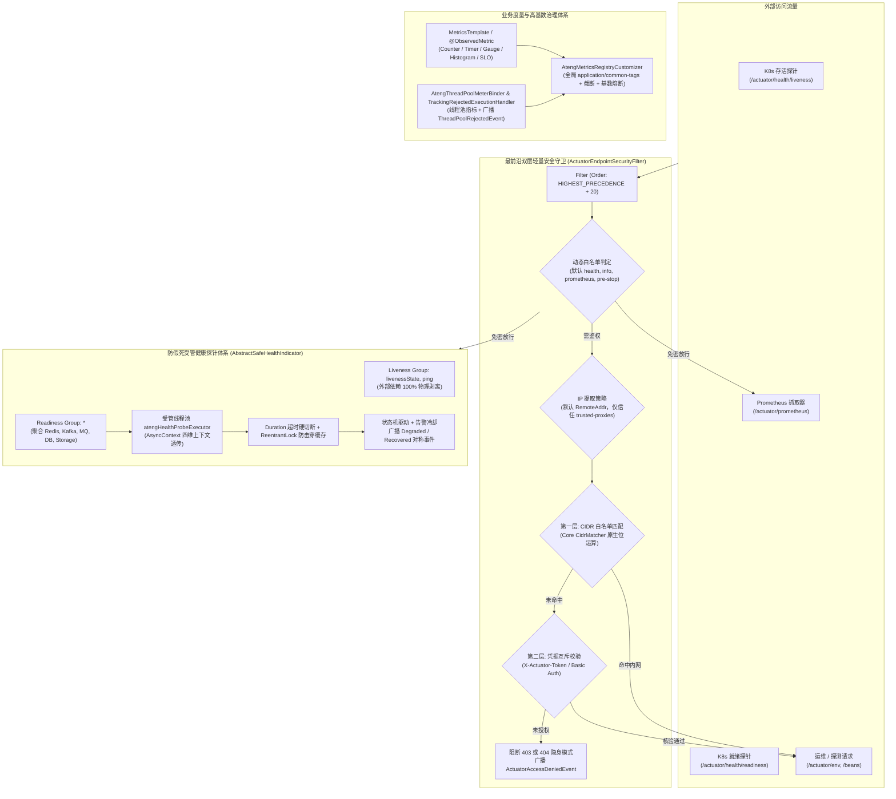

# ateng-boot-observability 云原生可观测性与端点安全治理 Starter

> 基于 Spring Boot 3 Actuator、Micrometer Prometheus 与 JDK 17 原生并发能力构建的工业级云原生可观测性、健康探针防假死与端点安全治理底座。提供受管线程池动态度量与任务拒绝追踪（`AtengThreadPoolMeterBinder`、`TrackingRejectedExecutionHandler`）、防假死异步受管健康探针基类（`AbstractSafeHealthIndicator` 含四维上下文透传、短效缓存防击穿、告警冷却与自愈事件闭环）及全中间件安全探针体系、业务度量双驱门面与直方图/SLO 能力（`MetricsTemplate` 与 `@ObservedMetric`）、全局公共标签与高基数熔断治理（`AtengMetricsRegistryCustomizer`）、防代理头伪造与 404 隐身双层安全守卫（`ActuatorEndpointSecurityFilter`）、Kubernetes 探针黄金硬解耦（`ObservabilityEnvironmentPostProcessor`）以及 Spring Boot Admin 出站握手密钥拦截器（`AdminClientSecretHttpRequestInterceptor`）。

---

## 0. 特性与公共 API 全景速查矩阵 (Feature & API Panorama Matrix)

| 特性分类 | 特性名称 | 核心门面 / 注解 / SPI | 关键配置项 (`ateng.boot.observability.*`) | 关键 API 签名 / 核心行为 | 锚定验证源头 (*Test / Sample) |
| :--- | :--- | :--- | :--- | :--- | :--- |
| **线程池度量** | 受管线程池全量自动发现与动态打标绑定器 | `AtengThreadPoolMeterBinder` | `metrics.prometheus.enabled`<br>`metrics.thread-pool.enabled` | `bindTo(MeterRegistry registry)`：容器启动时自动扫描全量 `ThreadPoolTaskExecutor` 与 `ThreadPoolExecutor`，打标 `pool="<beanName>"` 并向 Prometheus 导出核心、最大、活跃、队列深度及拒绝任务指标 | `AtengThreadPoolMeterBinderTest`<br>`ObservabilityScenarioTest` |
| **任务拒绝追踪** | 线程池任务拒绝原子累加追踪与异常安全装饰器 | `TrackingRejectedExecutionHandler` | - | `rejectedExecution(Runnable r, ThreadPoolExecutor executor)`<br>`getCumulativeRejectedCount()`<br>`getDelegate()`：装饰器透明包装原生策略，防 NPE 校验，原子累加导出 `ateng_threadpool_rejected_tasks_total`，并广播 `ThreadPoolRejectedEvent` | `TrackingRejectedExecutionHandlerTest`<br>`ObservabilityScenarioTest` |
| **业务度量门面** | 编程式业务指标度量统一门面（含直方图/SLO 与动态注销） | `MetricsTemplate` | `metrics.prometheus.enabled` | `increment(name, [amount], tags)` / `counter(...)` / `count(...)`<br>`record(name, Duration\|Runnable\|Supplier, [percentiles, histogram, sla], tags)` / `recordCallable(...)`<br>`timer(name, [percentiles, histogram, sla], tags)` / `startSample()` / `stopSample(...)`<br>`gauge(...)` / `gaugeCollectionSize(...)` / `gaugeMapSize(...)`<br>`summary(...)` / `distributionSummary(...)`<br>`remove(Meter\|Meter.Id\|name, tags)` / `clear()`<br>`applyTimerDistribution(...)` / `toTags(...)`：空注册表平滑降级，自动过滤非法分位数与非正数 SLA | `MetricsTemplateTest`<br>`ObservabilityScenarioTest` |
| **声明式度量** | 声明式方法耗时、直方图与 SLO 观测切面 | `@ObservedMetric`<br>`ObservedMetricAspect` | `metrics.observed.enabled` | `@ObservedMetric(value, tags, recordDuration, recordSuccess, recordFailure, percentiles, histogram, slaMs)`：AOP 环绕采集执行耗时、分位数、可聚合直方图（`_bucket`）、SLO 耗时桶（过滤 `<=0`）及成功/失败计数器，异常时静默降级不阻断业务 | `ObservedMetricAspectTest`<br>`ObservabilityScenarioTest` |
| **高基数治理** | 全局公共标签注入与高基数维度熔断治理器 | `AtengMetricsRegistryCustomizer` | `metrics.include-application-tag`<br>`metrics.common-tags`<br>`metrics.max-tag-value-length`<br>`metrics.max-meter-cardinality`<br>`metrics.deny-metric-prefixes` | `customize(MeterRegistry registry)`：自动注入 `application` 与 `common-tags`，按前缀黑名单丢弃噪音指标，截断超长标签值，并基于 `ReentrantLock` 与 `onMeterRemoved` 实施单指标最大基数上限熔断 | `AtengMetricsRegistryCustomizerTest`<br>`AtengMetricsAutoConfigurationTest`<br>`ObservabilityScenarioTest` |
| **探针防假死基类** | 受管异步健康探针超时硬切断、缓存冷却与自愈基类 | `AbstractSafeHealthIndicator` | `health.timeout`（默认 `2s`）<br>`health.cache-ttl`（默认 `0s`）<br>`health.degraded-event-cooldown`（默认 `0s`） | `health()` / `doCheck(Health.Builder)` / `getComponentName()`<br>`getTimeout()` / `getCacheTtl()` / `getDegradedEventCooldown()`<br>`getExecutor()` / `resetProbeState()`：通过 `BeanFactoryAware` 自动绑定 `atengHealthProbeExecutor` 并用 `AsyncContext` 透传四维上下文，`ReentrantLock` 防击穿缓存与告警冷却，`UP <-> DOWN/TIMEOUT` 对称广播降级与恢复事件 | `AbstractSafeHealthIndicatorTest`<br>`ObservabilityScenarioTest` |
| **Redis 探针** | Redis / Redisson 弱依赖防假死健康探针 | `RedisSafeHealthIndicator` | `health.redis.enabled` | 优先通过 `RedisConnection.ping()` 执行轻量弱探测，缺失连接工厂时回退 `UNKNOWN`，超时硬切断与事件广播 | `RedisSafeHealthIndicatorTest` |
| **Kafka 探针** | Kafka 生产与管理客户端防假死健康探针 | `KafkaSafeHealthIndicator` | `health.kafka.enabled` | 通过 `AdminClient.describeCluster(...)` 弱探测集群连通性；使用 `ReentrantLock` 保护懒加载初始化（防虚拟线程 Pinning）与 `destroy()` 安全关闭 | `KafkaSafeHealthIndicatorTest` |
| **RabbitMQ 探针** | RabbitMQ Broker 连通性防假死健康探针 | `RabbitmqSafeHealthIndicator` | `health.rabbitmq.enabled` | 探测 `ConnectionFactory.createConnection()` 与通道可用性，超时硬切断防阻塞 | `RabbitmqSafeHealthIndicatorTest` |
| **Search 探针** | Elasticsearch / OpenSearch 防假死健康探针 | `SearchSafeHealthIndicator` | `health.search.enabled` | 调用 `SearchEngineClient` 探测集群健康状态，超时降级与事件广播 | `SearchSafeHealthIndicatorTest` |
| **存储探针** | 对象存储本地目录与 S3 连通性探针 | `StorageHealthIndicator` | `health.storage.enabled` | 弱探测 `StorageDriverFactory` 与 `StorageDriver`，校验本地目录权限或 S3 连通性，敏感凭据脱敏 | `StorageHealthIndicatorTest`<br>`ObservabilityScenarioTest` |
| **通信探针** | 实时通信 WebSocket/SSE 双通道会话探针 | `RealtimeHealthIndicator` | `health.realtime.enabled` | 弱探测 `RealtimeSessionManager` 活跃会话数、在线用户数及 `RealtimeClusterBroadcaster` 集群节点状态 | `RealtimeHealthIndicatorTest` |
| **数据源探针** | 动态多数据源与连接池连通性探针 | `DynamicDatasourceHealthIndicator` | `health.dynamic-datasource.enabled` | 探查连接池 `isValid(1)`，联动 `DynamicDatasourceGuard` 诊断多数据源路由与连接状态 | `DynamicDatasourceHealthIndicatorTest`<br>`ObservabilityScenarioTest` |
| **RocketMQ 探针** | RocketMQ 5.x 客户端与消费监听容器探针 | `RocketmqHealthIndicator` | `health.rocketmq.enabled` | 弱探测 `RocketmqTemplate` 的 `Producer` 实例及 `RocketmqConsumerContainer` 的消费运行状态与活跃端点数 | `RocketmqHealthIndicatorTest` |
| **CIDR 匹配器** | 兼容 Core 底座的零依赖 CIDR IP 匹配器 | `CidrMatcher` | - | 继承 `io.github.atengk.boot.core.util.CidrMatcher`，保留 `CidrMatcher(Collection<String>)` 向后兼容构造器，支持 IPv4/IPv6 网段与单 IP 位运算无锁匹配 | `CidrMatcherTest`<br>`ObservabilityScenarioTest` |
| **双层安全守卫** | Actuator 端点防伪造、隐身与双层认证过滤器 | `ActuatorEndpointSecurityFilter` | `security.lockdown-enabled`<br>`security.token`<br>`security.allowed-ip-ranges`<br>`security.trust-proxy-headers`<br>`security.trusted-proxies`<br>`security.stealth-mode`<br>`security.whitelisted-endpoints`<br>`security.basic-auth.*` | 优先级 `HIGHEST_PRECEDENCE + 20`；默认采信直连 `RemoteAddr`，仅在开启 `trust-proxy-headers` 或直连命中 `trusted-proxies` 时解析代理头；白名单端点免密放行（`/actuator` 根索引始终拦截）；未授权支持 `403` 或 `404` 隐身 JSON 响应并广播 `ActuatorAccessDeniedEvent` | `ActuatorEndpointSecurityFilterTest`<br>`AtengSecurityAutoConfigurationTest`<br>`ObservabilityScenarioTest` |
| **SBA 握手拦截器** | Spring Boot Admin 客户端出站握手密钥拦截器 | `AdminClientSecretHttpRequestInterceptor` | `admin-client.enabled`<br>`admin-client.client-secret`<br>`admin-client.service-url`<br>`admin-client.management-url` | `intercept(...)`：幂等向发往 SBA Server 的 HTTP 请求头附加 `X-Admin-Client-Secret`，并注入 `actuator-token` 至 `InstanceProperties` 元数据 | `AdminClientSecretHttpRequestInterceptorTest`<br>`AtengAdminClientAutoConfigurationTest`<br>`ObservabilityScenarioTest` |
| **K8s 探针硬隔离** | 生产安全基线与 K8s 黄金探针解耦后处理器 | `ObservabilityEnvironmentPostProcessor` | `health.k8s-isolation-enabled` | 经 `EnvironmentPostProcessor.imports` 装配：Liveness 仅包含 `livenessState,ping`（剥离外部依赖），Readiness 聚合外部全量组件，默认收敛高危端点暴露 | `ObservabilityEnvironmentPostProcessorTest`<br>`ObservabilityScenarioTest` |
| **拒绝领域事件** | 线程池任务打满饱和拒绝领域事件 | `ThreadPoolRejectedEvent` | - | 携带 `poolName`、`cumulativeRejectedCount`、`taskDescription`、`corePoolSize`、`maxPoolSize`、`activeCount`、`queueSize`、`remainingQueueCapacity` | `TrackingRejectedExecutionHandlerTest`<br>`ObservabilityScenarioTest` |
| **降级领域事件** | 健康探针探测超时或异常降级领域事件 | `HealthProbeDegradedEvent` | - | 携带 `probeName`、`componentName`、`status`（`TIMEOUT` / `DOWN`）、`costMs`、`reason`、`cause` | `AbstractSafeHealthIndicatorTest`<br>`ObservabilityScenarioTest` |
| **恢复领域事件** | 健康探针故障恢复自愈对称领域事件 | `HealthProbeRecoveredEvent` | - | 携带 `probeName`、`componentName`、`previousStatus`、`downtimeMs`、`consecutiveFailures`，与 `HealthProbeDegradedEvent` 构成消警闭环 | `AbstractSafeHealthIndicatorTest`<br>`ObservabilityScenarioTest` |
| **安全拦截事件** | Actuator 敏感端点非法访问阻断领域事件 | `ActuatorAccessDeniedEvent` | - | 携带 `uri`、`clientIp`、`reason`、`timestamp`，无论处于 403 或 404 隐身模式均照常发布 | `ActuatorEndpointSecurityFilterTest`<br>`ObservabilityScenarioTest` |
| **强类型配置属性** | 全局强类型配置属性类与 IDE 补全元数据 | `ObservabilityProperties` | `ateng.boot.observability.*` | 强类型映射，涵盖 `enabled`、`metrics.*`、`health.*`（`Duration` 强类型超时/缓存/冷却）、`security.*` 与 `admin-client.*` | `ObservabilityPropertiesTest` |

---

## 1. 模块定位与快速起步 (Quick Start & Happy Path)

### 1.1 痛点与核心价值
传统 Spring Boot Actuator 直接应用于生产环境存在四大深水区痛点：
1. **外部故障引发探针假死与 Pod 死亡螺旋**：原生健康探针为同步阻塞，下游中间件网络抖动会挂起 Actuator 线程池；若 Liveness 绑定外部依赖将触发 K8s 误杀重启容器；
2. **高危端点暴露与代理头伪造漏洞**：`/actuator/env`、`/actuator/beans` 易暴露敏感拓扑；若无条件信任 `X-Forwarded-For`，外部攻击者可伪造内网 IP 绕过 CIDR 白名单；
3. **高基数维度爆炸与跨 Pod 聚合缺失**：业务标签若传入长文本或无界动态 ID 会撑爆 Prometheus TSDB，而仅使用客户端分位数（Summary）无法在多 Pod 集群中做全局聚合计算；
4. **线程池黑盒与故障自愈事件断层**：受管线程池任务拒绝及探针降级/恢复缺乏对称领域事件通知。

`ateng-boot-observability` 秉承“**零臃肿、防假死、K8s 硬隔离、代理头防伪造、高基数熔断与 100% 离线自洽**”原则，提供开箱即用的云原生可观测性保障。

### 1.2 Maven 引入坐标

**方式一：通过 `ateng-boot-bom` 统一纳管版本（推荐）**

```xml
<dependencyManagement>
    <dependencies>
        <dependency>
            <groupId>io.github.atengk</groupId>
            <artifactId>ateng-boot-bom</artifactId>
            <version>1.2.0</version>
            <type>pom</type>
            <scope>import</scope>
        </dependency>
    </dependencies>
</dependencyManagement>

<dependencies>
    <dependency>
        <groupId>io.github.atengk</groupId>
        <artifactId>ateng-boot-observability</artifactId>
    </dependency>
</dependencies>
```

**方式二：独立显式版本号引入**

```xml
<dependencies>
    <dependency>
        <groupId>io.github.atengk</groupId>
        <artifactId>ateng-boot-observability</artifactId>
        <version>1.2.0</version>
    </dependency>
</dependencies>
```

### 1.3 最小起步实战示例

#### 专属 YAML 最小配置 (`application.yml`)
```yaml
spring:
  application:
    name: ateng-boot-sample-observability

ateng:
  boot:
    observability:
      enabled: true
      metrics:
        prometheus:
          enabled: true
        thread-pool:
          enabled: true
      health:
        timeout: 2s
      security:
        lockdown-enabled: true
        token: "obs-admin-secret-token"
        allowed-ip-ranges:
          - "10.0.0.0/8"
          - "192.168.1.100"

# 暴露核心运维端点供抓取
management:
  endpoints:
    web:
      base-path: /actuator
      exposure:
        include: "health,info,prometheus,env,beans"
```

#### 极简业务度量实战代码 (100% 逆向提取自 Sample)
```java
@RestController
@RequestMapping("/sample/observability/metrics")
public class ObservabilityMetricsController {

    private final ECommerceObservabilityService observabilityService;

    public ObservabilityMetricsController(ECommerceObservabilityService observabilityService) {
        this.observabilityService = observabilityService;
    }

    /**
     * 编程式指标打点：记录订单创建计数、金额分布与执行耗时
     */
    @PostMapping("/order-create")
    public Result<String> createOrder(@Valid @RequestBody OrderCreateRequest request) {
        String message = observabilityService.recordOrderMetrics(request);
        return Result.success(message);
    }
}
```

#### Prometheus 端点指标抓取验证 (`/actuator/prometheus`)
```text
# HELP sample_orders_total
# TYPE sample_orders_total counter
sample_orders_total{application="ateng-boot-sample-observability",channel="app"} 1.0
# HELP sample_orders_amount_max
# TYPE sample_orders_amount_max gauge
sample_orders_amount_max{application="ateng-boot-sample-observability",channel="app"} 99.5
# HELP sample_orders_amount
# TYPE sample_orders_amount summary
sample_orders_amount_count{application="ateng-boot-sample-observability",channel="app"} 1
sample_orders_amount_sum{application="ateng-boot-sample-observability",channel="app"} 99.5
# HELP sample_orders_process_time_seconds
# TYPE sample_orders_process_time_seconds summary
sample_orders_process_time_seconds_count{application="ateng-boot-sample-observability",channel="app"} 1
sample_orders_process_time_seconds_sum{application="ateng-boot-sample-observability",channel="app"} 0.025
# HELP ateng_threadpool_core_size The core number of threads
# TYPE ateng_threadpool_core_size gauge
ateng_threadpool_core_size{application="ateng-boot-sample-observability",pool="sampleTaskExecutor",type="platform"} 4.0
```

---

## 2. 核心架构与设计不变量 (Core Architecture & Invariants)



### 核心不变量 (Design Invariants)
1. **Kubernetes 黄金硬隔离不变量**：Liveness 仅表征进程内活性（`livenessState,ping`），100% 物理剥离外部网络依赖；Readiness 聚合外部全量物理中间件。
2. **探针防假死与状态自愈不变量**：外部依赖探测隔离于 `atengHealthProbeExecutor` 受管线程池执行，通过 `AsyncContext` 透传四维上下文并在 `finally` 无条件清理；超时硬切断返回 `UNKNOWN`（带 `status=TIMEOUT`），故障降级与恢复分别发布 `HealthProbeDegradedEvent` 与 `HealthProbeRecoveredEvent`。
3. **代理头防欺骗与零臃肿安全不变量**：默认严格采信直连 `RemoteAddr`，仅在直连命中 `trusted-proxies`（或显式开启 `trust-proxy-headers`）时解析代理请求头；敏感端点比对采用 `MessageDigest.isEqual` 恒定时间防时序攻击，支持 `404` 隐身防扫描模式。
4. **高基数熔断与虚拟线程防 Pinning 不变量**：`AtengMetricsRegistryCustomizer` 统一保护 Prometheus TSDB 免受超长标签值与维度爆炸冲击；所有锁临界区（状态机、防击穿缓存、Kafka 懒加载、基数跟踪器）均使用 `ReentrantLock` 替代 `synchronized`，杜绝 JDK 21+ 虚拟线程 Carrier Pinning。
5. **度量异常零阻断不变量**：`MetricsTemplate` 空注册表平滑降级、非法分位数与非正数 SLA 安全过滤；`@ObservedMetric` 切面内部捕获度量收集异常，坚决不阻断核心业务调用。

---

## 3. 业务指标与受管线程池度量治理套件 (Metrics & ThreadPool Governance)

### 3.1 编程式业务度量门面 (`MetricsTemplate`)

#### 专属 YAML 配置
```yaml
ateng:
  boot:
    observability:
      metrics:
        prometheus:
          enabled: true  # 开启 Prometheus 指标导出与 MetricsTemplate 装配
```

#### 业务实战 Java 代码 (100% 逆向自 Sample)
```java
@Service
public class ECommerceObservabilityServiceImpl implements ECommerceObservabilityService {

    private final MetricsTemplate metricsTemplate;
    private final AtomicInteger activeMerchants = new AtomicInteger(128);
    private final Queue<String> pendingFulfillmentQueue = new ConcurrentLinkedQueue<>();
    private final Map<String, String> localCampaignCache = new ConcurrentHashMap<>();

    public ECommerceObservabilityServiceImpl(MetricsTemplate metricsTemplate) {
        this.metricsTemplate = metricsTemplate;
    }

    @PostConstruct
    public void initGaugeMetrics() {
        pendingFulfillmentQueue.offer("FUL-20261116-001");
        pendingFulfillmentQueue.offer("FUL-20261116-002");
        localCampaignCache.put("CAMPAIGN-1116", "ACTIVE");

        // 数值 Gauge、集合容量 Gauge 与 Map 容量 Gauge
        metricsTemplate.gauge("sample.merchants.active", activeMerchants, AtomicInteger::get, "region", "east");
        metricsTemplate.gaugeCollectionSize("sample.fulfillment.pending.queue.size", pendingFulfillmentQueue, "domain", "fulfillment");
        metricsTemplate.gaugeMapSize("sample.campaign.local.cache.size", localCampaignCache, "domain", "trade");
    }

    @Override
    public String recordOrderMetrics(OrderCreateRequest request) {
        // Counter 累计单数、Summary 金额分布与 Timer 固定耗时记录
        metricsTemplate.increment("sample.orders", 1.0, "channel", request.getChannel());
        metricsTemplate.summary("sample.orders.amount", request.getAmount(), "channel", request.getChannel());
        metricsTemplate.record("sample.orders.process.time", Duration.ofMillis(25), "channel", request.getChannel());
        return "订单 " + request.getOrderId() + " 业务指标打点成功";
    }

    @Override
    public String evaluateOrderRisk(OrderRiskCheckRequest request) {
        // 函数式 Supplier 环绕计时（支持直方图与 SLO 重载：record(name, supplier, percentiles, histogram, sla, tags)）
        return metricsTemplate.record("sample.orders.risk.check.time", () -> {
            String decision = request.getAmount() >= 10000.0 ? "REVIEW" : "APPROVED";
            return "订单 " + request.getOrderId() + " 风控校验完成: " + decision;
        }, "channel", request.getChannel());
    }

    @Override
    public String trackFulfillmentStages(FulfillmentTrackRequest request) {
        // 跨分段手动采样计时
        Timer.Sample sample = metricsTemplate.startSample();
        try {
            return "订单 " + request.getOrderId() + " 在仓库 " + request.getWarehouseCode() + " 完成分段履约";
        } finally {
            metricsTemplate.stopSample(sample, "sample.fulfillment.duration", "warehouse", request.getWarehouseCode());
        }
    }

    @Override
    public int removeCampaignMetric(CampaignMetricRequest request) {
        // 活动下线后动态注销对应标签组合的指标，联动释放基数额度
        return metricsTemplate.remove("sample.campaign.flash.sale",
                "campaignId", request.getCampaignId(), "channel", request.getChannel());
    }
}
```

#### 机制与边界防御
- `MetricsTemplate` 对 `MeterRegistry == null` 或空白指标名保持静默降级：`timer(...)`/`counter(...)` 返回 `null`，`record(name, Runnable/Supplier, ...)` 依然照常执行业务回调并返回结果，绝不阻断业务主链路；
- 针对带有 `percentiles`、`histogram` 与 `Duration[] sla` 参数的 `timer(...)` / `record(...)` 重载，底层通过 `applyTimerDistribution(...)` 自动过滤超出 `[0.0, 1.0]` 或非有限值的分位数，并自动忽略 `null`、零时长与负数 `Duration` 耗时桶；
- `toTags(String...)` 自动过滤空键并将奇数孤立键补齐为 `UNKNOWN`；`remove(...)` 对称注销 `Meter` 并触发 `onMeterRemoved` 回调释放高基数限额。

---

### 3.2 声明式方法耗时、直方图与 SLO 监控 (`@ObservedMetric`)

#### 专属 YAML 配置
```yaml
ateng:
  boot:
    observability:
      metrics:
        observed:
          enabled: true  # 开启声明式 @ObservedMetric AOP 切面采集
```

#### 业务实战 Java 代码 (100% 逆向自 Sample)
```java
@Service
public class ECommerceObservabilityServiceImpl implements ECommerceObservabilityService {

    /**
     * 声明式分位数监控（仅发布客户端分位数 P95/P99）
     */
    @Override
    @ObservedMetric(value = "sample.demo.observed", tags = {"tier", "api"}, percentiles = {0.95, 0.99})
    public String deductInventoryStock(StockDeductRequest request) {
        return "商品 " + request.getProductId() + " 成功扣减库存 " + request.getCount() + " 件";
    }

    /**
     * 云原生多 Pod 可聚合直方图与 SLO 耗时桶监控（50ms / 100ms / 500ms）
     */
    @Override
    @ObservedMetric(
            value = "sample.order.settle",
            tags = {"domain", "trade"},
            percentiles = {0.95, 0.99},
            histogram = true,
            slaMs = {50, 100, 500}
    )
    public String settleOrder(OrderSettleRequest request) {
        return "订单 " + request.getOrderId() + " 通过 " + request.getPaymentMethod() + " 结算成功";
    }
}
```

#### 实测直方图输出 (`/actuator/prometheus` 截取自 Sample 端到端测试)
```text
# TYPE sample_order_settle_seconds histogram
sample_order_settle_seconds_bucket{application="ateng-boot-sample-observability",class="ECommerceObservabilityServiceImpl",domain="trade",exception="none",method="settleOrder",status="success",le="0.05"} 1
sample_order_settle_seconds_bucket{application="ateng-boot-sample-observability",class="ECommerceObservabilityServiceImpl",domain="trade",exception="none",method="settleOrder",status="success",le="0.1"} 1
sample_order_settle_seconds_bucket{application="ateng-boot-sample-observability",class="ECommerceObservabilityServiceImpl",domain="trade",exception="none",method="settleOrder",status="success",le="0.5"} 1
sample_order_settle_seconds_bucket{application="ateng-boot-sample-observability",class="ECommerceObservabilityServiceImpl",domain="trade",exception="none",method="settleOrder",status="success",le="+Inf"} 1
```

#### 机制与边界防御
- 支持标注于方法级或类级（方法级优先），自动附加 `class`、`method`、`status`（`success`/`error`）与 `exception`（正常时为 `none`）统一标签键集；
- 当 `histogram = true` 或配置正数 `slaMs` 时，Prometheus 导出器会以可跨 Pod 聚合的 `histogram`（`_bucket`）形态输出；`slaMs` 中的非正数（`<= 0`）会被静默过滤并记录告警日志，默认 `histogram = false`、`slaMs = {}` 与旧版行为 100% 兼容；
- 切面内部采用防御性异常拦截：度量收集发生任何异常时仅记录 warn 日志，业务异常原样向上抛出，绝不吞咽或干扰业务主流程。

---

### 3.3 全局公共标签与高基数熔断治理 (`AtengMetricsRegistryCustomizer`)

#### 专属 YAML 配置
```yaml
spring:
  application:
    name: order-service

ateng:
  boot:
    observability:
      metrics:
        include-application-tag: true          # 自动注入 application=${spring.application.name}
        common-tags:                           # 全局自定义公共标签
          env: prod
          region: cn-east
        max-tag-value-length: 128              # 超长标签值自动截断上限（<=0 不限制）
        max-meter-cardinality: 1000            # 单指标名称最大标签组合基数上限（<=0 不限制）
        deny-metric-prefixes:                  # 按前缀过滤高噪音指标
          - "jvm.gc.pause"
```

#### 业务实战与自定义接管代码 (逆向自 Sample 与测试验证)
```java
// 1. 业务侧透明打点时自动注入 application="ateng-boot-sample-observability"，动态注销释放基数额度
metricsTemplate.increment("sample.campaign.flash.sale", 1.0,
        "campaignId", request.getCampaignId(), "channel", request.getChannel());
int removed = metricsTemplate.remove("sample.campaign.flash.sale",
        "campaignId", request.getCampaignId(), "channel", request.getChannel());

// 2. 如需定制注册表过滤规则，可通过 @ConditionalOnMissingBean 覆盖默认定制器
@Bean
public AtengMetricsRegistryCustomizer customMetricsRegistryCustomizer(
        ObservabilityProperties properties, Environment environment) {
    return new AtengMetricsRegistryCustomizer(properties, environment) {
        @Override
        public void customize(MeterRegistry registry) {
            super.customize(registry);
            registry.config().commonTags("cluster", "cn-east-prod");
        }
    };
}
```

#### 机制与边界防御
- **公共标签合并优先级**：自动从 `Environment` 提取 `spring.application.name` 写入 `application` 标签，再与 `common-tags` 合并注册为 `MeterRegistry` 全局公共标签（`common-tags` 中显式指定 `application` 时可覆盖默认应用名）；
- **四级高基数护栏**：依次挂载前缀黑名单过滤 `DenyPrefixMeterFilter` -> 全局 `commonTags` -> 超长标签值截断 `TruncatingTagValueMeterFilter` -> 基于 `ReentrantLock` 追踪每个指标标签组合数的 `CardinalityCircuitBreakerFilter`；
- **防泄漏动态退休**：当指标被 `MetricsTemplate.remove(...)` 注销时，通过 `registry.config().onMeterRemoved(...)` 同步释放对应标签组合与空追踪器，避免长期运行产生内存残留。

---

### 3.4 受管线程池全量自动发现与动态打标 (`AtengThreadPoolMeterBinder`)

#### 专属 YAML 配置
```yaml
ateng:
  boot:
    observability:
      metrics:
        thread-pool:
          enabled: true  # 自动扫描容器并向 Prometheus 绑定受管线程池指标
```

#### 业务实战 Java 代码 (100% 逆向自 Sample)
```java
@SpringBootApplication
public class SampleObservabilityApplication {

    @Bean(name = "sampleTaskExecutor")
    public ThreadPoolTaskExecutor sampleTaskExecutor() {
        ThreadPoolTaskExecutor executor = new ThreadPoolTaskExecutor();
        executor.setCorePoolSize(4);
        executor.setMaxPoolSize(8);
        executor.setQueueCapacity(50);
        executor.setThreadNamePrefix("sample-task-");
        executor.setRejectedExecutionHandler(new ThreadPoolExecutor.AbortPolicy());
        executor.initialize();
        return executor;
    }
}
```

#### 机制与边界防御
- 容器启动时自动扫描所有 `ThreadPoolTaskExecutor` 与 `ThreadPoolExecutor` Bean，自动提取 Bean 名称并打标 `pool="<beanName>"`；
- 兼容 JDK 21+ 虚拟线程执行器（对无界虚拟线程池自动忽略队列与容量指标，避免度量失真）。

---

### 3.5 饱和任务拒绝原子追踪 (`TrackingRejectedExecutionHandler`)

#### 专属 YAML 配置
```yaml
ateng:
  boot:
    observability:
      metrics:
        thread-pool:
          enabled: true
```

#### 业务实战 Java 代码 (100% 逆向自 Sample)
```java
@Service
public class ECommerceObservabilityServiceImpl implements ECommerceObservabilityService {

    @Override
    public String triggerBurstPressure(BurstPressureRequest request) {
        int count = (request != null && request.getTaskCount() != null) ? request.getTaskCount() : 70;
        CountDownLatch latch = new CountDownLatch(1);
        try {
            // 提交超量并发阻塞任务，强制触发拒绝策略
            for (int i = 0; i < count; i++) {
                sampleTaskExecutor.execute(() -> {
                    try {
                        latch.await(2, TimeUnit.SECONDS);
                    } catch (InterruptedException e) {
                        Thread.currentThread().interrupt();
                    }
                });
            }
        } catch (RejectedExecutionException ignored) {
            // 预期由 TrackingRejectedExecutionHandler 拦截并累加计数器与发布事件
        } finally {
            latch.countDown();
        }
        return "已触发线程池并发高压与任务拒绝追踪";
    }
}
```

#### 机制与边界防御
- 采用装饰器模式透明包装原生 `RejectedExecutionHandler`，前置防 NPE 与防递归双重防卫；
- 发生拒绝时先原子累加 Prometheus 计数器（`ateng_threadpool_rejected_tasks_total`），再发布 `ThreadPoolRejectedEvent`，最后委托给原生策略，确保指标与审计因果链绝对完备。

---

## 4. 防假死安全健康探针与 K8s 分级体系 (Fail-Safe Health Probes & K8s Decoupling)

### 4.1 受管异步超时熔断、结果缓存与冷却自愈 (`AbstractSafeHealthIndicator`)

#### 专属 YAML 配置
```yaml
ateng:
  boot:
    observability:
      health:
        timeout: 2s                    # 探测强类型超时阈值，防物理挂起拖垮线程池
        cache-ttl: 5s                  # 短效健康快照缓存（默认 0s 关闭，>0 时防高频抓取击穿中间件）
        degraded-event-cooldown: 30s   # 连续故障期间降级事件最小冷却间隔（默认 0s 不抑制）
```

#### 业务实战 Java 代码 (100% 逆向自 Sample)
```java
@Component
public class PaymentGatewayHealthIndicator extends AbstractSafeHealthIndicator {

    private final AtomicBoolean simulatedDown = new AtomicBoolean(false);
    private volatile String failureReason = "模拟第三方支付通道连通性异常";

    public PaymentGatewayHealthIndicator(ObservabilityProperties properties) {
        super(properties);
    }

    public void setSimulatedDown(boolean down, String reason) {
        this.failureReason = (reason != null && !reason.isBlank()) ? reason : "模拟第三方支付通道连通性异常";
        this.simulatedDown.set(down);
    }

    @Override
    protected String getComponentName() {
        return "paymentGateway";
    }

    @Override
    protected void doCheck(Health.Builder builder) throws Exception {
        if (this.simulatedDown.get()) {
            builder.down()
                    .withDetail("channel", "MockPayGateway")
                    .withDetail("reason", this.failureReason)
                    .withDetail("status", "DOWN");
            return;
        }
        // 模拟外部第三方支付通道（微信/支付宝等）连通性探测
        builder.up()
                .withDetail("channel", "MockPayGateway")
                .withDetail("latency", "12ms")
                .withDetail("status", "UP");
    }
}
```

#### 机制与边界防御
- **受管线程池自动绑定与四维上下文透传**：通过 `BeanFactoryAware` 自动绑定容器专属 `atengHealthProbeExecutor`（避免回退 `ForkJoinPool.commonPool()`），并通过 `AsyncContext.wrapSupplier(...)` 透传 $\langle\text{MDC}, \text{User}, \text{TenantId}, \text{IgnoreTenant}\rangle$ 四维上下文并在 `finally` 中安全清理；
- **超时硬切断与防击穿缓存**：当物理网络挂起超过 `timeout` 时，调用 `future.cancel(true)` 强行切断并返回 `Status.UNKNOWN`（携带 `{"status":"TIMEOUT","reason":"Probe execution timed out"}`）；开启 `cache-ttl` 后通过 `ReentrantLock` 双重检查防并发穿透；
- **状态机冷却与自愈消警**：连续故障期间依据 `degraded-event-cooldown` 抑制重复 `HealthProbeDegradedEvent` 告警风暴；当探针从 `DOWN` / `TIMEOUT` 恢复为 `UP` 时，精确计算 `downtimeMs` 与 `consecutiveFailures` 并广播对称 `HealthProbeRecoveredEvent`。支持调用 `resetProbeState()` 手动复位状态机与缓存快照。

---

### 4.2 Kubernetes 存活与就绪探针黄金硬解耦 (`ObservabilityEnvironmentPostProcessor`)

#### 专属 YAML 配置
```yaml
ateng:
  boot:
    observability:
      health:
        k8s-isolation-enabled: true  # 生产基线黄金隔离（默认开启）
```

#### 探针响应实测验证
1. **Liveness 存活探针**（`GET /actuator/health/liveness`）：
   ```json
   {
     "status": "UP",
     "components": {
       "livenessState": { "status": "UP" },
       "ping": { "status": "UP" }
     }
   }
   ```
   > **关键不变量**：外部组件（`dynamicDatasource`、`storage`、`paymentGateway`、`redis`）被 100% 物理剥离，即使外部网络全部中断，Pod 也绝不被 K8s 误杀重启。
2. **Readiness 就绪探针**（`GET /actuator/health/readiness`）：
   ```json
   {
     "status": "UP",
     "components": {
       "readinessState": { "status": "UP" },
       "dynamicDatasource": { "status": "UP" },
       "storage": { "status": "UP" },
       "paymentGateway": { "status": "UP" }
     }
   }
   ```
   > **降级机制**：外部组件故障时就绪探针返回 HTTP 503 与 `DOWN`（如 `paymentGateway` 降级时），K8s 优雅切断流量转发，保障业务无损。

---

### 4.3 全中间件专有健康探针矩阵

全中间件探针基于 `AbstractSafeHealthIndicator` 与弱依赖探测构建，兼顾 100% 离线自洽与全场景高可用：
- **Redis (`RedisSafeHealthIndicator`)**：弱装配探测 `RedisConnection.ping()`，缺失连接工厂时自动返回 `UNKNOWN` 并输出诊断信息，超时硬切断；
- **Kafka (`KafkaSafeHealthIndicator`)**：弱装配探测 `AdminClient.describeCluster()`，使用 `ReentrantLock` 保护客户端懒加载与 `destroy()` 关闭（消除虚拟线程 Pinning）；
- **RabbitMQ (`RabbitmqSafeHealthIndicator`)**：探测 `ConnectionFactory.createConnection()` 与通道可用性；
- **RocketMQ (`RocketmqHealthIndicator`)**：探测 5.x 客户端 `Producer` 与 `RocketmqConsumerContainer` 消费运行状态；
- **Search (`SearchSafeHealthIndicator`)**：探测 `SearchEngineClient` 集群连通性与节点状态；
- **Storage (`StorageHealthIndicator`)**：校验 Local 模式目录可写性与 S3 连通性，自动对 Secret 进行脱敏掩码；
- **Realtime (`RealtimeHealthIndicator`)**：弱探测 `RealtimeSessionManager` 活跃会话数及 `RealtimeClusterBroadcaster` 集群广播存活状态；
- **DynamicDatasource (`DynamicDatasourceHealthIndicator`)**：基于 `isValid(1)` 探测连接池连通性，联动 `DynamicDatasourceGuard` 多数据源守护。

---

## 5. 敏感端点加固与双层轻量防御体系 (Actuator Security Lockdown)

### 5.1 代理头防伪造与零依赖 CIDR 白名单 (`CidrMatcher`)

#### 专属 YAML 配置
```yaml
ateng:
  boot:
    observability:
      security:
        lockdown-enabled: true
        trust-proxy-headers: false      # 默认关闭！防止外部攻击者伪造 X-Forwarded-For 绕过白名单
        trusted-proxies:                # 推荐：仅信任位于受控网段的反向代理网关转发的代理头
          - "10.0.0.0/8"
          - "172.16.0.0/12"
        allowed-ip-ranges:              # 免密访问高危端点的内网 IP 或 CIDR 网段白名单
          - "10.0.0.0/8"
          - "192.168.1.100"
```

#### 业务实战与防伪造验证代码 (100% 逆向自 Sample 集成测试)
```java
// 1. 直接使用零依赖 CidrMatcher 执行原生 IPv4/IPv6 网段匹配
CidrMatcher matcher = new CidrMatcher(List.of("10.0.0.0/8", "192.168.1.100"));
boolean internalAllowed = matcher.matches("10.20.30.40");

// 2. 默认关闭 trust-proxy-headers 时，伪造 X-Forwarded-For: 10.0.0.1 无法绕过白名单
mockMvc.perform(get("/actuator/env")
                .with(request -> {
                    request.setRemoteAddr("172.16.0.1");
                    return request;
                })
                .header("X-Forwarded-For", "10.0.0.1")
                .header("X-Real-IP", "192.168.1.100"))
        .andExpect(status().isForbidden());
```

#### 机制与边界防御
- **默认直连防欺骗**：当 `trust-proxy-headers=false` 时，过滤器忽略外部客户端携带的 `X-Forwarded-For` / `X-Real-IP`，仅采信网络层 `RemoteAddr`；仅当直连 `RemoteAddr` 命中 `trusted-proxies`（或显式启用 `trust-proxy-headers=true`）时，才解析代理头首跳客户端 IP；
- **Core 原语复用**：模块内 `CidrMatcher` 作为继承 `io.github.atengk.boot.core.util.CidrMatcher` 的向后兼容类保留，底层纯依托 JDK 17 位运算与 `InetAddress` 实现 IPv4/IPv6 无锁匹配。

---

### 5.2 凭据鉴权、404 隐身模式与可配置白名单 (`ActuatorEndpointSecurityFilter`)

#### 专属 YAML 配置
```yaml
ateng:
  boot:
    observability:
      security:
        lockdown-enabled: true
        stealth-mode: false             # 设为 true 时，未授权访问返回 HTTP 404 JSON 隐身防扫描（默认 false 返回 403）
        whitelisted-endpoints:          # 免密放行的相对子路径白名单（/actuator 根索引端点始终拦截保护）
          - "health"
          - "info"
          - "prometheus"
          - "pre-stop"
        token: "obs-admin-secret-token"
        basic-auth:
          enabled: true
          username: "admin"
          password: "obs-admin-pass-123"
```

#### 接口防护与实测响应
- **白名单公开端点**（`/actuator/health`、`/actuator/info`、`/actuator/prometheus`）：免密无 Token 畅行无阻（HTTP 200）；
- **高危敏感端点未授权访问**（`GET /actuator/env` 来自非白名单 IP 且无凭证）：
  ```json
  {
    "code": 403,
    "msg": "Actuator 端点访问拒绝: 未授权访问高危端点：来源 IP 未在白名单且未提供有效授权凭据",
    "data": null,
    "timestamp": 1792656000000
  }
  ```
  > 若配置 `stealth-mode: true`，对外返回 HTTP 状态码 `404` 及对应隐身 `Result.fail(404, ...)` 报文，隐藏端点存在特征，同时照常记录告警日志与发布 `ActuatorAccessDeniedEvent`。
- **携带有效 Token 或 Basic Auth 访问**（`GET /actuator/env -H "X-Actuator-Token: obs-admin-secret-token"`）：正常放行（HTTP 200）；
- **恒定时间比对防时序攻击**：凭据校验统一采用 `MessageDigest.isEqual` 进行恒定时间（Constant-Time）字节比对，杜绝侧信道推测攻击。

---

### 5.3 Spring Boot Admin 客户端出站握手加固 (`AdminClientSecretHttpRequestInterceptor`)

#### 专属 YAML 配置
```yaml
ateng:
  boot:
    observability:
      security:
        token: "obs-admin-secret-token"
      admin-client:
        enabled: true
        client-secret: "YOUR_SBA_HANDSHAKE_SECRET"
        service-url: "https://order-service.internal:8080"
        management-url: "https://order-service.internal:9080"
```

#### 业务自检实战代码 (100% 逆向自 Sample `ObservabilitySecurityController`)
```java
AdminClientSecretHttpRequestInterceptor interceptor = new AdminClientSecretHttpRequestInterceptor(effectiveSecret);
HttpHeaders headers = new HttpHeaders();
HttpRequest outboundRequest = new InMemoryOutboundHttpRequest(headers);
try (ClientHttpResponse ignored = interceptor.intercept(outboundRequest, new byte[0], (req, body) -> EMPTY_OK_RESPONSE)) {
    // 拦截器会自动向出站 HTTP 请求注入请求头 X-Admin-Client-Secret（已存在时不重复覆盖）
}
String injectedValue = headers.getFirst(AdminClientSecretHttpRequestInterceptor.CLIENT_SECRET_HEADER);
String maskedHeaderValue = StringUtils.hasText(injectedValue) ? DesensitizeUtil.secretKey(injectedValue.strip()) : "";
```

#### 机制与边界防御
- 当容器引入 `spring-boot-admin-starter-client` 时，`AtengAdminClientAutoConfiguration` 自动将 `security.token` 注入 `InstanceProperties.getMetadata().get("actuator-token")`，同步应用 `service-url`/`management-url` 覆写；
- 同时通过 `RestTemplateCustomizer` 与 `BlockingRegistrationClient` 后置处理器自动挂载 `AdminClientSecretHttpRequestInterceptor`，幂等向 SBA Server 注册/心跳请求注入 `X-Admin-Client-Secret` 请求头。

---

## 6. 运维全生命周期领域事件总线 (Observability Domain Events)

四大运维领域事件均继承自 Spring `ApplicationEvent`，天然解耦告警中台与业务流：

### 6.1 事件监听与告警自愈联动实战代码 (100% 逆向自 Sample)
```java
@Component
@Slf4j
public class ObservabilityAlertEventListener {

    @EventListener
    public void onThreadPoolRejected(ThreadPoolRejectedEvent event) {
        log.error("【运维告警】受管线程池饱和拒绝！池名: {}, 累计拒绝数: {}, 活跃线程: {}/{}, 队列堆积: {}",
                event.getPoolName(), event.getCumulativeRejectedCount(), event.getActiveCount(),
                event.getMaxPoolSize(), event.getQueueSize());
    }

    @EventListener
    public void onHealthProbeDegraded(HealthProbeDegradedEvent event) {
        log.warn("【运维告警】组件健康探针降级！探针: {}, 组件: {}, 状态: {}, 耗时: {}ms, 原因: {}",
                event.getProbeName(), event.getComponentName(), event.getStatus(),
                event.getCostMs(), event.getReason());
    }

    @EventListener
    public void onHealthProbeRecovered(HealthProbeRecoveredEvent event) {
        log.info("【运维恢复】组件健康探针自愈！探针: {}, 组件: {}, 故障前状态: {}, 持续故障: {}ms, 累计失败: {}次",
                event.getProbeName(), event.getComponentName(), event.getPreviousStatus(),
                event.getDowntimeMs(), event.getConsecutiveFailures());
    }

    @EventListener
    public void onAccessDenied(ActuatorAccessDeniedEvent event) {
        log.warn("【安全审计】Actuator 敏感端点未授权访问阻断！URI: {}, 来源 IP: {}, 原因: {}",
                event.getUri(), event.getClientIp(), event.getReason());
    }
}
```

---

## 7. 生产扩展接管与核心非功能边界 (Customization & Production Boundary)

### 7.1 自定义扩展点与 `@ConditionalOnMissingBean` 接管
1. **自定义防假死健康探针**：继承 `AbstractSafeHealthIndicator`，仅需覆写 `getComponentName()` 与 `doCheck(Health.Builder builder)`，受管线程池绑定、四维上下文透传、超时切断、短效缓存与升降级对称事件广播均由基类自动代办；
2. **全局度量定制与高基数治理覆盖**：所有核心组件（`AtengMetricsRegistryCustomizer`、`MetricsTemplate`、`ObservedMetricAspect`、`AtengThreadPoolMeterBinder`、`ActuatorEndpointSecurityFilter` 与 `atengHealthProbeExecutor`）均标注 `@ConditionalOnMissingBean`，业务应用可直接声明自定义 Bean 平滑接管默认实现；
3. **动态安全拦截器定制**：可通过配置 `ateng.boot.observability.security.whitelisted-endpoints` 扩展免密端点，或覆盖 `ActuatorEndpointSecurityFilter` Bean 实现自定义鉴权规则。

### 7.2 生产级非功能边界防御
1. **JDK 21+ 虚拟线程防 Carrier Pinning**：探针状态机、防击穿缓存（`AbstractSafeHealthIndicator`）、高基数跟踪器（`AtengMetricsRegistryCustomizer`）及 `KafkaSafeHealthIndicator` 懒加载临界区统一使用 `ReentrantLock` 配合 `lock.isHeldByCurrentThread()` 保护释放，彻底杜绝 `synchronized` 导致的虚拟线程载体固定；
2. **四维上下文透传与确定性清理**：探针异步探测任务通过 `AsyncContext.wrapSupplier(...)` 自动传递并清理 $\langle\text{MDC}, \text{User}, \text{TenantId}, \text{IgnoreTenant}\rangle$ 上下文，杜绝线程池复用导致的租户/追踪串号；
3. **无界挂起与高基数爆仓防卫**：探针默认强制 `2s` `Duration` 超时切断；单指标默认 `1000` 基数上限与 `128` 字符标签值截断保护 Prometheus TSDB 内存；
4. **因果异常链完备性**：底层探测异常转译为降级健康状态与 `HealthProbeDegradedEvent`，100% 保留原始 `Throwable cause`。

---

## 8. 完整 YAML 配置属性清单 (Full Configuration Reference)

以下为 `ateng.boot.observability.*` 全量配置属性速查字典（100% 对齐 `ObservabilityProperties`）：

| 配置属性键名 | 数据类型 | 默认值 | 业务职责与配置说明 |
| :--- | :--- | :--- | :--- |
| `ateng.boot.observability.enabled` | `boolean` | `true` | 是否启用可观测性模块自动装配 |
| `ateng.boot.observability.metrics.include-application-tag` | `boolean` | `true` | 是否自动注入 `spring.application.name` 作为全局 `application` 公共标签 |
| `ateng.boot.observability.metrics.common-tags` | `Map<String, String>` | `{}` | 全局自定义公共标签键值对（如 `env: prod`、`region: cn-east`） |
| `ateng.boot.observability.metrics.max-tag-value-length` | `int` | `128` | 单个标签值最大字符长度，超出截断防御索引膨胀（`<=0` 不截断） |
| `ateng.boot.observability.metrics.max-meter-cardinality` | `int` | `1000` | 单个指标名称允许的最大标签组合基数上限（`<=0` 不限制） |
| `ateng.boot.observability.metrics.deny-metric-prefixes` | `List<String>` | `[]` | 按指标名称前缀黑名单丢弃采集（如 `jvm.gc.pause`） |
| `ateng.boot.observability.metrics.prometheus.enabled` | `boolean` | `true` | 是否启用 Prometheus 指标自动注册与 `MetricsTemplate` 导出 |
| `ateng.boot.observability.metrics.thread-pool.enabled` | `boolean` | `true` | 是否自动扫描并绑定 Spring 容器内所有受管线程池度量指标 |
| `ateng.boot.observability.metrics.observed.enabled` | `boolean` | `true` | 是否启用 `@ObservedMetric` 声明式切面度量采集 |
| `ateng.boot.observability.health.timeout` | `Duration` | `2s` | 生产级探针安全探测默认超时时间，防物理挂起拖垮线程池 |
| `ateng.boot.observability.health.cache-ttl` | `Duration` | `0s` | 探针健康结果短效缓存有效期（`0s` 关闭缓存；`>0` 时防高频抓取击穿中间件） |
| `ateng.boot.observability.health.degraded-event-cooldown` | `Duration` | `0s` | 同一探针连续故障期间重复广播降级事件的最小冷却间隔（`0s` 不抑制） |
| `ateng.boot.observability.health.k8s-isolation-enabled` | `boolean` | `true` | Kubernetes 存活与就绪探针黄金分级硬隔离开关（Liveness 排除外部依赖） |
| `ateng.boot.observability.health.storage.enabled` | `boolean` | `true` | 是否启用对象存储（`ateng-boot-storage`）健康探针 |
| `ateng.boot.observability.health.rocketmq.enabled` | `boolean` | `true` | 是否启用 RocketMQ 5.x 连通性探针 |
| `ateng.boot.observability.health.realtime.enabled` | `boolean` | `true` | 是否启用实时通信（WebSocket/SSE）健康探针 |
| `ateng.boot.observability.health.dynamic-datasource.enabled` | `boolean` | `true` | 是否启用动态多数据源连通性探针 |
| `ateng.boot.observability.health.redis.enabled` | `boolean` | `true` | 是否启用 Redis / Redisson 防假死安全健康探针 |
| `ateng.boot.observability.health.kafka.enabled` | `boolean` | `true` | 是否启用 Kafka 防假死安全健康探针 |
| `ateng.boot.observability.health.rabbitmq.enabled` | `boolean` | `true` | 是否启用 RabbitMQ 防假死安全健康探针 |
| `ateng.boot.observability.health.search.enabled` | `boolean` | `true` | 是否启用 Elasticsearch 防假死安全健康探针 |
| `ateng.boot.observability.security.lockdown-enabled` | `boolean` | `true` | 是否启用高危敏感端点（`/env`, `/beans` 等）生产加固守卫 |
| `ateng.boot.observability.security.token` | `String` | `""` | 访问高危敏感端点所需的授权 Token 密钥（请求头：`X-Actuator-Token`） |
| `ateng.boot.observability.security.allowed-ip-ranges` | `List<String>` | `[]` | 免密访问高危端点的内网 IP 或 CIDR 网段白名单 |
| `ateng.boot.observability.security.trust-proxy-headers` | `boolean` | `false` | 是否无条件信任 `X-Forwarded-For` 等反向代理头（默认 `false` 防止伪造绕过） |
| `ateng.boot.observability.security.trusted-proxies` | `List<String>` | `[]` | 受信任的反向代理网关 IP / CIDR 列表（直连命中时方解析代理请求头） |
| `ateng.boot.observability.security.stealth-mode` | `boolean` | `false` | 404 隐身防扫描阻断开关（开启返回 HTTP 404 JSON，关闭保持 403） |
| `ateng.boot.observability.security.whitelisted-endpoints` | `List<String>` | `["health", "info", "prometheus", "pre-stop"]` | 免密放行的 Actuator 相对子路径白名单（`/actuator` 根索引始终拦截） |
| `ateng.boot.observability.security.basic-auth.enabled` | `boolean` | `false` | 是否启用 Actuator 端点 HTTP Basic Auth 认证 |
| `ateng.boot.observability.security.basic-auth.username` | `String` | `""` | HTTP Basic Auth 认证用户名 |
| `ateng.boot.observability.security.basic-auth.password` | `String` | `""` | HTTP Basic Auth 认证密码 |
| `ateng.boot.observability.admin-client.enabled` | `boolean` | `true` | 是否自动向 SBA Server 上报端点凭据与密钥 |
| `ateng.boot.observability.admin-client.client-secret` | `String` | `null` | 向 SBA Server 发起注册时的握手通信密钥 |
| `ateng.boot.observability.admin-client.service-url` | `String` | `null` | 显式指定上报给 SBA 的业务地址 |
| `ateng.boot.observability.admin-client.management-url` | `String` | `null` | 显式指定独立管理端口访问地址 |

---

## 9. 场景样例与测试验收 (Sample & Verification)

本模块全部功能特性已在独立 1:1 场景沙箱工程 [`ateng-boot-sample-observability`](../ateng-boot-samples/ateng-boot-sample-observability/README.md) 中完成多领域 Controller 实测闭环，全量代码与测试用例通过以下命令验证全绿：

```bash
mvn test -pl ateng-boot-observability,ateng-boot-samples/ateng-boot-sample-observability -am -T 1C -nsu -B
```
