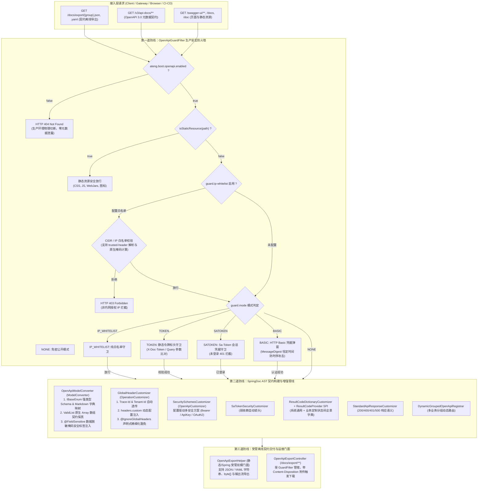

# ateng-boot-openapi OpenAPI 接口契约治理与安全底座

> 面向生产就绪的企业级 RESTful 接口契约治理、五模生产安全防火墙与受管离线契约交付底座。全面拥抱 **SpringDoc 官方原生标准生态（Swagger UI 5.x，依赖 `springdoc-openapi-starter-webmvc-ui:2.6.0`）**，坚持纯原生、零臃肿依赖与强类型契约设计，深度协同 Core 模块的 `IBaseEnum`、`ValidList` 与 `@Sensitive` 原语，为分布式微服务与单体应用提供可信契约基础设施。

---

## 0. 特性与公共 API 全景速查矩阵

| 特性分类 | 特性名称 | 核心门面 / 注解 / SPI | 关键配置项 (`ateng.boot.openapi.*`) | 关键 API 签名 / 核心行为 | 锚定验证源头 (*Test / Sample) |
| :--- | :--- | :--- | :--- | :--- | :--- |
| **装配生命周期** | 核心契约自动装配 | `OpenApiAutoConfiguration` | `enabled` (默认 `true`) | `customOpenAPI(OpenApiProperties)`: 构建基础 OpenAPI 3.0 元数据契约 | [OpenApiAutoConfigurationTest](./src/test/java/io/github/atengk/boot/openapi/autoconfigure/OpenApiAutoConfigurationTest.java) |
| **快捷路由** | /docs 友好路由重定向 | `OpenApiAutoConfiguration` | `redirect-docs` (默认 `true`) | `openApiWebMvcConfigurer`: 注册 `/docs` 与 `/doc` 302 重定向至 `/swagger-ui/index.html` | [OpenApiSampleEndToEndTest](../ateng-boot-samples/ateng-boot-sample-openapi/src/test/java/io/github/atengk/boot/sample/openapi/OpenApiSampleEndToEndTest.java) |
| **安全防御** | 生产环境物理切断 (404) | `OpenApiGuardFilter` | `enabled=false` | `doFilter(...)`: 彻底切断 Swagger UI、`/v3/api-docs` 及离线导出端点，原生响应 404 | [OpenApiGuardIntegrationTest](../ateng-boot-samples/ateng-boot-sample-openapi/src/test/java/io/github/atengk/boot/sample/openapi/OpenApiGuardIntegrationTest.java) |
| **安全防御** | HTTP Basic 访问守卫 | `OpenApiGuardFilter` | `guard.mode=BASIC`<br>`guard.basic.username`<br>`guard.basic.password` | `handleBasicAuth`: 触发标准 HTTP 401 `WWW-Authenticate: Basic` 弹窗，恒定时间比对防时序攻击 | [OpenApiGuardFilterTest](./src/test/java/io/github/atengk/boot/openapi/guard/OpenApiGuardFilterTest.java) |
| **安全防御** | Sa-Token 会话凭证守卫 | `OpenApiGuardFilter` | `guard.mode=SATOKEN` | `handleSaTokenAuth`: 弱依赖联动 Sa-Token 会话，未登录用户拒绝访问返回 401 | [OpenApiGuardFilterTest](./src/test/java/io/github/atengk/boot/openapi/guard/OpenApiGuardFilterTest.java) |
| **安全防御** | 静态令牌 (TOKEN) 守卫 | `OpenApiGuardFilter` | `guard.mode=TOKEN`<br>`guard.token.secret`<br>`guard.token.header-name`<br>`guard.token.allow-query-param`<br>`guard.token.query-param-name` | `handleTokenAuth`: 比对 `X-Doc-Token` 或 `?doc-token=xxx`，恒定时间防时序攻击比对 | [OpenApiGuardFilterTest](./src/test/java/io/github/atengk/boot/openapi/guard/OpenApiGuardFilterTest.java) |
| **安全防御** | CIDR 白名单网络防火墙 | `OpenApiGuardFilter`<br>`OpenApiCidrMatcher` | `guard.mode=IP_WHITELIST`<br>`guard.ip-whitelist.cidrs`<br>`guard.ip-whitelist.trusted-header`<br>`guard.ip-whitelist.enabled` | `matches(String clientIp)`: 支持 IPv4/IPv6 与子网掩码计算，配置反代受信任标头深度防伪造 | [OpenApiCidrMatcherTest](./src/test/java/io/github/atengk/boot/openapi/guard/OpenApiCidrMatcherTest.java) |
| **安全防御** | 静态资源白名单放行 | `OpenApiGuardFilter` | `guard.mode` | `isStaticResource(path)`: 对 CSS, JS, WebJars, 图标等静态资源免密放行，防御样式死锁 | [OpenApiGuardFilterTest](./src/test/java/io/github/atengk/boot/openapi/guard/OpenApiGuardFilterTest.java) |
| **契约模型保真** | IBaseEnum 强类型枚举映射 | `OpenApiModelConverter` | 无需配置，自动探测 | `resolve(...)`: 映射真实 Integer/String 强类型 Schema，注入 `enum` 取值、Markdown 字典与示例 | [OpenApiModelConverterTest](./src/test/java/io/github/atengk/boot/openapi/converter/OpenApiModelConverterTest.java) |
| **契约模型保真** | ValidList 批量数组保真 | `OpenApiModelConverter` | 无需配置，自动探测 | `resolve(...)`: 拦截泛型 `ValidList<E>` 并精确转换为原生 `ArraySchema` `[ { item } ]` | [OpenApiModelConverterTest](./src/test/java/io/github/atengk/boot/openapi/converter/OpenApiModelConverterTest.java) |
| **契约模型保真** | @FieldSensitive 脱敏警示 | `OpenApiModelConverter` | 无需配置，自动探测 | `resolve(...)`: 为脱敏字段注入 `[脱敏字段: xxx掩码]` 警示前缀与标准示例掩码值 | [OpenApiModelConverterTest](./src/test/java/io/github/atengk/boot/openapi/converter/OpenApiModelConverterTest.java) |
| **标头透传** | 全链路追踪头自动注入 | `GlobalHeaderCustomizer` | `headers.trace-id` (默认 `true`) | `customize(Operation, HandlerMethod)`: 自动向每个接口 Operation 注入请求头 `X-Trace-Id` | [GlobalHeaderCustomizerTest](./src/test/java/io/github/atengk/boot/openapi/customizer/GlobalHeaderCustomizerTest.java) |
| **标头透传** | 多租户标识头自动注入 | `GlobalHeaderCustomizer` | `headers.tenant-id` (默认 `true`) | `customize(Operation, HandlerMethod)`: 自动向每个接口 Operation 注入请求头 `X-Tenant-Id` | [GlobalHeaderCustomizerTest](./src/test/java/io/github/atengk/boot/openapi/customizer/GlobalHeaderCustomizerTest.java) |
| **标头透传** | 自定义全局请求头配置注入 | `GlobalHeaderCustomizer` | `headers.custom` (列表) | `customize(Operation, HandlerMethod)`: 声明式注入自定义 Header（名称、描述、必填项与示例） | [GlobalHeaderCustomizerTest](./src/test/java/io/github/atengk/boot/openapi/customizer/GlobalHeaderCustomizerTest.java) |
| **标头豁免** | 声明式精细化请求头豁免 | `@IgnoreGlobalHeaders` | 注解驱动 | 标注于类或方法上，支持无参全量豁免或精准指定豁免名单（如 `{"X-Tenant-Id"}`） | [GlobalHeaderCustomizerTest](./src/test/java/io/github/atengk/boot/openapi/customizer/GlobalHeaderCustomizerTest.java) |
| **通用鉴权** | 配置化多安全方案挂载 | `SecuritySchemesCustomizer` | `security-schemes` (列表) | `customise(OpenAPI)`: 配置驱动向 Components 注册 HTTP Bearer、ApiKey 并全局激活锁头 | [SecuritySchemesCustomizerTest](./src/test/java/io/github/atengk/boot/openapi/customizer/SecuritySchemesCustomizerTest.java) |
| **鉴权集成** | Sa-Token 锁头自动感知 | `SaTokenSecurityCustomizer` | 弱依赖感知 | `customise(OpenAPI)`: 探测并提取 Sa-Token 密钥名称，注册 APIKey 并激活锁头 | [SaTokenSecurityCustomizerTest](./src/test/java/io/github/atengk/boot/openapi/customizer/SaTokenSecurityCustomizerTest.java) |
| **状态码规范** | 通用状态码全景字典注入 | `ResultCodeDictionaryCustomizer` | `show-result-codes` (默认 `true`) | `customise(OpenAPI)`: 自动向 `Info.description` 追加 Core 模块通用状态码 Markdown 字典 | [ResultCodeDictionaryCustomizerTest](./src/test/java/io/github/atengk/boot/openapi/customizer/ResultCodeDictionaryCustomizerTest.java) |
| **状态码扩展** | 业务状态码字典 SPI 扩展 | `ResultCodeProvider` | SPI 注册 | `getResultCodes()`, `getTitle()`, `resolveScenario()`: 动态向全局描述注入业务领域状态码字典 | [ResultCodeProviderTest](./src/test/java/io/github/atengk/boot/openapi/customizer/ResultCodeProviderTest.java) |
| **契约规范** | 标准 HTTP 响应说明补全 | `StandardApiResponseCustomizer` | `standard-responses` (默认 `true`) | `customize(Operation, HandlerMethod)`: 为 Operation 补全 200/400/401/500 响应语义 | [StandardApiResponseCustomizerTest](./src/test/java/io/github/atengk/boot/openapi/customizer/StandardApiResponseCustomizerTest.java) |
| **业务分组** | 配置驱动多业务分组路由 | `DynamicGroupedOpenApiRegistrar` | `groups` (配置列表) | `registerBeanDefinitions(...)`: 依据配置动态注册多 `GroupedOpenApi`，未配置时兜底单全量 | [DynamicGroupedOpenApiRegistrarTest](./src/test/java/io/github/atengk/boot/openapi/group/DynamicGroupedOpenApiRegistrarTest.java) |
| **离线交付** | 离线契约导出门面助手 | `OpenApiExportHelper` | `exportJson(...)`<br>`exportYaml(...)`<br>`exportBytes(...)`<br>`export(...)` | 支持指定分组或全量 OpenAPI 规范导出为 JSON/YAML 字符串、字节数组或写入输出流 | [OpenApiExportHelperTest](./src/test/java/io/github/atengk/boot/openapi/export/OpenApiExportHelperTest.java)<br>[OpenApiSampleEndToEndTest](../ateng-boot-samples/ateng-boot-sample-openapi/src/test/java/io/github/atengk/boot/sample/openapi/OpenApiSampleEndToEndTest.java) |
| **离线交付** | 受管离线契约导出 REST 控制器 | `OpenApiExportController` | `export.enabled: true` | `GET /docs/export/{group}.json` 与 `/{group}.yaml`，带 `Content-Disposition` 附件下载响应头 | [OpenApiExportControllerTest](./src/test/java/io/github/atengk/boot/openapi/export/OpenApiExportControllerTest.java) |

---

## 1. 模块定位与快速起步

只需引入依赖，即可享受零配置开箱即用的 OpenAPI 3.0 接口文档、全链路 TraceId 自动注入与 `/docs` 极简友好重定向：

### 1.1 引入 Maven 依赖

`ateng-boot` 遵循 BOM 依赖版本统管规范（ADR-0003），子模块引入免配 `<version>`：

```xml
<dependency>
    <groupId>io.github.atengk</groupId>
    <artifactId>ateng-boot-openapi</artifactId>
</dependency>
```

### 1.2 最小起步配置 (`application.yml`)

```yaml
ateng:
  boot:
    openapi:
      enabled: true
      title: "电商中台微服务 API 契约沙箱"
      version: "1.0.0"
      description: "基于 ateng-boot 构建的标准化接口契约文档"
      headers:
        trace-id: true
        tenant-id: true
      redirect-docs: true
```

### 1.3 Controller 极简实战编码（显式强契约 Result<T>）

```java
@Tag(name = "运营管理端 - 用户治理", description = "面向后台管理系统管理员的用户创建、明细查询与列表治理接口")
@RestController
@RequestMapping("/sample/openapi/admin/users")
public class AdminUserController {

    /**
     * 创建系统用户
     *
     * @param request 创建参数
     * @return 统一响应包装的新建用户视图
     */
    @Operation(summary = "创建系统用户", description = "校验账号格式与邮箱唯一性，成功后初始化并返回用户明细")
    @PostMapping
    public Result<AdminUserVO> createUser(@Valid @RequestBody AdminUserCreateRequest request) {
        AdminUserVO user = AdminUserVO.of(
                10001L,
                request.getUsername(),
                request.getRealName(),
                request.getEmail(),
                "13800138000"
        );
        return Result.success(user);
    }
}
```

启动应用后，在浏览器访问 `http://localhost:8080/docs` 或 `http://localhost:8080/doc`，将自动 302 重定向至 Swagger UI 交互界面。

---

## 2. 核心架构与设计不变量

`ateng-boot-openapi` 架构坚持“外置安全守卫切面 + 内部 AST 契约保真构建 + 离线交付门面”的纵深防御模型：



### 核心设计不变量

1. **契约真实保真不变量 (Zero-Entity-Leakage & Semantic Truth)**：Controller 边界 100% 严禁直接接收或返回持久层 Entity；基于 `OpenApiModelConverter`，实现 Core 模块 `IBaseEnum` 的枚举映射为原生 integer/string Schema，`ValidList<E>` 100% 保真映射为原生 JSON Array，消除泛型擦除与反射歧义。
2. **生产纵深安全不变量 (Zero-Data-Leakage)**：生产环境通过 `enabled: false` 实施物理 404 切断，彻底卸载文档组件；守卫认证采用恒定时间比对，杜绝时序攻击；反向代理 IP 解析仅在声明 `trusted-header` 时提取，默认以物理连接 IP 保底，防御标头伪造。
3. **全链路透明透传与精细化豁免不变量 (Transparent Headers & Exemption)**：网关追踪与多租户标头自动无感挂载至每个 Operation；对外公开端点（登录、健康探针）依托 `@IgnoreGlobalHeaders` 声明式精准剔除内部标头。
4. **双模离线交付不变量 (Dual-Mode Spec Delivery)**：同时具备受管 HTTP 端点 `/docs/export/**`（自动挂载 `Content-Disposition` 附件标头）与无依赖静态门面 `OpenApiExportHelper`，无缝服务于前端 SDK 自动生成与 CI/CD 契约归档。

---

## 3. 契约模型治理与语义保真套件

### 3.1 IBaseEnum 强类型枚举与 Markdown 全景字典

针对 Core 模块强类型枚举契约 `IBaseEnum<T>`（ADR-0060），`OpenApiModelConverter` 自动解析其实际数据类型（Integer 或 String），填充合法取值集合与格式化 Markdown 表格字典。

#### 1. 专属配置片段
```yaml
ateng:
  boot:
    openapi:
      enabled: true # 模型转换器自动装配激活，无需额外配置
```

#### 2. 实战 Java 示例代码
```java
public enum UserStatusEnum implements IBaseEnum<Integer> {
    ENABLE(1, "启用"),
    DISABLE(0, "停用");

    private final Integer code;
    private final String label;

    UserStatusEnum(Integer code, String label) {
        this.code = code;
        this.label = label;
    }

    @Override
    public Integer getCode() {
        return code;
    }

    @Override
    public String getLabel() {
        return label;
    }
}
```

#### 3. 核心机制与预期契约输出
- **底层机制**：SpringDoc 反射解析该字段时，`OpenApiModelConverter` 拦截其 Class 类型，判定实现 `IBaseEnum` 接口后，调用 `getCode()` 获取实际泛型类型，将 Schema `type` 置为对应原生类型，向 `enum` 数组注入真实业务码值，并在 `description` 追加枚举说明字典。
- **生成的 OpenAPI JSON 契约片段**：
  ```json
  "status": {
    "type": "integer",
    "description": "账号状态<br/>**枚举选项：**<br/>- `1`: 启用 (ENABLE)<br/>- `0`: 停用 (DISABLE)",
    "enum": [ 1, 0 ],
    "example": 1
  }
  ```

---

### 3.2 ValidList 原生 JSON 数组契约保真

为批量列表入参（ADR-0027）使用 `ValidList<E>` 时，原生 SpringDoc 会将其解析为普通包装对象，导致文档显示为 `{ "list": [...] }`。`OpenApiModelConverter` 拦截并将其重塑为标准原生 JSON 数组 `[ { item } ]`。

#### 1. 专属配置片段
```yaml
ateng:
  boot:
    openapi:
      enabled: true
```

#### 2. 实战 Java 示例代码
```java
/**
 * 批量创建系统用户（演示 ValidList 原生 Array 契约）
 *
 * @param requestList 批量创建参数列表
 * @return 创建条数
 */
@Operation(summary = "批量创建系统用户", description = "批量校验入参并初始化多个系统用户，支持 ValidList 原生 JSON 数组契约")
@PostMapping("/batch")
public Result<Integer> batchCreateUsers(@Valid @RequestBody ValidList<AdminUserCreateRequest> requestList) {
    return Result.success(requestList != null ? requestList.size() : 0);
}
```

#### 3. 核心机制与预期契约输出
- **底层机制**：`OpenApiModelConverter` 检查解析上下文类型是否属于 `ValidList`，若是则递归提取泛型参数 `E` 的 Schema，构建原生 `ArraySchema` 并将泛型 Schema 设置为其 `items`。
- **生成的 OpenAPI JSON 契约片段**：
  ```json
  "requestBody": {
    "content": {
      "application/json": {
        "schema": {
          "type": "array",
          "items": {
            "$ref": "#/components/schemas/AdminUserCreateRequest"
          }
        }
      }
    }
  }
  ```

---

### 3.3 @FieldSensitive 数据脱敏安全警示标签

Core 模块在内存中保持真实明文（ADR-0012），出界时由 Jackson `@Sensitive` 掩码。`OpenApiModelConverter` 感知脱敏注解，自动注入掩码安全警示前缀与掩码示例值。

#### 1. 专属配置片段
```yaml
ateng:
  boot:
    openapi:
      enabled: true
```

#### 2. 实战 Java 示例代码
```java
@Schema(description = "管理端用户视图对象")
public class AdminUserVO {

    @FieldSensitive(SensitiveType.MOBILE_PHONE)
    @Schema(description = "联系手机号码")
    private String phone;

    // ... 其余字段与 Getter/Setter
}
```

#### 3. 核心机制与预期契约输出
- **底层机制**：解析 JavaBean 属性时，提取字段或 Getter 上的 `@Sensitive` / `@FieldSensitive` 注解，获取脱敏策略类型，自动为字段描述追加 `[脱敏字段: 手机号码掩码]` 前缀，并填充标准示例掩码值（如 `138****5678`）。
- **生成的 OpenAPI JSON 契约片段**：
  ```json
  "phone": {
    "type": "string",
    "description": "联系手机号码 [脱敏字段: 手机号码掩码]",
    "example": "138****5678"
  }
  ```

---

## 4. 全链路请求头治理与精细化豁免

### 4.1 全链路 Trace-Id / Tenant-Id 与自定义请求头自动透传

`GlobalHeaderCustomizer` 统一介入 SpringDoc AST 构建，为所有接口自动追加链路追踪头与多租户头，免除在每个 Controller 方法上手动标注 `@Parameter` 的冗余样板代码。

#### 1. 专属配置片段
```yaml
ateng:
  boot:
    openapi:
      headers:
        trace-id: true     # 自动注入 X-Trace-Id (String, 链路追踪追踪标识)
        tenant-id: true    # 自动注入 X-Tenant-Id (Long, 多租户租户标识)
        custom:
          - name: "X-App-Version"
            description: "客户端应用版本号"
            required: false
            example: "1.2.0"
```

#### 2. 实战 Java 示例代码
业务 Controller 无需任何 `@Parameter(in = ParameterIn.HEADER, ...)` 样板代码，普通端点即可自动挂载配置的全部全局请求头：

```java
@Tag(name = "运营管理端 - 用户治理", description = "面向后台管理系统管理员的用户创建、明细查询与列表治理接口")
@RestController
@RequestMapping("/sample/openapi/admin/users")
public class AdminUserController {

    /**
     * 查询用户列表（自动透传 X-Trace-Id, X-Tenant-Id 与自定义 X-App-Version）
     */
    @Operation(summary = "查询系统用户全量列表", description = "检索全量受管用户简要信息")
    @GetMapping
    public Result<List<AdminUserVO>> listUsers() {
        List<AdminUserVO> list = List.of(
                AdminUserVO.of(10001L, "admin_dev", "系统管理员"),
                AdminUserVO.of(10002L, "operator", "普通运营人员", "operator@example.com", "13900139000")
        );
        return Result.success(list);
    }
}
```

#### 3. 核心机制与预期契约输出
- **底层机制**：实现 SpringDoc `OperationCustomizer`，在 AST 节点遍历所有接口的 Operation 参数列表，若不存在指定 Header 则动态追加 `Parameter.in("header")`。
- **生成的 OpenAPI JSON 契约片段**：
  ```json
  "parameters": [
    {
      "name": "X-Trace-Id",
      "in": "header",
      "description": "全链路追踪 ID (Trace ID)",
      "required": false,
      "schema": { "type": "string" }
    },
    {
      "name": "X-Tenant-Id",
      "in": "header",
      "description": "多租户标识 (Tenant ID)",
      "required": false,
      "schema": { "type": "integer", "format": "int64" }
    },
    {
      "name": "X-App-Version",
      "in": "header",
      "description": "客户端应用版本号",
      "required": false,
      "schema": { "type": "string" },
      "example": "1.2.0"
    }
  ]
  ```

---

### 4.2 @IgnoreGlobalHeaders 声明式精细化与全量请求头豁免

针对对外开放端点（如管理员登录、公开心跳探针、第三方回调），内部的多租户或应用版本头不应暴露在文档中。使用 `@IgnoreGlobalHeaders` 声明式精准或全量剔除。

#### 1. 专属配置片段
```yaml
ateng:
  boot:
    openapi:
      headers:
        trace-id: true
        tenant-id: true
```

#### 2. 实战 Java 示例代码
```java
@Tag(name = "运营管理端 - 开放认证", description = "面向管理员的登录鉴权开放端点")
@RestController
@RequestMapping("/sample/openapi/admin/auth")
public class AdminAuthController {

    /**
     * 精准豁免 X-Tenant-Id，保留 X-Trace-Id 与自定义请求头
     */
    @Operation(summary = "管理员登录认证", description = "声明式精准豁免 X-Tenant-Id 租户头")
    @IgnoreGlobalHeaders({"X-Tenant-Id"})
    @PostMapping("/login")
    public Result<String> login(@Valid @RequestBody LoginRequest request) {
        return Result.success("mock-jwt-token-12345");
    }

    /**
     * 无参全量豁免所有全局请求头，保持公开端点绝对纯净
     */
    @Operation(summary = "公开系统心跳探针", description = "声明式全量豁免所有全局请求头")
    @IgnoreGlobalHeaders
    @GetMapping("/ping")
    public Result<String> ping() {
        return Result.success("pong");
    }
}
```

#### 3. 核心机制与预期契约输出
- **精准豁免**：声明 `@IgnoreGlobalHeaders({"X-Tenant-Id"})` 时，`GlobalHeaderCustomizer` 在注入请求头前比对白名单，精准跳过指定名称的请求头，其余全局头（如 `X-Trace-Id` 与自定义头）正常保留；
- **全量豁免**：声明无参 `@IgnoreGlobalHeaders` 时，当前类或方法下所有接口直接跳过所有全局请求头注入逻辑。
- **生成的 OpenAPI JSON 契约片段对比**：
  ```json
  // 1. /sample/openapi/admin/auth/login (精准豁免 X-Tenant-Id，保留 X-Trace-Id 与自定义头)
  "paths": {
    "/sample/openapi/admin/auth/login": {
      "post": {
        "summary": "管理员登录认证",
        "parameters": [
          {
            "name": "X-Trace-Id",
            "in": "header",
            "required": false,
            "schema": { "type": "string" }
          },
          {
            "name": "X-App-Version",
            "in": "header",
            "required": false,
            "schema": { "type": "string" }
          }
        ]
      }
    },
    // 2. /sample/openapi/admin/auth/ping (全量豁免所有全局请求头，无 parameters 字段)
    "/sample/openapi/admin/auth/ping": {
      "get": {
        "summary": "公开系统心跳探针"
      }
    }
  }
  ```

---

## 5. 多业务分组与动态路由

### 5.1 配置驱动 GroupedOpenApi 动态注册与路由匹配

`DynamicGroupedOpenApiRegistrar` 实现 `ImportBeanDefinitionRegistrar`，依据 YAML 配置动态向 Spring 容器注册多个 `GroupedOpenApi`，实现管理端与移动端接口的物理隔离与独立选项卡展示。

#### 1. 专属配置片段
```yaml
ateng:
  boot:
    openapi:
      groups:
        - group: "admin"
          display-name: "运营管理端 (Admin API)"
          paths-to-match:
            - "/sample/openapi/admin/**"
          packages-to-scan:
            - "io.github.atengk.boot.sample.openapi.controller.admin"
        - group: "app"
          display-name: "移动端服务 (App API)"
          paths-to-match:
            - "/sample/openapi/app/**"
          packages-to-scan:
            - "io.github.atengk.boot.sample.openapi.controller.app"
```

#### 2. 实战 Java 示例代码
业务按架构层次归属不同的包路径与路由前缀，无需手动编写繁琐的 `GroupedOpenApi` `@Bean` 声明：

```java
// 1. 运营管理端控制器（包路径：io.github.atengk.boot.sample.openapi.controller.admin，路由前缀：/sample/openapi/admin/**）
@Tag(name = "运营管理端 - 用户治理", description = "面向后台管理系统管理员的用户创建、明细查询与列表治理接口")
@RestController
@RequestMapping("/sample/openapi/admin/users")
public class AdminUserController {
    // 管理端接口实现...
}

// 2. 移动端文章控制器（包路径：io.github.atengk.boot.sample.openapi.controller.app，路由前缀：/sample/openapi/app/**）
@Tag(name = "移动端 - 文章资讯", description = "面向移动终端与小程序端的信息流推荐、分类阅读与文章详情接口")
@RestController
@RequestMapping("/sample/openapi/app/articles")
public class AppArticleController {
    // 移动端接口实现...
}
```

#### 3. 核心机制与预期契约输出
- **动态 Bean 注册**：在 Spring 容器启动早期，依据 `ateng.boot.openapi.groups` 列表逐项构造 `GroupedOpenApi` 的 `BeanDefinition` 并动态注入，支持设置展示名称、匹配路径通配符与包扫描路径；
- **兜底全量分组**：若 YAML 中未配置任何 `groups` 列表，自动注册名为 `default` 的全量分组，扫描全路径 `/**`。
- **分组元数据路由与契约隔离输出**：
  - 管理端专属元数据：`GET /v3/api-docs/admin`（仅包含 admin 路由，排斥 app 路由）：
    ```json
    {
      "openapi": "3.0.1",
      "info": { "title": "ateng-boot OpenAPI 生产级契约沙箱" },
      "paths": {
        "/sample/openapi/admin/users": { ... },
        "/sample/openapi/admin/auth/login": { ... }
      }
    }
    ```
  - 移动端专属元数据：`GET /v3/api-docs/app`（仅包含 app 路由，排斥 admin 路由）：
    ```json
    {
      "openapi": "3.0.1",
      "info": { "title": "ateng-boot OpenAPI 生产级契约沙箱" },
      "paths": {
        "/sample/openapi/app/articles": { ... }
      }
    }
    ```

---

## 6. 五模生产安全守卫与 CIDR 前置防火墙

### 6.1 生产环境 404 物理切断防元数据泄漏

当服务部署于生产公网环境且不允许对外开放 Swagger UI 或 API 元数据时，通过物理开关实施彻底切断。

#### 1. 专属配置片段
```yaml
ateng:
  boot:
    openapi:
      enabled: false # 生产环境一键切断
```

#### 2. 核心机制与预期契约输出
- **物理卸载**：所有 OpenAPI 契约构建 Bean、Swagger UI 自动配置与重定向路由均被 `@ConditionalOnProperty` 拦截而不会实例化；
- **最高优先级前沿切断**：`OpenApiGuardFilter` 注册在 Servlet 过滤链前沿，拦截任何匹配 `/swagger-ui/**`、`/docs`、`/doc`、`/v3/api-docs/**` 与 `/docs/export/**` 的请求，直接响应 HTTP 404 Not Found，杜绝渗透扫描与任何契约元数据泄漏。
- **物理切断 HTTP 响应报文**：
  ```http
  GET /v3/api-docs HTTP/1.1
  Host: api.example.com

  HTTP/1.1 404 Not Found
  Content-Length: 0
  ```

---

### 6.2 五大生产认证模式切换

通过 `ateng.boot.openapi.guard.mode` 灵活切换访问文档门户的安全防护等级：

#### 1. 专属配置片段
```yaml
ateng:
  boot:
    openapi:
      guard:
        mode: BASIC # 可选：NONE, BASIC, SATOKEN, TOKEN, IP_WHITELIST
        basic:
          username: "admin"
          password: "admin123"
        token:
          secret: "sample-doc-token"
          header-name: "X-Doc-Token"
          allow-query-param: true
          query-param-name: "doc-token"
        ip-whitelist:
          enabled: true
          trusted-header: "X-Forwarded-For"
          cidrs:
            - "127.0.0.1"
            - "10.0.0.0/8"
            - "192.168.0.0/16"
```

#### 2. 各模式行为机制
- **`NONE`（默认开放模式）**：免密直接访问，适合本地开发与内网沙箱测试；
- **`BASIC`（HTTP Basic 质询模式）**：未登录客户端触发标准 HTTP 401 `WWW-Authenticate: Basic realm="..."` 浏览器原生登录弹窗，凭据比对采用 `MessageDigest.isEqual` 恒定时间算法防时序攻击；
- **`SATOKEN`（会话鉴权桥接模式）**：弱依赖桥接 Sa-Token 鉴权中心，未登录用户访问文档直接响应 HTTP 401；
- **`TOKEN`（静态令牌标头模式）**：专为 CI/CD 自动化拉取设计，校验请求头 `X-Doc-Token: secret` 或 Query 参数 `?doc-token=secret`；
- **`IP_WHITELIST`（纯 IP 白名单模式）**：非白名单 IP 访问文档统一响应 HTTP 403 Forbidden。

---

### 6.3 CIDR 子网掩码计算与受信任反代标头防伪造

`OpenApiCidrMatcher` 提供纳秒级 IPv4 / IPv6 子网掩码位运算，配合反向代理防护机制守卫网络边界。

#### 1. 核心防御机制
- **受信任反代标头解析 (`trusted-header`)**：当应用部署于 Nginx、Envoy、Ingress 等反代背后时，配置 `trusted-header: X-Forwarded-For` 将提取反代链路首个客户端真实 IP 进行白名单比对；
- **防客户端标头伪造保底**：**未显式配置 `trusted-header` 时，强制仅读取物理网络套接字连接 IP (`request.getRemoteAddr()`)**，杜绝公网攻击者随意伪造 Header 绕过白名单；
- **静态资源免密白名单放行**：对 CSS, JS, WebJars, 图标等纯静态前端资产自动免密放行，防止浏览器因样式表二次鉴权失败而导致页面样式死锁崩溃。

---

## 7. 契约规范与状态码全景字典

### 7.1 ResultCodeProvider 业务状态码 SPI 扩展

除 Core 模块内置的 `CommonResultCode` 外，各领域业务模块通过实现 `ResultCodeProvider` 接口，可将自身模块特有的业务状态码自动汇入全局文档描述中。

#### 1. 专属配置片段
```yaml
ateng:
  boot:
    openapi:
      show-result-codes: true # 默认 true，开启状态码全景字典注入
```

#### 2. 实战 Java 示例代码
```java
@Component
public class SampleResultCodeProvider implements ResultCodeProvider {

    public enum SampleBusinessCode implements IResultCode {
        ARTICLE_AUDIT_PENDING(8001, "文章正在审核中"),
        USER_ACCOUNT_LOCKED(8002, "用户账号已被风控锁定");

        private final Integer code;
        private final String msg;

        SampleBusinessCode(Integer code, String msg) {
            this.code = code;
            this.msg = msg;
        }

        @Override
        public Integer getCode() {
            return code;
        }

        @Override
        public String getMsg() {
            return msg;
        }
    }

    @Override
    public String getTitle() {
        return "### 样例工程自定义业务状态码字典 (Sample Result Codes)";
    }

    @Override
    public Collection<? extends IResultCode> getResultCodes() {
        return Arrays.asList(SampleBusinessCode.values());
    }

    @Override
    public String resolveScenario(IResultCode resultCode) {
        if (resultCode == SampleBusinessCode.ARTICLE_AUDIT_PENDING) {
            return "敏感词拦截或新发布内容进入人工审核队列";
        }
        if (resultCode == SampleBusinessCode.USER_ACCOUNT_LOCKED) {
            return "密码输错超限或异常地理位置登录触发风控冻结";
        }
        return resultCode.getMsg();
    }

    @Override
    public int getOrder() {
        return 10;
    }
}
```

#### 3. 核心机制与预期契约输出
- **底层机制**：`ResultCodeDictionaryCustomizer` 收集容器中所有 `ResultCodeProvider` Bean，按照 `getOrder()` 升序排序，逐个生成 Markdown 格式的状态码表格，自动追加至全局 `OpenAPI.info.description` 尾部，使接口消费方在文档首页即可纵览全系统状态码。
- **注入到 `info.description` 的 Markdown 字典输出片段**：
  ```markdown
  ### 样例工程自定义业务状态码字典 (Sample Result Codes)

  | 业务状态码 (Code) | 提示信息 (Message) | 触发场景 / 业务语义说明 |
  | :--- | :--- | :--- |
  | `8001` | 文章正在审核中 | 敏感词拦截或新发布内容进入人工审核队列 |
  | `8002` | 用户账号已被风控锁定 | 密码输错超限或异常地理位置登录触发风控冻结 |
  ```

---

### 7.2 标准 HTTP 响应模型与语义说明

`StandardApiResponseCustomizer` 遵循企业 REST 规范，自动向所有接口 Operation 补全 200, 400, 401, 500 标准响应语义，且尊重开发者手动指定的 `@ApiResponse`。

#### 1. 专属配置片段
```yaml
ateng:
  boot:
    openapi:
      standard-responses: true # 默认 true
```

#### 2. 实战 Java 示例代码
业务控制器方法无需重复罗列通用的 400/401/500 等 `@ApiResponse` 注解，由框架自动统一补全：

```java
@Operation(summary = "查询用户详情", description = "根据用户主键 ID 检索基础信息与状态")
@GetMapping("/{id}")
public Result<AdminUserVO> getUserById(@Parameter(description = "用户唯一 ID", example = "10001") @PathVariable("id") Long id) {
    AdminUserVO user = AdminUserVO.of(id, "admin_dev", "系统管理员");
    return Result.success(user);
}
```

#### 3. 核心机制与预期契约输出
- **底层机制**：若接口未显式声明 200，自动追加 `HTTP 200: 操作成功`；自动为所有接口追加 `HTTP 400: 参数校验失败 (Bad Request)`、`HTTP 401: 未认证或认证已过期 (Unauthorized)` 与 `HTTP 500: 服务器内部错误 (Internal Server Error)`，统一全系统契约规范；
- **生成的 Operation responses JSON 契约片段**：
  ```json
  "responses": {
    "200": {
      "description": "操作成功",
      "content": {
        "application/json": {
          "schema": {
            "$ref": "#/components/schemas/ResultAdminUserVO"
          }
        }
      }
    },
    "400": {
      "description": "参数校验失败 (Bad Request)"
    },
    "401": {
      "description": "未认证或认证已过期 (Unauthorized)"
    },
    "500": {
      "description": "服务器内部错误 (Internal Server Error)"
    }
  }
  ```

---

## 8. 契约交付与离线导出门面

### 8.1 OpenApiExportHelper 静态与流式双模门面

在无需启动 Web 容器的单元测试、构建插件或 CI/CD 脚本中，使用 `OpenApiExportHelper` 门面类直接导出格式化契约：

```java
// 1. 导出指定业务分组的格式化 JSON 字符串
String adminJson = OpenApiExportHelper.exportJson("admin");

// 2. 导出默认全量分组的 YAML 字符串
String defaultYaml = OpenApiExportHelper.exportYaml();

// 3. 导出指定分组的二进制字节数组 (UTF-8)
byte[] bytes = OpenApiExportHelper.exportBytes("admin", OpenApiFormat.JSON);

// 4. 流式直接写入输出流 (文件或 HTTP 响应流，内存恒定防 OOM)
try (FileOutputStream fos = new FileOutputStream("target/openapi-admin.yaml")) {
    OpenApiExportHelper.export("admin", OpenApiFormat.YAML, fos);
}
```

---

### 8.2 受管下载端点 `/docs/export/**` 一键交付

配置激活后，系统自动挂载轻量 REST 下载端点，携带标准 `Content-Disposition: attachment` 响应头：

#### 1. 专属配置片段
```yaml
ateng:
  boot:
    openapi:
      export:
        enabled: true # 激活受管离线下载端点
```

#### 2. 下载端点矩阵

| 请求路径 | 契约格式 | 对应分组 | 触发下载附件文件名 |
| :--- | :--- | :--- | :--- |
| `GET /docs/export/json` | JSON | 默认全量 | `openapi-default.json` |
| `GET /docs/export/yaml` | YAML | 默认全量 | `openapi-default.yaml` |
| `GET /docs/export/{group}.json` | JSON | 指定业务域 (`admin` / `app`) | `openapi-{group}.json` |
| `GET /docs/export/{group}.yaml` | YAML | 指定业务域 (`admin` / `app`) | `openapi-{group}.yaml` |

#### 3. 核心机制与预期下载输出
- **底层机制**：`OpenApiExportController` 拦截下载端点，调用 `OpenApiExportHelper` 实时序列化指定分组的 OpenAPI AST，注入 `Content-Disposition: attachment; filename="..."` 响应头，直接触发浏览器或自动化客户端将内容作为文件下载；
- **导出会话 HTTP 响应报文与附件标头**：
  ```http
  GET /docs/export/admin.json HTTP/1.1
  Host: localhost:8080

  HTTP/1.1 200 OK
  Content-Type: application/json
  Content-Disposition: attachment; filename="openapi-admin.json"

  {
    "openapi": "3.0.1",
    "info": {
      "title": "ateng-boot OpenAPI 生产级契约沙箱",
      "version": "1.0.0"
    },
    "paths": {
      "/sample/openapi/admin/users": { ... },
      "/sample/openapi/admin/auth/login": { ... }
    }
  }
  ```

> **安全管辖说明**：所有离线导出端点均受到 `OpenApiGuardFilter` 生产安全防火墙管辖；若开启 Basic / Token 认证，下载接口同样必须通过认证挑战后方可放行。

---

## 9. 生产扩展接管与高可用运维边界

### 9.1 `@ConditionalOnMissingBean` 扩展接管

框架内部所有核心组件（`OpenAPI`、`GlobalHeaderCustomizer`、`SecuritySchemesCustomizer`、`ResultCodeDictionaryCustomizer`、`StandardApiResponseCustomizer`、`OpenApiExportHelper` 等）均显式标配 `@ConditionalOnMissingBean`，支持业务无缝声明同名或同类型 Bean 进行深度定制。

### 9.2 Swagger UI 与安全方案配置化挂载

无需引入重型安全框架，即可通过声明式配置向 `Components.securitySchemes` 注册 HTTP Bearer (JWT) 或 APIKey，并在 Swagger UI 右上角激活 Authorize 交互弹窗：

```yaml
ateng:
  boot:
    openapi:
      security-schemes:
        - name: "bearerAuth"
          type: "http"
          scheme: "bearer"
          bearer-format: "JWT"
          description: "通用 JWT 认证方案"
```

同时，当检测到类路径存在 Sa-Token 依赖时，`SaTokenSecurityCustomizer` 将自动提取 Sa-Token 的配置密钥名称，注册 APIKey 鉴权方案并全局激活锁头。

### 9.3 核心生产边界与非功能机制

1. **恒定时间防时序攻击**：Basic 认证与静态 Token 认证比对凭据时，严格使用 `java.security.MessageDigest.isEqual(byte[], byte[])` 逐字节比对，彻底防御利用响应延迟推断凭据前缀的时序侧信道攻击；
2. **反向代理受信任标头防线**：未配置 `guard.ip-whitelist.trusted-header` 时，系统决不读取 `X-Forwarded-For` 等可伪造标头，以物理 TCP 连接 IP 为唯一仲裁源；
3. **静态资源放行防样式死锁**：GuardFilter 对静态 Web 资源（`.css`, `.js`, `webjars`, 图标）实施安全免密放行，杜绝浏览器并发拉取静态资源因 401/403 导致 UI 渲染死锁。

---

## 10. 完整 YAML 配置属性清单 (全量速查附录)

以下为 `ateng-boot-openapi` 所纳管的全部配置属性清单，配置前缀统一为 `ateng.boot.openapi`：

```yaml
ateng:
  boot:
    openapi:
      # ==============================================================================
      # 1. 基础元数据与总开关
      # ==============================================================================
      enabled: true                               # 是否启用 OpenAPI 文档（默认 true；生产环境配置 false 触发 404 物理切断）
      title: "ateng-boot API Documentation"       # 接口文档主标题
      description: "Enterprise-grade API documentation powered by ateng-boot" # 接口文档描述信息
      version: "1.0.0"                            # 接口文档版本号
      terms-of-service: "https://example.com/terms" # 服务条款 URL
      redirect-docs: true                         # 是否开启 /docs 与 /doc 友好路由 302 重定向至 Swagger UI（默认 true）
      
      # 文档联系人信息
      contact:
        name: "Ateng"
        url: "https://github.com/atengk"
        email: "admin@example.com"
        
      # 文档许可证信息
      license:
        name: "Apache-2.0"
        url: "https://www.apache.org/licenses/LICENSE-2.0"
        
      # 服务多环境网关 / 根路径列表 (Servers)
      servers:
        - url: "/"
          description: "本地开发与网关直连环境"
        - url: "https://api.example.com"
          description: "生产反向代理网关环境"

      # ==============================================================================
      # 2. 全局请求头自动化注入配置
      # ==============================================================================
      headers:
        trace-id: true                            # 是否自动向所有接口注入 X-Trace-Id 链路追踪请求头（默认 true）
        tenant-id: true                           # 是否自动向所有接口注入 X-Tenant-Id 多租户标识请求头（默认 true）
        custom:                                   # 自定义全局请求头列表
          - name: "X-App-Version"
            description: "客户端应用版本号"
            required: false
            example: "1.2.0"

      # ==============================================================================
      # 3. 多业务分组列表 (GroupedOpenApi)
      # ==============================================================================
      groups:
        - group: "admin"                          # 业务分组唯一标识
          display-name: "运营管理端 (Admin API)"   # Swagger UI 下拉框展示名称
          paths-to-match:                         # 该分组匹配的 URL 路径规则列表
            - "/sample/openapi/admin/**"
          packages-to-scan:                       # 该分组扫描的控制器包名列表
            - "io.github.atengk.boot.sample.openapi.controller.admin"
        - group: "app"
          display-name: "移动端服务 (App API)"
          paths-to-match:
            - "/sample/openapi/app/**"
          packages-to-scan:
            - "io.github.atengk.boot.sample.openapi.controller.app"

      # ==============================================================================
      # 4. 生产安全访问守卫防火墙 (GuardFilter)
      # ==============================================================================
      guard:
        mode: NONE                                # 守卫模式：NONE(免密), BASIC(弹窗), SATOKEN(会话), TOKEN(令牌), IP_WHITELIST(纯白名单)
        
        # HTTP Basic 认证配置 (mode 为 BASIC 时生效)
        basic:
          username: "admin"
          password: "admin123"
          
        # 静态令牌认证配置 (mode 为 TOKEN 时生效)
        token:
          secret: "sample-doc-token"              # 静态访问令牌密钥
          header-name: "X-Doc-Token"              # 携带令牌的请求头名称
          allow-query-param: true                 # 是否允许通过 URL Query 参数传递令牌
          query-param-name: "doc-token"           # URL Query 参数名称
          
        # IP / CIDR 白名单防火墙配置 (支持独立启用或与各模式叠加)
        ip-whitelist:
          enabled: false                          # 是否强制开启 IP 白名单防火墙
          trusted-header: "X-Forwarded-For"       # 反向代理受信任请求头名称（未配置时默认读取物理套接字 IP）
          cidrs:                                  # 允许访问的 IPv4/IPv6 地址或 CIDR 子网段列表
            - "127.0.0.1"
            - "10.0.0.0/8"
            - "192.168.0.0/16"

      # ==============================================================================
      # 5. 契约规范与状态码全景字典
      # ==============================================================================
      show-result-codes: true                     # 是否在文档描述尾部自动追加系统与业务状态码字典表格（默认 true）
      standard-responses: true                    # 是否自动为所有 Operation 补全 200/400/401/500 标准响应语义说明（默认 true）

      # ==============================================================================
      # 6. 通用 SecurityScheme 方案配置列表
      # ==============================================================================
      security-schemes:
        - name: "bearerAuth"                      # 安全方案名称
          type: "http"                            # 方案类型 (http, apiKey, oauth2 等)
          scheme: "bearer"                        # HTTP 协议方案
          bearer-format: "JWT"                    # Bearer Token 格式说明
          description: "通用 JWT 认证方案"

      # ==============================================================================
      # 7. 离线契约交付配置
      # ==============================================================================
      export:
        enabled: true                             # 是否暴露受管离线契约下载端点 /docs/export/**（默认 false）
```
