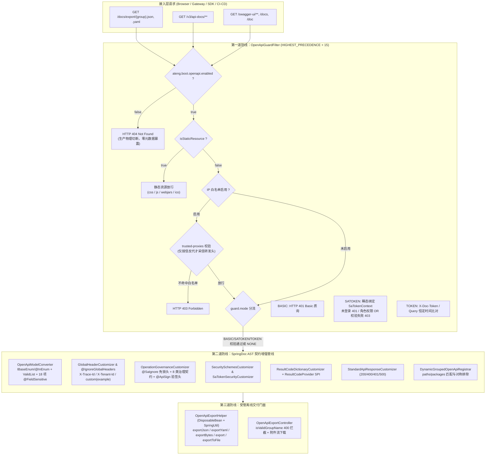

# ateng-boot-openapi OpenAPI 接口契约治理与安全底座

> 面向生产就绪的企业级 RESTful 接口契约治理、五模纵深生产安全防火墙与受管离线契约交付底座。全面拥抱 **SpringDoc 官方原生标准生态（Swagger UI 5.x）**，坚持纯原生、零臃肿依赖与显式 `Result<T>` 强类型契约设计，深度协同 Core 模块的 `IBaseEnum`、`@InEnum`、`ValidList`、`@FieldSensitive`（18 项 `SensitiveType`）、`FileUtil`、`SpringUtil` 与 `CidrMatcher` 原语，并通过零编译依赖内省感知 Sa-Token 与 Web 治理注解，为单体应用与分布式微服务提供全链路可信契约基础设施。

---

## 0. 特性与公共 API 全景速查矩阵

| 特性分类 | 特性名称 | 核心门面 / 注解 / SPI | 关键配置项 (`ateng.boot.openapi.*`) | 关键 API 签名 / 核心行为 | 锚定验证源头 (*Test / Sample) |
| :--- | :--- | :--- | :--- | :--- | :--- |
| **装配生命周期** | 核心契约自动装配 | `OpenApiAutoConfiguration` | `enabled`（默认 `true`）<br>`title`, `description`, `version`, `terms-of-service`, `contact.*`, `license.*`, `servers.*` | `customOpenAPI(OpenApiProperties)`: 构建基础 OpenAPI 3.0 `Info` 与多环境 `Server` 契约 | [OpenApiAutoConfigurationTest](./src/test/java/io/github/atengk/boot/openapi/autoconfigure/OpenApiAutoConfigurationTest.java) |
| **快捷路由** | /docs 友好路由重定向 | `OpenApiAutoConfiguration` | `redirect-docs`（默认 `true`） | `openApiWebMvcConfigurer`: 注册 `/docs` 与 `/doc` 302 重定向至 `/swagger-ui/index.html` | [OpenApiSampleEndToEndTest](../ateng-boot-samples/ateng-boot-sample-openapi/src/test/java/io/github/atengk/boot/sample/openapi/OpenApiSampleEndToEndTest.java) |
| **安全防御** | 生产环境物理切断 (404) | `OpenApiGuardFilter` | `enabled=false` | `isOpenApiPath(String)`、`doFilterInternal(...)`: 拦截 `/swagger-ui/**`、`/docs`、`/doc`、`/v3/api-docs/**` 与 `/docs/export/**` 并响应 HTTP 404 | [OpenApiGuardIntegrationTest](../ateng-boot-samples/ateng-boot-sample-openapi/src/test/java/io/github/atengk/boot/sample/openapi/OpenApiGuardIntegrationTest.java) |
| **安全防御** | HTTP Basic 访问守卫 | `OpenApiGuardFilter`<br>`GuardMode.BASIC` | `guard.mode=BASIC`<br>`guard.basic.username`<br>`guard.basic.password` | `handleBasicAuth`: 响应 HTTP 401 `WWW-Authenticate: Basic`，`MessageDigest.isEqual` 恒定时间防时序攻击 | [OpenApiGuardFilterTest](./src/test/java/io/github/atengk/boot/openapi/guard/OpenApiGuardFilterTest.java) |
| **安全防御** | Sa-Token 会话与角色/权限分级守卫 | `OpenApiGuardFilter`<br>`GuardMode.SATOKEN` | `guard.mode=SATOKEN`<br>`guard.satoken.roles`<br>`guard.satoken.permissions` | `handleSaTokenAuth`: 未登录 401；配置角色/权限时按 **OR 语义**判定（不匹配返回 403），并做瞬态上下文绑定与 `finally` 清理 | [OpenApiGuardFilterTest](./src/test/java/io/github/atengk/boot/openapi/guard/OpenApiGuardFilterTest.java)<br>[OpenApiGuardIntegrationTest](../ateng-boot-samples/ateng-boot-sample-openapi/src/test/java/io/github/atengk/boot/sample/openapi/OpenApiGuardIntegrationTest.java) |
| **安全防御** | 静态令牌 (TOKEN) 守卫 | `OpenApiGuardFilter`<br>`GuardMode.TOKEN` | `guard.mode=TOKEN`<br>`guard.token.secret`<br>`guard.token.header-name`<br>`guard.token.allow-query-param`<br>`guard.token.query-param-name` | `handleTokenAuth`: 比对 `X-Doc-Token` 或可选 Query 参数 `?doc-token=...`，恒定时间防时序攻击 | [OpenApiGuardFilterTest](./src/test/java/io/github/atengk/boot/openapi/guard/OpenApiGuardFilterTest.java) |
| **安全防御** | CIDR 白名单与授信反代防伪造 | `OpenApiGuardFilter`<br>`io.github.atengk.boot.core.util.CidrMatcher`<br>`GuardMode.IP_WHITELIST` | `guard.mode=IP_WHITELIST`<br>`guard.ip-whitelist.enabled`<br>`guard.ip-whitelist.cidrs`<br>`guard.ip-whitelist.trusted-header`<br>`guard.ip-whitelist.trusted-proxies` | `extractClientIp(HttpServletRequest)`、复用 Core `CidrMatcher.matches(String ip)`（支持 IPv4/IPv6 CIDR 与端口剥离）；配置 `trusted-proxies` 后仅授信反代连接才采信转发头 | [OpenApiGuardFilterTest](./src/test/java/io/github/atengk/boot/openapi/guard/OpenApiGuardFilterTest.java) |
| **安全防御** | 静态资源白名单放行 | `OpenApiGuardFilter` | `guard.mode` | `isStaticResource(String)`: 放行 `.css`、`.js`、`/webjars/`、图标等纯静态资源，避免 UI 样式死锁 | [OpenApiGuardFilterTest](./src/test/java/io/github/atengk/boot/openapi/guard/OpenApiGuardFilterTest.java) |
| **契约模型保真** | `IBaseEnum` 与 `@InEnum` 强类型映射 | `OpenApiModelConverter` | 自动装配，`DisposableBean` 对称注销 | `resolve(...)`: 同时探测 `IBaseEnum` 枚举与 DTO/方法参数 `@InEnum`，映射 `integer`/`boolean`/`string` Schema、`enum`、示例与 Markdown 字典；构造期同类去重注册 | [OpenApiModelConverterTest](./src/test/java/io/github/atengk/boot/openapi/converter/OpenApiModelConverterTest.java)<br>[OpenApiSampleEndToEndTest](../ateng-boot-samples/ateng-boot-sample-openapi/src/test/java/io/github/atengk/boot/sample/openapi/OpenApiSampleEndToEndTest.java) |
| **契约模型保真** | `ValidList` 原生数组保真 | `OpenApiModelConverter` | 自动装配 | `resolve(...)`: 拦截 `ValidList<E>` 并转换为原生 `ArraySchema` `[ { item } ]` | [OpenApiModelConverterTest](./src/test/java/io/github/atengk/boot/openapi/converter/OpenApiModelConverterTest.java) |
| **契约模型保真** | `@FieldSensitive` 全量 18 项脱敏警示 | `OpenApiModelConverter` | 自动装配 | `resolve(...)`: 覆盖全部 18 项 `SensitiveType`（`NONE` 跳过，`CUSTOM` 标注自定义区间），注入 `[脱敏字段: xxx掩码]` 前缀与掩码示例 | [OpenApiModelConverterTest](./src/test/java/io/github/atengk/boot/openapi/converter/OpenApiModelConverterTest.java) |
| **标头透传** | 全局与自定义请求头双向注入 | `GlobalHeaderCustomizer` | `headers.trace-id`（默认 `true`）<br>`headers.tenant-id`（默认 `true`）<br>`headers.custom[]`（`name`, `description`, `required`, `default-value`, `example`） | `customize(Operation, HandlerMethod)`、`addHeaderIfNotPresent(...)`: 自动注入 `X-Trace-Id`、`X-Tenant-Id`（`string`）与自定义头，`example` 优先并回退 `defaultValue` | [GlobalHeaderCustomizerTest](./src/test/java/io/github/atengk/boot/openapi/customizer/GlobalHeaderCustomizerTest.java) |
| **标头豁免** | 声明式精细化请求头豁免 | `@IgnoreGlobalHeaders` | 注解 `value()` 属性 | 标注于类或方法，支持无参全量豁免或精准排除指定 Header（不区分大小写） | [GlobalHeaderCustomizerTest](./src/test/java/io/github/atengk/boot/openapi/customizer/GlobalHeaderCustomizerTest.java) |
| **治理内省** | 跨模块治理契约零耦合内省 | `OperationGovernanceCustomizer` | `operation-governance-notes`（默认 `true`） | `customize(Operation, HandlerMethod)`: `@SaIgnore` 摘除锁头（方法级鉴权注解优先）、渲染 8 类 Sa-Token/Web 治理注解 Markdown 契约，`@ApiSign(verifyRequest=true)` 防重注入 4 大验签头 | [OperationGovernanceCustomizerTest](./src/test/java/io/github/atengk/boot/openapi/customizer/OperationGovernanceCustomizerTest.java)<br>[OpenApiSampleEndToEndTest](../ateng-boot-samples/ateng-boot-sample-openapi/src/test/java/io/github/atengk/boot/sample/openapi/OpenApiSampleEndToEndTest.java) |
| **鉴权挂载** | 配置化多安全方案与 Sa-Token 锁头 | `SecuritySchemesCustomizer`<br>`SaTokenSecurityCustomizer` | `security-schemes[]`（`key`, `name`, `type`, `scheme`, `bearer-format`, `in`, `description`, `global`） | `customise(OpenAPI)`: 注册 HTTP Bearer/Basic/ApiKey 方案；检测到 Sa-Token 时自动注册 APIKey 方案 | [SecuritySchemesCustomizerTest](./src/test/java/io/github/atengk/boot/openapi/customizer/SecuritySchemesCustomizerTest.java)<br>[SaTokenSecurityCustomizerTest](./src/test/java/io/github/atengk/boot/openapi/customizer/SaTokenSecurityCustomizerTest.java) |
| **状态码与响应** | 全景状态码字典与 SPI 扩展 | `ResultCodeDictionaryCustomizer`<br>`ResultCodeProvider` | `show-result-codes`（默认 `true`）<br>SPI Bean `getTitle()`, `getResultCodes()`, `resolveScenario(IResultCode)`, `getOrder()` | `customise(OpenAPI)`、`buildResultCodeTable()`: 注入 Core `CommonResultCode` 与业务扩展状态码 Markdown 表格 | [ResultCodeDictionaryCustomizerTest](./src/test/java/io/github/atengk/boot/openapi/customizer/ResultCodeDictionaryCustomizerTest.java)<br>[ResultCodeProviderTest](./src/test/java/io/github/atengk/boot/openapi/customizer/ResultCodeProviderTest.java) |
| **状态码与响应** | 标准 HTTP 响应语义补全 | `StandardApiResponseCustomizer` | `standard-responses`（默认 `true`） | `customize(Operation, HandlerMethod)`: 防覆盖补全 `200`/`400`/`401`/`500` 响应说明 | [StandardApiResponseCustomizerTest](./src/test/java/io/github/atengk/boot/openapi/customizer/StandardApiResponseCustomizerTest.java) |
| **业务分组** | 多业务分组动态注册与对称排除 | `DynamicGroupedOpenApiRegistrar` | `groups[]`（`group`, `display-name`, `paths-to-match`, `paths-to-exclude`, `packages-to-scan`, `packages-to-exclude`） | `registerBeanDefinitions(...)`、`buildGroupedOpenApi(...)`: 注册多 `GroupedOpenApi`，未配置分组时兜底 `default` | [DynamicGroupedOpenApiRegistrarTest](./src/test/java/io/github/atengk/boot/openapi/group/DynamicGroupedOpenApiRegistrarTest.java)<br>[OpenApiSampleEndToEndTest](../ateng-boot-samples/ateng-boot-sample-openapi/src/test/java/io/github/atengk/boot/sample/openapi/OpenApiSampleEndToEndTest.java) |
| **离线交付** | 离线契约导出门面与安全落盘 | `OpenApiExportHelper`<br>`OpenApiFormat` | `DisposableBean`、`SpringUtil` 容器兜底 | 静态：`getInstance()`, `setInstance(...)`, `isValidGroupName(String)`, `exportJson(...)`, `exportYaml(...)`, `exportBytes(...)`, `export(...)`, `exportToFile(...)`<br>实例：`exportJsonString(...)`, `exportYamlString(...)`, `exportStream(...)`, `exportBytes(...)`, `exportFile(...)` | [OpenApiExportHelperTest](./src/test/java/io/github/atengk/boot/openapi/export/OpenApiExportHelperTest.java)<br>[OpenApiSampleEndToEndTest](../ateng-boot-samples/ateng-boot-sample-openapi/src/test/java/io/github/atengk/boot/sample/openapi/OpenApiSampleEndToEndTest.java) |
| **离线交付** | 受管离线契约导出 REST 控制器 | `OpenApiExportController` | `export.enabled`（默认 `false`） | `GET /docs/export/json`、`/yaml`、`/{group}.json`、`/{group}.yaml`，白名单拦截非法 `{group}` 返回 400 | [OpenApiExportControllerTest](./src/test/java/io/github/atengk/boot/openapi/export/OpenApiExportControllerTest.java) |

---

## 1. 模块定位与快速起步

只需引入依赖并配置基础元数据，即可启用 OpenAPI 3.0 契约文档、全链路请求头自动注入、模型枚举/脱敏保真以及 `/docs` 快捷重定向：

### 1.1 引入 Maven 依赖

方式一：在引入 `ateng-boot-bom` 进行依赖版本统管时，业务模块免配 `<version>`：

```xml
<dependencyManagement>
    <dependencies>
        <dependency>
            <groupId>io.github.atengk</groupId>
            <artifactId>ateng-boot-bom</artifactId>
            <version>1.2.0</version>
            <type>pom</type>
            <scope>import</scope>
        </dependency>
    </dependencies>
</dependencyManagement>

<dependencies>
    <dependency>
        <groupId>io.github.atengk</groupId>
        <artifactId>ateng-boot-openapi</artifactId>
    </dependency>
</dependencies>
```

方式二：未导入 BOM 时，可直接使用独立显式版本号坐标引入：

```xml
<dependency>
    <groupId>io.github.atengk</groupId>
    <artifactId>ateng-boot-openapi</artifactId>
    <version>1.2.0</version>
</dependency>
```

> 若需联动 `GuardMode.SATOKEN` 会话权限守卫或 Swagger UI 自动锁头，需同时引入可选依赖 `cn.dev33:sa-token-spring-boot3-starter`；未引入时模块仍可零依赖正常启动（仅在显式配置 `guard.mode=SATOKEN` 时 Fail-Fast 提示）。

### 1.2 最小起步配置 (`application.yml`)

```yaml
ateng:
  boot:
    openapi:
      enabled: true
      title: "ateng-boot OpenAPI 生产级契约沙箱"
      description: "面向企业级生产环境的接口契约治理、安全守卫与多业务域分组沙箱"
      version: "1.0.0"
      headers:
        trace-id: true
        tenant-id: true
      redirect-docs: true
```

### 1.3 Controller 极简实战编码（显式强契约 `Result<T>`）

以下代码摘自体验工程 [AdminUserController.java](../ateng-boot-samples/ateng-boot-sample-openapi/src/main/java/io/github/atengk/boot/sample/openapi/controller/admin/AdminUserController.java)：

```java
@Tag(name = "运营管理端 - 用户治理", description = "面向后台管理系统管理员的用户创建、明细查询与列表治理接口")
@Validated
@RestController
@RequestMapping("/sample/openapi/admin/users")
public class AdminUserController {

    @Operation(summary = "创建系统用户", description = "校验账号格式、邮箱与 @InEnum 状态编码，成功后初始化并返回用户明细")
    @SaCheckPermission("admin:user:create")
    @Idempotent(timeout = 5)
    @PostMapping
    public Result<AdminUserVO> createUser(@Valid @RequestBody AdminUserCreateRequest request) {
        UserStatusEnum status = request.getStatusCode() != null
                ? EnumUtil.fromCode(UserStatusEnum.class, request.getStatusCode()).orElse(UserStatusEnum.ENABLE)
                : UserStatusEnum.ENABLE;
        AdminUserVO user = AdminUserVO.of(
                10001L,
                request.getUsername(),
                request.getRealName(),
                request.getEmail(),
                "13800138000",
                status
        );
        return Result.success(user);
    }
}
```

启动体验工程后访问 `http://localhost:8080/docs` 或 `http://localhost:8080/doc`，将自动 302 重定向至 `/swagger-ui/index.html`。

---

## 2. 核心架构与设计不变量

`ateng-boot-openapi` 采用“外置 Servlet 守卫防火墙 + SpringDoc AST 契约治理管线 + 受管离线交付门面”三层纵深架构：



### 核心设计不变量

1. **契约真实保真不变量 (Zero-Entity-Leakage & Semantic Truth)**：Controller 边界严格使用 Request DTO 与 Response VO（分页统一 `PageQuery` / `PageResult<VO>`），严禁泄露持久层 Entity；枚举与 `@InEnum` 映射为真实强类型 Schema，`ValidList<E>` 保真为原生 JSON 数组，内存保持明文、`@FieldSensitive` 仅在文档标注出界脱敏预期。
2. **生产纵深安全不变量 (Zero-Data-Leakage & Fail-Closed)**：生产关闭开关 `enabled=false` 时前置响应 HTTP `404`；Basic/Token 采用 `MessageDigest.isEqual` 恒定时间比对；配置 `trusted-proxies` 后，非授信 TCP 来源携带的转发头一律忽略；`SATOKEN` 角色/权限检验失败严格返回 HTTP `403` 且在 `finally` 中确定性清理瞬态上下文。
3. **跨模块零强耦合内省不变量 (Decoupled Reflection Introspection)**：`OperationGovernanceCustomizer` 通过类名与注解属性缓存反射内省 Sa-Token 与 `ateng-boot-web` 治理注解，无需为 `ateng-boot-openapi` 引入额外重型传递依赖。
4. **生命周期对称闭环不变量 (Symmetric Lifecycle)**：`OpenApiModelConverter` 与 `OpenApiExportHelper` 均实现 `DisposableBean`，容器销毁时精确注销全局静态注册表与静态实例引用，多上下文集成测试零残留。

---

## 3. 契约模型治理与语义保真套件

### 3.1 `IBaseEnum` 与 `@InEnum` 强类型枚举及 Markdown 字典

`OpenApiModelConverter` 不仅能自动识别字段上的 Core `IBaseEnum<T>` 枚举类型，还可探测 DTO 字段及 Controller 方法参数上的 `@InEnum(XxxEnum.class)` 约束，按 `getCode()` 真实类型生成 Schema 并幂等注入 Markdown 选项字典。

#### 1. 专属配置片段

```yaml
ateng:
  boot:
    openapi:
      enabled: true # OpenApiModelConverter 自动装配生效
```

#### 2. 实战 Java 示例代码

以下模型与分页查询接口摘自体验工程 [AdminUserCreateRequest.java](../ateng-boot-samples/ateng-boot-sample-openapi/src/main/java/io/github/atengk/boot/sample/openapi/model/AdminUserCreateRequest.java) 与 [AdminUserController.java](../ateng-boot-samples/ateng-boot-sample-openapi/src/main/java/io/github/atengk/boot/sample/openapi/controller/admin/AdminUserController.java)：

```java
// 1. DTO 字段上的 @InEnum 整数约束
@Schema(description = "管理端用户创建请求参数")
public class AdminUserCreateRequest {

    @InEnum(value = UserStatusEnum.class, message = "账号状态编码不合法")
    @Schema(description = "账号状态编码")
    private Integer statusCode = 1;
}

// 2. Controller 方法参数上的 @InEnum 与 PageQuery/PageResult 分页契约
@Operation(summary = "分页查询系统用户", description = "使用 Core 标准 PageQuery 与 PageResult，并演示控制器参数 @InEnum 强类型枚举筛选")
@RateLimiter(count = 60, time = 60, limitType = LimitType.IP)
@GetMapping("/page")
public Result<PageResult<AdminUserVO>> pageUsers(
        @Valid @ParameterObject PageQuery pageQuery,
        @Parameter(description = "账号状态编码筛选")
        @InEnum(value = UserStatusEnum.class, message = "筛选状态编码不合法")
        @RequestParam(value = "status", required = false) Integer status) {
    // 返回 PageResult<AdminUserVO> ...
}
```

#### 3. 核心机制与预期契约输出

- **底层机制**：依据枚举常量的 `getCode()` 运行时类型映射 Schema（`Long` -> `integer/int64`、`Integer` -> `integer/int32`、`Boolean` -> `boolean`，其余为 `string`），填充 `enum` 数组、首项 `example`，并按防重原则追加 `\n\n**枚举选项**：\n- ...`；同时在构造方法执行同类 `OpenApiModelConverter` 去重并实现 `DisposableBean.destroy()` 清理全局注册表。
- **生成的 OpenAPI JSON 契约片段**：
  ```json
  "status": {
    "type": "integer",
    "format": "int32",
    "description": "账号状态\n\n**枚举选项**：\n- `1`: 启用 (ENABLE)\n- `0`: 停用 (DISABLE)",
    "enum": [ 1, 0 ],
    "example": 1
  }
  ```

---

### 3.2 `ValidList` 原生 JSON 数组契约保真

批量入参遵循 `ValidList<E>` 契约，避免默认反射将 `ValidList` 渲染为内部属性对象。

#### 1. 专属配置片段

```yaml
ateng:
  boot:
    openapi:
      enabled: true
```

#### 2. 实战 Java 示例代码

```java
@Operation(summary = "批量创建系统用户", description = "批量校验入参并初始化多个系统用户，支持 ValidList 原生 JSON 数组契约")
@PostMapping("/batch")
public Result<Integer> batchCreateUsers(@Valid @RequestBody ValidList<AdminUserCreateRequest> requestList) {
    return Result.success(requestList != null ? requestList.size() : 0);
}
```

#### 3. 核心机制与预期契约输出

- **底层机制**：`OpenApiModelConverter` 拦截 `ValidList` 原始类型，递归解析泛型实参 `E` 的 Schema 并返回标准 `ArraySchema`。
- **生成的 OpenAPI JSON 契约片段**：
  ```json
  "requestBody": {
    "content": {
      "application/json": {
        "schema": {
          "type": "array",
          "items": {
            "$ref": "#/components/schemas/AdminUserCreateRequest"
          }
        }
      }
    }
  }
  ```

---

### 3.3 `@FieldSensitive` 全量 18 项脱敏安全警示

系统内存中保持 100% 原始明文，出界序列化由 `@FieldSensitive` 控制脱敏掩码；文档层同步标注各字段出界掩码形态。

#### 1. 专属配置片段

```yaml
ateng:
  boot:
    openapi:
      enabled: true
```

#### 2. 实战 Java 示例代码

以下视图定义摘自 [AdminUserVO.java](../ateng-boot-samples/ateng-boot-sample-openapi/src/main/java/io/github/atengk/boot/sample/openapi/model/AdminUserVO.java)：

```java
@Schema(description = "管理端用户视图对象")
public class AdminUserVO {

    @FieldSensitive(SensitiveType.EMAIL)
    @Schema(description = "工作电子邮箱", example = "zhangsan@example.com")
    private String email;

    @FieldSensitive(SensitiveType.MOBILE_PHONE)
    @Schema(description = "联系手机号码")
    private String phone;

    @FieldSensitive(SensitiveType.ID_CARD)
    @Schema(description = "身份证号码")
    private String idCard;

    @FieldSensitive(SensitiveType.IPV4)
    @Schema(description = "最近登录 IPv4")
    private String lastLoginIp;
}
```

#### 3. 核心机制与预期契约输出

- **全量覆盖机制**：支持 Core `SensitiveType` 全部 18 项类型，包含中文姓名、手机号、固话、身份证、邮箱、银行卡、密码、车牌、地址、IPv4、IPv6、统一社会信用代码（`SOCIAL_CREDIT_CODE` / `UNIFIED_CREDIT_CODE`）、密钥令牌、护照、`KEEP_HEAD_TAIL`（动态渲染前 `N` 后 `M` 位保留说明）与 `CUSTOM`（`[脱敏字段: 自定义区间掩码]`）；`SensitiveType.NONE` 不注入冗余警示前缀；若字段已显式声明 `example`，则保留开发者示例值不强覆。
- **生成的 OpenAPI JSON 契约片段**：
  ```json
  "phone": {
    "type": "string",
    "description": "[脱敏字段: 手机号码掩码] 联系手机号码",
    "example": "138****5678"
  },
  "lastLoginIp": {
    "type": "string",
    "description": "[脱敏字段: IPv4 地址掩码] 最近登录 IPv4",
    "example": "192.168.1.*"
  }
  ```

---

## 4. 全链路请求头治理与跨模块治理内省

### 4.1 全局与自定义请求头自动透传（`example` 与 `default-value` 双向兼容）

`GlobalHeaderCustomizer` 自动向接口注入链路追踪 `X-Trace-Id`、多租户 `X-Tenant-Id` 与 YAML 中声明的自定义全局请求头。

#### 1. 专属配置片段

```yaml
ateng:
  boot:
    openapi:
      headers:
        trace-id: true
        tenant-id: true
        custom:
          - name: "X-App-Version"
            description: "客户端应用版本号"
            required: false
            example: "1.2.0"
```

#### 2. 实战 Java 示例代码

普通 Controller 方法无需编写任何 `@Parameter(in = ParameterIn.HEADER)` 样板代码：

```java
@Operation(summary = "查询系统用户全量列表", description = "检索全量受管用户简要信息")
@GetMapping
public Result<List<AdminUserVO>> listUsers() {
    List<AdminUserVO> list = List.of(
            AdminUserVO.of(10001L, "admin_dev", "系统管理员"),
            AdminUserVO.of(10002L, "operator", "普通运营人员", "operator@example.com", "13900139000")
    );
    return Result.success(list);
}
```

#### 3. 核心机制与预期契约输出

- **双向兼容机制**：`HeaderParam` 同时支持 `defaultValue` 与 `example`；设置 `defaultValue` 时填充 `schema.setDefault(...)`，示例值按 `example` 优先、缺失时回退 `defaultValue` 同时渲染到 `parameter.example` 与 `schema.example`；`X-Trace-Id` 与 `X-Tenant-Id` 均为 `StringSchema`（`type: "string"`）。
- **生成的 OpenAPI JSON 契约片段**：
  ```json
  "parameters": [
    {
      "name": "X-Trace-Id",
      "in": "header",
      "description": "全链路追踪 Trace ID",
      "required": false,
      "schema": { "type": "string" }
    },
    {
      "name": "X-Tenant-Id",
      "in": "header",
      "description": "多租户标识 Tenant ID",
      "required": false,
      "schema": { "type": "string" }
    },
    {
      "name": "X-App-Version",
      "in": "header",
      "description": "客户端应用版本号",
      "required": false,
      "example": "1.2.0",
      "schema": { "type": "string", "example": "1.2.0" }
    }
  ]
  ```

---

### 4.2 `@IgnoreGlobalHeaders` 声明式精细化与全量豁免

登录与公开探针接口可通过 `@IgnoreGlobalHeaders` 精准豁免指定全局头（求类与方法声明并集），或无参全量豁免。

#### 1. 专属配置片段

```yaml
ateng:
  boot:
    openapi:
      headers:
        trace-id: true
        tenant-id: true
```

#### 2. 实战 Java 示例代码

以下实现摘自 [AdminAuthController.java](../ateng-boot-samples/ateng-boot-sample-openapi/src/main/java/io/github/atengk/boot/sample/openapi/controller/admin/AdminAuthController.java)：

```java
@Tag(name = "运营管理端 - 开放认证", description = "面向管理员的登录鉴权开放端点，演示 @IgnoreGlobalHeaders 声明式请求头豁免机制")
@RestController
@RequestMapping("/sample/openapi/admin/auth")
public class AdminAuthController {

    @Operation(summary = "管理员登录认证", description = "开放登录接口，声明式精准豁免 X-Tenant-Id 租户头")
    @SaIgnore
    @IgnoreGlobalHeaders({"X-Tenant-Id"})
    @PostMapping("/login")
    public Result<String> login(@Valid @RequestBody LoginRequest request) {
        return Result.success("mock-jwt-token-12345");
    }

    @Operation(summary = "公开系统心跳探针", description = "完全公开的监控端点，全量豁免所有全局请求头")
    @SaIgnore
    @IgnoreGlobalHeaders
    @GetMapping("/ping")
    public Result<String> ping() {
        return Result.success("pong");
    }
}
```

#### 3. 核心机制与预期契约输出

- **精细豁免与全量豁免**：`/login` 不区分大小写精准剔除 `X-Tenant-Id`，仅保留 `X-Trace-Id` 与 `X-App-Version`；`/ping` 因无参声明 `@IgnoreGlobalHeaders` 且无业务参数，生成的 Operation 不包含 `parameters` 节点。

---

### 4.3 `OperationGovernanceCustomizer` 跨模块治理契约零耦合内省

通过反射扫描 Sa-Token 与 `ateng-boot-web` 治理注解，无需强依赖即可在文档自动渲染治理规则、免锁头与验签请求头。

#### 1. 专属配置片段

```yaml
ateng:
  boot:
    openapi:
      operation-governance-notes: true # 默认 true，是否在 Operation 描述追加治理契约 Markdown 块
```

#### 2. 实战 Java 示例代码

以下开放回调接口摘自 [AdminUserController.java](../ateng-boot-samples/ateng-boot-sample-openapi/src/main/java/io/github/atengk/boot/sample/openapi/controller/admin/AdminUserController.java)：

```java
@Operation(summary = "同步回调接收", description = "演示开放回调免锁头与入站签名、IP白名单、API版本治理契约自动生成")
@SaIgnore
@ApiSign(verifyRequest = true, signResponse = false)
@IpAccessControl(rules = {"127.0.0.1", "10.0.0.0/8"})
@ApiVersion("2")
@PostMapping("/sync-callback")
public Result<String> syncCallback(
        @Parameter(name = "X-Signature", in = ParameterIn.HEADER, description = "自定义商户网关数字签名")
        @RequestHeader(value = "X-Signature", required = false) String customSignature,
        @Valid @RequestBody AdminUserCreateRequest request) {
    return Result.success("SYNC_ACK:" + request.getUsername());
}
```

#### 3. 核心机制与预期契约输出

- **免锁头与优先级防线**：探测到 `@SaIgnore` 且方法未显式叠加 `@SaCheckLogin` / `@SaCheckRole` / `@SaCheckPermission` 时，自动将 `Operation.security` 置为空数组 `[]` 摘除 Swagger 锁头（若类标注 `@SaIgnore` 但具体方法叠加了鉴权注解，则按 Fail-Closed 语义保留锁头）。
- **8 类治理注解内省与防重补签**：在 `Operation.description` 尾部幂等追加 `**接口治理契约**：` 列表（支持 `@SaCheckLogin`、`@SaCheckRole`、`@SaCheckPermission`、`@Idempotent`、`@RateLimiter`、`@ApiSign`、`@IpAccessControl`、`@ApiVersion`）；当 `@ApiSign(verifyRequest = true)` 时防重补齐 `X-App-Id`、`X-Timestamp`、`X-Nonce`、`X-Signature` 请求头，且绝不覆盖接口已手写的同名参数（如示例中的 `"自定义商户网关数字签名"`）。
- **生成的 OpenAPI JSON 契约片段**：
  ```json
  "/sample/openapi/admin/users/sync-callback": {
    "post": {
      "description": "演示开放回调免锁头与入站签名、IP白名单、API版本治理契约自动生成\n\n**接口治理契约**：\n- **访问安全**: 免鉴权公开访问 (`@SaIgnore`)\n- **接口加签**: 入站验签=`true`, 出站加签=`false`, 算法=`DEFAULT`\n- **IP 访问控制**: `WHITE_LIST` (`[127.0.0.1, 10.0.0.0/8]`)\n- **API 版本**: `v2`",
      "security": []
    }
  }
  ```

---

## 5. 多业务分组与动态对称路由

### 5.1 配置驱动分组匹配与对称排除 (`paths-to-exclude` / `packages-to-exclude`)

`DynamicGroupedOpenApiRegistrar` 依据 YAML 配置动态向 Spring 容器注入 `GroupedOpenApi`，同时支持正向匹配与内部端点/内部包对称排除，无需拆包即可隔离内部运维接口。

#### 1. 专属配置片段

以下配置摘自体验工程 [application.yml](../ateng-boot-samples/ateng-boot-sample-openapi/src/main/resources/application.yml)：

```yaml
ateng:
  boot:
    openapi:
      groups:
        - group: "admin"
          display-name: "运营管理端 (Admin API)"
          paths-to-match:
            - "/sample/openapi/admin/**"
          paths-to-exclude:
            - "/sample/openapi/admin/auth/ping"
          packages-to-scan:
            - "io.github.atengk.boot.sample.openapi.controller.admin"
          packages-to-exclude:
            - "io.github.atengk.boot.sample.openapi.controller.admin.internal"
        - group: "app"
          display-name: "移动端服务 (App API)"
          paths-to-match:
            - "/sample/openapi/app/**"
          packages-to-scan:
            - "io.github.atengk.boot.sample.openapi.controller.app"
        - group: "governance"
          display-name: "契约治理与导出 (Governance API)"
          paths-to-match:
            - "/sample/openapi/governance/**"
          packages-to-scan:
            - "io.github.atengk.boot.sample.openapi.controller.governance"
```

#### 2. 实战 Java 示例代码

[AdminInternalController.java](../ateng-boot-samples/ateng-boot-sample-openapi/src/main/java/io/github/atengk/boot/sample/openapi/controller/admin/internal/AdminInternalController.java) 与 [AppArticleController.java](../ateng-boot-samples/ateng-boot-sample-openapi/src/main/java/io/github/atengk/boot/sample/openapi/controller/app/AppArticleController.java) 归属不同子包与路径前缀，由注册器自动隔离：

```java
@Tag(name = "运营管理端 - 内部诊断", description = "仅在全量文档暴露、在 admin 业务分组中通过 packages-to-exclude 剔除的内部运维探针")
@RestController
@RequestMapping("/sample/openapi/admin/internal")
public class AdminInternalController {

    @Operation(summary = "获取内部运行指标", description = "内部排障专用探针，应被 admin 分组包排除规则剔除")
    @SaIgnore
    @GetMapping("/metrics")
    public Result<String> metrics() {
        return Result.success("INTERNAL_METRICS_OK");
    }
}
```

#### 3. 核心机制与预期契约输出

- **空白过滤与兜底分组**：`DynamicGroupedOpenApiRegistrar.toNonBlankArray` 自动跳过空白条目并修剪前后空格后透传至 `GroupedOpenApi.Builder`；若未配置任何 `groups` 且 `enabled=true`，自动兜底注册名为 `default` 的全量分组（`/**`）。
- **分组元数据隔离效果**：全量文档 `GET /v3/api-docs` 仍包含 `/sample/openapi/admin/auth/ping` 与 `/sample/openapi/admin/internal/metrics`，而在分组文档 `GET /v3/api-docs/admin` 中两者均被精准剔除，仅保留 `/sample/openapi/admin/users/**` 与 `/sample/openapi/admin/auth/login`。

---

## 6. 五模生产安全守卫与 CIDR 前置防火墙

### 6.1 生产环境 404 物理切断防元数据泄漏

当生产环境严禁对外暴露任何接口契约或文档界面时，使用总开关实施彻底物理切断；下游业务控制器（如 `OpenApiGovernanceController`）通过延迟依赖保持优雅降级：

#### 1. 专属配置片段

```yaml
ateng:
  boot:
    openapi:
      enabled: false
```

#### 2. 实战 Java 示例代码

以下延迟装配与切断校验摘自 [OpenApiGovernanceController.java](../ateng-boot-samples/ateng-boot-sample-openapi/src/main/java/io/github/atengk/boot/sample/openapi/controller/governance/OpenApiGovernanceController.java) 与 [OpenApiGuardIntegrationTest.java](../ateng-boot-samples/ateng-boot-sample-openapi/src/test/java/io/github/atengk/boot/sample/openapi/OpenApiGuardIntegrationTest.java)：

```java
// 1. 业务侧使用 ObjectProvider 延迟注入导出门面，确保 openapi.enabled=false 时容器正常启动
private final ObjectProvider<OpenApiExportHelper> exportHelperProvider;

private OpenApiExportHelper requireExportHelper() {
    OpenApiExportHelper helper = exportHelperProvider.getIfAvailable();
    if (helper == null) {
        throw new BusinessException(CommonResultCode.SERVICE_UNAVAILABLE, "OpenAPI 导出能力未启用或尚未装配");
    }
    return helper;
}

// 2. 物理切断行为验证：Swagger UI、元数据与导出端点全部响应 404，内部字典仍可工作
mockMvc.perform(get("/swagger-ui/index.html")).andExpect(status().isNotFound());
mockMvc.perform(get("/v3/api-docs")).andExpect(status().isNotFound());
mockMvc.perform(get("/docs")).andExpect(status().isNotFound());
mockMvc.perform(get("/docs/export/json")).andExpect(status().isNotFound());
mockMvc.perform(get("/sample/openapi/governance/preview").param("group", "admin"))
        .andExpect(jsonPath("$.code").value(503));
```

#### 3. 核心机制与预期契约输出

- **物理卸载与前沿阻断**：所有 AST 定制器、导出门面及控制器在 `enabled=false` 时均不注册，且 `OpenApiGuardFilter`（优先级 `Ordered.HIGHEST_PRECEDENCE + 15`）前置拦截 `/swagger-ui/**`、`/docs`、`/doc`、`/v3/api-docs/**` 与 `/docs/export/**` 并直接响应 HTTP `404 Not Found`。

---

### 6.2 五大生产认证模式与 Sa-Token 角色/权限分级守卫

通过 `ateng.boot.openapi.guard.mode` 切换访问安全守卫等级，并在 `SATOKEN` 模式下支持按角色或权限细粒度放行：

#### 1. 专属配置片段

```yaml
ateng:
  boot:
    openapi:
      guard:
        mode: SATOKEN # 可选：NONE, BASIC, SATOKEN, TOKEN, IP_WHITELIST
        basic:
          username: "admin"
          password: "YOUR_BASIC_PASSWORD"
        token:
          secret: "YOUR_DOC_TOKEN"
          header-name: "X-Doc-Token"
          allow-query-param: true
          query-param-name: "doc-token"
        satoken:
          roles:
            - "doc-admin"
          permissions:
            - "openapi:view"
```

#### 2. 实战 Java 示例代码

以下 Sa-Token 权限模型接入与分级守卫校验摘自 [OpenApiGuardIntegrationTest.java](../ateng-boot-samples/ateng-boot-sample-openapi/src/test/java/io/github/atengk/boot/sample/openapi/OpenApiGuardIntegrationTest.java)：

```java
// 1. 业务侧注册 StpInterface，为登录主体分配角色与权限码
@Bean
public StpInterface stpInterface() {
    return new StpInterface() {
        @Override
        public List<String> getPermissionList(Object loginId, String loginType) {
            return "perm-user".equals(String.valueOf(loginId))
                    ? List.of("openapi:view")
                    : Collections.emptyList();
        }

        @Override
        public List<String> getRoleList(Object loginId, String loginType) {
            return "role-user".equals(String.valueOf(loginId))
                    ? List.of("doc-admin")
                    : Collections.emptyList();
        }
    };
}

// 2. 分级拦截校验：未登录 -> 401；普通已登录用户 -> 403；命中任一角色或权限 -> 放行
mockMvc.perform(get("/docs")).andExpect(status().isUnauthorized());
mockMvc.perform(get("/docs/export/json").header(StpUtil.getTokenName(), plainToken))
        .andExpect(status().isForbidden());
mockMvc.perform(get("/docs").header(StpUtil.getTokenName(), roleToken))
        .andExpect(status().isFound());
mockMvc.perform(get("/docs/export/json").header(StpUtil.getTokenName(), permToken))
        .andExpect(status().isOk());
```

#### 3. 核心机制与预期响应行为

- **`NONE`**：免密放行，适用本地开发与内网受控沙箱；
- **`BASIC`**：缺失或凭据不匹配时返回 HTTP `401` 与 `WWW-Authenticate: Basic realm="OpenAPI Document Guard"`，校验采用 `MessageDigest.isEqual` 恒定时间防时序攻击；
- **`TOKEN`**：按配置比对请求头（默认 `X-Doc-Token`）或可选 Query 参数（默认 `doc-token`），不匹配返回 HTTP `401`；
- **`SATOKEN`**：因 `OpenApiGuardFilter`（`HIGHEST_PRECEDENCE + 15`）早于 Sa-Token 上下文过滤器（`-104`）执行，内部自动按需绑定瞬态 Servlet 上下文并在 `finally` 中安全释放，支持真实 Servlet 过滤链：`!StpUtil.isLogin()` 返回 HTTP `401 Unauthorized`；若 `roles` 或 `permissions` 非空，按 **OR 语义**判定（命中任一角色 `StpUtil.hasRole` 或任一权限 `StpUtil.hasPermission` 即放行），均未命中返回 HTTP `403 Forbidden`（含 `/docs` 与 `/docs/export/json`）；两者均为空或仅空白串时维持既有“已登录即放行”行为。

---

### 6.3 CIDR 白名单与授信反向代理节点 (`trusted-proxies`) 防伪造

`OpenApiGuardFilter` 直接复用 Core `io.github.atengk.boot.core.util.CidrMatcher` 提供纯数值 IPv4/IPv6 CIDR 位运算（无 DNS 查询挂起风险），并结合授信反代列表严防公网客户端伪造转发头。

#### 1. 专属配置片段

```yaml
ateng:
  boot:
    openapi:
      guard:
        mode: IP_WHITELIST
        ip-whitelist:
          enabled: true
          trusted-header: "X-Forwarded-For"
          trusted-proxies:
            - "127.0.0.1"
            - "172.16.0.0/12"
            - "fe80::/10"
          cidrs:
            - "10.0.0.0/8"
            - "2001:db8:1::/48"
```

#### 2. 实战 Java 示例代码

以下授信反代与伪造阻断验证摘自 [OpenApiGuardIntegrationTest.java](../ateng-boot-samples/ateng-boot-sample-openapi/src/test/java/io/github/atengk/boot/sample/openapi/OpenApiGuardIntegrationTest.java) 与 [OpenApiGuardFilterTest.java](./src/test/java/io/github/atengk/boot/openapi/guard/OpenApiGuardFilterTest.java)：

```java
// 1. 直接复用 Core CidrMatcher 进行无 DNS 阻塞的 IPv4/IPv6 CIDR 匹配
io.github.atengk.boot.core.util.CidrMatcher matcher =
        new io.github.atengk.boot.core.util.CidrMatcher(List.of("10.0.0.0/8", "2001:db8:1::/48"));
boolean v4Allowed = matcher.matches("10.10.1.2");       // true
boolean v6Allowed = matcher.matches("2001:db8:1::42");  // true

// 2. 非授信物理来源 (192.168.1.99) 伪造 X-Forwarded-For=10.10.1.2 -> 忽略转发头并以物理 IP 拦截 403
mockMvc.perform(get("/docs")
        .header("X-Forwarded-For", "10.10.1.2")
        .with(req -> {
            req.setRemoteAddr("192.168.1.99");
            return req;
        })).andExpect(status().isForbidden());

// 3. 授信反代节点 (172.16.0.10) 携带白名单客户端 X-Forwarded-For=10.10.1.2 -> 正常放行
mockMvc.perform(get("/docs")
        .header("X-Forwarded-For", "10.10.1.2, 172.16.0.10")
        .with(req -> {
            req.setRemoteAddr("172.16.0.10");
            return req;
        })).andExpect(status().isFound());
```

#### 3. 核心防御边界

- **授信反代双重校验**：当配置了非空 `trusted-proxies` 且请求携带转发头时，先剥离端口并比对物理连接地址 `request.getRemoteAddr()`：仅当物理源命中 `trusted-proxies`（支持 IPv4/IPv6 CIDR）才采信 `trusted-header` 中首个非 `"unknown"` 客户端 IP；非授信物理节点（如 `192.168.1.99`）即使伪造 `X-Forwarded-For: 10.10.1.2`，系统直接忽略转发头并以物理 IP 拒绝放行（HTTP `403`）。
- **向后兼容**：未配置 `trusted-proxies` 时完全保持既有 `trusted-header` 解析行为；未配置 `trusted-header` 时强制只取物理连接 IP；纯静态 Web 资源（`.css`, `.js`, `webjars`, 图标）免密放行防样式死锁。

---

## 7. 契约规范与状态码全景字典

### 7.1 `ResultCodeProvider` 业务状态码 SPI 扩展

各业务子系统通过实现 `ResultCodeProvider` Bean，即可将专属错误码自动合并渲染至 OpenAPI `Info.description` 尾部，并在体验工程治理控制器中供实时检索。

#### 1. 专属配置片段

```yaml
ateng:
  boot:
    openapi:
      show-result-codes: true # 默认 true
```

#### 2. 实战 Java 示例代码

以下 SPI 实现摘自 [SampleResultCodeProvider.java](../ateng-boot-samples/ateng-boot-sample-openapi/src/main/java/io/github/atengk/boot/sample/openapi/provider/SampleResultCodeProvider.java)：

```java
@Component
public class SampleResultCodeProvider implements ResultCodeProvider {

    public enum SampleBusinessCode implements IResultCode {
        ARTICLE_AUDIT_PENDING(8001, "文章正在审核中"),
        USER_ACCOUNT_LOCKED(8002, "用户账号已被风控锁定");
        // ... 构造器与 getCode()/getMsg()
    }

    @Override
    public String getTitle() {
        return "### 样例工程自定义业务状态码字典 (Sample Result Codes)";
    }

    @Override
    public Collection<? extends IResultCode> getResultCodes() {
        return Arrays.asList(SampleBusinessCode.values());
    }

    @Override
    public String resolveScenario(IResultCode resultCode) {
        if (resultCode == SampleBusinessCode.ARTICLE_AUDIT_PENDING) {
            return "敏感词拦截或新发布内容进入人工审核队列";
        }
        if (resultCode == SampleBusinessCode.USER_ACCOUNT_LOCKED) {
            return "密码输错超限或异常地理位置登录触发风控冻结";
        }
        return resultCode.getMsg();
    }

    @Override
    public int getOrder() {
        return 10;
    }
}
```

#### 3. 核心机制与预期 Markdown 输出

`ResultCodeDictionaryCustomizer` 收集全量 `ResultCodeProvider` 并按 `getOrder()` 升序渲染，幂等追加至 `Info.description`：

```markdown
### 样例工程自定义业务状态码字典 (Sample Result Codes)

| 状态码 (code) | 语义说明 (msg) | 场景说明 |
| :--- | :--- | :--- |
| `8001` | 文章正在审核中 | 敏感词拦截或新发布内容进入人工审核队列 |
| `8002` | 用户账号已被风控锁定 | 密码输错超限或异常地理位置登录触发风控冻结 |
```

---

### 7.2 标准 HTTP 响应模型与语义说明

`StandardApiResponseCustomizer` 自动向所有 Operation 补全企业级标准 HTTP 状态语义，同时防覆盖保留开发者手写的 `@ApiResponse`。

#### 1. 专属配置片段

```yaml
ateng:
  boot:
    openapi:
      standard-responses: true # 默认 true
```

#### 2. 实战 Java 示例代码与预期 JSON 输出

```java
@Operation(summary = "查询用户详情", description = "根据用户主键 ID 检索基础信息与状态")
@GetMapping("/{id}")
public Result<AdminUserVO> getUserById(@Parameter(description = "用户唯一 ID", example = "10001") @PathVariable("id") Long id) {
    AdminUserVO user = AdminUserVO.of(id, "admin_dev", "系统管理员");
    return Result.success(user);
}
```

生成的 Operation `responses` 契约：

```json
"responses": {
  "200": {
    "description": "操作成功 (HTTP 200 OK)"
  },
  "400": {
    "description": "参数校验失败 (HTTP 400 Bad Request)"
  },
  "401": {
    "description": "未授权或凭证已过期 (HTTP 401 Unauthorized)"
  },
  "500": {
    "description": "系统繁忙或内部错误 (HTTP 500 Internal Server Error)"
  }
}
```

---

## 8. 契约交付与离线安全导出门面

### 8.1 `OpenApiExportHelper` 双模离线导出与安全落盘 (`exportToFile`)

`OpenApiExportHelper` 提供静态与 Spring 受管双模方法，实现 `DisposableBean` 对称销毁并内置 `SpringUtil` 容器兜底获取；`exportToFile` / `exportFile` 支持自动创建父目录、阻断路径穿越与系统垃圾文件拦截。

#### 1. 专属配置片段

```yaml
ateng:
  boot:
    openapi:
      export:
        enabled: true # 开启受管离线下载端点（OpenApiExportHelper 默认随 openapi.enabled 装配）
```

#### 2. 实战 Java 示例代码

以下安全落盘与预览逻辑摘自体验工程 [OpenApiGovernanceController.java](../ateng-boot-samples/ateng-boot-sample-openapi/src/main/java/io/github/atengk/boot/sample/openapi/controller/governance/OpenApiGovernanceController.java) 与回归用例：

```java
// 1. 静态门面直接导出 JSON/YAML 字符串与字节数组
String adminJson = OpenApiExportHelper.exportJson("admin");
String defaultYaml = OpenApiExportHelper.exportYaml();
byte[] adminBytes = OpenApiExportHelper.exportBytes("admin", OpenApiFormat.JSON);

// 2. 流式写入输出流
try (ByteArrayOutputStream out = new ByteArrayOutputStream()) {
    OpenApiExportHelper.export("admin", OpenApiFormat.YAML, out);
}

// 3. 安全落盘至受管隔离目录（自动校验路径穿越与隐性垃圾文件，自动建目录）
Path appTempDir = FileUtil.getAppTempDirectory("ateng-boot-sample-openapi").toAbsolutePath().normalize();
Path targetFile = FileUtil.resolveSafePath(appTempDir, "exports/admin-contract.yaml");
Path written = OpenApiExportHelper.exportToFile("admin", OpenApiFormat.YAML, targetFile);
```

#### 3. 生命周期与路径安全防线

- **对称销毁与兜底解析**：`destroy()` 仅在 `instance == this` 时清空静态引用，防止多上下文集成测试交叉销毁误伤；静态引用为空且 `SpringUtil.isInitialized()` 时，自动回退解析容器 Bean。
- **落盘三重防卫**：`validateTargetFile` 拦截 `null` / 空白 / `\0` 空字节、未归一化原始 `Path` 中任意 `..` 路径段（涵盖 `../escape.json` 与 `dir.resolve("../escape.json")`）、`FileUtil.isSystemJunkFile` 识别的 `.DS_Store`/`desktop.ini`/`thumbs.db`/`._*`/`__MACOSX` 以及目录路径；全部校验与序列化完成后再原子创建父目录并调用 `Files.write`。

---

### 8.2 受管离线导出端点 `/docs/export/**` 与 `{group}` 白名单拦截

#### 1. 专属配置片段

```yaml
ateng:
  boot:
    openapi:
      export:
        enabled: true # 激活 /docs/export/** 受管下载端点（默认 false）
```

#### 2. 实战 Java 示例代码

以下端点下载与路径穿越前置拦截验证摘自 [OpenApiSampleEndToEndTest.java](../ateng-boot-samples/ateng-boot-sample-openapi/src/test/java/io/github/atengk/boot/sample/openapi/OpenApiSampleEndToEndTest.java)：

```java
// 1. 下载指定业务分组的离线 JSON 附件
mockMvc.perform(get("/docs/export/admin.json"))
        .andExpect(status().isOk())
        .andExpect(header().string(HttpHeaders.CONTENT_DISPOSITION, "attachment; filename=\"openapi-admin.json\""));

// 2. 非法或含路径穿越字符的 {group} 在控制器入口直接拦截 400
mockMvc.perform(get("/docs/export/admin..secret.json")).andExpect(status().isBadRequest());
mockMvc.perform(get("/docs/export/..evil.yaml")).andExpect(status().isBadRequest());
```

#### 3. 端点矩阵与预期 HTTP 响应

| 请求路径 | 契约格式 | 对应分组 | 响应特征与边界行为 |
| :--- | :--- | :--- | :--- |
| `GET /docs/export/json` | JSON | 默认分组 | `Content-Disposition: attachment; filename="openapi-default.json"` |
| `GET /docs/export/yaml` | YAML | 默认分组 | `Content-Disposition: attachment; filename="openapi-default.yaml"` |
| `GET /docs/export/{group}.json` | JSON | 指定合法分组 | 校验 `OpenApiExportHelper.isValidGroupName(group)`；非法/含 `..` 响应 `400`，未知合法分组响应 `404` |
| `GET /docs/export/{group}.yaml` | YAML | 指定合法分组 | 同上，返回 `application/yaml;charset=UTF-8` |

```http
GET /docs/export/admin.json HTTP/1.1
Host: localhost:8080

HTTP/1.1 200 OK
Content-Disposition: attachment; filename="openapi-admin.json"
Content-Type: application/json
```

---

## 9. 生产扩展接管与高可用运维边界

### 9.1 `@ConditionalOnMissingBean` 扩展接管

所有核心 Bean（`customOpenAPI`、`openApiWebMvcConfigurer`、`openApiGuardFilterRegistration`、`globalHeaderCustomizer`、`operationGovernanceCustomizer`、`saTokenSecurityCustomizer`、`resultCodeDictionaryCustomizer`、`standardApiResponseCustomizer`、`securitySchemesCustomizer`、`openApiModelConverter`、`openApiExportHelper`、`openApiExportController`）均标配 `@ConditionalOnMissingBean`，支持业务按同类型或同名 Bean 无缝覆盖接管。

### 9.2 多安全方案配置化与 `ResultCodeProvider` SPI

```yaml
ateng:
  boot:
    openapi:
      security-schemes:
        - name: "bearerAuth"
          type: "http"
          scheme: "bearer"
          bearer-format: "JWT"
          description: "通用 JWT 认证方案"
          global: true
```

同时检测到 Sa-Token 类路径时，`SaTokenSecurityCustomizer` 自动注入 APIKey 方案，与配置化方案可叠加协同激活 Swagger UI Authorize 锁头弹窗；业务模块另可通过实现 `ResultCodeProvider` Bean（完整示例见第 7.1 节 [SampleResultCodeProvider.java](../ateng-boot-samples/ateng-boot-sample-openapi/src/main/java/io/github/atengk/boot/sample/openapi/provider/SampleResultCodeProvider.java)）按 `getOrder()` 排序扩展全局状态码全景字典。

### 9.3 非功能边界清单

1. **JDK 21+ 虚拟线程友好**：过滤器与 AST 定制器全链路无 `synchronized` 阻塞 I/O 或静态 DNS 解析（`CidrMatcher` 仅做纯数值 IP 解析），零 Carrier Thread Pinning 风险；
2. **可选依赖类加载隔离**：`sa-token-spring-boot3-starter` 为 `<optional>true</optional>`；`OperationGovernanceCustomizer` 通过类存在性缓存反射解析，`OpenApiGuardFilter` 仅在 `SATOKEN` 模式下延迟引用 Sa-Token Servlet 类，未引入 Sa-Token 的工程零 `NoClassDefFoundError`；
3. **无状态与内存安全**：所有定制器、`CidrMatcher` 规则集合（`List.copyOf`）与 `OpenApiGuardFilter` 均为只读不可变或请求级隔离无状态实例。

---

## 10. 完整 YAML 配置属性清单 (全量速查附录)

以下属性完整对齐 [OpenApiProperties.java](./src/main/java/io/github/atengk/boot/openapi/properties/OpenApiProperties.java)，前缀为 `ateng.boot.openapi`：

```yaml
ateng:
  boot:
    openapi:
      # 1. 基础元数据与总开关
      enabled: true                                 # 是否启用 OpenAPI（false 时 404 物理切断）
      title: "ateng-boot API Documentation"         # 文档主标题
      description: "Enterprise-grade API documentation powered by ateng-boot" # 文档描述
      version: "1.0.0"                              # 文档版本号
      terms-of-service: "https://example.com/terms" # 服务条款 URL
      redirect-docs: true                           # 是否开启 /docs 与 /doc 302 重定向至 Swagger UI
      show-result-codes: true                       # 是否自动追加通用及 SPI 状态码字典
      standard-responses: true                      # 是否自动补全 200/400/401/500 标准响应说明
      operation-governance-notes: true              # 是否开启跨模块治理契约 Markdown 注释内省

      contact:
        name: "Ateng"
        url: "https://github.com/atengk"
        email: "admin@example.com"

      license:
        name: "Apache-2.0"
        url: "https://www.apache.org/licenses/LICENSE-2.0"

      servers:
        - url: "/"
          description: "Default Gateway / Server"

      # 2. 全局请求头注入配置
      headers:
        trace-id: true                              # 自动注入 X-Trace-Id
        tenant-id: true                             # 自动注入 X-Tenant-Id
        custom:
          - name: "X-App-Version"
            description: "客户端应用版本号"
            required: false
            default-value: ""                       # 默认值
            example: "1.2.0"                        # 示例值（优先于 default-value 展示）

      # 3. 多业务分组与对称排除
      groups:
        - group: "admin"
          display-name: "运营管理端 (Admin API)"
          paths-to-match:
            - "/sample/openapi/admin/**"
          paths-to-exclude:
            - "/sample/openapi/admin/auth/ping"
          packages-to-scan:
            - "io.github.atengk.boot.sample.openapi.controller.admin"
          packages-to-exclude:
            - "io.github.atengk.boot.sample.openapi.controller.admin.internal"

      # 4. 五模生产安全访问守卫 (OpenApiGuardFilter)
      guard:
        mode: NONE                                  # NONE | BASIC | SATOKEN | IP_WHITELIST | TOKEN
        basic:
          username: "admin"
          password: "YOUR_BASIC_PASSWORD"
        token:
          header-name: "X-Doc-Token"
          secret: "YOUR_DOC_TOKEN"
          allow-query-param: true
          query-param-name: "doc-token"
        satoken:
          roles: []                                 # 允许访问的角色列表（与 permissions 为 OR 语义）
          permissions: []                           # 允许访问的权限码列表（均空时仅校验已登录）
        ip-whitelist:
          enabled: false                            # 是否强制开启 IP 白名单防火墙
          trusted-header: "X-Forwarded-For"         # 可选转发标头（空则强制取 physical remoteAddr）
          trusted-proxies: []                       # 授信反代 CIDR 列表（非空时先校验物理连接地址）
          cidrs: []                                 # 允许访问的 IPv4/IPv6 或 CIDR 网段列表

      # 5. 通用 SecurityScheme 安全方案列表
      security-schemes:
        - key: ""                                   # 唯一标识键（空时默认回退 name）
          name: "bearerAuth"
          type: "http"                              # http | apiKey | oauth2 | openIdConnect
          scheme: "bearer"
          bearer-format: "JWT"
          in: "header"                              # header | query | cookie
          description: "通用 JWT 认证方案"
          global: true                              # 是否全局强制挂载锁头

      # 6. 离线契约导出端点开关
      export:
        enabled: false                              # 是否激活 /docs/export/** 下载端点（默认 false）
```
