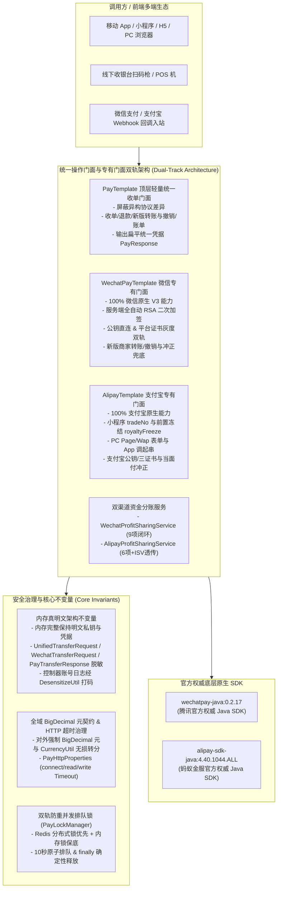
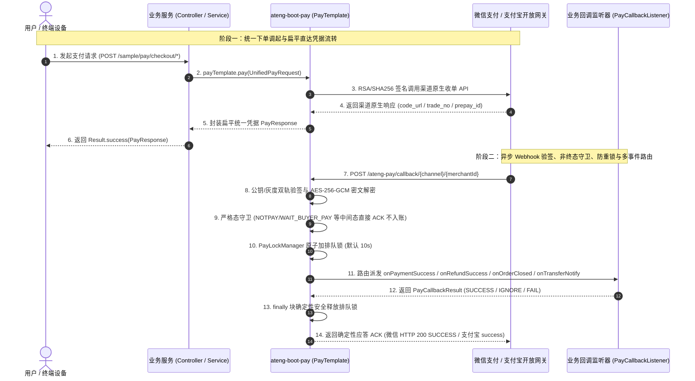

# ateng-boot-pay 基础设施 Starter

> 工业级企业多渠道专有支付中间件底座 Starter，深度集成腾讯官方权威 `wechatpay-java:0.2.17` 与蚂蚁金服 `alipay-sdk-java:4.40.1044.ALL` 原生 SDK，支持双轨专有独立门面 `WechatPayTemplate` 与 `AlipayTemplate`、顶层轻量统一收单门面 `PayTemplate`、支付宝小程序原生调起、微信新版用户确认模式商家转账与撤销、双渠道资金分账（微信 V3 分账与支付宝交易分账）、微信平台公钥/平台证书灰度双模验签、全通道 `PayHttpProperties` 网络超时治理、线下收银台条码付阶梯轮询与冲正兜底、财务对账单（GZIP 与支付宝双 CSV ZIP）流式解压解析引擎、四模密钥自适应加载、全事件异步 Webhook 网关与防重并发排队锁，以及全域 `BigDecimal` 元契约治理。

- **架构基线**：[ADR-0048 企业级多渠道专有支付中间件底座架构设计](../docs/adr/0048-enterprise-multi-channel-payment-architecture.md)、[ADR-0077 企业级支付底座官方SDK权威对齐与全场景加固架构](../docs/adr/0077-enterprise-pay-official-alignment-and-full-scenario-hardening-architecture.md)、[ADR-0100 支付基础设施样例工程多控制器领域解耦、REST 路由标准化与五维规范重构架构决策](../docs/adr/0100-pay-sample-multi-controller-and-documentation-specification-architecture.md)
- **研发工单闭环**：[#552](https://github.com/atengk/ateng-boot/issues/552) ~ [#557](https://github.com/atengk/ateng-boot/issues/557)（底座与五维基线初始化）、[#884](https://github.com/atengk/ateng-boot/issues/884) ~ [#886](https://github.com/atengk/ateng-boot/issues/886)（REST 路由与 ADR-0100 重构）、[#1061](https://github.com/atengk/ateng-boot/issues/1061)（Parent 全场景升级）、[#1065](https://github.com/atengk/ateng-boot/issues/1065)（HTTP 超时/支付宝分账/微信新版商家转账/对账单与灰度双轨验签）、[#1066](https://github.com/atengk/ateng-boot/issues/1066)（回调非终态守卫、退款分流、`onOrderClosed` / `onTransferNotify` SPI 扩展与条码撤单安全兜底）、[#1067](https://github.com/atengk/ateng-boot/issues/1067)（Sample 34 端点与 30 项 E2E 回归）、[#1068](https://github.com/atengk/ateng-boot/issues/1068)（五维文档 1:1 源码纠偏与 ADR 演进同步）

---

## 0. 特性与公共 API 全景速查矩阵 (Feature & API Panorama Matrix)

### 0.1 核心执行门面与业务服务

| 特性分类 | 特性名称 | 核心门面 / SPI / 工具类 | 关键配置项 (`ateng.boot.pay.*`) | 关键 API 签名 / 核心行为 | 锚定验证源头 (*Test / Sample) |
| :--- | :--- | :--- | :--- | :--- | :--- |
| **统一收单** | 统一多渠道收单路由 | `PayTemplate` | `ateng.boot.pay.enabled` | `pay(UnifiedPayRequest)`，多渠道自动路由，输出扁平凭据 `PayResponse`（`qrCode` / `payUrl` / `formHtml` / `wechatJsapi` / `tradeNo` / `orderString`） | `PayTemplateTest` / `PaySampleIntegrationTest` |
| **统一收单** | 统一交易状态查询 | `PayTemplate` | `ateng.boot.pay.enabled` | `queryOrder(UnifiedQueryRequest)` / `queryOrder(PayChannel, String)` / `queryOrder(PayChannel, String, String)` | `PayTemplateTest` / `PaySampleIntegrationTest` |
| **统一收单** | 统一未付款订单关闭 | `PayTemplate` | `ateng.boot.pay.enabled` | `closeOrder(UnifiedCloseRequest)` / `closeOrder(PayChannel, String)` / `closeOrder(PayChannel, String, String)` | `PayTemplateTest` / `PaySampleIntegrationTest` |
| **统一收单** | 统一交易订单撤销/冲正 | `PayTemplate` | `ateng.boot.pay.enabled` | `cancelOrder(UnifiedCancelRequest)` / `cancelOrder(PayChannel, String)` / `cancelOrder(PayChannel, String, String)`，如实透传渠道 `REVOKED`/`CLOSED` 状态 | `PayTemplateTest` / `PaySampleIntegrationTest` |
| **统一退款** | 统一售后退款发起与查询 | `PayTemplate` | `ateng.boot.pay.enabled` | `refund(UnifiedRefundRequest)`；`queryRefund(UnifiedRefundQueryRequest)` / `queryRefund(PayChannel, String)` / `queryRefund(PayChannel, String, String)` | `PayTemplateTest` / `PaySampleIntegrationTest` |
| **统一转账** | 统一商家转账发起、查询与撤销 | `PayTemplate` | `ateng.boot.pay.transfer.enabled`<br>`ateng.boot.pay.wechat.default-transfer-scene-id` | `transfer(UnifiedTransferRequest)`（支持 `transferSceneId`、`transferSceneReportInfos`、`legacyBatchMode`、返回 `packageInfo`）；`queryTransfer(...)`；`cancelTransfer(PayChannel, String, String)` | `PayTemplateTest` / `PaySampleIntegrationTest` |
| **转账业务** | 单笔资金转账专有服务 | `PayTransferService` | `ateng.boot.pay.transfer.enabled` | `transfer(...)` / `queryTransfer(...)` / `cancelTransfer(...)` / `transferWechat(...)` / `queryWechatTransfer(...)` / `queryWechatTransferBill(...)` / `cancelWechatTransfer(...)` / `transferAlipay(...)` / `queryAlipayTransfer(...)` | `PayTransferServiceTest` / `PaySampleIntegrationTest` |
| **对账单流** | 财务对账单流式下载与解析 | `PayTemplate` / `PayBillParser` | `ateng.boot.pay.enabled` | `downloadBillStream(PayBillDownloadRequest)`；`parse(InputStream)` 全量解析、`parse(InputStream, Consumer<PayBillEntry>)` 零 OOM 流式消费，支持微信 GZIP 与支付宝双 CSV ZIP | `PayBillParserTest` / `PaySampleIntegrationTest` |
| **统一逃生舱** | 便捷原生客户端与门面获取 | `PayTemplate` | - | `getWechatClient()`、`getAlipayClient()`、`getWechatPayTemplate()`、`getAlipayTemplate()` | `PayTemplateTest` |
| **条码收银** | 线下付款码收银轮询执行器 | `BarcodePayExecutor` | `ateng.boot.pay.barcode.max-wait-time`<br>`ateng.boot.pay.barcode.poll-interval`<br>`ateng.boot.pay.barcode.auto-cancel-on-timeout` | `execute(UnifiedPayRequest)` / `execute(UnifiedPayRequest, Duration, Duration)` / `execute(UnifiedPayRequest, Duration, Duration, boolean)` | `BarcodePayExecutorTest` / `PaySampleIntegrationTest` |
| **微信专有** | Native / JSAPI / H5 / App / 条码收单 | `WechatPayTemplate` | `ateng.boot.pay.wechat.enabled`<br>`ateng.boot.pay.wechat.http.*`<br>`ateng.boot.pay.wechat.merchants.<key>.*` | `payNative` / `payJsapi` / `payH5` / `payApp` / `payBarcode`、`queryOrder`、`closeOrder`、`cancelOrder`、`refund`、`queryRefund`、`downloadTradeBill`、`downloadFundFlowBill` | `WechatPayTemplateTest` / `PaySampleIntegrationTest` |
| **微信撤单重试** | 条码付冲正重试与安全兜底 | `WechatPayTemplate` | `ateng.boot.pay.wechat.reverse-retry.*`<br>`ateng.boot.pay.wechat.reverse-fallback.*` | `cancelOrder` 遭遇 `SYSTEMERROR` 执行受控退避重试（默认 `max-attempts=3`、`delay=1s`、`multiplier=2.0`、`max-delay=5s`）；`reverse-fallback.enabled=true` 支持先查单后关单/`PaidPolicy` 处置 | `WechatPayTemplateTest` |
| **微信分账** | 微信 V3 资金分账全生命周期服务 | `WechatProfitSharingService` | `ateng.boot.pay.profit-sharing.enabled` | `addReceiver` / `deleteReceiver`、`createOrder` / `queryOrder`、`unfreezeOrder`、`createReturnOrder` / `queryReturnOrder`、`queryOrderAmount`、`queryMerchantRatio`、`getProfitsharingService()` | `WechatProfitSharingServiceTest` / `PaySampleIntegrationTest` |
| **微信转账** | 微信新版用户确认商家转账与撤销 | `WechatPayTemplate` | `ateng.boot.pay.transfer.enabled`<br>`ateng.boot.pay.wechat.default-transfer-scene-id` | `transfer(WechatTransferRequest)`（主链 `/v3/fund-app/mch-transfer/transfer-bills`，`legacyBatchMode=true` 兼容旧版批次）；`queryTransfer(String, String, String)`；`cancelTransfer(String)` / `cancelTransfer(String, String)` | `WechatPayTemplateTest` / `PaySampleIntegrationTest` |
| **微信公钥与证书**| 公钥直连、平台证书轮换与灰度双轨 | `WechatPayTemplate` / `WechatAutoCertificateManager` | `ateng.boot.pay.wechat.merchants.<key>.wechat-pay-public-key*`<br>`ateng.boot.pay.wechat.merchants.<key>.auto-certificate` | 配置静态公钥（`wechat-pay-public-key` 或 `wechat-pay-public-key-path`）优先直连；同时开启 `auto-certificate=true` 时，回调支持公钥 ID 与已注册平台证书灰度双轨并行验签 | `WechatPayTemplateTest` / `WechatAutoCertificateManagerTest` / `PayCallbackHandlerTest` |
| **微信逃生舱** | 原生客户端与测试桩注入 | `WechatPayTemplate` | - | `getClient()` / `getClient(String)` / `getHttpClient()` / `getHttpClient(String)` / `getWechatConfig()` / `getWechatConfig(String)` / `setCustomHttpClient(HttpClient)` | `WechatPayTemplateTest` |
| **支付宝专有** | Page / Wap / App / 小程序 / Qr / 条码与退转单 | `AlipayTemplate` | `ateng.boot.pay.alipay.enabled`<br>`ateng.boot.pay.alipay.http.*`<br>`ateng.boot.pay.alipay.apps.<key>.*` | `payPage`、`payWap`、`payApp`、`payJsapi`、`payQr`（支持 `royaltyFreeze` 前置冻结）、`payBarcode`、`queryOrder`、`closeOrder`、`cancelOrder`、`refund`、`queryRefund`、`transfer`、`queryTransfer`、`queryBillDownloadUrl`、`downloadBillStream` | `AlipayTemplateTest` / `PaySampleIntegrationTest` |
| **支付宝分账** | 支付宝交易分账与 ISV 透传服务 | `AlipayProfitSharingService` | `ateng.boot.pay.profit-sharing.enabled` | `bindRelation`、`unbindRelation`、`batchQueryRelation`、`confirmSettle`、`orderSettle`、`queryOrderSettle`、`getAlipayClient()` / `getAlipayClient(String)`，全方法重载支持 `appKey` 与 ISV `appAuthToken` | `AlipayProfitSharingServiceTest` / `PaySampleIntegrationTest` |
| **支付宝逃生舱** | 原生客户端与缓存重置 | `AlipayTemplate` | - | `getClient()` / `getClient(String)` / `getAlipayClient()` / `getAlipayClient(String)`、`clearClientCache()` | `AlipayTemplateTest` |
| **回调网关** | 统一 Webhook 端点 | `PayWebhookController` | `ateng.boot.pay.callback.enabled`<br>`ateng.boot.pay.callback.path-prefix` | 暴露 `/ateng-pay/callback/{channel}/{merchantId}`，自动拦截、验签、解密与并发防重 | `PayWebhookControllerTest` / `PaySampleIntegrationTest` |
| **回调处理** | 编程式回调处理门面 | `PayCallbackHandler` | `ateng.boot.pay.callback.idempotent-timeout` | `handleWechat(...)`、`handleWechatTransfer(...)`、`handleAlipay(...)`、`parseAndVerifyWechat(...)`、`parseAndVerifyWechatRefund(...)`、`parseAndVerifyWechatTransfer(...)`、`parseAndVerifyAlipay(...)`、`dispatchOrderClosed(...)`、`dispatchTransfer(...)` | `PayCallbackHandlerTest` / `PaySampleIntegrationTest` |
| **回调监听 SPI**| 全生命周期异步回调监听器 | `PayCallbackListener` | - | `onPaymentSuccess(PaymentSuccessCallback)`（必填）、`onRefundSuccess(RefundSuccessCallback)`、`onOrderClosed(OrderClosedCallback)`、`onTransferNotify(TransferNotifyCallback)`（均含 `supports(...)` 默认方法） | `OrderPaymentCallbackListener` / `PaySampleIntegrationTest` |
| **证书扩展 SPI**| 外部密钥证书提供器 | `PayCertificateProvider` | - | 实现 `supports(String)` 与 `loadBytes(String)` 对接 KMS / Vault / 数据库动态加载私钥与证书字节 | `PayKeyLoaderTest` |
| **多商户注册** | 命名多商户多应用管理 | `NamedMerchantRegistry` | `ateng.boot.pay.wechat.merchants.*`<br>`ateng.boot.pay.alipay.apps.*` | 动态注册与热更新商户/应用，三级降级查找（显式键 -> 默认键 -> 首个已注册） | `NamedMerchantRegistryTest` |
| **线程切源** | 线程级动态切源持有者 | `PayContextHolder` | - | `setMerchantId`/`getMerchantId`、`setMerchantKey`/`getMerchantKey`、`setAppId`/`getAppId`、`setChannel`/`getChannel`、`runWithMerchant(...)`、`runWithChannel(...)`、`clear()` | `PayContextHolderTest` |
| **密钥解析** | 四模自适应密钥加载器 | `PayKeyLoader` | - | 自动识别 `classpath:`、`file:`、行内 PEM 与 Base64；提供 `loadPrivateKey`、`loadPublicKey`、`loadCertificate`、`clearPublicKeyCache()` 等 | `PayKeyLoaderTest` |
| **防重并发锁** | 双轨分布式防重锁门面 | `PayLockManager` | `ateng.boot.pay.callback.idempotent-timeout` | `tryLock(String, Duration)` 与 `unlock(String)`，Redis 存在优先装配分布式锁，无 Redis 内存锁保底 | `InMemoryPayLockManagerTest` / `RedisPayLockManagerTest` |
| **货币工具** | 元/分无损高精度换算 | `CurrencyUtil` | - | `yuanToFen(BigDecimal)`、`yuanToFenInt(BigDecimal)`、`fenToYuan(long)`、`yuanToAlipayString(BigDecimal)`、`alipayStringToYuan(String)`、`validateAmount(BigDecimal)` | `CurrencyUtilTest` |

---

### 0.2 核心强类型枚举与状态码一览

#### 核心业务枚举

| 枚举类型 | 真实枚举值 | 语义与关键说明 |
| :--- | :--- | :--- |
| `PayChannel` | `WECHAT_PAY`、`ALIPAY` | 支付渠道（微信支付 / 支付宝开放平台） |
| `PayTradeType` | `NATIVE`、`JSAPI`、`H5`、`APP`、`BARCODE`、`PAGE` | 统一收单交易场景类型（注：支付宝手机网站 Wap 收银台通过专有门面 `AlipayTemplate.payWap(...)` 调用，统一路由下使用 `H5`） |
| `PayTradeState` | `SUCCESS`、`NOTPAY`、`USERPAYING`、`CLOSED`、`REFUND`、`REVOKED`、`PAYERROR` | 统一标准化交易生命周期状态机（含 `isSuccess()` 与 `isFinalState()`） |
| `PayRefundState` | `PROCESSING`、`SUCCESS`、`CLOSED`、`ABNORMAL` | 统一资金售后退款状态机 |
| `PayTransferState` | `PROCESSING`、`SUCCESS`、`FAIL`、`CLOSED`、`REFUND`、`WAIT_USER_CONFIRM`、`CANCELLED` | 统一资金转账状态机（含 `isSuccess()`、`isProcessing()`、`isWaitUserConfirm()`、`isFinal()`） |
| `WechatPayProperties.ReverseFallbackProperties.PaidPolicy` | `REJECT`、`AUTO_REFUND` | 条码撤单安全兜底遇到已支付订单时的处置策略（默认 `REJECT` 拒绝自动退款） |

#### 支付业务语义错误码字典 (`PayResultCode`：`58001 ~ 58013`)

| 状态码 | 枚举常量 | 默认提示文案 | 典型触发场景 |
| :---: | :--- | :--- | :--- |
| `58001` | `PAY_SIGN_VERIFY_ERROR` | 支付回调签名验证失败 | Webhook 异步通知公钥验签或响应验签不通过（`PaySignException`） |
| `58002` | `PAY_DECRYPT_ERROR` | 支付报文解密失败 | 微信 APIv3 `AEAD_AES_256_GCM` 回调资源解密失败或密钥长度非法 |
| `58003` | `PAY_ORDER_NOT_FOUND` | 支付交易订单不存在 | 查单/关单/撤销时渠道明确返回订单号不存在 |
| `58004` | `PAY_TRADE_STATE_INVALID` | 支付交易状态异常 | 订单已支付或已关闭导致当前状态机流转非法（`PayTradeException`） |
| `58005` | `PAY_AMOUNT_INVALID` | 支付金额不合法 | 金额为空、非正数、超过两位小数或退款超限 |
| `58006` | `PAY_OPERATION_FORBIDDEN` | 支付高敏操作未授权或未开启 | 高敏操作被权限或物理规则阻断 |
| `58007` | `PAY_GATEWAY_ERROR` | 支付网关通信异常 | 底层微信/支付宝通道未启用、HTTP 通信异常或渠道服务端报错 |
| `58008` | `PAY_MERCHANT_NOT_CONFIGURED` | 未配置指定的支付商户或应用 | `NamedMerchantRegistry` 未命中任何可用的商户/应用配置 |
| `58009` | `PAY_LOCK_ACQUIRE_FAILED` | 获取支付防重锁失败，请勿并发重复操作 | Webhook 并发重入抢锁失败（触发渠道重试投递） |
| `58010` | `PAY_PARAM_INVALID` | 支付请求参数非法或缺失 | 缺失必填参数（如 `outTradeNo`、`transferSceneId` 或非法 HTTP 超时配置） |
| `58011` | `PAY_CERTIFICATE_NOT_FOUND` | 未找到有效的支付平台或商户证书 | 私钥/公钥/证书路径缺失、平台证书序号未注册或未加载 |
| `58012` | `PAY_FEATURE_DISABLED` | 支付高敏特性未启用或已被物理开关关闭 | `transfer.enabled` 或 `profit-sharing.enabled` 未开启时强行调用高敏能力 |
| `58013` | `PAY_BILL_PARSE_ERROR` | 财务对账单解析失败 | GZIP / ZIP 压缩包损坏、SHA1 摘要不匹配或 CSV 解析格式错误 |

---

## 1. 模块定位与快速起步 (Quick Start)

`ateng-boot-pay` 是面向企业电商收单、SaaS 订阅缴费、政企在线服务与资金清结算的生产就绪专有支付基础设施：
- **纯净依赖与双轨权威 SDK**：核心网络交互与协议解密 100% 对齐腾讯官方权威 `wechatpay-java:0.2.17` 与蚂蚁金服 `alipay-sdk-java:4.40.1044.ALL`，杜绝任何第三方二次封装包依赖膨胀；
- **全场景统一收单门面与扁平直达凭据**：统一轻量门面 `PayTemplate` 屏蔽异构渠道差异，出参采用扁平化统一凭据 `PayResponse`（`qrCode`、`payUrl`、`formHtml`、`wechatJsapi`、`tradeNo`、`orderString`），彻底消除多态强转与 `ClassCastException` 隐患；
- **传输层与持久层绝对隔离 (Zero-Entity-Leakage)**：Controller 传输边界 100% 严禁暴露 ORM 实体，统一使用强类型 Request DTO 挂载 JSR-303 格式校验与显式 `Result<T>` 返回。

### 1.1 Maven 坐标引入

#### 方式一：已导入 `ateng-boot-bom` 统管（推荐，免声明版本号）

```xml
<dependency>
    <groupId>io.github.atengk</groupId>
    <artifactId>ateng-boot-pay</artifactId>
</dependency>
```

#### 方式二：未引入 BOM 时独立显式指定版本号引入

```xml
<dependency>
    <groupId>io.github.atengk</groupId>
    <artifactId>ateng-boot-pay</artifactId>
    <version>1.2.0</version>
</dependency>
```

### 1.2 极简起步配置与实操 (微信扫码收单 Happy Path)

#### ① 最小可用 YAML 配置

```yaml
ateng:
  boot:
    pay:
      enabled: true
      wechat:
        enabled: true
        merchants:
          default:
            app-id: wx8888888888888888
            mch-id: "1900000001"
            api-v3-key: "YOUR_WECHAT_API_V3_KEY"
            merchant-serial-number: "YOUR_MERCHANT_SERIAL_NUMBER"
            private-key-path: classpath:certs/wechat_apiclient_key.pem
            wechat-pay-public-key-path: classpath:certs/wechat_pub_key.pem
            wechat-pay-public-key-id: "YOUR_WECHAT_PUBLIC_KEY_ID"
            auto-certificate: false
```

#### ② 一行代码发起收单

```java
@Autowired
private PayTemplate payTemplate;

public String createQrCodeOrder(String orderId, BigDecimal amount, String title) {
    UnifiedPayRequest request = UnifiedPayRequest.builder()
            .channel(PayChannel.WECHAT_PAY)
            .tradeType(PayTradeType.NATIVE)
            .outTradeNo(orderId)
            .amount(amount)
            .subject(title)
            .build();

    PayResponse response = payTemplate.pay(request);
    return response.getQrCode(); // 直接返回微信二维码内容链接供前端渲染
}
```

---

## 2. 核心架构与设计不变量 (Architecture & Invariants)



### 2.1 统一下单调起与全事件 Webhook 防重时序流转



### 2.2 核心架构设计不变量

- **“内存真明文”架构不变量 (ADR-0012 / ADR-0048)**：商户私钥、APIv3 密钥与收款人信息在 JVM 内存中始终保持 100% 真实明文，以支撑底层官方 SDK 高频加解密与数字签名运算；出入参对象（`UnifiedTransferRequest`、`WechatTransferRequest`、`PayTransferResponse`）在 `toString()` 中以及控制器打印敏感标识（如微信分账 `openid`）时统一调用 `DesensitizeUtil` 脱敏掩码；
- **全域 `BigDecimal` 元契约与无损换算**：对外所有接口、DTO 与 VO，金额统一使用 `BigDecimal`（保留两位小数，舍入模式 `RoundingMode.HALF_UP`）；底层进出渠道边界统一由 `CurrencyUtil` 执行元/分安全换算；
- **双轨防重并发排队锁**：Webhook 入站后（通过终态前置筛选），`PayLockManager` 按通道+单号维度加排队锁（默认 `10s`），Redis 环境优先装配分布式锁，无 Redis 时使用内存锁保底；冲突立即拒绝触发官方重试，且锁释放 100% 在 `finally` 块中完成。

---

## 3. 统一多渠道收单套件 (Unified Checkout Suite)

收单套件通过 `PayTemplate` 提供多渠道统一收单、查单与关单能力，出参采用扁平凭据 `PayResponse`。以下片段提取自 [`PayCheckoutController`](../ateng-boot-samples/ateng-boot-sample-pay/src/main/java/io/github/atengk/boot/sample/pay/controller/PayCheckoutController.java)。

### 3.1 微信 Native 扫码收单

```yaml
ateng:
  boot:
    pay:
      enabled: true
      wechat:
        enabled: true
        http:
          connect-timeout: 5s
          read-timeout: 15s
        merchants:
          default:
            app-id: wx8888888888888888
            mch-id: "1900000001"
            api-v3-key: "YOUR_WECHAT_API_V3_KEY"
            merchant-serial-number: "YOUR_MERCHANT_SERIAL_NUMBER"
            private-key-path: classpath:certs/wechat_apiclient_key.pem
            wechat-pay-public-key-path: classpath:certs/wechat_pub_key.pem
            wechat-pay-public-key-id: "YOUR_WECHAT_PUBLIC_KEY_ID"
            notify-url: "http://127.0.0.1:8080/ateng-pay/callback/wechat"
```

```java
@PostMapping("/native")
public Result<PayResponse> checkoutNative(@Valid @RequestBody PayCheckoutDTO dto) {
    UnifiedPayRequest request = UnifiedPayRequest.builder()
            .channel(dto.getChannel())
            .tradeType(PayTradeType.NATIVE)
            .outTradeNo(dto.getOutTradeNo())
            .amount(dto.getAmount())
            .subject(dto.getSubject())
            .merchantKey(dto.getMerchantKey())
            .notifyUrl(dto.getNotifyUrl())
            .attach(dto.getAttach())
            .build();

    PayResponse response = payTemplate.pay(request);
    return Result.success(response);
}
```

- **机制与边界说明**：微信 Native 模式返回 `code_url` 映射为 `response.getQrCode()`；微信支付与支付宝均统一通过 `PayHttpProperties` 强制约束连接与读取超时（默认 `5s`/`15s`），从根源杜绝网络悬挂。

---

### 3.2 微信 JSAPI 小程序/公众号收单 (服务端全自动二次加签)

```yaml
ateng:
  boot:
    pay:
      wechat:
        merchants:
          default:
            app-id: wx8888888888888888
            private-key-path: classpath:certs/wechat_apiclient_key.pem
```

```java
@PostMapping("/jsapi")
public Result<PayResponse> checkoutJsapi(@Valid @RequestBody PayCheckoutDTO dto) {
    UnifiedPayRequest request = UnifiedPayRequest.builder()
            .channel(dto.getChannel())
            .tradeType(PayTradeType.JSAPI)
            .outTradeNo(dto.getOutTradeNo())
            .amount(dto.getAmount())
            .subject(dto.getSubject())
            .openid(dto.getOpenid())
            .buyerId(dto.getBuyerId())
            .buyerOpenId(dto.getBuyerOpenId())
            .merchantKey(dto.getMerchantKey())
            .notifyUrl(dto.getNotifyUrl())
            .attach(dto.getAttach())
            .build();

    PayResponse response = payTemplate.pay(request);
    return Result.success(response);
}
```

- **机制与边界说明**：获取 `prepay_id` 后服务端全自动计算商户私钥 RSA 二次签名（`paySign`），封包 6 元素直达凭据 `wechatJsapi`（`appId`、`timeStamp`、`nonceStr`、`package`、`signType`、`paySign`），前端小程序直接传入 `wx.requestPayment(res.data.wechatJsapi)` 即可拉起支付。

---

### 3.3 支付宝小程序统一收单创建 (JSAPI)

```yaml
ateng:
  boot:
    pay:
      alipay:
        enabled: true
        http:
          connect-timeout: 5s
          read-timeout: 15s
        apps:
          default:
            app-id: "2021000000000001"
            private-key-path: classpath:certs/alipay_private_key.pem
            alipay-public-key: "YOUR_ALIPAY_PUBLIC_KEY"
            server-url: "https://openapi-sandbox.dl.alipaydev.com/gateway.do"
```

```java
@PostMapping("/alipay-miniapp")
public Result<PayResponse> checkoutAlipayMiniApp(@Valid @RequestBody PayCheckoutDTO dto) {
    log.info("Processing Alipay mini-program payment request: outTradeNo={}, amount={}, buyerId={}, buyerOpenId={}",
            dto.getOutTradeNo(), dto.getAmount(), dto.getBuyerId(), dto.getBuyerOpenId());
    dto.setChannel(PayChannel.ALIPAY);
    return checkoutJsapi(dto);
}
```

- **机制与边界说明**：调用支付宝 `alipay.trade.create`，兼容旧版 16 位数字 `buyer_id` 与新版开放标识 `buyer_open_id`（`buyerId` 与 `buyerOpenId` 均为空时也会自动由 `openid` 智能推导），返回 `tradeNo` 与 `transactionId` 供小程序端 `my.tradePay` 调起。

---

### 3.4 移动网页与 PC 电脑收单 (微信 H5 / 支付宝 Wap 与 Page)

```yaml
ateng:
  boot:
    pay:
      alipay:
        apps:
          default:
            return-url: "http://127.0.0.1:8080/pay/return"
```

```java
@PostMapping("/h5")
public Result<PayResponse> checkoutH5(@Valid @RequestBody PayCheckoutDTO dto) {
    UnifiedPayRequest request = UnifiedPayRequest.builder()
            .channel(dto.getChannel())
            .tradeType(PayTradeType.H5)
            .outTradeNo(dto.getOutTradeNo())
            .amount(dto.getAmount())
            .subject(dto.getSubject())
            .merchantKey(dto.getMerchantKey())
            .notifyUrl(dto.getNotifyUrl())
            .returnUrl(dto.getReturnUrl())
            .attach(dto.getAttach())
            .build();

    PayResponse response = payTemplate.pay(request);
    return Result.success(response);
}
```

- **机制与边界说明**：`PayTradeType.H5` 在微信端返回跳转地址 `payUrl`（`h5_url`），在支付宝端路由至 `payWap`；电脑网站支付传入 `PayTradeType.PAGE` 返回自提交 HTML 表单 `formHtml`（微信不支持 `PAGE`，直接抛出 `PAY_PARAM_INVALID`）；若需专有高级参数可直接调用 `AlipayTemplate.payWap(AlipayPayRequest)` 或 `payPage(...)`。

---

### 3.5 App 移动客户端收单 (微信 App prepayId / 支付宝 orderString)

```yaml
ateng:
  boot:
    pay:
      enabled: true
      wechat:
        enabled: true
      alipay:
        enabled: true
```

```java
@PostMapping("/app")
public Result<PayResponse> checkoutApp(@Valid @RequestBody PayCheckoutDTO dto) {
    UnifiedPayRequest request = UnifiedPayRequest.builder()
            .channel(dto.getChannel())
            .tradeType(PayTradeType.APP)
            .outTradeNo(dto.getOutTradeNo())
            .amount(dto.getAmount())
            .subject(dto.getSubject())
            .merchantKey(dto.getMerchantKey())
            .notifyUrl(dto.getNotifyUrl())
            .attach(dto.getAttach())
            .build();

    PayResponse response = payTemplate.pay(request);
    return Result.success(response);
}
```

- **机制与边界说明**：微信 App 返回服务端二次加签后的 `wechatApp` 凭据包与 `prepayId`；支付宝 App 返回客户端 SDK 调起所需的已加签 `orderString`。

---

### 3.6 订单交易状态主动查询与主动关单

```yaml
ateng:
  boot:
    pay:
      enabled: true
```

```java
@PostMapping("/query")
public Result<PayResponse> queryOrder(@Valid @RequestBody PayOrderQueryDTO dto) {
    UnifiedQueryRequest request = UnifiedQueryRequest.builder()
            .channel(dto.getChannel())
            .outTradeNo(dto.getOutTradeNo())
            .transactionId(dto.getTransactionId())
            .merchantKey(dto.getMerchantKey())
            .build();

    PayResponse response = payTemplate.queryOrder(request);
    return Result.success(response);
}

@PostMapping("/close")
public Result<PayResponse> closeOrder(@Valid @RequestBody PayOrderCloseDTO dto) {
    UnifiedCloseRequest request = UnifiedCloseRequest.builder()
            .channel(dto.getChannel())
            .outTradeNo(dto.getOutTradeNo())
            .merchantKey(dto.getMerchantKey())
            .build();

    PayResponse response = payTemplate.closeOrder(request);
    return Result.success(response);
}
```

- **机制与边界说明**：抹平微信与支付宝订单状态字符串差异，统一归一化为 `PayTradeState`（`SUCCESS`、`NOTPAY`、`USERPAYING`、`CLOSED`、`REFUND`、`REVOKED`、`PAYERROR`）；关单仅针对未支付订单生效。

---

## 4. 线下收银台条码付套件 (Barcode Cashier Suite)

线下收银台扫描用户手机付款码（微信以 `10~15` 开头，支付宝以 `25~30` 开头）发起扣款。以下代码提取自 [`PayBarcodeController`](../ateng-boot-samples/ateng-boot-sample-pay/src/main/java/io/github/atengk/boot/sample/pay/controller/PayBarcodeController.java)。

### 4.1 付款码阶梯轮询与主动撤销端点

```yaml
ateng:
  boot:
    pay:
      barcode:
        max-wait-time: 30s            # 轮询最大等待总时长（默认值）
        poll-interval: 3s             # 每次轮询查单间隔（默认值）
        auto-cancel-on-timeout: true  # 超时未决自动撤销冲正（默认值）
      wechat:
        reverse-retry:
          enabled: true               # 微信冲正失败受控退避重试（默认值）
          max-attempts: 3             # 最大调用次数（含首次）
          delay: 1s                   # 初始退避间隔
          multiplier: 2.0             # 指数倍率
          max-delay: 5s               # 最大退避封顶间隔
        reverse-fallback:
          enabled: false              # 网关不支持直接 /reverse 时启用先查再关/退安全兜底
          paid-policy: REJECT         # REJECT 拒绝自动退款 | AUTO_REFUND 原路全额退
```

```java
@PostMapping("/cashier")
public Result<PayResponse> cashierPay(@Valid @RequestBody PayBarcodeDTO dto) {
    UnifiedPayRequest request = UnifiedPayRequest.builder()
            .channel(dto.getChannel())
            .tradeType(PayTradeType.BARCODE)
            .merchantKey(dto.getMerchantKey())
            .outTradeNo(dto.getOutTradeNo())
            .amount(dto.getAmount())
            .authCode(dto.getAuthCode())
            .subject(dto.getSubject())
            .build();

    PayResponse response;
    if (dto.getMaxWaitTime() != null && dto.getPollInterval() != null) {
        boolean autoCancel = dto.getAutoCancelOnTimeout() != null ? dto.getAutoCancelOnTimeout() : true;
        response = barcodePayExecutor.execute(request, dto.getMaxWaitTime(), dto.getPollInterval(), autoCancel);
    } else {
        response = barcodePayExecutor.execute(request);
    }
    return Result.success(response);
}

@PostMapping("/cancel")
public Result<PayResponse> cancelOrder(@Valid @RequestBody PayOrderCancelDTO dto) {
    UnifiedCancelRequest request = UnifiedCancelRequest.builder()
            .channel(dto.getChannel())
            .merchantKey(dto.getMerchantKey())
            .outTradeNo(dto.getOutTradeNo())
            .transactionId(dto.getTransactionId())
            .subMchId(dto.getSubMchId())
            .appAuthToken(dto.getAppAuthToken())
            .build();

    PayResponse response = payTemplate.cancelOrder(request);
    return Result.success(response);
}
```

### 4.2 超时自动撤销冲正、受控退避重试与安全兜底机制

- **阶梯轮询**：遇到 `USERPAYING` / `WAIT_BUYER_PAY` 时，`BarcodePayExecutor` 默认每 `3s` 轮询查单一次，最长等待 `30s`；超时且 `auto-cancel-on-timeout=true` 自动发起 `cancelOrder`。
- **微信 `/reverse` 指数退避重试与兜底**：调用 `/v3/pay/transactions/out-trade-no/{outTradeNo}/reverse` 如实透传微信返回 `trade_state`（缺省回退 `REVOKED`）；遇到 `SYSTEMERROR` 或 5xx 网络抖动时基于 `RetryUtil` 默认最多尝试 `3` 次（退避序列 `1s` -> `2s`，上限封顶 `5s`）；若部分商户网关返回 `404`/`RESOURCE_NOT_EXISTS` 不支持 `/reverse`，开启 `reverse-fallback.enabled=true` 后自动切入“先查单、未支付关单、已支付按 `PaidPolicy`（`REJECT` 或 `AUTO_REFUND`）处置”的安全兜底。
- **支付宝当面付撤销**：调用 `alipay.trade.cancel` 映射为 `REVOKED` 并透传原样 `action` 描述，未付直接关单、已付原路冲正退还。

---

## 5. 资金售后退款套件 (Refund Suite)

支持对成功订单发起全额或多次部分原路退款。以下代码提取自 [`PayRefundController`](../ateng-boot-samples/ateng-boot-sample-pay/src/main/java/io/github/atengk/boot/sample/pay/controller/PayRefundController.java)。

```yaml
ateng:
  boot:
    pay:
      enabled: true
```

```java
@PostMapping("/apply")
public Result<PayRefundResponse> applyRefund(@Valid @RequestBody PayRefundDTO dto) {
    UnifiedRefundRequest request = UnifiedRefundRequest.builder()
            .channel(dto.getChannel())
            .merchantKey(dto.getMerchantKey())
            .outTradeNo(dto.getOutTradeNo())
            .transactionId(dto.getTransactionId())
            .outRefundNo(dto.getOutRefundNo())
            .refundAmount(dto.getRefundAmount())
            .totalAmount(dto.getTotalAmount())
            .reason(dto.getReason())
            .build();

    return Result.success(payTemplate.refund(request));
}

@PostMapping("/query")
public Result<PayRefundResponse> queryRefund(@Valid @RequestBody PayRefundQueryDTO dto) {
    UnifiedRefundQueryRequest request = UnifiedRefundQueryRequest.builder()
            .channel(dto.getChannel())
            .merchantKey(dto.getMerchantKey())
            .outTradeNo(dto.getOutTradeNo())
            .outRefundNo(dto.getOutRefundNo())
            .build();

    return Result.success(payTemplate.queryRefund(request));
}
```

- **机制与边界说明**：部分退款要求每次退款的 `outRefundNo` 严格全局唯一（出站支付宝时自动映射为 `out_request_no`），累计退款不得超过 `totalAmount`；支付宝退款查询若官方仅返回 `refund_status=REFUND_SUCCESS` 或仅有 `refund_fee` 均能准确映射至 `PayRefundState.SUCCESS`。

---

## 6. 单笔资金转账与新版商家转账套件 (Transfer Suite)

默认主链采用微信 2025 新版“用户确认模式商家转账”（`/v3/fund-app/mch-transfer/transfer-bills`）与支付宝 `alipay.fund.trans.uni.transfer`，同时支持主动撤销与旧版批次兼容模式。以下代码提取自 [`PayTransferController`](../ateng-boot-samples/ateng-boot-sample-pay/src/main/java/io/github/atengk/boot/sample/pay/controller/PayTransferController.java)。

```yaml
ateng:
  boot:
    pay:
      transfer:
        enabled: true                   # 高敏资金转账物理总开关（默认 false，必须显式启用）
      wechat:
        default-transfer-scene-id: "1000" # 新版商家转账兜底场景 ID（默认 1000）
```

```java
@PostMapping("/apply")
public Result<PayTransferResponse> applyTransfer(@Valid @RequestBody PayTransferDTO dto) {
    List<TransferSceneReportInfo> reportInfos = dto.getTransferSceneReportInfos() == null
            ? null
            : dto.getTransferSceneReportInfos().stream()
            .map(item -> TransferSceneReportInfo.builder()
                    .infoType(item.getInfoType())
                    .infoContent(item.getInfoContent())
                    .build())
            .toList();

    UnifiedTransferRequest request = UnifiedTransferRequest.builder()
            .channel(dto.getChannel())
            .merchantKey(dto.getMerchantKey())
            .outBizNo(dto.getOutBizNo())
            .amount(dto.getAmount())
            .title(dto.getTitle())
            .remark(dto.getRemark())
            .payeeAccount(dto.getPayeeAccount())
            .payeeRealName(dto.getPayeeRealName())
            .payeeIdentityType(dto.getPayeeIdentityType())
            .notifyUrl(dto.getNotifyUrl())
            .transferSceneId(dto.getTransferSceneId())
            .transferSceneReportInfos(reportInfos)
            .legacyBatchMode(dto.getLegacyBatchMode())
            .build();

    return Result.success(payTemplate.transfer(request));
}

@PostMapping("/cancel")
public Result<PayTransferResponse> cancelTransfer(@Valid @RequestBody PayTransferCancelDTO dto) {
    PayTransferResponse response = payTemplate.cancelTransfer(
            dto.getChannel(), dto.getMerchantKey(), dto.getOutBizNo());
    return Result.success(response);
}
```

- **机制与边界说明**：
  1. **微信新版用户确认模式**：出站加密 `user_name` 并校验场景 ID（`transferSceneId` 缺省兜底 `default-transfer-scene-id`）与报备信息 `transferSceneReportInfos`；受理成功返回 `status = WAIT_USER_CONFIRM` 与前端拉起确认收款页所需的 `packageInfo`；用户确认前可调用 `/cancel` 主动撤销返回 `CANCELLED`。仅当显式传入 `legacyBatchMode = true` 时退回旧版 `/v3/transfer/batches`；
  2. **物理安全与脱敏不变量**：未配置 `ateng.boot.pay.transfer.enabled=true` 时 `PayTransferService` 不装配且 `PayTemplate.transfer/cancelTransfer` 直接抛出 `PAY_FEATURE_DISABLED`；`UnifiedTransferRequest`、`WechatTransferRequest` 与 `PayTransferResponse` 在 `toString()` 中严格对收款姓名和账号打码脱敏。

---

## 7. 双渠道资金分账套件 (Profit Sharing Suite)

`ateng-boot-pay` 通过共享物理开关 `ateng.boot.pay.profit-sharing.enabled` 同时治理微信 V3 分账（`WechatProfitSharingService`）与支付宝交易分账（`AlipayProfitSharingService`）。以下代码提取自 [`PayProfitSharingController`](../ateng-boot-samples/ateng-boot-sample-pay/src/main/java/io/github/atengk/boot/sample/pay/controller/PayProfitSharingController.java)。

### 7.1 微信 V3 分账全生命周期 (`WechatProfitSharingService`)

```yaml
ateng:
  boot:
    pay:
      profit-sharing:
        enabled: true # 双渠道分账高敏特性共享物理总开关（默认 false）
```

```java
@PostMapping("/receivers/add")
public Result<AddReceiverResponse> addReceiver(@Valid @RequestBody ProfitSharingReceiverDTO dto) {
    WechatProfitSharingService service = requireWechatService();
    log.info("Adding WeChat profit sharing receiver: account={}, type={}",
            DesensitizeUtil.maskKeepHeadTail(dto.getAccount(), 3, 3), dto.getType());

    AddReceiverRequest request = new AddReceiverRequest();
    request.setType(parseEnum(ReceiverType.class, dto.getType(), "type"));
    request.setAccount(dto.getAccount());
    request.setName(dto.getName());
    request.setRelationType(parseEnum(ReceiverRelationType.class, dto.getRelationType(), "relationType"));

    return Result.success(service.addReceiver(dto.getMerchantKey(), request));
}

@PostMapping("/orders/create")
public Result<OrdersEntity> createOrder(@Valid @RequestBody ProfitSharingCreateOrderDTO dto) {
    WechatProfitSharingService service = requireWechatService();
    CreateOrderRequest request = new CreateOrderRequest();
    request.setSubMchid(dto.getSubMchid());
    request.setTransactionId(dto.getTransactionId());
    request.setOutOrderNo(dto.getOutOrderNo());
    request.setUnfreezeUnsplit(dto.getUnfreezeUnsplit());
    request.setReceivers(dto.getReceivers().stream().map(item -> {
        CreateOrderReceiver receiver = new CreateOrderReceiver();
        receiver.setType(item.getType());
        receiver.setAccount(item.getAccount());
        receiver.setAmount(item.getAmount());
        receiver.setDescription(item.getDescription());
        return receiver;
    }).toList());

    return Result.success(service.createOrder(dto.getMerchantKey(), request));
}

@PostMapping("/unfreeze")
public Result<OrdersEntity> unfreezeOrder(@Valid @RequestBody ProfitSharingUnfreezeDTO dto) {
    WechatProfitSharingService service = requireWechatService();
    UnfreezeOrderRequest request = new UnfreezeOrderRequest();
    request.setOutOrderNo(dto.getOutOrderNo());
    request.setTransactionId(dto.getTransactionId());
    request.setDescription(dto.getDescription());

    return Result.success(service.unfreezeOrder(dto.getMerchantKey(), request));
}
```

- **机制与边界说明**：微信分账下单前必须在统一下单中指定 `profitSharing = true`；门面完整覆盖接收方增删（`addReceiver` / `deleteReceiver`，控制器日志须经 `DesensitizeUtil.maskKeepHeadTail` 脱敏防 `openid` 明文泄漏）、发起分账（`createOrder`）、查询分账（`queryOrder`）、完结解冻（`unfreezeOrder`）、分账回退与查询（`createReturnOrder` / `queryReturnOrder`）、剩余待分金额（`queryOrderAmount`）与子商户最大比例查询（`queryMerchantRatio`）。

### 7.2 支付宝前置冻结收单与交易分账 (`AlipayProfitSharingService`)

```yaml
ateng:
  boot:
    pay:
      profit-sharing:
        enabled: true # 开启支付宝 AlipayProfitSharingService 自动装配
      alipay:
        apps:
          default:
            app-auth-token: YOUR_ISV_APP_AUTH_TOKEN # ISV 服务商授权令牌（可选全局默认值）
```

```java
@PostMapping("/alipay/pre-freeze-qr")
public Result<PayResponse> alipayPreFreezeQr(@Valid @RequestBody AlipayPreFreezeCheckoutDTO dto) {
    BusinessAssert.isTrue(alipayTemplate != null, "支付宝支付模块未启用");
    AlipayPayRequest request = AlipayPayRequest.builder()
            .appKey(dto.getMerchantKey())
            .appAuthToken(dto.getAppAuthToken())
            .outTradeNo(dto.getOutTradeNo())
            .amount(dto.getAmount())
            .subject(dto.getSubject())
            .royaltyFreeze(dto.getRoyaltyFreeze())
            .build();
    return Result.success(alipayTemplate.payQr(request));
}

@PostMapping("/alipay/receivers/bind")
public Result<AlipayTradeRoyaltyRelationBindResponse> bindAlipayReceivers(
        @Valid @RequestBody AlipayRoyaltyRelationDTO dto) {
    AlipayProfitSharingService service = requireAlipayService();
    AlipayTradeRoyaltyRelationBindModel model = new AlipayTradeRoyaltyRelationBindModel();
    model.setOutRequestNo(dto.getOutRequestNo());
    model.setReceiverList(toAlipayRoyaltyEntities(dto.getReceivers()));
    return Result.success(service.bindRelation(dto.getMerchantKey(), dto.getAppAuthToken(), model));
}

@PostMapping("/alipay/settle/order")
public Result<AlipayTradeOrderSettleResponse> settleAlipayOrder(@Valid @RequestBody AlipayOrderSettleDTO dto) {
    AlipayProfitSharingService service = requireAlipayService();
    AlipayTradeOrderSettleModel model = new AlipayTradeOrderSettleModel();
    model.setOutRequestNo(dto.getOutRequestNo());
    model.setTradeNo(dto.getTradeNo());
    model.setRoyaltyParameters(dto.getRoyaltyParameters().stream().map(item -> {
        OpenApiRoyaltyDetailInfoPojo pojo = new OpenApiRoyaltyDetailInfoPojo();
        pojo.setTransInType(item.getTransInType());
        pojo.setTransIn(item.getTransIn());
        pojo.setAmount(item.getAmount().setScale(2, RoundingMode.HALF_UP).toPlainString());
        pojo.setDesc(item.getDesc());
        pojo.setRoyaltyType(item.getRoyaltyType());
        return pojo;
    }).toList());
    return Result.success(service.orderSettle(dto.getMerchantKey(), dto.getAppAuthToken(), model));
}
```

- **机制与边界说明**：支付宝专有收单方法在传入 `royaltyFreeze = true` 时自动向 `extend_params` 写入 `"royalty_freeze":"true"` 冻结收款等待结算；`AlipayProfitSharingService` 封装关系绑定/解绑/批量分页查询（`bindRelation`/`unbindRelation`/`batchQueryRelation`）、结算确认（`confirmSettle`）、订单分账结算与查询（`orderSettle`/`queryOrderSettle`），所有重载均原生支持 ISV 第三方授权令牌 `appAuthToken` 自动回退与显式透传。

---

## 8. 财务对账单流式套件 (Bill Reconcile Suite)

自动拉取官方对账单，执行 SHA1 防篡改校验，并自适应解压微信 GZIP 与支付宝标准双 CSV ZIP 压缩流。以下代码提取自 [`PayBillController`](../ateng-boot-samples/ateng-boot-sample-pay/src/main/java/io/github/atengk/boot/sample/pay/controller/PayBillController.java)。

### 8.1 全量内存解析与双 CSV ZIP 智能识别

```yaml
ateng:
  boot:
    pay:
      enabled: true
```

```java
@PostMapping("/download/parse-memory")
public Result<PayBillResult> parseMemory(@Valid @RequestBody PayBillQueryDTO dto) throws Exception {
    PayBillDownloadRequest request = buildDownloadRequest(dto);
    try (InputStream stream = payTemplate.downloadBillStream(request)) {
        PayBillResult result = payBillParser.parse(stream);
        return Result.success(result);
    }
}
```

- **机制与边界说明**：全量内存解析适用于中小规模日账单；支付宝官方对账 ZIP 通常包含 `*_业务明细.csv` 与 `*_业务明细(汇总).csv` 两个 GBK 编码条目（压缩先后顺序不固定），`PayBillParser` 遍历全部 ZIP 条目解析明细并精确合并汇总数据。

### 8.2 常驻 O(1) 零 OOM 流式逐行消费模式

```yaml
ateng:
  boot:
    pay:
      enabled: true
```

```java
@PostMapping("/download/stream-consume")
public Result<PayBillSummary> streamReconcile(@Valid @RequestBody PayBillQueryDTO dto) throws Exception {
    PayBillDownloadRequest request = buildDownloadRequest(dto);
    AtomicLong counter = new AtomicLong();
    try (InputStream stream = payTemplate.downloadBillStream(request)) {
        PayBillSummary summary = payBillParser.parse(stream, entry -> {
            long c = counter.incrementAndGet();
            log.debug("Streaming entry #{}: outTradeNo={}, amount={}", c, entry.getOutTradeNo(), entry.getTotalAmount());
        });
        log.info("Finished streaming reconciliation, total streamed entries: {}", counter.get());
        return Result.success(summary);
    }
}
```

- **机制与边界说明**：面对海量对账文件时，`parse(InputStream, Consumer<PayBillEntry>)` 边流式解压边逐行触发回调消费，堆内存保持恒定 O(1)；`buildDownloadRequest(dto)` 同时支持透传服务商 `subMchid` 与支付宝二级商户 `smid`。

---

## 9. 双轨异步 Webhook、灰度验签与全事件回调 SPI

### 9.1 统一异步 Webhook 回调网关

Starter 自动对外暴露统一回调端点：
- 微信支付（交易/退款/新版商家转账 `MCHTRANSFER.BILL.FINISHED`）端点：`POST /ateng-pay/callback/wechat/{merchantId}`
- 支付宝异步通知端点：`POST /ateng-pay/callback/alipay/{merchantId}`

```yaml
ateng:
  boot:
    pay:
      callback:
        enabled: true
        path-prefix: /ateng-pay/callback
        idempotent-timeout: 10s
```

### 9.2 全事件回调监听器 SPI (`PayCallbackListener`) 落地

以下代码提取自 [`OrderPaymentCallbackListener`](../ateng-boot-samples/ateng-boot-sample-pay/src/main/java/io/github/atengk/boot/sample/pay/listener/OrderPaymentCallbackListener.java)：

```java
@Slf4j
@Component
public class OrderPaymentCallbackListener implements PayCallbackListener {

    private final Set<String> processedOrders = ConcurrentHashMap.newKeySet();
    private final Set<String> processedRefunds = ConcurrentHashMap.newKeySet();
    private final Set<String> processedClosedOrders = ConcurrentHashMap.newKeySet();
    private final Set<String> processedTransfers = ConcurrentHashMap.newKeySet();

    @Override
    public PayCallbackResult onPaymentSuccess(PaymentSuccessCallback callback) {
        String outTradeNo = callback.getOutTradeNo();
        if (!processedOrders.add(outTradeNo)) {
            return PayCallbackResult.ignore("订单已处理，忽略重复通知");
        }
        return PayCallbackResult.success("订单支付状态更新成功");
    }

    @Override
    public PayCallbackResult onOrderClosed(OrderClosedCallback callback) {
        String outTradeNo = callback.getOutTradeNo();
        if (!processedClosedOrders.add(outTradeNo)) {
            return PayCallbackResult.ignore("订单关单已处理，忽略重复通知");
        }
        return PayCallbackResult.success("订单关单同步关闭成功");
    }

    @Override
    public PayCallbackResult onTransferNotify(TransferNotifyCallback callback) {
        String outBizNo = callback.getOutBizNo();
        if (!processedTransfers.add(outBizNo)) {
            return PayCallbackResult.ignore("转账通知已处理，忽略重复通知");
        }
        return PayCallbackResult.success("商家转账终态入账成功");
    }
}
```

- **机制与边界说明**：
  - **非终态严格放行守卫**：微信 `NOTPAY`/`PAYERROR` 与支付宝 `WAIT_BUYER_PAY` 等非成功通知在验签通过后由 `PayCallbackHandler` 静默回执官方成功 ACK，绝不误触发 `onPaymentSuccess` 导致未付款发货；
  - **关单/退款/转账精准路由**：微信 `CLOSED`/`REVOKED` 与未携带退款金额的支付宝 `TRADE_CLOSED` 路由至 `onOrderClosed`；微信 `MCHTRANSFER.BILL.FINISHED` 验签解密后由内部安全锁键 `WECHAT_PAY:TRANSFER:{outBizNo}` 保护并路由至 `onTransferNotify`；支付宝退款依据真实退款字段 `refund_fee` 精准分流 `onRefundSuccess`（新增的 `onOrderClosed` 与 `onTransferNotify` 均有向后兼容 `default` 实现）。

---

## 10. 生产扩展接管与高级定制 (Customization & Extensibility)

### 10.1 多商户多应用动态注册 (`NamedMerchantRegistry`)

支持在运行时动态注册或热更新微信商户与支付宝应用配置，三级降级查找（显式传入路由键 -> 配置默认键 -> 首个已注册商户/应用）：

```java
@Autowired
private NamedMerchantRegistry merchantRegistry;

public void registerTenantWechat(String tenantId, String mchId, String appId,
                                 String privateKeyPath, String pubKeyPath, String pubKeyId) {
    WechatMerchantProperties props = new WechatMerchantProperties();
    props.setMchId(mchId);
    props.setAppId(appId);
    props.setPrivateKeyPath(privateKeyPath);
    props.setWechatPayPublicKeyPath(pubKeyPath);
    props.setWechatPayPublicKeyId(pubKeyId);
    props.setAutoCertificate(false);

    merchantRegistry.registerWechatMerchant(tenantId, props);
}
```

### 10.2 线程级商户切源与上下文隔离 (`PayContextHolder`)

支持通过 `setMerchantKey(...)` / `setMerchantId(...)`（内部对称别名）与受控闭包 `runWithMerchant(...)` 动态切换路由键（缺省时自动级联感知 Core 模块 `TenantContextHolder`）：

```java
PayResponse response = PayContextHolder.runWithMerchant("tenant_saas_001", () -> payTemplate.pay(request));
```

若手动调用 `PayContextHolder.setMerchantKey("tenant_saas_001")` 或 `setChannel(PayChannel.WECHAT_PAY)`，必须在 `finally` 块中调用 `PayContextHolder.clear()` 彻底清理 `ThreadLocal` 栈，严防线程池污染。

### 10.3 外部密钥与证书扩展 SPI (`PayCertificateProvider`)

对接外部云 KMS、HashiCorp Vault 或加密配置库时，实现 `PayCertificateProvider` 接口并注册为 Spring Bean（或通过 `PayKeyLoader.registerProvider(...)` 手工挂载）：

```java
@Component
public class CloudKmsCertificateProvider implements PayCertificateProvider {

    @Override
    public boolean supports(String locationOrIdentifier) {
        return locationOrIdentifier != null && locationOrIdentifier.startsWith("kms://");
    }

    @Override
    public byte[] loadBytes(String locationOrIdentifier) {
        return decryptPemBytesFromKms(locationOrIdentifier);
    }
}
```

### 10.4 双轨并发防重排队锁自主接管 (`PayLockManager`)

当存在 `StringRedisTemplate` 且未自定义 `PayLockManager` Bean 时默认装配 Redis 分布式防重锁（`RedisPayLockManager`），无 Redis 环境下自动降级为单机内存锁（`InMemoryPayLockManager`）。业务方注入自定义 `PayLockManager` Bean（标配 `@ConditionalOnMissingBean` 让位机制）即可无缝替换（如对接 Redisson 看门狗锁）。

### 10.5 官方权威原生 SDK 逃生舱与测试拦截器注入

- `payTemplate.getWechatClient()` / `wechatPayTemplate.getHttpClient(merchantKey)`：获取腾讯官方 `HttpClient`；
- `payTemplate.getAlipayClient()` / `alipayTemplate.getAlipayClient(appKey)` / `alipayProfitSharingService.getAlipayClient(appKey)`：获取蚂蚁金服官方 `AlipayClient`；
- `payTemplate.getWechatPayTemplate()` / `payTemplate.getAlipayTemplate()` / `wechatProfitSharingService.getProfitsharingService()`：直接访问专有高阶门面与官方分账服务；
- `alipayTemplate.clearClientCache()` 与 `wechatPayTemplate.setCustomHttpClient(...)`：运行时缓存刷新与集成测试自定义 HTTP 桩重定向。

---

## 11. 核心生产边界与非功能机制 (Production Boundary & Failure Modes)

### 11.1 微信平台公钥直连、平台证书轮换与灰度双轨混合验签

- **纯静态平台公钥模式 (`auto-certificate: false` + `wechat-pay-public-key` / `wechat-pay-public-key-path` + `wechat-pay-public-key-id`)**：纯本地构建 `RSAPublicKeyConfig`，零周期性证书拉取网络开销；`PayCallbackHandler` 严守边界，拒绝旧平台证书序列号回调；
- **旧版自动轮换平台证书模式 (`auto-certificate: true` 且未配置公钥)**：`WechatAutoCertificateManager` 后台定时下载并平滑轮换 X.509 平台证书；
- **灰度双轨过渡模式（同时配置静态公钥 + `auto-certificate: true`）**：向微信平台公钥迁移灰度窗口期内，入站回调根据 `Wechatpay-Serial` 请求头是否匹配公钥 ID 自动择优走静态公钥验签或走已注册/轮换的平台证书验签，实现线上零中断无缝过渡。

### 11.2 HTTP 客户端网络超时前置 Fail-Fast 防线

`PayHttpProperties` 为微信支付与支付宝底层 HTTP 客户端强约束超时时间（`connectTimeout=5s`、`readTimeout=15s`、`writeTimeout=15s`）；任何超时项被错误配置为 `null`、非正时长（`<= 0`）或超出整型毫秒上限时，在加载校验节点直接 Fail-Fast 抛出 `PAY_PARAM_INVALID`（`58010`）。

### 11.3 防御性锁释放范式

恪守工业级代码成熟度第 3 条与第 5 条防线：Webhook 并发防重锁获取成功后，所有业务分发与异常捕获必须收敛于 `try { ... } finally { payLockManager.unlock(lockKey); }`，在回调遇到非成功状态、重复投递、业务抛错或监听器返回 `FAIL` 时均确保确定性锁释放，零锁泄漏隐患。

---

## 12. 完整 YAML 配置属性清单 (Configuration Property Dictionary)

以下为 `ateng.boot.pay.*` 全量配置属性字典（严格与源码属性类及自动装配守卫一致）：

| 配置属性路径 | 类型 | 默认值 | 详细中文说明与生产建议 |
| :--- | :---: | :---: | :--- |
| `ateng.boot.pay.enabled` | `Boolean` | `true` | 支付底座全局总开关（`matchIfMissing=true`），缺省即装配统一门面 `PayTemplate` |
| `ateng.boot.pay.callback.enabled` | `Boolean` | `true` | 统一 Webhook 异步回调网关开关（`matchIfMissing=true`） |
| `ateng.boot.pay.callback.path-prefix` | `String` | `/ateng-pay/callback` | Webhook 回调统一路由前缀 |
| `ateng.boot.pay.callback.idempotent-timeout` | `Duration` | `10s` | 回调入站并发防重排队锁租期（强类型 `Duration`） |
| `ateng.boot.pay.transfer.enabled` | `Boolean` | `false` | 单笔资金转账高敏操作物理总开关，生产须显式开启 `true` 后装配 `PayTransferService` |
| `ateng.boot.pay.profit-sharing.enabled` | `Boolean` | `false` | 双渠道（微信与支付宝）资金分账高敏共享总开关，生产须显式开启 `true` |
| `ateng.boot.pay.barcode.max-wait-time` | `Duration` | `30s` | 线下条码收银轮询最大等待总时间（强类型 `Duration`） |
| `ateng.boot.pay.barcode.poll-interval` | `Duration` | `3s` | 线下条码收银轮询查单步长间隔（强类型 `Duration`） |
| `ateng.boot.pay.barcode.auto-cancel-on-timeout` | `Boolean` | `true` | 条码收银等待超时是否自动发起撤销冲正 |
| `ateng.boot.pay.wechat.enabled` | `Boolean` | `true` | 微信支付专有门面总开关（`matchIfMissing=true`） |
| `ateng.boot.pay.wechat.default-merchant` | `String` | `default` | 默认微信商户别名 |
| `ateng.boot.pay.wechat.default-transfer-scene-id` | `String` | `1000` | 微信新版商家转账默认场景 ID（未显式传参时兜底使用） |
| `ateng.boot.pay.wechat.service-provider-mode` | `Boolean` | `false` | 是否开启微信服务商（ISV）默认模式标记 |
| `ateng.boot.pay.wechat.http.connect-timeout` | `Duration` | `5s` | 微信 HTTP 客户端建立连接超时（强类型 `Duration`，必须大于 0） |
| `ateng.boot.pay.wechat.http.read-timeout` | `Duration` | `15s` | 微信 HTTP 客户端读取响应超时（强类型 `Duration`，必须大于 0） |
| `ateng.boot.pay.wechat.http.write-timeout` | `Duration` | `15s` | 微信 HTTP 客户端写入请求超时（强类型 `Duration`，必须大于 0） |
| `ateng.boot.pay.wechat.reverse-retry.enabled` | `Boolean` | `true` | 微信条码撤单遇到系统异常是否开启受控重试 |
| `ateng.boot.pay.wechat.reverse-retry.max-attempts` | `Integer` | `3` | 微信条码撤单最大调用次数（含首次） |
| `ateng.boot.pay.wechat.reverse-retry.delay` | `Duration` | `1s` | 微信条码撤单重试初始退避间隔（强类型 `Duration`） |
| `ateng.boot.pay.wechat.reverse-retry.multiplier` | `Double` | `2.0` | 微信条码撤单指数退避倍率 |
| `ateng.boot.pay.wechat.reverse-retry.max-delay` | `Duration` | `5s` | 微信条码撤单最大退避间隔上限（强类型 `Duration`） |
| `ateng.boot.pay.wechat.reverse-fallback.enabled` | `Boolean` | `false` | 微信 `/reverse` 端点不支持时是否启用查单后关单/退款安全兜底 |
| `ateng.boot.pay.wechat.reverse-fallback.paid-policy` | `PaidPolicy` | `REJECT` | 撤单安全兜底遇到已支付订单策略：`REJECT`（拒退抛异常）/ `AUTO_REFUND`（全额原路退） |
| `ateng.boot.pay.wechat.merchants.<key>.app-id` | `String` | - | 微信公众平台或开放平台应用 AppID |
| `ateng.boot.pay.wechat.merchants.<key>.mch-id` | `String` | - | 微信支付直连或服务商商户号 |
| `ateng.boot.pay.wechat.merchants.<key>.api-v3-key` | `String` | - | 微信商户 32 字节 APIv3 安全密钥 |
| `ateng.boot.pay.wechat.merchants.<key>.merchant-serial-number` | `String` | - | 商户 API 证书序列号 |
| `ateng.boot.pay.wechat.merchants.<key>.private-key-path` | `String` | - | 商户私钥路径（`classpath:` / `file:`） |
| `ateng.boot.pay.wechat.merchants.<key>.private-key-pem` | `String` | - | 商户私钥行内 PEM 纯文本 |
| `ateng.boot.pay.wechat.merchants.<key>.wechat-pay-public-key` | `String` | - | 微信支付平台静态公钥纯文本或 PEM（优先于路径生效） |
| `ateng.boot.pay.wechat.merchants.<key>.wechat-pay-public-key-path` | `String` | - | 微信支付平台静态公钥文件路径（`classpath:` / `file:`） |
| `ateng.boot.pay.wechat.merchants.<key>.wechat-pay-public-key-id` | `String` | - | 微信支付平台公钥 ID（以 `PUB_KEY_ID_` 开头） |
| `ateng.boot.pay.wechat.merchants.<key>.auto-certificate` | `Boolean` | `true` | 是否启用平台证书后台自动轮换（与静态公钥同启构成灰度双轨模式） |
| `ateng.boot.pay.wechat.merchants.<key>.notify-url` | `String` | - | 微信支付异步回调通知地址 |
| `ateng.boot.pay.wechat.merchants.<key>.sp-mch-id` | `String` | - | 微信服务商商户号（ISV 模式专用） |
| `ateng.boot.pay.wechat.merchants.<key>.sp-app-id` | `String` | - | 微信服务商应用 AppId（ISV 模式专用） |
| `ateng.boot.pay.wechat.merchants.<key>.sub-mch-id` | `String` | - | 微信特约子商户号（`sub_mchid`，服务商模式专用） |
| `ateng.boot.pay.wechat.merchants.<key>.sub-app-id` | `String` | - | 微信特约子商户应用 AppId（`sub_appid`，服务商模式可选） |
| `ateng.boot.pay.alipay.enabled` | `Boolean` | `true` | 支付宝专有门面总开关（`matchIfMissing=true`） |
| `ateng.boot.pay.alipay.default-app` | `String` | `default` | 默认支付宝应用别名 |
| `ateng.boot.pay.alipay.service-provider-mode` | `Boolean` | `false` | 是否开启支付宝服务商（ISV）模式标记 |
| `ateng.boot.pay.alipay.http.connect-timeout` | `Duration` | `5s` | 支付宝 HTTP 客户端建立连接超时（强类型 `Duration`，必须大于 0） |
| `ateng.boot.pay.alipay.http.read-timeout` | `Duration` | `15s` | 支付宝 HTTP 客户端读取响应超时（强类型 `Duration`，必须大于 0） |
| `ateng.boot.pay.alipay.http.write-timeout` | `Duration` | `15s` | 支付宝 HTTP 客户端写入请求超时（强类型 `Duration`，必须大于 0） |
| `ateng.boot.pay.alipay.apps.<key>.app-id` | `String` | - | 支付宝开放平台应用 AppID |
| `ateng.boot.pay.alipay.apps.<key>.private-key` | `String` | - | 支付宝应用私钥纯文本内容 |
| `ateng.boot.pay.alipay.apps.<key>.private-key-path` | `String` | - | 支付宝应用私钥文件路径（`classpath:` / `file:`） |
| `ateng.boot.pay.alipay.apps.<key>.alipay-public-key` | `String` | - | 支付宝公钥内容或文件路径（普通公钥模式） |
| `ateng.boot.pay.alipay.apps.<key>.cert-mode` | `Boolean` | `false` | 是否开启支付宝三证书公钥证书模式 |
| `ateng.boot.pay.alipay.apps.<key>.app-cert-path` | `String` | - | 应用公钥证书路径（`appCertPublicKey.crt`） |
| `ateng.boot.pay.alipay.apps.<key>.alipay-cert-path` | `String` | - | 支付宝公钥证书路径（`alipayCertPublicKey_RSA2.crt`） |
| `ateng.boot.pay.alipay.apps.<key>.alipay-root-cert-path` | `String` | - | 支付宝根证书路径（`alipayRootCert.crt`） |
| `ateng.boot.pay.alipay.apps.<key>.server-url` | `String` | `https://openapi.alipay.com/gateway.do` | 支付宝网关地址（沙箱请配置沙箱网关） |
| `ateng.boot.pay.alipay.apps.<key>.format` | `String` | `json` | 请求数据格式 |
| `ateng.boot.pay.alipay.apps.<key>.charset` | `String` | `UTF-8` | 字符编码集 |
| `ateng.boot.pay.alipay.apps.<key>.sign-type` | `String` | `RSA2` | 签名算法类型 |
| `ateng.boot.pay.alipay.apps.<key>.app-auth-token` | `String` | - | ISV 服务商第三方应用授权令牌（`app_auth_token`） |
| `ateng.boot.pay.alipay.apps.<key>.notify-url` | `String` | - | 支付宝异步回调通知地址 |
| `ateng.boot.pay.alipay.apps.<key>.return-url` | `String` | - | 支付宝网页支付同步跳转地址 |

---

## 13. 样例工程与全真端到端验证索引 (Sample Engineering & Testing Matrix)

场景样例工程位于 [`ateng-boot-samples/ateng-boot-sample-pay`](../ateng-boot-samples/ateng-boot-sample-pay/README.md)，提供 6 大业务领域 Controller、1 个全事件异步监听器及 **30 项** 全真 `MockMvc` + `MockWebServer` 端到端集成测试用例：

### 13.1 场景控制器与监听器一览

| 场景分类 | 控制器 / 监听器 | 规范化 REST 路径 | 核心覆盖场景 |
| :--- | :--- | :--- | :--- |
| **统一收单** | `PayCheckoutController` | `/sample/pay/checkout/*` | Native 扫码、JSAPI/公众号、支付宝小程序、H5 网页、App 调起、订单状态查询、主动关单（7 端点） |
| **线下条码付** | `PayBarcodeController` | `/sample/pay/barcode/*` | 付款码被扫与阶梯轮询（`/cashier`）、双渠道主动撤销冲正（`/cancel`）（2 端点） |
| **售后退款** | `PayRefundController` | `/sample/pay/refund/*` | 原路全额与部分退款申请（`/apply`）、退款状态查询（`/query`）（2 端点） |
| **商家转账** | `PayTransferController` | `/sample/pay/transfer/*` | 新版微信用户确认转账与支付宝转账（`/apply`）、查单（`/query`）、主动撤销（`/cancel`）（3 端点） |
| **双渠道分账** | `PayProfitSharingController` | `/sample/pay/profit-sharing/*` | 微信 V3 9 步全生命周期与支付宝前置冻结/绑定/解绑/批量查询/确认/结算/查进度（16 端点） |
| **财务对账** | `PayBillController` | `/sample/pay/bill/*` | 内存全量解析（`/download/parse-memory`）、零 OOM 流式逐行消费（`/download/stream-consume`），兼容微信 GZIP 与支付宝双 CSV ZIP（2 端点） |
| **业务监听 SPI**| `OrderPaymentCallbackListener` | - | 覆盖 `onPaymentSuccess`、`onRefundSuccess`、`onOrderClosed`、`onTransferNotify` 全生命周期幂等防重 |

---

### 13.2 30 项全场景集成测试用例矩阵 (`PaySampleIntegrationTest`)

| 序号 | 测试方法名称 | 场景说明 | 核心验证断言 |
| :---: | :--- | :--- | :--- |
| 1 | `shouldReturnQrCodeForNativeCheckout` | 微信 Native 扫码收单 | 生成二维码内容链接，`tradeType=NATIVE` |
| 2 | `shouldReturnWechatJsapiParamsForJsapiCheckout` | 微信 JSAPI 小程序收单 | 服务端 RSA 二次加签，封包 6 元素调起凭据 |
| 3 | `shouldReturnPayUrlForH5Checkout` | 微信 H5 移动网页支付 | 生成专属跳转 URL，`tradeType=H5` |
| 4 | `shouldReturnOrderStringForAppCheckout` | 支付宝 App 客户端调起收单 | 生成客户端 SDK 加签调起串，`tradeType=APP` |
| 5 | `shouldReturnQueryOrderResult` | 微信交易订单状态查询 | 主动查单，映射 `tradeState=SUCCESS` |
| 6 | `shouldReturnCloseOrderResult` | 微信未支付订单主动关单 | 主动关单，映射 `tradeState=CLOSED` |
| 7 | `shouldFailFastWhenAmountIsInvalid` | JSR-303 金额校验拦截 | 金额非正数返回 `code=400`、`success=false` |
| 8 | `shouldFailFastWhenOutTradeNoIsBlank` | JSR-303 单号判空拦截 | 单号为空返回 `code=400`、`success=false` |
| 9 | `shouldHandlePaymentCallbackWithIdempotentDeduplication`| 支付回调监听器防重 | 首次消费返回 SUCCESS，重复投递返回 IGNORE |
| 10 | `shouldRejectUnsupportedWebhookChannel` | Webhook 非法渠道防御 | 非法渠道路径快速失败返回 HTTP 400 |
| 11 | `shouldReturnFailAckWhenAlipaySignatureInvalid` | 支付宝回调非法签名拦截 | 缺少合法签名返回官方 `fail` 应答 |
| 12 | `shouldApplyRefundSuccessfully` | 微信统一售后退款发起 | 输出统一退款凭据，`refundState=PROCESSING` |
| 13 | `shouldQueryRefundSuccessfully` | 微信统一退款状态查询 | 查询退款进度，映射 `refundState=SUCCESS` |
| 14 | `shouldHandleRefundCallbackWithIdempotentDeduplication`| 退款回调监听器防重 | 首次更新退款状态，重投返回 IGNORE |
| 15 | `shouldApplySingleTransferSuccessfully` | 支付宝单笔资金转账发起 | 输出统一转账凭据，`status=SUCCESS` |
| 16 | `shouldQuerySingleTransferSuccessfully` | 支付宝单笔资金转账查询 | 查询转账单据状态与单据号 |
| 17 | `shouldCashierBarcodePaySuccessfully` | 线下条码收银面对面扣款 | 扫码扣款，即时返回 `tradeState=SUCCESS` |
| 18 | `shouldDownloadAndParseBillInMemory` | 微信对账单全量内存解析 | 解压 GZIP 账单并校验明细与汇总 |
| 19 | `shouldStreamReconcileBillZeroOom` | 微信对账单零 OOM 流式消费 | 边流式解压边逐行回调消费 |
| 20 | `shouldAddProfitSharingReceiverAndUnfreeze` | 微信分账添加接收方与解冻 | 添加分账接收方与完结解冻资金 |
| 21 | `shouldReturnTradeNoForAlipayMiniAppCheckout` | 支付宝小程序统一收单创建 | 调用真实 `alipay.trade.create` 返回 `tradeNo` |
| 22 | `shouldCancelAndReverseBarcodeCashierOnTimeout` | 条码收银超时自动撤销冲正 | 触发 `/reverse` 接口并返回 `REVOKED` 终态 |
| 23 | `shouldCancelBarcodeOrderForBothChannelsAndValidate` | 独立条码/订单双渠道撤销 | 覆盖微信/支付宝 `/barcode/cancel` 透传与 `code=400` 校验 |
| 24 | `shouldExecuteWechatNewMerchantTransferApplyQueryAndCancel`| 微信新版用户确认商家转账全周期 | 断言 `WAIT_USER_CONFIRM`、`packageInfo`、出站场景/报备/密文 `user_name`、`/cancel` 与 400 校验 |
| 25 | `shouldExecuteFullWechatProfitSharingLifecycle` | 微信 V3 资金分账完整生命周期 | 发起/查询分账、剩余金额、最大比例、回退/查询、删接收方与 `code=400` 校验 |
| 26 | `shouldExecuteFullAlipayProfitSharingLifecycle` | 支付宝前置冻结与分账全链路 | `royalty_freeze=true` 预下单、关系绑定/批查/解绑、结算确认/分账/查询与 `app_auth_token` 透传 |
| 27 | `shouldDownloadAndParseAlipayDualCsvZipBill` | 支付宝双 CSV ZIP 对账单流式解析 | 验证汇总+明细双 GBK CSV ZIP 内存全量与流式汇总精确解析 |
| 28 | `shouldHandleOrderClosedAndTransferCallbacksIdempotently`| 关单与转账监听器 SPI 幂等防重 | 首次入账写入 `processedClosedOrders`/`processedTransfers`，重投 IGNORE |
| 29 | `shouldEnforceNonSuccessGuardAndGrayscaleSignatureInWebhookEndpoints` | Webhook 非终态守卫与灰度双轨验签 | 微信 `NOTPAY` 忽略、`CLOSED` 路由关单、支付宝 `WAIT_BUYER_PAY` 不入账、灰度商户公钥+平台证书双验签 |
| 30 | `shouldHandleWechatTransferCallbackEndToEndViaWebhook` | 微信新版商家转账 Webhook 端到端回调 | 验证 `MCHTRANSFER.BILL.FINISHED` 经 `/ateng-pay/callback/wechat/default` 自动入账 |

---

### 验证全绿命令

```bash
# 精准定向验收 ateng-boot-pay 核心底座（216 tests）与 sample-pay 样例工程（30 tests）
mvn test -pl ateng-boot-pay,ateng-boot-samples/ateng-boot-sample-pay -am -T 1C -nsu -B
```
