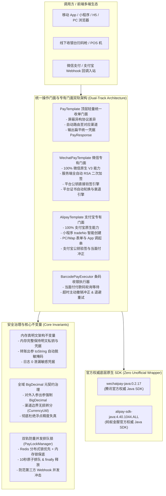

# ateng-boot-pay 基础设施 Starter

> 工业级企业多渠道专有支付中间件底座 Starter，深度集成腾讯官方权威 `wechatpay-java:0.2.17` 与蚂蚁金服 `alipay-sdk-java:4.40.1044.ALL` 原生 SDK，支持双轨专有独立门面 `WechatPayTemplate` 与 `AlipayTemplate`、顶层轻量统一收单门面 `PayTemplate`、支付宝小程序原生调起、微信平台公钥双模自适应验签、资金售后退款、单笔转账到零钱/账户、订单资金分账解冻、线下收银台条码付自动轮询与冲正退避重试、财务对账单流式解压解析引擎、四模密钥自适应解析加载、微信平台证书自动轮换与平滑衰退引擎、双轨异步 Webhook 自动化验签解密、双模防重并发排队锁、强类型业务回调监听器 SPI 与全域 BigDecimal 元契约治理。

- **架构基线**：[ADR-0048 企业级多渠道专有支付中间件底座架构设计](../docs/adr/0048-enterprise-multi-channel-payment-architecture.md)、[ADR-0077 企业级支付底座官方SDK权威对齐与全场景加固架构](../docs/adr/0077-enterprise-pay-official-alignment-and-full-scenario-hardening-architecture.md)、[ADR-0100 支付基础设施样例工程多控制器领域解耦、REST 路由标准化与五维规范重构架构决策](../docs/adr/0100-pay-sample-multi-controller-and-documentation-specification-architecture.md)
- **研发工单闭环**：[#552](https://github.com/atengk/ateng-boot/issues/552)（Parent 目标架构工单）、[#553](https://github.com/atengk/ateng-boot/issues/553)（微信平台公钥加载与自适应验签）、[#554](https://github.com/atengk/ateng-boot/issues/554)（微信支付 V3 线下条码付撤销冲正与受控退避重试）、[#555](https://github.com/atengk/ateng-boot/issues/555)（支付宝小程序统一收单创建与买家标识智能推导）、[#556](https://github.com/atengk/ateng-boot/issues/556)（Sample 样例工程双模驱动升级与 22 项全链路场景实测闭环）、[#557](https://github.com/atengk/ateng-boot/issues/557)（五维生产交付文档）、[#884](https://github.com/atengk/ateng-boot/issues/884)（对标五维规范重构规格书）、[#885](https://github.com/atengk/ateng-boot/issues/885)（Sample 路由统一与 ADR-0100）、[#886](https://github.com/atengk/ateng-boot/issues/886)（五维生产文档与四段式体验卡闭环）

---

## 0. 特性与公共 API 全景速查矩阵 (Feature & API Panorama Matrix)

### 0.1 核心执行门面与业务服务

| 特性分类 | 特性名称 | 核心门面 / SPI / 工具类 | 关键配置项 (`ateng.boot.pay.*`) | 关键 API 签名 / 核心行为 | 锚定验证源头 (*Test / Sample) |
| :--- | :--- | :--- | :--- | :--- | :--- |
| **统一收单** | 统一多渠道收单路由 | `PayTemplate` | `ateng.boot.pay.enabled` | `pay(UnifiedPayRequest)`，多渠道自动路由，输出扁平凭据 `PayResponse`（`qrCode` / `payUrl` / `formHtml` / `wechatJsapi` / `tradeNo` / `orderString`） | `PayTemplateTest` / `PaySampleIntegrationTest` |
| **统一收单** | 统一交易状态查询 | `PayTemplate` | `ateng.boot.pay.enabled` | `queryOrder(UnifiedQueryRequest)` / `queryOrder(PayChannel, String)` / `queryOrder(PayChannel, String, String)`，主动查询订单生命周期状态 | `PayTemplateTest` / `PaySampleIntegrationTest` |
| **统一收单** | 统一未付款订单关闭 | `PayTemplate` | `ateng.boot.pay.enabled` | `closeOrder(UnifiedCloseRequest)` / `closeOrder(PayChannel, String)` / `closeOrder(PayChannel, String, String)`，主动关闭未付款超时订单 | `PayTemplateTest` / `PaySampleIntegrationTest` |
| **统一收单** | 统一交易订单撤销/冲正 | `PayTemplate` | `ateng.boot.pay.enabled` | `cancelOrder(UnifiedCancelRequest)` / `cancelOrder(PayChannel, String)` / `cancelOrder(PayChannel, String, String)`，超时未决撤销与关单冲正 | `PayTemplateTest` |
| **统一退款** | 统一售后退款发起 | `PayTemplate` | `ateng.boot.pay.enabled` | `refund(UnifiedRefundRequest)`，支持原路全额与部分多次退款，输出统一退款凭据 `PayRefundResponse` | `PayTemplateTest` / `PaySampleIntegrationTest` |
| **统一退款** | 统一退款状态查询 | `PayTemplate` | `ateng.boot.pay.enabled` | `queryRefund(UnifiedRefundQueryRequest)` / `queryRefund(PayChannel, String)` / `queryRefund(PayChannel, String, String)`，查询退款进度与入账流水 | `PayTemplateTest` / `PaySampleIntegrationTest` |
| **统一转账** | 统一单笔资金转账发起 | `PayTemplate` | `ateng.boot.pay.transfer.enabled` | `transfer(UnifiedTransferRequest)`，商家转账到微信零钱与支付宝单笔转账，输出 `PayTransferResponse` | `PayTemplateTest` / `PaySampleIntegrationTest` |
| **统一转账** | 统一单笔转账状态查询 | `PayTemplate` | `ateng.boot.pay.transfer.enabled` | `queryTransfer(UnifiedTransferQueryRequest)` / `queryTransfer(PayChannel, String)` / `queryTransfer(PayChannel, String, String)`，查询转账到账状态 | `PayTemplateTest` / `PaySampleIntegrationTest` |
| **转账业务** | 单笔资金转账专有服务 | `PayTransferService` | `ateng.boot.pay.transfer.enabled` | `transfer(...)` / `queryTransfer(...)` / `transferWechat(...)` / `queryWechatTransfer(...)`，高敏单笔转账专有业务服务 | `PayTransferServiceTest` / `PaySampleIntegrationTest` |
| **对账单流** | 财务对账单流式下载 | `PayTemplate` | `ateng.boot.pay.enabled` | `downloadBillStream(PayBillDownloadRequest)` / `downloadBill(PayBillDownloadRequest)`，流式下载渠道官方明细对账单输入流 | `PayTemplateTest` / `PaySampleIntegrationTest` |
| **统一逃生舱** | 便捷原生客户端逃生舱 | `PayTemplate` | - | `getWechatClient()` 获取微信 `HttpClient`；`getAlipayClient()` 获取支付宝 `AlipayClient`；`getWechatPayTemplate()` 与 `getAlipayTemplate()` 获取独立专有门面 | `PayTemplateTest` |
| **条码收银** | 线下付款码收银轮询执行器 | `BarcodePayExecutor` | `ateng.boot.pay.barcode.max-wait-time`<br>`ateng.boot.pay.barcode.poll-interval`<br>`ateng.boot.pay.barcode.auto-cancel-on-timeout` | `execute(UnifiedPayRequest)` / `execute(UnifiedPayRequest, Duration, Duration)` / `execute(UnifiedPayRequest, Duration, Duration, boolean)`，阶梯式轮询支付结果，超时自动撤销冲正 | `BarcodePayExecutorTest` / `PaySampleIntegrationTest` |
| **账单解析** | 财务对账单流式解压解析引擎 | `PayBillParser` | - | `parse(InputStream)` 全量内存解析为 `PayBillResult`；`parse(InputStream, Consumer<PayBillEntry>)` 零 OOM 流式逐行解压与回调 | `PayBillParserTest` / `PaySampleIntegrationTest` |
| **微信专有** | Native 扫码收单 | `WechatPayTemplate` | `ateng.boot.pay.wechat.enabled`<br>`ateng.boot.pay.wechat.merchants.<key>.*` | `payNative(WechatPayRequest)`，直连商户与特约服务商扫码预下单，返回 `qrCode` 二维码内容链接 | `WechatPayTemplateTest` / `PaySampleIntegrationTest` |
| **微信专有** | JSAPI 小程序/公众号支付 | `WechatPayTemplate` | `ateng.boot.pay.wechat.merchants.<key>.app-id`<br>`ateng.boot.pay.wechat.merchants.<key>.private-key-path` | `payJsapi(WechatPayRequest)`，服务端全自动 RSA 二次加签，封包 5 元素直达凭据 `wechatJsapi` | `WechatPayTemplateTest` / `PaySampleIntegrationTest` |
| **微信专有** | H5 移动网页支付 | `WechatPayTemplate` | `ateng.boot.pay.wechat.merchants.<key>.*` | `payH5(WechatPayRequest)`，生成手机浏览器专属跳转支付链接 `payUrl`（`h5_url`） | `WechatPayTemplateTest` / `PaySampleIntegrationTest` |
| **微信专有** | App 移动客户端支付 | `WechatPayTemplate` | `ateng.boot.pay.wechat.merchants.<key>.*` | `payApp(WechatPayRequest)`，服务端计算开放平台 App SDK 调起签名，封包 `wechatApp` 凭据 | `WechatPayTemplateTest` / `PaySampleIntegrationTest` |
| **微信专有** | 条码付 / 付款码被扫 | `WechatPayTemplate` | `ateng.boot.pay.wechat.merchants.<key>.*` | `payBarcode(WechatPayRequest)`，线下商户扫描用户微信付款码收单（`auth_code`） | `WechatPayTemplateTest` |
| **微信专有** | 微信订单状态查询 | `WechatPayTemplate` | `ateng.boot.pay.wechat.merchants.<key>.*` | `queryOrder(WechatPayRequest)` / `queryOrder(String)` / `queryOrder(String, String)`，微信订单状态机自动映射 | `WechatPayTemplateTest` |
| **微信专有** | 微信未支付订单关闭 | `WechatPayTemplate` | `ateng.boot.pay.wechat.merchants.<key>.*` | `closeOrder(WechatPayRequest)` / `closeOrder(String)` / `closeOrder(String, String)`，关闭超时未支付会话 | `WechatPayTemplateTest` |
| **微信专有** | 微信条码付撤销冲正与重试 | `WechatPayTemplate` | `ateng.boot.pay.wechat.merchants.<key>.*` | `cancelOrder(WechatPayRequest)` / `cancelOrder(String)` / `cancelOrder(String, String)`，调用 `/reverse` 接口并在遇到 `SYSTEMERROR` 时自动受控退避重试 | `WechatPayTemplateTest` |
| **微信专有** | 微信售后退款发起与查询 | `WechatPayTemplate` | `ateng.boot.pay.wechat.merchants.<key>.*` | `refund(WechatRefundRequest)` 发起退款；`queryRefund(WechatRefundRequest)` / `queryRefund(String)` / `queryRefund(String, String)` 查询微信退款状态 | `WechatPayTemplateTest` |
| **微信专有** | 微信官方对账单下载 | `WechatPayTemplate` | `ateng.boot.pay.wechat.merchants.<key>.*` | `downloadTradeBill(...)` 下载交易账单；`downloadFundFlowBill(...)` 下载资金账单，自动校验 SHA1 摘要并返回流 | `WechatPayTemplateTest` |
| **微信分账** | 微信订单资金分账服务 | `WechatProfitSharingService` | `ateng.boot.pay.profit-sharing.enabled` | 封装 `createOrder` 请求分账、`queryOrder` 查询分账、`unfreezeOrder` 完结解冻在途资金、`addReceiver`/`deleteReceiver` 接收方管理、`createReturnOrder` 分账回退 | `WechatProfitSharingServiceTest` / `PaySampleIntegrationTest` |
| **微信公钥** | 平台公钥直接验签引擎 | `WechatPayTemplate` | `ateng.boot.pay.wechat.merchants.<key>.wechat-pay-public-key-path`<br>`ateng.boot.pay.wechat.merchants.<key>.wechat-pay-public-key-id` | 加载微信支付官方静态平台公钥，直接构建 `RSAPublicKeyConfig` 实例，免除周期性下载证书网络交互开销 | `WechatPayTemplateTest` |
| **微信证书** | 平台证书自动轮换管理 | `WechatAutoCertificateManager` | `ateng.boot.pay.wechat.merchants.<key>.auto-certificate` | 微信商户平台证书后台守护自动轮换、内存平滑切换与历史证书防雪崩衰退管理 | `WechatAutoCertificateManagerTest` |
| **微信逃生舱** | 原生客户端与服务持有获取 | `WechatPayTemplate` | - | `getClient(String)` / `getClient()` / `getHttpClient()` 获取官方 `HttpClient`；`getWechatConfig(String)` 获取官方 `Config`；`setCustomHttpClient(...)` 注入测试拦截器 | `WechatPayTemplateTest` |
| **支付宝专有** | 电脑网站支付 (Page) | `AlipayTemplate` | `ateng.boot.pay.alipay.enabled`<br>`ateng.boot.pay.alipay.apps.<key>.*` | `payPage(AlipayPayRequest)`，PC 端收银台，返回 `formHtml` 包含自提交 HTML 表单与脚本 | `AlipayTemplateTest` |
| **支付宝专有** | 手机网站支付 (Wap) | `AlipayTemplate` | `ateng.boot.pay.alipay.apps.<key>.*` | `payWap(AlipayPayRequest)`，手机浏览器收银台，返回 `payUrl` 跳转链接或 `formHtml` | `AlipayTemplateTest` |
| **支付宝专有** | App 移动客户端支付 | `AlipayTemplate` | `ateng.boot.pay.alipay.apps.<key>.*` | `payApp(AlipayPayRequest)`，生成支付宝官方客户端 SDK 加签调起串 `orderString` | `AlipayTemplateTest` / `PaySampleIntegrationTest` |
| **支付宝专有** | 小程序统一收单创建 (JSAPI) | `AlipayTemplate` | `ateng.boot.pay.alipay.apps.<key>.*` | `payJsapi(AlipayPayRequest)`，调用 `alipay.trade.create`，智能推导 `buyer_id` / `buyer_open_id`，输出 `tradeNo` 供小程序 `my.tradePay` 调起 | `AlipayTemplateTest` / `PaySampleIntegrationTest` |
| **支付宝专有** | 当面付扫码预下单 (Qr) | `AlipayTemplate` | `ateng.boot.pay.alipay.apps.<key>.*` | `payQr(AlipayPayRequest)`，线下收单生成支付宝付款二维码内容链接 `qrCode` | `AlipayTemplateTest` |
| **支付宝专有** | 当面付条码收单 (Barcode) | `AlipayTemplate` | `ateng.boot.pay.alipay.apps.<key>.*` | `payBarcode(AlipayPayRequest)`，商户扫描用户支付宝付款码收单（`auth_code`） | `AlipayTemplateTest` |
| **支付宝专有** | 支付宝订单状态查询 | `AlipayTemplate` | `ateng.boot.pay.alipay.apps.<key>.*` | `queryOrder(AlipayPayRequest)` / `queryOrder(String)` / `queryOrder(String, String)`，查询支付宝收单流水 | `AlipayTemplateTest` |
| **支付宝专有** | 支付宝未支付订单关闭 | `AlipayTemplate` | `ateng.boot.pay.alipay.apps.<key>.*` | `closeOrder(AlipayPayRequest)` / `closeOrder(String)` / `closeOrder(String, String)`，关闭超时订单 | `AlipayTemplateTest` |
| **支付宝专有** | 支付宝当面付订单撤销冲正 | `AlipayTemplate` | `ateng.boot.pay.alipay.apps.<key>.*` | `cancelOrder(AlipayPayRequest)` / `cancelOrder(String)` / `cancelOrder(String, String)`，调用 `alipay.trade.cancel` 撤销超时交易并自动冲正 | `AlipayTemplateTest` |
| **支付宝专有** | 支付宝售后退款与查询 | `AlipayTemplate` | `ateng.boot.pay.alipay.apps.<key>.*` | `refund(AlipayRefundRequest)` 支持部分退款与分账同步退款；`queryRefund(AlipayRefundRequest)` / `queryRefund(String, String)` 查询退款明细 | `AlipayTemplateTest` |
| **支付宝专有** | 支付宝账单下载链接查询 | `AlipayTemplate` | `ateng.boot.pay.alipay.apps.<key>.*` | `downloadBillUrl(String, String)` / `downloadBillStream(...)`，获取官方账单临时下载 URL 并流式拉取 | `AlipayTemplateTest` |
| **支付宝逃生舱** | 原生客户端与缓存清理获取 | `AlipayTemplate` | - | `getClient(String)` / `getClient()` / `getAlipayClient()` 获取蚂蚁金服官方原生 `AlipayClient`；`clearClientCache()` 运行时重置客户端缓存 | `AlipayTemplateTest` |
| **回调网关** | 统一 Webhook 端点 | `PayWebhookController` | `ateng.boot.pay.callback.enabled`<br>`ateng.boot.pay.callback.path-prefix` | 暴露统一端点 `/ateng-pay/callback/{channel}/{merchantId}`，自动拦截、验签、解密与并发防重 | `PayWebhookControllerTest` / `PaySampleIntegrationTest` |
| **回调处理** | 编程式回调处理门面 | `PayCallbackHandler` | `ateng.boot.pay.callback.idempotent-timeout` | `handleWechat(...)` 与 `handleAlipay(...)`，支持 Servlet 请求或解耦参数对象编程式调度 | `PayWebhookControllerTest` / `PaySampleIntegrationTest` |
| **回调监听 SPI** | 支付与退款异步监听器 | `PayCallbackListener` | - | 实现 `onPaymentSuccess(PaymentSuccessCallback)` 与 `onRefundSuccess(RefundSuccessCallback)`，返回确定性 `PayCallbackResult` | `OrderPaymentCallbackListener` / `PaySampleIntegrationTest` |
| **证书扩展 SPI** | 外部密钥证书提供器 | `PayCertificateProvider` | - | 实现外部 KMS / HashiCorp Vault / 数据库动态解密私钥与证书扩展接口 | `PayKeyLoaderTest` |
| **多商户注册** | 命名多商户多应用管理 | `NamedMerchantRegistry` | `ateng.boot.pay.wechat.merchants.*`<br>`ateng.boot.pay.alipay.apps.*` | 运行时动态注册与热更新商户/应用配置，支持三级降级查找（显式键 -> 默认键 -> 首个已注册） | `NamedMerchantRegistryTest` |
| **线程切源** | 线程级动态切源持有者 | `PayContextHolder` | - | `setMerchantKey(String)` / `getMerchantKey()` / `clear()`，支持多租户与请求上下文动态绑定商户别名 | `PayContextHolderTest` |
| **密钥解析** | 四模自适应密钥加载器 | `PayKeyLoader` | - | 自动识别 `classpath:`、`file:`、纯文本 PEM（`loadPrivateKeyPem` / `loadPublicKeyPem`）与纯 Base64 编码，静态平台公钥缓存与动态清理 | `PayKeyLoaderTest` |
| **防重并发锁** | 双轨分布式防重锁门面 | `PayLockManager` | `ateng.boot.pay.callback.idempotent-timeout` | `tryLock(String, Duration)` 与 `unlock(String)`，Redis 基础设施存在时优先装配分布式锁，无 Redis 内存锁保底 | `InMemoryPayLockManagerTest` / `RedisPayLockManagerTest` |
| **货币工具** | 元/分无损高精度换算 | `CurrencyUtil` | - | `yuanToFen(BigDecimal)` 与 `fenToYuan(Long)` / `fenToYuan(Integer)`，防御浮点精度失真 | `CurrencyUtilTest` |

---

### 0.2 核心强类型枚举一览

| 枚举类型 | 常用枚举项 | 语义说明 |
| :--- | :--- | :--- |
| `PayChannel` | `WECHAT_PAY`、`ALIPAY` | 支付渠道（微信支付 / 支付宝开放平台） |
| `PayTradeType` | `NATIVE`、`JSAPI`、`H5`、`APP`、`BARCODE`、`PAGE`、`WAP` | 统一交易类型（扫码、小程序/公众号、手机网页、移动应用、付款码收银、电脑网站、手机网站） |
| `PayTradeState` | `SUCCESS`、`USERPAYING`、`NOTPAY`、`CLOSED`、`REVOKED`、`PAYERROR` | 统一交易生命周期状态机 |
| `PayRefundState` | `SUCCESS`、`PROCESSING`、`ABNORMAL`、`CLOSED` | 统一资金售后退款状态机 |
| `PayTransferState`| `SUCCESS`、`FAIL`、`PROCESSING`、`REFUND`、`CLOSED` | 统一单笔资金转账状态机 |
| `PayResultCode` | `PAY_SUCCESS` (200)、`PAY_PARAM_INVALID` (58001)、`PAY_FEATURE_DISABLED` (58002)、`PAY_SIGN_FAILED` (58003)、`PAY_GATEWAY_ERROR` (58007) 等 | 支付业务语义化状态错误码 |

---

## 1. 模块定位与快速起步 (Quick Start)

`ateng-boot-pay` 是面向企业电商收单、SaaS 订阅缴费、政企在线支付与资金清结算的生产就绪专有支付基础设施：
- **纯净依赖与双轨权威 SDK**：核心网络交互与协议解密 100% 对齐腾讯官方权威 `wechatpay-java:0.2.17` 与蚂蚁金服 `alipay-sdk-java:4.40.1044.ALL`，杜绝任何未经安全审计的第三方二次封装包；
- **全场景统一收单门面与扁平直达凭据**：统一轻量收单门面 `PayTemplate` 屏蔽异构渠道差异，出参采用扁平化统一凭据 `PayResponse`（前端直接取用 `qrCode`、`payUrl`、`formHtml`、`wechatJsapi`、`tradeNo`、`orderString`），彻底消除多态强转与 `ClassCastException` 隐患；
- **传输层与持久层绝对隔离 (Zero-Entity-Leakage)**：Controller 传输边界 100% 严禁暴露 ORM 实体，统一使用入参 DTO 挂载 JSR-303 格式校验与出参强类型 `Result<T>`。

### 1.1 Maven 坐标引入

在已导入 `ateng-boot-bom` 的工程中，无需声明版本号即可直接引入：

```xml
<dependency>
    <groupId>io.github.atengk</groupId>
    <artifactId>ateng-boot-pay</artifactId>
</dependency>
```

### 1.2 极简起步配置与实操 (微信扫码收单 Happy Path)

#### ① 最小可用 YAML 配置

```yaml
ateng:
  boot:
    pay:
      enabled: true
      wechat:
        enabled: true
        merchants:
          default:
            app-id: wx8888888888888888
            mch-id: "1900000001"
            api-v3-key: "32bytesMockApiV3KeyForTesting000"
            merchant-serial-number: "1234567890ABCDEF1234567890ABCDEF"
            private-key-path: classpath:certs/test_private_key.pem
            wechat-pay-public-key-path: classpath:certs/test_public_key.pem
            wechat-pay-public-key-id: "PUB_KEY_ID_TEST_001"
```

#### ② 一行代码发起收单

```java
@Autowired
private PayTemplate payTemplate;

public String createQrCodeOrder(String orderId, BigDecimal amount, String title) {
    UnifiedPayRequest request = UnifiedPayRequest.builder()
            .channel(PayChannel.WECHAT_PAY)
            .tradeType(PayTradeType.NATIVE)
            .outTradeNo(orderId)
            .amount(amount)
            .subject(title)
            .build();

    PayResponse response = payTemplate.pay(request);
    return response.getQrCode(); // 直接返回微信二维码内容链接供前端渲染
}
```

---

## 2. 核心架构与设计不变量 (Architecture & Invariants)



- **“内存真明文”架构不变量 (ADR-0012 / ADR-0048)**：商户私钥、APIv3 密钥与支付凭据在 JVM 内存中始终保持 100% 真实明文，以支撑底层官方 SDK 高频加解密与数字签名运算；出参对象（如 `PayTransferResponse`）在 `toString()` 中自动调用 `DesensitizeUtil` 对真实姓名与账号动态脱敏掩码，坚决杜绝敏感凭证在日志中泄漏；
- **全域 `BigDecimal` 元契约与无损换算**：对外所有接口、DTO、VO 与业务模型，金额统一使用 `BigDecimal`（保留两位小数，舍入模式 `RoundingMode.HALF_UP`），彻底消除浮点数 `Double`/`Float` 精度失真与无量纲整型歧义；底层进出渠道边界时统一由 `CurrencyUtil` 完成元/分安全换算；
- **双轨防重并发排队锁 (ADR-0048 / ADR-0077)**：Webhook 入站时，`PayLockManager` 依据订单号执行原子加锁，租期默认 10 秒；Redis 环境优先装配分布式锁，无 Redis 自动以内存锁保底；遇到并发锁冲突立即返回失败驱动渠道阶梯重试，释放严格在 `finally` 块中执行。

---

## 3. 统一多渠道收单套件 (Unified Checkout Suite)

收单套件通过 `PayTemplate` 提供多渠道统一收单、查单与关单能力，出参采用扁平凭据 `PayResponse`，各端按需直接提取字段。

### 3.1 微信 Native 扫码收单

为 PC 网页收银台生成微信支付二维码内容链接，前端使用二维码组件直接渲染。

```yaml
ateng:
  boot:
    pay:
      enabled: true
      wechat:
        enabled: true
        merchants:
          default:
            app-id: wx8888888888888888
            mch-id: "1900000001"
            api-v3-key: "32bytesMockApiV3KeyForTesting000"
            merchant-serial-number: "1234567890ABCDEF1234567890ABCDEF"
            private-key-path: classpath:certs/test_private_key.pem
            wechat-pay-public-key-path: classpath:certs/test_public_key.pem
            wechat-pay-public-key-id: "PUB_KEY_ID_TEST_001"
            notify-url: "http://127.0.0.1:8080/ateng-pay/callback/wechat"
```

```java
@PostMapping("/native")
public Result<PayResponse> checkoutNative(@Valid @RequestBody PayCheckoutDTO dto) {
    UnifiedPayRequest request = UnifiedPayRequest.builder()
            .channel(dto.getChannel())
            .tradeType(PayTradeType.NATIVE)
            .outTradeNo(dto.getOutTradeNo())
            .amount(dto.getAmount())
            .subject(dto.getSubject())
            .merchantKey(dto.getMerchantKey())
            .notifyUrl(dto.getNotifyUrl())
            .attach(dto.getAttach())
            .build();

    PayResponse response = payTemplate.pay(request);
    return Result.success(response);
}
```

- **机制与边界说明**：微信 Native 模式返回 `code_url` 映射为 `response.getQrCode()`，有效时间默认为 2 小时；微信平台公钥直连模式免除了调用微信下载证书接口的周期性网络开销。

---

### 3.2 微信 JSAPI 小程序/公众号收单 (服务端全自动二次加签)

微信小程序或微信公众号网页内调起支付时，服务端在获取 `prepay_id` 后，全自动使用商户私钥计算 RSA 数字签名并封包 5 元素调起凭据（`appId`、`timeStamp`、`nonceStr`、`package`、`signType`、`paySign`）。

```yaml
ateng:
  boot:
    pay:
      wechat:
        merchants:
          default:
            app-id: wx8888888888888888
            private-key-path: classpath:certs/test_private_key.pem
```

```java
@PostMapping("/jsapi")
public Result<PayResponse> checkoutJsapi(@Valid @RequestBody PayCheckoutDTO dto) {
    UnifiedPayRequest request = UnifiedPayRequest.builder()
            .channel(dto.getChannel())
            .tradeType(PayTradeType.JSAPI)
            .outTradeNo(dto.getOutTradeNo())
            .amount(dto.getAmount())
            .subject(dto.getSubject())
            .openid(dto.getOpenid())
            .merchantKey(dto.getMerchantKey())
            .build();

    PayResponse response = payTemplate.pay(request);
    return Result.success(response);
}
```

#### 微信 JSAPI 5 元素调起响应示例

```json
{
  "code": 200,
  "msg": "操作成功",
  "data": {
    "channel": "WECHAT_PAY",
    "tradeType": "JSAPI",
    "outTradeNo": "ORD_JSAPI_20261110_002",
    "success": true,
    "wechatJsapi": {
      "appId": "wx8888888888888888",
      "timeStamp": "1729699200",
      "nonceStr": "mockNonceStr123",
      "package": "prepay_id=wx20261023prepay001",
      "signType": "RSA",
      "paySign": "MOCK_PAY_SIGN_BASE64_VALUE"
    }
  },
  "success": true,
  "traceId": "c8a14b0365734fb4864f7bdf753b890a"
}
```

- **机制与边界说明**：前端小程序直接将 `data.wechatJsapi` 对象解构传入 `wx.requestPayment(res.data.wechatJsapi)`，彻底消除了传统后端手工拼接时间戳和换行签名的痛点与验签失败风险。

---

### 3.3 支付宝小程序统一收单创建 (JSAPI)

支付宝小程序在前端调起 `my.tradePay` 前，服务端必须先调用支付宝统一收单交易创建接口（`alipay.trade.create`）换取支付宝交易号（`trade_no`）。

```yaml
ateng:
  boot:
    pay:
      alipay:
        enabled: true
        apps:
          default:
            app-id: "2021000000000001"
            private-key-path: classpath:certs/test_private_key.pem
            alipay-public-key: classpath:certs/test_public_key.pem
            server-url: "https://openapi-sandbox.dl.alipaydev.com/gateway.do"
```

```java
@PostMapping("/alipay-miniapp")
public Result<PayResponse> checkoutAlipayMiniApp(@Valid @RequestBody PayCheckoutDTO dto) {
    dto.setChannel(PayChannel.ALIPAY);
    UnifiedPayRequest request = UnifiedPayRequest.builder()
            .channel(PayChannel.ALIPAY)
            .tradeType(PayTradeType.JSAPI)
            .outTradeNo(dto.getOutTradeNo())
            .amount(dto.getAmount())
            .subject(dto.getSubject())
            .buyerId(dto.getBuyerId())
            .buyerOpenId(dto.getBuyerOpenId())
            .build();

    PayResponse response = payTemplate.pay(request);
    return Result.success(response);
}
```

- **买家标识智能推导机制 (ADR-0077 / #555)**：支持 16 位以 2088 开头的旧版 `buyer_id` 与以 0 开头的新版开放标识 `buyer_open_id`；框架自动按官方规范推导注入，返回 `response.getTradeNo()` 供前端 `my.tradePay({ tradeNO: res.data.tradeNo })` 调起。

---

### 3.4 移动网页与 PC 电脑收单 (微信 H5 / 支付宝 Wap 与 Page)

```java
@PostMapping("/h5")
public Result<PayResponse> checkoutH5(@Valid @RequestBody PayCheckoutDTO dto) {
    UnifiedPayRequest request = UnifiedPayRequest.builder()
            .channel(dto.getChannel())
            .tradeType(PayTradeType.H5)
            .outTradeNo(dto.getOutTradeNo())
            .amount(dto.getAmount())
            .subject(dto.getSubject())
            .returnUrl(dto.getReturnUrl())
            .build();

    PayResponse response = payTemplate.pay(request);
    return Result.success(response);
}
```

- **机制与边界说明**：微信 H5 返回 `payUrl`（`h5_url`），需在手机外部浏览器中打开并自动唤起微信；支付宝 Wap/Page 模式返回 `formHtml`，前端将其插入 DOM 后自动触发表单提交跳转至支付宝收银台。

---

### 3.5 App 移动客户端收单 (微信 App prepayId / 支付宝 orderString)

```java
@PostMapping("/app")
public Result<PayResponse> checkoutApp(@Valid @RequestBody PayCheckoutDTO dto) {
    UnifiedPayRequest request = UnifiedPayRequest.builder()
            .channel(dto.getChannel())
            .tradeType(PayTradeType.APP)
            .outTradeNo(dto.getOutTradeNo())
            .amount(dto.getAmount())
            .subject(dto.getSubject())
            .build();

    PayResponse response = payTemplate.pay(request);
    return Result.success(response);
}
```

- **机制与边界说明**：微信 App 收单返回 `prepayId` 与已完成二次加签的参数；支付宝 App 收单返回已加签的 URL 编码字符串 `orderString`，客户端直接传入官方客户端 SDK 调起支付。

---

### 3.6 订单交易状态主动查询与主动关单

```java
@PostMapping({"/query", "/order/query"})
public Result<PayResponse> queryOrder(@Valid @RequestBody PayOrderQueryDTO dto) {
    UnifiedQueryRequest request = UnifiedQueryRequest.builder()
            .channel(dto.getChannel())
            .outTradeNo(dto.getOutTradeNo())
            .transactionId(dto.getTransactionId())
            .merchantKey(dto.getMerchantKey())
            .build();

    PayResponse response = payTemplate.queryOrder(request);
    return Result.success(response);
}

@PostMapping({"/close", "/order/close"})
public Result<PayResponse> closeOrder(@Valid @RequestBody PayOrderCloseDTO dto) {
    UnifiedCloseRequest request = UnifiedCloseRequest.builder()
            .channel(dto.getChannel())
            .outTradeNo(dto.getOutTradeNo())
            .merchantKey(dto.getMerchantKey())
            .build();

    PayResponse response = payTemplate.closeOrder(request);
    return Result.success(response);
}
```

- **机制与边界说明**：抹平异构渠道状态机差异，统一归一化为 `PayTradeState`（`SUCCESS`、`USERPAYING`、`NOTPAY`、`CLOSED`、`REVOKED`、`PAYERROR`）。关单操作仅对未支付的超时订单有效，已支付订单将抛出语义化业务异常。

---

## 4. 线下收银台条码付套件 (Barcode Cashier Suite)

线下门店商户扫描用户手机付款码（微信支付以 `10~15` 开头，支付宝以 `25~30` 开头）发起面对面扣款。

```yaml
ateng:
  boot:
    pay:
      barcode:
        max-wait-time: 30s
        poll-interval: 2s
        auto-cancel-on-timeout: true
```

### 4.1 付款码即时扣款与阶梯轮询扣款

```java
@PostMapping("/cashier")
public Result<PayResponse> cashierPay(@Valid @RequestBody PayBarcodeDTO dto) {
    UnifiedPayRequest request = UnifiedPayRequest.builder()
            .channel(dto.getChannel())
            .tradeType(PayTradeType.BARCODE)
            .merchantKey(dto.getMerchantKey())
            .outTradeNo(dto.getOutTradeNo())
            .amount(dto.getAmount())
            .authCode(dto.getAuthCode())
            .subject(dto.getSubject())
            .build();

    PayResponse response;
    if (dto.getMaxWaitTime() != null && dto.getPollInterval() != null) {
        boolean autoCancel = dto.getAutoCancelOnTimeout() != null ? dto.getAutoCancelOnTimeout() : true;
        response = barcodePayExecutor.execute(request, dto.getMaxWaitTime(), dto.getPollInterval(), autoCancel);
    } else {
        response = barcodePayExecutor.execute(request);
    }
    return Result.success(response);
}
```

### 4.2 超时自动撤销冲正与受控退避重试 (ADR-0077 / #554)

- **轮询阶梯机制**：当用户端需要输入密码时，渠道返回 `USERPAYING`；`BarcodePayExecutor` 启动受控阶梯轮询（默认每隔 2 秒查询一次状态，最多等待 30 秒）；
- **超时撤销冲正与退避重试**：当超过 `maxWaitTime` 且 `autoCancelOnTimeout=true` 时，执行器自动调用 `cancelOrder` 撤销冲正；
  - 微信支付调用 `/reverse` 接口。若遭遇网络超时或微信系统繁忙返回 `SYSTEMERROR`，框架依托 Core 底座 `RetryUtil` 自动执行最多 3 次指数退避重试（间隔 1s、2s、4s），彻底防止单边账与资金悬挂；
  - 支付宝调用 `alipay.trade.cancel` 接口，未支付直接关单，已扣款自动原路冲正退还。

---

## 5. 资金售后退款套件 (Refund Suite)

支持对已支付的成功订单发起原路全额退款或部分多次退款。

```java
@PostMapping("/apply")
public Result<PayRefundResponse> applyRefund(@Valid @RequestBody PayRefundDTO dto) {
    UnifiedRefundRequest request = UnifiedRefundRequest.builder()
            .channel(dto.getChannel())
            .merchantKey(dto.getMerchantKey())
            .outTradeNo(dto.getOutTradeNo())
            .transactionId(dto.getTransactionId())
            .outRefundNo(dto.getOutRefundNo())
            .refundAmount(dto.getRefundAmount())
            .totalAmount(dto.getTotalAmount())
            .reason(dto.getReason())
            .build();

    PayRefundResponse response = payTemplate.refund(request);
    return Result.success(response);
}

@PostMapping("/query")
public Result<PayRefundResponse> queryRefund(@Valid @RequestBody PayRefundQueryDTO dto) {
    UnifiedRefundQueryRequest request = UnifiedRefundQueryRequest.builder()
            .channel(dto.getChannel())
            .merchantKey(dto.getMerchantKey())
            .outTradeNo(dto.getOutTradeNo())
            .outRefundNo(dto.getOutRefundNo())
            .build();

    PayRefundResponse response = payTemplate.queryRefund(request);
    return Result.success(response);
}
```

- **机制与边界说明**：同一笔订单支持多次发起部分退款，多次退款必须保证商户退款单号 `outRefundNo` 严格全局唯一；累计退款金额不得超过订单总额 `totalAmount`；统一返回 `PayRefundState`（`PROCESSING`、`SUCCESS`、`ABNORMAL`、`CLOSED`）。

---

## 6. 单笔资金转账套件 (Transfer Suite)

面向企业发薪、佣金提现或赔付场景，支持商家转账到微信零钱与支付宝单笔转账到账户。

```yaml
ateng:
  boot:
    pay:
      transfer:
        enabled: true # 资金高敏操作总开关
```

```java
@PostMapping("/apply")
public Result<PayTransferResponse> applyTransfer(@Valid @RequestBody PayTransferDTO dto) {
    UnifiedTransferRequest request = UnifiedTransferRequest.builder()
            .channel(dto.getChannel())
            .merchantKey(dto.getMerchantKey())
            .outBizNo(dto.getOutBizNo())
            .amount(dto.getAmount())
            .title(dto.getTitle())
            .payeeAccount(dto.getPayeeAccount())
            .payeeRealName(dto.getPayeeRealName())
            .build();

    PayTransferResponse response = payTemplate.transfer(request);
    return Result.success(response);
}

@PostMapping("/query")
public Result<PayTransferResponse> queryTransfer(@Valid @RequestBody PayTransferQueryDTO dto) {
    UnifiedTransferQueryRequest request = UnifiedTransferQueryRequest.builder()
            .channel(dto.getChannel())
            .merchantKey(dto.getMerchantKey())
            .outBizNo(dto.getOutBizNo())
            .orderId(dto.getOrderId())
            .build();

    PayTransferResponse response = payTemplate.queryTransfer(request);
    return Result.success(response);
}
```

- **机制与边界说明**：转账出资属于物理扣款高危操作，受 `ateng.boot.pay.transfer.enabled` 总开关守卫；出参对象 `PayTransferResponse` 在 `toString()` 时通过 `DesensitizeUtil` 自动对收款人姓名和账号打码掩码，杜绝凭证在日志中泄漏。

---

## 7. 微信资金分账套件 (Profit Sharing Suite)

适用于平台型电商、服务商或分销体系，支持在订单支付成功后冻结资金，并在完成履约后按比例分账，最后解冻在途剩余资金。

```yaml
ateng:
  boot:
    pay:
      profit-sharing:
        enabled: true # 微信分账高敏特性开关
```

```java
@PostMapping({"/receiver/add", "/receivers/add"})
public Result<AddReceiverResponse> addReceiver(@Valid @RequestBody ProfitSharingReceiverDTO dto) {
    AddReceiverRequest request = new AddReceiverRequest();
    request.setType(ReceiverType.valueOf(dto.getType().toUpperCase()));
    request.setAccount(dto.getAccount());
    request.setName(dto.getName());
    request.setRelationType(ReceiverRelationType.valueOf(dto.getRelationType().toUpperCase()));

    AddReceiverResponse response = profitSharingService.addReceiver(dto.getMerchantKey(), request);
    return Result.success(response);
}

@PostMapping({"/order/unfreeze", "/unfreeze"})
public Result<OrdersEntity> unfreezeOrder(@Valid @RequestBody ProfitSharingUnfreezeDTO dto) {
    UnfreezeOrderRequest request = new UnfreezeOrderRequest();
    request.setOutOrderNo(dto.getOutOrderNo());
    request.setTransactionId(dto.getTransactionId());
    request.setDescription(dto.getDescription());

    OrdersEntity entity = profitSharingService.unfreezeOrder(dto.getMerchantKey(), request);
    return Result.success(entity);
}
```

- **机制与边界说明**：微信分账订单在下单时需标记 `profit_sharing = true`；分账操作完成后必须调用 `unfreezeOrder` 完结解冻，将未分配的剩余资金释放回特约商户可用余额。

---

## 8. 财务对账单流式套件 (Bill Reconcile Suite)

自动完成微信与支付宝官方明细对账单下载、SHA1 摘要防篡改校验，并自适应解压 GZIP 与 ZIP 压缩流。

### 8.1 模式一：全量内存解析模式 (中小批量)

```java
@PostMapping({"/parse-memory", "/download/parse-memory"})
public Result<PayBillResult> parseMemory(@Valid @RequestBody PayBillQueryDTO dto) throws Exception {
    PayBillDownloadRequest request = PayBillDownloadRequest.builder()
            .channel(dto.getChannel())
            .merchantKey(dto.getMerchantKey())
            .billDate(dto.getBillDate())
            .billType(dto.getBillType())
            .tarType(dto.getTarType())
            .build();

    try (InputStream stream = payTemplate.downloadBillStream(request)) {
        PayBillResult result = payBillParser.parse(stream);
        return Result.success(result);
    }
}
```

### 8.2 模式二：常驻 O(1) 零 OOM 流式逐行对账消费模式 (海量数据)

```java
@PostMapping({"/stream-reconcile", "/download/stream-consume"})
public Result<PayBillSummary> streamReconcile(@Valid @RequestBody PayBillQueryDTO dto) throws Exception {
    PayBillDownloadRequest request = PayBillDownloadRequest.builder()
            .channel(dto.getChannel())
            .merchantKey(dto.getMerchantKey())
            .billDate(dto.getBillDate())
            .billType(dto.getBillType())
            .tarType(dto.getTarType())
            .build();

    try (InputStream stream = payTemplate.downloadBillStream(request)) {
        PayBillSummary summary = payBillParser.parse(stream, entry -> {
            // 逐行消费明细（如写库入账校验），堆内存常驻 O(1)，无 OOM 隐患
            log.debug("Reconciling: tradeNo={}, amount={}", entry.getTransactionId(), entry.getTotalAmount());
        });
        return Result.success(summary);
    }
}
```

- **机制与边界说明**：针对数十万级庞大账单文件，流式逐行消费避免了构建巨大集合对象塞爆 JVM 堆内存，实现了极低内存消耗下的高效批量财务对账。

---

## 9. 双轨异步 Webhook 与并发防重套件 (Webhook & Anti-Replay Suite)

### 9.1 统一异步 Webhook 回调网关

Starter 自动对外暴露统一回调端点：
- 微信通知端点：`POST /ateng-pay/callback/wechat/{merchantId}`
- 支付宝通知端点：`POST /ateng-pay/callback/alipay/{merchantId}`

```yaml
ateng:
  boot:
    pay:
      callback:
        enabled: true
        path-prefix: /ateng-pay/callback
        idempotent-timeout: 10s # 并发排队锁租期
```

网关自动执行：
1. HTTP 标头提取（微信时间戳、随机数、数字签名、证书序列号等）；
2. 公钥验签与报文解密（微信 AES-256-GCM 解密通知密文，支付宝表单参数验签）；
3. 调用 `PayLockManager` 针对交易单号加排队锁（10 秒）；
4. 调度业务监听器 SPI `PayCallbackListener`；
5. 向渠道返回官方应答（微信 HTTP 200，支付宝字符串 `success` 或 `fail`）。

### 9.2 业务回调监听器 SPI (`PayCallbackListener`) 落地

业务方无需编写任何 Webhook Controller，只需实现 `PayCallbackListener` SPI 并注册为 Spring Bean：

```java
@Slf4j
@Component
public class OrderPaymentCallbackListener implements PayCallbackListener {

    private final Set<String> processedOrders = ConcurrentHashMap.newKeySet();

    @Override
    public boolean supports(PaymentSuccessCallback callback) {
        return callback != null && callback.getOutTradeNo() != null;
    }

    @Override
    public PayCallbackResult onPaymentSuccess(PaymentSuccessCallback callback) {
        String outTradeNo = callback.getOutTradeNo();

        // 1. 业务防重放检查：已处理订单返回 IGNORE 静默确认，防止重复发货
        if (processedOrders.contains(outTradeNo)) {
            log.info("Order [{}] already processed, returning IGNORE ACK.", outTradeNo);
            return PayCallbackResult.ignore("订单已处理，忽略重复通知");
        }

        // 2. 执行业务订单更新（标记 PAID、核销卡券、出库发货）
        processedOrders.add(outTradeNo);
        log.info("Order [{}] marked as PAID in database.", outTradeNo);

        // 3. 返回 SUCCESS 指示网关向第三方渠道回复成功应答
        return PayCallbackResult.success("订单支付状态更新成功");
    }

    @Override
    public boolean supports(RefundSuccessCallback callback) {
        return callback != null && callback.getOutRefundNo() != null;
    }

    @Override
    public PayCallbackResult onRefundSuccess(RefundSuccessCallback callback) {
        return PayCallbackResult.success("退款成功确认");
    }
}
```

---

## 10. 生产扩展接管与高级定制 (Customization & Extensibility)

### 10.1 多商户多应用动态注册 (`NamedMerchantRegistry`)

支持在应用运行时动态注册或热更新微信商户与支付宝应用配置，三级降级查找（显式指定商户别名 -> 默认商户 -> 首个已注册商户）：

```java
@Autowired
private NamedMerchantRegistry merchantRegistry;

public void registerTenantWechat(String tenantId, String mchId, String appId, String privateKeyPath, String pubKeyPath, String pubKeyId) {
    WechatMerchantProperties props = new WechatMerchantProperties();
    props.setMchId(mchId);
    props.setAppId(appId);
    props.setPrivateKeyPath(privateKeyPath);
    props.setWechatPayPublicKeyPath(pubKeyPath);
    props.setWechatPayPublicKeyId(pubKeyId);

    merchantRegistry.registerWechatMerchant(tenantId, props);
}
```

### 10.2 线程级商户切源与上下文隔离 (`PayContextHolder`)

在多租户拦截器或定时任务中，通过 ThreadLocal 动态绑定当前线程商户别名：

```java
try {
    PayContextHolder.setMerchantKey("tenant_saas_001");
    // 后续调用的统一门面方法会自动选用 tenant_saas_001 对应商户密钥与配置
    payTemplate.pay(request);
} finally {
    PayContextHolder.clear(); // 严格清理现场，杜绝线程池污染
}
```

### 10.3 外部密钥与证书扩展 SPI (`PayCertificateProvider`)

对接企业云 KMS（阿里云 KMS / 腾讯云 KMS / AWS KMS）或 HashiCorp Vault：

```java
@Component
public class CloudKmsCertificateProvider implements PayCertificateProvider {

    @Override
    public boolean supports(String locationOrContent) {
        return locationOrContent != null && locationOrContent.startsWith("kms://");
    }

    @Override
    public PrivateKey loadPrivateKey(String locationOrContent) {
        return decryptPrivateKeyFromKms(locationOrContent);
    }

    @Override
    public X509Certificate loadCertificate(String locationOrContent) {
        return null;
    }
}
```

### 10.4 双轨并发防重排队锁自主接管 (`PayLockManager`)

默认装配 Redis 分布式锁（基于 `StringRedisTemplate`）与单机内存锁保底。若需接入 Redisson 锁，可通过实现并注入自定义 Bean 覆盖：

```java
@Configuration(proxyBeanMethods = false)
public class CustomPayLockConfiguration {

    @Bean
    public PayLockManager customPayLockManager(RedissonClient redissonClient) {
        return new RedissonPayLockManager(redissonClient);
    }
}
```

### 10.5 官方权威原生 SDK 客户端逃生舱与单测桩注入

- `payTemplate.getWechatClient()`：获取腾讯官方 `com.wechat.pay.java.core.http.HttpClient`；
- `payTemplate.getAlipayClient()`：获取蚂蚁金服官方 `com.alipay.api.AlipayClient`；
- `payTemplate.getWechatPayTemplate()` / `payTemplate.getAlipayTemplate()`：获取独立专有门面；
- `alipayTemplate.clearClientCache()`：运行时清理客户端缓存，支持热配置生效与单测桩切换。

---

## 11. 核心生产边界与非功能机制 (Production Boundary & Failure Modes)

### 11.1 微信平台公钥直连 vs 微信平台证书自动轮换双模引擎

- **模式 A: 微信官方新版静态平台公钥直连（强烈推荐）**：
  配置 `wechat-pay-public-key-path`（或 `wechat-pay-public-key-pem`）及公钥 ID 后，由 `PayKeyLoader` 直接构建 `RSAPublicKeyConfig` 实例。进站回调验签与敏感数据加密 100% 本地运算完成，免去周期性下载证书的网络开销与轮询故障风险；
- **模式 B: 微信平台证书后台自动轮换引擎**：
  针对老商户配置 `auto-certificate: true` 后，`WechatAutoCertificateManager` 启动守护线程定时轮询，下载新证书并执行原子化热替换，旧证书平滑保留至失效窗口期结束。

### 11.2 线下条码付撤销冲正因果链与受控退避重试

条码收银面临网络超时、收银员提前取消或用户网络欠费等复杂异常：
- 微信支付 V3 不提供撤销退款接口，必须调用官方撤销冲正接口 `/v3/pay/transactions/out-trade-no/{outTradeNo}/reverse`；
- 当网络抖动或微信服务端返回 `SYSTEMERROR`（系统繁忙）时，`WechatPayTemplate.cancelOrder` 依托 Core 基础底座 `RetryUtil` 自动执行指数退避重试（最多 3 次，初始间隔 1 秒，倍率 2.0，上限 5 秒），确保订单冲正绝对确定性闭环，坚决杜绝超扣与悬挂。

### 11.3 防御性锁释放范式

恪守九道成熟度防线第 5 条（严格无状态与受管并发），在处理 Webhook 回调防重加锁时，锁释放必须且只能在 `finally` 块中执行：

```java
String lockKey = channel.name() + ":" + outTradeNo;
boolean acquired = payLockManager.tryLock(lockKey, Duration.ofSeconds(10));
if (!acquired) {
    // 锁冲突时向渠道返回失败，促使其进入官方重试投递队列，避免重复消费
    return buildConflictResponse(channel);
}
try {
    return doProcessCallback(channel, merchantKey, request);
} finally {
    payLockManager.unlock(lockKey); // 防御性释放，杜绝死锁与锁悬挂
}
```

---

## 12. 完整 YAML 配置属性清单 (Configuration Property Dictionary)

以下为 `ateng.boot.pay.*` 全量配置属性字典：

| 配置属性路径 | 类型 | 默认值 | 详细中文说明与生产建议 |
| :--- | :---: | :---: | :--- |
| `ateng.boot.pay.enabled` | `Boolean` | `false` | 支付底座全局总开关，开启后自动装配统一支付门面 `PayTemplate` |
| `ateng.boot.pay.callback.enabled` | `Boolean` | `true` | 统一 Webhook 异步回调网关总开关 |
| `ateng.boot.pay.callback.path-prefix` | `String` | `/ateng-pay/callback` | Webhook 回调统一路由前缀 |
| `ateng.boot.pay.callback.idempotent-timeout` | `Duration` | `10s` | 回调入站并发防重排队锁租期（强类型 `Duration`，如 `10s`、`30s`） |
| `ateng.boot.pay.transfer.enabled` | `Boolean` | `false` | 单笔资金转账高敏操作物理总开关，生产按需显式开启 |
| `ateng.boot.pay.profit-sharing.enabled` | `Boolean` | `false` | 微信资金分账高敏特性物理总开关，生产按需显式开启 |
| `ateng.boot.pay.barcode.max-wait-time` | `Duration` | `30s` | 线下条码收银轮询最大等待时间（强类型 `Duration`） |
| `ateng.boot.pay.barcode.poll-interval` | `Duration` | `2s` | 线下条码收银轮询间隔时间（强类型 `Duration`） |
| `ateng.boot.pay.barcode.auto-cancel-on-timeout` | `Boolean` | `true` | 条码收银等待超时是否自动发起撤销冲正并受控退避重试 |
| `ateng.boot.pay.wechat.enabled` | `Boolean` | `false` | 微信支付专有门面特性总开关 |
| `ateng.boot.pay.wechat.default-merchant` | `String` | `default` | 默认微信商户别名（当调用未显式指定 `merchantKey` 时使用） |
| `ateng.boot.pay.wechat.merchants.<key>.app-id` | `String` | - | 微信公众号或微信小程序 AppID |
| `ateng.boot.pay.wechat.merchants.<key>.mch-id` | `String` | - | 微信商户号（直连商户号或服务商商户号） |
| `ateng.boot.pay.wechat.merchants.<key>.api-v3-key` | `String` | - | 微信商户 APIv3 密钥（32 字节安全密钥） |
| `ateng.boot.pay.wechat.merchants.<key>.merchant-serial-number` | `String` | - | 商户 API 证书序列号 |
| `ateng.boot.pay.wechat.merchants.<key>.private-key-path` | `String` | - | 商户私钥文件路径（支持 `classpath:`、`file:` 或纯文本 PEM） |
| `ateng.boot.pay.wechat.merchants.<key>.private-key-pem` | `String` | - | 商户私钥纯文本 PEM 内容 |
| `ateng.boot.pay.wechat.merchants.<key>.wechat-pay-public-key-path` | `String` | - | 微信支付平台公钥文件路径（官方静态公钥模式） |
| `ateng.boot.pay.wechat.merchants.<key>.wechat-pay-public-key-id` | `String` | - | 微信支付平台公钥 ID（以 `PUB_KEY_ID_` 开头） |
| `ateng.boot.pay.wechat.merchants.<key>.auto-certificate` | `Boolean` | `false` | 是否开启微信商户平台证书后台自动轮换（老模式） |
| `ateng.boot.pay.wechat.merchants.<key>.notify-url` | `String` | - | 默认微信支付成功异步回调通知地址 |
| `ateng.boot.pay.alipay.enabled` | `Boolean` | `false` | 支付宝专有门面特性总开关 |
| `ateng.boot.pay.alipay.default-app` | `String` | `default` | 默认支付宝应用别名 |
| `ateng.boot.pay.alipay.apps.<key>.app-id` | `String` | - | 支付宝开放平台应用 AppID |
| `ateng.boot.pay.alipay.apps.<key>.private-key-path` | `String` | - | 应用私钥文件路径（支持 `classpath:`、`file:` 或 PEM） |
| `ateng.boot.pay.alipay.apps.<key>.alipay-public-key` | `String` | - | 支付宝公钥（支持文件路径或纯公钥文本） |
| `ateng.boot.pay.alipay.apps.<key>.server-url` | `String` | `https://openapi.alipay.com/gateway.do` | 支付宝网关地址（沙箱环境请指定沙箱网关） |
| `ateng.boot.pay.alipay.apps.<key>.notify-url` | `String` | - | 默认支付宝异步回调通知地址 |
| `ateng.boot.pay.alipay.apps.<key>.return-url` | `String` | - | 默认电脑网站/手机网站收银台同步返回地址 |

---

## 13. 样例工程与全真端到端验证索引 (Sample Engineering & Testing Matrix)

场景样例工程位于 [`ateng-boot-samples/ateng-boot-sample-pay`](../ateng-boot-samples/ateng-boot-sample-pay/README.md)，提供 6 大业务领域 Controller 与 22 项全真端到端测试用例：

### 13.1 场景控制器一览

| 场景分类 | 控制器类 | 规范化 REST 路径 | 核心覆盖场景 |
| :--- | :--- | :--- | :--- |
| **统一收单** | `PayCheckoutController` | `/sample/pay/checkout/*` | Native 扫码、JSAPI/公众号、支付宝小程序、H5 网页、App 调起、订单状态查询、主动关单 |
| **线下条码付** | `PayBarcodeController` | `/sample/pay/barcode/cashier` | 付款码被扫、阶梯轮询扣款、超时自动撤销冲正与受控退避重试 |
| **售后退款** | `PayRefundController` | `/sample/pay/refund/*` | 原路全额与部分退款申请、退款状态与流水进度查询 |
| **单笔转账** | `PayTransferController` | `/sample/pay/transfer/*` | 微信商家转账到零钱、支付宝单笔转账到账户、出参姓名账号自动脱敏、单据状态查询 |
| **微信分账** | `PayProfitSharingController` | `/sample/pay/profit-sharing/*` | 微信资金分账接收方添加、在途剩余资金完结解冻 |
| **财务对账** | `PayBillController` | `/sample/pay/bill/*` | 账单流式全量内存解析、常驻 O(1) 零 OOM 流式逐行对账消费 |
| **业务监听 SPI**| `OrderPaymentCallbackListener` | - | 支付成功与退款成功事件监听、防重放排队与确定性应答 |

---

### 13.2 22 项全场景集成测试用例矩阵

| 序号 | 测试方法名称 | 场景说明 | 核心验证断言 |
| :---: | :--- | :--- | :--- |
| 1 | `shouldReturnQrCodeForNativeCheckout` | 微信 Native 扫码收单 | 生成二维码内容链接，`tradeType=NATIVE` |
| 2 | `shouldReturnWechatJsapiParamsForJsapiCheckout` | 微信 JSAPI 小程序收单 | 服务端 RSA 二次加签，封包 5 元素调起凭据 |
| 3 | `shouldReturnPayUrlForH5Checkout` | 微信 H5 移动网页支付 | 生成专属跳转 URL，`tradeType=H5` |
| 4 | `shouldReturnOrderStringForAppCheckout` | 支付宝 App 客户端调起收单 | 生成客户端 SDK 加签调起串，`tradeType=APP` |
| 5 | `shouldReturnQueryOrderResult` | 微信交易订单状态查询 | 主动轮询交易流水，映射 `tradeState=SUCCESS` |
| 6 | `shouldReturnCloseOrderResult` | 微信未支付订单主动关单 | 成功向官方发起关单请求，映射 `tradeState=CLOSED` |
| 7 | `shouldFailFastWhenAmountIsInvalid` | JSR-303 金额校验失败快速拦截 | 金额非正数时 Fail-Fast 拦截，返回状态码 400 |
| 8 | `shouldFailFastWhenOutTradeNoIsBlank` | JSR-303 单号判空快速失败拦截 | 单号为空时 Fail-Fast 拦截，返回状态码 400 |
| 9 | `shouldHandlePaymentCallbackWithIdempotentDeduplication`| 业务回调监听器防重放拦截 | 首次处理返回 SUCCESS，重复投递触发防重返回 IGNORE |
| 10 | `shouldRejectUnsupportedWebhookChannel` | Webhook 非法渠道防御 | 非法渠道路径直接快速失败返回 400 拦截 |
| 11 | `shouldReturnFailAckWhenAlipaySignatureInvalid`| 支付宝回调非法签名拦截 | 缺少合法签名时向支付宝返回官方 fail 应答 |
| 12 | `shouldApplyRefundSuccessfully` | 微信统一售后退款发起 | 输出统一退款凭据，`refundState=PROCESSING` |
| 13 | `shouldQueryRefundSuccessfully` | 微信统一退款状态查询 | 查询退款流水进度，映射 `refundState=SUCCESS` |
| 14 | `shouldHandleRefundCallbackWithIdempotentDeduplication`| 退款异步通知防重放消费 | 首次更新退款状态，二次重投返回 IGNORE 幂等忽略 |
| 15 | `shouldApplySingleTransferSuccessfully` | 支付宝单笔资金转账发起 | 输出统一转账凭据，`status=SUCCESS` |
| 16 | `shouldQuerySingleTransferSuccessfully` | 支付宝单笔资金转账查询 | 主动查询转账单据状态，返回订单流水与状态 |
| 17 | `shouldCashierBarcodePaySuccessfully` | 线下条码收银面对面扣款 | 模拟扫码扣款，即时返回 `tradeState=SUCCESS` |
| 18 | `shouldDownloadAndParseBillInMemory` | 财务对账单流式全量内存解析 | 解压 GZIP 账单并解析明细条目与汇总统计 |
| 19 | `shouldStreamReconcileBillZeroOom` | 财务对账单常驻 O(1) 零 OOM 流式对账 | 边流式解压边逐行回调消费，无内存堆积风险 |
| 20 | `shouldAddProfitSharingReceiverAndUnfreeze` | 微信资金分账接收方与解冻 | 成功添加分账接收方，完结解冻在途剩余资金 |
| 21 | `shouldReturnTradeNoForAlipayMiniAppCheckout` | 支付宝小程序统一收单创建 | 调用真实 `alipay.trade.create`，返回 `tradeNo` |
| 22 | `shouldCancelAndReverseBarcodeCashierOnTimeout`| 条码收银等待超时自动撤销冲正 | 全真执行冲正 `/reverse` 接口，返回 `tradeState=REVOKED` |

---

### 验证全绿命令

```bash
# 精准定向验收 ateng-boot-pay 核心底座与 sample-pay 样例场景
mvn test -pl ateng-boot-pay,ateng-boot-samples/ateng-boot-sample-pay -am -T 1C -nsu -B
```
