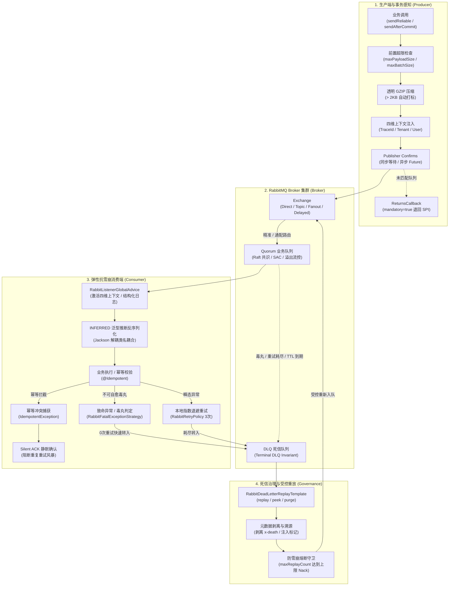

# ateng-boot-rabbitmq 消息通信与可靠投递底座 Starter

> 依托 Spring 官方 Spring AMQP 生态与 JDK 17 原生能力构建的工业级可靠消息通信底座，提供零丢信双重确认（Publisher Confirms 与 ReturnsCallback）、事务感知延迟发信（`sendAfterCommit` + 补偿 SPI 杜绝幽灵消息）、死信受控治理门面（`RabbitDeadLetterReplayTemplate` 支持元数据剥离溯源、防二次死信雪崩熔断与只读探查）、生产端批量可靠发送与消费端批量削峰、泛型推断反序列化解耦（`TypePrecedence.INFERRED` 杜绝 microservice 类名耦合与 `@class` 注入漏洞）、消费端幂等静默确认（拦截 `IdempotentException` 触发 Silent ACK 阻断重试风暴）、毒丸快速隔离至死信、死信终点不变量强校验（Terminal DLQ Invariant）、流畅拓扑构建器（`RabbitTopologyBuilder` 支持 Quorum 仲裁队列、单活独占消费者、优先级、溢出流控、毒丸上限与动态匿名广播队列）、只读运维账号启动安全防御（`auto-declare: false`）以及 100% 离线自洽测试沙箱。

---

## 0. 特性与公共 API 全景速查矩阵 (Feature & API Panorama Matrix)

| 特性分类 | 特性名称 | 核心门面 / 注解 / SPI | 关键配置项 (`ateng.boot.*`) | 关键 API 签名 / 核心行为 | 锚定验证源头 (*Test / Sample) |
| :--- | :--- | :--- | :--- | :--- | :--- |
| **可靠投递门面** | 生产端可靠投递与事务感知门面 | `RabbitReliableTemplate` | `ateng.boot.rabbitmq.reliable.default-timeout`<br>`ateng.boot.rabbitmq.reliable.returns-callback-enabled`<br>`ateng.boot.rabbitmq.producer.max-payload-size`<br>`ateng.boot.rabbitmq.producer.compression-threshold`<br>`ateng.boot.rabbitmq.producer.max-batch-size` | `sendReliable(exchange, routingKey, payload, [bizKey], [timeout], [customizers])`<br>`sendReliableAsync(exchange, routingKey, payload, [bizKey], [customizers])`<br>`sendBatchReliable(exchange, routingKey, payloads, [timeout])`<br>`sendBatchReliableAsync(exchange, routingKey, payloads, [timeout])`<br>`sendReliableWithPriority(exchange, routingKey, payload, priority, [bizKey], [timeout])`<br>`sendReliableAsyncWithPriority(exchange, routingKey, payload, priority, [bizKey])`<br>`sendDelayed(exchange, routingKey, payload, [bizKey], delay)`<br>`sendDelayedAsync(exchange, routingKey, payload, [bizKey], delay)`<br>`sendAfterCommit(exchange, routingKey, payload, [bizKey], [timeout], [customizers])`<br>`sendAfterCommitWithPriority(exchange, routingKey, payload, priority, [bizKey], [timeout])`<br>`getRabbitTemplate()`：同步阻塞等待 Confirm ACK、异步非阻塞返回 Future、批量聚合等待确认、单批上限 1000 条 Fail-Fast、优先级标记、本地事务提交感知发信、大报文超限 Fail-Fast (2MB) 与透明 GZIP 压缩 (>2KB) | `RabbitReliableTemplateTest` / `SampleRabbitmqE2eTest` |
| **死信治理门面** | 死信受控重放与防雪崩治理门面 | `RabbitDeadLetterReplayTemplate` | `ateng.boot.rabbitmq.dead-letter.default-replay-limit`<br>`ateng.boot.rabbitmq.dead-letter.max-replay-count` | `replay(dlq, targetExchange, targetRoutingKey, [limit], [filter])`<br>`peek(dlq, [limit])`<br>`purge(dlq)`：从死信队列受控拉取消息，剥离底层 `x-death` 头并注入重放溯源标记；单批上限防 OOM；检测消息重放次数上限 (`maxReplayCount`) 熔断阻断防范二次死信雪崩；支持只读探查 (`peek`) 与清空 (`purge`) | `RabbitDeadLetterReplayTemplateTest` / `SampleRabbitmqE2eTest` |
| **拓扑构建器** | 声明式流畅拓扑构建器 (Fluent API) | `RabbitTopologyBuilder` | `ateng.boot.rabbitmq.topology.auto-declare` | `direct(name)` / `topic(name)` / `fanout(name)` / `delayed(name, [type])`<br>`ttlDelayQueue(name, delay, targetEx, targetRk)`<br>`queue(name).quorum().singleActiveConsumer().maxPriority(priority).overflow(strategy).deliveryLimit(count).deadLetterStrategy(strategy).ttl(duration).maxLength(limit).deadLetter(dlx, dlq, rk).ttlQueue(name, delay).build()`<br>`alternateExchange(exchangeName)`<br>`anonymousQueue()` / `exclusiveAutoDeleteQueue([name])`<br>`build()`：一键链式声明 Raft Quorum 队列、优先级、溢出流控、毒丸上限、死信终点隔离、备用交换机与广播匿名临时队列，返回 Spring 原生 `Declarables` | `RabbitTopologyBuilderTest` / `SampleRabbitmqE2eTest` |
| **溢出策略枚举** | 队列满载溢出流控策略枚举 | `OverflowStrategy` | - | `DROP_HEAD("drop-head")`：丢弃队头最旧消息<br>`REJECT_PUBLISH("reject-publish")`：直接拒绝新发布消息<br>`REJECT_PUBLISH_DLX("reject-publish-dlx")`：拒绝新消息并直接流转至死信队列 | `RabbitTopologyBuilderTest` |
| **死信策略枚举** | Quorum 队列死信流转策略枚举 | `DeadLetterStrategy` | - | `AT_LEAST_ONCE("at-least-once")`：至少一次死信流转策略 (Quorum 推荐标准，确保死信安全投递至 DLX) | `RabbitTopologyBuilderTest` |
| **消费批量削峰** | 消费端批量削峰容器工厂与全局切面 | `batchRabbitListenerContainerFactory`<br>`SimpleRabbitListenerContainerFactory`<br>`RabbitListenerGlobalAdvice` | `ateng.boot.rabbitmq.consumer.batch.enabled`<br>`ateng.boot.rabbitmq.consumer.batch.size`<br>`ateng.boot.rabbitmq.consumer.batch.max-wait-time` | 提供专职 `batchRabbitListenerContainerFactory` Bean，支持 `@RabbitListener(containerFactory = ...)` 独立批量削峰接收 `List<T>`；全局切面自适应提取首条消息四维上下文激活当前线程，并在 `[MQ-CONSUME]` 宏日志记录 `batchSize` 与 `isBatch=true` | `RabbitListenerGlobalAdviceTest` / `SampleRabbitmqE2eTest` |
| **死信诊断工具** | 死信元数据只读诊断助手 | `RabbitDeadLetterHelper` | - | `getOriginalQueue(message/props)`<br>`getOriginalExchange(message/props)`<br>`getDeathReason(message/props)`<br>`getDeathCount(message/props)`<br>`getOriginalRoutingKeys(message/props)`<br>`getFirstDeath(message/props)`<br>`getAllDeaths(message/props)`：安全解析复杂的嵌套 `x-death` 头，宽容兼容 String、`byte[]`、LongString 等异构驱动类型，提取原队列、原交换机、死因与重试流转计数 | `RabbitDeadLetterHelperTest` / `SampleRabbitmqE2eTest` |
| **消费环绕拦截** | 消费端全局上下文与幂等切面 | `RabbitListenerGlobalAdvice` | `ateng.boot.rabbitmq.logging.enabled`<br>`ateng.boot.rabbitmq.logging.log-payload-max-length` | 实现 AOP `MethodInterceptor`，在消费方法执行前后自动激活/清理四维上下文（TraceId、TenantId、UserId），记录 `[MQ-CONSUME]` 结构化审计日志；捕获 `IdempotentException` 自动执行静默确认（Silent ACK）阻断重复重试风暴 | `RabbitListenerGlobalAdviceTest` / `SampleRabbitmqE2eTest` |
| **毒丸致命判定** | 毒丸与致命异常分类策略 | `RabbitFatalExceptionStrategy` | - | 实现 Spring AMQP `FatalExceptionStrategy`，精准识别反序列化失败（`MessageConversionException`）、格式校验违规（`MethodArgumentNotValidException` / `ConstraintViolationException`）以及业务断言失败，执行 0 次重试快速送死信（DLQ） | `RabbitFatalExceptionStrategyTest` / `SampleRabbitmqE2eTest` |
| **本地受控重试** | 容器内本地指数退避重试 | `RabbitRetryPolicy` | `ateng.boot.rabbitmq.consumer.retry.enabled`<br>`ateng.boot.rabbitmq.consumer.retry.max-attempts`<br>`ateng.boot.rabbitmq.consumer.retry.initial-interval`<br>`ateng.boot.rabbitmq.consumer.retry.multiplier`<br>`ateng.boot.rabbitmq.consumer.retry.max-interval` | 继承 Spring Retry `SimpleRetryPolicy`，配合 `RejectAndDontRequeueRecoverer` 在本地内存执行指数退避重试（默认 3 次），重试耗尽安全转移至 DLQ，彻底取缔 Broker Requeue 死循环自旋 | `RabbitRetryPolicyTest` / `SampleRabbitmqE2eTest` |
| **不可路由告警** | 不可路由退回消息回调 SPI | `RabbitUnroutableMessageCallback` | `ateng.boot.rabbitmq.reliable.returns-callback-enabled` | `onUnroutableMessage(returned)`：当开启 `mandatory=true` 且消息未命中任何队列被 Broker 退回时，打印格式化告警 `[MQ-RETURNS]` 并回调此 SPI 供企业落库或钉钉告警 | `RabbitReturnsCallbackTest` |
| **事务发信补偿** | 事务提交后发信失败补偿 SPI | `RabbitTransactionFailureCallback` | - | `onTransactionPostCommitFailed(exchange, routingKey, payload, bizKey, ex)`：当 `sendAfterCommit` 在本地事务 Commit 成功后因网络抖动发信失败时被触发，供业务落库本地重发表兜底 | `RabbitReliableTemplateTest` |
| **消息类型推断** | 泛型推断反序列化消息转换器 | `Jackson2JsonMessageConverter` | - | 默认注入开启 `TypePrecedence.INFERRED` 与 `alwaysConvertToInferredType(true)` 的 Jackson 转换器，消费端 100% 依监听方法参数推断反序列化，解耦微服务契约，杜绝 `@class` 注入 RCE | `Jackson2JsonMessageConverterTest` |
| **优雅停机排空** | 消费端容器优雅下线排空定制 | `ContainerCustomizer<SimpleMessageListenerContainer>` | `ateng.boot.rabbitmq.consumer.shutdown-timeout` | 默认设置 `shutdownTimeout`（默认 30s），K8s 滚动停机收到 SIGTERM 时停止拉取新消息，预留窗口排空在途消费 | `AtengRabbitmqAutoConfigurationTest` |
| **只读拓扑安全** | 拓扑自动声明开关 | `RabbitAdmin` 生命周期后置增强 | `ateng.boot.rabbitmq.topology.auto-declare` | 当置为 `false` 时，后置处理器自动将 `RabbitAdmin.autoStartup` 设为 `false`，生产只读账号不主动向 Broker 发起声明，防御 403 启动崩溃 | `AtengRabbitmqAutoConfigurationTest` |

---

## 1. 模块定位与快速起步 (Quick Start)

### 1.1 Maven 坐标引入
在业务工程的 `pom.xml` 中引入 `ateng-boot-rabbitmq` 模块依赖（版本由根工程或 BOM 统管）：

```xml
<dependency>
    <groupId>io.github.atengk</groupId>
    <artifactId>ateng-boot-rabbitmq</artifactId>
</dependency>
```

### 1.2 最小起步配置 (`application.yml`)
在 `application.yml` 中配置连接信息与基本可靠投递参数：

```yaml
spring:
  rabbitmq:
    host: localhost
    port: 5672
    username: guest
    password: guest
    publisher-confirm-type: correlated
    publisher-returns: true

ateng:
  boot:
    rabbitmq:
      enabled: true
      reliable:
        default-timeout: 3s
      consumer:
        prefetch: 20
        retry:
          enabled: true
          max-attempts: 3
```

### 1.3 开箱即用业务代码示例

#### 步骤 1：声明业务 Direct 交换机与 Quorum 队列拓扑
```java
@Configuration(proxyBeanMethods = false)
public class RabbitOrderTopologyConfig {

    @Bean
    public Declarables orderDirectTopology() {
        return RabbitTopologyBuilder.direct("sample.order.direct")
                .queue("sample.order.create.queue")
                .quorum()                  // 声明为现代 Raft Quorum 仲裁队列
                .singleActiveConsumer()    // 开启单活独占消费者
                .routingKey("order.create")
                .build();
    }
}
```

#### 步骤 2：业务发信（同步等待 Broker 落盘确认）
```java
@Component
@RequiredArgsConstructor
public class TradeMessageProducer {

    private final RabbitReliableTemplate rabbitReliableTemplate;

    public void sendOrderCreate(OrderCreateMessage message) {
        // 同步阻塞等待 Broker Confirm ACK，超时未收到或 NACK 立即抛出 MessageDeliveryException
        rabbitReliableTemplate.sendReliable(
                "sample.order.direct",
                "order.create",
                message,
                message.orderId()
        );
    }
}
```

#### 步骤 3：消费端监听消费（强类型推断与四维上下文透传）
```java
@Component
@Slf4j
public class OrderConsumer {

    @RabbitListener(queues = "sample.order.create.queue")
    public void onOrderCreate(OrderCreateMessage message,
                              @Header(name = "X-Trace-Id", required = false) String traceId) {
        log.info("[CONSUMER-ORDER] 消费订单创建消息成功: orderId={}, traceId={}",
                message.orderId(), traceId);
    }
}
```

---

## 2. 核心架构与设计不变量 (Architecture & Invariants)

### 2.1 双重投递可靠性与弹性抗雪崩消费流



### 2.2 核心设计不变量

1. **泛型推断反序列化解耦 (Inferred Deserialization)**：
   Spring AMQP 原生 Jackson 转换器默认依赖发送端注入的 `__TypeId__` 全限定类名反序列化。在微服务架构下，各微服务通常拥有各自独立的包名（如 `com.mall.order.dto` 与 `com.mall.pay.dto`），强耦合类名将直接导致 `ClassNotFoundException` 或反序列化 RCE 风险。`ateng-boot-rabbitmq` 强制装配 `TypePrecedence.INFERRED`，使消费端 100% 基于 `@RabbitListener` 目标方法的方法签名推断反序列化类型，实现跨微服务契约彻底解耦。
2. **死信终点不变量强校验 (Terminal DLQ Invariant)**：
   死信队列（DLQ）是消息流转的生命周期终点。若死信队列自身再次配置 `x-dead-letter-exchange`，当消息因 TTL 或拒绝再次触发死信时，将形成致命的“死循环乒乓风暴”，迅速吃满 Broker 磁盘与连接。`RabbitTopologyBuilder` 在拓扑声明期严格执行终端断言，死信队列绝对严禁配置死信交换机。
3. **死信受控重放防二次雪崩 (Replay Avalanche Defense)**：
   死信重放不是简单的“再次投递”。进入死信队列的消息附带了多层嵌套的 `x-death` 异构头，若原样投递会被消费端直接识别为死信再次拒收。`RabbitDeadLetterReplayTemplate` 自动清洗底层 `x-death` 头并打上溯源标记；同时基于 `maxReplayCount`（默认 1 次）严格把关，重放后再次进入死信的消息坚决拒绝重放，执行 `basicNack(requeue=true)` 留存死信队列，杜绝无休止震荡。

---

## 3. 生产端高可靠投递与事务感知套件

### 3.1 同步与异步 Publisher Confirm 可靠投递

#### 专属 YAML 配置
```yaml
ateng:
  boot:
    rabbitmq:
      reliable:
        # 同步等待 Broker Confirm ACK 确认的默认超时时间
        default-timeout: 3s
        # 是否启用消息不可路由退回告警与 SPI 回调
        returns-callback-enabled: true
```

#### 逆向实战代码 (`TradeMessageProducer.java`)
```java
@Component
@RequiredArgsConstructor
public class TradeMessageProducer {

    private final RabbitReliableTemplate rabbitReliableTemplate;

    /**
     * 同步可靠投递：阻塞等待 Broker 磁盘落盘 ACK 确认
     */
    public void sendOrderCreate(OrderCreateMessage message) {
        rabbitReliableTemplate.sendReliable(
                "sample.order.direct",
                "order.create",
                message,
                message.orderId()
        );
    }

    /**
     * 异步非阻塞投递：立即返回 CompletableFuture，支持响应式与非阻塞回调
     */
    public CompletableFuture<CorrelationData.Confirm> sendOrderCreateAsync(OrderCreateMessage message) {
        return rabbitReliableTemplate.sendReliableAsync(
                "sample.order.direct",
                "order.create",
                message,
                message.orderId()
        );
    }
}
```

#### 机制与边界说明
- **阻塞等待与超时**：`sendReliable` 底层通过 `CorrelationData.getFuture().get(timeout)` 等待 Broker ACK；超时抛出 `MessageDeliveryException`，状态码明确携带超时时间与业务主键；
- **异步回调与上下文**：`sendReliableAsync` 内部通过动态 CorrelationData 透传四维上下文快照，异步线程收到 Confirm 后无锁解析确认状态。

---

### 3.2 事务感知延迟发信 (`sendAfterCommit`)

#### 专属 YAML 配置
```yaml
ateng:
  boot:
    rabbitmq:
      reliable:
        default-timeout: 3s
```

#### 逆向实战代码 (`OrderTransactionService.java`)
```java
@Service
@RequiredArgsConstructor
public class OrderTransactionService {

    private final RabbitReliableTemplate rabbitReliableTemplate;
    private final AtomicInteger dbRecordCount = new AtomicInteger(0);

    /**
     * 事务提交成功场景：物理落库完成后，触发 afterCommit 钩子执行物理网络发信
     */
    @Transactional(rollbackFor = Exception.class)
    public void createOrderWithCommit(OrderCreateMessage message) {
        dbRecordCount.incrementAndGet();
        rabbitReliableTemplate.sendAfterCommit(
                "sample.order.direct",
                "order.create",
                message,
                message.orderId()
        );
    }

    /**
     * 事务回滚场景：模拟事务异常，发信钩子直接作废，发信次数严格为 0
     */
    @Transactional(rollbackFor = Exception.class)
    public void createOrderWithRollback(OrderCreateMessage message) {
        dbRecordCount.incrementAndGet();
        rabbitReliableTemplate.sendAfterCommit(
                "sample.order.direct",
                "order.create",
                message,
                message.orderId()
        );
        throw new IllegalStateException("模拟业务异常触发数据库事务回滚");
    }
}
```

#### 机制与边界说明
- **防幽灵消息 (Ghost Message)**：在分布式业务中，先发 MQ 再提交事务会导致消费者先于事务完成消费脏数据；先提交事务再发 MQ 若发信崩溃会导致丢信。`sendAfterCommit` 将发信动作挂载至当前活跃事务的 `TransactionSynchronization.afterCommit` 阶段；
- **异常零发信**：若事务因任何原因回滚（Rollback），发信任务被底层无条件丢弃，零物理发信；
- **事务补偿 SPI**：若本地事务提交已成功但物理网络发信因网络闪断失败，框架自动回调 `RabbitTransactionFailureCallback` 扩展点，供业务写入本地重发表。

---

### 3.3 大报文超限 Fail-Fast 与透明 GZIP 压缩

#### 专属 YAML 配置
```yaml
ateng:
  boot:
    rabbitmq:
      producer:
        # 单条出站消息最大上限，超限前置阻断 (默认 2MB)
        max-payload-size: 2MB
        # 是否开启透明压缩
        compression-enabled: true
        # 超过阈值自动启用 GZIP 压缩 (默认 2KB)
        compression-threshold: 2KB
        # 批量单批次上限保护
        max-batch-size: 1000
```

#### 逆向实战代码
```java
// 生产端直接投递大对象，底层自动计算序列化字节大小
rabbitReliableTemplate.sendReliable(
        "sample.order.direct",
        "order.create",
        largeReportPayload,
        "REPORT-20261109"
);
```

#### 机制与边界说明
- **前置 Fail-Fast 阻断**：在消息序列化为字节后，框架前置校验体积是否超过 `maxPayloadSize`（默认 2MB）。若超限，直接在出站前抛出 `MessageDeliveryException`，杜绝将超大载荷推入 Broker 造成内存震荡；
- **透明压缩与解压**：超过 `compressionThreshold`（默认 2KB）的消息自动执行 GZIP 压缩，并打上 `Content-Encoding: gzip` 消息头；消费端容器已默认挂载 `GUnzipPostProcessor`，业务无需改动代码即可自动透明解压。

---

## 4. 声明式流式拓扑构建套件 (`RabbitTopologyBuilder`)

### 4.1 Direct / Topic / Fanout 常用交换机拓扑

#### 专属 YAML 配置
```yaml
ateng:
  boot:
    rabbitmq:
      topology:
        # 是否自动向 Broker 声明拓扑 (默认 true)
        auto-declare: true
```

#### 逆向实战代码 (`RabbitScenarioTopologyConfig.java`)
```java
@Configuration(proxyBeanMethods = false)
public class RabbitScenarioTopologyConfig {

    public static final String EXCHANGE_ORDER_DIRECT = "sample.order.direct";
    public static final String QUEUE_ORDER_CREATE = "sample.order.create.queue";
    public static final String ROUTING_KEY_ORDER_CREATE = "order.create";

    public static final String EXCHANGE_LOG_TOPIC = "sample.log.topic";
    public static final String QUEUE_LOG_ERROR = "sample.log.error.queue";
    public static final String ROUTING_KEY_LOG_ERROR = "log.error.#";

    public static final String EXCHANGE_BROADCAST_FANOUT = "sample.broadcast.fanout";

    @Bean
    public Declarables orderDirectTopology() {
        return RabbitTopologyBuilder.direct(EXCHANGE_ORDER_DIRECT)
                .queue(QUEUE_ORDER_CREATE)
                .routingKey(ROUTING_KEY_ORDER_CREATE)
                .build();
    }

    @Bean
    public Declarables logTopicTopology() {
        return RabbitTopologyBuilder.topic(EXCHANGE_LOG_TOPIC)
                .queue(QUEUE_LOG_ERROR)
                .routingKey(ROUTING_KEY_LOG_ERROR)
                .build();
    }

    @Bean
    public Declarables broadcastFanoutTopology() {
        return RabbitTopologyBuilder.fanout(EXCHANGE_BROADCAST_FANOUT)
                .build();
    }
}
```

#### 机制与边界说明
- **Fluent 链式语法**：统一通过 `RabbitTopologyBuilder` 静态入口创建，链式调用声明交换机、队列与绑定关系，最终输出 Spring AMQP 原生 `Declarables`；
- **解耦式广播**：`fanout(exchange).build()` 允许单独声明交换机，便于由不同下游消费者动态挂载各自的匿名队列。

---

### 4.2 Raft Quorum 仲裁队列与单活独占消费者 (`singleActiveConsumer`)

#### 专属 YAML 配置
```yaml
ateng:
  boot:
    rabbitmq:
      topology:
        auto-declare: true
```

#### 逆向实战代码 (`RabbitScenarioTopologyConfig.java`)
```java
@Bean
public Declarables orderDirectTopology() {
    return RabbitTopologyBuilder.direct("sample.order.direct")
            .queue("sample.order.create.queue")
            .quorum()                  // 声明为现代 Raft 共识 Quorum 队列
            .singleActiveConsumer()    // 开启单活独占消费者 (严格保障全局消费顺序)
            .routingKey("order.create")
            .build();
}
```

#### 机制与边界说明
- **高可用与强一致性**：Quorum 队列基于 Raft 协议在集群节点间进行日志复制，替代已被 RabbitMQ 官方废弃的经典镜像队列（Mirrored Queues）；
- **单活独占消费者 (SAC)**：设置 `x-single-active-consumer: true` 后，即使部署多个消费实例，Broker 始终保证同一时刻仅有单实例消费，其他实例处于热备状态，故障时秒级自动无缝漂移。

---

### 4.3 优先级消息与满载溢出策略 (`OverflowStrategy`)

#### 专属 YAML 配置
```yaml
ateng:
  boot:
    rabbitmq:
      topology:
        auto-declare: true
```

#### 逆向实战代码 (`RabbitScenarioTopologyConfig.java`)
```java
@Bean
public Declarables priorityQuorumTopology() {
    return RabbitTopologyBuilder.direct("sample.priority.direct")
            .queue("sample.priority.order.queue")
            .quorum()
            .overflow(OverflowStrategy.REJECT_PUBLISH_DLX) // 队列满载时拒绝新消息并流转至死信
            .deliveryLimit(5)                              // 毒丸重试 5 次强制路由死信
            .deadLetterStrategy(DeadLetterStrategy.AT_LEAST_ONCE)
            .deadLetter("sample.biz.dlx", "sample.biz.dlq", "biz.dead")
            .routingKey("priority.order")
            .build();
}
```

#### 机制与边界说明
- **现代溢出策略 (`OverflowStrategy`)**：
  - `DROP_HEAD`：丢弃队头最旧消息；
  - `REJECT_PUBLISH`：向发布者返回 NACK 直接拒绝入队；
  - `REJECT_PUBLISH_DLX`：拒绝新消息入队并将其直接转送死信交换机，保障零丢信且主队列不超容；
- **Quorum 优先级规范**：依据 RabbitMQ 规范，Quorum 队列不支持 `x-max-priority` 内存多级子队列划分，需在经典队列上启用 `maxPriority(n)`，或在应用层使用分级 Topic 路由。

---

### 4.4 动态匿名临时排他队列广播订阅

#### 专属 YAML 配置
```yaml
ateng:
  boot:
    rabbitmq:
      topology:
        auto-declare: true
```

#### 逆向实战代码 (`AnonymousBroadcastConsumer.java`)
```java
@Component
@Slf4j
public class AnonymousBroadcastConsumer {

    private final List<String> receivedBroadcasts = new CopyOnWriteArrayList<>();

    /**
     * 基于通道自洽创建匿名临时排他队列，自动绑定到 Fanout 交换机
     * 实例下线或 Broker 连接断开时队列由 Broker 自动清理销毁
     */
    @RabbitListener(bindings = @QueueBinding(
            value = @Queue(exclusive = "true", autoDelete = "true"),
            exchange = @Exchange(name = "sample.broadcast.fanout", type = ExchangeTypes.FANOUT)
    ))
    public void onBroadcast(String message) {
        log.info("[CONSUMER-BROADCAST] 动态匿名队列收到广播消息: message={}", message);
        this.receivedBroadcasts.add(message);
    }
}
```

#### 机制与边界说明
- **自动排他清理**：`exclusive = true` 与 `autoDelete = true` 确保该临时队列仅归属当前消费通道独占，通道断开后 Broker 自动垃圾回收，完美支撑集群多节点配置热刷新、缓存失效通知等无状态广播场景。

---

## 5. 消费端弹性防卫与批量削峰套件

### 5.1 全局通知链与四维上下文透传 (`RabbitListenerGlobalAdvice`)

#### 专属 YAML 配置
```yaml
ateng:
  boot:
    rabbitmq:
      logging:
        # 是否输出 [MQ-CONSUME] 标准结构化审计日志
        enabled: true
        # 日志报文最大打印字符数
        logPayloadMaxLength: 1024
```

#### 机制与日志截取
框架通过全局 AOP 通知链 `RabbitListenerGlobalAdvice` 环绕所有 `@RabbitListener` 消费端：
```text
2026-11-09 19:24:54.595 INFO  [main] [775bb8bdfc650b2a8ca082cb26d84444] i.g.a.b.r.i.RabbitListenerGlobalAdvice : [MQ-CONSUME] mq=rabbitmq topic=null bizKey=idemp-test-01 traceId=775bb8bdfc650b2a8ca082cb26d84444 status=SUCCESS cost=0ms
```

#### 机制与边界说明
- **全链路追踪与上下文复制**：消费前自动解析并向 MDC 注入 `traceId`，同时恢复 `UserContextHolder` 与 `TenantContextHolder`；
- **确定性资源清理**：在 `finally` 块中执行无条件清理，防止线程复用引发上下文污染。

---

### 5.2 消费端防重幂等静默确认 (`Silent ACK`)

#### 专属 YAML 配置
```yaml
ateng:
  boot:
    rabbitmq:
      consumer:
        retry:
          enabled: true
          max-attempts: 3
```

#### 逆向实战代码 (`IdempotentOrderConsumer.java`)
```java
@Component
@Slf4j
public class IdempotentOrderConsumer {

    private final Set<String> processedKeys = ConcurrentHashMap.newKeySet();

    @RabbitListener(queues = "sample.order.idempotent.queue")
    public void onOrderMessage(String payload, @Header(name = "X-Biz-Key", required = false) String bizKey) {
        if (bizKey != null && !processedKeys.add(bizKey)) {
            // 检测到重复业务消息，直接抛出业务断言或 IdempotentException
            log.warn("[CONSUMER-IDEMPOTENT] 检测到重复消息，触发静默确认: bizKey={}", bizKey);
            throw new IdempotentException("订单消息已处理，触发静默确认: bizKey=" + bizKey);
        }
        log.info("[CONSUMER-IDEMPOTENT] 首次消费处理成功: bizKey={}, payload={}", bizKey, payload);
    }
}
```

#### 机制与边界说明
- **阻断重试风暴**：普通异常会导致消费者抛出错误并触发本地重试或 Requeue，导致已成功的消息反复执行。抛出 `IdempotentException` 时，`RabbitListenerGlobalAdvice` 拦截该异常，记录 `[MQ-IDEMPOTENT-DUPLICATE]` 警告并向 Broker 发送 Basic.Ack 标记成功消费，优雅阻断重试风暴。

---

### 5.3 毒丸隔离至死信队列 (`RabbitFatalExceptionStrategy`)

#### 专属 YAML 配置
```yaml
ateng:
  boot:
    rabbitmq:
      consumer:
        retry:
          max-attempts: 3
```

#### 逆向实战代码 (`PoisonPillConsumer.java`)
```java
@Component
@Slf4j
public class PoisonPillConsumer {

    @RabbitListener(queues = "sample.biz.queue")
    public void onBizMessage(String payload) {
        if ("poison-pill".equalsIgnoreCase(payload)) {
            log.error("[CONSUMER-BIZ] 收到致命毒丸消息，抛出非法参数异常: {}", payload);
            throw new IllegalArgumentException("致命毒丸消息，不可自愈，立即路由至死信队列");
        }
    }
}
```

#### 机制与边界说明
- **0 次重试快速进 DLQ**：参数校验失败（JSR-303）、反序列化错误或非法业务入参属于不可自愈的“毒丸（Poison Pill）”。`RabbitFatalExceptionStrategy` 将其判定为 Fatal，跳过本地 3 次重试，立即触发 `RejectAndDontRequeue` 送入死信队列，保障主队列通畅。

---

### 5.4 容器内本地指数退避重试 (`RabbitRetryPolicy`)

#### 专属 YAML 配置
```yaml
ateng:
  boot:
    rabbitmq:
      consumer:
        retry:
          # 是否启用本地指数退避重试
          enabled: true
          # 最大本地重试次数 (包含首次执行)
          max-attempts: 3
          # 首次退避间隔时间
          initial-interval: 1s
          # 指数退避倍率
          multiplier: 2.0
          # 最大退避间隔时间
          max-interval: 10s
```

#### 机制与边界说明
- **解耦 Broker Requeue**：Spring AMQP 默认使用 Broker 重入队（Requeue），重入队会直接插回队头或在集群中循环震荡。框架装配 `RabbitRetryPolicy`，在消费容器本地内存中执行指数退避重试（1s -> 2s -> 4s），抗击瞬态数据库抖动；达到 `maxAttempts` 后转交 Recoverer 送入死信队列。

---

### 5.5 消费端批量聚合削峰 (`batchRabbitListenerContainerFactory`)

#### 专属 YAML 配置
```yaml
ateng:
  boot:
    rabbitmq:
      consumer:
        batch:
          # 开启消费端批量监听器削峰
          enabled: true
          # 单批次最大聚合条数
          size: 50
          # 聚合等待最大超时时间
          max-wait-time: 500ms
```

#### 逆向实战代码 (`BatchOrderConsumer.java`)
```java
@Component
@Slf4j
public class BatchOrderConsumer {

    private final List<OrderCreateMessage> receivedOrders = new CopyOnWriteArrayList<>();

    /**
     * 批量消费削峰：入参为 List<T>，由容器聚合多条消息后批量交付业务处理
     */
    @RabbitListener(queues = "sample.batch.order.queue", containerFactory = "batchRabbitListenerContainerFactory")
    public void onBatchOrders(List<OrderCreateMessage> batch) {
        log.info("[CONSUMER-BATCH] 收到批量削峰订单消息: count={}", batch.size());
        this.receivedOrders.addAll(batch);
    }
}
```

#### 机制与边界说明
- **独立工厂与自动适配**：通过独立的 `batchRabbitListenerContainerFactory` 提供批量能力，不影响其他单条消费监听器；
- **批量上下文适配**：`RabbitListenerGlobalAdvice` 识别到批量入参时，提取首条消息上下文用于调用链路度量，并在日志中输出 `isBatch=true, batchSize=N`。

---

## 6. 死信受控治理与防雪崩重放套件

### 6.1 死信受控重放与元数据清洗 (`RabbitDeadLetterReplayTemplate.replay`)

#### 专属 YAML 配置
```yaml
ateng:
  boot:
    rabbitmq:
      dead-letter:
        # 单批次死信受控重放默认拉取上限
        default-replay-limit: 100
        # 单条消息允许的最大重放次数
        max-replay-count: 1
```

#### 逆向实战代码 (`DeadLetterReplayService.java`)
```java
@Service
@RequiredArgsConstructor
public class DeadLetterReplayService {

    private final RabbitDeadLetterReplayTemplate replayTemplate;

    /**
     * 受控重放死信消息并重新注入业务队列
     */
    public int replayBizDeadLetters(int limit) {
        return replayTemplate.replay(
                "sample.biz.dlq",
                "sample.biz.direct",
                "biz.work",
                limit
        );
    }
}
```

#### 机制与边界说明
- **底层元数据清洗**：死信入队后由 RabbitMQ 注入深层嵌套的 `x-death` 头。直接重放会导致业务消费者误判其为历史死信。`RabbitDeadLetterReplayTemplate` 自动剥离底层 `x-death` 头，并注入 `X-Dead-Letter-Replayed: true` 与 `X-Dead-Letter-Replay-Count: N` 溯源标记。

---

### 6.2 最大重放次数防雪崩熔断机制 (`max-replay-count`)

#### 专属 YAML 配置
```yaml
ateng:
  boot:
    rabbitmq:
      dead-letter:
        # 超过该阈值坚决拒绝重放，防范业务队列与死信队列之间无限震荡
        max-replay-count: 1
```

#### 机制与边界说明
- **二次死信熔断**：通过 `maxReplayCount`（默认 1 次）严格防卫。若某条问题消息经重放后仍消费失败回到死信队列，达到该上限后将被阻断重放，并执行 `basicNack(requeue=true)` 安全留存原死信队列，坚决杜绝死信在业务队列与死信队列之间无限循环震荡。

---

### 6.3 队列只读探查与一键排空 (`peek` & `purge`)

#### 专属 YAML 配置
```yaml
ateng:
  boot:
    rabbitmq:
      dead-letter:
        default-replay-limit: 100
```

#### 逆向实战代码 (`DeadLetterReplayService.java`)
```java
@Service
@RequiredArgsConstructor
public class DeadLetterReplayService {

    private final RabbitDeadLetterReplayTemplate replayTemplate;

    /**
     * 只读探查队列头部消息：利用 basicNack(requeue=true) 获取载荷但不消费
     */
    public List<Message> peekBizDeadLetters(int limit) {
        return replayTemplate.peek("sample.biz.dlq", limit);
    }

    /**
     * 一键清空死信队列全部积压
     */
    public int purgeBizDeadLetters() {
        return replayTemplate.purge("sample.biz.dlq");
    }
}
```

#### 机制与边界说明
- **无破坏性探查**：`peek` 内部通过拉取并立即调用 `channel.basicNack(deliveryTag, false, true)` 实现原样放回，供线上运维排查积压消息体；
- **安全排空**：`purge` 底层调用原生 `channel.queuePurge(dlq)`，返回本次被物理清除的消息条数。

---

### 6.4 死信元数据只读诊断助手 (`RabbitDeadLetterHelper`)

#### 逆向实战代码 (`DeadLetterAuditConsumer.java`)
```java
@Component
@Slf4j
public class DeadLetterAuditConsumer {

    private final List<RabbitDeadLetterHelper.DeadLetterRecord> auditRecords = new CopyOnWriteArrayList<>();

    @RabbitListener(queues = "sample.biz.dlq")
    public void onDeadLetterMessage(Message message) {
        String originQueue = RabbitDeadLetterHelper.getOriginalQueue(message);
        String originExchange = RabbitDeadLetterHelper.getOriginalExchange(message);
        String reason = RabbitDeadLetterHelper.getDeathReason(message);
        long count = RabbitDeadLetterHelper.getDeathCount(message);

        log.warn("[DLQ-AUDIT] 收到死信消息: originQueue={}, originExchange={}, reason={}, count={}",
                originQueue, originExchange, reason, count);
        this.auditRecords.add(new RabbitDeadLetterHelper.DeadLetterRecord(originQueue, originExchange, reason, count));
    }
}
```

#### 机制与边界说明
- **驱动类型宽容兼容**：底层 AMQP 驱动在解析 `x-death` 头时可能返回 `String`、`byte[]` 或 `LongString` 等异构类型。`RabbitDeadLetterHelper` 进行了全类型安全清洗与空安全防御，提供零异常的诊断元数据提取。

---

## 7. 生产扩展接管与核心非功能边界

### 7.1 不可路由退回消息告警与落库 SPI (`RabbitUnroutableMessageCallback`)

#### 专属 YAML 配置
```yaml
ateng:
  boot:
    rabbitmq:
      reliable:
        # 激活 ReturnsCallback 告警与 SPI 回调
        returns-callback-enabled: true
```

#### 逆向实战代码
```java
@Component
@Slf4j
public class CustomUnroutableCallback implements RabbitUnroutableMessageCallback {

    @Override
    public void onUnroutableMessage(RabbitTemplate.ReturnsCallback.Returned returned) {
        log.error("[ALERT] 消息不可路由，推送企业告警: exchange={}, routingKey={}, replyText={}",
                returned.getExchange(), returned.getRoutingKey(), returned.getReplyText());
        // 扩展：在此将不可路由退回消息持久化至补偿表或推送到钉钉/飞书告警机器人
    }
}
```

#### 机制与边界说明
- **Mandatory 路由防卫**：当开启 `returnsCallbackEnabled: true` 时，`RabbitReliableTemplate` 强制将投递消息标记为 `mandatory=true`。若投递至 Exchange 后因路由键未匹配任何队列，Broker 触发 `Basic.Return`，框架触发此 SPI，阻断无声丢信。

---

### 7.2 事务提交后发信失败兜底补偿 SPI (`RabbitTransactionFailureCallback`)

#### 专属 YAML 配置
```yaml
ateng:
  boot:
    rabbitmq:
      reliable:
        default-timeout: 3s
```

#### 逆向实战代码
```java
@Component
@Slf4j
public class CustomTxFailureCallback implements RabbitTransactionFailureCallback {

    @Override
    public void onTransactionPostCommitFailed(String exchange, String routingKey,
                                              Object payload, String bizKey, Throwable ex) {
        log.error("[TX-COMPENSATE] 事务已提交但发信失败，落库本地重发表: bizKey={}", bizKey, ex);
        // 扩展：写入本地事务待重发表，由调度任务轮询重发兜底
    }
}
```

#### 机制与边界说明
- **极端故障防御**：当使用 `sendAfterCommit` 时，若本地数据库事务已成功 Commit，但在紧随其后的物理网络发信阶段遭遇网络闪断或 Broker 拒绝，框架自动触发此 SPI，保障数据最终一致性。

---

### 7.3 只读运维账号启动安全治理 (`auto-declare: false`)

#### 专属 YAML 配置
```yaml
ateng:
  boot:
    rabbitmq:
      topology:
        # 生产只读受限账号环境下关闭启动自动声明，防御 403 启动崩溃
        auto-declare: false
```

#### 机制与边界说明
- **启动防御机制**：当生产环境采用严格收敛权限的只读账号连接 RabbitMQ 时，账号无权创建交换机与队列。开启 `auto-declare: false` 后，后置处理器自动将 `RabbitAdmin.autoStartup` 设为 `false`，应用启动时不执行任何声明操作，彻底规避 403 权限异常导致的启动崩溃。

---

### 7.4 Kubernetes 滚动发布优雅停机排空 (`shutdown-timeout`)

#### 专属 YAML 配置
```yaml
ateng:
  boot:
    rabbitmq:
      consumer:
        # K8s 停机优雅缓冲窗口 (默认 30s)
        shutdown-timeout: 30s
```

#### 机制与边界说明
- **无损下线**：Kubernetes 滚动发布推送 `SIGTERM` 信号时，Spring 容器通知监听器容器停止从 Broker 拉取新消息，并预留 `shutdownTimeout` 缓冲窗口等待在途正在消费中的消息完成 ACK，排空在途流量后再关闭网络连接，防止停机丢信或重复消费。

---

## 8. 完整 YAML 配置属性清单 (Appendix: Configuration Properties)

全量纳管于配置前缀 `ateng.boot.rabbitmq.*`，严格采用强类型 `Duration` 与 `DataSize` 消除单位歧义：

| 配置键名 | 类型 | 默认值 | 说明 |
| :--- | :--- | :--- | :--- |
| `ateng.boot.rabbitmq.enabled` | `boolean` | `true` | 是否启用 RabbitMQ 增强底座特性 |
| `ateng.boot.rabbitmq.producer.max-payload-size` | `DataSize` | `2MB` | 单条出站消息最大报文限制，超过该阈值出站前 Fail-Fast 阻断 |
| `ateng.boot.rabbitmq.producer.compression-threshold` | `DataSize` | `2KB` | 透明 GZIP 压缩阈值，超过该大小自动启用压缩并在 Header 注入 `Content-Encoding: gzip` |
| `ateng.boot.rabbitmq.producer.compression-enabled` | `boolean` | `true` | 是否启用大报文透明 GZIP 压缩特性 |
| `ateng.boot.rabbitmq.producer.max-batch-size` | `int` | `1000` | 批量投递单批次消息上限保护阈值，防止一次性发射过量消息导致 OOM |
| `ateng.boot.rabbitmq.reliable.default-timeout` | `Duration` | `3s` | Publisher Confirm 同步等待 Broker ACK 的默认超时时间 |
| `ateng.boot.rabbitmq.reliable.returns-callback-enabled` | `boolean` | `true` | 是否激活不可路由消息 (ReturnsCallback) 的告警与 SPI 回调 |
| `ateng.boot.rabbitmq.consumer.prefetch` | `int` | `20` | 单消费者默认预取数 (Prefetch Count)，调优吞吐并杜绝饥饿 |
| `ateng.boot.rabbitmq.consumer.concurrency` | `int` | `1` | 默认初始并发消费者数 |
| `ateng.boot.rabbitmq.consumer.max-concurrency` | `int` | `8` | 默认最大并发消费者数 |
| `ateng.boot.rabbitmq.consumer.shutdown-timeout` | `Duration` | `30s` | Kubernetes 滚动停机优雅下线超时时间，预留缓冲窗口排空在途消费 |
| `ateng.boot.rabbitmq.consumer.retry.enabled` | `boolean` | `true` | 是否开启容器内本地指数退避重试 |
| `ateng.boot.rabbitmq.consumer.retry.max-attempts` | `int` | `3` | 最大本地重试次数 (包含首次执行) |
| `ateng.boot.rabbitmq.consumer.retry.initial-interval` | `Duration` | `1s` | 首次重试退避间隔时间 |
| `ateng.boot.rabbitmq.consumer.retry.multiplier` | `double` | `2.0` | 指数退避倍率 |
| `ateng.boot.rabbitmq.consumer.retry.max-interval` | `Duration` | `10s` | 最大重试退避间隔时间 |
| `ateng.boot.rabbitmq.consumer.batch.enabled` | `boolean` | `false` | 是否开启消费端批量监听器削峰 |
| `ateng.boot.rabbitmq.consumer.batch.size` | `int` | `50` | 单批次最大聚合消费消息数 |
| `ateng.boot.rabbitmq.consumer.batch.max-wait-time` | `Duration` | `500ms` | 批量聚合最大等待超时时间 |
| `ateng.boot.rabbitmq.topology.auto-declare` | `boolean` | `true` | 是否自动向 Broker 声明交换机、队列与绑定拓扑 |
| `ateng.boot.rabbitmq.dead-letter.default-replay-limit` | `int` | `100` | 单批次死信受控重放默认数量限制 |
| `ateng.boot.rabbitmq.dead-letter.max-replay-count` | `int` | `1` | 单条消息允许的最大死信重放次数，超过该阈值阻断重放防范二次死信雪崩 |
| `ateng.boot.rabbitmq.logging.enabled` | `boolean` | `true` | 是否输出 `[MQ-SEND]` 与 `[MQ-CONSUME]` 标准结构化宏日志 |
| `ateng.boot.rabbitmq.logging.log-payload-max-length` | `int` | `1024` | 日志中打印 Payload 报文的最大截断字符数，防止大报文冲垮日志管道 |

> 本工程端到端测试与真实场景自验，请参阅场景样例工程：[ateng-boot-sample-rabbitmq](../ateng-boot-samples/ateng-boot-sample-rabbitmq/README.md)。
