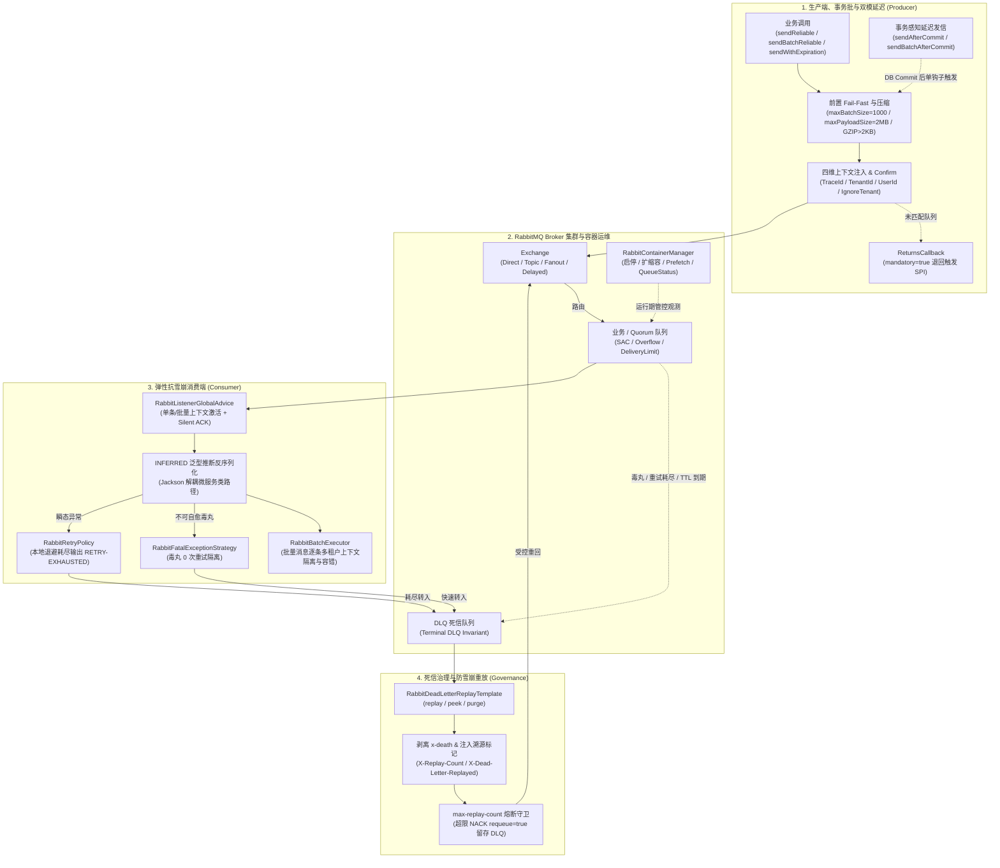

# ateng-boot-rabbitmq 消息通信与可靠投递底座 Starter

> 依托 Spring 官方 Spring AMQP 生态与 JDK 17/21+ 原生能力构建的工业级可靠消息通信底座，集成零丢信双重确认（Publisher Confirms 与 ReturnsCallback）、单条与批量事务感知发信（`sendAfterCommit` / `sendBatchAfterCommit` + 补偿 SPI）、双模延迟投递（插件 `sendDelayed` 与原生消息级 TTL `sendWithExpiration` / `sendAsyncWithExpiration`）、死信受控治理门面（`RabbitDeadLetterReplayTemplate` 与 `X-Replay-Count` 防二次雪崩熔断）、批量消费逐条多租户隔离执行器（`RabbitBatchExecutor`）、运行期消费监听容器动态运维与队列积压探测（`RabbitContainerManager`）、泛型推断反序列化解耦（`TypePrecedence.INFERRED`）、消费端幂等静默确认（Silent ACK）、毒丸 0 次重试隔离、流畅拓扑构建器（`RabbitTopologyBuilder`）、只读运维账号安全防御（`auto-declare: false`）与 100% 离线自洽体验沙箱。

---

## 0. 特性与公共 API 全景速查矩阵 (Feature & API Panorama Matrix)

| 特性分类 | 特性名称 | 核心门面 / 状态视图 / SPI | 关键配置项 (`ateng.boot.rabbitmq.*`) | 关键 API 签名 / 核心行为 / 结构化日志前缀 | 锚定验证源头 (*Test / Sample) |
| :--- | :--- | :--- | :--- | :--- | :--- |
| **可靠投递门面** | 生产端同步/异步可靠投递、批量确认与事务感知门面 | `RabbitReliableTemplate` | `enabled`<br>`reliable.default-timeout`<br>`reliable.returns-callback-enabled`<br>`producer.max-payload-size`<br>`producer.compression-threshold`<br>`producer.compression-enabled`<br>`producer.max-batch-size` | `sendReliable(exchange, routingKey, payload, [bizKey], [timeout], [customizers])`<br>`sendReliableWithPriority(exchange, routingKey, payload, priority, [bizKey], [timeout])`<br>`sendReliableAsync(exchange, routingKey, payload, [bizKey], [customizers])`<br>`sendReliableAsyncWithPriority(exchange, routingKey, payload, priority, [bizKey])`<br>`sendBatchReliable(exchange, routingKey, payloads, [timeout])`<br>`sendBatchReliableAsync(exchange, routingKey, payloads, [timeout])`<br>`sendDelayed(exchange, routingKey, payload, [bizKey], delay, [timeout])`<br>`sendDelayedAsync(exchange, routingKey, payload, [bizKey], delay)`<br>`sendWithExpiration(exchange, routingKey, payload, [bizKey], expiration, [timeout])`<br>`sendAsyncWithExpiration(exchange, routingKey, payload, [bizKey], expiration)`<br>`sendAfterCommit(exchange, routingKey, payload, [bizKey], [timeout], [customizers])`<br>`sendAfterCommitWithPriority(exchange, routingKey, payload, priority, [bizKey], [timeout])`<br>`sendBatchAfterCommit(exchange, routingKey, payloads, [timeout])`<br>`getRabbitTemplate()`：单批上限 `HARD_MAX_BATCH_SIZE=1000`；大报文超限（2MB）前置 Fail-Fast、>2KB 自动 GZIP 压缩；输出 `[MQ-SEND]`、`[MQ-TRANSACTION-POST-COMMIT-FAILED]`、`[MQ-TRANSACTION-CALLBACK-ERROR]` | `RabbitReliableTemplateTest`<br>`RabbitBatchReliableTemplateTest`<br>`RabbitProduceController`<br>`RabbitTransactionController`<br>`RabbitDelayController`<br>`SampleRabbitmqE2eTest` |
| **批量多租户隔离** | 批量消费逐条四维上下文隔离与单条容错执行器 | `RabbitBatchExecutor` | - | 静态原语：`generateBatchTraceId()`（生成 `batch-<UUID>`）、`runInContext(message, consumer)`、`callInContext(message, function)`、`processBatchSafely(messages, processor, [failureHandler])`、`isIdempotentException(throwable)`<br>Bean 实例方法（依托 `MessageConverter` 按 `Class<T>` 推断反序列化）：`runInContext(message, targetType, consumer/biConsumer)`、`callInContext(message, targetType, function/biFunction)`、`processBatchSafely(messages, targetType, processor, [failureHandler])`<br>逐条还原并清理 `TraceId`/`TenantId`/`UserId`/`IgnoreTenant`；幂等冲突输出 `[MQ-IDEMPOTENT-DUPLICATE]` 静默跳过；单条异常输出 `[MQ-CONSUME-BATCH]` 并转交 `failureHandler` | `RabbitBatchExecutorTest`<br>`RabbitBatchAndPriorityController`<br>`RabbitBatchTenantIsolationTest` |
| **运行期容器运维** | 监听容器动态启停、扩缩容与队列积压观测门面 | `RabbitContainerManager`<br>`RabbitContainerStatus`<br>`RabbitQueueStatus` | `consumer.prefetch`<br>`consumer.concurrency`<br>`consumer.max-concurrency`<br>`consumer.shutdown-timeout` | `getListenerContainer(id)` / `getListenerContainerIds()` / `findContainers(idOrQueue)`<br>`start(idOrQueue)` / `stop(idOrQueue)` / `isRunning(idOrQueue)` / `startAll()` / `stopAll()`<br>`scaleConcurrency(idOrQueue, concurrentConsumers, maxConcurrentConsumers)`<br>`updatePrefetchCount(idOrQueue, prefetchCount)`（范围 `[1, 65535]`）<br>`getContainerStatuses()` / `getContainerStatus(idOrQueue)`：返回不可变视图 `RabbitContainerStatus(listenerId, queueNames, running, autoStartup, activeConsumerCount, prefetchCount, containerType)`<br>`getQueueStatus(queueName)`：返回不可变视图 `RabbitQueueStatus(queueName, messageCount, consumerCount, exists)`（`RabbitAdmin` 不可用时安全降级零值）<br>输出 `[MQ-CONTAINER-STOP]`、`[MQ-CONTAINER-START]`、`[MQ-CONTAINER-STOP-ALL]`、`[MQ-CONTAINER-START-ALL]`、`[MQ-CONTAINER-SCALE]`、`[MQ-CONTAINER-PREFETCH]`、`[MQ-QUEUE-STATUS]` | `RabbitContainerManagerTest`<br>`RabbitContainerController`<br>`RabbitContainerControllerE2eTest` |
| **死信治理门面** | 死信受控重放、只读探查与队列清空门面 | `RabbitDeadLetterReplayTemplate` | `dead-letter.default-replay-limit`<br>`dead-letter.max-replay-count` | `replay(dlq, targetExchange, targetRoutingKey, [limit], [filter])`<br>`peek(dlq, [limit])`<br>`purge(dlq)` / `getRabbitTemplate()`：单批上限 `HARD_MAX_REPLAY_LIMIT=1000`；清洗底层 `x-death` 头并注入 `X-Dead-Letter-Replayed`、`X-Replay-Time`、`X-Replay-Count`、`X-Original-Dead-Letter-Queue`、`X-Original-Dead-Letter-Reason`；达 `max-replay-count` 熔断回滚防范二次死信雪崩；输出 `[MQ-DLQ-REPLAY]`、`[MQ-DLQ-REPLAY-BLOCKED]`、`[MQ-DLQ-PURGE]`、`[MQ-REPLAY-NACK-WARN]`、`[MQ-PEEK-NACK-WARN]`、`[MQ-DLQ-REPLAY-WARN]` | `RabbitDeadLetterReplayTemplateTest`<br>`RabbitDeadLetterController`<br>`SampleRabbitmqE2eTest` |
| **死信诊断工具** | 死信元数据只读诊断与强类型解析模型 | `RabbitDeadLetterHelper`<br>`DeadLetterRecord` | - | `getOriginalQueue(message/props)` / `getOriginalExchange(message/props)` / `getDeathReason(message/props)` / `getDeathCount(message/props)` / `getOriginalRoutingKeys(message/props)` / `getFirstDeath(message/props)` / `getAllDeaths(message/props)`<br>返回 6 字段强类型记录 `DeadLetterRecord(queue, exchange, reason, count, routingKeys, time)`；宽容兼容 String、`byte[]` 与 LongString | `RabbitDeadLetterHelperTest`<br>`RabbitDeadLetterController`<br>`SampleRabbitmqE2eTest` |
| **拓扑构建器** | 声明式流畅拓扑构建器 (Fluent API) 与策略枚举 | `RabbitTopologyBuilder`<br>`OverflowStrategy`<br>`DeadLetterStrategy` | `topology.auto-declare` | 交换机入口：`direct(name)` / `topic(name)` / `fanout(name)` / `delayed(name, [delayedType])` / `ttlDelayQueue(ttlQueueName, delay, targetExchange, targetRoutingKey)`<br>`ExchangeTopologyBuilder`：`.alternateExchange(name)`、`.queue(name/Queue)`、`.anonymousQueue()`、`.exclusiveAutoDeleteQueue([name])`、`.build()`<br>`QueueStep`：`.quorum()`、`.singleActiveConsumer()`、`.ttl(duration)`、`.maxLength(n)`、`.maxPriority(n)`、`.overflow(OverflowStrategy)`（`DROP_HEAD` / `REJECT_PUBLISH` / `REJECT_PUBLISH_DLX`）、`.deliveryLimit(n)`、`.deadLetterStrategy(DeadLetterStrategy / String)`（`AT_LEAST_ONCE`）、`.durable(b)` / `.autoDelete(b)` / `.exclusive(b)` / `.argument(k, v)`、`.routingKey(rk)` / `.routingKeys(rks...)`、`.deadLetter(dlx, dlq, rk)`、`.ttlQueue(name, delay)`、`.andQueue(name)` / `.andAnonymousQueue()` / `.andExclusiveAutoDeleteQueue([name])`、`.build()` | `RabbitTopologyBuilderTest`<br>`RabbitScenarioTopologyConfig`<br>`SampleRabbitmqE2eTest` |
| **消费环绕拦截** | 消费端全局四维上下文、幂等静默确认与批量切面 | `RabbitListenerGlobalAdvice` | `logging.enabled`<br>`logging.log-payload-max-length` | 激活并确定性恢复 `TraceId`/`TenantId`/`UserId`/`IgnoreTenant`（纯 `List<POJO>` 无 `traceId` 时兜底生成 `batch-<UUID>`）；捕获 `IdempotentException` 执行 Silent ACK 并输出 `[MQ-IDEMPOTENT-DUPLICATE]`；记录 `[MQ-CONSUME]` 宏日志（`status=SUCCESS/RETRY/FATAL_DLQ` 与 `isBatch`/`batchSize`） | `RabbitListenerGlobalAdviceTest`<br>`SampleRabbitmqE2eTest` |
| **毒丸与本地重试** | 致命毒丸 0 次重试隔离与容器内本地指数退避重试 | `RabbitFatalExceptionStrategy`<br>`RabbitRetryPolicy`<br>`LoggingRejectAndDontRequeueRecoverer` | `consumer.retry.enabled`<br>`consumer.retry.max-attempts`<br>`consumer.retry.initial-interval`<br>`consumer.retry.multiplier`<br>`consumer.retry.max-interval` | 毒丸异常（反序列化、JSR-303 校验、业务断言）触发 `[MQ-FATAL-POISON-PILL]` 立即入死信；死信队列自身异常触发 `[MQ-TERMINAL-DLQ-FAILURE]` 终点防卫；本地重试耗尽转入死信前触发 `[MQ-CONSUME-RETRY-EXHAUSTED]` 告警 | `RabbitFatalExceptionStrategyTest`<br>`RabbitRetryPolicyTest`<br>`AtengRabbitmqAutoConfigurationTest`<br>`SampleRabbitmqE2eTest` |
| **不可路由回调 SPI** | Exchange 未匹配队列退回告警扩展点 | `RabbitUnroutableMessageCallback` | `reliable.returns-callback-enabled` | `onUnroutableMessage(ReturnedMessage returned)`：触发 `[MQ-RETURNS]` 结构化告警并回调自定义实现；回调自身异常触发 `[MQ-RETURNS-CALLBACK-ERROR]` | `RabbitReturnsCallbackTest`<br>`RabbitProduceController` |
| **事务失败回调 SPI** | 本地事务提交后发信失败兜底补偿扩展点 | `RabbitTransactionFailureCallback` | - | `onFailure(String exchange, String routingKey, Object payload, String bizKey, Throwable cause)`：在 `sendAfterCommit` / `sendBatchAfterCommit` 提交后发射失败时回调供本地补偿表兜底；记录 `[MQ-TRANSACTION-POST-COMMIT-FAILED]` | `RabbitReliableTemplateTest`<br>`RabbitTransactionController` |
| **自动装配与基础设施** | 类型推断、批量容器工厂、只读防御与虚拟线程装配 | `AtengRabbitmqAutoConfiguration`<br>`RabbitmqProperties` | `consumer.batch.enabled`<br>`consumer.batch.size`<br>`consumer.batch.max-wait-time`<br>`consumer.shutdown-timeout`<br>`topology.auto-declare` | 装配 `Jackson2JsonMessageConverter`（`TypePrecedence.INFERRED`）、`batchRabbitListenerContainerFactory`、K8s 优雅停机排空、`RabbitAdmin` 只读关闭（`[RABBITMQ-TOPOLOGY]`）及 JDK 21+ `VirtualThreadsConfiguration`（`atengRabbitVirtualTaskExecutor`）；属性严格使用 `Duration` / `DataSize` | `AtengRabbitmqAutoConfigurationTest`<br>`Jackson2JsonMessageConverterTest`<br>`RabbitmqPropertiesTest` |

---

## 1. 模块定位与快速起步 (Quick Start)

### 1.1 Maven 引入坐标

**方式一：通过 `ateng-boot-bom` 统一纳管版本（推荐）**

```xml
<dependencyManagement>
    <dependencies>
        <dependency>
            <groupId>io.github.atengk</groupId>
            <artifactId>ateng-boot-bom</artifactId>
            <version>1.2.0</version>
            <type>pom</type>
            <scope>import</scope>
        </dependency>
    </dependencies>
</dependencyManagement>

<dependencies>
    <dependency>
        <groupId>io.github.atengk</groupId>
        <artifactId>ateng-boot-rabbitmq</artifactId>
    </dependency>
    <!-- 可选：引入 Micrometer Observation 自动激活容器与 Template 链路观测 -->
    <dependency>
        <groupId>io.micrometer</groupId>
        <artifactId>micrometer-observation</artifactId>
    </dependency>
</dependencies>
```

**方式二：独立显式版本号引入**

```xml
<dependencies>
    <dependency>
        <groupId>io.github.atengk</groupId>
        <artifactId>ateng-boot-rabbitmq</artifactId>
        <version>1.2.0</version>
    </dependency>
</dependencies>
```

### 1.2 最小起步配置 (`application.yml`)

```yaml
spring:
  rabbitmq:
    host: localhost
    port: 5672
    username: YOUR_RABBITMQ_USERNAME
    password: YOUR_RABBITMQ_PASSWORD
    publisher-confirm-type: correlated
    publisher-returns: true

ateng:
  boot:
    rabbitmq:
      enabled: true
      reliable:
        default-timeout: 3s
        returns-callback-enabled: true
      consumer:
        prefetch: 20
        retry:
          enabled: true
          max-attempts: 3
```

### 1.3 开箱即用业务代码示例

#### 步骤 1：声明业务 Direct 交换机与 Quorum 队列拓扑 (`RabbitScenarioTopologyConfig.java`)
```java
@Bean
public Declarables orderDirectTopology() {
    return RabbitTopologyBuilder.direct(EXCHANGE_ORDER_DIRECT)
            .queue(QUEUE_ORDER_CREATE)
            .quorum()
            .singleActiveConsumer()
            .routingKey(ROUTING_KEY_ORDER_CREATE)
            .andQueue(QUEUE_ORDER_IDEMPOTENT)
            .routingKey(ROUTING_KEY_ORDER_IDEMPOTENT)
            .build();
}
```

#### 步骤 2：生产端同步可靠发信 (`TradeMessageProducer.java`)
```java
public void sendOrderCreate(OrderCreateMessage message) {
    log.info("[PRODUCER] 开始同步投递订单创建消息: orderId={}", message.orderId());
    rabbitReliableTemplate.sendReliable(
            RabbitScenarioTopologyConfig.EXCHANGE_ORDER_DIRECT,
            RabbitScenarioTopologyConfig.ROUTING_KEY_ORDER_CREATE,
            message,
            message.orderId(),
            Duration.ofSeconds(3)
    );
    log.info("[PRODUCER] 订单创建消息投递成功并收到 Broker Confirm ACK: orderId={}", message.orderId());
}
```

#### 步骤 3：消费端强类型监听与上下文透传 (`OrderConsumer.java`)
```java
@RabbitListener(queues = RabbitScenarioTopologyConfig.QUEUE_ORDER_CREATE)
public void onOrderCreate(OrderCreateMessage message,
                          @Header(name = "X-Trace-Id", required = false) String traceId,
                          @Header(name = "X-Tenant-Id", required = false) String tenantId) {
    log.info("[CONSUMER-ORDER] 消费订单创建消息成功: orderId={}, amount={}, traceId={}, tenantId={}",
            message.orderId(), message.amount(), traceId, tenantId);
    receivedMessages.add(message);
}
```

---

## 2. 核心架构与设计不变量 (Architecture & Invariants)

### 2.1 双重投递可靠性、弹性消费与死信治理流



### 2.2 核心设计不变量

1. **泛型推断反序列化解耦 (`Inferred Deserialization`)**：强制装配 `TypePrecedence.INFERRED` 与 `alwaysConvertToInferredType(true)`，消费端 100% 依 `@RabbitListener` 方法形参或 `RabbitBatchExecutor` 显式传入的 `Class<T>` 进行反序列化，彻底解除跨微服务 DTO 包名耦合与 `__TypeId__` 反序列化注入风险。
2. **批量多租户上下文零污染 (`Batch Tenant Context Isolation`)**：Spring 原生批量监听器将多条可能隶属于不同租户与用户的消息聚合在同一批次回调中。`RabbitBatchExecutor` 在逐条处理前通过 `MessageContextPropagator.ContextScope` 切换四维上下文并在 `try-with-resources` 块结束时确定性还原调用线程现场，彻底杜绝跨租户脏读串门。
3. **死信终点与重放防二次雪崩 (`Terminal DLQ & Replay Avalanche Defense`)**：`RabbitTopologyBuilder` 在拓扑构建期禁止死信队列（`*.dlq` / `*dead-letter*`）再次绑定 DLX；`RabbitDeadLetterReplayTemplate` 在重放时剥离原始 `x-death` 嵌套头并维护 `X-Replay-Count`，一旦超过 `max-replay-count`（默认 1 次）强制熔断留存 DLQ。
4. **严格异步通信与数据库中立边界**：拒绝封装阻塞式 MQ RPC 门面（同步调用交由 HTTP/gRPC）；拒绝强绑定关系型数据库 Outbox 表，坚持通过 `sendAfterCommit` / `sendBatchAfterCommit` + `RabbitTransactionFailureCallback` SPI 实现业务可控补偿。

---

## 3. 生产端高可靠投递、事务感知与双模延迟套件

### 3.1 同步、异步与微批 Confirm 可靠投递 (`sendReliable` / `sendBatchReliable`)

#### 专属 YAML 配置
```yaml
ateng:
  boot:
    rabbitmq:
      reliable:
        default-timeout: 3s
        returns-callback-enabled: true
      producer:
        max-batch-size: 1000
```

#### 逆向实战代码 (`TradeMessageProducer.java`)
```java
public CompletableFuture<CorrelationData.Confirm> sendOrderCreateAsync(OrderCreateMessage message) {
    log.info("[PRODUCER] 开始异步投递订单创建消息: orderId={}", message.orderId());
    return rabbitReliableTemplate.sendReliableAsync(
            RabbitScenarioTopologyConfig.EXCHANGE_ORDER_DIRECT,
            RabbitScenarioTopologyConfig.ROUTING_KEY_ORDER_CREATE,
            message,
            message.orderId()
    );
}

public void sendBatchOrders(List<OrderCreateMessage> orders) {
    log.info("[PRODUCER] 开始批量投递订单创建消息: count={}", orders.size());
    rabbitReliableTemplate.sendBatchReliable(
            RabbitScenarioTopologyConfig.EXCHANGE_BATCH_DIRECT,
            RabbitScenarioTopologyConfig.ROUTING_KEY_BATCH_ORDER,
            orders
    );
    log.info("[PRODUCER] 批量订单消息全部收到 Broker Confirm ACK: count={}", orders.size());
}
```

#### 机制与边界说明
- **逐条独立 CorrelationData 聚合等待**：`sendBatchReliable` / `sendBatchReliableAsync` 在发信前强制校验批次非空、条数不超过 `maxBatchSize`（硬上限 `1000`）且元素无 `null`；逐条注入四维上下文并并发投递，通过 `CompletableFuture.allOf` 聚合等待所有条目 Confirm。任意条目 NACK 或超时会精准定位失败索引与 `bizKey`，抛出携带因果链的 `MessageDeliveryException`。
- **线程中断前置防卫**：调用 `sendBatchReliable` 或非事务分支的 `sendBatchAfterCommit` 前会先执行 `checkBatchNotInterrupted(...)`，避免已中断线程继续向 Broker 发射网络帧。

---

### 3.2 单条与批量事务感知延迟发信 (`sendAfterCommit` & `sendBatchAfterCommit`)

#### 专属 YAML 配置
```yaml
ateng:
  boot:
    rabbitmq:
      reliable:
        default-timeout: 3s
```

#### 逆向实战代码 (`OrderTransactionService.java`)
```java
@Transactional
public void createOrderWithCommit(OrderCreateMessage message) {
    dbRecordCount.incrementAndGet();
    rabbitReliableTemplate.sendAfterCommit(
            RabbitScenarioTopologyConfig.EXCHANGE_ORDER_DIRECT,
            RabbitScenarioTopologyConfig.ROUTING_KEY_ORDER_CREATE,
            message,
            message.orderId()
    );
}

@Transactional
public void createOrderBatchWithCommit(List<OrderCreateMessage> messages) {
    Assert.notEmpty(messages, "批量事务订单消息列表不能为空");
    dbRecordCount.addAndGet(messages.size());
    log.info("[TX-SERVICE] 本地批量订单入库成功: count={}", messages.size());

    rabbitReliableTemplate.sendBatchAfterCommit(
            RabbitScenarioTopologyConfig.EXCHANGE_ORDER_DIRECT,
            RabbitScenarioTopologyConfig.ROUTING_KEY_ORDER_CREATE,
            messages
    );
}

@Transactional
public void createOrderBatchWithRollback(List<OrderCreateMessage> messages) {
    Assert.notEmpty(messages, "批量事务订单消息列表不能为空");
    dbRecordCount.addAndGet(messages.size());
    rabbitReliableTemplate.sendBatchAfterCommit(
            RabbitScenarioTopologyConfig.EXCHANGE_ORDER_DIRECT,
            RabbitScenarioTopologyConfig.ROUTING_KEY_ORDER_CREATE,
            messages
    );
    throw new IllegalStateException("模拟批量库存扣减异常触发本地事务回滚: count=" + messages.size());
}
```

#### 机制与边界说明
- **单同步器注册与提交前全量 Fail-Fast**：在活跃 Spring 事务中调用 `sendBatchAfterCommit` 时，框架在注册 `TransactionSynchronization` 前即同步完成整批消息的载荷序列化、大报文超限（2MB）及批量上限（`maxBatchSize` / `1000`）检验，以及四维上下文快照提取；整个批次仅向当前事务注册 **1 个** 事务同步器钩子。
- **防幽灵消息与非事务回退语义**：若本地事务回滚，所有已注册同步器无条件作废、物理零发信；若当前不在活跃事务中，`sendAfterCommit` / `sendBatchAfterCommit` 立即同步投递并等待 Broker ACK（并发射前检测线程中断状态）。
- **提交后发信失败兜底**：事务物理 Commit 成功后若批量投递出现 Broker NACK、超时或网络异常，记录 `[MQ-TRANSACTION-POST-COMMIT-FAILED]` 并回调 `RabbitTransactionFailureCallback.onFailure(exchange, routingKey, payloads, "batch[N]", ex)` 供业务落库重发表。

---

### 3.3 双模延迟投递：插件延迟与原生消息级 TTL (`sendDelayed` & `sendWithExpiration`)

#### 专属 YAML 配置
```yaml
ateng:
  boot:
    rabbitmq:
      reliable:
        default-timeout: 3s
      sample:
        # 若服务端未启用 rabbitmq_delayed_message_exchange 插件，可关闭延迟拓扑并选用原生消息级 TTL
        delayed-plugin-enabled: true
```

#### 逆向实战代码 (`TradeMessageProducer.java`)
```java
// 方式一：基于 x-delayed-message 插件交换机的任意时长延迟投递
public void sendOrderDelay(OrderTimeoutMessage message, Duration delay) {
    log.info("[PRODUCER] 投递延迟订单消息: orderId={}, delay={}", message.orderId(), delay);
    rabbitReliableTemplate.sendDelayed(
            RabbitScenarioTopologyConfig.EXCHANGE_ORDER_DELAY,
            RabbitScenarioTopologyConfig.ROUTING_KEY_ORDER_TIMEOUT,
            message,
            message.orderId(),
            delay
    );
}

// 方式二：零插件依赖的原生 AMQP 消息级 TTL（MessageProperties.expiration）同步/异步投递
public void sendOrderWithExpiration(OrderTimeoutMessage message, Duration expiration) {
    log.info("[PRODUCER] 同步投递原生 TTL 过期订单消息: orderId={}, expiration={}", message.orderId(), expiration);
    rabbitReliableTemplate.sendWithExpiration(
            RabbitScenarioTopologyConfig.EXCHANGE_ORDER_DIRECT,
            RabbitScenarioTopologyConfig.ROUTING_KEY_ORDER_EXPIRATION,
            message,
            message.orderId(),
            expiration
    );
}

public CompletableFuture<CorrelationData.Confirm> sendOrderWithExpirationAsync(OrderTimeoutMessage message, Duration expiration) {
    log.info("[PRODUCER] 异步投递原生 TTL 过期订单消息: orderId={}, expiration={}", message.orderId(), expiration);
    return rabbitReliableTemplate.sendAsyncWithExpiration(
            RabbitScenarioTopologyConfig.EXCHANGE_ORDER_DIRECT,
            RabbitScenarioTopologyConfig.ROUTING_KEY_ORDER_EXPIRATION,
            message,
            message.orderId(),
            expiration
    );
}
```

#### 机制与边界说明
- **双模选型对比**：
  - `sendDelayed` / `sendDelayedAsync` 写入 `x-delay` 延迟头，要求目标交换机为 `RabbitTopologyBuilder.delayed(...)` 声明的延迟插件交换机，无队头阻塞（HOL Blocking）；
  - `sendWithExpiration` / `sendAsyncWithExpiration` 直接写入标准 AMQP `MessageProperties.expiration`（字符串毫秒值），**无需安装任何 RabbitMQ 第三方插件**，配合 `RabbitTopologyBuilder.ttlDelayQueue(...)` 或死信队列即可实现死信延迟投递，且严格校验 `expiration` 不得为 `null`、零值、负值或不足 `1ms`（亚毫秒如 `500us` 立即 Fail-Fast 拒绝）。

---

### 3.4 大报文超限 Fail-Fast 与透明 GZIP 压缩

#### 专属 YAML 配置
```yaml
ateng:
  boot:
    rabbitmq:
      producer:
        # 单条出站消息最大上限，超限前置阻断 (默认 2MB)
        max-payload-size: 2MB
        # 是否开启透明 GZIP 压缩
        compression-enabled: true
        # 超过阈值自动启用 GZIP 压缩 (默认 2KB)
        compression-threshold: 2KB
        # 批量单批次条数上限保护 (默认 1000)
        max-batch-size: 1000
```

#### 逆向实战代码 (`TradeMessageProducer.java`)
```java
rabbitReliableTemplate.sendReliable(
        RabbitScenarioTopologyConfig.EXCHANGE_ORDER_DIRECT,
        RabbitScenarioTopologyConfig.ROUTING_KEY_ORDER_CREATE,
        largeOrderPayload,
        largeOrderPayload.orderId()
);
```

#### 机制与边界说明
- **前置 Fail-Fast 阻断**：序列化为字节后前置校验是否超出 `max-payload-size`（默认 `2MB`），超限直接抛出 `MessageDeliveryException` 防止撑爆 Broker 通道。
- **自动透明解压**：超过 `compression-threshold`（默认 `2KB`）自动执行 GZIP 压缩并打上 `Content-Encoding: gzip` 消息头；消费端默认与批量容器工厂均挂载 `GUnzipPostProcessor`，上游压缩、下游无感接收。

---

## 4. 声明式流式拓扑构建套件 (`RabbitTopologyBuilder`)

### 4.1 Direct / Topic / Fanout 常用交换机拓扑

#### 专属 YAML 配置
```yaml
ateng:
  boot:
    rabbitmq:
      topology:
        auto-declare: true
```

#### 逆向实战代码 (`RabbitScenarioTopologyConfig.java`)
```java
@Bean
public Declarables logTopicTopology() {
    return RabbitTopologyBuilder.topic(EXCHANGE_LOG_TOPIC)
            .queue(QUEUE_LOG_ERROR)
            .routingKey(ROUTING_KEY_LOG_ERROR)
            .build();
}

@Bean
public Declarables broadcastFanoutTopology() {
    return RabbitTopologyBuilder.fanout(EXCHANGE_BROADCAST_FANOUT)
            .build();
}
```

#### 机制与边界说明
- **统一返回 Spring 原生 `Declarables`**：自动由 `RabbitAdmin` 扫描注册到 Broker；单交换机下可通过 `.andQueue(...)` / `.andAnonymousQueue()` / `.andExclusiveAutoDeleteQueue(...)` 继续挂载多个队列绑定。

---

### 4.2 Raft Quorum 仲裁队列、溢出策略与毒丸投递上限

#### 专属 YAML 配置
```yaml
ateng:
  boot:
    rabbitmq:
      topology:
        auto-declare: true
```

#### 逆向实战代码 (`RabbitScenarioTopologyConfig.java`)
```java
@Bean
public Declarables priorityQuorumTopology() {
    return RabbitTopologyBuilder.direct(EXCHANGE_PRIORITY_DIRECT)
            .queue(QUEUE_PRIORITY_ORDER)
            .quorum()
            .overflow(OverflowStrategy.REJECT_PUBLISH_DLX)
            .deliveryLimit(5)
            .deadLetterStrategy(DeadLetterStrategy.AT_LEAST_ONCE)
            .deadLetter(EXCHANGE_BIZ_DLX, QUEUE_BIZ_DLQ, ROUTING_KEY_BIZ_DEAD)
            .routingKey(ROUTING_KEY_PRIORITY_ORDER)
            .build();
}
```

#### 机制与边界说明
- **现代 Quorum 队列语义**：基于 Raft 协议实现多副本共识，配合 `.singleActiveConsumer()` 可保障集群同组严格串行单活消费，故障秒级漂移；`.deliveryLimit(5)` 与 `.deadLetterStrategy(DeadLetterStrategy.AT_LEAST_ONCE)` 防范毒丸反复重新入队。
- **溢出策略枚举 (`OverflowStrategy`)**：`DROP_HEAD` 丢弃队头旧消息、`REJECT_PUBLISH` 直接 NACK 拒绝发布、`REJECT_PUBLISH_DLX` 将被拒新消息直接转入死信队列。
- **Quorum 优先级约束**：遵循 RabbitMQ 官方规范，Quorum 队列不支持经典队列的 `x-max-priority` 参数；如需队列优先级请在经典队列上调用 `.maxPriority(10)`，或通过多条 Quorum 分级队列路由替代。

---

### 4.3 纯原生 TTL + DLX 延迟队列与备用交换机

#### 专属 YAML 配置
```yaml
ateng:
  boot:
    rabbitmq:
      topology:
        auto-declare: true
```

#### 逆向实战代码 (`RabbitScenarioTopologyConfig.java`)
```java
@Bean
public Declarables nativeTtlDelayQueue() {
    return RabbitTopologyBuilder.ttlDelayQueue(
            "sample.order.native-delay.queue",
            Duration.ofMinutes(15),
            EXCHANGE_ORDER_DIRECT,
            ROUTING_KEY_ORDER_CREATE
    );
}
```

#### 机制与边界说明
- **零插件延时闭环**：`ttlDelayQueue(...)` 声明一个“无消费者暂存队列”，到期后由 RabbitMQ 通过 `x-dead-letter-exchange` 自动将到期消息路由到目标消费交换机与队列；`.alternateExchange(name)` 可为任意主交换机挂载不可路由兜底备用交换机。

---

### 4.4 动态匿名临时排他队列广播订阅

#### 专属 YAML 配置
```yaml
ateng:
  boot:
    rabbitmq:
      topology:
        auto-declare: true
```

#### 逆向实战代码 (`AnonymousBroadcastConsumer.java`)
```java
@RabbitListener(bindings = @QueueBinding(
        value = @Queue,
        exchange = @Exchange(value = RabbitScenarioTopologyConfig.EXCHANGE_BROADCAST_FANOUT, type = ExchangeTypes.FANOUT)
))
public void onBroadcast(String message) {
    log.info("[CONSUMER-BROADCAST] 动态匿名队列收到广播消息: message={}", message);
    this.receivedBroadcasts.add(message);
}
```

#### 机制与边界说明
- **无状态广播自动 GC**：结合通道独占临时队列或 `RabbitTopologyBuilder.fanout(...).anonymousQueue().build()`，消费实例下线断开连接后 Broker 自动清理队列，适合多 Pod 配置热刷新与本地缓存失效广播。

---

## 5. 消费端弹性防卫、批量削峰与多租户隔离套件

### 5.1 全局通知链、四维上下文透传与宏日志 (`RabbitListenerGlobalAdvice`)

#### 专属 YAML 配置
```yaml
ateng:
  boot:
    rabbitmq:
      logging:
        # 是否输出 [MQ-SEND] 与 [MQ-CONSUME] 标准结构化宏日志
        enabled: true
        # 日志中打印 Payload 报文的最大截断字符数
        log-payload-max-length: 1024
```

#### 实战日志输出截取
```text
INFO  [...] i.g.a.b.r.i.RabbitListenerGlobalAdvice : [MQ-CONSUME] mq=rabbitmq topic=sample.order.direct bizKey=ORD-1001 traceId=2d4365bc6925c12e678a622e884ff51a status=SUCCESS cost=2ms
WARN  [...] i.g.a.b.r.i.RabbitListenerGlobalAdvice : [MQ-IDEMPOTENT-DUPLICATE] 消费端检测到幂等防重冲突，触发静默确认 (Silent ACK): exchange=sample.order.direct, routingKey=order.idempotent, queue=sample.order.idempotent.queue, bizKey=idemp-test-01, traceId=2d4365bc6925c12e678a622e884ff51a, isBatch=false, batchSize=1
```

#### 机制与边界说明
- **单条与批量自适应追踪**：入站透明恢复 `TraceId`、`TenantId`、`UserId`、`IgnoreTenant` 与 MDC 并在 `finally` 无条件还原；当 `@RabbitListener` 接收纯 `List<POJO>` 且无 `Message` 提取路径时，调用 `RabbitBatchExecutor.generateBatchTraceId()` 兜底生成 `batch-<UUID>` 批次追踪标识并记录 `isBatch=true, batchSize=N`。

---

### 5.2 消费端防重幂等静默确认 (`Silent ACK`)

#### 专属 YAML 配置
```yaml
ateng:
  boot:
    rabbitmq:
      consumer:
        retry:
          enabled: true
          max-attempts: 3
```

#### 逆向实战代码 (`IdempotentOrderConsumer.java`)
```java
@RabbitListener(queues = RabbitScenarioTopologyConfig.QUEUE_ORDER_IDEMPOTENT)
public void onConsume(String payload,
                      @Header(name = "X-Biz-Key", required = false) String bizKey) {
    String key = bizKey != null ? bizKey : payload;
    if (!processedKeys.add(key)) {
        idempotentTriggeredCount.incrementAndGet();
        log.warn("[CONSUMER-IDEMPOTENT] 检测到重复消息，抛出 IdempotentException 触发静默确认: bizKey={}", key);
        throw new IdempotentException("订单消息已处理，幂等拦截静默确认: " + key);
    }

    normalProcessedCount.incrementAndGet();
    log.info("[CONSUMER-IDEMPOTENT] 首次消费处理成功: bizKey={}, payload={}", key, payload);
}
```

#### 机制与边界说明
- **阻断重试风暴与死信污染**：捕获到因果链上的 `IdempotentException`（或错误码为 `CommonResultCode.REPEAT_SUBMIT` 的 `BusinessException`）时，外层重试与死信策略不再触发，切面直接返回 `null` 触发 `Basic.Ack` 静默确认并输出 `[MQ-IDEMPOTENT-DUPLICATE]`。

---

### 5.3 毒丸隔离与容器内本地指数退避重试 (`RabbitFatalExceptionStrategy` & `RabbitRetryPolicy`)

#### 专属 YAML 配置
```yaml
ateng:
  boot:
    rabbitmq:
      consumer:
        retry:
          # 是否开启容器内本地指数退避重试
          enabled: true
          # 最大本地重试次数 (包含初次执行)
          max-attempts: 3
          # 首次重试退避间隔时间
          initial-interval: 1s
          # 指数退避倍率
          multiplier: 2.0
          # 最大重试退避间隔时间
          max-interval: 10s
```

#### 逆向实战代码 (`PoisonPillConsumer.java`)
```java
@RabbitListener(queues = RabbitScenarioTopologyConfig.QUEUE_BIZ_MAIN)
public void onBizMessage(String payload) {
    attemptCount.incrementAndGet();
    if ("poison-pill".equals(payload)) {
        log.error("[CONSUMER-BIZ] 收到致命毒丸消息，抛出非法参数异常: {}", payload);
        throw new IllegalArgumentException("毒丸格式严重错误，不可自愈: " + payload);
    } else if ("biz-error".equals(payload)) {
        log.error("[CONSUMER-BIZ] 收到业务重试消息，模拟服务故障: attempt={}", attemptCount.get());
        throw new RuntimeException("下游服务网络抖动");
    }
    log.info("[CONSUMER-BIZ] 业务消息消费成功: {}", payload);
}
```

#### 机制与边界说明
- **毒丸 0 次重试与终点防卫**：`RabbitFatalExceptionStrategy` 依托 `FatalExceptionClassifier` 识别反序列化错误、JSR-303 校验异常与 `IllegalArgumentException` 等毒丸直接拒收送 DLQ（输出 `[MQ-FATAL-POISON-PILL]`）；若消费端本身正在消费 `.dlq` / `dead-letter` 队列仍抛出异常，直接触发 `[MQ-TERMINAL-DLQ-FAILURE]` 终点防卫阻断死循环。
- **重试耗尽结构化告警**：瞬态故障在本地容器按指数退避重试耗尽后，由 `LoggingRejectAndDontRequeueRecoverer` 打印 `[MQ-CONSUME-RETRY-EXHAUSTED]` Error 日志并拒绝消息入死信（彻底替代 Broker Requeue 死循环自旋）。

---

### 5.4 消费端批量聚合削峰 (`batchRabbitListenerContainerFactory`)

#### 专属 YAML 配置
```yaml
ateng:
  boot:
    rabbitmq:
      consumer:
        batch:
          # 开启批量聚合监听支持
          enabled: true
          # 单批次最大聚合条数
          size: 50
          # 批量聚合最大等待超时时间
          max-wait-time: 500ms
```

#### 逆向实战代码 (`BatchOrderConsumer.java`)
```java
@RabbitListener(
        queues = RabbitScenarioTopologyConfig.QUEUE_BATCH_ORDER,
        containerFactory = "batchRabbitListenerContainerFactory"
)
public void onBatch(List<OrderCreateMessage> orders) {
    if (orders != null && !orders.isEmpty()) {
        log.info("[CONSUMER-BATCH] 收到批量订单消费消息: count={}", orders.size());
        this.allReceivedOrders.addAll(orders);
    }
}
```

#### 机制与边界说明
- **正交工厂隔离**：`batchRabbitListenerContainerFactory` 独立托管批量聚合监听器，不干扰其余常规单条 `@RabbitListener` 消费者的确认模式与吞吐配置。

---

### 5.5 批量消费逐条四维上下文隔离与单条容错 (`RabbitBatchExecutor`)

#### 专属 YAML 配置
```yaml
ateng:
  boot:
    rabbitmq:
      consumer:
        batch:
          enabled: true
          size: 50
          max-wait-time: 500ms
```

#### 逆向实战代码 (`BatchTenantIsolationConsumer.java`)
```java
@RabbitListener(
        queues = RabbitScenarioTopologyConfig.QUEUE_BATCH_TENANT,
        containerFactory = "batchRabbitListenerContainerFactory"
)
public void onBatchMessages(List<Message> messages) {
    log.info("[BATCH-TENANT-CONSUMER] 接收批量租户混排消息: count={}", messages != null ? messages.size() : 0);
    rabbitBatchExecutor.processBatchSafely(
            messages,
            OrderCreateMessage.class,
            this::handleSingleOrder,
            this::handleFailedOrder
    );
}
```

#### 机制与边界说明
- **逐条强隔离防串门**：批量接收 `List<Message>` 后委托 `RabbitBatchExecutor` 按每条消息的 Header 逐条激活 `MessageContextPropagator.ContextScope`（还原独立的 `TenantId`、`UserId`、`IgnoreTenant` 与 `TraceId`），通过容器 `MessageConverter` 推断反序列化为 `OrderCreateMessage` 后执行单条逻辑，结束立刻恢复调用线程上下文。
- **单条故障隔离与幂等跳过**：批次中单条出现 `IdempotentException` 时自动打印 `[MQ-IDEMPOTENT-DUPLICATE]` 并静默跳过；出现常规业务异常时打印 `[MQ-CONSUME-BATCH]` 并调用 `failureHandler` 记录隔离失败（可转投死信或补偿表），其余同批不同租户的消息照常处理完毕，杜绝整批回滚死锁。

---

## 6. 死信受控治理与防雪崩重放套件

### 6.1 死信受控重放与元数据清洗 (`RabbitDeadLetterReplayTemplate.replay`)

#### 专属 YAML 配置
```yaml
ateng:
  boot:
    rabbitmq:
      dead-letter:
        # 单批次死信受控重放默认数量限制
        default-replay-limit: 100
        # 单条消息允许的最大死信重放次数
        max-replay-count: 1
```

#### 逆向实战代码 (`DeadLetterReplayService.java`)
```java
public int replayBizDeadLetters(int limit) {
    log.info("[SERVICE-REPLAY] 开始重放死信队列消息: dlq={}, limit={}",
            RabbitScenarioTopologyConfig.QUEUE_BIZ_DLQ, limit);
    int replayed = replayTemplate.replay(
            RabbitScenarioTopologyConfig.QUEUE_BIZ_DLQ,
            RabbitScenarioTopologyConfig.EXCHANGE_BIZ_DIRECT,
            RabbitScenarioTopologyConfig.ROUTING_KEY_BIZ,
            limit
    );
    log.info("[SERVICE-REPLAY] 死信队列消息重放完成: dlq={}, replayedCount={}",
            RabbitScenarioTopologyConfig.QUEUE_BIZ_DLQ, replayed);
    return replayed;
}
```

#### 机制与边界说明
- **元数据清洗与 5 项标准溯源头**：重放自动剥离 `x-death`、`x-first-death-exchange`、`x-first-death-queue`、`x-first-death-reason` 原始死信头防止下游再次拒收，同时向消息注入：
  - `X-Dead-Letter-Replayed: true`
  - `X-Replay-Time`: 重放毫秒时间戳
  - `X-Replay-Count`: 递增后的当前重放次数（对应常量 `HEADER_X_REPLAY_COUNT`）
  - `X-Original-Dead-Letter-Queue`: 原始死信来源队列名
  - `X-Original-Dead-Letter-Reason`: 原始死信触发原因

---

### 6.2 最大重放次数防雪崩熔断机制 (`max-replay-count`)

#### 专属 YAML 配置
```yaml
ateng:
  boot:
    rabbitmq:
      dead-letter:
        # 超过该阈值阻断重放，防范业务队列与死信队列之间无限震荡
        max-replay-count: 1
```

#### 逆向实战代码 (`DeadLetterReplayService.java`)
```java
int replayed = replayTemplate.replay(
        RabbitScenarioTopologyConfig.QUEUE_BIZ_DLQ,
        RabbitScenarioTopologyConfig.EXCHANGE_BIZ_DIRECT,
        RabbitScenarioTopologyConfig.ROUTING_KEY_BIZ,
        100,
        message -> !RabbitDeadLetterHelper.getAllDeaths(message).isEmpty()
);
```

#### 机制与边界说明
- **二次死信熔断与 FIFO 保护**：重放前解析 `X-Replay-Count`；一旦达到 `max-replay-count`，框架立即打印 `[MQ-DLQ-REPLAY-BLOCKED]` 错误日志并跳过投递，待本批处理完毕后对所有未重放消息按**逆序**执行 `channel.basicNack(tag, false, true)` 放回死信队列，严格保全队列 FIFO 原序。

---

### 6.3 队列只读探查与一键排空 (`peek` & `purge`)

#### 专属 YAML 配置
```yaml
ateng:
  boot:
    rabbitmq:
      dead-letter:
        default-replay-limit: 100
```

#### 逆向实战代码 (`DeadLetterReplayService.java`)
```java
public List<Message> peekBizDeadLetters(int limit) {
    return replayTemplate.peek(RabbitScenarioTopologyConfig.QUEUE_BIZ_DLQ, limit);
}

public int purgeBizDeadLetters() {
    return replayTemplate.purge(RabbitScenarioTopologyConfig.QUEUE_BIZ_DLQ);
}
```

#### 机制与边界说明
- **只读不丢信探查**：`peek` 支持默认 100 或自定义 `(1 ~ 1000)` 条上限，拉取后在 `finally` 中逆序执行 `basicNack(deliveryTag, false, true)` 原样放回队列头部；`purge` 调用底层 `channel.queuePurge(dlq)` 物理清空并输出 `[MQ-DLQ-PURGE]`。

---

### 6.4 死信元数据只读诊断助手 (`RabbitDeadLetterHelper` & `DeadLetterRecord`)

#### 专属 YAML 配置
```yaml
ateng:
  boot:
    rabbitmq:
      dead-letter:
        default-replay-limit: 100
```

#### 逆向实战代码 (`DeadLetterAuditConsumer.java`)
```java
@RabbitListener(queues = RabbitScenarioTopologyConfig.QUEUE_BIZ_DLQ)
public void onDeadLetter(Message message) {
    String body = new String(message.getBody(), StandardCharsets.UTF_8);
    String originQueue = RabbitDeadLetterHelper.getOriginalQueue(message);
    String originExchange = RabbitDeadLetterHelper.getOriginalExchange(message);
    String reason = RabbitDeadLetterHelper.getDeathReason(message);
    long count = RabbitDeadLetterHelper.getDeathCount(message);
    RabbitDeadLetterHelper.DeadLetterRecord record = RabbitDeadLetterHelper.getFirstDeath(message);

    log.warn("[DLQ-AUDIT] 收到死信消息: body={}, originQueue={}, originExchange={}, reason={}, count={}",
            body, originQueue, originExchange, reason, count);

    if (record != null) {
        auditRecords.add(record);
    }
}
```

#### 机制与边界说明
- **完整 6 字段强类型记录 (`DeadLetterRecord`)**：`RabbitDeadLetterHelper.getFirstDeath(...)` / `getAllDeaths(...)` 返回强类型记录 `RabbitDeadLetterHelper.DeadLetterRecord(String queue, String exchange, String reason, long count, List<String> routingKeys, Date time)`，安全兼容 `String`、`byte[]` 与 AMQP `LongString` 异构驱动类型，零 `ClassCastException`。

---

## 7. 运行期容器动态运维与队列积压观测套件 (`RabbitContainerManager`)

### 7.1 监听容器启停、动态扩缩容、预取调节与队列深度查询

#### 专属 YAML 配置
```yaml
ateng:
  boot:
    rabbitmq:
      consumer:
        # 初始通道预取数与并发范围，运行期可被 RabbitContainerManager 动态覆盖
        prefetch: 20
        concurrency: 1
        max-concurrency: 8
```

#### 逆向实战代码 (`RabbitContainerController.java`)
```java
@GetMapping("/list")
public Result<List<RabbitContainerStatus>> listContainers() {
    return Result.success(rabbitContainerManager.getContainerStatuses());
}

@PostMapping("/start")
public Result<RabbitContainerStatus> startContainer(@Valid @RequestBody ContainerTargetRequest request) {
    rabbitContainerManager.start(request.getTarget());
    return Result.success(rabbitContainerManager.getContainerStatus(request.getTarget()), "监听容器启动成功");
}

@PostMapping("/stop")
public Result<RabbitContainerStatus> stopContainer(@Valid @RequestBody ContainerTargetRequest request) {
    rabbitContainerManager.stop(request.getTarget());
    return Result.success(rabbitContainerManager.getContainerStatus(request.getTarget()), "监听容器停止成功");
}

@PostMapping("/scale")
public Result<RabbitContainerStatus> scaleConcurrency(@Valid @RequestBody ContainerScaleRequest request) {
    rabbitContainerManager.scaleConcurrency(
            request.getTarget(),
            request.getConcurrentConsumers(),
            request.getMaxConcurrentConsumers()
    );
    return Result.success(rabbitContainerManager.getContainerStatus(request.getTarget()), "容器并发消费者调整成功");
}

@PostMapping("/prefetch")
public Result<RabbitContainerStatus> updatePrefetchCount(@Valid @RequestBody ContainerPrefetchRequest request) {
    rabbitContainerManager.updatePrefetchCount(request.getTarget(), request.getPrefetchCount());
    return Result.success(rabbitContainerManager.getContainerStatus(request.getTarget()), "容器预取数调整成功");
}

@GetMapping("/queue-status")
public Result<RabbitQueueStatus> getQueueStatus(@RequestParam String queueName) {
    return Result.success(rabbitContainerManager.getQueueStatus(queueName));
}
```

#### 机制与边界说明
- **双维目标寻址 (`idOrQueue`)**：`start`、`stop`、`isRunning`、`scaleConcurrency`、`updatePrefetchCount`、`getContainerStatus` 均同时支持按 `@RabbitListener(id = ...)` 精确容器 ID 或所监听队列名匹配查找（同队列多容器场景下批量生效）；未命中监听容器立即 Fail-Fast 抛出 `IllegalArgumentException`。
- **强校验与不可变观测视图**：`scaleConcurrency` 要求 `concurrentConsumers > 0` 且 `maxConcurrentConsumers >= concurrentConsumers`（仅支持 `SimpleMessageListenerContainer`）；`updatePrefetchCount` 限制 AMQP 0-9-1 合法区间 `[1, 65535]`。状态查询返回不可变 record `RabbitContainerStatus` 与 `RabbitQueueStatus`（`RabbitAdmin` 不可用或队列尚未创建时安全降级返回 `exists = false` 与零值，并输出 `[MQ-QUEUE-STATUS]`）。

---

## 8. 生产扩展接管与核心非功能边界

### 8.1 不可路由退回消息告警与落库 SPI (`RabbitUnroutableMessageCallback`)

#### 专属 YAML 配置
```yaml
ateng:
  boot:
    rabbitmq:
      reliable:
        # 激活 mandatory=true 与 ReturnsCallback 退回告警
        returns-callback-enabled: true
```

#### 生产接管示例
```java
@Component
@Slf4j
public class CustomUnroutableCallback implements RabbitUnroutableMessageCallback {

    @Override
    public void onUnroutableMessage(ReturnedMessage returned) {
        log.error("[ALERT] 消息不可路由，推送企业告警: exchange={}, routingKey={}, replyCode={}, replyText={}",
                returned.getExchange(),
                returned.getRoutingKey(),
                returned.getReplyCode(),
                returned.getReplyText());
        // 扩展：在此将不可路由退回消息写入补偿表或推送告警机器人
    }
}
```

#### 机制与边界说明
- **Mandatory 退回防线**：开启 `returns-callback-enabled: true` 后自动向 `CachingConnectionFactory` 开启 `publisherReturns=true` 且强制发送消息置为 `mandatory=true`；当路由键未匹配任何队列时 Broker 触发 `Basic.Return`，框架打印 `[MQ-RETURNS]` 告警后回调此 SPI（接管方法形参为 `org.springframework.amqp.core.ReturnedMessage`）。

---

### 8.2 事务提交后发信失败兜底补偿 SPI (`RabbitTransactionFailureCallback`)

#### 专属 YAML 配置
```yaml
ateng:
  boot:
    rabbitmq:
      reliable:
        default-timeout: 3s
```

#### 生产接管示例
```java
@Component
@Slf4j
public class CustomTxFailureCallback implements RabbitTransactionFailureCallback {

    @Override
    public void onFailure(String exchange, String routingKey,
                          Object payload, String bizKey, Throwable cause) {
        log.error("[TX-COMPENSATE] 事务已提交但发信失败，落库本地重发表: exchange={}, routingKey={}, bizKey={}",
                exchange, routingKey, bizKey, cause);
        // 扩展：单条场景 payload 为原始对象、bizKey 为业务主键；
        // 批量 sendBatchAfterCommit 失败场景 payload 为整批 payloads 列表快照、bizKey 为 "batch[N]"
    }
}
```

#### 机制与边界说明
- **单批通吃事务兜底**：`onFailure` 方法在 `sendAfterCommit`（单条）及 `sendBatchAfterCommit`（整批，传入完整 `payloads` 与 `"batch[N]"`）Commit 后发信异常时统一回调，并完整保留底层 `cause` 异常链。

---

### 8.3 只读运维账号启动安全治理 (`auto-declare: false`)

#### 专属 YAML 配置
```yaml
ateng:
  boot:
    rabbitmq:
      topology:
        # 生产受限只读账号环境下关闭 RabbitAdmin 启动自动建队与声明拓扑，防御 403 启动崩溃
        auto-declare: false
```

#### 机制与边界说明
- **生命周期后置抑制**：`AtengRabbitLifecycleBeanPostProcessor` 监测到 `topology.auto-declare=false` 时，打印 `[RABBITMQ-TOPOLOGY]` 日志并将 `RabbitAdmin.setAutoStartup(false)`，由 DBA 或运维平台提前预建拓扑。

---

### 8.4 Kubernetes 优雅停机排空与 JDK 21+ 虚拟线程自适应调度

#### 专属 YAML 配置
```yaml
spring:
  threads:
    virtual:
      # 在 JDK 21+ 运行时开启后，监听容器自动切换为 VirtualThreads 调度执行器
      enabled: true

ateng:
  boot:
    rabbitmq:
      consumer:
        # K8s 滚动停机排空缓冲窗口 (默认 30s)
        shutdown-timeout: 30s
```

#### 机制与边界说明
- **停机无损排空**：收到 `SIGTERM` 信号时容器先停止拉取新消息，并等待最高 `shutdown-timeout` 时长排空在途消费再释放 Broker 信道。
- **虚拟线程无缝适配**：在 JDK 21+ 且开启 `spring.threads.virtual.enabled=true` 时，`AtengRabbitmqAutoConfiguration.VirtualThreadsConfiguration` 自动注册名称为 `atengRabbitVirtualTaskExecutor`（线程前缀 `ateng-vt-rabbit-`）的虚拟线程执行器并注入容器定制器，吞吐与调度无需修改业务代码。

---

### 8.5 结构化日志前缀与排障观测速查

| 日志前缀 | 级别 | 触发位置 | 语义说明 |
| :--- | :--- | :--- | :--- |
| `[MQ-SEND]` | `INFO` / `ERROR` | `RabbitReliableTemplate` | 生产端投递状态、字节体积、Confirm 结果与耗时统计 |
| `[MQ-RETURNS]` | `WARN` | `AtengRabbitmqAutoConfiguration` | `mandatory=true` 未匹配队列退回告警（含 `replyCode`/`replyText`） |
| `[MQ-RETURNS-CALLBACK-ERROR]` | `ERROR` | `AtengRabbitmqAutoConfiguration` | 自定义 `RabbitUnroutableMessageCallback` 回调次生异常 |
| `[MQ-TRANSACTION-POST-COMMIT-FAILED]` | `ERROR` | `RabbitReliableTemplate` | 本地事务 Commit 后单条或批量发信失败 |
| `[MQ-TRANSACTION-CALLBACK-ERROR]` | `ERROR` | `RabbitReliableTemplate` | 自定义 `RabbitTransactionFailureCallback.onFailure` 回调次生异常 |
| `[MQ-CONSUME]` | `INFO` / `WARN` / `ERROR` | `RabbitListenerGlobalAdvice` | 消费端执行状态（`SUCCESS`/`RETRY`/`FATAL_DLQ`）、`isBatch`/`batchSize` 与耗时 |
| `[MQ-IDEMPOTENT-DUPLICATE]` | `WARN` | `RabbitListenerGlobalAdvice` / `RabbitBatchExecutor` | 命中 `IdempotentException` 静默确认或批量单条静默跳过 |
| `[MQ-CONSUME-BATCH]` | `ERROR` | `RabbitBatchExecutor` | 批量消费逐条异常隔离日志及 `failureHandler` 次生异常告警 |
| `[MQ-CONSUME-RETRY-EXHAUSTED]` | `ERROR` | `LoggingRejectAndDontRequeueRecoverer` | 本地指数退避重试耗尽即将拒绝消息进入死信队列 |
| `[MQ-FATAL-POISON-PILL]` | `WARN` | `RabbitFatalExceptionStrategy` | 识别不可自愈毒丸异常，0 次重试直接路由死信队列 |
| `[MQ-TERMINAL-DLQ-FAILURE]` | `ERROR` | `RabbitFatalExceptionStrategy` | 死信队列消费仍报错触发 Terminal DLQ Invariant 阻断自旋 |
| `[MQ-DLQ-REPLAY]` / `[MQ-DLQ-REPLAY-BLOCKED]` / `[MQ-DLQ-PURGE]` | `INFO` / `ERROR` | `RabbitDeadLetterReplayTemplate` | 死信重放完成统计、达 `max-replay-count` 熔断阻断、队列清空统计 |
| `[MQ-CONTAINER-*]` / `[MQ-QUEUE-STATUS]` | `INFO` / `DEBUG` / `WARN` | `RabbitContainerManager` | 容器启停/扩缩容/预取调优日志与队列深度查询降级提示 |
| `[RABBITMQ-TOPOLOGY]` | `INFO` | `AtengRabbitLifecycleBeanPostProcessor` | `auto-declare=false` 关闭 `RabbitAdmin` 启动自动建队提示 |

---

## 9. 完整 YAML 配置属性清单 (Appendix: Configuration Properties)

全量纳管于配置前缀 `ateng.boot.rabbitmq.*`，严格采用 `java.time.Duration` 与 `org.springframework.util.unit.DataSize` 消除单位歧义：

| 配置键名 | 类型 | 默认值 | 说明 |
| :--- | :--- | :--- | :--- |
| `ateng.boot.rabbitmq.enabled` | `boolean` | `true` | 是否启用 RabbitMQ 增强底座特性 |
| `ateng.boot.rabbitmq.producer.max-payload-size` | `DataSize` | `2MB` | 单条出站消息最大报文限制，超过该阈值在出站前 Fail-Fast 阻断 |
| `ateng.boot.rabbitmq.producer.compression-threshold` | `DataSize` | `2KB` | 透明 GZIP 压缩阈值，超过该大小自动启用压缩并在 Header 注入 `Content-Encoding: gzip` |
| `ateng.boot.rabbitmq.producer.compression-enabled` | `boolean` | `true` | 是否启用大报文透明 GZIP 压缩特性 |
| `ateng.boot.rabbitmq.producer.max-batch-size` | `int` | `1000` | 批量投递单批次消息上限保护阈值，防止一次性发射过量消息导致 OOM |
| `ateng.boot.rabbitmq.reliable.default-timeout` | `Duration` | `3s` | Publisher Confirm 同步等待 Broker ACK 的默认超时时间 |
| `ateng.boot.rabbitmq.reliable.returns-callback-enabled` | `boolean` | `true` | 是否激活不可路由消息 (`ReturnsCallback`) 的告警与 SPI 回调 |
| `ateng.boot.rabbitmq.consumer.prefetch` | `int` | `20` | 单消费者默认预取数 (Prefetch Count)，调优吞吐并杜绝饥饿 |
| `ateng.boot.rabbitmq.consumer.concurrency` | `int` | `1` | 默认初始并发消费者数 |
| `ateng.boot.rabbitmq.consumer.max-concurrency` | `int` | `8` | 默认最大并发消费者数 |
| `ateng.boot.rabbitmq.consumer.shutdown-timeout` | `Duration` | `30s` | Kubernetes 滚动停机优雅下线超时时间，预留缓冲窗口排空在途消费 |
| `ateng.boot.rabbitmq.consumer.retry.enabled` | `boolean` | `true` | 是否开启容器内本地指数退避重试 |
| `ateng.boot.rabbitmq.consumer.retry.max-attempts` | `int` | `3` | 最大本地重试次数 (包含初次执行) |
| `ateng.boot.rabbitmq.consumer.retry.initial-interval` | `Duration` | `1s` | 首次重试退避间隔时间 |
| `ateng.boot.rabbitmq.consumer.retry.multiplier` | `double` | `2.0` | 指数退避倍率 |
| `ateng.boot.rabbitmq.consumer.retry.max-interval` | `Duration` | `10s` | 最大重试退避间隔时间 |
| `ateng.boot.rabbitmq.consumer.batch.enabled` | `boolean` | `false` | 是否开启消费端批量监听器削峰 |
| `ateng.boot.rabbitmq.consumer.batch.size` | `int` | `50` | 单批次最大聚合消费消息数 |
| `ateng.boot.rabbitmq.consumer.batch.max-wait-time` | `Duration` | `500ms` | 批量聚合最大等待超时时间 |
| `ateng.boot.rabbitmq.topology.auto-declare` | `boolean` | `true` | 是否自动向 Broker 声明交换机、队列与绑定拓扑 |
| `ateng.boot.rabbitmq.dead-letter.default-replay-limit` | `int` | `100` | 单批次死信受控重放默认数量限制 |
| `ateng.boot.rabbitmq.dead-letter.max-replay-count` | `int` | `1` | 单条消息允许的最大死信重放次数，超过该阈值阻断重放防范二次死信雪崩 |
| `ateng.boot.rabbitmq.logging.enabled` | `boolean` | `true` | 是否输出 `[MQ-SEND]` 与 `[MQ-CONSUME]` 标准结构化宏日志 |
| `ateng.boot.rabbitmq.logging.log-payload-max-length` | `int` | `1024` | 日志中打印 Payload 报文的最大截断字符数，防止大报文冲垮日志管道 |

> 本工程端到端测试、7 大 REST 控制器全场景交互体验与双模启动指引，请参阅场景样例工程：[ateng-boot-sample-rabbitmq](../ateng-boot-samples/ateng-boot-sample-rabbitmq/README.md)。
