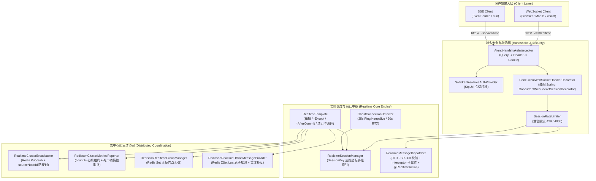

# ateng-boot-realtime 实时通信底座 Starter

> 依托 Spring 6 与 Tomcat 10 原生底层构建的零臃肿全双工与流式双模实时通信底座，统一融通全双工 WebSocket 与半双工流式 Server-Sent Events (SSE)，提供 Spring 并发安全会话装饰（彻底根除 `TEXT_PARTIAL_WRITING` 并发写崩溃与 512KB 缓冲治理）、三阶握手鉴权与 Sa-Token 自动桥接、声明式上行方法级双向 Request-Response 路由（`@RealtimeAction` + JSR-303 DTO 校验 + `RealtimeActionInterceptor` 责任链）、正交二进制帧 SPI（`RealtimeBinaryMessageListener`）、会话级滑窗限流与 4005 阶梯断开、Redisson Set 分布式群组与排除发送方组播（`*Except`）、事务提交后感知推送（`*AfterCommit`）、Redisson ZSet 单次 Lua 原子离线存储与重连自动补发（`auto-push-on-connect`）、虚拟线程全 `ReentrantLock` 防 Pinning、死节点心跳租约淘汰（`RedissonClusterMetricsReporter`）、`SseStreamHelper` 打字机流助手及四阶优雅停机排空。

---

## 0. 特性与公共 API 全景速查矩阵 (Feature & API Panorama Matrix)

| 特性分类 | 特性名称 | 核心门面 / 注解 / SPI | 关键配置项 (`ateng.boot.*`) | 关键 API 签名 / 核心行为 | 锚定验证源头 (*Test / Sample) |
| :--- | :--- | :--- | :--- | :--- | :--- |
| **统一推送门面** | 统一推送、事务感知、排除会话与会话治理门面 | `RealtimeTemplate` | `ateng.boot.realtime.enabled` | `sendToSession(sessionKey, message)` / `sendToSession(userId, clientId, message)` / `sendBinary(sessionKey, payload)` / `sendToUser(userId, [tenantId,] message)` / `sendToUserExcept(userId, [tenantId,] message, excludeSessionKeys)` / `sendViaWebSocket(sessionKey, message)` / `sendViaSse(sessionKey, message)` / `sendToUserViaWebSocket(userId, message)` / `sendToUserViaSse(userId, message)` / `sendToGroup(groupId, message)` / `sendToGroupExcept(groupId, message, excludeSessionKeys)` / `sendToTenant(tenantId, message)` / `sendToAll(message)` / `sendToAllExcept(message, excludeSessionKeys)` / `sendToSessionAfterCommit(sessionKey, message)` / `sendToSessionAfterCommit(userId, clientId, message)` / `sendToUserAfterCommit(userId, [tenantId,] message)` / `sendToGroupAfterCommit(groupId, message)` / `sendToTenantAfterCommit(tenantId, message)` / `sendToAllAfterCommit(message)` / `joinGroup(groupId, sessionKey/userId)` / `leaveGroup(groupId, sessionKey/userId)` / `getGroupSessions(groupId)` / `getGroupMemberCount(groupId)` / `getClusterGroupMemberCount(groupId)` / `getClusterGroupMembers(groupId)` / `dismissGroup(groupId)` / `kickoutSession(sessionKey, [status])` / `kickoutUser(userId, [status])` / `kickoutTenant(tenantId, [status])` / `isUserOnline(userId)` / `isSessionOnline(sessionKey)` / `getOnlineCount()` / `getOnlineUserCount()` / `getOnlineCountByChannel(channelType)` / `getOnlineCountByTenant(tenantId)` / `getSessionsByTenant(tenantId)` / `getSessionsByUser(userId)` / `getAllSessions()` / `getSession(sessionKey)` / `getClusterOnlineCount()` / `pullAndClearOfflineMessages(userId)` / `getOfflineMessages(userId)` / `getOfflineMessagesSince(userId, fromTimestamp/lastEventId)` / `clearOfflineMessages(userId)` / `getOfflineMessageCount(userId)` | `RealtimeTemplateTest` / `RealtimePushController` / `RealtimeControllersScenarioTest` |
| **集群分布式协同** | 多节点去中心化广播门面 | `RealtimeClusterBroadcaster`<br>`StandaloneRealtimeClusterBroadcaster`<br>`RedissonRealtimeClusterBroadcaster` | `ateng.boot.realtime.cluster-mode`<br>`ateng.boot.realtime.cluster.topic` | `broadcast(packet)` / `addConsumer(consumer)` / `removeConsumer(consumer)` / `getNodeId()` / `isClusterEnabled()` / `isUserOnline(userId)`，依托 Redis Pub/Sub 广播并注入 `sourceNodeId` 防反射回环 | `RealtimeClusterBroadcasterTest` / `RealtimeClusterAntiReflectionTest` / `RealtimeClusterDualModeScenarioTest` |
| **集群在线度量** | 节点心跳租约上报与死节点惰性淘汰 | `RealtimeClusterMetricsProvider`<br>`StandaloneClusterMetricsProvider`<br>`RedissonClusterMetricsReporter` | `ateng.boot.realtime.cluster.nodes-hash-key`<br>`ateng.boot.realtime.cluster.metrics-interval` | `getClusterOnlineCount()` / `reportMetrics()`，以 `count:timestampMillis` 上报 Redis Hash 并按 `max(3 * metricsInterval, 15s)` 租约惰性剔除崩溃死节点，防止幽灵在线数虚高 | `RealtimeClusterMetricsTest` / `RealtimeSessionController` / `ClusterAndOfflineScenarioTest` |
| **分布式群组治理** | Redisson Set 正反向双索引群组管理 | `RealtimeGroupManager`<br>`RedissonRealtimeGroupManager` | `ateng.boot.realtime.cluster.group-key-prefix`<br>`ateng.boot.realtime.cluster.session-groups-key-prefix` | `joinGroup(groupId, sessionKey)` / `leaveGroup(groupId, sessionKey)` / `leaveAllGroups(sessionKey)` / `dismissGroup(groupId)` / `getClusterGroupMembers(groupId)` / `getClusterGroupMemberCount(groupId)` / `getGroupSessions(groupId)` / `getGroupMemberCount(groupId)` / `getSessionGroups(sessionKey)` / `getAllGroupIds()` / `clear()`，解散时广播 `group_dismissed` 并级联清理 | `RealtimeGroupManagerTest` / `RedissonRealtimeGroupManagerTest` / `RealtimeGroupController` / `GroupMulticastScenarioTest` |
| **离线消息存储与补发** | ZSet 单次 Lua 原子暂存、防 Pinning 内存实现与重连自动补发 | `RealtimeOfflineMessageProvider`<br>`RedissonRealtimeOfflineMessageProvider`<br>`InMemoryRealtimeOfflineMessageProvider`<br>`NoOpRealtimeOfflineMessageProvider` | `ateng.boot.realtime.offline.enabled`<br>`ateng.boot.realtime.offline.max-messages-per-user`<br>`ateng.boot.realtime.offline.ttl`<br>`ateng.boot.realtime.offline.key-prefix`<br>`ateng.boot.realtime.offline.auto-push-on-connect` | `saveOfflineMessage(userId, message)` / `pullAndClearOfflineMessages(userId)` / `getOfflineMessages(userId)` / `getOfflineMessagesSince(userId, fromTimestamp/lastEventId)` / `clearOfflineMessages(userId)` / `getOfflineMessageCount(userId)`；Redisson 单次 `RScript#eval` Lua 原子执行 `ZADD + ZREMRANGEBYRANK + PEXPIRE`；内存版全 `ReentrantLock` 零 `synchronized`；实名 WS 建连按需自动补发与失败回存 | `RealtimeOfflineMessageProviderTest` / `RedissonRealtimeOfflineMessageProviderTest` / `AtengWebSocketOfflineAutoPushTest` / `RealtimeOfflineController` |
| **会话级限流防刷** | 会话自适应滑动窗口限流器 | `SessionRateLimiter`<br>`RateLimitDecision` | `ateng.boot.realtime.websocket.rate-limit.enabled`<br>`ateng.boot.realtime.websocket.rate-limit.max-requests-per-second`<br>`ateng.boot.realtime.websocket.rate-limit.consecutive-violations-before-close` | `tryAcquire()` / `getConsecutiveViolations()` / `reset()`，心跳 Ping 豁免放行，超限下发 429 警告帧（`WARNING`），连续恶意刷量以 `4005 (RATE_LIMIT_EXCEEDED)` 阶梯切断（`CLOSE`） | `SessionRateLimiterTest` / `AtengWebSocketHandlerTest` / `WebSocketActionScenarioTest` |
| **声明式双向路由** | 上行事件路由注解、DTO 校验与上下文分发引擎 | `@RealtimeAction`<br>`RealtimeMessageDispatcher` | - | `@RealtimeAction("event")` 自适应绑定 `RealtimeSession`、`SessionKey`、`RealtimeMessage` 及强类型 DTO；入参自动 JSR-303 校验（失败回发 400 错误帧）；返回非 `void`/`null` 自动单播 `{event}:reply`；执行前后自动装配/清理 MDC `traceId`、`UserContextHolder`、`TenantContextHolder`；`BusinessException` 转译为 `Result.failure` | `RealtimeActionDispatcherTest` / `ChatActionHandler` / `WebSocketActionScenarioTest` |
| **上行动作拦截器 SPI** | 上行 `@RealtimeAction` 责任链拦截扩展点 | `RealtimeActionInterceptor` | - | `preHandle(session, message, targetBean, targetMethod, args)` / `afterCompletion(session, message, targetBean, targetMethod, result, ex)`，按 `@Order` 编排权限校验、审计日志与耗时统计，`afterCompletion` 早于上下文 `clear()` 执行 | `RealtimeActionDispatcherTest` / `SampleActionAuditInterceptor` / `WebSocketActionScenarioTest` |
| **原始与二进制监听 SPI** | 上行文本兜底与原生二进制帧消费 SPI | `RealtimeMessageListener`<br>`RealtimeBinaryMessageListener` | `ateng.boot.realtime.websocket.max-binary-message-buffer-size` | `RealtimeMessageListener#onMessage(session, message)`（未匹配 `@RealtimeAction` 时回退）；`RealtimeBinaryMessageListener#onBinaryMessage(session, payload)`（直收语音 ASR/Protobuf/分片流，对称 `sendBinary`） | `RealtimeActionDispatcherTest` / `AtengWebSocketHandlerTest` / `AudioBinaryStreamListener` |
| **打字机流助手** | 专职 SSE 命令式流助手与托管端点 | `SseStreamHelper`<br>`AtengSseController` | `ateng.boot.realtime.sse.enabled`<br>`ateng.boot.realtime.sse.path`<br>`ateng.boot.realtime.sse.default-timeout` | `create([timeout])` / `sendChunk(emitter, chunk)` / `sendEvent(emitter, eventName, data)` / `sendEvent(emitter, message)` / `sendComment(emitter, comment)` / `complete(emitter)` / `completeWithError(emitter, error)` / `isClientAbortException(throwable)`，静默吞咽客户端断开防日志风暴 | `SseStreamHelperTest` / `AtengSseControllerTest` / `RealtimeSseStreamController` / `SseSubscriptionScenarioTest` |
| **并发写安全装饰器** | WebSocket 处理器与会话并发写包装 | `ConcurrentWebSocketHandlerDecorator`<br>Spring `ConcurrentWebSocketSessionDecorator` | `ateng.boot.realtime.websocket.enabled`<br>`ateng.boot.realtime.websocket.path`<br>`ateng.boot.realtime.websocket.max-text-message-buffer-size`<br>`ateng.boot.realtime.websocket.async-send-timeout`<br>`ateng.boot.realtime.websocket.send-buffer-limit`<br>`ateng.boot.realtime.websocket.send-timeout` | `getConcurrentSession(session)`，建连时自动为物理 `WebSocketSession` 装配 Spring 原生 `ConcurrentWebSocketSessionDecorator`，提供 512KB 有界写队列与 `10s` 发送超时熔断，彻底消除 `TEXT_PARTIAL_WRITING` | `ConcurrentWebSocketSessionDecoratorTest` / `AtengWebSocketHandlerTest` |
| **死链心跳探针** | 幽灵死链定时探测与空闲排空 | `GhostConnectionDetector` | `ateng.boot.realtime.heartbeat.interval`<br>`ateng.boot.realtime.heartbeat.idle-timeout` | 基于 Spring `SmartLifecycle` 周期向 WebSocket 发送 Ping 帧、向 SSE 下发 `:keepalive\n\n` 注释，空闲超过 60s 以 `IDLE_TIMEOUT (4004)` 强制排空 | `GhostConnectionDetectorTest` |
| **三阶握手鉴权** | 统一端点握手拦截器与 SPI | `AtengHandshakeInterceptor`<br>`RealtimeAuthHandshakeProvider`<br>`SaTokenRealtimeAuthProvider` | `ateng.boot.realtime.auth.allow-anonymous`<br>`ateng.boot.realtime.auth.token-query-param-names`<br>`ateng.boot.realtime.auth.header-name`<br>`ateng.boot.realtime.auth.token-prefix`<br>`ateng.boot.realtime.auth.cookie-name`<br>`ateng.boot.realtime.cors.allowed-origins` | 按 `URL Query -> HTTP Header -> Cookie` 顺序提取 Token；`SaTokenRealtimeAuthProvider` 按 `@ConditionalOnClass(StpUtil.class)` 条件桥接 `LoginId`/`LoginDevice`/租户信息；非法凭据一律拒收 401 | `AtengHandshakeInterceptorTest` / `SaTokenRealtimeAuthProviderTest` / `RealtimeAuthScenarioTest` |
| **权限事件联动切断** | Sa-Token 封禁/踢退实时切断监听 | `RealtimeSaTokenListener` | - | 实现 `SaTokenListener`，监听 `doDisable` 与 `doKickout` 并向集群广播 `4002 (USER_KICKED_OUT)` 强制切断全端在线连接 | `RealtimeSaTokenSecurityTest` / `ClusterAndOfflineScenarioTest` |
| **优雅停机排空** | 云原生四阶优雅停机处理器 | `RealtimeGracefulShutdownHandler` | `ateng.boot.realtime.shutdown.enabled`<br>`ateng.boot.realtime.shutdown.drain-timeout`<br>`ateng.boot.realtime.shutdown.quiet-period` | `SmartLifecycle` 停机阶段拒绝新握手 -> 广播 `1012 (SERVICE_RESTART)` 帧 -> 缓冲冲刷排空 -> 确定性物理断开 | `RealtimeGracefulShutdownTest` |
| **会话与生命周期事件 SPI** | 会话注册/注销与 Spring 应用事件 | `RealtimeSessionListener`<br>`RealtimeSessionEventPublisher`<br>`RealtimeConnectedEvent`<br>`RealtimeDisconnectedEvent` | `ateng.boot.realtime.session.max-connections-per-user`<br>`ateng.boot.realtime.session.eviction-policy` | `RealtimeSessionListener#onSessionRegistered` / `onSessionClosed(session, [status])`；发布 Spring 原生 `RealtimeConnectedEvent` / `RealtimeDisconnectedEvent` | `RealtimeSessionEventPublisherTest` / `RealtimeSessionManagerTest` |
| **基础契约与状态码** | 强类型消息、三维坐标与 RFC 6455 状态码 | `` `RealtimeMessage<T>` ``<br>`SessionKey`<br>`RealtimeCloseStatus` | - | `RealtimeMessage.of` / `ofPersistent` / `freezeContextMetadata` / `ping` / `pong`；`SessionKey.of` / `anonymous` / `format` / `parse`；`RealtimeCloseStatus` (`1000/1012/4001~4005`) | `RealtimeMessageTest` / `SessionKeyTest` / `RealtimeCloseStatusTest` |

---

## 1. 模块定位与快速起步 (Positioning & Quick Start)

### 1.1 模块定位与 Maven 坐标
`ateng-boot-realtime` 是面向生产就绪的工业级实时通信基础设施模块：
- **纯原生零臃肿**：坚守 JDK 17 与 Spring 6 / Tomcat 10 原生能力，不引入 Netty、Socket.IO 等重型外部通信引擎；
- **双模全双工/流式合一**：全双工 WebSocket 与半双工流式 SSE 深度融合，统一由 `RealtimeSessionManager` 纳管；
- **开箱即用调度门面**：通过 `RealtimeTemplate` 统一抹平单播、排除发送方组播（`*Except`）、事务提交后感知推送（`*AfterCommit`）、群组治理、离线暂存与集群度量；
- **全链路企业级防线**：内置并发写缓冲保护、DTO JSR-303 校验与拦截器链、滑窗限流防刷、Lua 原子离线存储、死节点心跳淘汰与 Sa-Token 强退联动。

**方式一：通过 `ateng-boot-bom` 统一纳管版本（推荐）**

```xml
<dependencyManagement>
    <dependencies>
        <dependency>
            <groupId>io.github.atengk</groupId>
            <artifactId>ateng-boot-bom</artifactId>
            <version>1.2.0</version>
            <type>pom</type>
            <scope>import</scope>
        </dependency>
    </dependencies>
</dependencyManagement>

<dependencies>
    <dependency>
        <groupId>io.github.atengk</groupId>
        <artifactId>ateng-boot-realtime</artifactId>
    </dependency>
    <!-- 可选：开启多节点 Redis Pub/Sub 集群广播、分布式群组与 ZSet 离线消息存储 -->
    <dependency>
        <groupId>io.github.atengk</groupId>
        <artifactId>ateng-boot-redis</artifactId>
    </dependency>
    <!-- 可选：开启 Sa-Token 握手自动鉴权与封禁/踢退实时断链联动 -->
    <dependency>
        <groupId>io.github.atengk</groupId>
        <artifactId>ateng-boot-satoken</artifactId>
    </dependency>
</dependencies>
```

**方式二：独立引入（显式声明版本号）**

```xml
<dependency>
    <groupId>io.github.atengk</groupId>
    <artifactId>ateng-boot-realtime</artifactId>
    <version>1.2.0</version>
</dependency>
```

### 1.2 最小可用配置 (application.yml)
```yaml
ateng:
  boot:
    realtime:
      enabled: true                     # 是否启用实时通信底座自动装配
      cluster-mode: auto                # AUTO: 自动探测 Redisson 启用集群广播，缺省降级为单机内存模式
      cors:
        allowed-origins:                # 允许跨域握手来源列表（默认：["*"]）
          - "*"
      websocket:
        enabled: true                   # 开启 WebSocket 传输引擎
        path: /ws/realtime              # 端点路径
      sse:
        enabled: true                   # 开启 SSE 传输引擎
        path: /sse/realtime             # 端点路径
```

### 1.3 极简实战体验（Happy Path）
业务组件标记 `@RealtimeAction` 处理强类型上行请求，通过 `RealtimeTemplate` 实现单播与事务后推送：

```java
// 1. 上行强类型 DTO 校验与双向应答 (逆向提取自 ChatActionHandler.java)
@Component
public class ChatActionHandler {
    @RealtimeAction("order:confirm")
    public Result<String> handleOrderConfirm(OrderConfirmActionRequest payload) {
        return Result.success("已确认订单 [" + payload.getOrderId() + "]，数量 " + payload.getQuantity());
    }
}

// 2. 下行消息单播与事务后推送 (逆向提取自 RealtimePushController.java)
@RestController
@RequestMapping("/sample/realtime/push")
@RequiredArgsConstructor
public class RealtimePushController {
    private final RealtimeTemplate realtimeTemplate;

    @PostMapping("/user")
    public Result<Integer> sendToUser(@Valid @RequestBody PushUserMessageRequest request) {
        RealtimeMessage<String> message = RealtimeMessage.of(request.getEvent(), request.getContent());
        int count = realtimeTemplate.sendToUser(request.getUserId(), message);
        return Result.success(count);
    }
}
```

---

## 2. 核心架构与设计不变量 (Core Architecture & Design Invariants)



### 核心设计不变量：
1. **并发写安全与防 Pinning 不变量**：`ConcurrentWebSocketHandlerDecorator` 为每个物理 `WebSocketSession` 装配 Spring 原生 `ConcurrentWebSocketSessionDecorator`，内置 512KB 有界发送队列消除 `TEXT_PARTIAL_WRITING`；所有自研阻塞/同步临界区全面使用 `ReentrantLock` 替代 `synchronized`，适配 JDK 21+ 虚拟线程。
2. **集群防反射与死节点不变量**：节点启动生成不可变 `sourceNodeId` 阻断 Redis Pub/Sub 自发自收；节点在线度量采用 `count:timestampMillis` 租约与惰性淘汰，根除实例崩溃后的幽灵在线统计漂移。
3. **上下文贯通与确定性清理不变量**：`@RealtimeAction` 上行分发在调度前后严格装配与清理 MDC `traceId`、`UserContextHolder` 与 `TenantContextHolder`；`*AfterCommit` 事务提交后推送则通过 Core `AsyncContext` 捕获并恢复完整四维上下文（`MDC`、`UserContextHolder`、`TenantContextHolder`、`IgnoreTenant`），并在 `finally` 中确定性清理。
4. **传输契约解耦与离线零丢失不变量**：Controller 与动作入参统一使用 DTO/VO 与 `Result<T>`；Redisson 离线存储通过单次 Lua 脚本原子完成 `ZADD + ZREMRANGEBYRANK + PEXPIRE`，WebSocket 重连自动补发遇异常即时回存未投递消息。

---

## 3. 全双工 WebSocket 与声明式双向交互 (Full-Duplex WebSocket)

### 3.1 并发写安全与 512KB 发送缓冲治理 (Concurrent Writing Safety & Buffer Governance)

#### 专属 YAML 配置
```yaml
ateng:
  boot:
    realtime:
      websocket:
        enabled: true                   # 启用 WebSocket 传输引擎（默认：true）
        path: /ws/realtime              # 端点路径（默认：/ws/realtime）
        send-buffer-limit: 512KB        # Spring ConcurrentWebSocketSessionDecorator 发送缓冲上限（默认：512KB）
        send-timeout: 10s               # 单次写阻塞超时熔断阈值（默认：10s）
        max-text-message-buffer-size: 64KB # 底层容器文本帧接收缓冲区上限（默认：64KB）
```

#### 实战业务代码 (逆向提取自 RealtimePushController.java 与 AtengRealtimeAutoConfiguration.java)
```java
// 1. 自动装配层 (AtengRealtimeAutoConfiguration.AtengWebSocketConfigurer) 自动包装处理器：
//    new ConcurrentWebSocketHandlerDecorator(rawHandler, sendTimeoutMillis, sendBufferLimitBytes)
//    每当物理 WebSocketSession 建连时，底层自动生成 org.springframework.web.socket.handler.ConcurrentWebSocketSessionDecorator

// 2. 业务控制器并发向指定会话下发（逆向提取自 RealtimePushController.java）
@PostMapping("/user")
public Result<Integer> sendToUser(@Valid @RequestBody PushUserMessageRequest request) {
    RealtimeMessage<String> message = RealtimeMessage.of(request.getEvent(), request.getContent());
    if (StringUtils.hasText(request.getDeviceType()) && StringUtils.hasText(request.getClientId())) {
        SessionKey key = SessionKey.of(request.getUserId(), request.getDeviceType(), request.getClientId());
        boolean success = realtimeTemplate.sendToSession(key, message);
        return Result.success(success ? 1 : 0);
    }
    int count = realtimeTemplate.sendToUser(request.getUserId(), message);
    return Result.success(count);
}
```

#### 核心机制与生产边界
- **Spring 原生装饰器托底**：`ConcurrentWebSocketHandlerDecorator` 直接复用 Spring Framework 原生 `org.springframework.web.socket.handler.ConcurrentWebSocketSessionDecorator`，无额外造轮子风险，彻底杜绝多线程并发写同一原生 JSR-356/Tomcat 会话引发的 `IllegalStateException: TEXT_PARTIAL_WRITING`；
- **防慢客户端 OOM 熔断**：当对端接收缓慢导致缓冲积压超过 `send-buffer-limit`（`512KB`）或单次写耗时超过 `send-timeout`（`10s`）时，装饰器按策略主动切断慢连接，保护服务端堆内存；
- **全库虚拟线程防 Pinning**：模块自研锁（如 `InMemoryRealtimeOfflineMessageProvider` 每用户邮箱锁与分布式连接协调临界区）全部采用 `ReentrantLock` 并在 `finally` 检查 `isHeldByCurrentThread()` 后解锁。

---

### 3.2 声明式双向路由、DTO JSR-303 校验与拦截器链 (`@RealtimeAction` / `RealtimeActionInterceptor`)

#### 专属 YAML 配置
```yaml
ateng:
  boot:
    realtime:
      websocket:
        enabled: true                   # 启用 WebSocket 传输引擎（默认：true）
        path: /ws/realtime              # 端点路径（默认：/ws/realtime）
```

#### 实战业务代码 (逆向提取自 OrderConfirmActionRequest.java、ChatActionHandler.java 与 SampleActionAuditInterceptor.java)
```java
// 1. 上行强类型 DTO 与 JSR-303 约束（提取自 OrderConfirmActionRequest.java）
@Data
@Builder
@NoArgsConstructor
@AllArgsConstructor
public class OrderConfirmActionRequest implements Serializable {
    @NotBlank(message = "订单编号不能为空")
    private String orderId;

    @NotNull(message = "购买数量不能为 null")
    @Min(value = 1, message = "购买数量至少为 1")
    private Integer quantity;

    private String remark;
}

// 2. 上行双向处理与异常语义转译（提取自 ChatActionHandler.java）
@Slf4j
@Component
@RequiredArgsConstructor
public class ChatActionHandler {

    @RealtimeAction("order:query")
    public Result<Map<String, Object>> handleOrderQuery(Map<String, Object> payload) {
        String orderId = payload != null ? String.valueOf(payload.get("orderId")) : "ORD-001";
        return Result.success(Map.of("orderId", orderId, "status", "PAID", "amount", 199.9));
    }

    @RealtimeAction("order:cancel")
    public Result<Void> handleOrderCancel(Map<String, Object> payload) {
        String orderId = payload != null ? String.valueOf(payload.get("orderId")) : "ORD-001";
        throw new BusinessException(40001, "订单 [" + orderId + "] 已锁定不可取消");
    }

    @RealtimeAction("order:confirm")
    public Result<String> handleOrderConfirm(OrderConfirmActionRequest payload) {
        log.info("[Sample] 收到订单确认请求: orderId={}, quantity={}", payload.getOrderId(), payload.getQuantity());
        return Result.success("已确认订单 [" + payload.getOrderId() + "]，数量 " + payload.getQuantity());
    }
}

// 3. 责任链前置与收尾审计拦截器（提取自 SampleActionAuditInterceptor.java）
@Slf4j
@Order(100)
@Component
public class SampleActionAuditInterceptor implements RealtimeActionInterceptor {

    @Override
    public boolean preHandle(RealtimeSession session,
                             RealtimeMessage<?> message,
                             Object targetBean,
                             Method targetMethod,
                             Object[] args) {
        log.info("[Sample-Interceptor] 前置放行动作: event={}, sessionKey={}, method={}, traceId={}",
                message.getEvent(), session.getSessionKey(), targetMethod.getName(), MDC.get("traceId"));
        return true;
    }

    @Override
    public void afterCompletion(RealtimeSession session,
                                RealtimeMessage<?> message,
                                Object targetBean,
                                Method targetMethod,
                                Object result,
                                Throwable ex) {
        log.info("[Sample-Interceptor] 动作执行收尾: event={}, sessionKey={}, traceId={}, hasException={}",
                message.getEvent(), session.getSessionKey(), MDC.get("traceId"), ex != null);
    }
}
```

#### 核心机制与生产边界
- **强类型 DTO 自动校验**：`RealtimeMessageDispatcher` 将 `message.getData()` 绑定为业务 DTO 后自动触发 `ValidatorUtil.validate`（JSR-303）；校验不通过时不进入业务方法，直接以 `{event}:reply` 回发 HTTP 400 语义错误帧且长连接不断开；
- **拦截器链与四维上下文顺序**：全部 `RealtimeActionInterceptor` Bean 按 `@Order`/`Ordered` 升序执行 `preHandle`；只要通过首个放行阶段，`afterCompletion` 即以栈逆序保证触发，且严格早于调度线程 `MDC`、`UserContextHolder` 与 `TenantContextHolder` 的 `finally { clear(); }` 清理；
- **请求 ID 继承与异常转译**：非 `void`/`null` 返回值自动封装 `{event}:reply` 并保留上行 `id`；`BusinessException` 原地转译为 `Result.failure(code, msg)`，彻底屏蔽底层堆栈向客户端泄漏。

---

### 3.3 会话级自适应滑动窗口限流防刷与 4005 阶梯断开

#### 专属 YAML 配置
```yaml
ateng:
  boot:
    realtime:
      websocket:
        rate-limit:
          enabled: true                 # 开启会话级上行流量限制（默认：false）
          max-requests-per-second: 50   # 单会话每秒最大允许上行请求数（默认：50）
          consecutive-violations-before-close: 3 # 连续违规触发 4005 断开的次数阈值（默认：3；设为 0 表示仅警告不强断）
```

#### 实战业务代码 (逆向提取自 SessionRateLimiterTest.java)
```java
// 开启 ateng.boot.realtime.websocket.rate-limit.enabled=true 后，
// RealtimeSessionManager#registerSession 会为每条 WebSocket 会话自动装配独立的 SessionRateLimiter：
AtomicLong currentTime = new AtomicLong(1000000L);
SessionRateLimiter limiter = new SessionRateLimiter(5, 3, currentTime::get);

// 1. 阈值内请求均正常放行 (ALLOWED)
for (int i = 0; i < 5; i++) {
    assertEquals(RateLimitDecision.ALLOWED, limiter.tryAcquire());
}

// 2. 第 1~2 次超限触发 WARNING，回发 429 警告帧但保留连接
assertEquals(RateLimitDecision.WARNING, limiter.tryAcquire());
assertEquals(RateLimitDecision.WARNING, limiter.tryAcquire());

// 3. 连续违规达到 threshold (3) 次升级为 CLOSE，物理切断并返回 4005 (RATE_LIMIT_EXCEEDED)
assertEquals(RateLimitDecision.CLOSE, limiter.tryAcquire());
```

#### 核心机制与生产边界
- **无锁高频计数与 Ping 豁免**：`SessionRateLimiter` 维护单会话时间窗口原子计数器，无需每次消息访问 Redis；心跳 `ping` 文本帧在限流判定前直通 `pong` 响应，避免误杀健康心跳；
- **两阶梯精准惩戒**：偶发突发仅触发 `WARNING`（429 告警帧，保持长连接）；恶意死循环连续超限达 `consecutiveViolationsBeforeClose`（默认 3 次）即下发 `RealtimeCloseStatus.RATE_LIMIT_EXCEEDED (4005)` 物理切断，客户端凭 `4005` 状态码进入冷却提示流程。

---

### 3.4 原生二进制音视频流上行监听 SPI (`RealtimeBinaryMessageListener`)

#### 专属 YAML 配置
```yaml
ateng:
  boot:
    realtime:
      websocket:
        max-binary-message-buffer-size: 64KB # 底层容器单次二进制缓冲区上限（默认：64KB）
```

#### 实战业务代码 (逆向提取自 AudioBinaryStreamListener.java)
```java
@Slf4j
@Component
public class AudioBinaryStreamListener implements RealtimeBinaryMessageListener {

    @Override
    public void onBinaryMessage(RealtimeSession session, byte[] payload) {
        log.info("[Sample] 收到客户端原生二进制音频流分片: sessionKey={}, byteCount={}",
                session.getSessionKey(), payload != null ? payload.length : 0);
        // 直接交付语音识别 ASR 引擎或推入音频流队列，彻底规避 JSON 序列化损耗
    }
}
```

#### 核心机制与生产边界
- **正交双流与对称二进制回写**：二进制消息绕过 JSON 解析直达 `RealtimeBinaryMessageListener`；配合 `session.sendBinary(byte[])` 或 `realtimeTemplate.sendBinary(sessionKey, bytes)`，实现纯二进制双向流式交互，并同样享有四维上下文透传。

---

## 4. 轻量半双工 SSE 与打字机流式推流 (Server-Sent Events)

### 4.1 原生 `AtengSseController` 长连接托管与生命周期

#### 专属 YAML 配置
```yaml
ateng:
  boot:
    realtime:
      sse:
        enabled: true                   # 是否开启 SSE 传输引擎（默认：true）
        path: /sse/realtime             # SSE 长连接端点路径（默认：/sse/realtime）
        default-timeout: 30m            # SSE 长连接默认超时（默认：30m）
```

#### 实战业务代码 (逆向提取自 RealtimePushController.java 与 AtengSseController.java)
```java
// 1. 客户端接入：GET /sse/realtime?token=...&clientId=sse-01（支持 HTTP Header Last-Event-ID 断点续传）
//    由 AtengSseController#connect 自动完成鉴权、注册至 RealtimeSessionManager，并纳入心跳保活探针

// 2. 服务端向指定 SSE 端点定向推送（逆向提取自 RealtimePushController.java）
@PostMapping("/sse")
public Result<Boolean> sendViaSse(@RequestParam String userId,
                                  @RequestParam(defaultValue = "default") String clientId,
                                  @RequestParam String message) {
    SessionKey key = SessionKey.of(userId, clientId);
    RealtimeMessage<String> realtimeMessage = RealtimeMessage.of("notice:sse", message);
    return Result.success(realtimeTemplate.sendViaSse(key, realtimeMessage));
}
```

#### 核心机制与生产边界
- **双通道统一索引**：`AtengSseController` 创建的 `SseEmitter` 同样包装为 `RealtimeSession`（`ChannelType.SSE`）注册进 `RealtimeSessionManager`，支持按用户、租户、群组及 `sendViaSse` 定向推送；
- **网关防断链保活**：`GhostConnectionDetector` 周期向 SSE 会话下发标准 `:keepalive\n\n` 注释帧（由 `SseStreamHelper.sendComment(emitter, "keepalive")` 驱动），避免 Nginx/ALB 因 `proxy_read_timeout` 静默掐断空闲连接。

---

### 4.2 `SseStreamHelper` 大模型打字机流与客户端中止静默拦截

#### 专属 YAML 配置
```yaml
ateng:
  boot:
    realtime:
      sse:
        enabled: true                   # 开启 SSE 传输基础设施（默认：true）
        default-timeout: 30m            # 默认 SseEmitter 超时阈值（默认：30m）
```

#### 实战业务代码 (逆向提取自 RealtimeSseStreamController.java)
```java
@Slf4j
@RestController
@RequestMapping("/sample/realtime/sse")
@RequiredArgsConstructor
public class RealtimeSseStreamController {

    private final ObjectProvider<Executor> taskExecutorProvider;

    @GetMapping(value = "/stream-llm", produces = MediaType.TEXT_EVENT_STREAM_VALUE)
    public SseEmitter streamLlm(@RequestParam(defaultValue = "Explain realtime architecture") String prompt) {
        log.info("[Sample] 触发 LLM 打字机流式推流: prompt={}", prompt);
        SseEmitter emitter = SseStreamHelper.create(60_000L);
        Runnable task = () -> {
            try {
                String[] words = {"[Prompt: ", prompt, "] ", "Hello", " ", "World", "!", " ", "This", " ", "is", " ", "ateng-boot-realtime", " ", "streaming."};
                for (String word : words) {
                    Thread.sleep(50);
                    // 发送分块；若客户端主动断开连接，sendChunk 内部静默拦截并立即返回 false，避免下游无谓消耗推理算力
                    boolean sent = SseStreamHelper.sendChunk(emitter, word);
                    if (!sent) {
                        log.debug("[Sample] 客户端已断开打字机推流，终止任务");
                        return;
                    }
                }
                SseStreamHelper.complete(emitter);
            } catch (InterruptedException e) {
                Thread.currentThread().interrupt();
            }
        };

        Executor executor = taskExecutorProvider.getIfAvailable();
        if (executor != null) {
            executor.execute(task);
        } else {
            // 受管单线程降级执行，防范无界野线程与 Carrier Pinning
            log.warn("[Sample] 未发现注入的受管异步线程池，降级使用 SimpleAsyncTaskExecutor 受管执行");
            new SimpleAsyncTaskExecutor("sse-stream-").execute(task);
        }
        return emitter;
    }
}
```

#### 核心机制与生产边界
- **真实方法契约与客户端中止识别**：`SseStreamHelper` 提供 `create`、`sendChunk`、`sendEvent`（支持具名事件或 `RealtimeMessage` 对象）、`sendComment`、`complete`、`completeWithError` 及 `isClientAbortException`；
- **零日志风暴熔断**：当浏览器取消 `fetch` 或关闭标签触发 `ClientAbortException` / `Broken pipe` / `async request timed out` 时，`sendChunk` / `sendEvent` / `completeWithError` 自动降级静默关闭，并返回 `false` 通知 AI 推理线程即时退出。

---

## 5. 分布式集群协同与群组广播治理 (Distributed Coordination)

### 5.1 去中心化 Redis Pub/Sub 广播总线与 `sourceNodeId` 防反射

#### 专属 YAML 配置
```yaml
ateng:
  boot:
    realtime:
      cluster-mode: auto                # AUTO (探测到 Redisson 自动启用集群广播，默认), STANDALONE (强制单机模式)
      cluster:
        topic: ateng:realtime:broadcast # 跨节点广播 Redis Topic 名称（默认：ateng:realtime:broadcast）
```

#### 实战业务代码 (逆向提取自 RealtimePushController.java)
```java
@PostMapping("/tenant")
public Result<Integer> sendToTenant(@RequestParam Long tenantId, @RequestParam String message) {
    int count = realtimeTemplate.sendToTenant(tenantId, RealtimeMessage.of("notice:tenant", message));
    return Result.success(count);
}

@PostMapping("/broadcast")
public Result<Integer> broadcast(@Valid @RequestBody PushBroadcastRequest request) {
    RealtimeMessage<String> message = RealtimeMessage.of(request.getEvent(), request.getContent());
    int count = request.getTenantId() != null
            ? realtimeTemplate.sendToTenant(request.getTenantId(), message)
            : realtimeTemplate.sendToAll(message);
    return Result.success(count);
}
```

#### 核心机制与生产边界
- **去中心化与零依赖降级**：探测到 `RedissonClient` 时自动激活 `RedissonRealtimeClusterBroadcaster` 跨 Pod 广播；无 Redis 时无缝退回 `StandaloneRealtimeClusterBroadcaster` 单机闭环；
- **`sourceNodeId` 防反射环路**：每条跨节点 `RealtimeClusterPacket` 自动携带发布者节点不可变 UUID（`sourceNodeId`），订阅侧在第一行卫语句丢弃来自自身的包，彻底根除 Pub/Sub 广播风暴。

---

### 5.2 Redisson Set 正反向双索引群组纳管、排除发送方组播与解散通知

#### 专属 YAML 配置
```yaml
ateng:
  boot:
    realtime:
      cluster:
        group-key-prefix: ateng:realtime:cluster:group:       # 正向成员索引 Redis Set 前缀
        session-groups-key-prefix: ateng:realtime:cluster:session: # 反向群组索引 Redis Set 前缀
```

#### 实战业务代码 (逆向提取自 RealtimeGroupController.java)
```java
@RestController
@RequestMapping("/sample/realtime/group")
@RequiredArgsConstructor
public class RealtimeGroupController {

    private final RealtimeTemplate realtimeTemplate;

    @PostMapping("/send")
    public Result<Integer> sendToGroup(@Valid @RequestBody PushGroupMessageRequest request) {
        int count = realtimeTemplate.sendToGroup(request.getGroupId(),
                RealtimeMessage.of(request.getEvent(), request.getContent()));
        return Result.success(count);
    }

    @PostMapping("/send-except")
    public Result<Integer> sendToGroupExcept(@Valid @RequestBody PushGroupMessageRequest request) {
        List<SessionKey> excludeKeys = parseSessionKeys(request.getExcludeSessionKeys());
        int count = realtimeTemplate.sendToGroupExcept(request.getGroupId(),
                RealtimeMessage.of(request.getEvent(), request.getContent()), excludeKeys);
        return Result.success(count);
    }

    private List<SessionKey> parseSessionKeys(List<String> rawKeys) {
        if (CollectionUtils.isEmpty(rawKeys)) {
            return Collections.emptyList();
        }
        List<SessionKey> keys = new ArrayList<>(rawKeys.size());
        for (String raw : rawKeys) {
            if (StringUtils.hasText(raw)) {
                try {
                    keys.add(SessionKey.parse(raw.trim()));
                } catch (IllegalArgumentException e) {
                    throw new BusinessException(CommonResultCode.BAD_REQUEST,
                            "会话坐标格式非法，需符合 userId:deviceType:clientId 规范: " + raw, e);
                }
            }
        }
        return keys;
    }

    @PostMapping("/join")
    public Result<Void> joinGroup(@RequestParam String groupId, @RequestParam String userId) {
        realtimeTemplate.joinGroup(groupId, userId);
        return Result.success();
    }

    @PostMapping("/leave")
    public Result<Void> leaveGroup(@RequestParam String groupId, @RequestParam String userId) {
        realtimeTemplate.leaveGroup(groupId, userId);
        return Result.success();
    }

    @PostMapping("/dismiss")
    public Result<Integer> dismissGroup(@RequestParam String groupId) {
        int localEjected = realtimeTemplate.dismissGroup(groupId);
        return Result.success(localEjected);
    }

    @GetMapping("/members")
    public Result<GroupMembersVo> getGroupMembers(@RequestParam String groupId) {
        return Result.success(GroupMembersVo.builder()
                .groupId(groupId)
                .clusterCount(realtimeTemplate.getClusterGroupMemberCount(groupId))
                .clusterMembers(realtimeTemplate.getClusterGroupMembers(groupId))
                .localCount(realtimeTemplate.getGroupMemberCount(groupId))
                .localMembers(realtimeTemplate.getGroupSessions(groupId))
                .build());
    }
}
```

#### 核心机制与生产边界
- **双向索引与 `SessionKey.parse` 序列化契约**：使用 `SessionKey.format()`（`userId:deviceType:clientId`）作为 Redis Set 元素值，`SessionKey.parse` 按最后两个冒号切分反向还原（兼容含冒号的 `userId` 如 `anonymous:xxx`）；
- **排除发送方组播 (`sendToGroupExcept`) & 全服排除 (`sendToAllExcept`)**：多端协同场景传入自身 `SessionKey`（本地与跨节点 Redis Pub/Sub 均精确跳过排除列表），消除回显污染；
- **原子级联退出与全域解散**：连接断开时根据 `session-groups` 反向索引批量清理群组记录；`dismissGroup` 原子清除 Redis Set 并向集群全节点推送 `group_dismissed` 事件后本地清场。

---

### 5.3 集群在线连接度量上报与失联死节点惰性剔除

#### 专属 YAML 配置
```yaml
ateng:
  boot:
    realtime:
      cluster:
        nodes-hash-key: ateng:realtime:cluster:nodes # 节点在线度量 Redis Hash 键名
        metrics-interval: 5s            # 心跳上报周期（默认：5s；失联租约阈值为 max(3 * metrics-interval, 15s)）
```

#### 实战业务代码 (逆向提取自 RealtimeSessionController.java)
```java
@RestController
@RequestMapping("/sample/realtime/session")
@RequiredArgsConstructor
public class RealtimeSessionController {

    private final RealtimeTemplate realtimeTemplate;

    @GetMapping("/metrics")
    public Result<LocalMetricsVo> getLocalMetrics() {
        return Result.success(LocalMetricsVo.builder()
                .onlineCount(realtimeTemplate.getOnlineCount())
                .onlineUserCount(realtimeTemplate.getOnlineUserCount())
                .websocketCount(realtimeTemplate.getOnlineCountByChannel(ChannelType.WEBSOCKET))
                .sseCount(realtimeTemplate.getOnlineCountByChannel(ChannelType.SSE))
                .build());
    }

    @GetMapping("/cluster-metrics")
    public Result<Integer> getClusterOnlineCount() {
        return Result.success(realtimeTemplate.getClusterOnlineCount());
    }
}
```

#### 核心机制与生产边界
- **心跳租约与死节点惰性剔除**：`RedissonClusterMetricsReporter` 每隔 `metrics-interval`（默认 `5s`）向 `nodes-hash-key` 写入 `"{count}:{timestampMillis}"`；上报或读取 `getClusterOnlineCount()` 时，若发现其它节点时间戳超过 `max(3 * metricsInterval, 15s)` 未续期，自动判定为失联/被 `kill -9` 进程并从 Redis Hash 惰性移除（`remove`），防止集群总在线数长期虚高；
- **异常降级保底**：Redis 不可用或读超时时安全回退 `sessionManager.getOnlineCount()`，不影响业务请求链路。

---

## 6. 可靠消息递送与离线暂存断点续传 (Reliable Delivery & Offline)

### 6.1 统一业务推送门面、事务提交后推送与排除会话单播 (`RealtimeTemplate`)

#### 专属 YAML 配置
```yaml
ateng:
  boot:
    realtime:
      enabled: true                     # 开启 RealtimeTemplate 自动装配（默认：true）
      cluster-mode: auto                # 推送自适应本地直发或跨节点广播（默认：AUTO）
```

#### 实战业务代码 (逆向提取自 RealtimePushController.java)
```java
@RestController
@RequestMapping("/sample/realtime/push")
@RequiredArgsConstructor
public class RealtimePushController {

    private final RealtimeTemplate realtimeTemplate;

    @PostMapping("/user-after-commit")
    public Result<Void> sendToUserAfterCommit(@Valid @RequestBody PushUserMessageRequest request) {
        RealtimeMessage<String> message = RealtimeMessage.of(request.getEvent(), request.getContent());
        if (StringUtils.hasText(request.getDeviceType()) && StringUtils.hasText(request.getClientId())) {
            SessionKey key = SessionKey.of(request.getUserId(), request.getDeviceType(), request.getClientId());
            realtimeTemplate.sendToSessionAfterCommit(key, message);
        } else {
            realtimeTemplate.sendToUserAfterCommit(request.getUserId(), message);
        }
        return Result.success();
    }

    @PostMapping("/user-except")
    public Result<Integer> sendToUserExcept(@Valid @RequestBody PushUserMessageRequest request) {
        RealtimeMessage<String> message = RealtimeMessage.of(request.getEvent(), request.getContent());
        List<SessionKey> excludeKeys = CollectionUtils.isEmpty(request.getExcludeClientIds())
                ? Collections.emptyList()
                : request.getExcludeClientIds().stream()
                .filter(StringUtils::hasText)
                .map(clientId -> SessionKey.of(request.getUserId(), request.getDeviceType(), clientId))
                .toList();
        int count = realtimeTemplate.sendToUserExcept(request.getUserId(), message, excludeKeys);
        return Result.success(count);
    }
}
```

#### 核心机制与生产边界
- **事务提交后感知推送（`*AfterCommit`）**：通过 Spring `TransactionSynchronizationManager.isSynchronizationActive()` 检测活跃事务：
  - **存在活跃事务**：先冻结当前 `RealtimeMessage` 上下文元数据并捕获 Core 四维上下文快照（`MDC`/`User`/`Tenant`/`IgnoreTenant`），待数据库 `COMMIT` 成功后在 `afterCommit` 回调中恢复上下文并触发推送，末尾在 `finally` 清理上下文；若事务回滚，消息绝不发出，彻底避免“库里还没提交/已回滚，前端已收到幻读通知”；
  - **无活跃事务**：自动降级为立即同步发送，调用方无需编写 `if (tx)` 分支。
- **排除自身的多端定向推送（`sendToUserExcept`）**：面向同一账号多设备/多浏览器 Tab 状态同步，在本地投递与跨节点 Redis Pub/Sub 广播全链路中精确跳过 `excludeSessionKeys` 后扇出给其余设备；当目标用户在对应租户作用域下仍保有任何活跃打开会话（含被排除但仍在线的发送端会话）或跨节点仍在线时视为在线不落盘，仅当全集群均无活跃会话且消息为持久化消息时才按需转存离线。

---

### 6.2 Redisson ZSet Lua 原子裁切、防 Pinning 并发安全与重连自动补发

#### 专属 YAML 配置
```yaml
ateng:
  boot:
    realtime:
      offline:
        enabled: true                   # 是否开启离线消息暂存（默认：false）
        max-messages-per-user: 100      # 单用户离线消息保留上限（默认：100，超出按 FIFO 淘汰防 OOM）
        ttl: 7d                         # 离线消息保留时间（默认：7d）
        key-prefix: ateng:realtime:offline: # 离线消息 Redis ZSet 键前缀
        auto-push-on-connect: true      # WebSocket 实名重连建连时是否自动拉取并顺序补发（默认：false，保持手动拉取向后兼容）
```

#### 实战业务代码 (逆向提取自 RealtimeOfflineController.java)
```java
@RestController
@RequestMapping("/sample/realtime/offline")
@RequiredArgsConstructor
public class RealtimeOfflineController {

    private final RealtimeTemplate realtimeTemplate;

    @PostMapping("/send-persistent")
    public Result<Integer> sendPersistent(@Valid @RequestBody SendOfflineMessageRequest request) {
        // 标记 persistent=true，当全集群均无该用户在线会话时自动写入离线暂存箱
        RealtimeMessage<String> message = RealtimeMessage.ofPersistent(request.getEvent(), request.getContent());
        int sent = realtimeTemplate.sendToUser(request.getUserId(), message);
        return Result.success(sent);
    }

    @GetMapping("/messages")
    public Result<List<RealtimeMessage<?>>> getOfflineMessages(@RequestParam String userId) {
        return Result.success(realtimeTemplate.getOfflineMessages(userId));
    }

    @PostMapping("/pull")
    public Result<List<RealtimeMessage<?>>> pullOfflineMessages(@RequestParam String userId) {
        return Result.success(realtimeTemplate.pullAndClearOfflineMessages(userId));
    }

    @GetMapping("/count")
    public Result<Integer> getOfflineMessageCount(@RequestParam String userId) {
        return Result.success(realtimeTemplate.getOfflineMessageCount(userId));
    }

    @DeleteMapping("/messages")
    public Result<Void> clearOfflineMessages(@RequestParam String userId) {
        realtimeTemplate.clearOfflineMessages(userId);
        return Result.success();
    }
}
```

#### 核心机制与生产边界
- **单次 Lua 脚本原子写入与裁切**：`RedissonRealtimeOfflineMessageProvider#saveOfflineMessage` 通过单次 `RScript#eval`（`StringCodec.INSTANCE`）原子执行 `ZADD`、`ZREMRANGEBYRANK key 0 -(maxMessages + 1)` 与 `PEXPIRE key ttlMillis`，消除多 RTT 并发窗口，杜绝边界竞态丢数据或失效永生 Key；
- **虚拟线程防 Pinning 内存降级**：单机未装配 Redis 时使用 `InMemoryRealtimeOfflineMessageProvider`，采用每用户独立 `UserMailbox + ReentrantLock`（零 `synchronized` 关键字），所有临界区均在 `finally` 中判断 `isHeldByCurrentThread()` 后解锁；
- **WebSocket 建连自动补发与零丢失补偿**：当 `offline.enabled=true` 且 `offline.auto-push-on-connect=true` 时，非匿名实名用户在 `AtengWebSocketHandler#afterConnectionEstablished` 注册成功后自动拉取并按时间戳升序逐条下发离线消息；**若发送途中发生连接断开异常，框架立即将当前失败条及后续所有未投递消息逐条回存至离线提供者**，确保弱网闪断零消息丢失。

---

### 6.3 W3C SSE `Last-Event-ID` 只读断点续传

#### 专属 YAML 配置
```yaml
ateng:
  boot:
    realtime:
      sse:
        enabled: true                   # 开启原生 SSE /sse/realtime 端点（默认：true）
      offline:
        enabled: true                   # 开启离线存储以支撑历史事件断点查询（默认：false）
```

#### 实战业务代码 (逆向提取自 AtengSseController.java 与 RedissonRealtimeOfflineMessageProviderTest.java)
```java
// 1. 客户端断线重连携带 W3C 标准 Last-Event-ID 请求头或 Query 参数：
//    curl -N -H "Last-Event-ID: 1700000001000" "http://localhost:8080/sse/realtime?token=YOUR_TOKEN"

// 2. 服务端按断点只读窥探重放（不清除 ZSet，保障多端同时重连互不覆盖）：
List<RealtimeMessage<?>> missed = realtimeTemplate.getOfflineMessagesSince(userId, lastEventId);
```

#### 核心机制与生产边界
- **只读非破坏性重放**：`getOfflineMessagesSince` 基于 Redis ZSet `valueRange` / score 时间戳过滤，仅只读推流增量事件而不删除队列，保证同一用户多个浏览器标签或手机端并发重连时均可完整回放断点后事件。

---

## 7. 全链路握手安全、会话生命周期与停机治理 (Security & Lifecycle)

### 7.1 三阶自适应握手鉴权与 Sa-Token 桥接

#### 专属 YAML 配置
```yaml
ateng:
  boot:
    realtime:
      auth:
        allow-anonymous: false          # 是否允许未携带凭据的匿名访客连接（默认：false）
        token-query-param-names:        # URL Query 参数凭据名称列表（按序匹配）
          - token
          - satoken
          - access_token
        header-name: Authorization      # HTTP 请求头凭据名称（默认：Authorization）
        token-prefix: "Bearer "         # HTTP 请求头凭据前缀（默认：Bearer ）
        cookie-name: satoken            # Cookie 凭据名称（默认：satoken）
```

#### 实战业务代码 (逆向提取自 RealtimeAuthController.java)
```java
@RestController
@RequestMapping("/sample/realtime/auth")
@RequiredArgsConstructor
public class RealtimeAuthController {

    @PostMapping("/login")
    public Result<String> login(@RequestParam String userId) {
        StpUtil.login(userId);
        return Result.success(StpUtil.getTokenValue());
    }

    @PostMapping("/logout")
    public Result<Void> logout(@RequestParam String userId) {
        StpUtil.logout(userId);
        return Result.success();
    }
}
```

#### 核心机制与生产边界
- **三阶提取优先级**：握手拦截器按序探测 `URL Query 参数` $\rightarrow$ `HTTP Header (Authorization)` $\rightarrow$ `Cookie (satoken)`；
- **严格安全拦截**：若携带了 Token 但校验失败，或未携带 Token 且 `allowAnonymous=false`，拦截器直接拒绝握手返回 HTTP 401。

---

### 7.2 Sa-Token 账号封禁 / 踢退 4002 强退切断联动

#### 专属 YAML 与启用前提
```yaml
# 需同时引入 ateng-boot-satoken；多节点广播需确保 Redisson 可用且 cluster-mode 未禁用
ateng:
  boot:
    realtime:
      cluster-mode: auto                # 多节点集群自动广播 Sa-Token 强退切断指令（默认：AUTO）
```

#### 实战业务代码 (逆向提取自 RealtimeAuthController.java)
```java
@PostMapping("/kickout")
public Result<Void> kickout(@RequestParam String userId) {
    // 触发 Sa-Token 强制踢人（RealtimeSaTokenListener 自动监听 doKickout 并切断全集群长连接）
    StpUtil.kickout(userId);
    return Result.success();
}

@PostMapping("/disable")
public Result<Void> disable(@RequestParam String userId,
                            @RequestParam(defaultValue = "86400") long disableTime) {
    // 触发 Sa-Token 账号封禁（RealtimeSaTokenListener 自动监听 doDisable 并广播 4002 切断指令）
    StpUtil.disable(userId, disableTime);
    return Result.success();
}
```

#### 核心机制与生产边界
- 框架内置 `RealtimeSaTokenListener` 实现 `SaTokenListener`，监听 `doDisable`（账号封禁）与 `doKickout`（强制踢出）事件；
- 一旦触发，自动向 Redis 集群广播切断指令，全网所有物理节点同步检索并强制关闭目标用户全部在线连接，下发标准状态码 `4002 (USER_KICKED_OUT)`，前端据此展示下线提示并阻断自动重连。

---

### 7.3 幽灵死链 60s 心跳探针排空 (`GhostConnectionDetector`)

#### 专属 YAML 配置
```yaml
ateng:
  boot:
    realtime:
      heartbeat:
        interval: 25s                   # 服务端保底心跳探测间隔（默认：25s）
        idle-timeout: 60s               # 空闲超时阈值（默认：60s，超时强制排空）
```

#### 核心机制与生产边界
- **双模探测**：探针基于 Spring `SmartLifecycle` 托管生命周期，周期性向 WebSocket 下发协议 Ping 帧、向 SSE 会话下发 `:keepalive\n\n` 注释；
- **死链确定性排空**：若连接超过 `idleTimeout`（默认 60s）未发生任何上行动静，探针强制调用 `session.close(RealtimeCloseStatus.IDLE_TIMEOUT)` 释放物理句柄与内存索引。

---

### 7.4 Spring `SmartLifecycle` 四阶优雅停机排空

#### 专属 YAML 配置
```yaml
ateng:
  boot:
    realtime:
      shutdown:
        enabled: true                   # 是否启用优雅停机排空（默认：true）
        drain-timeout: 3s               # 在途缓冲冲刷等待超时阈值（默认：3s）
        quiet-period: 500ms             # 握手熔断静默期（默认：500ms）
```

#### 核心机制与生产边界
挂载至 Spring `SmartLifecycle`（Phase 为 `Integer.MAX_VALUE - 1000`，优先于 Web 容器与其他业务 Bean 销毁前执行）：
1. **阶段一（熔断新连接）**：置位状态 `draining = true`，拒绝后续所有新连接握手；
2. **阶段二（广播 1012 重启帧）**：向当前节点活跃长连接下发 `RealtimeCloseStatus.SERVICE_RESTART (1012)` 关闭帧或事件，引导客户端带随机抖动指数退避重连其它健康 Pod；
3. **阶段三（冲刷在途缓冲）**：等待 `drainTimeout`（默认 3s）供发送队列排空；
4. **阶段四（物理切断与注销）**：注销集群广播订阅与群组映射，强制切断残留句柄。

---

### 7.5 单用户并发连接配额与驱逐策略 (`FIFO` / `REJECT`)

#### 专属 YAML 配置
```yaml
ateng:
  boot:
    realtime:
      session:
        max-connections-per-user: 10    # 单用户最大并发连接数配额（默认：10；设为 0 表示不限制）
        eviction-policy: fifo           # 超限驱逐策略：FIFO（踢除最早会话，默认） / REJECT（拒绝新连接）
```

#### 实战业务代码 (逆向提取自 RealtimeSessionManagerTest.java)
```java
RealtimeProperties properties = new RealtimeProperties();
properties.getSession().setMaxConnectionsPerUser(2);
properties.getSession().setEvictionPolicy(EvictionPolicy.FIFO);

RealtimeSessionManager manager = new RealtimeSessionManager(properties);
manager.registerSession(s1);
manager.registerSession(s2);

// 接入第 3 个会话：FIFO 自动踢掉最早建立的 s1，并下发 MAX_CONNECTIONS_EXCEEDED (4003)
boolean registered = manager.registerSession(s3);
// 若配置为 EvictionPolicy.REJECT：registered == false，直接向新会话 s3 下发 4003 并拒绝接纳
```

#### 核心机制与生产边界
- **双重并发防刷保底**：每个用户的在线会话集合受 `ConcurrentHashMap` 与无全局阻塞协调保护；当超出 `max-connections-per-user`（> 0）时：
  - `EvictionPolicy.FIFO`：按建连时间顺序逐一关闭最早旧连接，并发送 `RealtimeCloseStatus.MAX_CONNECTIONS_EXCEEDED (4003)`，确保最新设备/标签页顺利接管；
  - `EvictionPolicy.REJECT`：拒绝接纳新连接并立即向新会话回发 `4003` 关闭帧，`registerSession` 返回 `false`。

---

### 7.6 RFC 6455 生产扩展关闭状态码契约

| 状态码 | 常量定义 | 业务场景语义 | 客户端处理与重连建议 |
| :--- | :--- | :--- | :--- |
| **1000** | `NORMAL` | 正常自愿关闭连接 | 正常结束，无需重连 |
| **1012** | `SERVICE_RESTART` | 服务端优雅停机或应用重启 | **必须重连**：使用带随机抖动（Jitter）的指数退避重连，严防瞬间雪崩 |
| **4001** | `AUTH_FAILED` | Token 过期、无效或鉴权失败 | **严禁自动重连**：应引导用户重新登录或刷新 Token 凭据 |
| **4002** | `USER_KICKED_OUT` | 用户被管理员封禁或踢出下线 | **严禁自动重连**：弹出被踢提示并注销本地会话 |
| **4003** | `MAX_CONNECTIONS_EXCEEDED` | 单用户并发连接数超过配额上限 | **严禁重连**：提示用户关闭其他多余标签页或设备 |
| **4004** | `IDLE_TIMEOUT` | 连接假死或心跳无动静超过 60s 超时 | **允许重连**：延迟数秒后重新发起握手 |
| **4005** | `RATE_LIMIT_EXCEEDED` | 会话持续恶意高频上行刷量超限熔断 | **延迟重连**：提示用户操作过于频繁，冷却后重连 |

---

## 8. 生产扩展接管与高阶定制 (Customization & SPI Panorama)

### 8.1 自定义握手鉴权提供者 SPI (`RealtimeAuthHandshakeProvider`)
当默认 Sa-Token 鉴权无法满足定制诉求（如私有 JWT、mTLS 证书），声明实现 Bean 并实现核心抽象方法 `authenticate(String token)` 即可无缝接管（亦可按需覆写双参重载 `authenticate(String token, Map<String, Object> attributes)` 读取握手请求上下文）：
```java
@Component
public class CustomRealtimeAuthProvider implements RealtimeAuthHandshakeProvider {

    @Override
    public RealtimeAuthPayload authenticate(String token) {
        if (!"YOUR_VALID_SECRET_TOKEN".equals(token)) {
            return null; // 返回 null 立即触发 401 握手拒绝
        }
        return RealtimeAuthPayload.builder()
                .userId("user-custom-007")
                .deviceType("WEB")
                .tenantId(1001L)
                .build();
    }
}
```

### 8.2 自定义上行 `@RealtimeAction` 拦截器 SPI (`RealtimeActionInterceptor`)
注册多个 `RealtimeActionInterceptor` Bean 并配合 `@Order` 编排责任链，统一拦截上行动作方法执行权限校验或耗时审计（提取自 `SampleActionAuditInterceptor.java`）：
```java
@Slf4j
@Order(100)
@Component
public class CustomActionAuditInterceptor implements RealtimeActionInterceptor {

    @Override
    public boolean preHandle(RealtimeSession session,
                             RealtimeMessage<?> message,
                             Object targetBean,
                             Method targetMethod,
                             Object[] args) {
        log.info("[Audit] 前置校验: event={}, userId={}, traceId={}",
                message.getEvent(), session.getUserId(), MDC.get("traceId"));
        return true; // 返回 false 立即中止目标动作执行
    }

    @Override
    public void afterCompletion(RealtimeSession session,
                                RealtimeMessage<?> message,
                                Object targetBean,
                                Method targetMethod,
                                Object result,
                                Throwable ex) {
        // 早于调度器 finally 中的四维上下文 clear() 执行
        log.info("[Audit] 收尾完成: event={}, hasException={}", message.getEvent(), ex != null);
    }
}
```

### 8.3 自定义离线消息暂存 SPI (`RealtimeOfflineMessageProvider`)
当需将离线消息持久化至关系型数据库或审计库时，声明自定义 Bean 即可覆盖默认的 Redisson/内存实现：
```java
@Component
public class CustomDatabaseOfflineMessageProvider implements RealtimeOfflineMessageProvider {

    @Override
    public void saveOfflineMessage(Object userId, RealtimeMessage<?> message) {
        // 写入数据库离线表
    }

    @Override
    public List<RealtimeMessage<?>> pullAndClearOfflineMessages(Object userId) {
        return Collections.emptyList();
    }

    @Override
    public List<RealtimeMessage<?>> getOfflineMessages(Object userId) {
        return Collections.emptyList();
    }

    @Override
    public List<RealtimeMessage<?>> getOfflineMessagesSince(Object userId, long fromTimestamp) {
        return Collections.emptyList();
    }

    @Override
    public void clearOfflineMessages(Object userId) {}

    @Override
    public int getOfflineMessageCount(Object userId) {
        return 0;
    }
}
```

### 8.4 监听原生连接生命周期事件与会话 SPI (`RealtimeConnectedEvent` / `RealtimeSessionListener`)
```java
@Component
@Slf4j
public class RealtimeAuditEventListener {

    @EventListener
    public void onConnected(RealtimeConnectedEvent event) {
        log.info("[Audit] 客户端上线: sessionKey={}, userId={}, tenantId={}, channel={}",
                event.getSessionKey(), event.getUserId(), event.getTenantId(), event.getChannelType());
    }

    @EventListener
    public void onDisconnected(RealtimeDisconnectedEvent event) {
        log.info("[Audit] 客户端离线: sessionKey={}, channel={}, closeStatus={}",
                event.getSessionKey(), event.getChannelType(), event.getCloseStatus());
    }
}
```

---

## 9. 完整 YAML 配置属性清单 (Configuration Properties Appendix)

| 配置属性路径 | 类型 | 默认值 | 详细说明 | 对应能力章节 |
| :--- | :--- | :--- | :--- | :--- |
| `ateng.boot.realtime.enabled` | `boolean` | `true` | 是否启用实时通信底座自动装配 | 第 1 章 |
| `ateng.boot.realtime.cluster-mode` | `ClusterMode` | `AUTO` | 集群模式：`AUTO` (探测到 Redisson 自动启用集群，默认), `STANDALONE` (强制单机模式) | 第 5 章 |
| `ateng.boot.realtime.cluster.topic` | `String` | `ateng:realtime:broadcast` | 集群跨节点广播 Redis Topic 名称 | 第 5.1 节 |
| `ateng.boot.realtime.cluster.nodes-hash-key` | `String` | `ateng:realtime:cluster:nodes` | 集群在线节点心跳度量上报 Redis Hash 键名 | 第 5.3 节 |
| `ateng.boot.realtime.cluster.group-key-prefix` | `String` | `ateng:realtime:cluster:group:` | 集群分布式群组正向成员索引 Redis Set 键前缀 | 第 5.2 节 |
| `ateng.boot.realtime.cluster.session-groups-key-prefix` | `String` | `ateng:realtime:cluster:session:` | 集群分布式群组反向所属索引 Redis Set 键前缀 | 第 5.2 节 |
| `ateng.boot.realtime.cluster.metrics-interval` | `Duration` | `5s` | 集群节点度量上报心跳周期（死节点失联阈值为 `max(3*interval, 15s)`） | 第 5.3 节 |
| `ateng.boot.realtime.websocket.enabled` | `boolean` | `true` | 是否开启 WebSocket 传输引擎 | 第 3.1 节 |
| `ateng.boot.realtime.websocket.path` | `String` | `/ws/realtime` | WebSocket 统一端点接入路径 | 第 3.1 节 |
| `ateng.boot.realtime.websocket.max-text-message-buffer-size` | `DataSize` | `64KB` | 底层容器单次文本消息缓冲区上限 | 第 3.1 节 |
| `ateng.boot.realtime.websocket.max-binary-message-buffer-size` | `DataSize` | `64KB` | 底层容器单次二进制消息缓冲区上限 | 第 3.4 节 |
| `ateng.boot.realtime.websocket.async-send-timeout` | `Duration` | `10s` | 底层容器异步发送超时阈值 | 第 3.1 节 |
| `ateng.boot.realtime.websocket.send-buffer-limit` | `DataSize` | `512KB` | `ConcurrentWebSocketSessionDecorator` 发送缓冲队列上限 | 第 3.1 节 |
| `ateng.boot.realtime.websocket.send-timeout` | `Duration` | `10s` | `ConcurrentWebSocketSessionDecorator` 单次写超时阈值 | 第 3.1 节 |
| `ateng.boot.realtime.websocket.rate-limit.enabled` | `boolean` | `false` | 是否开启会话级上行流量限制 | 第 3.3 节 |
| `ateng.boot.realtime.websocket.rate-limit.max-requests-per-second` | `int` | `50` | 单会话每秒最大允许上行请求数 | 第 3.3 节 |
| `ateng.boot.realtime.websocket.rate-limit.consecutive-violations-before-close` | `int` | `3` | 连续超限触发强制断开（`4005`）的违规次数阈值（0 表示不强制断开） | 第 3.3 节 |
| `ateng.boot.realtime.cors.allowed-origins` | `` `List<String>` `` | `["*"]` | 允许跨域握手来源列表 | 第 1.2 节 |
| `ateng.boot.realtime.sse.enabled` | `boolean` | `true` | 是否开启 SSE 传输引擎 | 第 4.1 节 |
| `ateng.boot.realtime.sse.path` | `String` | `/sse/realtime` | SSE 统一长连接端点路径 | 第 4.1 节 |
| `ateng.boot.realtime.sse.default-timeout` | `Duration` | `30m` | SSE 默认长连接超时时间 | 第 4.1 节 |
| `ateng.boot.realtime.session.max-connections-per-user` | `int` | `10` | 单用户最大并发连接数配额（0 表示不限制） | 第 7.5 节 |
| `ateng.boot.realtime.session.eviction-policy` | `EvictionPolicy` | `FIFO` | 连接数超过配额时的驱逐策略 (`FIFO` / `REJECT`) | 第 7.5 节 |
| `ateng.boot.realtime.heartbeat.interval` | `Duration` | `25s` | 服务端保底心跳探测间隔 | 第 7.3 节 |
| `ateng.boot.realtime.heartbeat.idle-timeout` | `Duration` | `60s` | 连接无动静的空闲超时阈值，超时主动排空（`4004`） | 第 7.3 节 |
| `ateng.boot.realtime.auth.allow-anonymous` | `boolean` | `false` | 是否允许未携带凭据的匿名访客连接 | 第 7.1 节 |
| `ateng.boot.realtime.auth.token-query-param-names` | `` `List<String>` `` | `["token", "satoken", "access_token"]` | Query URL 参数中凭据提取参数名列表 | 第 7.1 节 |
| `ateng.boot.realtime.auth.header-name` | `String` | `Authorization` | HTTP 请求头凭据名称 | 第 7.1 节 |
| `ateng.boot.realtime.auth.token-prefix` | `String` | `Bearer ` | HTTP 请求头凭据前缀 | 第 7.1 节 |
| `ateng.boot.realtime.auth.cookie-name` | `String` | `satoken` | Cookie 凭据名称 | 第 7.1 节 |
| `ateng.boot.realtime.offline.enabled` | `boolean` | `false` | 是否启用离线消息暂存 | 第 6.2 节 |
| `ateng.boot.realtime.offline.max-messages-per-user` | `int` | `100` | 单用户离线消息最大保留条数（超出按 FIFO 淘汰防 OOM） | 第 6.2 节 |
| `ateng.boot.realtime.offline.ttl` | `Duration` | `7d` | 离线消息保留时间 | 第 6.2 节 |
| `ateng.boot.realtime.offline.key-prefix` | `String` | `ateng:realtime:offline:` | 离线消息 Redis ZSet 键前缀 | 第 6.2 节 |
| `ateng.boot.realtime.offline.auto-push-on-connect` | `boolean` | `false` | WebSocket 实名重连建连成功时是否自动拉取并顺序下发离线消息（异常自动回存） | 第 6.2 节 |
| `ateng.boot.realtime.shutdown.enabled` | `boolean` | `true` | 是否启用实时底座优雅停机排空机制 | 第 7.4 节 |
| `ateng.boot.realtime.shutdown.drain-timeout` | `Duration` | `3s` | 停机缓冲排空等待超时阈值 | 第 7.4 节 |
| `ateng.boot.realtime.shutdown.quiet-period` | `Duration` | `500ms` | 握手熔断静默期 | 第 7.4 节 |
