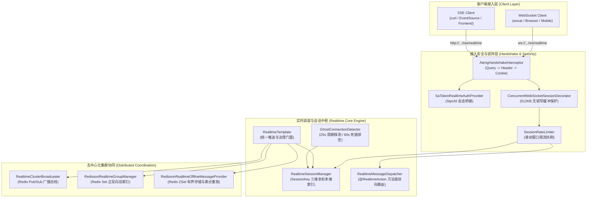

# ateng-boot-realtime 实时通信底座 Starter

> 依托 Spring 6 与 Tomcat 10 原生底层构建的零臃肿全双工与流式双模实时通信底座，统一融通全双工 WebSocket 与半双工流式 Server-Sent Events (SSE)，提供并发安全会话装饰器（彻底根除 `TEXT_PARTIAL_WRITING` 并发写崩溃与 512KB 缓冲治理）、三阶握手鉴权（Query -> Header -> Cookie）与 Sa-Token 自动桥接、声明式上行方法级双向 Request-Response 路由（`@RealtimeAction` 与业务异常转译）、正交二进制帧上行监听 SPI（`RealtimeBinaryMessageListener`）、会话级滑动窗口限流防刷与 4005 阶梯断开（`SessionRateLimiter`）、Redisson Set 分布式群组治理与广播解散通知、Redisson ZSet 有界离线消息存储与 SSE `Last-Event-ID` 断点重放、统一推送门面（`RealtimeTemplate`）、大模型打字机流助手（`SseStreamHelper`）、幽灵死链 60s 心跳探针排空（`GhostConnectionDetector`）、去中心化多节点集群协同与 `sourceNodeId` 防反射风暴总线、Sa-Token 封禁事件联动实时切断、Spring `SmartLifecycle` 四阶优雅停机排空以及 RFC 6455 生产扩展状态码契约。

---

## 0. 特性与公共 API 全景速查矩阵 (Feature & API Panorama Matrix)

| 特性分类 | 特性名称 | 核心门面 / 注解 / SPI | 关键配置项 (`ateng.boot.*`) | 关键 API 签名 / 核心行为 | 锚定验证源头 (*Test / Sample) |
| :--- | :--- | :--- | :--- | :--- | :--- |
| **统一推送门面** | 统一推送与会话治理门面 | `RealtimeTemplate` | `ateng.boot.realtime.enabled` | `sendToSession(sessionKey, message)` / `sendBinary(sessionKey, payload)` / `sendToUser(userId, message)` / `sendViaWebSocket(sessionKey, message)` / `sendViaSse(sessionKey, message)` / `sendToUserViaWebSocket(userId, message)` / `sendToUserViaSse(userId, message)` / `sendToGroup(groupId, message)` / `sendToTenant(tenantId, message)` / `sendToAll(message)` / `joinGroup(groupId, sessionKey/userId)` / `leaveGroup(groupId, sessionKey/userId)` / `getGroupSessions(groupId)` / `getGroupMemberCount(groupId)` / `getClusterGroupMemberCount(groupId)` / `getClusterGroupMembers(groupId)` / `dismissGroup(groupId)` / `kickoutSession(sessionKey, [status])` / `kickoutUser(userId, [status])` / `kickoutTenant(tenantId, [status])` / `isUserOnline(userId)` / `isSessionOnline(sessionKey)` / `getOnlineCount()` / `getOnlineUserCount()` / `getOnlineCountByChannel(channelType)` / `getSessionsByUser(userId)` / `getSessionsByTenant(tenantId)` / `getAllSessions()` / `getSession(sessionKey)` / `getClusterOnlineCount()` / `pullAndClearOfflineMessages(userId)` / `getOfflineMessages(userId)` / `getOfflineMessagesSince(userId, lastEventId/fromTimestamp)` / `clearOfflineMessages(userId)` / `getOfflineMessageCount(userId)` | `RealtimeTemplateTest` / `RealtimePushController` / `RealtimeControllersScenarioTest` |
| **集群分布式协同** | 多节点去中心化广播门面 | `RealtimeClusterBroadcaster`<br>`StandaloneRealtimeClusterBroadcaster`<br>`RedissonRealtimeClusterBroadcaster` | `ateng.boot.realtime.cluster-mode`<br>`ateng.boot.realtime.cluster.topic`<br>`ateng.boot.realtime.cluster.nodes-hash-key`<br>`ateng.boot.realtime.cluster.metrics-interval` | `broadcast(packet)` / `addConsumer(consumer)` / `removeConsumer(consumer)` / `getNodeId()` / `isClusterEnabled()`，依托 Redis Pub/Sub 广播并注入 `sourceNodeId` 防反射回环丢弃 | `RealtimeClusterBroadcasterTest` / `RealtimeClusterAntiReflectionTest` / `RealtimeClusterDualModeScenarioTest` |
| **集群在线度量** | 集群节点在线度量统计与聚合 | `RealtimeClusterMetricsProvider`<br>`StandaloneClusterMetricsProvider`<br>`RedissonClusterMetricsReporter` | `ateng.boot.realtime.cluster.nodes-hash-key`<br>`ateng.boot.realtime.cluster.metrics-interval` | `getClusterOnlineCount()`，单机直接统计本地连接数，集群模式通过定时受管调度任务将本地计数上报至 Redis Hash 并聚合汇总 | `RealtimeClusterMetricsTest` / `RealtimeSessionController` / `ClusterAndOfflineScenarioTest` |
| **分布式群组治理** | Redisson Set 分布式群组管理器 | `RealtimeGroupManager`<br>`RedissonRealtimeGroupManager` | `ateng.boot.realtime.cluster.group-key-prefix`<br>`ateng.boot.realtime.cluster.session-groups-key-prefix` | `joinGroup(groupId, sessionKey)` / `leaveGroup(groupId, sessionKey)` / `leaveAllGroups(sessionKey)` / `dismissGroup(groupId)` / `getClusterGroupMembers(groupId)` / `getClusterGroupMemberCount(groupId)` / `getGroupSessions(groupId)` / `getGroupMemberCount(groupId)` / `getSessionGroups(sessionKey)` / `getAllGroupIds()` / `clear()`，正反向双索引维护，解散广播通知并自动剔除 | `RealtimeGroupManagerTest` / `RealtimeGroupController` / `GroupMulticastScenarioTest` |
| **离线消息存储 SPI** | 离线暂存扩展接口与实现 | `RealtimeOfflineMessageProvider`<br>`RedissonRealtimeOfflineMessageProvider`<br>`InMemoryRealtimeOfflineMessageProvider`<br>`NoOpRealtimeOfflineMessageProvider` | `ateng.boot.realtime.offline.enabled`<br>`ateng.boot.realtime.offline.max-messages-per-user`<br>`ateng.boot.realtime.offline.ttl`<br>`ateng.boot.realtime.offline.key-prefix` | `saveOfflineMessage(userId, message)` / `pullAndClearOfflineMessages(userId)` / `getOfflineMessages(userId)` / `getOfflineMessagesSince(userId, lastEventId/fromTimestamp)` / `clearOfflineMessages(userId)` / `getOfflineMessageCount(userId)`，Redis ZSet 有界存储、时间戳 score 排序、只读断点窥探与原子 FIFO 淘汰 | `RealtimeOfflineMessageProviderTest` / `RealtimeOfflineController` / `ClusterAndOfflineScenarioTest` |
| **会话级限流防刷** | 会话自适应滑动窗口限流器 | `SessionRateLimiter`<br>`RateLimitDecision` | `ateng.boot.realtime.websocket.rate-limit.enabled`<br>`ateng.boot.realtime.websocket.rate-limit.max-requests-per-second`<br>`ateng.boot.realtime.websocket.rate-limit.consecutive-violations-before-close` | `tryAcquire()`，滑动窗口精确限流，心跳 Ping 静默放行，超限下发 429 警告帧，连续恶意刷量以 4005 (RATE_LIMIT_EXCEEDED) 阶梯断开 | `SessionRateLimiterTest` / `AtengWebSocketHandlerTest` / `WebSocketActionScenarioTest` |
| **声明式双向路由** | 客户端上行事件动作标记 | `@RealtimeAction` | - | `@RealtimeAction("event")`，方法级注解声明，支持自适应注入 `RealtimeSession`、`SessionKey`、`RealtimeMessage` 及强类型业务 DTO 载荷；返回非 void/非 null 结果自动封装单播回发 `{event}:reply` 应答帧 | `RealtimeActionDispatcherTest` / `ChatActionHandler` / `WebSocketActionScenarioTest` |
| **上行路由调度引擎** | 双向通信调度与上下文贯通引擎 | `RealtimeMessageDispatcher` | - | `dispatch(session, message)`，容器启动动态扫描构建反射路由表；执行前自动绑定 MDC `traceId`、`UserContextHolder`、`TenantContextHolder`，执行后 `finally` 确定性清理；拦截 `BusinessException` 转译为 `Result.failure` 应答帧 | `RealtimeActionDispatcherTest` / `WebSocketActionScenarioTest` |
| **二进制监听 SPI** | 原生二进制帧上行消费扩展点 | `RealtimeBinaryMessageListener` | - | `onBinaryMessage(session, payload)`，直接处理 WebSocket 原始字节帧（音视频流 ASR/TTS、Protobuf、文件分片），绕过 JSON 反序列化开销，贯通四维上下文；配合 `session.sendBinary(payload)` / `RealtimeTemplate.sendBinary(sessionKey, payload)` 实现完全对称的二进制双向全双工吞吐 | `AtengWebSocketHandlerTest` / `AudioBinaryStreamListener` / `WebSocketActionScenarioTest` |
| **打字机流助手** | 专职 SSE 命令式流助手 | `SseStreamHelper` | `ateng.boot.realtime.sse.default-timeout` | `create([timeout])` / `sendChunk(emitter, chunk)` / `sendEvent(emitter, message)` / `sendEvent(emitter, event, data, [id])` / `sendKeepalive(emitter)` / `sendComment(emitter, comment)` / `complete(emitter)` / `completeWithError(emitter, throwable)` / `isClientAbortException(throwable)`，静默吞咽客户端断开防日志风暴 | `SseStreamHelperTest` / `RealtimeSseStreamController` / `SseSubscriptionScenarioTest` |
| **并发写安全装饰器** | 生产级并发安全会话装饰器 | `ConcurrentWebSocketHandlerDecorator`<br>`ConcurrentWebSocketSessionDecorator` | `ateng.boot.realtime.websocket.send-buffer-limit`<br>`ateng.boot.realtime.websocket.send-timeout` | 统一为 WebSocket 端点挂载并发写安全装饰器，提供 512KB 缓冲区与无锁高并发安全发送，彻底根除 `TEXT_PARTIAL_WRITING` 异常 | `ConcurrentWebSocketSessionDecoratorTest` |
| **死链心跳探针** | 幽灵死链排空探针 | `GhostConnectionDetector` | `ateng.boot.realtime.heartbeat.interval`<br>`ateng.boot.realtime.heartbeat.idle-timeout` | 实现 Spring `SmartLifecycle` 托管生命周期，定时周期性向 WebSocket 下发协议 Ping 帧与向 SSE 发送 `:keepalive\n\n` 注释，超时 60s 强制 Close 排空死链 | `GhostConnectionDetectorTest` |
| **三阶握手鉴权** | 统一端点握手拦截器 | `AtengHandshakeInterceptor` | `ateng.boot.realtime.auth.token-query-param-names`<br>`ateng.boot.realtime.auth.header-name`<br>`ateng.boot.realtime.auth.token-prefix`<br>`ateng.boot.realtime.auth.cookie-name`<br>`ateng.boot.realtime.auth.allow-anonymous` | 三阶自适应提取凭据 Token（URL Query -> HTTP Header -> Cookie），结合 `RealtimeAuthHandshakeProvider` SPI 认证；显式带非法 Token 强行拒绝 401 | `AtengHandshakeInterceptorTest` / `RealtimeAuthController` / `RealtimeAuthScenarioTest` |
| **Sa-Token 自动桥接** | Sa-Token 原生鉴权提供者 | `SaTokenRealtimeAuthProvider` | - | `@ConditionalOnClass(StpUtil.class)` 条件装配，根据 Token 解析 `LoginId`、`LoginDevice` 与 `LoginUser` 载荷并提取多租户标识 | `SaTokenRealtimeAuthProviderTest` / `RealtimeAuthScenarioTest` |
| **权限事件联动切断** | Sa-Token 账号封禁联动切断 | `RealtimeSaTokenListener` | - | 实现 Sa-Token `SaTokenListener` SPI，监听 `doDisable` 封禁与 `doKickout` 踢退，全集群广播 4002 (USER_KICKED_OUT) 物理切断长连接 | `RealtimeSaTokenSecurityTest` / `ClusterAndOfflineScenarioTest` |
| **优雅停机排空** | 云原生优雅停机排空处理器 | `RealtimeGracefulShutdownHandler` | `ateng.boot.realtime.shutdown.enabled`<br>`ateng.boot.realtime.shutdown.drain-timeout`<br>`ateng.boot.realtime.shutdown.quiet-period` | 实现 Spring `SmartLifecycle` (Phase=Integer.MAX_VALUE - 1000)，按序执行拒绝新连接 -> 向本地会话广播 1012 重启帧 -> 缓冲排空与确定性物理切断 | `RealtimeGracefulShutdownTest` |
| **原生应用事件** | Spring 原生生命周期事件广播 | `RealtimeSessionEventPublisher`<br>`RealtimeConnectedEvent`<br>`RealtimeDisconnectedEvent` | - | 监听会话注册与注销，向 Spring 容器广播标准应用事件，支持 `@EventListener` 跨模块解耦监听 | `RealtimeSessionEventPublisherTest` |
| **状态码契约** | RFC 6455 生产扩展关闭状态码 | `RealtimeCloseStatus` | - | 定义 `NORMAL(1000)`、`SERVICE_RESTART(1012)`、`AUTH_FAILED(4001)`、`USER_KICKED_OUT(4002)`、`MAX_CONNECTIONS_EXCEEDED(4003)`、`IDLE_TIMEOUT(4004)`、`RATE_LIMIT_EXCEEDED(4005)` 标准契约 | `RealtimeCloseStatusTest` |
| **通用消息契约** | 统一数据下发强类型载荷 | `RealtimeMessage<T>` | - | `RealtimeMessage.of(event, data)` / `RealtimeMessage.of(id, event, data)` / `RealtimeMessage.ofPersistent(event, data)`，规范化封装 `id`、`event`、`data`、`timestamp`、`traceId` 与 `tenantId` | `RealtimeMessageTest` |
| **端点三维坐标** | 用户端点会话唯一路由标识 | `SessionKey` | - | `SessionKey.of(userId, deviceType, clientId)` / `SessionKey.of(userId, clientId)` / `SessionKey.anonymous(clientId)`，实现多端多设备独立路由 | `SessionKeyTest` |

---

## 1. 模块定位与快速起步 (Positioning & Quick Start)

### 1.1 模块定位与 Maven 坐标
`ateng-boot-realtime` 是面向生产就绪的工业级实时通信基础设施模块：
- **纯原生零臃肿**：坚守纯原生标准库与 Spring 6 原生能力，坚决不引入 Netty、Socket.IO、Tio 等重型第三方全量通信引擎；
- **双模全双工/流式合一**：全双工 WebSocket 与半双工流式 SSE 深度融合，统一由受管会话中心纳管；
- **开箱即用调度门面**：通过 `RealtimeTemplate` 统一抹平单播、组播、全服广播、离线暂存与在线连接度量；
- **全链路企业级防线**：内置会话并发写保护、滑动窗口限流防刷、幽灵死链排空、优雅停机排空及 Sa-Token 权限强退切断联动。

```xml
<dependency>
    <groupId>io.github.atengk</groupId>
    <artifactId>ateng-boot-realtime</artifactId>
</dependency>
```

### 1.2 最小可用配置 (application.yml)
```yaml
ateng:
  boot:
    realtime:
      enabled: true                     # 是否启用实时通信底座自动装配
      cluster-mode: auto                # AUTO: 自动探测 Redisson 启用集群广播，缺省降级为单机内存模式
      websocket:
        enabled: true                   # 开启 WebSocket 传输引擎
        path: /ws/realtime              # 端点路径
      sse:
        enabled: true                   # 开启 SSE 传输引擎
        path: /sse/realtime             # 端点路径
```

### 1.3 极简实战体验（Happy Path）
业务组件标记 `@RealtimeAction` 处理上行请求，通过 `RealtimeTemplate` 实现秒级通知单播：

```java
// 1. 上行双向处理 (逆向提取自 ChatActionHandler.java)
@Component
public class ChatActionHandler {
    @RealtimeAction("order:query")
    public Result<Map<String, Object>> handleOrderQuery(Map<String, Object> payload) {
        String orderId = String.valueOf(payload.get("orderId"));
        return Result.success(Map.of("orderId", orderId, "status", "PAID"));
    }
}

// 2. 下行消息单播 (逆向提取自 RealtimePushController.java)
@RestController
@RequestMapping("/sample/realtime/push")
@RequiredArgsConstructor
public class RealtimePushController {
    private final RealtimeTemplate realtimeTemplate;

    @PostMapping("/user")
    public Result<Integer> sendToUser(@Valid @RequestBody PushUserMessageRequest request) {
        RealtimeMessage<String> message = RealtimeMessage.of(request.getEvent(), request.getContent());
        int count = realtimeTemplate.sendToUser(request.getUserId(), message);
        return Result.success(count);
    }
}
```

---

## 2. 核心架构与设计不变量 (Core Architecture & Design Invariants)



### 核心设计不变量：
1. **并发写安全不变量**：底层统一挂载 `ConcurrentWebSocketSessionDecorator`，内置 512KB 环形发送缓冲队列，彻底终结 Tomcat `TEXT_PARTIAL_WRITING` 崩溃；
2. **集群防反射不变量**：节点启动内存随机分配不可变 `sourceNodeId`，Redis Pub/Sub 广播通过信封封装，源节点消费时在前置卫语句阻断自身发出的包，根除死循环风暴；
3. **四维上下文贯通与零污染不变量**：上行方法分发自动绑定 MDC `traceId`、`UserContextHolder`、`TenantContextHolder`，并在 `finally` 严格执行确定性清理；
4. **内存真明文与模型解耦不变量**：传输边界入参统一使用 DTO，出参统一返回 `Result<T>`，绝不向外泄露 ORM 实体（Zero-Entity-Leakage）。

---

## 3. 全双工 WebSocket 与声明式双向交互 (Full-Duplex WebSocket)

### 3.1 并发写安全与 512KB 发送缓冲治理 (Concurrent Writing Safety & Buffer Governance)

#### 专属 YAML 配置
```yaml
ateng:
  boot:
    realtime:
      websocket:
        enabled: true                   # 启用 WebSocket 传输引擎
        path: /ws/realtime              # 端点路径
        send-buffer-limit: 512KB        # 并发安全装饰器发送缓冲队列上限（默认：512KB）
        send-timeout: 10s               # 并发安全装饰器单次写超时阈值（默认：10s）
        max-text-message-buffer-size: 64KB # 单个文本帧消息缓冲区上限（默认：64KB）
```

#### 实战业务代码 (逆向提取自 ConcurrentWebSocketHandlerDecorator.java 与 ConcurrentWebSocketSessionDecorator.java)
```java
// 框架底层自动为原生 WebSocketSession 挂载并发写安全装饰器与受控缓冲队列
ConcurrentWebSocketSessionDecorator concurrentSession = 
    new ConcurrentWebSocketSessionDecorator(session, sendTimeout, sendBufferSizeLimit);

// 业务端点或受管线程池高并发异步发送时，框架通过无锁/有界环形缓冲与 ReentrantLock 协调
// 彻底根除 Tomcat 10 底层 "TEXT_PARTIAL_WRITING" 并发写崩溃与虚拟线程 Carrier Pinning
realtimeTemplate.sendToSession(sessionKey, message);
```

#### 核心机制与生产边界
- **无锁/有界队列排空**：Tomcat 与 JSR-356 原生 WebSocket 规范严禁对同一 `Session` 进行跨线程并发 `sendMessage`，否则必报 `java.lang.IllegalStateException: The remote endpoint was in state [TEXT_PARTIAL_WRITING] which is an invalid state for called method`；
- **防内存溢出与写超时熔断**：装饰器内置 `512KB` 队列容量保护，当客户端网络阻塞积压超过阈值或写阻塞达到 `10s`（`send-timeout`）时，主动切断问题连接，防止高并发下大量慢客户端拖垮服务器内存；
- **虚拟线程防 Pinning**：临界区全面采用 `java.util.concurrent.locks.ReentrantLock` 替代原生 `synchronized` 关键字，杜绝 JDK 21+ 虚拟线程运行时 Carrier Thread Pinning 阻塞。

---

### 3.2 声明式双向 Request-Response 与异常转译 (`@RealtimeAction`)

#### 专属 YAML 配置
```yaml
ateng:
  boot:
    realtime:
      websocket:
        enabled: true                   # 启用 WebSocket 传输引擎
        path: /ws/realtime              # 端点路径
```

#### 实战业务代码 (逆向提取自 ChatActionHandler.java)
```java
package io.github.atengk.boot.sample.realtime.handler;

import io.github.atengk.boot.core.exception.BusinessException;
import io.github.atengk.boot.core.model.Result;
import io.github.atengk.boot.realtime.annotation.RealtimeAction;
import io.github.atengk.boot.realtime.model.RealtimeMessage;
import io.github.atengk.boot.realtime.session.RealtimeSession;
import lombok.RequiredArgsConstructor;
import lombok.extern.slf4j.Slf4j;
import org.springframework.stereotype.Component;

import java.io.IOException;
import java.util.Map;

@Slf4j
@Component
@RequiredArgsConstructor
public class ChatActionHandler {

    /**
     * 1. 传统单向消息回执
     */
    @RealtimeAction("chat")
    public void handleChatMessage(RealtimeSession session, RealtimeMessage<Map<String, Object>> message) throws IOException {
        log.info("[Sample] 收到客户端聊天消息: fromUser={}, data={}", session.getUserId(), message.getData());
        RealtimeMessage<String> receipt = RealtimeMessage.of("chat:ack", "Message received from " + session.getUserId());
        session.sendMessage(receipt);
    }

    /**
     * 2. 双向 Request-Response 自动应答
     * 客户端发送: {"id":"req-001","event":"order:query","data":{"orderId":"ORD-888999"}}
     * 服务端回发: {"id":"req-001","event":"order:query:reply","data":{"code":200,"data":{"status":"PAID"...}}}
     */
    @RealtimeAction("order:query")
    public Result<Map<String, Object>> handleOrderQuery(Map<String, Object> payload) {
        String orderId = payload != null ? String.valueOf(payload.get("orderId")) : "ORD-001";
        log.info("[Sample] 收到订单查询请求: orderId={}", orderId);
        return Result.success(Map.of("orderId", orderId, "status", "PAID", "amount", 199.9));
    }

    /**
     * 3. 业务受控异常自动语义化转译
     * 客户端发送: {"id":"req-002","event":"order:cancel","data":{"orderId":"ORD-888999"}}
     * 服务端回发: {"id":"req-002","event":"order:cancel:reply","data":{"code":40001,"msg":"订单已锁定不可取消"}}
     */
    @RealtimeAction("order:cancel")
    public Result<Void> handleOrderCancel(Map<String, Object> payload) {
        String orderId = payload != null ? String.valueOf(payload.get("orderId")) : "ORD-001";
        log.info("[Sample] 收到订单取消请求: orderId={}", orderId);
        throw new BusinessException(40001, "订单 [" + orderId + "] 已锁定不可取消");
    }
}
```

#### 核心机制与生产边界
- **请求 ID 继承**：方法返回非 void/非 null 结果自动封装单播回发 `{event}:reply` 应答帧，回执帧 ID 精准对齐上行 `id`，便于前端基于 Promise 机制实现类 RPC 式异步等待；
- **异常因果转译**：抛出 `BusinessException` 时，框架底层自动拦截并转译为标准 `Result.failure` 错误帧下发，物理 Socket 连接保持活跃不中断。

---

### 3.3 会话级自适应滑动窗口限流防刷与 4005 阶梯断开

#### 专属 YAML 配置
```yaml
ateng:
  boot:
    realtime:
      websocket:
        rate-limit:
          enabled: true                 # 是否开启会话级上行流量限制（默认：false）
          max-requests-per-second: 50   # 单会话每秒最大允许上行请求数（默认：50）
          consecutive-violations-before-close: 3 # 连续违规超限触发强制切断阈值（默认：3，设为 0 表示不强制断开）
```

#### 核心机制与生产边界
- **滑动窗口纳秒级判定**：`SessionRateLimiter` 维持毫秒精度滑动窗口计数，心跳 Ping 帧在前置卫语句中直接放行与即时 Pong 回执，豁免限流统计；
- **两阶段阶梯惩罚**：
  1. **第一阶段（突发超限）**：单秒请求超限时丢弃当前请求帧，向客户端下发 429 告警帧，长连接保持存活；
  2. **第二阶段（洪峰熔断）**：连续超限达到 `consecutiveViolationsBeforeClose`（默认 3 次），立即下发终结告警并以 `RealtimeCloseStatus.RATE_LIMIT_EXCEEDED (4005)` 强制切断物理连接。

---

### 3.4 原生二进制音视频流上行监听 SPI (`RealtimeBinaryMessageListener`)

#### 专属 YAML 配置
```yaml
ateng:
  boot:
    realtime:
      websocket:
        max-binary-message-buffer-size: 64KB # 底层容器单次二进制缓冲区上限（默认：64KB）
```

#### 实战业务代码 (逆向提取自 AudioBinaryStreamListener.java)
```java
package io.github.atengk.boot.sample.realtime.handler;

import io.github.atengk.boot.realtime.dispatcher.RealtimeBinaryMessageListener;
import io.github.atengk.boot.realtime.session.RealtimeSession;
import lombok.extern.slf4j.Slf4j;
import org.springframework.stereotype.Component;

@Slf4j
@Component
public class AudioBinaryStreamListener implements RealtimeBinaryMessageListener {

    @Override
    public void onBinaryMessage(RealtimeSession session, byte[] payload) {
        log.info("[Sample] 收到客户端原生二进制音频流分片: sessionKey={}, byteCount={}",
                session.getSessionKey(), payload != null ? payload.length : 0);
        // 直接交付语音识别 ASR 引擎或推入音频流队列，彻底规避 JSON 序列化损耗
    }
}
```

#### 核心机制与生产边界
- **正交双流解耦**：二进制帧处理与 JSON `@RealtimeAction` 路由正交隔离；配合 `RealtimeTemplate.sendBinary(sessionKey, payload)` 可实现全对称的纯二进制双向流式吞吐。

---

## 4. 轻量半双工 SSE 与打字机流式推流 (Server-Sent Events)

### 4.1 原生 `AtengSseController` 长连接托管与生命周期

#### 专属 YAML 配置
```yaml
ateng:
  boot:
    realtime:
      sse:
        enabled: true                   # 是否开启 SSE 传输引擎（默认：true）
        path: /sse/realtime             # SSE 端点暴露路径（默认：/sse/realtime）
        default-timeout: 30m            # SSE 默认长连接超时时间（默认：30m）
```

#### 核心机制与生产边界
- **跨通道统一受管**：GET `/sse/realtime` 端点自动由 `RealtimeSessionManager` 纳入统一会话池管理，支持通过 `RealtimeTemplate.sendViaSse` 定向单播；
- **自动保活心跳**：`GhostConnectionDetector` 定时向 SSE 会话推流 `:keepalive\n\n` 规范注释行，防止网关或反向代理（如 Nginx `proxy_read_timeout`）单方面静默切断长连接。

---

### 4.2 `SseStreamHelper` 大模型打字机流与客户端中止静默拦截

#### 实战业务代码 (逆向提取自 RealtimeSseStreamController.java)
```java
package io.github.atengk.boot.sample.realtime.controller;

import io.github.atengk.boot.realtime.sse.SseStreamHelper;
import lombok.RequiredArgsConstructor;
import lombok.extern.slf4j.Slf4j;
import org.springframework.beans.factory.ObjectProvider;
import org.springframework.http.MediaType;
import org.springframework.web.bind.annotation.*;
import org.springframework.web.servlet.mvc.method.annotation.SseEmitter;

import java.util.concurrent.CompletableFuture;
import java.util.concurrent.Executor;

@Slf4j
@RestController
@RequestMapping("/sample/realtime/sse")
@RequiredArgsConstructor
public class RealtimeSseStreamController {

    private final ObjectProvider<Executor> taskExecutorProvider;

    @GetMapping(value = "/stream-llm", produces = MediaType.TEXT_EVENT_STREAM_VALUE)
    public SseEmitter streamLlm(@RequestParam(defaultValue = "Explain realtime architecture") String prompt) {
        log.info("[Sample] 触发 LLM 打字机流式推流: prompt={}", prompt);
        SseEmitter emitter = SseStreamHelper.create(60_000L);
        Runnable task = () -> {
            try {
                String[] words = {"[Prompt: ", prompt, "] ", "Hello", " ", "World", "!", " ", "This", " ", "is", " ", "streaming."};
                for (String word : words) {
                    Thread.sleep(50);
                    // 发送分块；若客户端主动断开连接，sendChunk 内部静默拦截并立即返回 false，避免下游无谓消耗推理算力
                    boolean sent = SseStreamHelper.sendChunk(emitter, word);
                    if (!sent) {
                        log.debug("[Sample] 客户端已断开打字机推流，终止任务");
                        return;
                    }
                }
                SseStreamHelper.complete(emitter);
            } catch (InterruptedException e) {
                Thread.currentThread().interrupt();
            }
        };

        Executor executor = taskExecutorProvider.getIfAvailable();
        if (executor != null) {
            executor.execute(task);
        } else {
            CompletableFuture.runAsync(task);
        }
        return emitter;
    }
}
```

#### 核心机制与生产边界
- **客户端断开静默拦截**：当客户端关闭浏览器标签或点击“停止生成”时，Tomcat 抛出 `ClientAbortException`，`SseStreamHelper.sendChunk` 捕获后静默吞咽，不打印海量无谓异常堆栈，并即时返回 `false` 供异步线程快速退出大模型推理。

---

## 5. 分布式集群协同与群组广播治理 (Distributed Coordination)

### 5.1 去中心化 Redis Pub/Sub 广播总线与 `sourceNodeId` 防反射

#### 专属 YAML 配置
```yaml
ateng:
  boot:
    realtime:
      cluster-mode: auto                # AUTO (探测到 Redisson 自动启用), STANDALONE (强制单机), REDIS (强制集群)
      cluster:
        topic: ateng:realtime:broadcast # 跨节点广播 Redis Topic
```

#### 核心机制与生产边界
- **无主对称架构**：任意节点投递广播或跨节点单播时，直接将消息封包 `RealtimeClusterPacket` 发送至 Redis Topic，集群内所有节点对等订阅；
- **防反射环路隔离**：节点启动时分配唯一且不可变的 `sourceNodeId`，监听到广播包时对比节点标识，若等于自身发出的包则直接静默丢弃，彻底根除死循环风暴。

---

### 5.2 Redisson Set 正反向双索引群组纳管与解散通知

#### 专属 YAML 配置
```yaml
ateng:
  boot:
    realtime:
      cluster:
        group-key-prefix: ateng:realtime:cluster:group:       # 正向成员索引 Redis Set 前缀
        session-groups-key-prefix: ateng:realtime:cluster:session: # 反向群组索引 Redis Set 前缀
```

#### 实战业务代码 (逆向提取自 RealtimeGroupController.java)
```java
package io.github.atengk.boot.sample.realtime.controller;

import io.github.atengk.boot.core.model.Result;
import io.github.atengk.boot.realtime.model.RealtimeMessage;
import io.github.atengk.boot.realtime.template.RealtimeTemplate;
import io.github.atengk.boot.sample.realtime.dto.PushGroupMessageRequest;
import jakarta.validation.Valid;
import lombok.RequiredArgsConstructor;
import org.springframework.web.bind.annotation.*;

@RestController
@RequestMapping("/sample/realtime/group")
@RequiredArgsConstructor
public class RealtimeGroupController {

    private final RealtimeTemplate realtimeTemplate;

    @PostMapping("/send")
    public Result<Integer> sendToGroup(@Valid @RequestBody PushGroupMessageRequest request) {
        int count = realtimeTemplate.sendToGroup(request.getGroupId(),
                RealtimeMessage.of(request.getEvent(), request.getContent()));
        return Result.success(count);
    }

    @PostMapping("/join")
    public Result<Void> joinGroup(@RequestParam String groupId, @RequestParam String userId) {
        realtimeTemplate.joinGroup(groupId, userId);
        return Result.success();
    }

    @PostMapping("/dismiss")
    public Result<Integer> dismissGroup(@RequestParam String groupId) {
        int localEjected = realtimeTemplate.dismissGroup(groupId);
        return Result.success(localEjected);
    }
}
```

#### 核心机制与生产边界
- **正反双索引一致性**：加入群组时原子写入 `groupKeyPrefix + groupId`（成员集合）与 `sessionGroupsKeyPrefix + sessionKey`（所属群组集合）；
- **解散广播全服联动**：调用 `dismissGroup` 时，本节点原子清空 Redis Set，广播下发 `RealtimeMessage.EVENT_GROUP_DISMISSED`（`group_dismissed`）事件帧给所有群成员，并通过集群总线广播 `DISMISS_GROUP` 指令同步排空其余物理节点的内存引用。

---

### 5.3 集群在线连接度量上报与聚合

#### 专属 YAML 配置
```yaml
ateng:
  boot:
    realtime:
      cluster:
        nodes-hash-key: ateng:realtime:cluster:nodes # 节点在线度量 Redis Hash 键名
        metrics-interval: 5s            # 心跳上报周期（默认：5s）
```

#### 实战业务代码 (逆向提取自 RealtimeSessionController.java)
```java
package io.github.atengk.boot.sample.realtime.controller;

import io.github.atengk.boot.core.model.Result;
import io.github.atengk.boot.realtime.template.RealtimeTemplate;
import lombok.RequiredArgsConstructor;
import org.springframework.web.bind.annotation.*;

@RestController
@RequestMapping("/sample/realtime/session")
@RequiredArgsConstructor
public class RealtimeSessionController {

    private final RealtimeTemplate realtimeTemplate;

    @GetMapping("/metrics")
    public Result<Integer> getLocalOnlineCount() {
        return Result.success(realtimeTemplate.getOnlineCount());
    }

    @GetMapping("/cluster-metrics")
    public Result<Integer> getClusterOnlineCount() {
        return Result.success(realtimeTemplate.getClusterOnlineCount());
    }
}
```

---

## 6. 可靠消息递送与离线暂存断点续传 (Reliable Delivery & Offline)

### 6.1 统一业务推送门面 `RealtimeTemplate`

#### 实战业务代码 (逆向提取自 RealtimePushController.java)
```java
package io.github.atengk.boot.sample.realtime.controller;

import io.github.atengk.boot.core.model.Result;
import io.github.atengk.boot.realtime.model.RealtimeMessage;
import io.github.atengk.boot.realtime.template.RealtimeTemplate;
import io.github.atengk.boot.sample.realtime.dto.PushBroadcastRequest;
import io.github.atengk.boot.sample.realtime.dto.PushUserMessageRequest;
import jakarta.validation.Valid;
import lombok.RequiredArgsConstructor;
import org.springframework.web.bind.annotation.*;

@RestController
@RequestMapping("/sample/realtime/push")
@RequiredArgsConstructor
public class RealtimePushController {

    private final RealtimeTemplate realtimeTemplate;

    @PostMapping("/user")
    public Result<Integer> sendToUser(@Valid @RequestBody PushUserMessageRequest request) {
        RealtimeMessage<String> message = RealtimeMessage.of(request.getEvent(), request.getContent());
        int count = realtimeTemplate.sendToUser(request.getUserId(), message);
        return Result.success(count);
    }

    @PostMapping("/broadcast")
    public Result<Integer> broadcast(@Valid @RequestBody PushBroadcastRequest request) {
        RealtimeMessage<String> message = RealtimeMessage.of(request.getEvent(), request.getContent());
        int count = request.getTenantId() != null
                ? realtimeTemplate.sendToTenant(request.getTenantId(), message)
                : realtimeTemplate.sendToAll(message);
        return Result.success(count);
    }
}
```

---

### 6.2 Redisson ZSet 有界离线消息存储与 FIFO 淘汰

#### 专属 YAML 配置
```yaml
ateng:
  boot:
    realtime:
      offline:
        enabled: true                   # 是否开启离线消息暂存（默认：false）
        max-messages-per-user: 100      # 单用户离线消息保留上限（默认：100，超出按 FIFO 淘汰防 OOM）
        ttl: 7d                         # 离线消息保留时间（默认：7d）
        key-prefix: ateng:realtime:offline: # 离线消息 Redis ZSet 键前缀
```

#### 实战业务代码 (逆向提取自 RealtimeOfflineController.java)
```java
package io.github.atengk.boot.sample.realtime.controller;

import io.github.atengk.boot.core.model.Result;
import io.github.atengk.boot.realtime.model.RealtimeMessage;
import io.github.atengk.boot.realtime.template.RealtimeTemplate;
import io.github.atengk.boot.sample.realtime.dto.SendOfflineMessageRequest;
import jakarta.validation.Valid;
import lombok.RequiredArgsConstructor;
import org.springframework.web.bind.annotation.*;

import java.util.List;

@RestController
@RequestMapping("/sample/realtime/offline")
@RequiredArgsConstructor
public class RealtimeOfflineController {

    private final RealtimeTemplate realtimeTemplate;

    @PostMapping("/send-persistent")
    public Result<Integer> sendPersistent(@Valid @RequestBody SendOfflineMessageRequest request) {
        // 使用 RealtimeMessage.ofPersistent 标记持久化，当目标离线时自动存入离线箱
        RealtimeMessage<String> message = RealtimeMessage.ofPersistent(request.getEvent(), request.getContent());
        int sent = realtimeTemplate.sendToUser(request.getUserId(), message);
        return Result.success(sent);
    }

    @GetMapping("/messages")
    public Result<List<RealtimeMessage<?>>> getOfflineMessages(@RequestParam String userId) {
        return Result.success(realtimeTemplate.getOfflineMessages(userId));
    }

    @PostMapping("/pull")
    public Result<List<RealtimeMessage<?>>> pullOfflineMessages(@RequestParam String userId) {
        return Result.success(realtimeTemplate.pullAndClearOfflineMessages(userId));
    }
}
```

#### 核心机制与生产边界
- **Lua 脚本原子 FIFO 裁切**：使用 Redis Sorted Set 存储，score 为消息时间戳；写入时执行 Lua 脚本原子核验并剔除超出 `maxMessagesPerUser` 的陈旧消息，防止无限制堆积耗尽 Redis 内存；
- **只读窥探与多端幂等**：`getOfflineMessages` 仅只读窥探，不清除 ZSet 数据，确保用户在多个浏览器 Tab 或移动端并发重连时都能完整接收历史未读。

---

### 6.3 W3C SSE `Last-Event-ID` 只读断点续传
- SSE 客户端在连接时携带 HTTP Header `Last-Event-ID: <id>` 或 URL Query 参数 `lastEventId=<id>`；
- `AtengSseController` 识别后自动从离线提供者中增量检索该 ID 之后的所有未读消息，按序重放推流，实现弱网环境下的无感断点重放。

---

## 7. 全链路握手安全、会话生命周期与停机治理 (Security & Lifecycle)

### 7.1 三阶自适应握手鉴权与 Sa-Token 桥接

#### 专属 YAML 配置
```yaml
ateng:
  boot:
    realtime:
      auth:
        allow-anonymous: false          # 是否允许未携带凭据的匿名访客连接（默认：false）
        token-query-param-names:        # URL Query 参数凭据名称列表（按序匹配）
          - token
          - satoken
          - access_token
        header-name: Authorization      # HTTP 请求头凭据名称（默认：Authorization）
        token-prefix: "Bearer "         # HTTP 请求头凭据前缀（默认：Bearer ）
        cookie-name: satoken            # Cookie 凭据名称（默认：satoken）
```

#### 实战业务代码 (逆向提取自 RealtimeAuthController.java)
```java
package io.github.atengk.boot.sample.realtime.controller;

import cn.dev33.satoken.stp.StpUtil;
import io.github.atengk.boot.core.model.Result;
import lombok.RequiredArgsConstructor;
import org.springframework.web.bind.annotation.*;

@RestController
@RequestMapping("/sample/realtime/auth")
@RequiredArgsConstructor
public class RealtimeAuthController {

    @PostMapping("/login")
    public Result<String> login(@RequestParam String userId) {
        StpUtil.login(userId);
        return Result.success(StpUtil.getTokenValue());
    }

    @PostMapping("/kickout")
    public Result<Void> kickout(@RequestParam String userId) {
        StpUtil.kickout(userId);
        return Result.success();
    }
}
```

#### 核心机制与生产边界
- **三阶提取优先级**：握手拦截器按序探测：`URL Query 参数` $\rightarrow$ `HTTP Header (Authorization)` $\rightarrow$ `Cookie (satoken)`；
- **严格安全拦截**：若携带了 Token 但校验失败，或未携带 Token 且 `allowAnonymous=false`，拦截器直接拒绝握手，返回 HTTP 401。

---

### 7.2 Sa-Token 账号封禁 / 踢退 4002 强退切断联动
- 框架内置 `RealtimeSaTokenListener` 监听 Sa-Token 的 `doDisable`（账号封禁）与 `doKickout`（强制踢出）事件；
- 一旦触发，自动向 Redis 集群广播切断指令，全网所有物理节点同步检索并强制 Close 目标用户的物理连接，下发标准状态码 `4002 (USER_KICKED_OUT)`，前端据此展示下线提示并阻断自动重连。

---

### 7.3 幽灵死链 60s 心跳探针排空 (`GhostConnectionDetector`)

#### 专属 YAML 配置
```yaml
ateng:
  boot:
    realtime:
      heartbeat:
        interval: 25s                   # 服务端保底心跳探测间隔（默认：25s）
        idle-timeout: 60s               # 空闲超时阈值（默认：60s，超时强制排空）
```

#### 核心机制与生产边界
- **双模探测**：探针基于 Spring `SmartLifecycle` 托管生命周期，周期性向 WebSocket 下发协议 Ping 帧，向 SSE 会话下发 `:keepalive\n\n` 注释；
- **死链确定性排空**：若连接超过 `idleTimeout`（默认 60s）未发生任何上行动静，探针强制调用 `session.close(RealtimeCloseStatus.IDLE_TIMEOUT)` 释放物理句柄与内存索引。

---

### 7.4 Spring `SmartLifecycle` 四阶优雅停机排空

#### 专属 YAML 配置
```yaml
ateng:
  boot:
    realtime:
      shutdown:
        enabled: true                   # 是否启用优雅停机排空（默认：true）
        drain-timeout: 3s               # 在途缓冲冲刷等待超时阈值（默认：3s）
        quiet-period: 500ms             # 握手熔断静默期（默认：500ms）
```

#### 核心机制与生产边界
挂载至 Spring `SmartLifecycle`（Phase 为 `Integer.MAX_VALUE - 1000`，优先于 Web 容器与其他业务 Bean 销毁前执行）：
1. **阶段一（熔断新连接）**：置位内部状态 `draining = true`，拒绝后续所有新连接握手；
2. **阶段二（广播 1012 重启帧）**：向当前节点的所有活跃长连接广播下发 `RealtimeCloseStatus.SERVICE_RESTART (1012)` 关闭帧或事件，客户端收到后启动带随机抖动（Jitter）的指数退避重连其他节点；
3. **阶段三（冲刷在途缓冲）**：等待 `drainTimeout`（默认 3s）供发送队列排空；
4. **阶段四（物理切断与注销）**：注销集群广播订阅，强制物理切断残留句柄。

---

### 7.5 RFC 6455 生产扩展关闭状态码契约

| 状态码 | 常量定义 | 业务场景语义 | 客户端处理与重连建议 |
| :--- | :--- | :--- | :--- |
| **1000** | `NORMAL` | 正常自愿关闭连接 | 正常结束，无需重连 |
| **1012** | `SERVICE_RESTART` | 服务端优雅停机或应用重启 | **必须重连**：使用带随机抖动（Jitter）的指数退避重连，严防瞬间雪崩 |
| **4001** | `AUTH_FAILED` | Token 过期、无效或鉴权失败 | **严禁自动重连**：应引导用户重新登录或刷新 Token 凭据 |
| **4002** | `USER_KICKED_OUT` | 用户被管理员封禁或踢出下线 | **严禁自动重连**：弹出被踢提示并注销本地会话 |
| **4003** | `MAX_CONNECTIONS_EXCEEDED` | 单用户并发连接数超过配额上限 | **严禁重连**：提示用户关闭其他多余标签页或设备 |
| **4004** | `IDLE_TIMEOUT` | 连接假死或心跳无动静超过 60s 超时 | **允许重连**：延迟数秒后重新发起握手 |
| **4005** | `RATE_LIMIT_EXCEEDED` | 会话持续恶意高频上行刷量超限熔断 | **延迟重连**：提示用户操作过于频繁，冷却后重连 |

---

## 8. 生产扩展接管与高阶定制 (Customization & SPI Panorama)

### 8.1 自定义握手鉴权提供者 SPI (`RealtimeAuthHandshakeProvider`)
当默认的 Sa-Token 鉴权无法满足需求时（如私有 JWT、双向 mTLS 证书），声明实现即可无缝接管：
```java
@Component
public class CustomRealtimeAuthProvider implements RealtimeAuthHandshakeProvider {

    @Override
    public RealtimeAuthPayload authenticate(String token, Map<String, Object> attributes) {
        if (!"valid-secret-token".equals(token)) {
            return null; // 返回 null 立即触发 401 握手拒绝
        }
        return RealtimeAuthPayload.builder()
                .userId("user-custom-007")
                .deviceType("WEB")
                .tenantId(1001L)
                .build();
    }
}
```

### 8.2 自定义离线消息暂存 SPI (`RealtimeOfflineMessageProvider`)
当需将离线消息落入关系型数据库或审计日志时，声明自定义 Bean 即可接管默认的 Redisson 存储：
```java
@Component
public class CustomDatabaseOfflineMessageProvider implements RealtimeOfflineMessageProvider {

    @Override
    public void saveOfflineMessage(Object userId, RealtimeMessage<?> message) {
        // 落入数据库离线表
    }

    @Override
    public List<RealtimeMessage<?>> pullAndClearOfflineMessages(Object userId) {
        // 从数据库拉取未读消息并标记为已排空
        return Collections.emptyList();
    }

    @Override
    public List<RealtimeMessage<?>> getOfflineMessages(Object userId) {
        return Collections.emptyList();
    }

    @Override
    public List<RealtimeMessage<?>> getOfflineMessagesSince(Object userId, String lastEventId) {
        return Collections.emptyList();
    }

    @Override
    public List<RealtimeMessage<?>> getOfflineMessagesSince(Object userId, long fromTimestamp) {
        return Collections.emptyList();
    }

    @Override
    public void clearOfflineMessages(Object userId) {}

    @Override
    public int getOfflineMessageCount(Object userId) {
        return 0;
    }
}
```

### 8.3 监听 Spring 原生连接生命周期事件
```java
@Component
@Slf4j
public class RealtimeAuditEventListener {

    @EventListener
    public void onConnected(RealtimeConnectedEvent event) {
        log.info("[Audit] 客户端上线: sessionKey={}, channel={}, remoteAddress={}",
                event.getSessionKey(), event.getChannelType(), event.getRemoteAddress());
    }

    @EventListener
    public void onDisconnected(RealtimeDisconnectedEvent event) {
        log.info("[Audit] 客户端离线: sessionKey={}, channel={}, closeStatus={}",
                event.getSessionKey(), event.getChannelType(), event.getCloseStatus());
    }
}
```

---

## 9. 完整 YAML 配置属性清单 (Configuration Properties Appendix)

| 配置属性路径 | 类型 | 默认值 | 详细说明 | 对应能力章节 |
| :--- | :--- | :--- | :--- | :--- |
| `ateng.boot.realtime.enabled` | `boolean` | `true` | 是否启用实时通信底座自动装配 | 第 1 章 |
| `ateng.boot.realtime.cluster-mode` | `ClusterMode` | `AUTO` | 集群模式：`AUTO` (探测到 Redisson 自动启用), `STANDALONE` (单机), `REDIS` (强制集群) | 第 5 章 |
| `ateng.boot.realtime.cluster.topic` | `String` | `ateng:realtime:broadcast` | 集群跨节点广播 Redis Topic 名称 | 第 5.1 节 |
| `ateng.boot.realtime.cluster.nodes-hash-key` | `String` | `ateng:realtime:cluster:nodes` | 集群在线节点度量上报 Redis Hash 键名 | 第 5.3 节 |
| `ateng.boot.realtime.cluster.group-key-prefix` | `String` | `ateng:realtime:cluster:group:` | 集群分布式群组正向成员索引 Redis Set 键前缀 | 第 5.2 节 |
| `ateng.boot.realtime.cluster.session-groups-key-prefix` | `String` | `ateng:realtime:cluster:session:` | 集群分布式群组反向所属索引 Redis Set 键前缀 | 第 5.2 节 |
| `ateng.boot.realtime.cluster.metrics-interval` | `Duration` | `5s` | 集群节点度量上报心跳周期 | 第 5.3 节 |
| `ateng.boot.realtime.websocket.enabled` | `boolean` | `true` | 是否开启 WebSocket 传输引擎 | 第 3.1 节 |
| `ateng.boot.realtime.websocket.path` | `String` | `/ws/realtime` | WebSocket 统一端点接入路径 | 第 3.1 节 |
| `ateng.boot.realtime.websocket.max-text-message-buffer-size` | `DataSize` | `64KB` | 底层容器单次文本消息缓冲区上限 | 第 3.1 节 |
| `ateng.boot.realtime.websocket.max-binary-message-buffer-size` | `DataSize` | `64KB` | 底层容器单次二进制消息缓冲区上限 | 第 3.3 节 |
| `ateng.boot.realtime.websocket.async-send-timeout` | `Duration` | `10s` | 底层容器异步发送超时阈值 | 第 3.1 节 |
| `ateng.boot.realtime.websocket.send-buffer-limit` | `DataSize` | `512KB` | 并发安全装饰器发送缓冲队列上限 | 第 3.1 节 |
| `ateng.boot.realtime.websocket.send-timeout` | `Duration` | `10s` | 并发安全装饰器单次写超时阈值 | 第 3.1 节 |
| `ateng.boot.realtime.websocket.rate-limit.enabled` | `boolean` | `false` | 是否开启会话级上行流量限制 | 第 3.2 节 |
| `ateng.boot.realtime.websocket.rate-limit.max-requests-per-second` | `int` | `50` | 单会话每秒最大允许上行请求数 | 第 3.2 节 |
| `ateng.boot.realtime.websocket.rate-limit.consecutive-violations-before-close` | `int` | `3` | 连续超限触发强制断开长连接的违规次数阈值（0 表示不强制断开） | 第 3.2 节 |
| `ateng.boot.realtime.cors.allowed-origins` | `List<String>` | `["*"]` | 允许跨域握手来源列表 | 第 1.2 节 |
| `ateng.boot.realtime.sse.enabled` | `boolean` | `true` | 是否开启 SSE 传输引擎 | 第 4.1 节 |
| `ateng.boot.realtime.sse.path` | `String` | `/sse/realtime` | SSE 统一长连接端点路径 | 第 4.1 节 |
| `ateng.boot.realtime.sse.default-timeout` | `Duration` | `30m` | SSE 默认长连接超时时间 | 第 4.1 节 |
| `ateng.boot.realtime.session.max-connections-per-user` | `int` | `10` | 单用户最大并发连接数配额（0 表示不限制） | 第 7.5 节 |
| `ateng.boot.realtime.session.eviction-policy` | `EvictionPolicy` | `FIFO` | 连接数超过配额时的驱逐策略 (`FIFO` / `REJECT`) | 第 7.5 节 |
| `ateng.boot.realtime.heartbeat.interval` | `Duration` | `25s` | 服务端保底心跳探测间隔 | 第 7.3 节 |
| `ateng.boot.realtime.heartbeat.idle-timeout` | `Duration` | `60s` | 连接无动静的空闲超时阈值，超时主动排空 | 第 7.3 节 |
| `ateng.boot.realtime.auth.allow-anonymous` | `boolean` | `false` | 是否允许未携带凭据的匿名访客连接 | 第 7.1 节 |
| `ateng.boot.realtime.auth.token-query-param-names` | `List<String>` | `["token", "satoken", "access_token"]` | Query URL 参数中凭据提取参数名列表 | 第 7.1 节 |
| `ateng.boot.realtime.auth.header-name` | `String` | `Authorization` | HTTP 请求头凭据名称 | 第 7.1 节 |
| `ateng.boot.realtime.auth.token-prefix` | `String` | `Bearer ` | HTTP 请求头凭据前缀 | 第 7.1 节 |
| `ateng.boot.realtime.auth.cookie-name` | `String` | `satoken` | Cookie 凭据名称 | 第 7.1 节 |
| `ateng.boot.realtime.offline.enabled` | `boolean` | `false` | 是否启用离线消息暂存 | 第 6.2 节 |
| `ateng.boot.realtime.offline.max-messages-per-user` | `int` | `100` | 单用户离线消息最大保留条数（超出按 FIFO 淘汰防 OOM） | 第 6.2 节 |
| `ateng.boot.realtime.offline.ttl` | `Duration` | `7d` | 离线消息保留时间 | 第 6.2 节 |
| `ateng.boot.realtime.offline.key-prefix` | `String` | `ateng:realtime:offline:` | 离线消息 Redis ZSet 键前缀 | 第 6.2 节 |
| `ateng.boot.realtime.shutdown.enabled` | `boolean` | `true` | 是否启用实时底座优雅停机排空机制 | 第 7.4 节 |
| `ateng.boot.realtime.shutdown.drain-timeout` | `Duration` | `3s` | 停机缓冲排空等待超时阈值 | 第 7.4 节 |
| `ateng.boot.realtime.shutdown.quiet-period` | `Duration` | `500ms` | 握手熔断静默期 | 第 7.4 节 |
