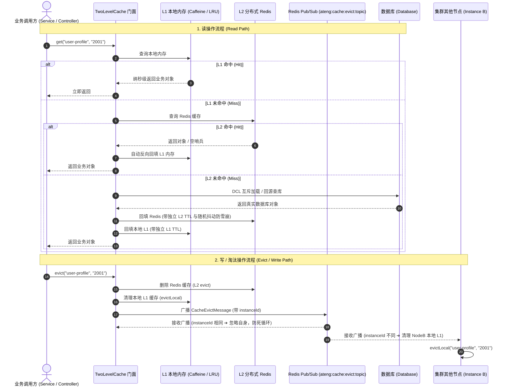

# ateng-boot-redis 分布式协同与缓存增强套件

> 提供 Spring Data Redis (Lettuce) 与 Redisson 双核融合底座、无 `@class` 污染纯净安全 JSON 序列化、全能 `RedisUtil` 操作门面、声明式四阶分布式锁、双模轻量延时队列、Pub/Sub 广播引擎、业务并发流控、原子流水号发号与带随机抖动防雪崩的工业级 `RedisCacheManager`。

---

## 0. 特性与公共 API 全景速查矩阵

| 特性分类 | 特性名称 | 核心门面 / 注解 / SPI | 关键配置项 (`ateng.boot.*`) | 关键 API 签名 / 核心行为 | 锚定验证源头 (*Test / Sample) |
| :--- | :--- | :--- | :--- | :--- | :--- |
| **基础运维** | 自动装配与主配置 | `RedisProperties` / `AtengRedisAutoConfiguration` | `ateng.boot.redis.enabled`<br>`ateng.boot.redis.key-prefix` | 统管双核装配开关与全局统一 Key 命名前缀隔离 | `AtengRedisAutoConfigurationTest` |
| **数据操作** | 全能操作门面 | `RedisUtil` | `ateng.boot.redis.key-prefix` | `hasKey(key)` / `expire(key, duration)` / `scanKeys(pattern, count)` / `get(key, clazz)` / `set(key, val, duration)` / `hScan` / `executePipelined` | `RedisUtilTest`<br>`SampleRedisIntegrationTest` |
| **分布式锁** | 声明式分布式锁 | `@DistributedLock` / `DistributedLockAspect` | `ateng.boot.redis.lock.enabled`<br>`ateng.boot.redis.lock.prefix`<br>`ateng.boot.redis.lock.wait-time`<br>`ateng.boot.redis.lock.lease-time`<br>`ateng.boot.redis.lock.slow-threshold` | `@DistributedLock(key, keys, mode, waitTime, leaseTime, timeUnit, message)`：支持 SpEL、四阶锁模式、看门狗自动续期、防误删释放与慢锁审计 | `DistributedLockAspectTest`<br>`SampleRedisIntegrationTest` |
| **分布式锁** | 编程式锁受管模板 | `DistributedLockTemplate` | `ateng.boot.redis.lock.wait-time`<br>`ateng.boot.redis.lock.lease-time`<br>`ateng.boot.redis.lock.slow-threshold` | `execute(key, supplier)` / `execute(keys, mode, wait, lease, unit, supplier, fallback)` / `tryExecute(key, action)`：闭包内业务异常无损透传 | `DistributedLockTemplateTest`<br>`SampleRedisIntegrationTest` |
| **分布式锁** | 静态锁操作门面 | `RedisLockUtil` | `ateng.boot.redis.lock.*` | `RedisLockUtil.execute(key, supplier)` / `RedisLockUtil.tryExecute(key, action)`：静态上下文无需注入 Spring Bean 一键安全加锁 | `RedisLockUtilTest`<br>`SampleRedisIntegrationTest` |
| **分布式锁** | 锁模式枚举与闭包 | `LockMode` / `LockSupplier<T, E>` / `LockAction<E>` | - | `REENTRANT`, `FAIR`, `READ`, `WRITE`；支持受检与非受检异常穿透声明 | `DistributedLockTemplateTest`<br>`SampleRedisIntegrationTest` |
| **延时队列** | 编程式延时任务 | `RedisDelayedQueue` | `ateng.boot.redis.delay-queue.enabled`<br>`ateng.boot.redis.delay-queue.dead-letter-enabled`<br>`ateng.boot.redis.delay-queue.dead-letter-suffix` | `offer(queue, msg, delay)` / `poll(queue, clazz)` / `take(queue, clazz)` / `remove(queue, msg)` / `destroy()`<br>DLQ 运维：`peekDeadLetter` / `pollDeadLetter` / `getDeadLetterSize` / `clearDeadLetter` / `sendToDeadLetter` | `RedisDelayedQueueTest`<br>`SampleRedisIntegrationTest` |
| **延时队列** | 声明式消费监听 | `@DelayedQueueListener` / `DelayedQueueBootstrap` | `ateng.boot.redis.delay-queue.retry-times`<br>`ateng.boot.redis.delay-queue.retry-delay` | `@DelayedQueueListener(queue, concurrency)`：受管 `ThreadPoolTaskExecutor` 并发驱动、`ContextCopyingTaskDecorator` 上下文透传、指数/固定退避重试与平滑优雅停机 | `DelayedQueueBootstrapTest`<br>`SampleRedisIntegrationTest` |
| **延时队列** | 死信流转与失败 SPI | `DeadLetterMessage<T>` / `DelayedQueueFailureHandler` | `ateng.boot.redis.delay-queue.dead-letter-enabled`<br>`ateng.boot.redis.delay-queue.dead-letter-suffix` | `onFailed(deadLetterMessage, cause)`：重试耗尽后封装完整因果堆栈转入死信队列，默认 `LoggingDelayedQueueFailureHandler` 告警，支持自定义 SPI 无缝接管 | `DelayedQueueBootstrapTest`<br>`AtengRedisAutoConfigurationTest` |
| **广播订阅** | 主题广播发布者 | `RedisMessagePublisher` | `ateng.boot.redis.pub-sub.enabled` | `publish(channel, message)` / `subscribe(listener, channel)` / `unsubscribe(listener, channel)`：跨节点广播通知与动态订阅 | `RedisMessagePublisherTest` |
| **广播订阅** | 声明式频道监听 | `@ChannelTopicListener` / `ChannelTopicBootstrap` | `ateng.boot.redis.pub-sub.enabled` | `@ChannelTopicListener(topics, patterns, concurrency)`：支持 `${...}` 占位符、精确主题与通配模式，支持单参 POJO/String/byte[]/Message、双参及三参多态安全反序列化，受管 `ThreadPoolTaskExecutor` 并发驱动与 MDC `traceId` 透传 | `ChannelTopicBootstrapTest`<br>`SampleRedisIntegrationTest` |
| **布隆过滤** | 分布式布隆过滤器 | `RedisBloomFilter` | `ateng.boot.redis.key-prefix`<br>`ateng.boot.redis.bloom-filters.<name>.expected-insertions`<br>`ateng.boot.redis.bloom-filters.<name>.false-probability` | `tryInit(name, expected, prob)` / `add(name, val)` / `addAll(name, coll)` / `contains(name, val)` / `containsAll(name, coll)` / `count(name)` / `getUsageRate(name)` / `isOverCapacity(name, threshold)` / `delete(name)`：支持静态与 Bean 双重操作范式、80% 容量安全预警与全局 KeyPrefix 隔离 | `RedisBloomFilterTest`<br>`SampleRedisIntegrationTest` |
| **布隆过滤** | 声明式自动预热调度器 | `BloomFilterBootstrap` | `ateng.boot.redis.bloom-filters.*` | 容器就绪后自动遍历 YAML 中声明的规则，原子幂等调用 `tryInit` 完成预热 | `RedisBloomFilterTest`<br>`AtengRedisAutoConfigurationTest` |
| **原子发号** | 结构化发号与自增 | `RedisAtomicUtil` | `ateng.boot.redis.key-prefix` | `generateDailySeq(bizPrefix, length)`：跨天自重置且带 48h TTL 防泄露流水号；`incrWithExpire(key, delta, duration)` | `RedisAtomicUtilTest`<br>`SampleRedisIntegrationTest` |
| **并发流控** | 滑动窗口严格限流 | `RedisAtomicUtil` | - | `isAllowedBySlidingWindow(key, maxLimit, window)`：基于 ZSet 毫秒级时间戳实现精准滑动窗口防突刺 | `RedisAtomicUtilTest`<br>`SampleRedisIntegrationTest` |
| **并发流控** | 分布式令牌桶流控 | `RedisRateLimiterClient` | - | `tryAcquire(key, rate, interval)` / `tryAcquire(key, rate, interval, permits, timeout)` / `acquire` / `delete`：基于 Redisson 令牌桶平滑流控 | `RedisRateLimiterClientTest`<br>`SampleRedisIntegrationTest` |
| **缓存增强** | 多级 TTL 缓存管理 | `RedisCacheManager` / `AtengRedisAutoConfiguration` | `ateng.boot.redis.cache.enabled`<br>`ateng.boot.redis.cache.default-ttl`<br>`ateng.boot.redis.cache.expires` | 个性化为不同 `@Cacheable(value = "...")` 声明独立 TTL；支持空值防穿透 | `AtengRedisAutoConfigurationTest` |
| **缓存防卫** | 统一缓存执行模板 | `RedisCacheTemplate` | `ateng.boot.redis.cache.enabled`<br>`ateng.boot.redis.cache.default-ttl`<br>`ateng.boot.redis.cache.null-ttl`<br>`ateng.boot.redis.cache.max-jitter`<br>`ateng.boot.redis.cache.jitter-enabled`<br>`ateng.boot.redis.cache.cache-null-values`<br>`ateng.boot.redis.cache.lock-wait-time` | `getOrLoad(key, clazz, loader)` / `getOrLoad(key, typeRef, loader)`：单键 DCL + 互斥锁防击穿 + 短 TTL 空哨兵防穿透 + 随机抖动防雪崩 + 争锁超时降级<br>`batchGetOrLoad(keys, mapper, clazz/typeRef, batchLoader)`：批量 MGET 探测 + 字典序排序锁去重 + 降级自愈回填 + Pipeline 回写彻底杜绝 N+1<br>`get` / `put` / `evict` / `batchEvict` / `hasKey`：对称运维门面（空哨兵语义自洽） | `RedisCacheTemplateTest`<br>`SampleRedisIntegrationTest` |
| **两级缓存** | 两级缓存核心门面 | `TwoLevelCache` / `DefaultTwoLevelCache` | `ateng.boot.redis.two-level.*`<br>`ateng.boot.redis.key-prefix` | `getName()` / `get(key)` / `get(key, clazz)` / `get(key, loader)` / `put(key, val, ttl)` / `putIfAbsent` / `evict(key)` / `evictLocal(key)` / `clear()` / `clearLocal()`：纳秒级 L1 本地命中、分布式 L2 兜底、空哨兵防穿透与游标安全 scan 清理 | `TwoLevelCacheTest`<br>`SampleRedisIntegrationTest` |
| **两级缓存** | Spring Cache 适配器 | `TwoLevelCacheManager` | `ateng.boot.redis.two-level.enabled`<br>`ateng.boot.redis.two-level.topic`<br>`ateng.boot.redis.two-level.l1.*`<br>`ateng.boot.redis.two-level.l2.*` | `@Cacheable` / `@CacheEvict` 无缝注解驱动、动态按需创建缓存空间、`instanceId` 唯一标识防环、`ateng:cache:evict:topic` 跨节点集中广播协同失效 | `TwoLevelCacheManagerTest`<br>`SampleRedisIntegrationTest` |
| **两级缓存** | L1 内存缓存与退化工厂 | `L1MemoryCacheFactory` / `L1MemoryCache` / `ConcurrentLruMemoryCache` | `ateng.boot.redis.two-level.l1.default-max-size`<br>`ateng.boot.redis.two-level.l1.default-ttl` | 自动探测 Caffeine，存在时启用 W-TinyLFU 高性能缓存，缺失时自动退化为内置 LRU 内存结构并受 `default-max-size` 严格限制防 OOM | `ConcurrentLruMemoryCacheTest`<br>`L1MemoryCacheFactoryTest` |
| **两级缓存** | 跨节点广播失效载荷 | `CacheEvictMessage` | `ateng.boot.redis.two-level.topic` | `cacheName` / `key` / `instanceId` / `clearAll`：跨实例失效广播数据契约 | `TwoLevelCacheTest`<br>`TwoLevelCacheManagerTest` |
| **缓存增强** | 随机抖动防雪崩 | `JitterTtlFunction` | `ateng.boot.redis.cache.jitter-enabled`<br>`ateng.boot.redis.cache.max-jitter` | 实现 `RedisCacheWriter.TtlFunction`，在基准 TTL 上叠加 0 ~ `maxJitter` 动态偏移量打散失效时刻 | `JitterTtlFunctionTest`<br>`AtengRedisAutoConfigurationTest` |
| **序列化** | 纯净安全序列化工厂 | `RedisSerializerFactory` | - | `createSafeObjectMapper()` / `jsonSerializer(clazz)` / `stringSerializer()`：无 `@class` 多态 RCE 漏洞，内置 JSR-310 与 Long 精度保护 | `RedisSerializerFactoryTest` |

---

## 1. 模块定位与 Maven 坐标

`ateng-boot-redis` 坚持双核融合架构，摒弃“Spring Data Redis 与 Redisson 二选一”的传统割裂思维，同时规避了官方 `redisson-spring-boot-starter` 强行覆盖官方 `RedisConnectionFactory` 带来的隐式冲突与序列化漂移。

```xml
<dependency>
    <groupId>io.github.atengk</groupId>
    <artifactId>ateng-boot-redis</artifactId>
</dependency>
```

---

## 2. 双核架构与安全序列化不变量

### 场景痛点
默认 Spring Data Redis 序列化方案要么使用 JDK 原生二进制（无法跨语言排查、性能低下），要么使用 GenericJackson2JsonRedisSerializer / DefaultTyping 自动写入 `@class` 类全限定名属性，极易引发严重的多态反序列化 RCE 安全漏洞，且在重构类路径时导致历史缓存全部反序列化崩溃。

### 双核架构拓扑
```
┌────────────────────────────────────────────────────────────────────────┐
│                          业务应用与 Controller / Service 层             │
└────────────────────────────────────┬───────────────────────────────────┘
                                     │
           ┌─────────────────────────┴─────────────────────────┐
           ▼                                                   ▼
┌──────────────────────┐                           ┌──────────────────────┐
│  Spring Data Redis   │                           │       Redisson       │
│  (Lettuce 高性能驱动) │                           │   (原生分布式协调内核) │
├──────────────────────┤                           ├──────────────────────┤
│ • RedisTemplate      │                           │ • RedissonClient     │
│ • RedisUtil (全能门面)│                           │ • @DistributedLock  │
│ • RedisAtomicUtil    │                           │ • RedisDelayedQueue  │
│ • RedisCacheManager  │                           │ • RRateLimiter 流控  │
└──────────┬───────────┘                           └──────────┬───────────┘
           │                                                   │
           └─────────────────────────┬─────────────────────────┘
                                     ▼
                ┌────────────────────────────────────────┐
                │ 统一纯净安全 JSON 序列化器                │
                │ (零 @class 污染 / JSR-310 / Long精度保护)│
                └────────────────────────────────────────┘
```

### 统一序列化规范
- **Key 序列化**：统一采用 `StringRedisSerializer`，保证所有键名在 Redis 控制台原生可读；
- **Value 序列化**：统一采用无 `@class` 污染的纯净 `Jackson2JsonRedisSerializer`，集成 Java 8 日期模块（JSR-310，默认格式 `yyyy-MM-dd HH:mm:ss`）、统一东八区时区，并将超出 JavaScript 安全整数范围的 Long/BigInteger 序列化为 String 防前端精度丢失。

---

## 3. 全能 RedisUtil 操作门面与安全游标扫描

### 场景痛点
生产环境严禁直接调用 `KEYS *`、`HKEYS` 或 `SMEMBERS`，当集合包含百万级大 Key 时会导致单线程 Redis 发生秒级阻塞停机。`RedisUtil` 彻底封装了游标分批扫描算法，对外暴露安全流式 API。

### 核心代码示例
```java
@Service
public class ProductCacheService {

    @Autowired
    private RedisUtil redisUtil;

    public void demoOperations() {
        // 1. 基础 String 操作与过期时间
        redisUtil.set("product:1001", new ProductVO(1001L, "手机"), Duration.ofMinutes(30));
        ProductVO product = redisUtil.get("product:1001", ProductVO.class);

        // 2. Hash 结构与安全游标迭代
        redisUtil.hSet("cart:user:888", "item:1001", 2);
        redisUtil.hScan("cart:user:888", "*", 100, entry -> {
            log.info("商品: {}, 数量: {}", entry.getKey(), entry.getValue());
        });

        // 3. 安全扫描指定前缀的 Key（底层 SCAN 游标分批拉取，杜绝阻塞 Redis）
        Set<String> matchedKeys = redisUtil.scanKeys("order:20261016:*", 500);

        // 4. 高效管道流水线批量执行 (Pipeline)
        List<Object> results = redisUtil.executePipelined(connection -> {
            for (int i = 0; i < 100; i++) {
                connection.stringCommands().incr(("counter:" + i).getBytes());
            }
        });
    }
}
```

### 预期控制台与 Redis 存储呈现
```text
2026-10-19 16:11:55.158 INFO  [main] [ea52411c7e479cd39e04bbf3f0f9317e] i.g.a.b.s.r.service.RedisSampleService   : RedisUtil 游标模糊扫描完成: pattern=sample:user:*, count=50, matchedSize=2
```

```json
// Redis 中实际存储的 Value（无 @class 冗余字段）:
{
  "id": "1001",
  "name": "手机",
  "createTime": "2026-10-16 18:00:00"
}
```

---

## 4. 双模一体化分布式锁 (`@DistributedLock` & `RedisLockUtil` & `DistributedLockTemplate`)

### 场景痛点
手动调用分布式锁容易发生死锁、异常时未在 `finally` 块释放、锁重入计数紊乱、锁超时后误删其他线程持有的锁，以及并发大事务锁持有时间过长拖垮数据库。此外，注解加锁强制要求抽取独立 Spring Bean 方法，对于类内部小代码块、定时任务、异步多线程或静态工具类场景，直接调用原生 Redisson 极易写错 `try-finally` 造成锁泄露，且缺乏全局锁前缀隔离与慢锁可观测审计。

### 特性矩阵
- **双模同构内核**：声明式切面与编程式门面均全量委托 `DistributedLockTemplate`，保证锁前缀拼接、看门狗自动续期、安全持锁释放与慢锁审计 100% 规则自洽；
- **极简静态门面 (`RedisLockUtil`)**：无需注入 Spring Bean，在任意上下文一行代码安全执行闭包加锁；
- **无损异常穿透**：定制 `LockSupplier<T>` 与 `LockAction` 声明 `throws Throwable`，闭包内自由抛出业务异常，模板安全释放锁后原样透传，杜绝多余的 `try-catch` 包装；
- **弹性容灾机制**：支持争锁超时降级闭包 `fallback` 以及默认 0 等待即时非阻塞试探 `tryExecute`（支持自定义等待时长）；
- **四阶锁模式与多键联锁**：支持可重入锁 (`REENTRANT`)、公平锁 (`FAIR`)、共享读锁 (`READ`)、排他写锁 (`WRITE`) 以及跨资源原子联锁 (`MultiLock`，自动键去重)；
- **智能租期守护**：缺省 `leaseTime = -1` 自动启用 Redisson 看门狗 (Watchdog) 30s 自动续期（长事务生产推荐）；指定具体租期则强制超时熔断防死锁（注意：显式指定具体租期将禁用看门狗自动延期）；
- **慢锁告警网关**：锁持有耗时超过阈值（默认 3 秒）自动输出 WARN 级别慢锁审计日志。

### 核心代码示例

#### 范式 A：声明式注解加锁 (`@DistributedLock`)
```java
@Service
public class OrderLockService {

    /**
     * 下单扣减库存：排他可重入锁，等待 3 秒，最长持有 10 秒
     */
    @DistributedLock(
            key = "'order:create:' + #userId + ':' + #productId",
            mode = LockMode.REENTRANT,
            waitTime = 3,
            leaseTime = 10,
            timeUnit = TimeUnit.SECONDS,
            message = "当前排队人数较多，请稍后重试"
    )
    public String createOrder(Long userId, Long productId) {
        // 业务逻辑执行...
        return "SUCCESS";
    }

    /**
     * 数据读取：共享读锁，高并发读不互斥
     */
    @DistributedLock(key = "'doc:' + #docId", mode = LockMode.READ)
    public DocumentVO readDocument(Long docId) {
        return loadDoc(docId);
    }
}
```

#### 范式 B：编程式模板与静态门面加锁 (`RedisLockUtil`)
```java
@Service
public class OrderPaymentService {

    /**
     * 1. 最简调用：默认排他锁 + 看门狗自动续期 + 争锁超时快速熔断 BusinessException(429)
     */
    public void processPayment(String orderId) {
        RedisLockUtil.execute("order:pay:" + orderId, () -> {
            updatePayStatus(orderId);
        });
    }

    /**
     * 2. 带返回值与异常无损穿透：
     */
    public String deductStock(String skuId, int count) {
        return RedisLockUtil.execute("stock:" + skuId, () -> {
            return stockService.doDeduct(skuId, count);
        });
    }

    /**
     * 3. 弹性降级回调（争锁超时不抛异常，返回兜底内容）：
     */
    public String snatchCoupon(String couponId, Long userId) {
        return RedisLockUtil.execute("coupon:" + couponId,
                () -> couponService.doSnatch(couponId, userId),
                () -> "活动太火爆了，优惠券已被抢光或请稍后重试"
        );
    }

    /**
     * 4. 布尔试探模式（定时任务或幂等分发试跑）：
     */
    public void runJob() {
        boolean executed = RedisLockUtil.tryExecute("job:sync_daily", () -> {
            doSyncData();
        });
        if (!executed) {
            log.info("已有其他节点在执行同步任务，本次跳过");
        }
    }
}
```

### 预期日志呈现
```text
// 1. 标准加锁与持锁审计：
2026-10-19 16:11:55.029 DEBUG [main] [NO-TRACE] i.g.a.b.r.l.t.DistributedLockTemplate    : [DistributedLock] 加锁成功: keys=[lock:order:ORD_9999], mode=REENTRANT
2026-10-19 16:11:55.031 INFO  [main] [NO-TRACE] i.g.a.b.s.r.service.RedisSampleService   : 获得分布式锁，开始处理订单业务: orderId=ORD_9999
2026-10-19 16:11:55.032 DEBUG [main] [NO-TRACE] i.g.a.b.r.l.t.DistributedLockTemplate    : [DistributedLock] 释放分布式锁成功: keys=[lock:order:ORD_9999]

// 2. 看门狗自动续期长事务执行（leaseTime = -1）：
2026-10-19 16:11:54.319 DEBUG [main] [NO-TRACE] i.g.a.b.r.l.t.DistributedLockTemplate    : [DistributedLock] 加锁成功: keys=[lock:watchdog:TASK_LONG_RUNNING], mode=REENTRANT
2026-10-19 16:11:54.321 INFO  [main] [NO-TRACE] i.g.a.b.s.r.service.RedisSampleService   : 激活 Redisson 看门狗持锁执行长事务: taskId=TASK_LONG_RUNNING
2026-10-19 16:11:54.321 DEBUG [main] [NO-TRACE] i.g.a.b.r.l.t.DistributedLockTemplate    : [DistributedLock] 释放分布式锁成功: keys=[lock:watchdog:TASK_LONG_RUNNING]

// 3. 同一线程锁安全可重入（外层注解加锁，内层模板重入加锁）：
2026-10-19 16:11:55.017 DEBUG [main] [NO-TRACE] i.g.a.b.r.l.t.DistributedLockTemplate    : [DistributedLock] 加锁成功: keys=[lock:reentrant:ORD_REENTRANT_888], mode=REENTRANT
2026-10-19 16:11:55.018 INFO  [main] [NO-TRACE] i.g.a.b.s.r.service.RedisSampleService   : 外层方法获取分布式锁成功: orderId=ORD_REENTRANT_888
2026-10-19 16:11:55.018 DEBUG [main] [NO-TRACE] i.g.a.b.r.l.t.DistributedLockTemplate    : [DistributedLock] 加锁成功: keys=[lock:reentrant:ORD_REENTRANT_888], mode=REENTRANT
2026-10-19 16:11:55.018 INFO  [main] [NO-TRACE] i.g.a.b.s.r.service.RedisSampleService   : 内层闭包同一线程重入同一锁成功: orderId=ORD_REENTRANT_888
2026-10-19 16:11:55.020 DEBUG [main] [NO-TRACE] i.g.a.b.r.l.t.DistributedLockTemplate    : [DistributedLock] 释放分布式锁成功: keys=[lock:reentrant:ORD_REENTRANT_888]
2026-10-19 16:11:55.021 DEBUG [main] [NO-TRACE] i.g.a.b.r.l.t.DistributedLockTemplate    : [DistributedLock] 释放分布式锁成功: keys=[lock:reentrant:ORD_REENTRANT_888]

// 4. 争锁超时平滑触发 fallback 降级闭包：
2026-10-19 16:11:55.195 DEBUG [main] [NO-TRACE] i.g.a.b.r.l.t.DistributedLockTemplate    : [DistributedLock] 获取分布式锁超时，执行降级逻辑: keys=[lock:resource:fallback_res_1]

// 5. 慢锁告警网关（持锁耗时超出阈值）：
2026-10-19 16:20:13.567 WARN  [http-nio-8080-exec-1] [X-Trace-Id: 104523...] i.g.a.b.r.l.t.DistributedLockTemplate : [DistributedLock] 检测到慢分布式锁持锁: keys=[lock:order:pay:ORD_888], mode=REENTRANT, holdCost=3444ms, slowThreshold=3000ms
```

---

## 5. 轻量可靠延时队列 (`RedisDelayedQueue`)

### 场景痛点
在超时自动取消订单、订单未支付催付提醒等延时场景中，直接轮询数据库性能低下，而为了几分钟的轻量延时任务专门引入 RocketMQ、RabbitMQ 或 Kafka 又极大增加了运维复杂度与架构成本。

### 双模驱动与死信兜底范式
1. **编程式发送**：调用 `RedisDelayedQueue.offer(queueName, payload, delay)` 发送延时消息；
2. **声明式消费**：在 Spring Bean 方法上标记 `@DelayedQueueListener(queueName)` 自动启动由 Spring 受管线程池管理的并发消费循环，支持自动反序列化与多维上下文透传；
3. **死信兜底与失败 SPI**：消费失败并在重试耗尽后，自动封装包含原始载荷、异常因果链与失败时间的 `DeadLetterMessage<T>` 流转至目标死信队列（默认 `${queueName}:dlq`），同时触发 `DelayedQueueFailureHandler` 告警或业务降级；
4. **对称运维门面**：通过 `peekDeadLetter` / `pollDeadLetter` / `getDeadLetterSize` / `clearDeadLetter` 对死信队列实施全生命周期对称运维。

### 核心代码示例
```java
@Service
public class OrderDelayService {

    @Autowired
    private RedisDelayedQueue delayedQueue;

    // 1. 发送 30 分钟延时消息
    public void scheduleOrderCancel(Long orderId) {
        OrderDelayPayload payload = new OrderDelayPayload(orderId, System.currentTimeMillis());
        delayedQueue.offer("order_cancel_queue", payload, Duration.ofMinutes(30));
    }

    // 2. 声明式监听延时队列到期消费（支持受管线程并发）
    @DelayedQueueListener(queue = "order_cancel_queue", concurrency = 2)
    public void handleOrderTimeout(OrderDelayPayload payload) {
        log.info("收到超时订单取消通知: orderId={}", payload.getOrderId());
        // 执行关单退库存逻辑...
    }

    // 3. 死信队列运维与排查拉取
    public DeadLetterMessage<OrderDelayPayload> inspectDeadLetter() {
        int dlqSize = delayedQueue.getDeadLetterSize("order_cancel_queue");
        log.info("当前死信队列积压数量: {}", dlqSize);
        return delayedQueue.pollDeadLetter("order_cancel_queue", OrderDelayPayload.class);
    }
}
```

### 预期控制台呈现
```text
2026-10-19 16:11:54.074 INFO  [main] [NO-TRACE] i.g.a.b.r.d.b.DelayedQueueBootstrap      : 已成功注册 Redis 延时队列消费者 [queue=sample:order:cancel, concurrency=1, method=OrderDelayQueueService#onOrderCancel]
2026-10-19 16:11:54.499 INFO  [main] [NO-TRACE] i.g.a.b.s.r.s.OrderDelayQueueService     : 编程式投递延时取消任务: queue=sample:order:cancel, orderId=ORD_DELAY_999, delay=PT1S
2026-10-19 16:11:54.513 INFO  [:order:cancel-1] [cff82f2353553ebd092601e87767de84] i.g.a.b.s.r.s.OrderDelayQueueService     : 声明式监听到期消费: orderId=ORD_DELAY_999, reason=订单未支付超时自动取消
2026-10-19 19:41:00.415 [redis-delay-queue-retry-queue-1] INFO i.g.a.b.r.d.b.DelayedQueueBootstrap : Redis 延时队列 [retry-queue] 消费失败且重试耗尽，已转入死信队列 [retry-queue:dlq]
2026-10-19 19:41:00.415 [redis-delay-queue-retry-queue-1] ERROR i.g.a.b.r.d.s.LoggingDelayedQueueFailureHandler : Redis 延时队列任务消费失败并已转入死信队列: originalQueue=retry-queue, retryTimes=2, failedTime=2026-10-19T19:41:00.412, error=扣款超时
```

---

## 6. 广播发布与订阅引擎 (Pub/Sub)

### 场景痛点
在单体集群部署中，某个节点更新了本地 JVM 缓存或系统配置后，需要即时同步给所有集群节点刷新内存。传统手写 Spring Data Redis `MessageListener` 配置繁琐、缺乏统一类型反序列化，且在监听回调线程中直接执行阻塞业务容易导致监听连接假死与链路 Trace 丢失。

### 声明式监听契约与特性
- **注解声明式订阅**：在任意 Spring Bean 方法上标注 `@ChannelTopicListener` 即可完成主题注册；
- **动态占位符与通配模式**：
  - `topics` / `topic` / `value`：精确主题订阅，支持 `${app.topic.notice:default-topic}` 配置属性解析；
  - `patterns`：模糊模式匹配（如 `sample:system:*`），对应底层 `PatternTopic`；
- **多态形参智能适配**：
  - **单参数**：`onMessage(T payload)`（自动反序列化为目标 POJO，或直接接收 `String`、`byte[]`、`Message`）；
  - **双参数**：`onMessage(T payload, String channel)`（同时获取解包数据与当前接收频道）；
  - **三参数**：`onMessage(T payload, String channel, String pattern)`（通配模式下额外获取匹配模式字符串）；
- **受管线程池与全链路追踪**：每个监听方法独享受管 `ThreadPoolTaskExecutor` 异步消费队列，避免阻塞 Redis 监听底层长连接；统一挂载 `ContextCopyingTaskDecorator`，自动注入并透传 MDC `traceId`。

### 核心代码示例（源自 `ateng-boot-sample-redis`）
```java
@Slf4j
@Service
@RequiredArgsConstructor
public class NoticeBroadcastService {

    public static final String TOPIC_NOTICE_BROADCAST = "sample:notice:broadcast";
    public static final String PATTERN_SYSTEM_EVENT = "sample:system:*";

    private final RedisMessagePublisher redisMessagePublisher;

    /**
     * 广播发布系统通知
     */
    public Long publishNotice(NoticeBroadcastPayload notice) {
        log.info("广播发布系统通知: topic={}, noticeId={}", TOPIC_NOTICE_BROADCAST, notice.getNoticeId());
        return redisMessagePublisher.publish(TOPIC_NOTICE_BROADCAST, notice);
    }

    /**
     * 声明式精确主题监听：自动反序列化为强类型 POJO
     */
    @ChannelTopicListener(topics = TOPIC_NOTICE_BROADCAST, concurrency = 1)
    public void onNoticeBroadcast(NoticeBroadcastPayload notice) {
        log.info("声明式接收系统公告广播: noticeId={}, title={}", notice.getNoticeId(), notice.getTitle());
    }

    /**
     * 声明式通配模式监听：多参数获取 payload 与触发频道
     */
    @ChannelTopicListener(patterns = PATTERN_SYSTEM_EVENT, concurrency = 1)
    public void onSystemEvent(String eventData, String channel) {
        log.info("声明式通配监听到系统事件: channel={}, data={}", channel, eventData);
    }
}
```

### 真实控制台执行日志（锚定 `SampleRedisIntegrationTest`）
```text
2026-10-19 20:12:50.151 INFO  [           main] [a0a5afbd98fbb70e8d19891762163654] i.g.a.b.s.r.s.NoticeBroadcastService     : 广播发布系统事件: channel=sample:system:config_reload, data=cluster_mode=true
2026-10-19 20:12:50.152 DEBUG [           main] [a0a5afbd98fbb70e8d19891762163654] i.g.a.b.r.pubsub.RedisMessagePublisher   : 向 Redis 频道 [sample:system:config_reload] 发布广播消息
2026-10-19 20:12:50.168 INFO  [mple_system__-1] [a0a5afbd98fbb70e8d19891762163654] i.g.a.b.s.r.s.NoticeBroadcastService     : 声明式通配监听到系统事件: channel=sample:system:config_reload, data=cluster_mode=true
2026-10-19 20:12:50.506 INFO  [           main] [a812f66e9b35f8547b0945b7f127703e] i.g.a.b.s.r.s.NoticeBroadcastService     : 广播发布系统通知: topic=sample:notice:broadcast, noticeId=NOTICE_20261019, title=系统升级维护公告
2026-10-19 20:12:50.506 DEBUG [           main] [a812f66e9b35f8547b0945b7f127703e] i.g.a.b.r.pubsub.RedisMessagePublisher   : 向 Redis 频道 [sample:notice:broadcast] 发布广播消息
2026-10-19 20:12:50.560 INFO  [ice_broadcast-1] [a812f66e9b35f8547b0945b7f127703e] i.g.a.b.s.r.s.NoticeBroadcastService     : 声明式接收系统公告广播: noticeId=NOTICE_20261019, title=系统升级维护公告
```

---

## 7. 业务并发流控与原子发号器

### 场景痛点
- 手写递增 Key 生成订单号时，缺少日期跨天自重置导致流水号无限增长膨胀；
- 秒杀接口高频刷接口时，传统计数器窗口存在临界突刺击穿问题。

### 核心代码示例
```java
@Service
public class OrderNumberService {

    @Autowired
    private RedisAtomicUtil redisAtomicUtil;

    @Autowired
    private RedisRateLimiterClient rateLimiterClient;

    /**
     * 1. 生成按日自重置的 18 位结构化流水号 (前缀 + yyyyMMdd + 6位递增流水号)
     * 底层通过原子 Lua 脚本绑定自增与 48 小时 TTL 过期时间，杜绝孤儿 Key 永久泄漏
     * 例如: ORD20261016000001
     */
    public String generateDailyOrderNo() {
        return redisAtomicUtil.generateDailySeq("ORD", 6);
    }

    /**
     * 2. 基于 Redisson 令牌桶平滑流控（1 秒最多放行 10 个请求）
     */
    public void processPayment() {
        boolean acquired = rateLimiterClient.tryAcquire("rate:payment", 10, Duration.ofSeconds(1), Duration.ofMillis(200));
        if (!acquired) {
            throw new BusinessException(CommonResultCode.TOO_MANY_REQUESTS, "支付排队人数较多，请稍候");
        }
        // 执行支付动作...
    }

    /**
     * 3. 基于 ZSet 毫秒滑动窗口严格限流（最近 60 秒内同一用户最多发送 5 条短信）
     */
    public boolean checkSmsLimit(String phone) {
        return redisAtomicUtil.isAllowedBySlidingWindow("sms:limit:" + phone, 5, Duration.ofSeconds(60));
    }
}
```

### 预期控制台呈现
```text
2026-10-19 16:11:54.643 INFO  [main] [NO-TRACE] i.g.a.b.s.r.service.RedisSampleService   : 生成结构化原子流水号成功: prefix=ORD, length=6, seq=ORD20261019000001
2026-10-19 16:11:54.670 INFO  [main] [NO-TRACE] i.g.a.b.s.r.service.RedisSampleService   : 滑动窗口频控校验: key=sms:user:1001, maxRequests=5, window=PT1M, allowed=true
```

---

## 8. 分布式布隆过滤器 (`RedisBloomFilter`) 开箱即用支持

### 场景痛点
- **海量数据判重内存膨胀**：爬虫 IP 过滤、黑名单或海量唯一流水判重在 Redis Set 中存储占用巨大内存；
- **缓存穿透威胁数据库**：不存在的 Key 直接击穿到数据库，缺乏毫秒级位图过滤器进行前置拦截；
- **缺乏配置化预热与容量超限告警**：Redisson 原生布隆过滤器需要手写命令初始化，缺乏启动预热机制与容量逼近 80% 安全告警，一旦容量溢出导致误判率急剧恶化。

### 增强解决方案
1. **配置化声明式预热 (`BloomFilterBootstrap`)**：在 YAML 中配置预期容量与容错率，启动时原子幂等预热，多实例集群安全；
2. **双重操作范式 (`RedisBloomFilter`)**：同时支持 Spring Bean 依赖注入与静态门面调用，支持单元素、多元素批量判定与增删；
3. **80% 容量安全预警防线**：实时监测填充率，当元素填充率达到 80% 时自动记录 WARN 级别审计告警日志；
4. **全局 KeyPrefix 隔离**：自动前置拼接全局 `keyPrefix` 与 `bloom:` 前缀分层纳管。

### 核心配置与使用示例（1:1 逆向自 `ateng-boot-sample-redis`）

#### 1. YAML 声明式预热配置
```yaml
ateng:
  boot:
    redis:
      bloom-filters:
        user-blacklist:
          expected-insertions: 50000     # 预估元素容量
          false-probability: 0.01        # 期望误判率 1%
```

#### 2. Controller 业务调用代码
```java
@RestController
@RequestMapping("/api/redis-sample")
@RequiredArgsConstructor
public class RedisSampleController {

    private final RedisBloomFilter redisBloomFilter;

    /**
     * 将用户添加至黑名单布隆过滤器（同时支持 redisBloomFilter.add 或 RedisBloomFilter.add 静态门面）
     */
    @PostMapping("/bloom/blacklist/add")
    public Result<Boolean> addBlacklist(@RequestParam("userId") String userId) {
        boolean added = redisBloomFilter.add("user-blacklist", userId);
        return Result.success(added);
    }

    /**
     * 判定用户是否可能处于黑名单中
     */
    @GetMapping("/bloom/blacklist/check")
    public Result<Boolean> checkBlacklist(@RequestParam("userId") String userId) {
        boolean inBlacklist = redisBloomFilter.contains("user-blacklist", userId);
        return Result.success(inBlacklist);
    }

    /**
     * 查询黑名单布隆过滤器的监控指标
     */
    @GetMapping("/bloom/blacklist/metrics")
    public Result<Map<String, Object>> getBlacklistMetrics() {
        Map<String, Object> metrics = new HashMap<>();
        metrics.put("filterName", "user-blacklist");
        metrics.put("count", redisBloomFilter.count("user-blacklist"));
        metrics.put("expectedInsertions", redisBloomFilter.getExpectedInsertions("user-blacklist"));
        metrics.put("usageRate", redisBloomFilter.getUsageRate("user-blacklist"));
        metrics.put("falseProbability", redisBloomFilter.getFalseProbability("user-blacklist"));
        return Result.success(metrics);
    }
}
```

### 真实控制台与响应（锚定 `SampleRedisIntegrationTest`）
```json
{
  "code": 200,
  "msg": "操作成功",
  "data": {
    "filterName": "user-blacklist",
    "count": "1",
    "expectedInsertions": "50000",
    "falseProbability": 0.01,
    "usageRate": 0.00002
  },
  "success": true
}
```
当填充率达到 80% 时的告警日志呈现：
```text
WARN io.github.atengk.boot.redis.bloom.RedisBloomFilter -- 分布式布隆过滤器 [user-blacklist] 容量逼近告警: 当前估计元素数 40000，预估容量 50000，填充率 80.00%（建议规划扩容或重建新过滤器以防误判率恶化）
```

---

## 9. 工业级增强缓存管理器 (`RedisCacheManager`)

### 场景痛点
- 默认 Spring Cache 对所有缓存统配相同过期时间，无法针对基础字典（长缓存）与动态状态（短缓存）差异化配置；
- 查询数据库不存在的数据时不缓存，恶意请求引发缓存穿透击穿数据库；
- 大量数据批量写入缓存时设置了相同 TTL，在同一时刻集中过期引发严重的缓存雪崩。

### 增强解决方案
1. **分 Cache 个性化 TTL**：通过 YAML 配置即可为每个 `@Cacheable(value = "...")` 指定专属过期时间；
2. **防穿透空对象缓存**：默认启用空值缓存，防止空 Key 重复穿透；
3. **原生随机抖动防雪崩 (`JitterTtlFunction`)**：实现 Spring Data Redis 3.3.x 原生 `RedisCacheWriter.TtlFunction`，在配置的基准 TTL 基础上自适应随机叠加抖动偏移量，彻底打散热点失效时间。

### 核心配置与使用示例
```yaml
ateng:
  boot:
    redis:
      cache:
        enabled: true
        default-ttl: 30m
        jitter-enabled: true
        max-jitter: 5m
        cache-null-values: true
        expires:
          sys_dict: 24h
          user_profile: 2h
          sms_code: 5m
```

```java
@Service
public class DictService {

    // 自动应用 24h + 0~5m 随机抖动失效时间，杜绝雪崩与穿透
    @Cacheable(value = "sys_dict", key = "#dictCode")
    public List<DictItemVO> getDict(String dictCode) {
        return queryFromDatabase(dictCode);
    }
}
```

---

## 10. 全景缓存防卫模板 (`RedisCacheTemplate`)

### 场景痛点
在高并发与海量请求场景下，传统的简单缓存读写存在四大致命缺陷：
1. **缓存击穿 (Cache Breakdown)**：极高并发热点 Key 失效瞬间，海量请求同时穿透至底层数据库，瞬间打满连接池导致数据库宕机；
2. **缓存穿透 (Cache Penetration)**：恶意请求查询大量数据库中根本不存在的非法 Key，绕过缓存持续冲击持久层；
3. **缓存雪崩 (Cache Avalanche)**：大批量热点 Key 设置了完全一致的过期时间，在同一时刻集中过期，DB 瞬间承受暴增压力；
4. **批量查询 N+1 危机 (Batch N+1 Crisis)**：循环单键调用 `getOrLoad` 导致 $N$ 次 Redis 网络往返和 $N$ 次数据库单条查询，吞吐量断崖式暴跌。

### 全景防卫体系
`RedisCacheTemplate` 融合 Spring Data Redis 与 Redisson 双核能力，构筑了严密的多维防卫流水线：

```
┌────────────────────────────────────────────────────────────────────────┐
│                        业务调用方 (Service / Controller)                │
└───────────────────────────────────┬────────────────────────────────────┘
                                    │
                                    ▼
┌────────────────────────────────────────────────────────────────────────┐
│ 1. 第一重快速检查 (Fast Path)                                            │
│    • MGET / GET 快速探测 Redis 缓存                                    │
│    • 命中空值哨兵 (__ATENG_CACHE_NULL__) ➔ 防穿透生效，立即返回 null   │
│    • 命中有效业务对象 ➔ 反序列化安全转换，立即返回                       │
└───────────────────────────────────┬────────────────────────────────────┘
                                    │ 缓存未命中 (Cache Miss)
                                    ▼
┌────────────────────────────────────────────────────────────────────────┐
│ 2. 分布式互斥锁防击穿 (Redisson Lock)                                  │
│    • 单键：获取防击穿分布式互斥锁 (`lock:cache:{key}`)                 │
│    • 批量：按缺失键字典序排序加锁，彻底杜绝多键加锁死锁               │
│    • 争锁超时容灾降级：超时（默认 3s）记录 WARN 平滑穿透查库，不阻断业务│
└───────────────────────────────────┬────────────────────────────────────┘
                                    │ 获取互斥锁成功
                                    ▼
┌────────────────────────────────────────────────────────────────────────┐
│ 3. DCL 第二重检查 (Double-Checked Locking)                             │
│    • 再次 GET / MGET，若并发前序线程已回填，立即返回无需查库           │
└───────────────────────────────────┬────────────────────────────────────┘
                                    │ 依然缺失
                                    ▼
┌────────────────────────────────────────────────────────────────────────┐
│ 4. 批量/单条回源查库 (Database / Loader)                               │
│    • 单键：执行 loader.apply(key) 回源查库                             │
│    • 批量：单次调用 batchLoader.apply(missingKeys) 批量查询，杜绝 N+1   │
└───────────────────────────────────┬────────────────────────────────────┘
                                    │ 回源数据
                                    ▼
┌────────────────────────────────────────────────────────────────────────┐
│ 5. 回填缓存与防雪崩/防穿透                                              │
│    • 查库有值：叠加 0 ~ maxJitter 随机抖动打散过期时间，Pipeline 批量回填│
│    • 查库为空：回写短 TTL（默认 5m）空哨兵，杜绝后续缓存穿透            │
│    • finally 严密释放分布式锁（当前线程持有才释放）                    │
└────────────────────────────────────────────────────────────────────────┘
```

### 核心代码示例（锚定 `RedisSampleService`）

#### 1. 单商品安全查询（防击穿 + 防穿透 + 防雪崩）
```java
@Autowired
private RedisCacheTemplate redisCacheTemplate;

public ProductVO getProduct(Long productId) {
    return redisCacheTemplate.getOrLoad(
            "product:" + productId,
            ProductVO.class,
            key -> {
                // 仅在真实未命中时回源查库，查库为空会自动回填短 TTL 空哨兵
                log.info("[RedisSampleService] 缓存未命中，回源模拟数据库查询: productId={}", productId);
                return productRepository.selectById(productId);
            }
    );
}
```

#### 2. 批量商品安全查询（MGET + 字典序排序锁 + Pipeline 批量回写，彻底杜绝 N+1）
```java
public Map<Long, ProductVO> batchGetProducts(List<Long> productIds) {
    return redisCacheTemplate.batchGetOrLoad(
            productIds,
            id -> "product:" + id,
            ProductVO.class,
            missingIds -> {
                // 仅对真正缺失的键单次批量查库，100% 杜绝 N+1 查询
                log.info("[RedisSampleService] 批量缓存未命中，单次批量回源模拟数据库: missingCount={}", missingIds.size());
                return productRepository.selectBatchIds(missingIds)
                        .stream().collect(Collectors.toMap(ProductVO::getProductId, Function.identity()));
            }
    );
}
```

#### 3. 对称运维门面
```java
// 主动驱逐单键缓存
redisCacheTemplate.evict("product:1001");

// 批量驱逐多键缓存
redisCacheTemplate.batchEvict(List.of("product:1001", "product:1002"));

// 键存在性检查
boolean exists = redisCacheTemplate.hasKey("product:1001");
```

### 真实控制台与响应（锚定 `SampleRedisIntegrationTest`）
单商品冷启动未命中回源后，再次请求直接命中 Redis 缓存（DB 访问计数维持为 1）：
```json
{
  "code": 200,
  "msg": "操作成功",
  "data": {
    "productId": "1001",
    "name": "iPhone 16 Pro",
    "price": 7999.00,
    "stock": 50
  },
  "success": true
}
```
批量查询 `[1001, 1002, 9999]` 一次性批量探测与单次批量回源（非存在商品 9999 被写入短 TTL 空哨兵防穿透）：
```json
{
  "code": 200,
  "msg": "操作成功",
  "data": {
    "1001": {
      "productId": "1001",
      "name": "iPhone 16 Pro",
      "price": 7999.00,
      "stock": 50
    },
    "1002": {
      "productId": "1002",
      "name": "MacBook Pro M4",
      "price": 12999.00,
      "stock": 20
    }
  },
  "success": true
}
```

---

## 11. 生产级内存+Redis 两级缓存体系 (`TwoLevelCache` & `TwoLevelCacheManager`)

### 场景痛点
在高并发与读多写少的核心业务场景中，传统的单一缓存方案各有利弊与硬伤：
1. **单一分布式 Redis 性能瓶颈**：尽管 Redis 响应极快，但在超高并发场景下，每次网络 I/O 往返延迟（毫秒级）和反序列化开销依然会成为瓶颈，且极易引发 Redis 单节点或集群网络带宽打满；
2. **纯本地 JVM 内存缓存的多实例脏读**：本地堆缓存性能极致（纳秒级读取），但在微服务多节点集群部署时，节点 A 变更了数据，节点 B 无法感知，造成严重的多实例数据不一致与脏读；
3. **跨节点广播失效的自重入死循环**：节点 A 淘汰缓存后向 Pub/Sub 广播失效消息，自身监听器若不加鉴别重新触发淘汰，会导致自重入死循环广播或不必要的内部锁竞争；
4. **强依赖与 OOM 风险**：业界部分两级缓存方案强制依赖第三方重型类库或没有严格的本地内存上限控制，在无 Caffeine 依赖时直接启动失败，或在突发海量缓存写入时引发 JVM 堆内存 OOM 崩溃。

### 两级协同与分层架构设计
`ateng-boot-redis` 提供了生产级轻量立体两级缓存体系：
- **L1 本地高性能堆内存**：纳秒级直读。支持编译期可选（`<optional>true</optional>`）的 **Caffeine（W-TinyLFU 高命中淘汰算法）**；若环境未引入 Caffeine 依赖，`L1MemoryCacheFactory` 自动平滑退化为内置的 **`ConcurrentLruMemoryCache`**，基于原生 `LinkedHashMap` 实现读写安全锁与严格容量限制（`l1.default-max-size`），彻底杜绝内存无界膨胀与 OOM；
- **L2 分布式 Redis**：集中式持久缓存。支持个性化 TTL、随机抖动防雪崩（Jitter）、空哨兵防穿透（`__ATENG_CACHE_NULL__`）与全局前缀（`key-prefix`）安全隔离；
- **集中式 Pub/Sub 跨节点广播失效与反自重入**：统一接入集中频道 `ateng:cache:evict:topic` 广播携带 `instanceId`（无锁原子自增）的 `CacheEvictMessage`。本地节点更新/删除时优先清除自身 L1 与 L2 并广播消息；各节点监听到广播时比对 `instanceId`，**自动忽略自身发出的失效消息**，仅清除其他节点的 L1 本地缓存，杜绝重复擦除与死循环；
- **Spring Cache 声明式无缝接管**：`TwoLevelCacheManager` 标配 `@Primary` 并继承 `AbstractCacheManager`，当 `ateng.boot.redis.two-level.enabled=true` 时无缝接管 `@Cacheable`、`@CachePut` 与 `@CacheEvict` 注解驱动，同时对外暴露强类型 `getTwoLevelCache(cacheName)` 编程式门面。



### 核心配置与使用示例

#### 1. YAML 配置（对齐 `ateng-boot-sample-redis`）
```yaml
ateng:
  boot:
    redis:
      two-level:
        enabled: true                     # 开启两级缓存基础设施 (默认 false)
        topic: "ateng:cache:evict:topic"  # 跨节点失效广播主题 (默认 "ateng:cache:evict:topic")
        l1:
          default-ttl: 5m                 # L1 本地堆内存默认过期时间 (默认 5m)
          default-max-size: 10000         # L1 本地缓存最大元素容量，严格防 OOM (默认 10000)
          expires:                        # 针对特定 CacheName 的独立 L1 TTL
            user-profile: 2m
        l2:
          default-ttl: 30m                # L2 Redis 默认过期时间 (默认 30m)
          jitter-enabled: true            # L2 是否启用随机抖动防雪崩 (默认 true)
          max-jitter: 60s                 # L2 随机抖动最大时间跨度 (默认 60s)
          cache-null-values: true         # L2 是否缓存空哨兵防穿透 (默认 true)
          null-ttl: 5m                    # L2 空对象防穿透独立短过期时间 (默认 5m)
          expires:                        # 针对特定 CacheName 的独立 L2 TTL
            user-profile: 1h
```

#### 2. Service 声明式注解调用（锚定 `RedisSampleService`）
```java
@Service
@RequiredArgsConstructor
@Slf4j
public class RedisSampleService {

    private final AtomicInteger dbQueryCount = new AtomicInteger(0);

    /**
     * Spring Cache 声明式两级缓存查询（@Cacheable）
     * 首次调用进入方法体查库并自动回填 L1 内存与 L2 Redis，后续调用直接从 L1 纳秒级极速返回
     */
    @Cacheable(cacheNames = "user-profile", key = "#userId")
    public String getUserProfile(Long userId) {
        dbQueryCount.incrementAndGet();
        log.info("[RedisSampleService] 两级缓存未命中，执行模拟数据库查询: userId={}", userId);
        return "Role_VIP_" + userId;
    }

    /**
     * Spring Cache 声明式定向淘汰（@CacheEvict）
     * 清除本地 L1 与 L2 Redis，并通过 Pub/Sub 广播协同淘汰集群其他节点的本地 L1
     */
    @CacheEvict(cacheNames = "user-profile", key = "#userId")
    public void evictUserProfile(Long userId) {
        log.info("[RedisSampleService] 淘汰用户档案两级缓存: userId={}", userId);
    }

    /**
     * Spring Cache 声明式全量清空（@CacheEvict allEntries = true）
     */
    @CacheEvict(cacheNames = "user-profile", allEntries = true)
    public void clearUserProfileCache() {
        log.info("[RedisSampleService] 清空用户档案全量两级缓存");
    }
}
```

#### 3. Controller 接口接入（锚定 `RedisSampleController`）
```java
@RestController
@RequestMapping("/api/redis-sample")
@RequiredArgsConstructor
public class RedisSampleController {

    private final RedisSampleService redisSampleService;

    @GetMapping("/cache/user-profile")
    public Result<String> getUserProfile(@RequestParam("userId") Long userId) {
        return Result.success(redisSampleService.getUserProfile(userId));
    }

    @PostMapping("/cache/user-profile/evict")
    public Result<Void> evictUserProfile(@RequestParam("userId") Long userId) {
        redisSampleService.evictUserProfile(userId);
        return Result.success();
    }

    @PostMapping("/cache/user-profile/clear")
    public Result<Void> clearUserProfile() {
        redisSampleService.clearUserProfileCache();
        return Result.success();
    }
}
```

#### 4. 编程式门面调用（锚定 `TwoLevelCacheManager` 与 `TwoLevelCache`）
当需要在非 Web/非注解场景下（如 MQ 消费、定时调度、底层算法）进行两级缓存细粒度操作或本地定向清除时，直接注入 `TwoLevelCacheManager`：
```java
@Autowired
private TwoLevelCacheManager twoLevelCacheManager;

public void programmaticUsage() {
    // 1. 获取强类型两级缓存门面
    TwoLevelCache cache = twoLevelCacheManager.getTwoLevelCache("custom-space");

    // 2. 写入两级缓存（支持显式指定 L2 TTL）
    cache.put("cfg:1", "Active", Duration.ofMinutes(10));

    // 3. 读取缓存（L1 未命中自动探测 L2 并反向回填 L1）
    String value = cache.get("cfg:1", String.class);

    // 4. 定向仅清除本地 L1（不删除 L2，亦不向集群广播）
    cache.evictLocal("cfg:1");

    // 5. 本地全量清空 L1 空间
    cache.clearLocal();
}
```

### 真实控制台与响应（锚定 `SampleRedisIntegrationTest`）
1. 首次查询用户档案（`userId=2001`），两级缓存均未命中，执行回源查库（DB count = 1）：
```json
{
  "code": 200,
  "msg": "操作成功",
  "data": "Role_VIP_2001",
  "success": true
}
```
真实控制台日志：
```text
INFO  [RedisSampleService] 两级缓存未命中，执行模拟数据库查询: userId=2001
```

2. 第二次查询相同用户档案（`userId=2001`），**0 次 DB 访问**（DB count 维持为 1），直接自 L1 堆内存纳秒级返回：
```json
{
  "code": 200,
  "msg": "操作成功",
  "data": "Role_VIP_2001",
  "success": true
}
```

3. 触发定向淘汰接口 `/cache/user-profile/evict?userId=2001` 后，再次查询重新回源查库（DB count 递增至 2）：
```json
{
  "code": 200,
  "msg": "操作成功",
  "data": "Role_VIP_2001",
  "success": true
}
```
真实控制台日志：
```text
INFO  [RedisSampleService] 淘汰用户档案两级缓存: userId=2001
INFO  [RedisSampleService] 两级缓存未命中，执行模拟数据库查询: userId=2001
```

---

## 12. 完整 YAML 配置属性清单

```yaml
spring:
  data:
    redis:
      host: 127.0.0.1
      port: 6379
      password: ""
      database: 0
      timeout: 3000ms

ateng:
  boot:
    redis:
      enabled: true                     # 是否启用 Redis 增强基础设施 (默认 true)
      key-prefix: ""                    # 全局 Redis 键统一命名前缀 (默认空，不加前缀)
      lock:
        enabled: true                   # 是否启用声明式分布式锁切面 (默认 true)
        prefix: "lock:"                 # 分布式锁 Key 统配全局前缀 (默认 "lock:")
        wait-time: 3s                   # 默认获取锁最大阻塞等待时长 (默认 3s，支持 3s、3000ms 等标准 Duration 格式)
        lease-time: -1ms                # 默认持锁租约超时时长 (默认 -1ms 表示启用看门狗自动续期，亦可指定 10s 等固定时长)
        time-unit: SECONDS              # 默认时间单位 (默认 SECONDS，向后兼容保留)
        slow-threshold: 3s              # 慢锁监控告警阈值 (默认 3s，支持 3s、3000ms 等 Duration 格式，亦兼容 slow-threshold-ms 与 slow-lock-threshold)
      delay-queue:
        enabled: true                   # 是否启用延时队列支持 (默认 true)
        retry-times: 3                  # 延时消费失败最大重试次数 (默认 3)
        retry-delay: 3s                 # 延时消费失败重试间隔 (默认 3s)
        dead-letter-enabled: true       # 是否启用消费重试耗尽转入死信队列 (默认 true)
        dead-letter-suffix: ":dlq"      # 死信队列统配名称后缀 (默认 ":dlq")
      pub-sub:
        enabled: true                   # 是否启用 Pub/Sub 广播引擎 (默认 true)
      bloom-filters:                    # 分布式布隆过滤器声明式预热配置映射 (`Map<String, BloomFilterConfig>`)
        user-blacklist:
          expected-insertions: 50000    # 预估元素插入总量 (默认 100,000)
          false-probability: 0.01       # 期望误判率 (默认 0.01 即 1%，取值区间 (0, 1))
      cache:
        enabled: true                   # 是否启用增强单级 Redis 缓存基础设施 (默认 true)
        default-ttl: 30m                # 缓存默认生存时间 (默认 30m)
        jitter-enabled: true            # 是否启用随机抖动防雪崩 (默认 true)
        max-jitter: 60s                 # 随机抖动最大时间跨度 (默认 60s)
        cache-null-values: true         # 是否缓存 null 防穿透 (默认 true)
        null-ttl: 5m                    # 空对象防穿透独立短过期时间 (默认 5m)
        lock-wait-time: 3s              # 缓存防击穿互斥锁最大等待时长，超时平滑降级直接查库 (默认 3s)
        expires:                        # 针对不同 CacheName 的个性化 TTL (`Map<String, Duration>`)
          short_cache: 10m
          long_cache: 24h
      two-level:
        enabled: false                  # 是否启用生产级两级缓存 (L1 JVM + L2 Redis，默认 false)
        topic: "ateng:cache:evict:topic"# 跨节点两级缓存失效广播主题 (默认 "ateng:cache:evict:topic")
        l1:
          default-ttl: 5m               # L1 堆内存本地缓存默认过期时间 (默认 5m)
          default-max-size: 10000       # L1 堆内存最大元素容量，严格防 OOM (默认 10000)
          expires:                      # 针对特定 CacheName 的 L1 独立 TTL (`Map<String, Duration>`)
            user-profile: 2m
        l2:
          default-ttl: 30m              # L2 集中式 Redis 缓存默认过期时间 (默认 30m)
          jitter-enabled: true          # L2 写入是否启用随机抖动防雪崩 (默认 true)
          max-jitter: 60s               # L2 随机抖动最大时间跨度 (默认 60s)
          cache-null-values: true       # L2 是否缓存空哨兵防穿透 (默认 true)
          null-ttl: 5m                  # L2 空对象防穿透独立短过期时间 (默认 5m)
          expires:                      # 针对特定 CacheName 的 L2 独立 TTL (`Map<String, Duration>`)
            user-profile: 1h
      redisson:
        config: ""                      # 可选自定义 Redisson 外部配置文件路径 (如 classpath:redisson.yaml)
        threads: 0                      # Redisson 通用线程池大小 (默认 0，表示采用 Redisson 核心数*2 默认值)
        netty-threads: 0                # Redisson Netty 线程池大小 (默认 0，表示采用 Redisson 默认值)
```

---

## 13. 生产扩展与高阶定制 (Customization & Extensibility)

`ateng-boot-redis` 坚持 `@ConditionalOnMissingBean` 缺省守卫铁律，支持企业级生产场景深度定制与平滑无缝接管：

### 13.1 自定义 RedissonClient 接管
当现有自动化配置无法满足集群特异性参数（如特定 SSL 证书、自定义编解码管道或监控指标导出）时，下游应用仅需声明同类型 Bean 即可 100% 接管 Redisson 装配：

```java
@Configuration(proxyBeanMethods = false)
public class CustomRedissonConfiguration {

    @Bean
    public RedissonClient redissonClient() {
        Config config = new Config();
        config.useSingleServer()
                .setAddress("redis://127.0.0.1:6379")
                .setConnectionMinimumIdleSize(10)
                .setConnectionPoolSize(64);
        return Redisson.create(config);
    }
}
```

### 13.2 编程式延时队列平滑接管
`RedisDelayedQueue` 既支持作为 Spring 托管单例由容器注入，也支持在离线测试或轻量客户端中通过构造器原生初始化：

```java
RedisDelayedQueue delayedQueue = new RedisDelayedQueue(redissonClient, objectMapper);
delayedQueue.offer("custom_queue", new TaskPayload(1001L), Duration.ofMinutes(10));
```

### 13.3 自定义死信失败处理 SPI 接管 (`DelayedQueueFailureHandler`)
框架默认注入 `LoggingDelayedQueueFailureHandler` 打印 ERROR 堆栈日志。当下游需要对接企业微信/钉钉报警、流转告警中心或落库持久化时，仅需声明同类型 Bean 即可一键接管：

```java
@Component
public class AlertDelayedQueueFailureHandler implements DelayedQueueFailureHandler {

    @Override
    public void onFailed(DeadLetterMessage<?> deadLetterMessage, Throwable cause) {
        log.error("延时队列死信告警触发: queue={}, retryTimes={}", deadLetterMessage.originalQueue(), deadLetterMessage.retryTimes(), cause);
        // 发送钉钉机器人告警通知...
    }
}
```

### 13.4 编程式动态布隆过滤器与原生 Redisson 句柄扩展
除了在 YAML 中静态声明，`RedisBloomFilter` 亦完全支持在动态业务运行时按需初始化与底层句柄扩展：

```java
// 1. 动态按需原子初始化
boolean initialized = RedisBloomFilter.tryInit("dynamic_promo_users", 200_000L, 0.005);

// 2. 获取原生 Redisson 句柄以进行异步操作或高级监听
RBloomFilter<String> nativeFilter = RedisBloomFilter.getFilter("dynamic_promo_users");
RFuture<Boolean> future = nativeFilter.containsAsync("user_10086");
```

### 13.5 两级缓存 L1 内存引擎平滑退化与 SPI 适配
`ateng-boot-redis` 在设计两级缓存 L1 抽象时恪守零臃肿与底座优先原则：
- **编译期可选依赖 (Optional Dependency)**：`com.github.ben-manes.caffeine:caffeine` 标配 `<optional>true</optional>`，下游可按需引入享受 Caffeine 的 W-TinyLFU 高命中淘汰算法；
- **纯原生 JVM 零依赖平滑退化**：若下游未引入 Caffeine，`L1MemoryCacheFactory` 在类加载期通过 `ClassUtils.isPresent` 与私有静态内部类完成隔离探测，自动退化为内置的 `ConcurrentLruMemoryCache`，基于原生 `LinkedHashMap`（写锁防护、`accessOrder = true`）与 `l1.default-max-size` 严格容量控制，保障生产环境无外部重依赖下平稳运行且绝不 OOM。

---

## 14. 核心生产边界与非功能语义 (Production Boundary & Failure Modes)

### 14.1 分布式锁防御性释放与防误删不变量
- **状态判断释放范式**：在 `DistributedLockTemplate.safeUnlockAndAudit` 释放锁前，强制通过 `rLock.isHeldByCurrentThread()` 校验当前线程是否真正持有锁；若因业务耗时严重超出 `leaseTime` 导致锁已被 Redis 自动过期并由其他节点的线程获取，当前线程会主动跳过 `unlock()` 并记录 WARN 日志，**绝对杜绝误删其他线程持有的锁造成级联并发穿透**。
- **次生异常彻底隔离**：锁释放逻辑在 `finally` 块中受到全面保护并捕获底层网络断开等偶发异常，确保业务方法本身抛出的原始业务异常（如业务断言失败、校验未通过等）不被次生异常冲刷掩盖。

### 14.2 看门狗自动续期与固定租期选择策略
- **`leaseTime <= 0`（推荐）**：默认 `leaseTime = -1ms`，此时 Redisson 会自动激活看门狗（Watchdog，默认每隔 10s 自动续期至 30s）。适合绝大多数长事务与复杂业务逻辑，只要业务节点存活即可确保持锁不中断，进程宕机后 30s 自动失效。
- **`leaseTime > 0`（显式固定时长）**：一旦显式指定具体租期（例如 `leaseTime = 10`），Redisson 将**彻底禁用看门狗自动延期**。若业务执行耗时超出指定租期，锁将强制自动释放；请确保设置的租期显著大于业务最大可能耗时。

### 14.3 延时队列生命周期消费、受管线程池与死信流转
- **受管线程池与四维上下文透传**：`DelayedQueueBootstrap` 消费轮询彻底淘汰裸 `Executors`，接入 Spring 容器受管的 `ThreadPoolTaskExecutor` 并挂载 `ContextCopyingTaskDecorator`，确保 TraceId、TenantId 等上下文在延时队列消费线程中合规生效；
- **死信流转与错误隔离**：内置异常受控重试；重试耗尽后若 `deadLetterEnabled=true` 则将包装完整的 `DeadLetterMessage<T>` 投递至 `${queueName}:dlq` 并触发 `DelayedQueueFailureHandler` SPI，杜绝毒药消息阻塞队列并保障可追溯审计；
- **平滑优雅停机**：监听容器实现了 `DisposableBean`，在 JVM 或 Spring 容器销毁时首先停止拉取新消息，等待在途任务执行完成并注销内部阻塞循环与受管线程池，保障零消息悬挂。

### 14.4 布隆过滤器容量 80% 安全预警与生命周期清理
- **元素填充率实时预警**：布隆过滤器的误判率由预估容量与已插入元素数决定。当实际元素数超过预估容量的 80%（`getUsageRate() >= 0.8`）时，`RedisBloomFilter` 在添加操作后自动记录 WARN 日志告警，提示运维及时扩容或重建双过滤器平滑迁移；
- **对称物理销毁**：通过 `RedisBloomFilter.delete(filterName)` 可一键原子销毁底层 Redis 位图，释放内存占用。

### 14.5 RedisCacheTemplate 争锁超时容灾与死锁防御
- **争锁超时平滑降级（Resilience Pass-Through）**：当极端高并发争抢热点 Key 时，若等待互斥锁超时（超出 `lockWaitTime`，默认 3s），模板记录 WARN 日志后平滑降级穿透查库，并将查库结果异步尝试回填 Redis，严禁向外抛出异常阻断正常业务流；
- **批量缺失键字典序排序加锁**：在 `batchGetOrLoad` 处理并发缺失多键时，所有物理锁 Key 严格执行字典序升序排序（`Collections.sort(lockKeys)`）后再申请 MultiLock，从数学机制上杜绝并发请求中不同顺序加锁引发的死锁悬挂隐患。

### 14.6 两级缓存广播失效、反自重入与雪崩/穿透防御语义
- **全局唯一实例 ID 与自重入防环机制**：`TwoLevelCacheManager` 在初始化时分配全局递增无锁 `instanceId`。当业务线程执行 `@CacheEvict` 或 `cache.evict(...)` 时，本地优先清除 L1 与 L2 并向 Redis 集中频道（默认 `ateng:cache:evict:topic`）广播 `CacheEvictMessage`。各实例的消息监听器收到消息后比对 `instanceId`，若等于当前实例 ID 则立即判定为本地自身触发的广播并主动丢弃，仅对其他实例的本地 L1 触发清除，**从拓扑机制上 100% 杜绝自身二次淘汰、广播回环与自重入死锁**；
- **防穿透空哨兵机制**：当查库为空时，`DefaultTwoLevelCache` 向 Redis 写入专用空哨兵标识符 `__ATENG_CACHE_NULL__`（带有独立短过期时间 `l2.null-ttl`，默认 5m），并发请求命中空哨兵时立即返回 `null`，严防恶意不存在 Key 击穿底层存储；
- **防雪崩随机抖动 (Jitter)**：回填 L2 Redis 缓存时，系统自动在基准 TTL 基础上叠加 0 ~ `max-jitter` 的随机动态偏移，打散相同批次热点数据的集中过期时间；
- **安全键前缀隔离**：两级缓存与广播消息全面遵从全局 `ateng.boot.redis.key-prefix`，杜绝多服务多环境共用单 Redis 实例时的键冲突污染。


